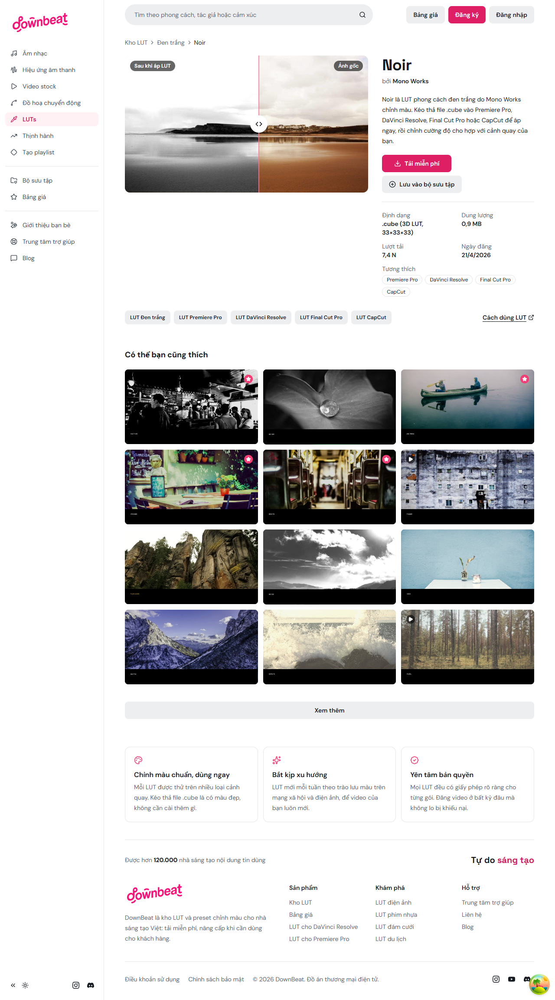

# Chỉ mục tương đồng (hồ sơ sản phẩm 6 khối, sim(i, j), bảng lut_similarity, "Có thể bạn cũng thích" theo nội dung)

> Plan: [plan/chi-muc-tuong-dong.md](../../plan/chi-muc-tuong-dong.md) · API: `GET /api/lut/public/related` (đổi ruột) · Giao diện: khối "Có thể bạn cũng thích" ở `/luts/<slug>` và "LUT tương tự" trong hộp thoại "Đã tải xong" · Phạm vi: chỉ backend

## 1. Mục tiêu

Trước chức năng này, "LUT liên quan" chọn theo luật cứng (cùng phong cách, cùng danh mục, nhiều lượt tải). Chức năng này biểu diễn mỗi LUT đã xuất bản bằng **hồ sơ sản phẩm 6 khối** và tính **độ tương đồng nội dung `sim(i, j)`** giữa hai LUT bất kỳ. Kết quả được lưu ở bảng `lut_similarity` (50 LUT gần nhất của mỗi LUT) và `GET /lut/public/related` trả LUT theo `sim` giảm dần.

Ví dụ ở trang Kodak 400, "Super 8" (phong cách Cổ điển nhưng chung thẻ grain, phim và danh mục Phim nhựa) đứng thứ 2; luật cũ xếp nó thứ 5. Chỉ mục vector trong bộ nhớ (`LutVectorIndex`) là nền cho hai lát sau: hồ sơ người dùng (2.2) và xếp hạng "Dành cho bạn" (2.3).

Chưa làm (để lát sau): hồ sơ người dùng và phần cá nhân hoá `score(u, j)`, MMR, `for-you`, trang quản trị gợi ý (`/recommend/config`, `/recommend/rebuild`), các khoá `recommend.*` còn lại của Phụ lục B.

## 2. Luồng hoạt động

**Dựng chỉ mục khi backend khởi động.** Sau Flyway, `LutColorFeatureBootstrap` (`@Order(0)`) tính đặc trưng màu cho LUT còn thiếu, rồi `LutIndexListener` (`@Order(100)`) gọi `LutIndexService.rebuild("khởi động")`: đọc LUT `PUBLISHED` kèm thẻ, danh mục, đặc trưng màu → dựng `LutVectorIndex` mới → tính top 50 mỗi LUT → thay cả bảng `lut_similarity` trong một giao dịch → gán chỉ mục mới vào tham chiếu dùng chung. Với 36 LUT mẫu, log ghi `Chỉ mục gợi ý: 36 LUT, 1260 dòng lut_similarity, 385 ms`.

**Khách xem "Có thể bạn cũng thích".** Trang `/luts/noir` gọi `related?slug=noir`. Backend đọc các dòng `lut_similarity` của Noir, nối với `lut` còn `PUBLISHED`, xếp `score` giảm dần, rồi `downloadCount` giảm dần, rồi `id` tăng dần. Noir trả "Chì Than" (0,8574), "Bạc Xám" (0,7975), sau đó là các LUT điểm thấp hơn nhiều (≤ 0,12). Hộp thoại "LUT tương tự" sau khi tải Noir hiện 4 LUT đầu của danh sách này.

**Quản trị thay đổi kho.** Các thao tác dưới đây phát `LutCatalogChangedEvent`; sau khi giao dịch commit, chỉ mục được dựng lại **ngay trong request đó** nên khi API trả 200, `related` đã phản ánh thay đổi.

| API quản trị | Phát sự kiện khi | Không phát khi |
|---|---|---|
| `POST /lut/publish/{id}` | Trạng thái thật sự đổi sang `PUBLISHED` | LUT đã xuất bản từ trước, hoặc lỗi điều kiện |
| `POST /lut/hide/{id}` | `PUBLISHED` → `HIDDEN` | LUT đã ẩn, hoặc LUT nháp |
| `POST /lut/update` | Sửa LUT đang `PUBLISHED` | Tạo mới, sửa LUT nháp / ẩn |
| `POST /lut/upload` (`kind = CUBE`) | LUT đang `PUBLISHED` | Ảnh / video, LUT nháp / ẩn |
| `POST /lut/feature/recompute` | Có ít nhất 1 LUT tính lại thành công (một sự kiện cho cả lô) | Không LUT nào tính được |
| `POST /lut/delete/{id}` | Không phát (khoá ngoại CASCADE dọn `lut_similarity`) | |

Ngoài ra chỉ mục được dựng lại lúc 03:00 hằng ngày (phòng khi ai đó sửa thẳng DB).

**Ngoại lệ.**

- LUT đang xem chưa có dòng nào trong `lut_similarity` (chỉ mục chưa dựng xong hoặc lần dựng gần nhất lỗi): `related` dùng luật cũ (cùng phong cách, cùng danh mục, phổ biến), item không có field `similarity`.
- Dựng lỗi (mất kết nối DB…): log ERROR, giữ nguyên chỉ mục và bảng cũ; thao tác của quản trị vẫn thành công vì giao dịch của nó đã commit.
- LUT thiếu đặc trưng màu: khối màu lấy z = 0 (bằng trung bình kho), log cảnh báo số LUT thiếu.
- LUT vừa bị ẩn nhưng chưa dựng lại xong: bị loại lúc đọc nhờ điều kiện `lut.status = 'PUBLISHED'`.
- `slug` không có / nháp / đã ẩn: 404 `DATA_NOT_FOUND` "Không tìm thấy LUT"; thiếu `slug`: 400.

## 3. Hồ sơ sản phẩm và công thức

Mỗi LUT có sáu khối vector. Với N là số LUT đã xuất bản, `idf(df) = ln((N + 1) / (df + 1)) + 1` dùng chung cho thẻ, danh mục và văn bản.

| Khối | Trọng số | Cách biểu diễn | Độ đo |
|---|---|---|---|
| Thẻ | 0,30 | Chuẩn hoá (NFC, chữ thường, gộp khoảng trắng, gộp đồng nghĩa như "b&w" → "đen trắng"), tf nhị phân × idf, chuẩn L2 | cosine |
| Màu | 0,25 | 10 đặc trưng (độ sáng, tương phản, bão hoà, độ ấm, sắc lệch, màu vùng tối / sáng, đơn sắc), z-score trên toàn kho, cắt về [-3, 3] | RBF `exp(-‖z_i − z_j‖² / 20)` |
| Danh mục | 0,15 | Multi-hot × idf, chuẩn L2; **bỏ nhóm `phan-mem`** (Premiere, DaVinci…) vì LUT nào cũng có | cosine |
| Phong cách | 0,15 | One-hot theo `lut.style` | cosine |
| Văn bản | 0,10 | Tiêu đề + mô tả tách riêng, bỏ từ dừng, âm tiết đơn + cặp âm tiết liền nhau (không ghép qua từ dừng; cặp chỉ giữ khi có ở ≥ 2 LUT), `(1 + ln(số lần)) × idf`, chuẩn L2 | cosine |
| Tác giả | 0,05 | One-hot `creatorId` | cosine |

`sim(i, j) = Σ w_b · sim_b(i, j)`, kẹp về [0, 1]; trọng số tự chia cho tổng. Vector rỗng có cosine 0 với mọi vector (không chia lại trọng số cho khối rỗng). Mỗi cặp chỉ tính một lần, dùng cho cả (i, j) và (j, i); thứ tự hoà điểm theo `downloadCount` giảm dần rồi `id` tăng dần.

Cấu hình nằm ở khối `recommend.*` của `application.yml`: `weights`, `similarity-top` (50), `build-on-startup`, `rebuild-cron`, `tag-synonyms` (danh sách các nhóm, phần tử đầu là dạng chuẩn), `text-stopwords`. Trọng số âm hoặc tổng bằng 0 thì ứng dụng không khởi động (`recommend.weights không hợp lệ`).

## 4. Cơ sở dữ liệu

Migration `V10__chi_muc_tuong_dong.sql`, một bảng, không seed, không thêm resource phân quyền.

**`lut_similarity`**

| Cột | Kiểu | Ghi chú |
|---|---|---|
| `id` | int PK AUTO_INCREMENT | Thêm so với thiết kế vì `AbsMysqlRepository` yêu cầu cột `id` |
| `lut_id` | int NOT NULL | FK → `lut(id)` ON DELETE CASCADE |
| `similar_lut_id` | int NOT NULL | FK → `lut(id)` ON DELETE CASCADE |
| `score` | double NOT NULL | `sim` trong [0, 1], lưu nguyên giá trị (không làm tròn) |

Ràng buộc `uk_lut_similarity_pair (lut_id, similar_lut_id)`, index `idx_lut_similarity_score (lut_id, score)`. Không có dòng `(i, i)`; với 36 LUT mẫu, mỗi LUT có 35 dòng, cả bảng 1260 dòng. Mỗi lần dựng là `DELETE` rồi `INSERT` lô 1000 dòng trong một giao dịch mới (`REQUIRES_NEW`); không dùng `TRUNCATE` vì lệnh này tự commit và khách sẽ thấy bảng rỗng giữa chừng.

## 5. Backend

Package mới `vn.aeoc.business.recommend` (chỉ phụ thuộc một chiều vào `business.lut`):

- `config/RecommendProperties`: đọc cấu hình, `normalizedWeights()`.
- `index/TagNormalizer`, `TextTokenizer`, `LutVectorIndex`: lớp thuần Java, bất biến, không phụ thuộc Spring.
- `service/SimilarityService`: `blockSims`, `sim`, `topSimilar`.
- `service/LutIndexService`: giữ `AtomicReference<LutVectorIndex>`, `rebuild(reason)` chạy tuần tự bằng `ReentrantLock`, bắt mọi exception.
- `service/LutIndexListener`: `@TransactionalEventListener(AFTER_COMMIT, fallbackExecution = true)`, sự kiện khởi động, `@Scheduled` 03:00 (múi giờ Asia/Ho_Chi_Minh).
- `repository/LutSimilarityRepository.replaceAll`.

Phía `lut`: `LutCatalogChangedEvent(lutId, reason)`; `LutAdminService` và `LutColorFeatureService` phát sự kiện; `LutRepository` thêm `listPublishedForIndex`, `similarPublished`, `countSimilarPublished`; `LutService.related` đổi ruột, làm tròn `similarity` 4 chữ số khi trả ra; POJO `Lut` thêm field `similarity`.

### API `GET /api/lut/public/related` (công khai)

Query: `slug` (bắt buộc), `page` (mặc định 1), `limit` (mặc định 12, tối đa 48). Chỉ trả LUT `PUBLISHED`, không bao giờ có chính LUT đang xem, không lộ `fileKey` / `status`. `total` bằng số dòng `lut_similarity` của LUT đó mà LUT đích còn xuất bản (kho 36 LUT: 35). Mỗi item có thêm `similarity`; ở nhánh dự phòng thì không có field này. Frontend không đổi vì chỉ bỏ qua field mới.

| Tình huống | HTTP | errorCode | Message |
|---|---|---|---|
| `slug` không có, LUT nháp hoặc đã ẩn | 404 | `DATA_NOT_FOUND` | Không tìm thấy LUT |
| Thiếu `slug` | 400 | lỗi tham số của Spring | |

## 6. Giao diện

Không sửa giao diện. Hai nơi dùng `related` vẫn như cũ: khối "Có thể bạn cũng thích" ở `/luts/<slug>` (lưới `LUT liên quan`, 12 thẻ mỗi lần tải) và "LUT tương tự" trong hộp thoại "Đã tải xong" (4 mục). Chỉ có thứ tự thay đổi.

### Hình ảnh

Trang `/luts/noir`: hai thẻ đầu của "Có thể bạn cũng thích" là "Chì Than" và "Bạc Xám", không có chính Noir.

Hộp thoại "Đã tải xong" sau khi tải Noir: "LUT tương tự" gồm 4 LUT, đầu danh sách là Chì Than và Bạc Xám.

LUT sinh đôi vừa xuất bản đã đứng đầu "Có thể bạn cũng thích" của LUT giống nó ngay sau khi quản trị bấm xuất bản.

## 7. Kiểm thử

Kết quả thực tế trên 36 LUT mẫu: noir → chi-than 0,8574, bac-xam 0,7975, anh-trang 0,1189; kodak-400 → fuji-classic 0,7376, super-8 0,5932.

### JUnit (backend)

Tổng 78 test của module `business` đều xanh (0 lỗi, 0 bỏ qua). Phần của lát này nằm ở `recommend/**` (`TagNormalizerTest`, `TextTokenizerTest`, `LutVectorIndexTest`, `SimilarityServiceTest`, `RecommendPropertiesTest`, `LutIndexServiceTest`) và `lut/service` (`LutAdminServiceTest`, `LutServiceTest`).

| TC | Nội dung | Kết quả |
|---|---|---|
| TC-01 | Chuẩn hoá thẻ và đồng nghĩa | Pass |
| TC-02 | Tách âm tiết, cặp không ghép qua từ dừng / ranh giới trường | Pass |
| TC-03 | Khối thẻ TF-IDF (kho 3 LUT tính tay) | Pass |
| TC-04 | Khối danh mục, bỏ nhóm phần mềm | Pass |
| TC-05 | Khối văn bản | Pass |
| TC-06 | Khối màu: z-score, cắt [-3, 3], LUT thiếu đặc trưng | Pass |
| TC-07 | RBF, cosine rỗng, one-hot | Pass |
| TC-08 | `sim` tổng: sim(A,B) 0,6669; sim(A,C) 0,0833; sim(B,C) 0,0397 | Pass |
| TC-09 | UT-06: sim(i,i) = 1, đối xứng, trong [0, 1] (kho 3 và kho 30 LUT ngẫu nhiên) | Pass |
| TC-10 | Chuẩn hoá trọng số, trọng số không hợp lệ | Pass |
| TC-11 | Top-K và thứ tự hoà điểm | Pass |
| TC-12 | Hiệu năng 1000 LUT (< 3 s, 50 000 dòng) | Pass |
| TC-13 | `rebuild` giữ bản cũ khi lỗi | Pass |
| TC-14 | Sự kiện phát từ `lut` đúng 11 tình huống | Pass |
| TC-15 | `LutService.related`: bảng, dự phòng, 404 | Pass |

### Playwright (`frontend/tests/e2e/chi-muc-tuong-dong.spec.ts`)

Tổng **12/12 pass** (9 API + 3 giao diện), 20,3 giây; nhóm "API" chạy riêng cũng 9/9.

| TC | Nội dung | Kết quả |
|---|---|---|
| TC-16 | Giá trị tham chiếu trên 36 LUT mẫu (4 LUT) | Pass |
| TC-17 | Mọi LUT có danh sách đúng dạng (`total`, `similarity` giảm dần, không lộ khoá nội bộ) | Pass |
| TC-18 | LUT nháp / ẩn không bao giờ xuất hiện | Pass |
| TC-19 | Phân trang | Pass |
| TC-20 | Lỗi 404 / 400 | Pass |
| TC-21 | LUT mới xuất bản có mặt ngay (similarity = 1,0) | Pass |
| TC-22 | Ẩn rồi xuất bản lại | Pass |
| TC-23 | Sửa LUT đang xuất bản thì tính lại (0,4000) | Pass |
| TC-24 | Đổi file .cube thì tính lại (< 0,35) | Pass |
| TC-25 | UI: "Có thể bạn cũng thích" ở `/luts/noir` | Pass |
| TC-26 | UI: "LUT tương tự" sau khi tải | Pass |
| TC-27 | UI: LUT mới xuất bản hiện ngay | Pass |

Hồi quy: `kho-lut.spec.ts` TC-15 (đã sửa theo thứ tự mới: hai đầu Fuji Classic, Super 8; ba kế là tập Chân Dung Mềm, Lụa Trắng, Pastel Hồng) pass. `pnpm build` thành công, `pnpm lint` 0 lỗi (2 cảnh báo có sẵn).

## 8. Điểm lệch plan và hạn chế

- **Vòng sửa**: backend 0, frontend không có worker.
- **Mẫu §5.1 sai thứ tự `tags`**: Chì Than trả `["đen trắng", "tương phản"]` (repository có sẵn sắp thẻ theo chữ cái), không phải thứ tự trong mẫu. Đã sửa plan và spec; không phải lỗi code.
- **Dựng đồng bộ, không dùng luồng riêng**: ghi chú ở kế hoạch tổng nói "luồng riêng", nhưng `backend/AGENTS.md` cấm xử lý bất đồng bộ nên chỉ mục được dựng trong request, sau commit. Với 36 LUT mất vài chục ms.
- **Dữ liệu mẫu**: 36 LUT dùng chung một câu mô tả dài nên khối văn bản làm `sim` mọi cặp cao thêm khoảng 0,02–0,03; ít đổi thứ hạng.
- **Cần đặc trưng màu**: máy mới chưa nạp MinIO thì khối màu của hai LUT cùng thiếu sẽ bằng 1; chạy `tools/seed/kho-lut/build.py` trước khi demo.
