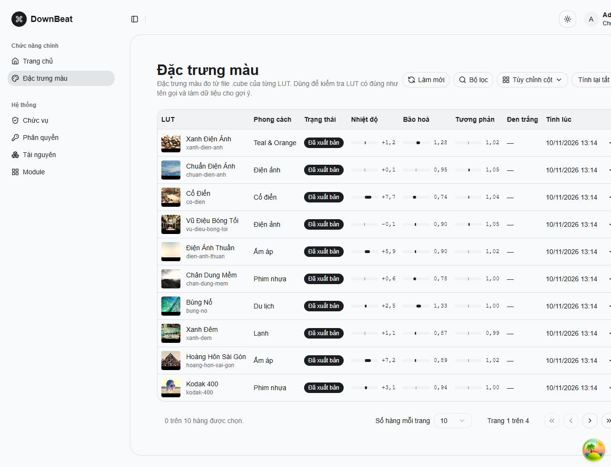
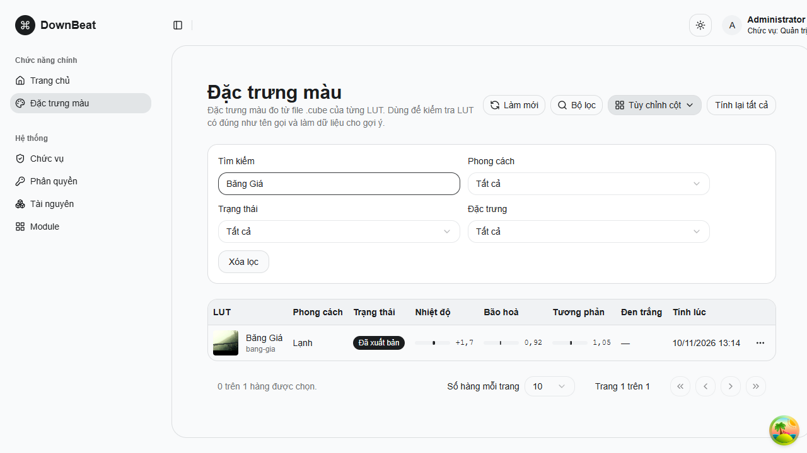
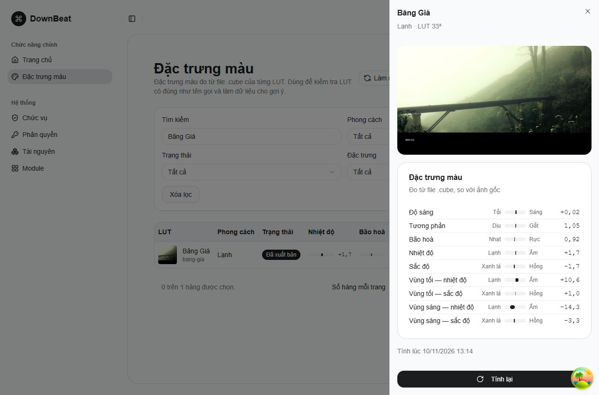
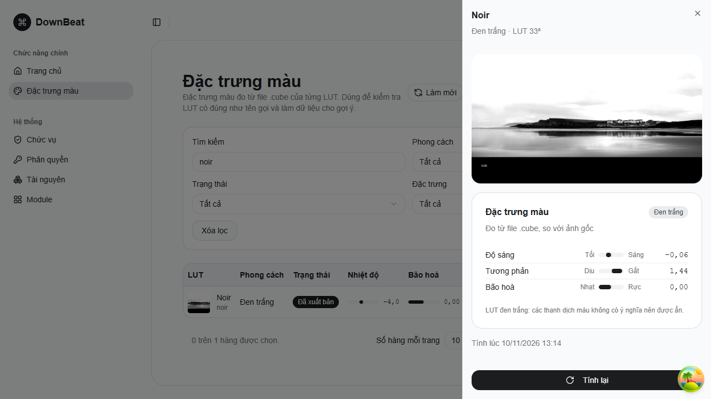
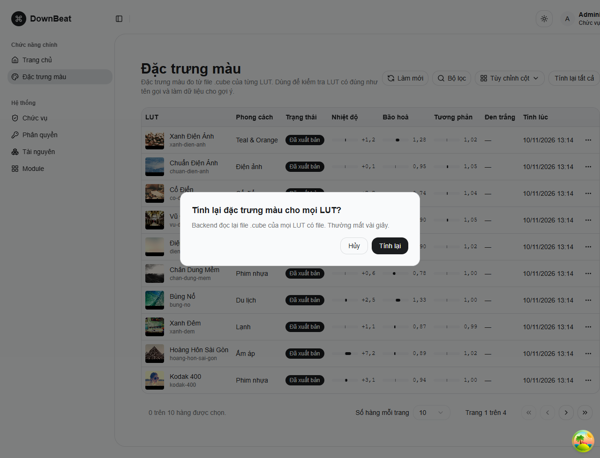
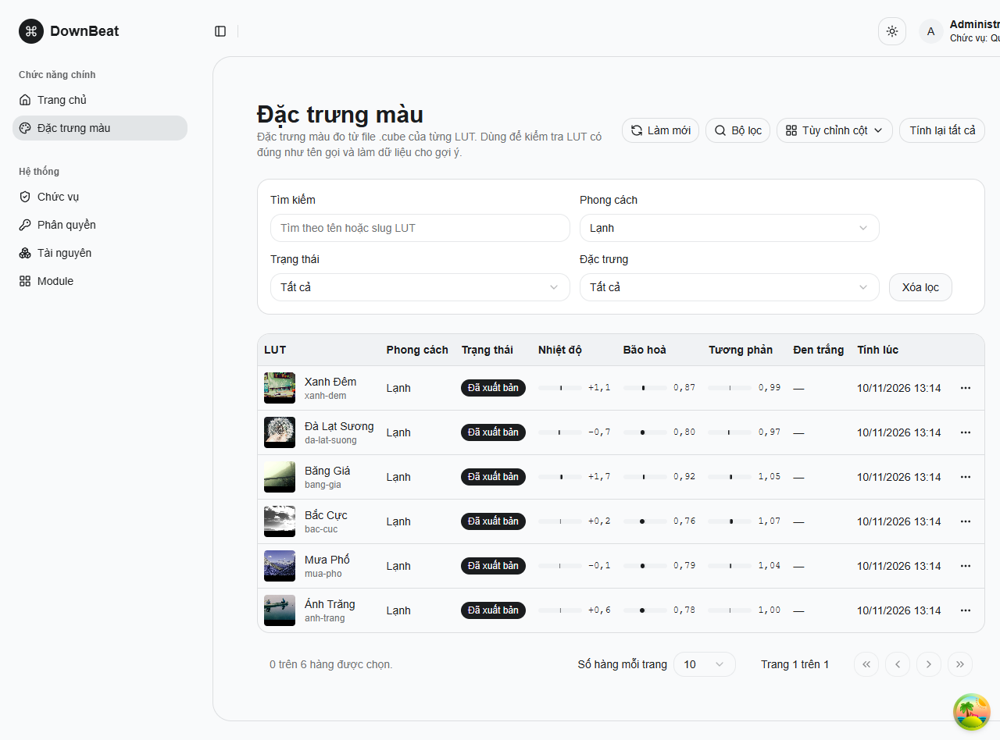
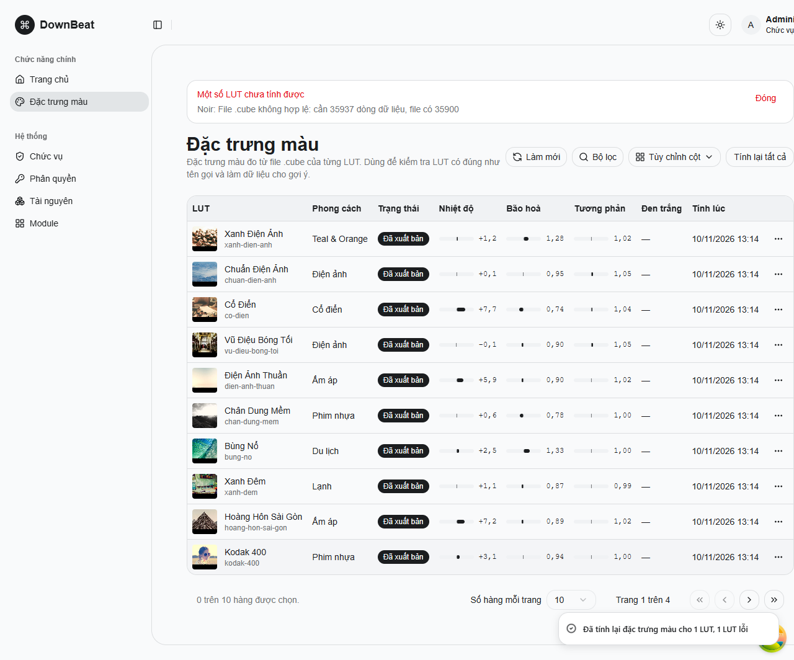

# Đặc trưng màu (đọc file .cube, đo 10 đặc trưng, trang quản trị)

> Plan: [plan/dac-trung-mau.md](../../plan/dac-trung-mau.md) · Route: `/admin/dac-trung-mau` · Phạm vi: backend + frontend

## 1. Mục tiêu

Hệ gợi ý của đồ án cần biết mỗi LUT "trông như thế nào" bằng con số, không dựa vào tên hay nhãn do người đặt. Chức năng này đo các con số đó từ chính file `.cube`:

- Backend **đọc file .cube** (kích thước 17, 33 hoặc 65), từ chối LUT 1D và file lỗi bằng mã `LUT_FILE_INVALID`.
- Backend **đo 10 đặc trưng màu**: độ sáng, tương phản, bão hoà, nhiệt độ (ấm / lạnh), sắc độ, dịch màu vùng tối (2 số), dịch màu vùng sáng (2 số) và cờ đen trắng. Kết quả lưu ở bảng `lut_color_feature`.
- Cả 38 LUT mẫu được tính tự động khi backend khởi động.
- Quản trị mở **`/admin/dac-trung-mau`** để xem đặc trưng từng LUT, so các LUT với nhau và bấm tính lại. Trang này giúp phát hiện LUT đặt tên không khớp thực tế, ví dụ "Băng Giá" thuộc phong cách lạnh nhưng đo ra hơi ấm.

Bộ đọc file, hàm tính và thẻ "Đặc trưng màu" được viết để lát `quan-ly-lut` (upload .cube) dùng lại.

Chưa làm (để chức năng sau): upload .cube và form LUT, chuẩn hoá z-score toàn kho, độ tương đồng giữa các LUT, tác vụ định kỳ dựng chỉ mục, hiện đặc trưng ở cửa hàng, sửa tay giá trị đặc trưng.

## 2. Luồng sử dụng

**Tự tính khi khởi động.** Sau Flyway, backend lấy các LUT có `file_key` mà chưa có dòng đặc trưng, đọc file từ bucket riêng tư `downbeat-lut`, đọc .cube, đo và ghi vào `lut_color_feature`. Log một dòng "Đặc trưng màu: đã tính X LUT, lỗi Y LUT". LUT lỗi (file mất, file hỏng) chỉ ghi cảnh báo, **không chặn** backend khởi động; từ lần khởi động thứ hai gần như không tính lại gì. Tắt được bằng `lut.feature.compute-on-startup=false`.

**Xem.** Quản trị mở mục "Đặc trưng màu" ở sidebar: bảng mọi LUT (cả nháp và đã ẩn) với ba thanh nhỏ "Nhiệt độ", "Bão hoà", "Tương phản". Lọc theo tên / slug, phong cách, trạng thái, tình trạng đã tính. Bấm hàng (hoặc ⋮ → "Xem đặc trưng") mở ngăn bên phải có ảnh bìa và thẻ "Đặc trưng màu" đủ 9 thanh.

**Tính lại.** Trong ngăn chi tiết bấm "Tính lại" (một LUT), hoặc "Tính lại tất cả" ở đầu trang (có hộp xác nhận). Toast cho biết số LUT đã tính. LUT lỗi hiện trong khung cảnh báo "Một số LUT chưa tính được" phía trên bảng, mỗi dòng "{tên}: {lý do}".

Trường hợp đặc biệt:

- LUT chưa có file `.cube`: không tính, kết quả kèm `featureError` "LUT chưa có file .cube".
- Không đọc được object trên MinIO: `featureError` "Không đọc được file .cube".
- File sai định dạng: `featureError` là message của `LUT_FILE_INVALID` (ví dụ "File .cube không hợp lệ: cần 35937 dòng dữ liệu, file có 35900"). Dòng đặc trưng cũ, nếu có, **được giữ nguyên**.
- Danh sách tính lại có id không tồn tại: 404 "Không tìm thấy LUT", chưa tính LUT nào.
- LUT đen trắng (`isMono = 1`): thẻ chỉ hiện "Độ sáng", "Tương phản", "Bão hoà" và badge "Đen trắng", vì các dịch màu của LUT này chỉ phản ánh việc bỏ hết màu nên không có ý nghĩa.

## 3. Cơ sở dữ liệu

Migration `backend/app/src/main/resources/db/migration/V6__dac_trung_mau.sql` (chạy mọi môi trường, chạy lại không đổi gì):

- Bảng `lut_color_feature`, mỗi LUT tối đa một dòng (`lut_id` UNIQUE, khoá ngoại tới `lut`, `ON DELETE CASCADE`).
- Module `Kho LUT` (code `CATALOG`) và resource `LUT` (uri `/lut/`, actions VIEW, ADD, UPDATE, DELETE) nếu chưa có. Resource này dùng chung cho mọi trang quản trị LUT, nên khai báo đủ 4 action ngay từ đầu.

| Cột | Ý nghĩa | Công thức (thiết kế §7.2.4) |
|---|---|---|
| `brightness` | Làm sáng (+) / tối (−) | mean(L_ra − L_vào) / 100 |
| `contrast` | > 1 tăng tương phản | std(L_ra) / std(L_vào), độ lệch chuẩn tổng thể (chia n) |
| `saturation` | > 1 tăng bão hoà, ≈ 0 đen trắng | mean(C_ra) / mean(C_vào), chỉ trên điểm có C_vào > 10 |
| `warmth` | + ấm, − lạnh | mean(b_ra − b_vào) |
| `tint` | + hồng, − xanh lá | mean(a_ra − a_vào) |
| `shadow_a`, `shadow_b` | Dịch màu vùng tối | như `tint`, `warmth` trên điểm có L_vào < 30 |
| `highlight_a`, `highlight_b` | Dịch màu vùng sáng | như trên với L_vào > 70 |
| `is_mono` | LUT đen trắng | 1 nếu mean(C_ra) < 5 trên mọi điểm mẫu |

Cách đo: lấy mẫu lưới 17³ điểm cho mọi kích thước LUT (nên cùng một LUT ở 17, 33, 65 cho cùng kết quả), đổi sRGB sang CIELAB trước và sau khi áp LUT, rồi tính theo bảng trên. Giá trị lưu đầy đủ chữ số, không làm tròn; giao diện tự làm tròn khi hiện.

Khác thiết kế gốc §4.7: thêm cột `id` tự tăng (`AbsMysqlRepository` bắt buộc có cột này) và `lut_id` thành UNIQUE; dùng `DOUBLE` thay `float` để giá trị đọc ra khớp giá trị tính. Ghi bằng `INSERT … ON DUPLICATE KEY UPDATE` theo `lut_id`, cập nhật cả `computed_time`.

## 4. API

Phản hồi thành công bọc `{ code, message, result }`. Lỗi nghiệp vụ trả `{ path, code, errorCode, message }`. Cả hai endpoint thuộc resource `LUT`.

| Method | Đường dẫn | Quyền | Mô tả |
|---|---|---|---|
| GET | `/lut/feature/list` | VIEW | Danh sách mọi LUT (mọi trạng thái) kèm `colorFeature`; lọc `keyword`, `style`, `status`, `hasFeature`; phân trang `page`, `limit` (tối đa 100); thứ tự `id` tăng dần |
| POST | `/lut/feature/recompute` | UPDATE | Body là mảng id LUT, mảng rỗng `[]` = mọi LUT có file; trả mảng kết quả theo `id`, phần tử lỗi có `featureError` |

Quy tắc của `recompute`: kiểm mọi id trước (có id không tồn tại thì 404, chưa tính gì); sau đó từng LUT xử lý độc lập, LUT lỗi không làm hỏng LUT khác và giữ dòng đặc trưng cũ; gọi lại với cùng file cho cùng giá trị (chỉ `computedTime` đổi). Đặc trưng của cả trang `list` lấy bằng một truy vấn `WHERE lut_id IN (…)`.

API công khai của kho (`/lut/public/**`) **không** trả `colorFeature`, khách không thấy đặc trưng.

Lỗi:

| Tình huống | HTTP | errorCode | Message |
|---|---|---|---|
| `recompute` có id không tồn tại | 404 | `DATA_NOT_FOUND` | Không tìm thấy LUT |
| Không token | 401 | — | Chưa đăng nhập |
| Thiếu quyền (`list` / `recompute`) | 403 | `FORBIDDEN` | Bạn không có quyền thực hiện thao tác này! Path: /lut/, Action: VIEW (hoặc UPDATE) |
| File .cube hỏng | — | `LUT_FILE_INVALID` | Nằm trong `featureError`, không phải lỗi HTTP ở lát này |

Message `LUT_FILE_INVALID` (HTTP 400 khi lát `quan-ly-lut` trả ra lúc upload): thiếu `LUT_3D_SIZE`; là LUT 1D; kích thước không nằm trong 17, 33, 65; `DOMAIN_MIN` không nhỏ hơn `DOMAIN_MAX`; dòng `{n}` không phải 3 số thực; số dòng dữ liệu khác N³.

Mã: `vn.aeoc.business.lut.feature` (`CubeParser`, `ColorFeatureExtractor`), `LutColorFeatureService` (`computeAndSave` là `public` cho lát upload dùng lại), `LutColorFeatureBootstrap` (nghe `ApplicationReadyEvent`), `LutFeatureController`, `LutColorFeatureRepository`; `LutRepository` thêm `adminList` / `adminCount` / `getAdminByIds` / `getWithFile`; `FileStorageService.readPrivate`; `ErrorCode.LUT_FILE_INVALID`.

## 5. Giao diện

Route `/admin/dac-trung-mau`, sidebar nhóm "Chức năng chính", mục "Đặc trưng màu" (icon `Palette`, gắn quyền resource `LUT`). Người không có quyền không thấy mục này; mở thẳng URL thấy "Truy cập bị từ chối".

- **Bảng** (`DataTableAdvanced`): cột LUT (ảnh bìa, tên, slug), Phong cách, Trạng thái, ba thanh nhỏ Nhiệt độ / Bão hoà / Tương phản, Đen trắng ("Có" hoặc "—"), Tính lúc (`dd/MM/yyyy HH:mm`, chưa tính thì "Chưa tính" màu cảnh báo). Không có nút thêm, chọn hay xoá.
- **Ngăn chi tiết** (`Sheet`): ảnh bìa 16:9, thẻ "Đặc trưng màu", giờ tính, nút "Tính lại". Sau khi tính lại ngăn hiện số mới ngay.
- **Thẻ "Đặc trưng màu"**: 9 thanh hai phía (tâm là "không đổi"), mỗi thanh là `role="meter"` có `aria-valuetext` bằng số hiện. Số theo định dạng `vi-VN`, làm tròn rồi mới xét dấu.
- **Tính lại tất cả**: hộp xác nhận "Tính lại đặc trưng màu cho mọi LUT?"; toast "Đã tính lại đặc trưng màu cho {N} LUT" (thêm ", {k} LUT lỗi" nếu có); khung "Một số LUT chưa tính được" liệt kê LUT lỗi, có nút "Đóng".
- Lỗi tải danh sách: khung "Không tải được danh sách" kèm "Thử lại".
- Mã: `routes/admin/dac-trung-mau.tsx`, `components/admin/lut-feature/` (cột bảng, ngăn chi tiết), `components/admin/lut/` (`feature-bar.tsx`, `lut-color-feature-card.tsx`, dùng lại được), `lib/lut-feature/feature-rows.ts` (cấu hình 9 hàng, hàm định dạng), `lib/axios/lut-feature.ts`, `lib/tanstack/options/lut-feature.ts`, `lib/types/lut-feature.ts`.

### Hình ảnh

Trang "Đặc trưng màu": bảng mọi LUT với ba thanh nhỏ nhiệt độ, bão hoà, tương phản.

Tìm "Băng Giá" (phong cách lạnh): ô "Nhiệt độ" lại là +1,7, tức đo ra hơi ấm.

Ngăn chi tiết của Băng Giá: ảnh bìa và thẻ "Đặc trưng màu" đủ 9 thanh, vùng sáng ngả lạnh rõ (−14,3).

Noir là LUT đen trắng: badge "Đen trắng", chỉ 3 thanh, kèm dòng giải thích vì sao ẩn các thanh dịch màu.

Hộp xác nhận khi bấm "Tính lại tất cả".

Lọc "Phong cách" = "Lạnh": chỉ còn các LUT phong cách lạnh.

Khung "Một số LUT chưa tính được" khi có LUT lỗi sau lần tính lại.

## 6. Kiểm thử

JUnit (JUnit 5 + AssertJ + Mockito, file .cube dựng trong code) do worker viết; Playwright (`frontend/tests/e2e/dac-trung-mau.spec.ts`) do Claude viết, gồm 9 test API và 8 test giao diện (TC-21 và TC-22 gộp một test vì TC-22 nối tiếp ngăn Noir đang mở), chạy tuần tự vì có bước ghi `computed_time`.

| ID | Mô tả | Loại | Kết quả |
|---|---|---|---|
| TC-01 | Identity ở 3 kích thước (17, 33, 65) cho cùng kết quả | JUnit | Pass |
| TC-02 | LUT đổi mọi màu sang xám → `isMono`, bão hoà ≈ 0 | JUnit | Pass |
| TC-03 | Tăng đỏ, giảm xanh dương → `warmth` > 3 | JUnit | Pass |
| TC-04 | Vùng tối ngả xanh, vùng sáng ngả cam | JUnit | Pass |
| TC-05 | File lỗi → `LUT_FILE_INVALID` đúng từng message | JUnit | Pass |
| TC-06 | Phần đầu (BOM, TITLE, chú thích) và `DOMAIN` | JUnit | Pass |
| TC-07 | `recompute`: kiểm id trước, lỗi từng LUT | JUnit | Pass |
| TC-08 | `recompute([])` = mọi LUT có file | JUnit | Pass |
| TC-09 | Bootstrap chỉ tính LUT còn thiếu, không ném lỗi | JUnit | Pass |
| TC-10 | Migration resource `LUT`, module `CATALOG` | API | Pass |
| TC-11 | Tự tính khi khởi động: 38 LUT đủ 12 khoá | API | Pass |
| TC-12 | 5 LUT tham chiếu khớp bảng (±0,01) | API | Pass |
| TC-13 | Lọc và phân trang | API | Pass |
| TC-14 | Tính lại một LUT (giá trị không đổi, `computedTime` mới) | API | Pass |
| TC-15 | Tính lại tất cả | API | Pass |
| TC-16 | Id không tồn tại → 404, không tính LUT nào | API | Pass |
| TC-17 | Quyền: `noaccess`, khách hàng 403; không token 401 | API | Pass |
| TC-18 | API công khai không lộ đặc trưng | API | Pass |
| TC-19 | Mở trang, tìm "Băng Giá" | E2E | Pass |
| TC-20 | Ngăn chi tiết đủ 9 thanh | E2E | Pass |
| TC-21 | LUT đen trắng (badge, 3 thanh) | E2E | Pass |
| TC-22 | Tính lại một LUT trong ngăn | E2E | Pass |
| TC-23 | Tính lại tất cả (Hủy không gửi yêu cầu; xác nhận thì toast) | E2E | Pass |
| TC-24 | Bộ lọc phong cách, trạng thái, đặc trưng | E2E | Pass |
| TC-25 | Lỗi tính lại hiện khung cảnh báo | E2E | Pass |
| TC-26 | Không có quyền (không có mục sidebar, "Truy cập bị từ chối") | E2E | Pass |
| TC-27 | Backend lỗi khi tải danh sách | E2E | Pass |
| | **Tổng** | | **26/26 pass** (Playwright 17/17: 9 API + 8 giao diện; JUnit 9 test TC-01 → TC-09 trong 4 lớp, `ColorFeatureExtractorTest` 4, `CubeParserTest` 2, `LutColorFeatureServiceTest` 2, `LutColorFeatureBootstrapTest` 1) |

Giá trị đo thực tế khớp bảng tham chiếu (tính độc lập bằng script Python trên chính các file .cube) đến 3 chữ số lẻ. Ví dụ: `noir` có `saturation` 0 và `isMono` 1; `bang-gia` có `warmth` +1,7 nhưng `highlightB` −14,3.

Quá trình: cả backend lẫn frontend sạch từ vòng review đầu, **0 vòng sửa** mỗi bên; Playwright chạy có giao diện 17/17 pass (49,1 giây).

## 7. Điểm lệch plan và hạn chế

- Cả backend lẫn frontend do agy làm (Codex hết quota, người dùng quyết định).
- Frontend thêm prop `onRowClick` vào `DataTableAdvanced` dùng chung (bỏ qua click trên nút / mục menu) để bấm hàng mở ngăn chi tiết.
- Backend đổi `LutRepository.joined()` từ join sang left join, ảnh hưởng nhẹ đến API công khai (LUT không có tác giả vẫn hiện).
- Spec: TC-23 lấy N từ chính response `recompute` thay vì đọc `list` trước; TC-25 chặn `recompute` trả item thật của `hoang-hon-sai-gon` và `noir`; đổi tiêu đề TC-23 sang "không gửi yêu cầu" để lọc `-g API` không bắt nhầm.
- Hạn chế và dữ liệu "lạ" có chủ đích: 4 LUT lạnh mẫu (`bang-gia` +1,7; `xanh-dem` +1,1; `anh-trang` +0,6; `bac-cuc` +0,2) có `warmth` hơi dương vì file mẫu sinh từ bộ lọc CSS cũ chỉ làm lạnh vùng sáng. Đây đúng là điều đặc trưng màu cần phát hiện nên không sửa dữ liệu mẫu; các dịch vùng sáng vẫn tách được LUT lạnh.
- Dịch màu của LUT đen trắng vẫn lưu nguyên, chỉ ẩn ở giao diện; lát độ tương đồng cần nhớ khi chuẩn hoá.
- Trang riêng `/admin/dac-trung-mau` chưa gắn vào `/admin/luts` (lát `quan-ly-lut` chưa làm); sau đó giữ làm công cụ rà soát hay gộp là câu hỏi mở ở plan §11.
