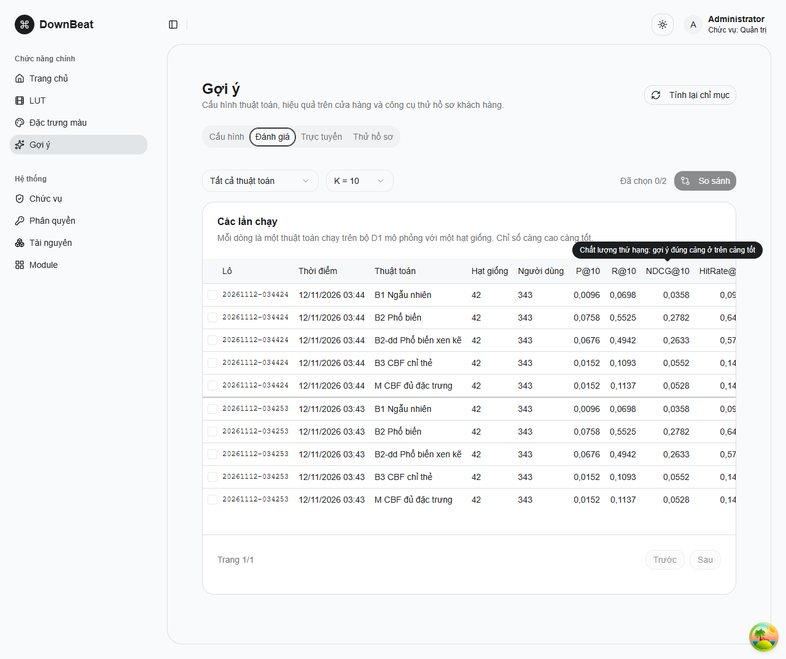
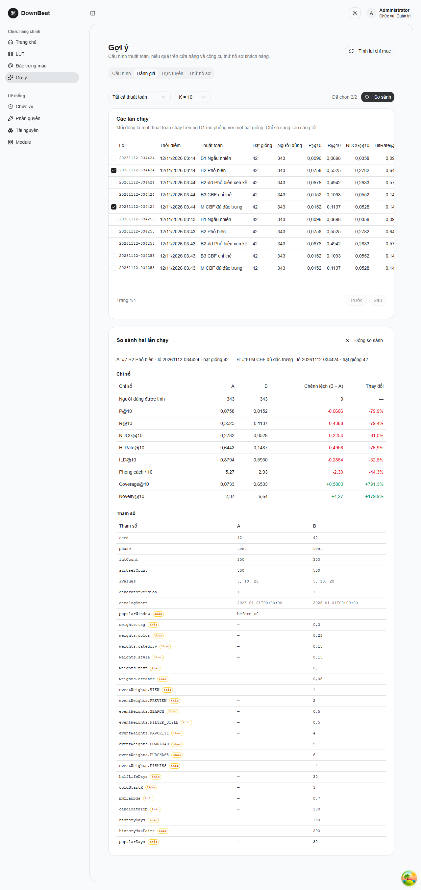
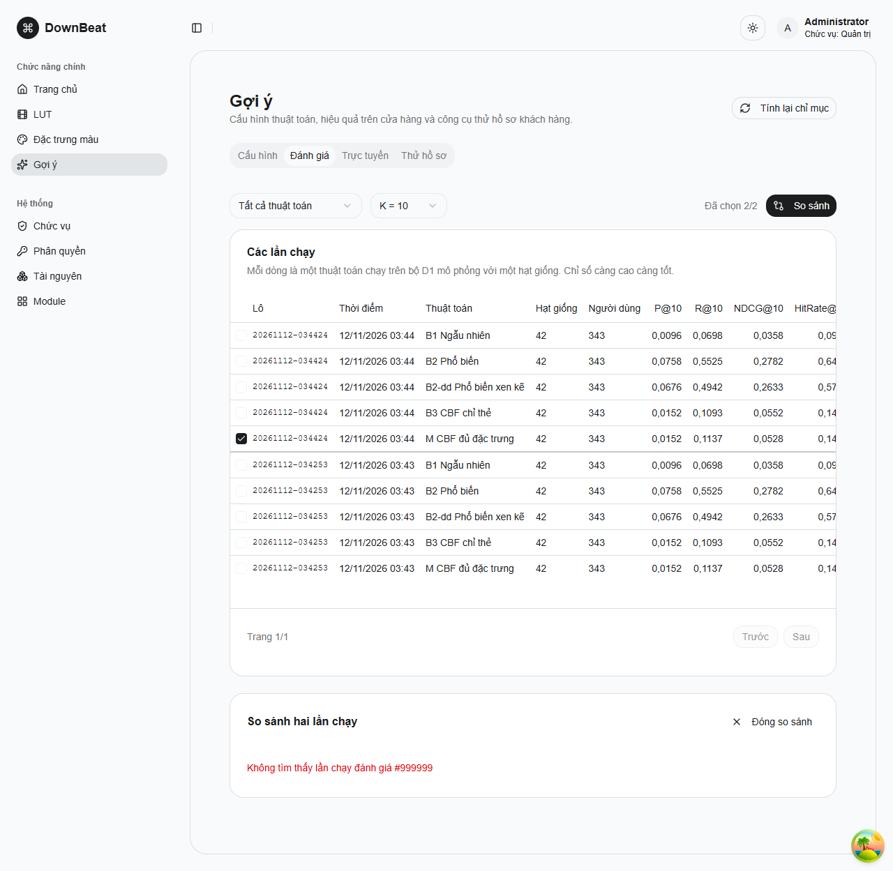
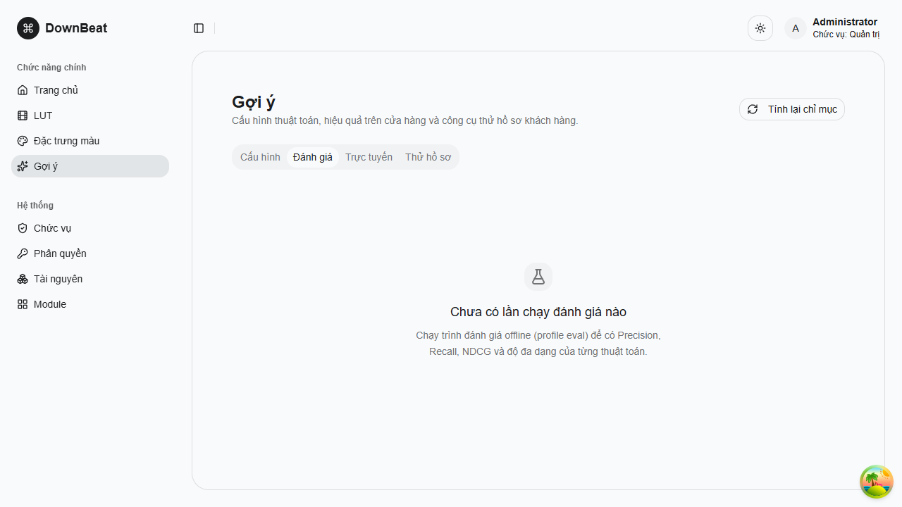
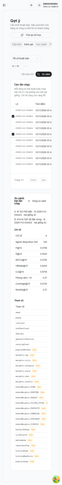

# Đánh giá gợi ý, phần 1 (bộ D1 mô phỏng, chỉ số, 5 thuật toán, bảng `rec_eval_run`, thẻ "Đánh giá")

> Plan: [plan/danh-gia-goi-y.md](../../plan/danh-gia-goi-y.md) · API: `GET /api/recommend/eval/list`, `GET /api/recommend/eval/get` · Dòng lệnh: profile `eval` · Giao diện: `/admin/goi-y?tab=danh-gia` · Phạm vi: backend + frontend

## 1. Mục tiêu

Bốn lát trước đã làm xong thuật toán gợi ý và trang quản trị, nhưng chưa có số đo cho biết thuật toán tốt đến đâu. Lát này (phần 1 trong ba phần của mục 3.1 kế hoạch tổng) dựng **bộ đánh giá offline** theo chương 8 của thiết kế:

- Sinh **bộ dữ liệu D1** trong bộ nhớ: kho 300 LUT từ tham số màu (ghi ra file `.cube` thật rồi đo bằng đúng `CubeParser` và `ColorFeatureExtractor`) và 500 người dùng mô phỏng có "gu ẩn".
- Chia dữ liệu theo thời gian (`TimeSplitter`, chế độ `test` và `valid`), tính 8 chỉ số (Precision, Recall, NDCG, HitRate, ILD, số phong cách, Coverage, Novelty) ở K = 5, 10, 20.
- Chạy **5 thuật toán**: B1 Ngẫu nhiên, B2 Phổ biến, B2-dd Phổ biến xen kẽ, B3 CBF chỉ thẻ, M CBF đủ đặc trưng (trọng số mặc định). B3 và M dùng đúng `ProfileBuilder` và `Recommender` của cửa hàng, không viết lại.
- Ghi mỗi (thuật toán, hạt giống) thành một dòng `rec_eval_run` và hiện ở thẻ **"Đánh giá"** của `/admin/goi-y`: bảng các lần chạy, đổi K, lọc thuật toán, so sánh hai lần chạy.

Chưa làm (để hai lát sau): tinh chỉnh trọng số trên tập kiểm định, 7 biến thể M-\*, chỉ số cold-start (`tinh-chinh-goi-y`); 5 hạt giống, Wilcoxon + Holm, bootstrap, xuất Bảng 8.1 → 8.5 (`kiem-dinh-goi-y`); dữ liệu người dùng thật D2/D3; nút "Chạy đánh giá" trên giao diện; xoá lần chạy; biểu đồ.

## 2. Luồng hoạt động

**Chạy đánh giá (dòng lệnh, lập trình viên).**

```
java -jar backend/app/target/aeoc-backend.jar --spring.profiles.active=local,eval [--eval.seeds=42] [--eval.users=500] [--eval.luts=300]
```

App lên không có web server, không dựng chỉ mục cửa hàng. `EvalCommand` kiểm tham số rồi sinh mã lô `yyyyMMdd-HHmmss` (giờ VN). Với mỗi hạt giống: `CatalogGenerator` sinh kho → `LutVectorIndex.build` → `UserSimulator` sinh hành vi → `TimeSplitter` dựng ca đánh giá của từng người → chạy lần lượt 5 thuật toán → `EvalMetrics` → 5 dòng `RecEvalRun`. Mọi dòng của lô ghi trong một transaction, in bảng Markdown mỗi hạt giống rồi thoát mã 0. Tham số sai thì in "Tham số đánh giá không hợp lệ: {khoá}", không ghi DB, thoát mã 2.

| Khoá `eval.*` | Mặc định | Hợp lệ |
|---|---|---|
| `seeds` | `42` | danh sách ≥ 1 số nguyên |
| `luts` | 300 | 40 → 2000 |
| `users` | 500 | 20 → 5000 |
| `k-values` | `5,10,20` | mỗi số 1 → 50, không trùng |
| `algorithms` | cả 5 thuật toán | tập con, giữ thứ tự chạy |
| `random-repeats` | 20 | 1 → 100 |
| `phase` | `test` | `test` / `valid` |
| `dataset` | `D1-sim` | chỉ `D1-sim` |

**Xem kết quả.** Quản trị mở `/admin/goi-y` → thẻ "Đánh giá" → giao diện gọi `eval/list?page=1&limit=20`. Bảng hiện lô mới nhất trước, trong lô theo thứ tự B1 → M, chỉ số ở K = 10. Đổi "Số gợi ý" sang K = 5 / 20 thì cột đổi ngay, không gọi lại API vì `metrics` đã có đủ ba K.

**So sánh hai lần chạy.** Tích 2 dòng → nút "So sánh" sáng → URL thêm `a=<id>&b=<id>` → giao diện gọi `eval/get` cho từng id và hiện thẻ "So sánh hai lần chạy" gồm bảng chỉ số (A, B, chênh lệch B − A, % thay đổi) và bảng tham số (dòng khác nhau có badge "khác").

**Luồng thay thế.**

- Lọc thuật toán: đổi "Thuật toán" thì `page` về 1, URL có `algo=<mã>`.
- Tải lại trang khi URL có `a`, `b`: card so sánh vẫn hiện và hai dòng vẫn được tích. "Đóng so sánh" xoá `a`, `b` khỏi URL.
- Chưa có lần chạy nào: "Chưa có lần chạy đánh giá nào" kèm hướng dẫn chạy profile `eval`. Có lọc mà rỗng: "Không có lần chạy nào khớp bộ lọc."

**Ngoại lệ.**

- Không token: 401. Khách hàng, `noaccess`: 403 `FORBIDDEN` "Bạn không có quyền thực hiện thao tác này! Path: /recommend/, Action: VIEW".
- `eval/get` id không có hoặc thiếu: 404 `DATA_NOT_FOUND` "Không tìm thấy lần chạy đánh giá". Ở giao diện so sánh, mỗi id lỗi hiện một dòng "Không tìm thấy lần chạy đánh giá #{id}" và không có bảng chỉ số.
- Lỗi mạng / 5xx: "Không tải được dữ liệu" kèm "Thử lại".

## 3. Cách đo

**Bộ D1.** Mỗi người có gu ẩn (nguyên mẫu màu, phong cách, thẻ). Hành vi sinh theo phiên: xem, xem thử, yêu thích, tải, bỏ qua; mỗi người 20–60 sự kiện; mỗi tải hoặc yêu thích đều có xem thử trước đó cùng LUT. Dữ liệu sinh lại y hệt từ `params.seed` và `params.generatorVersion` (NFR-08), nên **không ghi vào DB** và không có schema đánh giá riêng.

**Chia theo thời gian.** Với mỗi người, phần cuối của lịch sử là phần kiểm; các sự kiện trước thời điểm t0 dùng dựng hồ sơ. "LUT liên quan" (rel) lấy từ phần kiểm (tải 3, yêu thích 3, các mức thấp hơn cho hành vi nhẹ), chỉ gồm LUT đã xuất bản trước t0 và chưa có sự kiện dương ở phần dựng. Người có ít hơn 5 sự kiện dựng hoặc tập liên quan rỗng bị loại (vì vậy 343 trong 500 người được tính ở lần chạy mặc định).

**Chỉ số** (trung bình theo người, làm tròn 4 chữ số):

| Chỉ số | Ý nghĩa |
|---|---|
| Precision@K, Recall@K | Tỉ lệ gợi ý đúng trong K đầu; tỉ lệ LUT liên quan được gợi ý |
| NDCG@K | Chất lượng thứ hạng, độ lợi theo mức rel |
| HitRate@K | Tỉ lệ người có ít nhất một gợi ý đúng |
| ILD@K | Độ khác nhau về màu giữa các LUT trong danh sách |
| Phong cách / K | Số phong cách khác nhau trong danh sách |
| Coverage@K | Tỉ lệ LUT của kho từng được gợi ý cho ít nhất một người |
| Novelty@K | Mức ít phổ biến của LUT được gợi ý (n_i đếm người tải trước t0, mẫu số N + 1) |

**Năm thuật toán.**

| Mã | Nhãn | Cách làm |
|---|---|---|
| `random` | B1 Ngẫu nhiên | Chọn ngẫu nhiên, lặp 20 lần lấy trung bình |
| `popular` | B2 Phổ biến | Xếp theo số lượt tải trước t0 (không cửa sổ ngày) |
| `popular-dd` | B2-dd Phổ biến xen kẽ | Đúng `Recommender.rankPopular` của cửa hàng (30 ngày, xen kẽ phong cách) |
| `cbf-tag` | B3 CBF chỉ thẻ | `ProfileBuilder` + `Recommender` với trọng số `{tag: 1, còn lại 0}` |
| `cbf-full` | M CBF đủ đặc trưng | Như trên với `RecommendProperties` đang chạy (6 khối) |

Người mô phỏng coi như gói Pro (không giới hạn Premium) để chỉ số đo thuật toán chứ không đo luật kinh doanh. `RecommendProperties` thật không bị sửa khi chạy B3.

## 4. Cơ sở dữ liệu

Migration `V14__danh_gia_goi_y.sql`: bảng `rec_eval_run`.

| Cột | Kiểu | Ghi chú |
|---|---|---|
| `id` | INT, PK, tự tăng | |
| `batch_code` | VARCHAR(20) | Mã lô `yyyyMMdd-HHmmss`, các dòng ghi trong cùng một lần chạy (thêm so với thiết kế §4.7) |
| `dataset` | VARCHAR(30) | `D1-sim` |
| `algorithm` | VARCHAR(30) | `random`, `popular`, `popular-dd`, `cbf-tag`, `cbf-full` |
| `params` | JSON | Hạt giống, cỡ dữ liệu, trọng số, tham số, `elapsedMs` |
| `metrics` | JSON | Khoá `"5"`, `"10"`, `"20"`, mỗi khoá 8 chỉ số |
| `user_count` | INT | Số người được tính |
| `created_time` | DATETIME | |

Chỉ mục `idx_rec_eval_run_batch (batch_code, id)` và `idx_rec_eval_run_algorithm (algorithm, batch_code)`. Không unique, không có API xoá.

## 5. Backend

- Gói `business.recommend.eval`: `EvalCommand` (chạy ở profile `eval`, `web-application-type: none`), `EvalProperties` (kiểm tham số), `EvalRunner`; các gói con `sim` (`CubeWriter`, `CatalogGenerator`, `UserSimulator`), `split` (`TimeSplitter`), `metric` (`EvalMetrics`), `algo` (5 thuật toán). Cấu hình mặc định ở `application-eval.yml`.
- `RecEvalRunService` + `RecEvalRunRepository` (jOOQ): `list` (chuẩn hoá `page`/`limit`), `get`, `saveBatch` (một lần `insertAll`). `RecommendAdminController` thêm 2 endpoint, mỗi handler gọi `checkPermission(principal, "/recommend/", "VIEW")` ở dòng đầu.
- POJO `RecEvalRun` ở `entity.data.mysql.recommend` tự sắp lại khoá JSON theo thứ tự chuẩn vì cột JSON của MySQL không giữ thứ tự khoá; vì vậy `entity/pom.xml` thêm `jackson-databind`.
- `ProfileBuilder`, `Recommender`, `ScoreCalculator`, `LutVectorIndex`, `CubeParser`, `ColorFeatureExtractor` **không đổi** (đã kiểm diff rỗng).

### API

Thành công: `{ "code": 200, "message": "OK", "result": … }`. Cả hai endpoint đòi token và quyền VIEW `RECOMMEND`.

| Method | Đường dẫn | Chức năng | `result` |
|---|---|---|---|
| GET | `/api/recommend/eval/list?algorithm=&batch=&page=&limit=` | Danh sách lần chạy, lô mới nhất trước, trong lô theo thứ tự chạy; `limit` mặc định 20, tối đa 100 | `{ total, page, items[] }` |
| GET | `/api/recommend/eval/get?id=` | Một lần chạy | Một phần tử như trong `items` |

Mỗi item: `{ id, batchCode, dataset, algorithm, userCount, createdTime, params, metrics }`. `algorithm` và `batch` khớp đúng sau khi trim; giá trị không có thì `total` 0, `items` rỗng, không lỗi.

| Tình huống | HTTP | errorCode | Message |
|---|---|---|---|
| Không token | 401 | (của bộ lọc) | (của bộ lọc) |
| Thiếu VIEW `RECOMMEND` | 403 | `FORBIDDEN` | Bạn không có quyền thực hiện thao tác này! Path: /recommend/, Action: VIEW |
| `get`: id không có hoặc thiếu | 404 | `DATA_NOT_FOUND` | Không tìm thấy lần chạy đánh giá |

## 6. Giao diện

- Thẻ "Đánh giá" của `/admin/goi-y` (đã có từ lát quản trị gợi ý, trước đây chỉ có trạng thái rỗng). Tham số URL `algo`, `k` (5 / 10 / 20, mặc định 10), `page`, `a`, `b`, kiểm bằng Zod `.catch` nên URL sai không làm vỡ trang.
- Thanh công cụ: "Thuật toán", "Số gợi ý", "Đã chọn n/2" và nút "So sánh" (sáng khi chọn đúng 2 dòng).
- Card "Các lần chạy": 14 cột (checkbox, Lô, Thời điểm, Thuật toán, Hạt giống, Người dùng, rồi 8 chỉ số theo K); dòng đầu mỗi lô có viền trên đậm; tooltip giải thích từng chỉ số; phân trang 20 dòng; bảng nằm trong khung cuộn ngang nên trang không tràn ở 390 px. Số theo `vi-VN` (`0,2782`, `5,98`).
- Card "So sánh hai lần chạy": bảng "Chỉ số" (chênh lệch có dấu, xanh khi dương, đỏ khi âm) và bảng "Tham số" làm phẳng khoá (`weights.tag`, `eventWeights.VIEW`), bỏ `elapsedMs`.
- Thành phần mới: `eval-runs-table.tsx`, `eval-compare-card.tsx`; sửa `eval-tab.tsx`, `labels.ts`, kiểu `recommend.ts`, `api.gen.ts`, hàm gọi API và TanStack options.

### Hình ảnh



Thẻ "Đánh giá": bảng "Các lần chạy" của hai lô, chỉ số ở K = 10, dòng đầu mỗi lô có viền đậm.



So sánh B2 Phổ biến với M CBF đủ đặc trưng: bảng chỉ số có chênh lệch và phần trăm thay đổi, bảng tham số đánh dấu "khác" ở các trọng số.



Id không tồn tại: card chỉ hiện "Không tìm thấy lần chạy đánh giá #999999", không có bảng chỉ số.



Trạng thái rỗng "Chưa có lần chạy đánh giá nào" kèm hướng dẫn chạy profile `eval`.



Màn hình 390 × 844: trang không tràn ngang, bảng cuộn ngang trong khung riêng.

## 7. Kết quả đo lô seed 42

Lần chạy mặc định (`--eval.seeds=42`, 300 LUT, 500 người mô phỏng, 343 người được tính, tổng khoảng 37 giây), K = 10. Đây là số đo thật của bộ D1 hiện tại, **chưa phải bảng báo cáo cuối** (chưa tinh chỉnh, chưa gộp 5 hạt giống).

| Thuật toán | P@10 | R@10 | NDCG@10 | HitRate@10 | ILD@10 | Phong cách / 10 | Coverage@10 | Novelty@10 |
|---|---|---|---|---|---|---|---|---|
| B1 Ngẫu nhiên | 0,0096 | 0,0698 | 0,0358 | 0,0945 | 1,2446 | 5,96 | 0,6747 | 6,73 |
| B2 Phổ biến | 0,0758 | 0,5525 | 0,2782 | 0,6443 | 0,8794 | 5,27 | 0,0733 | 2,37 |
| B2-dd Phổ biến xen kẽ | 0,0676 | 0,4942 | 0,2633 | 0,5773 | 1,1854 | 8,00 | 0,1567 | 3,06 |
| B3 CBF chỉ thẻ | 0,0152 | 0,1093 | 0,0552 | 0,1487 | 0,7501 | 3,51 | 0,6233 | 6,70 |
| M CBF đủ đặc trưng | 0,0152 | 0,1137 | 0,0528 | 0,1487 | 0,5930 | 2,93 | 0,6533 | 6,64 |

Nhận xét: CBF (B3, M) hơn hẳn ngẫu nhiên nhưng **thua** các thuật toán phổ biến trên D1; B2-dd cho độ đa dạng phong cách cao nhất (8/8). Hai nguyên nhân dự kiến, ghi cho lát `tinh-chinh-goi-y`: (1) ứng viên của CBF không loại LUT người dùng đã xem / xem thử ở phần dựng, trong khi các LUT đó có rel = 0; (2) trình mô phỏng cho 12 trên 24 LUT mà người dùng thấy lấy từ danh sách phổ biến, nên phổ biến có lợi thế sẵn. Kết quả còn phụ thuộc các số tự đặt của bộ mô phỏng (nguyên mẫu màu, luật thẻ, tỉ lệ phiên); báo cáo cuối phải nêu rõ điều này.

## 8. Kiểm thử

### JUnit (backend)

Module `business`: 128 test, 0 lỗi, 0 bỏ qua. Phần của lát này: `EvalUnitTest` (10 test, TC-01 → TC-10) và `RecEvalRunServiceTest` (3 test, TC-11).

### Dòng lệnh và Playwright

Spec [frontend/tests/e2e/danh-gia-goi-y.spec.ts](../../frontend/tests/e2e/danh-gia-goi-y.spec.ts): **13/13 pass** (6 API + 7 giao diện), lượt đầu không phải sửa. Hồi quy `quan-tri-goi-y.spec.ts` 19/19 (TC-21 cũ được sửa cho khớp trạng thái rỗng mới của thẻ "Đánh giá").

| TC | Loại | Nội dung | Kết quả |
|---|---|---|---|
| TC-01 | unit | `EvalMetrics` theo ví dụ tính tay (K = 3, 5; trung bình; coverage; danh sách ngắn) | Pass |
| TC-02 | unit | `EvalMetrics` biên: L rỗng, 1 phần tử, không có rel, K lớn hơn kho | Pass |
| TC-03 | unit | `TimeSplitter` chế độ `test` và `valid`, loại người thiếu sự kiện / R rỗng | Pass |
| TC-04 | unit | `CubeWriter` → `CubeParser` → `extract` (trung tính, am-ap, lanh, den-trang) | Pass |
| TC-05 | unit | `CatalogGenerator`: tái lập theo seed, phân bố phong cách, thẻ, đặc trưng | Pass |
| TC-06 | unit | `UserSimulator`: tái lập, 20–60 sự kiện, ràng buộc xem thử trước tải, tỉ lệ khai báo | Pass |
| TC-07 | unit | B2 / B2-dd không rò rỉ sau t0 | Pass |
| TC-08 | unit | CBF dùng đúng `ProfileBuilder` + `Recommender`; không đổi `RecommendProperties` | Pass |
| TC-09 | unit | `EvalRunner` nhỏ: thứ tự, khoá `params`, khoảng giá trị, tái lập | Pass |
| TC-10 | unit | `EvalProperties.validate` | Pass |
| TC-11 | unit | `RecEvalRunService`: chuẩn hoá `page`/`limit`, `get` 404, `saveBatch` | Pass |
| TC-12 | cli | Lệnh mặc định (mã 0, ≈ 37 giây, 5 dòng cùng `batch_code`); `eval.algorithms=xyz`, `eval.users=10` (mã 2) | Pass (Claude chạy ở bước review BE) |
| TC-13 | api | Phân quyền `list`, `get`: 403 / 401 | Pass |
| TC-14 | api | `list` lô mới nhất: thứ tự thuật toán, `params` theo thuật toán | Pass |
| TC-15 | api | `metrics` đủ khoá, khoảng hợp lệ, recall / hitRate không giảm theo K, CBF hơn ngẫu nhiên | Pass |
| TC-16 | api | Chạy lại cùng seed ra đúng kết quả (NFR-08) | Pass |
| TC-17 | api | Lọc thuật toán / lô, phân trang, `limit` ≤ 100, trim | Pass |
| TC-18 | api | `get` đúng và 404 | Pass |
| TC-19 | e2e | Bảng các lần chạy, tiêu đề cột, tooltip | Pass |
| TC-20 | e2e | Đổi K không gọi lại API | Pass |
| TC-21 | e2e | Lọc thuật toán | Pass |
| TC-22 | e2e | So sánh hai lần chạy, tải lại, đóng | Pass |
| TC-23 | e2e | So sánh với id không có | Pass |
| TC-24 | e2e | Trạng thái rỗng, rỗng có lọc, lỗi và "Thử lại" | Pass |
| TC-25 | e2e | Điện thoại 390 × 844 | Pass |
| | | **Tổng** | **25/25 TC pass** — JUnit 13 (cả 128 test module `business` xanh), Playwright 13/13 (7 giao diện + 6 API), TC-12 chạy tay |

`pnpm build` và `pnpm lint` xanh (0 lỗi; 2 cảnh báo có sẵn ngoài phạm vi). `pnpm api:types` khớp `lib/types/recommend.ts`.

### Quá trình thực hiện

Mỗi bên 0 vòng sửa. Không lệch plan (ngoài việc thêm `jackson-databind` vào `entity/pom.xml` như mục 5).

## 9. Hạn chế

- Chỉ mục vector dựng một lần cho cả kho mỗi hạt giống, nên IDF và z-score có tính cả LUT xuất bản sau t0. Đó là đặc trưng nội dung chứ không phải hành vi, rò rỉ rất nhỏ; cần ghi vào phần hạn chế của báo cáo.
- Các số của bộ mô phỏng (nguyên mẫu màu, luật thẻ, tỉ lệ phiên, nhiễu cố định theo cặp) do nhóm tự đặt, thiết kế chỉ mô tả định tính.
- Mới một hạt giống, tham số mặc định; chưa có khoảng tin cậy hay kiểm định thống kê.
