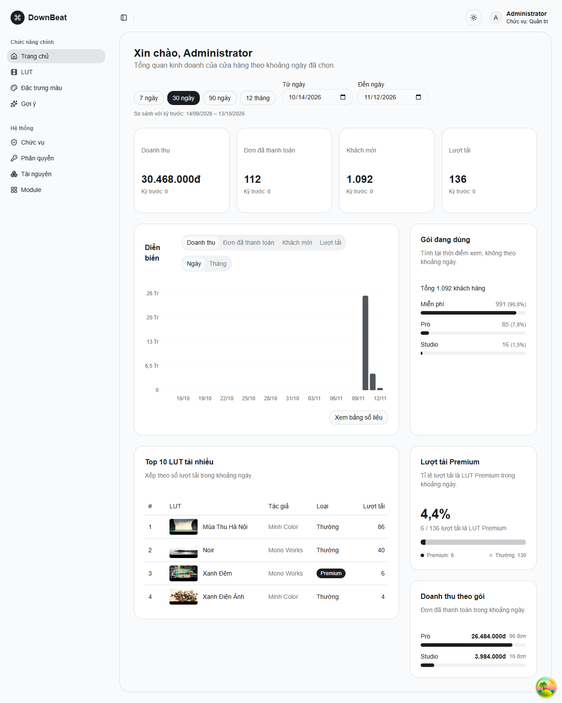
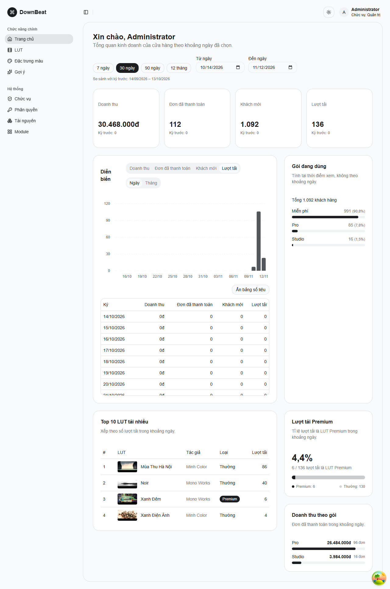
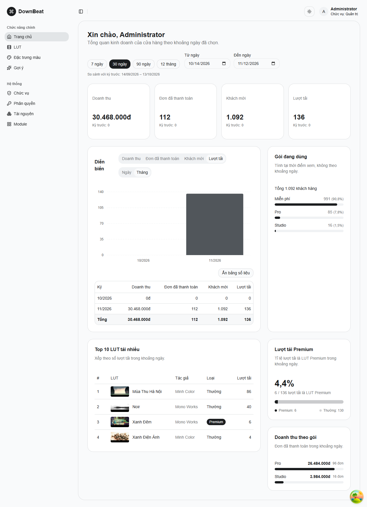
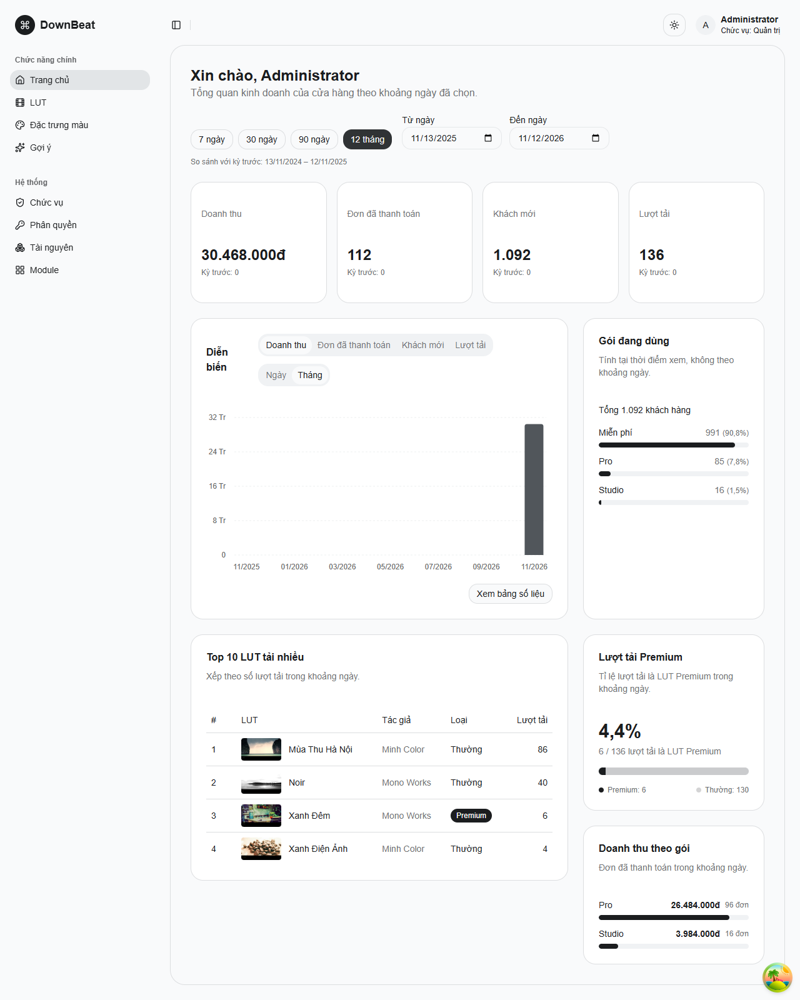
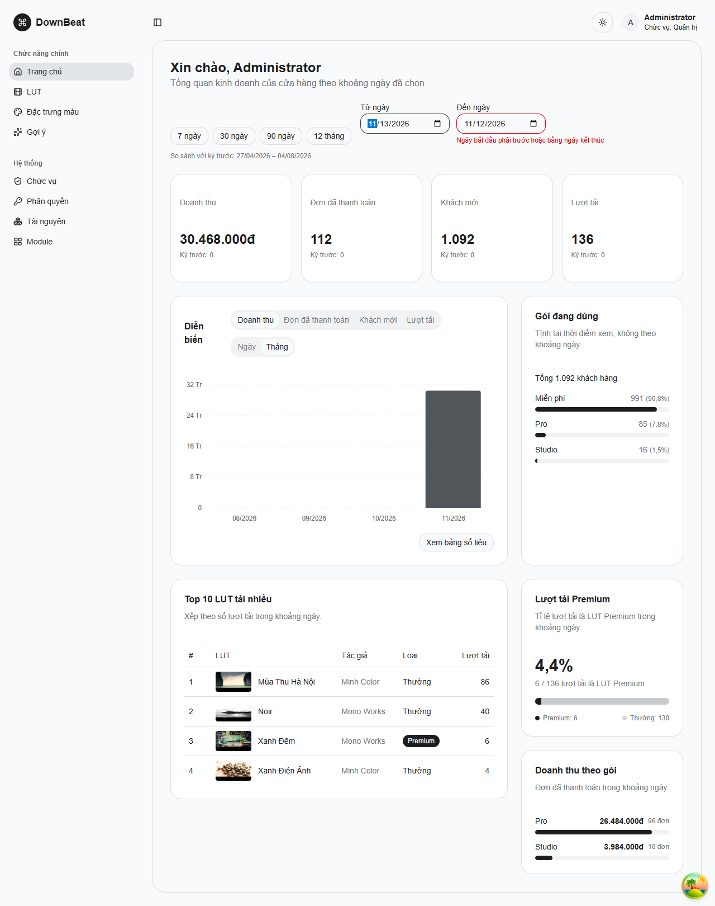
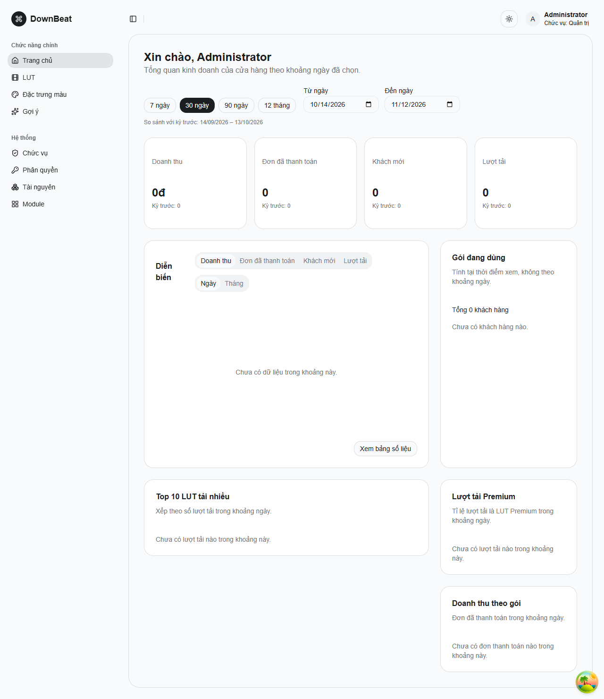
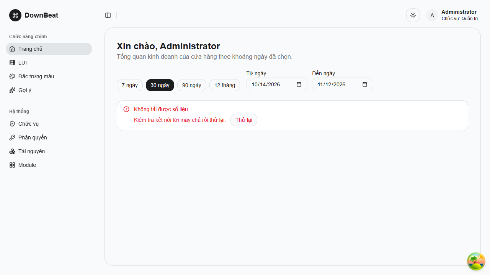
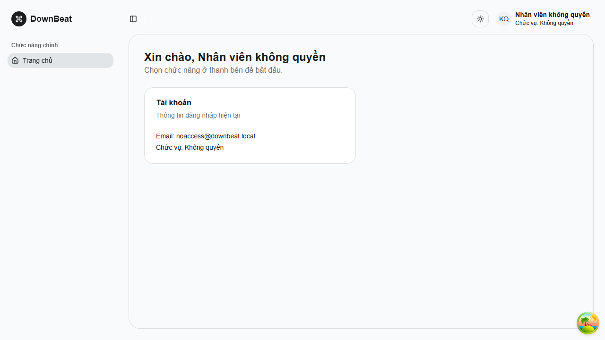
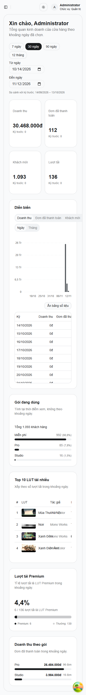

# Bảng số liệu quản trị (trang `/admin`: doanh thu, đơn đã thanh toán, khách mới, lượt tải, gói đang dùng, top 10 LUT, tỉ lệ Premium)

> Plan: [plan/dashboard-admin.md](../../plan/dashboard-admin.md) · API: `GET /api/dashboard/summary` · Giao diện: `/admin` · Phạm vi: backend + frontend

## 1. Mục tiêu

Trước lát này, `/admin` chỉ có trang chào. Người quản trị chưa nhìn được cửa hàng đang bán thế nào. Lát này biến `/admin` thành **bảng số liệu kinh doanh** theo một khoảng ngày (mặc định 30 ngày gần nhất), đáp ứng yêu cầu FR-15 và mục 9.4 của tài liệu thiết kế:

- Bốn ô số **Doanh thu**, **Đơn đã thanh toán**, **Khách mới**, **Lượt tải**, mỗi ô so sánh với kỳ trước có cùng số ngày.
- Card **"Diễn biến"**: biểu đồ cột theo ngày hoặc theo tháng, đổi giữa bốn chỉ số, mở được bảng số liệu.
- Card **"Gói đang dùng"** (khách theo Miễn phí / Pro / Studio), **"Doanh thu theo gói"**, **"Lượt tải Premium"** và **"Top 10 LUT tải nhiều"**.

Người không có quyền `DASHBOARD` (khách hàng, `noaccess`) vẫn thấy trang chào cũ và không gọi API.

Chưa làm: danh sách đơn, khách hàng, sửa giá gói; xuất CSV / Excel; cache số liệu; dữ liệu mẫu cho bảng số liệu.

## 2. Luồng hoạt động

**Xem tổng quan.** Quản trị đăng nhập và vào `/admin`. Giao diện thấy có quyền VIEW `DASHBOARD` nên gọi `summary` với `from` = hôm nay − 29, `to` = hôm nay, `groupBy=DAY`. Backend kiểm quyền, chuẩn hoá khoảng ngày, tính kỳ trước (cùng số ngày, liền trước `from`), chạy các truy vấn gom cho kỳ này và kỳ trước rồi trả một khối JSON. Giao diện hiện bốn ô số, "Diễn biến" và bốn card phụ.

**Đổi khoảng ngày.** Bấm nút nhanh "7 ngày", "30 ngày", "90 ngày" (gom theo ngày) hoặc "12 tháng" (gom theo tháng), hoặc sửa tay "Từ ngày" / "Đến ngày" (gom tự chọn: không quá 92 ngày thì theo ngày, dài hơn theo tháng). Trong lúc chờ, số liệu cũ vẫn hiện nhưng mờ đi.

**Xem diễn biến.** Đổi chỉ số ("Doanh thu", "Đơn đã thanh toán", "Khách mới", "Lượt tải") không gọi API vì dùng `series` đã có. Đổi "Ngày" / "Tháng" thì gọi lại `summary`. "Xem bảng số liệu" mở bảng các kỳ kèm dòng "Tổng".

**Luồng thay thế.**

- Role có VIEW `DASHBOARD` nhưng không có VIEW `LUT`: tên LUT ở bảng top là chữ thường, không phải link.
- Khoảng không có dữ liệu: bốn ô số về 0, mỗi card hiện câu rỗng riêng.
- Kỳ trước bằng 0: dòng so sánh là "Kỳ trước: 0", không tính phần trăm.
- Gọi API không có `groupBy` hoặc giá trị lạ: backend tự chọn theo số ngày, không báo lỗi.

**Ngoại lệ.**

- Không có quyền: API 403; giao diện hiện trang chào cũ, không gọi API.
- Ngày sai định dạng, `from` sau `to`, quá 366 ngày: API 400. Giao diện chặn hai lỗi sau trước khi gọi.
- Lỗi mạng hoặc 5xx: khung "Không tải được số liệu" kèm "Thử lại", bộ lọc ngày vẫn dùng được.

## 3. Cách tính số liệu

| Đại lượng | Cách tính |
|---|---|
| Khoảng ngày | Tính cả hai đầu; hôm nay theo giờ Asia/Ho_Chi_Minh. Kỳ trước: `prevTo = from − 1`, cùng số ngày với kỳ này |
| Doanh thu, đơn đã thanh toán | `SUM(amount)` và `COUNT(*)` của `payment_order` có `status = 'PAID'` và `paid_time` trong khoảng, mọi chu kỳ, kể cả đơn nâng cấp |
| Khách mới | Số khách hàng có `regis_date` trong khoảng. "Khách hàng" là người có role mặc định, không phải operator |
| Lượt tải | Số dòng `download_log` trong khoảng; Premium là dòng có LUT `is_premium = 1` (cờ hiện tại) |
| Tỉ lệ Premium | `premiumDownloads / downloads` làm tròn 4 chữ số; không có lượt tải thì 0 |
| `series` | Theo ngày: mỗi ngày một phần tử. Theo tháng: mỗi tháng có ngày trong khoảng một phần tử, tháng đầu / cuối chỉ cộng các ngày trong khoảng. Kỳ không có dữ liệu vẫn có phần tử toàn 0 |
| Doanh thu theo gói | Mọi gói đang bật trừ `free`, theo `sort_order`, kể cả gói không có đơn; tổng bằng doanh thu của `summary` |
| Gói đang dùng | Tính tại lúc xem, không theo khoảng ngày. Gói trả phí = số khách có `subscription` ACTIVE còn hạn; Miễn phí = tổng khách trừ các gói trả phí (không âm) |
| Top 10 LUT | Gom `download_log` theo `lut_id`, sắp lượt tải giảm dần rồi `id` tăng dần; gồm cả LUT đã ẩn |

Tiền là số nguyên VND, tỉ lệ nằm trong [0, 1] và giao diện đổi sang phần trăm (`24,3%`).

## 4. Cơ sở dữ liệu

Migration `V17__dashboard_admin.sql`: **không tạo bảng, không thêm cột**.

- Thêm module `SALES` ("Kinh doanh") và resource `DASHBOARD` (`/dashboard/`, hành động `VIEW`), viết theo kiểu chạy lại được (`WHERE NOT EXISTS`). Không cấp permission cho role nào vì role operator có mọi quyền.
- Thêm index `idx_payment_order_status_paid (status, paid_time)` cho truy vấn doanh thu theo ngày thanh toán.

Các bảng chỉ được đọc: `payment_order`, `plan`, `subscription`, `user_app`, `role`, `download_log`, `lut`, `creator`.

## 5. Backend

- Module `business.dashboard`: `DashboardController` gọi `checkPermission(principal, "/dashboard/", "VIEW")` ở dòng đầu nên 403 thắng 400; `DashboardService` kiểm ngày và ghép kết quả; `DashboardRepository` (jOOQ) chạy các truy vấn gom.
- `DashboardCalculator` (`calc/`) là lớp thuần, không Spring: gom ngày thành tháng, lấp kỳ trống, cộng tổng, chọn `groupBy`, tính kỳ trước. Nhờ vậy kiểm thử được bằng dữ liệu viết tay.
- POJO mới ở `entity.data.mysql.dashboard`.
- Handler chỉ đọc, không `@Transactional`.

### API

Thành công: `{ "code": 200, "message": "OK", "result": … }`. Đòi token.

| Method | Đường dẫn | Quyền | Chức năng | `result` |
|---|---|---|---|---|
| GET | `/api/dashboard/summary?from=&to=&groupBy=` | VIEW `DASHBOARD` | Số liệu kinh doanh của khoảng ngày (cả ba tham số tuỳ chọn) | `{ from, to, groupBy, summary, previous, series[], revenueByPlan[], activePlans, topLuts[] }` |

| Tình huống | HTTP | errorCode | Message |
|---|---|---|---|
| Không token / token sai | 401 | `LOGIN` / `UNAUTHORIZED` / `TOKEN_EXPIRED` | (message của bộ lọc) |
| Thiếu VIEW `DASHBOARD` | 403 | `FORBIDDEN` | Bạn không có quyền thực hiện thao tác này! Path: /dashboard/, Action: VIEW |
| Ngày sai định dạng (kể cả `2026-02-30`) | 400 | `BAD_REQUEST` | Ngày không hợp lệ |
| `from` sau `to` | 400 | `BAD_REQUEST` | Ngày bắt đầu phải trước hoặc bằng ngày kết thúc |
| Quá 366 ngày | 400 | `BAD_REQUEST` | Khoảng thời gian tối đa 366 ngày |

Thứ tự kiểm: quyền → `to` → `from` → `from ≤ to` → không quá 366 ngày. Ba message 400 trùng với `recommend/stats` để hai trang nói giống nhau.

## 6. Giao diện

- Route `/admin` không bọc `AdminPermissionGuard` vì là trang đầu của mọi người vào quản trị. Có VIEW `DASHBOARD` thì hiện bảng số liệu; đang chờ quyền thì hiện trạng thái tải; không có quyền thì giữ nguyên trang chào ("Xin chào, {tên}", "Chọn chức năng ở thanh bên để bắt đầu.", card "Tài khoản") và không gọi API.
- Bộ lọc ngày: hai ô "Từ ngày", "Đến ngày" và bốn nút nhanh (nút đang chọn có `aria-pressed="true"`). Kiểm ngày ngay trên giao diện, thiếu ngày hoặc sai thì không gọi API.
- Bốn ô số có dòng so sánh "+133,8% so với kỳ trước", "Bằng kỳ trước" hoặc "Kỳ trước: 0".
- "Diễn biến" dùng component `chart` của shadcn (recharts `BarChart`); trục tiền dạng gọn, tooltip đầy đủ.
- "Top 10 LUT tải nhiều": ảnh bìa nhỏ, badge "Premium" / "Đã ẩn", tiêu đề là link tới `/admin/luts/{id}` khi có VIEW `LUT`.
- Điện thoại (từ 360 px): không tràn ngang, bốn ô số xếp 2 cột, hai bảng cuộn ngang trong khung của nó.
- Số liệu mới tải thì số cũ mờ đi (`aria-busy`); thêm thư viện `recharts` vào `package.json`.

### Hình ảnh

Trang `/admin` với bốn ô số, biểu đồ "Diễn biến" theo ngày và các card "Gói đang dùng", "Doanh thu theo gói", "Lượt tải Premium", "Top 10 LUT tải nhiều".

Chỉ số "Lượt tải" và "Bảng số liệu theo kỳ" đã mở, có dòng "Tổng".

Biểu đồ khi đổi sang gom "Tháng".

Nút nhanh "12 tháng": gom theo tháng.

Ngày bắt đầu sau ngày kết thúc: thông báo lỗi dưới ô ngày, không gọi API.

Bảng "Top LUT tải nhiều" với ảnh bìa, tác giả, loại và số lượt tải.

Khoảng không có dữ liệu: mỗi card hiện câu rỗng riêng, bốn ô số về 0.

API lỗi 500: khung "Không tải được số liệu" kèm "Thử lại", bộ lọc ngày vẫn hiện.

Tài khoản không có quyền `DASHBOARD` vẫn thấy trang chào cũ.

Màn hình 390 × 844: bốn ô số xếp hai cột, trang không tràn ngang.

## 7. Kiểm thử

### JUnit (backend)

Phần của lát này: `DashboardCalculatorTest` (4) và `DashboardServiceTest` (2), **6/6 pass**.

| TC | Nội dung | Kết quả |
|---|---|---|
| TC-01 | `series` theo ngày: 5 phần tử, kỳ trống bằng 0, dòng ngoài khoảng bị bỏ | Pass |
| TC-02 | `series` theo tháng: tháng đầu / cuối chỉ cộng ngày trong khoảng; khoảng 13 tháng | Pass |
| TC-03 | `totals`: tổng, tỉ lệ Premium 0,3333; danh sách rỗng; tỉ lệ 0,243 | Pass |
| TC-04 | `resolveGroupBy` (92 → DAY, 93 → MONTH, giá trị lạ → DAY) và `previousRange` | Pass |
| TC-05 | `DashboardService`: khoảng mặc định, ngày sai, `from` > `to`, 367 ngày bị chặn, 366 hợp lệ | Pass |
| TC-06 | `DashboardService` ghép `activePlans` (Miễn phí = tổng − gói trả phí), `revenueByPlan`, `topLuts` | Pass |

### Playwright (`frontend/tests/e2e/dashboard-admin.spec.ts`)

Tổng **16/16 pass** (7 API + 9 giao diện), chạy có giao diện, slowMo 400, 48 giây.

| TC | Nội dung | Kết quả |
|---|---|---|
| TC-07 | Phân quyền: không token 401, khách và `noaccess` 403, 403 thắng 400 | Pass |
| TC-08 | Validate ngày: ba lỗi "Ngày không hợp lệ", `from` > `to`, 367 ngày 400, 366 ngày 200 | Pass |
| TC-09 | Mặc định 30 ngày, `previous` liền trước, tổng `series` bằng `summary` | Pass |
| TC-10 | `groupBy`: tự chọn theo 92 / 93 ngày, không phân biệt hoa thường, giá trị lạ | Pass |
| TC-11 | `previous` của khoảng A bằng đúng `summary` của khoảng B liền trước | Pass |
| TC-12 | Khách mới + đơn Pro `mock-pay` + 3 lượt tải làm số liệu tăng đúng | Pass |
| TC-13 | Role chỉ có VIEW `DASHBOARD`: 200, thu hồi quyền thì lại 403 | Pass |
| TC-14 | Tổng quan mặc định: một request đúng tham số, bốn ô số khớp response | Pass |
| TC-15 | "Diễn biến": đổi chỉ số không gọi API, bảng số liệu có dòng "Tổng", đổi "Tháng" gọi lại | Pass |
| TC-16 | Bộ lọc ngày: bốn nút nhanh, sửa tay, lỗi ngày không gọi API | Pass |
| TC-17 | Card phụ khớp response: gói đang dùng, doanh thu theo gói, Premium, top LUT | Pass |
| TC-18 | Trạng thái rỗng của từng card, "Kỳ trước: 0" | Pass |
| TC-19 | Lỗi 500 → "Không tải được số liệu" → "Thử lại" | Pass |
| TC-20 | `noaccess` và khách mới thấy trang chào cũ, không gọi `dashboard/summary` | Pass |
| TC-21 | Role chỉ VIEW `DASHBOARD`: có bảng số liệu, tên LUT không là link | Pass |
| TC-22 | Điện thoại 390 × 844: không tràn ngang, bảng cuộn ngang trong khung | Pass |

Tổng cả lát: 22 TC (6 JUnit + 16 Playwright), 22/22 pass. `pnpm build` thành công, `pnpm lint` 0 lỗi (2 cảnh báo có sẵn). Hồi quy `auth`, `go-redis-mail`, `phan-quyen`, `quan-ly-lut`, `quan-tri-goi-y`, `dac-trung-mau`: pass; `tai-khoan-khach` đỏ 4 test (TC-20, 22, 23, 24) do trang chủ tải ảnh `picsum.photos` mà máy chạy không có mạng tới, không liên quan lát này (mã chỉ nằm ở `/admin`).

## 8. Điểm lệch plan và hạn chế

- **Vòng sửa**: backend 0, frontend 0.
- **Lệch plan**: không có điểm ảnh hưởng. Frontend để các trường của `DashboardSummaryParams` là tuỳ chọn thay vì bắt buộc; giao diện luôn gửi đủ ba tham số nên không đổi hành vi. Plan được bổ sung `aria-pressed` cho nút nhanh trong lúc viết test.
- **Hạn chế**: không cache số liệu (mỗi lần đổi khoảng là một lượt truy vấn); "Gói đang dùng" chỉ phản ánh thời điểm xem; tỉ lệ Premium theo cờ hiện tại của LUT, nên LUT đổi loại sau khi tải sẽ đổi số liệu quá khứ; chưa xuất CSV.
- **Môi trường**: spec E2E nằm trong `frontend/tests/` bị `.gitignore` bỏ qua nên không có trong commit.
