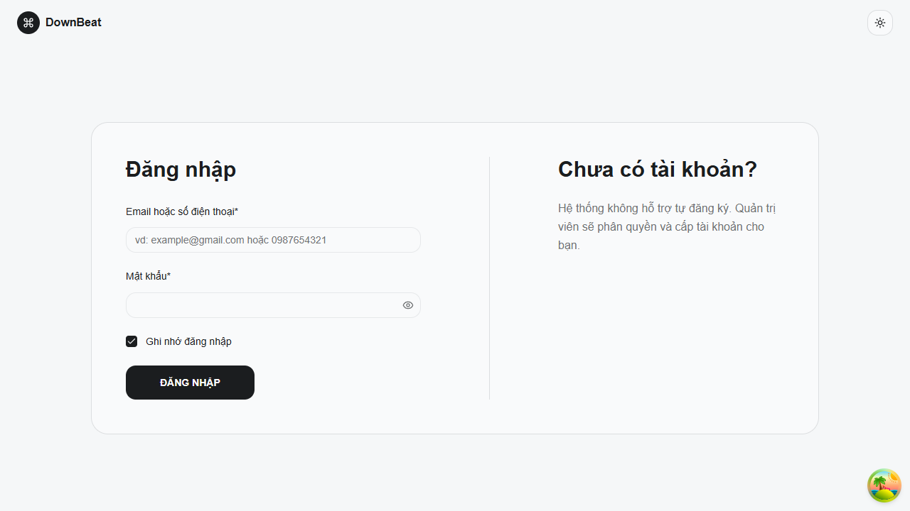
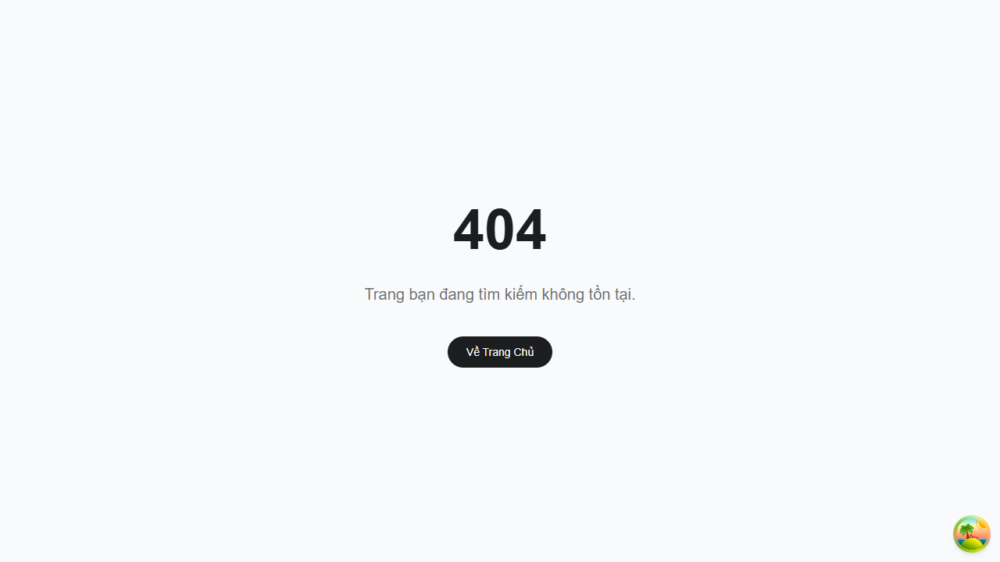
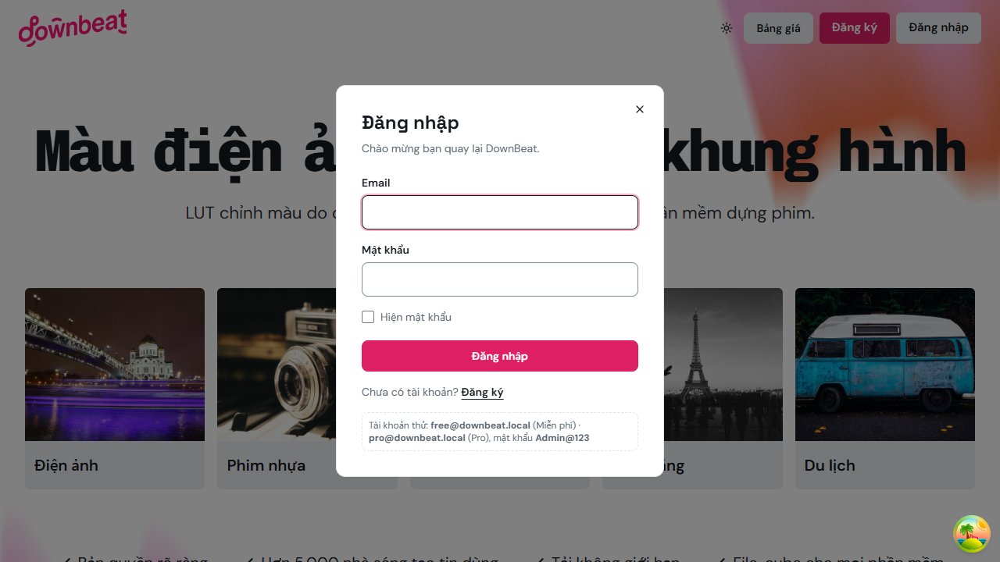

# Gỡ Redis và gửi mail (Mailpit) khỏi DownBeat

> Plan: [plan/go-redis-mail.md](../../plan/go-redis-mail.md) · Phạm vi: hạ tầng + module `authenticate` + bỏ giao diện quên mật khẩu · Không thêm endpoint, không thêm quyền

## 1. Mục tiêu

Trước đây backend cần bốn dịch vụ ngoài: MySQL, MinIO, Redis (lưu refresh token, đếm đăng nhập sai, cache) và Mailpit (nhận email OTP quên mật khẩu). Với một cửa hàng chạy một instance, Redis và Mailpit chỉ làm tăng việc cài đặt. Chức năng này gỡ cả hai để DownBeat chỉ cần **MySQL + MinIO**:

| Trước | Sau |
|---|---|
| Refresh token lưu trong Redis | Bảng MySQL `refresh_token` (chỉ lưu SHA-256 của token) |
| Bộ đếm đăng nhập sai trong Redis | Cache Caffeine trong bộ nhớ, cùng ngưỡng 10 lần / 15 phút |
| Quên mật khẩu bằng OTP qua email | Bỏ hẳn, cả backend lẫn giao diện |
| `ThreeLayerCacheTemplate` (cache 3 tầng, không nơi nào dùng) | Xoá |

Hợp đồng của ba endpoint còn lại (`/user/authenticate`, `/auth/refresh`, `/auth/logout`) giữ nguyên, nên frontend không phải đổi phần đăng nhập, gia hạn, đăng xuất.

## 2. Luồng hoạt động

1. Đăng nhập: backend kiểm bộ đếm sai trong bộ nhớ, so mật khẩu, đúng thì xoá bộ đếm rồi cấp access token (JWT) và refresh token. Refresh token là 32 byte ngẫu nhiên (Base64 URL); bảng chỉ giữ giá trị băm SHA-256.
2. Access token hết hạn: frontend gọi `/auth/refresh`. Backend tìm hash còn hạn, **xoá dòng đó**, rồi cấp cặp token mới. Mỗi refresh token chỉ dùng được một lần.
3. Đăng xuất: xoá dòng của refresh token. Token sai hoặc đã dùng vẫn trả 200 (coi như đã đăng xuất).
4. Đổi mật khẩu: xoá mọi dòng `refresh_token` của người dùng, nghĩa là đăng xuất khỏi mọi thiết bị.
5. Người dùng bị khoá hoặc không còn tồn tại khi refresh: xoá mọi dòng của họ và trả 401.
6. Khởi động lại backend: refresh token vẫn dùng được (nằm trong MySQL), còn bộ đếm đăng nhập sai bị xoá (nằm trong bộ nhớ). Chấp nhận được vì ứng dụng chạy một instance.

## 3. Cơ sở dữ liệu

Migration `V2__refresh_token.sql`:

| Cột | Kiểu | Ghi chú |
|---|---|---|
| `id` | `bigint` AUTO_INCREMENT | Khoá chính |
| `user_id` | `int` NOT NULL | FK → `user_app.id`, `ON DELETE CASCADE` |
| `token_hash` | `char(64)` NOT NULL | SHA-256 dạng hex, unique (`refresh_token_hash_uindex`) |
| `expires_at` | `timestamp` NOT NULL | Thời điểm cấp + 30 ngày, tính theo giờ DB |
| `created_at` | `timestamp` NULL | Mặc định `CURRENT_TIMESTAMP` |

Có thêm index `refresh_token_user_index (user_id)`. Xoá là xoá cứng. Một số quyết định đáng chú ý:

- Hạn được so sánh và ghi bằng giờ của MySQL (`expires_at > CURRENT_TIMESTAMP`) để JVM và MySQL lệch múi giờ cũng không ảnh hưởng.
- Không cần tác vụ định kỳ dọn rác: mỗi lần cấp token mới, hệ thống xoá luôn các dòng đã hết hạn của người dùng đó.
- Chống hai request refresh cùng lúc: tìm dòng theo hash rồi `DELETE ... WHERE id = ?`; chỉ coi là hợp lệ khi `DELETE` xoá đúng 1 dòng. Request đến sau nhận 401.

## 4. API

Không có endpoint mới. Ba endpoint dưới đây đổi nơi lưu nhưng giữ nguyên request và response:

| Method | Đường dẫn | Ai gọi | Ghi chú |
|---|---|---|---|
| POST | `/api/user/authenticate` | Công khai | Trả `token`, `refreshToken`, `userId` |
| POST | `/api/auth/refresh` | Công khai | Xác thực bằng `refreshToken` trong body; token cũ bị thu hồi |
| POST | `/api/auth/logout` | Công khai | Luôn 200, `result` = "Đăng xuất thành công" |

Hai endpoint bị xoá:

| Endpoint | Không token | Có access token |
|---|---|---|
| `POST /api/auth/forgot-password` | 401 "Chưa đăng nhập" | 404 |
| `POST /api/auth/reset-password` | 401 "Chưa đăng nhập" | 404 |

Trước khi làm, đường dẫn không tồn tại bị `GlobalExceptionHandler` biến thành 500. Nay có handler riêng trả 404 "Không tìm thấy API".

Lỗi nghiệp vụ:

| Tình huống | HTTP | Thông báo |
|---|---|---|
| Sai tài khoản hoặc mật khẩu | 400 | Tài khoản hoặc mật khẩu không đúng. |
| Sai đủ 10 lần trong 15 phút rồi đăng nhập tiếp | 429 | Đăng nhập sai quá nhiều lần, vui lòng thử lại sau ít phút |
| Refresh token sai, đã dùng, hết hạn hoặc rỗng | 401 | Phiên đăng nhập đã hết hạn, vui lòng đăng nhập lại |

Về bộ đếm đăng nhập sai: khoá theo email/số điện thoại đã `trim` và đổi chữ thường; cửa sổ 15 phút tính từ **lần sai đầu tiên** (các lần sai sau không kéo dài thêm); đăng nhập đúng thì bộ đếm về 0.

## 5. Thay đổi chính trong mã nguồn

**Backend**
- Thêm `RefreshTokenRepository`, entity `RefreshToken`, viết lại `RefreshTokenService` dùng repository (giữ nguyên chữ ký `issue / consume / revoke / revokeAll`).
- `LoginAttemptService` dùng cache Caffeine `loginAttemptCache` (khai báo trong `AuthCacheConfig`), nhận `Ticker` qua bean để test giả lập thời gian.
- Xoá `OtpService`, `EmailContent`, `forgotPassword / resetPassword / sendEmail` trong `UserService`, hai endpoint ở `AuthController`, `ErrorCode.OTP_*`, các trường `otp*` trong `AuthGuardProperties`.
- Xoá `ThreeLayerCacheTemplate`, `CacheInfraConfig`, `CacheTemplateProperties`, bean `cacheLoaderExecutor`.
- pom: bỏ `spring-boot-starter-data-redis`, `commons-pool2`, `spring-boot-starter-mail`. Cấu hình: bỏ `spring.data.redis`, `spring.mail`, `management.health.mail`, `security.guard.otp-*`, `app.cache.template` ở các file `application*.yml`, bỏ mục `REDIS_*`, `MAIL_*`, `MAILPIT_*` ở `backend/.env.example`. Healthcheck không còn phụ thuộc Redis.

**Frontend**
- Xoá route `/forgot-password` và form tương ứng; bỏ link "Quên mật khẩu?" ở trang `/login`, bỏ nút "Quên mật khẩu?" trong hộp thoại đăng nhập cửa hàng.
- Xoá `forgotPassword`, `resetPassword` cùng các mutation options và kiểu dữ liệu liên quan.

**Hạ tầng và tài liệu**
- Gỡ service `redis`, `mailpit` khỏi `docker-compose.local.yml`; gỡ `redis`, `REDIS_*`, `MAIL_*` khỏi `docker-compose.yml` và `.env.example` gốc.
- Sửa `CLAUDE.md`, `backend/AGENTS.md`, `.claude/skills/cook/SKILL.md`, `README.md` cho khớp.

## 6. Giao diện

Chức năng chỉ **bỏ** các phần tử sau:

- Trang đăng nhập quản trị `/login`: hàng dưới ô mật khẩu chỉ còn "Ghi nhớ đăng nhập".
- Route `/forgot-password`: mở trực tiếp hiện trang 404 ("Trang bạn đang tìm kiếm không tồn tại.").
- Hộp thoại đăng nhập cửa hàng: chỉ còn checkbox "Hiện mật khẩu".

Ảnh nằm ở `docs/chuc-nang/img/go-redis-mail/`.

Hình 1. Trang đăng nhập quản trị không còn link "Quên mật khẩu?".

Hình 2. Mở `/forgot-password` hiện trang 404 có sẵn.

Hình 3. Hộp thoại đăng nhập cửa hàng chỉ còn checkbox "Hiện mật khẩu".

## 7. Kiểm thử

Toàn bộ chạy khi hai container `downBeat-redis` và `downBeat-mailpit` **đã dừng**. JUnit nằm ở module `authenticate`; Playwright ở `frontend/tests/e2e/go-redis-mail.spec.ts` (nhóm "API" gồm 11 test, nhóm giao diện 4 test).

| Mã | Loại | Nội dung | Kết quả |
|---|---|---|---|
| TC-01 | API | Đăng nhập cấp cặp token | Pass |
| TC-02 | API | Refresh xoay vòng token (R2 ≠ R1) | Pass |
| TC-03 | API | Refresh token chỉ dùng được một lần | Pass |
| TC-04 | API | Đăng xuất thu hồi phiên | Pass |
| TC-05 | API | Refresh token rác / rỗng trả 401 | Pass |
| TC-06 | API | Đăng xuất bằng token rác vẫn 200 | Pass |
| TC-07 | API | Đổi mật khẩu thu hồi mọi phiên | Pass |
| TC-08 | API | Khoá sau 10 lần sai (lần 11 trả 429) | Pass |
| TC-09 | API | Khoá không phân biệt hoa thường / khoảng trắng | Pass |
| TC-10 | API | Đăng nhập đúng xoá bộ đếm | Pass |
| TC-11 | API | `/auth/forgot-password` đã xoá (401 / 404) | Pass |
| TC-12 | API | `/auth/reset-password` đã xoá (401 / 404) | Pass |
| TC-13 | API | Healthcheck UP khi Redis đã dừng | Pass |
| TC-14 | Tay | Backend khởi động không cần Redis / Mailpit, log không lỗi | Pass |
| TC-15 | Tay | Refresh token còn dùng được sau khi restart backend | Pass |
| TC-16 | Giao diện | `/login` không còn "Quên mật khẩu?", đăng nhập admin vào `/admin` | Pass |
| TC-17 | Giao diện | `/forgot-password` hiện trang 404 | Pass |
| TC-18 | Giao diện | Hộp thoại đăng nhập cửa hàng không còn "Quên mật khẩu?" | Pass |
| TC-19 | Giao diện | FE tự gia hạn phiên bằng refresh token lưu MySQL | Pass |
| TC-20 | JUnit | `issue` lưu hash, không lưu token gốc | Pass |
| TC-21 | JUnit | `consume` hợp lệ trả userId và xoá dòng | Pass |
| TC-22 | JUnit | `consume` thua cuộc đua (xoá 0 dòng) | Pass |
| TC-23 | JUnit | `consume` token không có / hết hạn | Pass |
| TC-24 | JUnit | `consume(null)` / `consume("  ")` không gọi DB | Pass |
| TC-25 | JUnit | `revokeAll` | Pass |
| TC-26 | JUnit | Khoá sau ngưỡng 10 lần | Pass |
| TC-27 | JUnit | Chuẩn hoá identifier | Pass |
| TC-28 | JUnit | Cửa sổ tính từ lần sai đầu tiên (Ticker giả) | Pass |
| TC-29 | JUnit | `onSuccess` xoá bộ đếm | Pass |
| **Tổng** | | | **29/29 pass** |

Chi tiết số liệu:
- Playwright `go-redis-mail.spec.ts`: 15/15 pass (TC-01→13 và TC-16→19).
- JUnit: 10 test cho TC-20→29 (`RefreshTokenServiceTest` 6, `LoginAttemptServiceTest` 4), `mvn test` xanh.
- Hồi quy: `auth.spec.ts`, `shop-flows.spec.ts`, `shop-ui.spec.ts` 66/66 pass; test "quên mật khẩu: gửi OTP" trong `auth.spec.ts` đã bị xoá cùng chức năng.
- `pnpm build` và `pnpm lint` xanh (lint còn 2 cảnh báo có sẵn từ trước).

## 8. Điểm lệch plan và hạn chế

- Không lệch hợp đồng API. Bản backend đầu của Codex hỏng mã hoá tiếng Việt ở `application.yml`, `UserService`, `AuthGuardProperties`, có javadoc tiếng Anh và chưa dùng bean `Ticker`; đã giao `plan/tasks/go-redis-mail-be-fix1.md` sửa trong 1 vòng. Frontend 0 vòng sửa.
- Codex báo `failed` lần đầu vì `backend-restart.sh` treo trong shell của nó; Claude chạy lại thì bình thường.
- **Mất chức năng quên mật khẩu** (đã chốt với người dùng). Hiện chưa có màn hình quản trị người dùng, nên người quên mật khẩu phải nhờ quản trị đặt lại trực tiếp trong CSDL. Nếu cần, lập plan riêng.
- Bộ đếm đăng nhập sai nằm trong bộ nhớ: khởi động lại backend là mở khoá, và chạy nhiều instance thì mỗi instance đếm riêng. Muốn bền hơn có thể chuyển sang bảng `login_attempt`.
- `docker-compose.yml` (bản deploy) vẫn là bản AEOC cũ (tên project `aeoc`, còn Kafka); chức năng này chỉ gỡ Redis và Mail khỏi file đó.
- Container và volume cũ (`downBeat-redis`, `downBeat-mailpit`, `downbeat_downbeat-redis-data`) đã được xoá sau khi người dùng đồng ý.

## 9. Quy trình thực hiện

Backend giao cho Codex (`plan/tasks/go-redis-mail-be.md`, sửa lần 1 ở `go-redis-mail-be-fix1.md`), frontend giao cho agy (`plan/tasks/go-redis-mail-fe.md`). Claude viết E2E, review, chạy kiểm thử và chỉnh hạ tầng, tài liệu.
