# Gói của tôi (gói đang dùng, lịch sử đơn hàng, huỷ gói)

> Plan: [plan/goi-cua-toi.md](../../plan/goi-cua-toi.md) · Route: `/goi-cua-toi` · Phạm vi: backend + frontend · Không có migration

## 1. Mục tiêu

Sau lát `goi-thanh-toan`, khách đã mua được gói nhưng chưa có chỗ nào để xem lại gói mình đang dùng, các đơn đã tạo hay bỏ gói. Chức năng này bổ sung phần còn thiếu của yêu cầu FR-07: **trang "Gói của tôi"** cho khách đã đăng nhập.

- Xem gói đang dùng: chu kỳ, ngày bắt đầu, ngày hết hạn, số ngày còn lại.
- Gia hạn hoặc nâng cấp ngay tại trang (dùng lại hộp thoại "Mua gói …" có sẵn).
- **Huỷ gói**: tắt tự gia hạn, vẫn dùng đến hết ngày hết hạn.
- Xem **lịch sử đơn hàng** (mọi đơn đã tạo, đơn đang chờ có link "Tiếp tục thanh toán"), phân trang 10 đơn.

**Chưa làm** (để lát sau): trang quản trị đơn, khách hàng, sửa giá gói (`quan-tri-don-hang`); tự trừ tiền định kỳ (payOS là chuyển khoản từng lần); hoàn tiền; huỷ có hiệu lực ngay; nút "Bật lại tự gia hạn" riêng; xuất hoá đơn.

**Ý nghĩa thật của "Huỷ gói".** Hệ thống không tự thu tiền, nên `auto_renew` không chặn khoản thu nào. "Huỷ gói" ở đây có nghĩa: khách nói không muốn tiếp tục, hệ thống ghi nhận (`auto_renew = 0`), hiện "Đã huỷ" và **thôi nhắc gia hạn** (menu, `/pricing`, thẻ trang). Gói vẫn `ACTIVE` đến hết `end_date`, rồi tác vụ 00:10 có sẵn chuyển `EXPIRED` như mọi gói khác. Muốn dùng tiếp thì bấm "Gia hạn gói" (trả thêm một kỳ, cờ bật lại).

## 2. Luồng sử dụng

**Luồng chính — xem gói và lịch sử.**

1. Khách gói Pro mở menu tài khoản, bấm "Gói của tôi" (`/goi-cua-toi`).
2. Trang gọi song song `GET /subscription/my` và `GET /order/my-list?page=1&limit=10`.
3. Khối "Gói hiện tại" hiện "Gói Pro", badge "Đang dùng", "Chu kỳ: Theo năm", "Bắt đầu", "Hết hạn", "Còn lại n ngày" và các nút "Gia hạn gói Pro", "Nâng cấp lên Studio", "Huỷ gói".
4. Khối "Lịch sử đơn hàng" liệt kê đơn mới nhất trước; bấm mã đơn sang `/thanh-toan/ket-qua/<mã>` (trang có sẵn).

**Luồng chính — huỷ gói.**

1. Bấm "Huỷ gói" → hộp thoại "Huỷ gói Pro?" nói rõ vẫn dùng đến hết ngày hết hạn và không hoàn tiền.
2. Bấm "Huỷ gói" trong hộp thoại → `POST /subscription/cancel` đặt `auto_renew = 0`.
3. Toast "Đã huỷ gói Pro. Bạn vẫn dùng được đến 10/11/2027."; thẻ đổi badge "Đã huỷ", nút "Huỷ gói" biến mất, hiện câu "Gói Pro vẫn dùng được đến hết ngày … Sau đó tài khoản trở về gói Miễn phí."
4. Trang đọc lại `account/me` nên menu tài khoản đổi "Hết hạn …" thành "Dùng đến …" kèm "Đã huỷ gia hạn" và thôi nhắc gia hạn.

**Luồng phụ.**

- **Gia hạn từ trang**: mở hộp thoại "Mua gói Pro" với chu kỳ hiện tại. Thanh toán xong, `PaymentActivationService` cộng thêm kỳ **và đặt lại `auto_renew = 1`** (gia hạn sau khi đã huỷ nghĩa là khách đổi ý).
- **Nâng cấp từ trang** (chỉ gói Pro): "Nâng cấp lên Studio" mở hộp thoại "Mua gói Studio"; dòng Studio mới luôn `auto_renew = 1`.
- **Khách gói Miễn phí**: thẻ "Gói Miễn phí" và nút "Xem bảng giá"; lịch sử vẫn hiện.
- **Đơn đang chờ** (`PENDING`): dòng có link "Tiếp tục thanh toán" mở `checkoutUrl` payOS ở cùng tab.
- **Lịch sử > 10 đơn**: "Trang trước" / "Trang sau"; trang lưu ở `?trang=2` nên F5 giữ nguyên.
- **Huỷ lặp lại** (hai tab, hoặc gọi API hai lần): vẫn 200, kết quả giống lần đầu.

**Ngoại lệ.**

- Không token: 401 "Chưa đăng nhập".
- Huỷ khi không có gói trả phí còn hạn (gói Miễn phí, hoặc dòng ACTIVE đã quá `end_date` mà 00:10 chưa chạy): 400 `NO_ACTIVE_PLAN` "Bạn chưa có gói trả phí nào để huỷ".
- Lỗi tải trang (mạng / 500): mỗi khối tự hiện "Không tải được …" kèm "Thử lại", khối kia vẫn hiện bình thường.

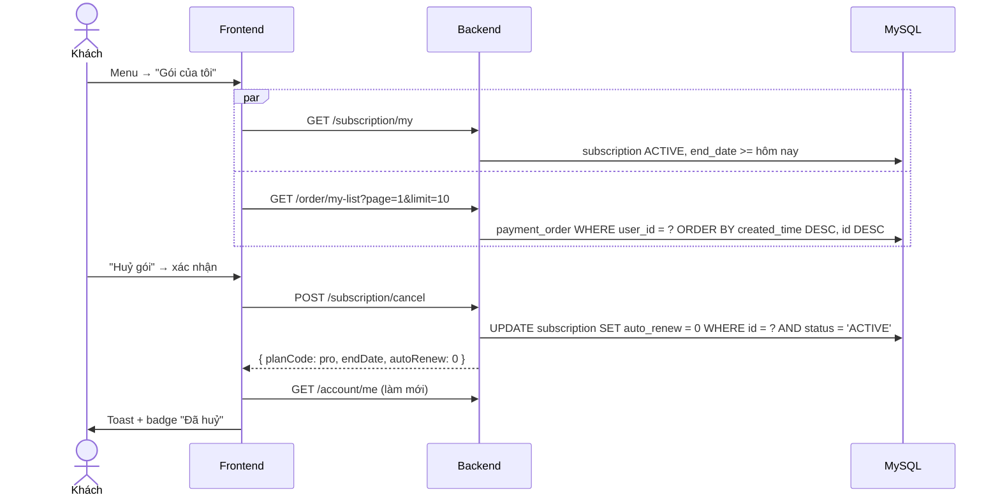

## 3. Cơ sở dữ liệu

**Không có migration** và không có resource quản trị (chỉ API cho khách đã đăng nhập, luôn lấy `userId` từ token). Dùng lại hai bảng của V7:

| Bảng | Cột dùng | Ghi chú |
|---|---|---|
| `subscription` | `auto_renew` | Mặc định 1. `subscription/cancel` đặt 0; gia hạn cùng gói đặt lại 1; dòng mới (mua lần đầu, đổi gói) luôn 1 |
| `payment_order` | mọi cột | Chỉ đọc. Chỉ mục `(user_id, created_time)` có sẵn phục vụ `order/my-list` |

"Gói còn hạn" ở mọi nơi trong chức năng là dòng `status = 'ACTIVE' AND end_date >= hôm nay` (đúng `findActiveByUserId`).

## 4. API

Phản hồi thành công bọc `{ code, message, result }`; lỗi `{ path, code, errorCode, message }`. Khoá rỗng không ra JSON.

| Method | Đường dẫn | Quyền | Mô tả |
|---|---|---|---|
| GET | `/order/my-list?page=1&limit=10` | Đăng nhập | Đơn của chính mình, mọi trạng thái, mới nhất trước |
| GET | `/subscription/my` | Đăng nhập | Gói đang dùng (mới) |
| POST | `/subscription/cancel` | Đăng nhập | Tắt tự gia hạn (mới) |
| GET | `/account/me` | Đăng nhập | Sửa: thêm `planAutoRenew` cho gói trả phí còn hạn |

**`order/my-list`**: `page` mặc định 1 (< 1 thì 1), `limit` mặc định 10, tối đa 50 (> 50 thì 50, < 1 thì 10); không báo lỗi tham số. Kết quả `{ total, page, items }`, sắp xếp `created_time DESC, id DESC`. Mỗi item gồm `code`, `planCode`, `planName`, `cycle`, `amount`, `status`, `createdTime`, và có điều kiện `paidTime`, `sourceLutId` / `sourceLutSlug` / `sourceLutTitle`. `checkoutUrl` **chỉ có khi `PENDING`** để không mở lại link payOS đã chết. Khác `order/get`, API này **không gọi payOS đối soát**: trạng thái là trạng thái đang lưu. Không bao giờ trả `id`, `userId`, `planId`, `payosOrderCode`, `payosPaymentLinkId`, `payosReference`, `webhookPayload`.

**`subscription/my`**: gói trả phí còn hạn trả `{ planCode, planName, cycle, startDate, endDate, autoRenew }`; gói Miễn phí **không trả `null`** mà trả đúng `{ planCode: "free", planName: "Miễn phí" }`. Không có `id`, `userId`, `status`… Số ngày còn lại do frontend tính từ `endDate`.

**`subscription/cancel`** (không có thân request), quy tắc:

1. Tìm dòng còn hạn của khách; không có thì 400 `NO_ACTIVE_PLAN`.
2. `UPDATE subscription SET auto_renew = 0 WHERE id = ? AND status = 'ACTIVE'`. Đã là 0 thì vẫn 200 (huỷ lặp lại không lỗi).
3. **Không** đổi `status`, `start_date`, `end_date`, `cycle`; không đụng `payment_order`; không gọi payOS; không ghi sự kiện gợi ý.
4. Trả như `subscription/my` với `autoRenew = 0`.

**Gia hạn cùng gói** (`PaymentActivationService.activate`): ngoài `end_date`, `cycle`, `order_id`, nay cập nhật thêm `auto_renew = 1`.

Lỗi mới:

| Tình huống | HTTP | errorCode | Message |
|---|---|---|---|
| Ba API trên không token | 401 | — | Chưa đăng nhập |
| `subscription/cancel` khi không có gói trả phí còn hạn | 400 | `NO_ACTIVE_PLAN` (mới) | Bạn chưa có gói trả phí nào để huỷ |

Mã: package `vn.aeoc.business.billing` — `SubscriptionController` (mới), `OrderController.myList`, `OrderService.myList`, `SubscriptionService.my` / `cancel` (`@Transactional`, dùng `Clock` Asia/Ho_Chi_Minh), `SubscriptionRepository.disableAutoRenew`, `PaymentOrderRepository.myList` / `countByUser`; POJO `Subscription` thêm `planCode`, `planName` và ẩn các khoá nội bộ (`WRITE_ONLY`), `User` thêm `planAutoRenew`; `ErrorCode` thêm `NO_ACTIVE_PLAN`; `AccountService.me` trả `planAutoRenew`.

## 5. Giao diện

**Trang `/goi-cua-toi`** (layout `_shop`, tiêu đề tab "Gói của tôi | DownBeat", h1 "Gói của tôi"). Chưa đăng nhập: lời mời "Đăng nhập để xem gói của bạn" với nút "Đăng nhập" (đăng nhập xong ở lại trang) và "Tạo tài khoản".

Khối **"Gói hiện tại"** theo trạng thái:

| Trạng thái | Nội dung | Nút |
|---|---|---|
| Miễn phí | "Gói Miễn phí", câu mời nâng cấp | "Xem bảng giá" |
| Trả phí, đang tự gia hạn | "Gói Pro" + badge "Đang dùng"; Chu kỳ, Bắt đầu, Hết hạn, Còn lại ("Hết hạn hôm nay" khi 0 ngày) | "Gia hạn gói Pro"; gói Pro có thêm "Nâng cấp lên Studio"; "Huỷ gói" |
| Như trên, còn ≤ 3 ngày | Thêm khung nhắc "Gói Pro hết hạn sau n ngày. Gia hạn để không gián đoạn việc tải LUT Premium." | như trên |
| Đã huỷ (`autoRenew = 0`) | Badge "Đã huỷ" và câu "Gói Pro vẫn dùng được đến hết ngày … Sau đó tài khoản trở về gói Miễn phí." | "Gia hạn gói Pro", "Nâng cấp lên Studio"; **không** có "Huỷ gói" |

Hộp thoại "Huỷ gói Pro?" có hai nút "Huỷ gói" (đang gửi: "Đang huỷ…") và "Giữ gói"; lỗi thì toast nguyên văn message backend và hộp thoại giữ nguyên.

Khối **"Lịch sử đơn hàng"**: bảng các cột Mã đơn (link sang trang kết quả), Gói ("Pro · Theo năm", kèm "Từ LUT …" nếu đơn mua từ LUT Premium), Số tiền, Trạng thái (badge "Chờ thanh toán" / "Đã thanh toán" / "Đã huỷ" / "Hết hạn"), Ngày tạo, Ngày thanh toán ("—" nếu chưa), thao tác "Tiếp tục thanh toán" chỉ ở đơn `PENDING`. Rỗng: "Bạn chưa có đơn hàng nào." Phân trang hiện khi `total > 10` ("Trang 1 / 2", `?trang=`). Màn hẹp: bảng cuộn ngang trong khung, trang không cuộn ngang.

**Menu tài khoản**: thêm mục "Gói của tôi" (icon `CreditCard`). Khi `planAutoRenew = 0`, khung gói đổi "Hết hạn …" thành "Dùng đến …", thêm "Đã huỷ gia hạn", ẩn "Còn n ngày" và mục "Gia hạn gói" (kể cả khi còn ≤ 3 ngày). **`/pricing`**: khung nhắc "Gói Pro của bạn hết hạn ngày …" chỉ hiện khi `planAutoRenew !== 0`.

Mã: `routes/_shop/goi-cua-toi.tsx`, `components/shop/subscription/{my-plan-page,current-plan-card,cancel-plan-dialog,order-history-table,my-plan-login-prompt}.tsx`; sửa `header-actions.tsx`, `pricing-page.tsx`, `payment-result-page.tsx` (làm mới `subscription-my` / `order-my-list` khi đơn `PAID`), `shop-session-sync.tsx`; `lib/axios/{account,billing}.ts`, `lib/tanstack/options/billing.ts`, `lib/types/account.ts`, `lib/utils/plan.ts` (`formatOrderDateTime`, `orderStatusLabel`, `cycleLabel`).

### Hình ảnh

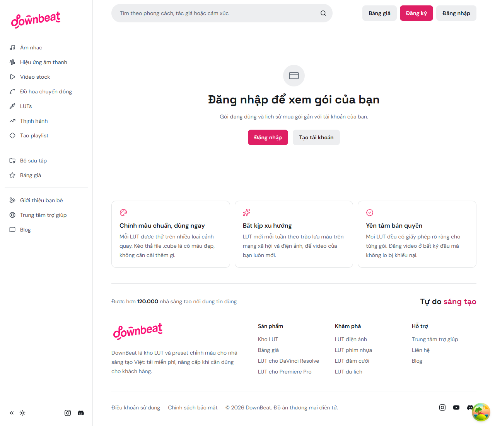

Khách vừa đăng nhập mở `/goi-cua-toi`: hai khối "Gói hiện tại" và "Lịch sử đơn hàng".

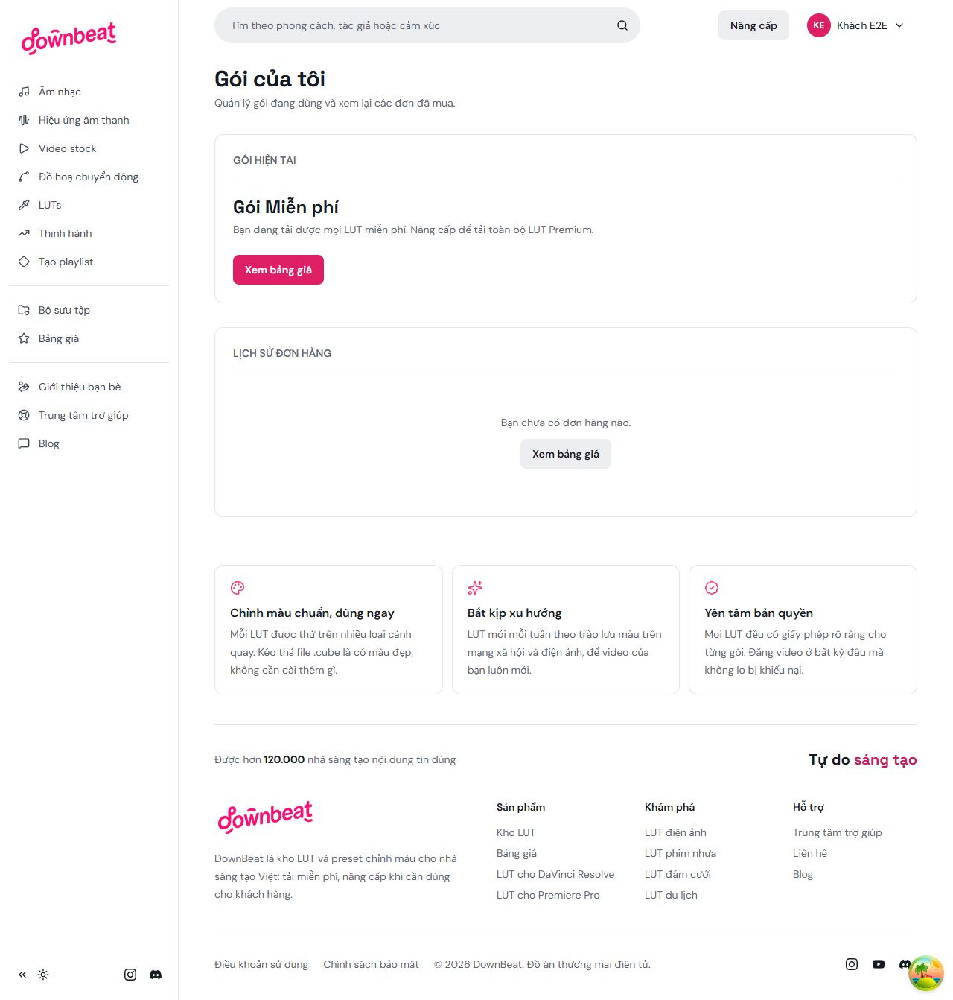

Khách gói Miễn phí: thẻ "Gói Miễn phí", nút "Xem bảng giá", lịch sử trống.

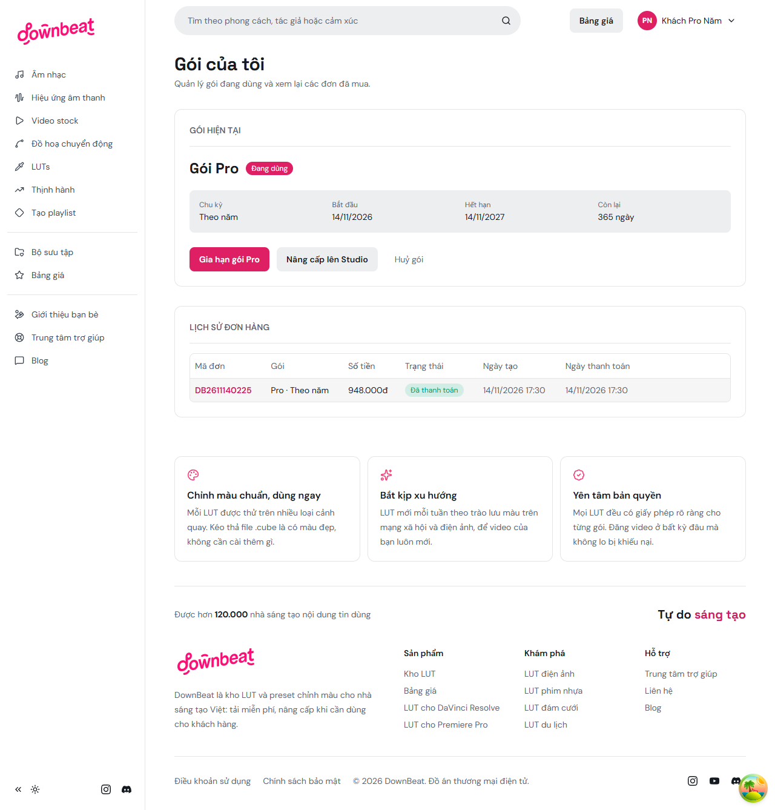

Khách gói Pro theo năm: badge "Đang dùng", ngày bắt đầu, hết hạn, số ngày còn lại và ba nút hành động.

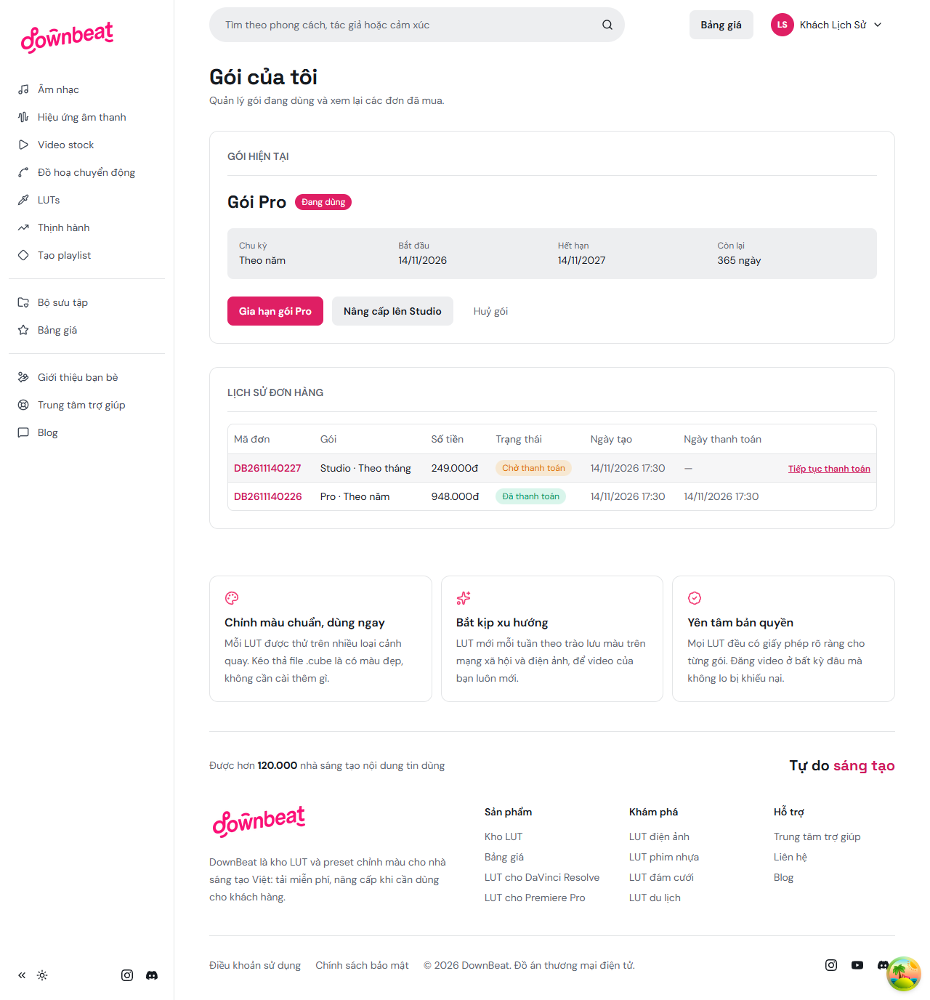

Bảng lịch sử có một đơn đang chờ (link "Tiếp tục thanh toán") và một đơn đã thanh toán.

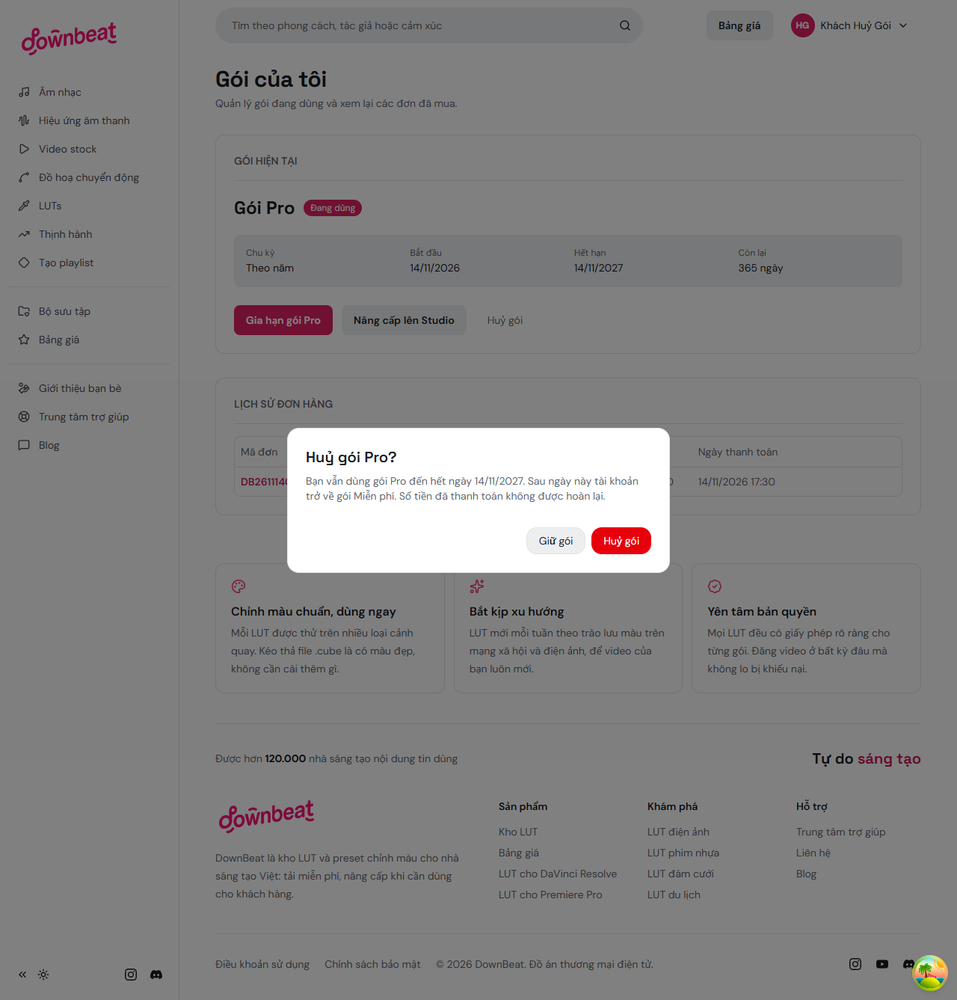

Hộp thoại "Huỷ gói Pro?" nói rõ vẫn dùng đến hết ngày hết hạn và không hoàn tiền.

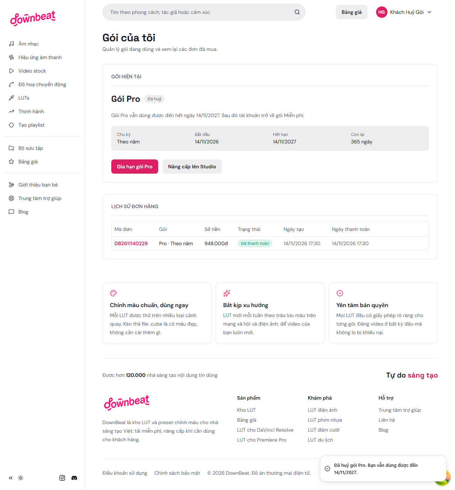

Sau khi huỷ: badge "Đã huỷ", mất nút "Huỷ gói", hiện câu giải thích ngày dùng còn lại.

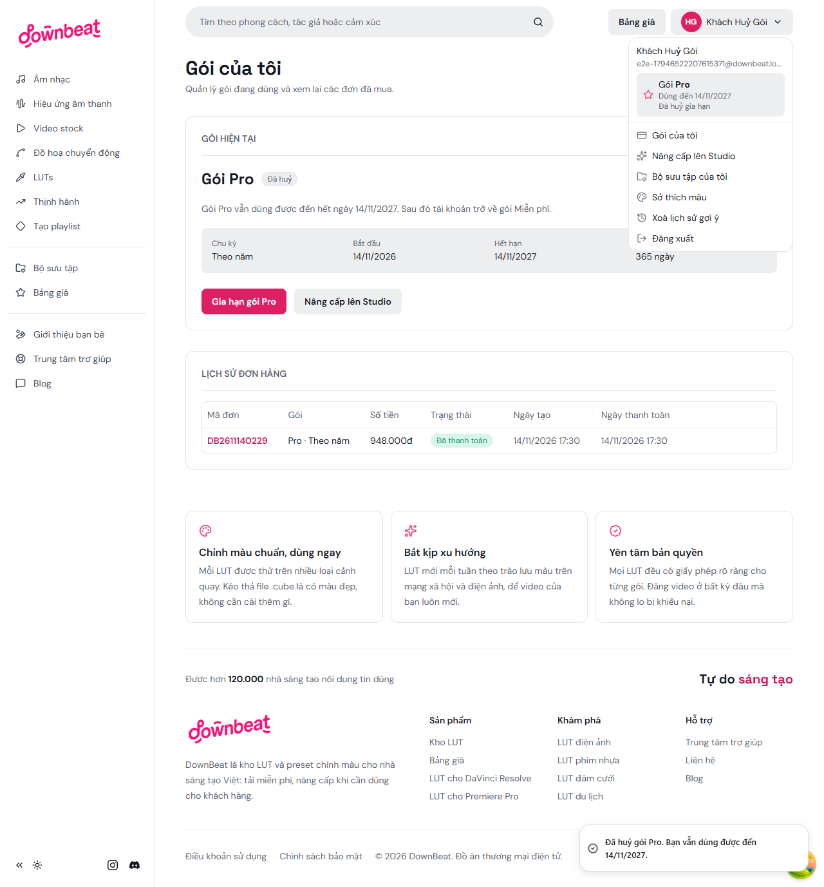

Menu tài khoản đổi sang "Dùng đến …" và "Đã huỷ gia hạn".

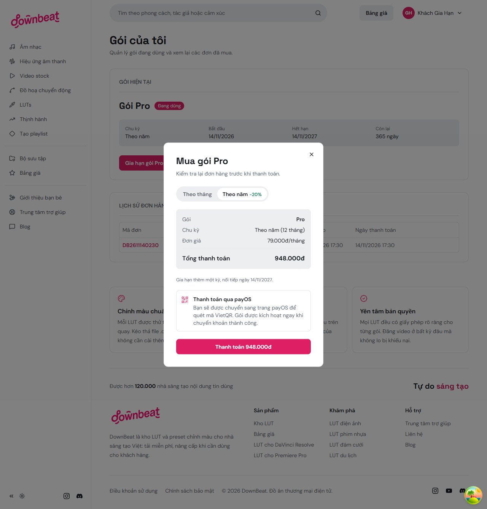

Bấm "Gia hạn gói Pro" mở hộp thoại "Mua gói Pro" với chu kỳ hiện tại.

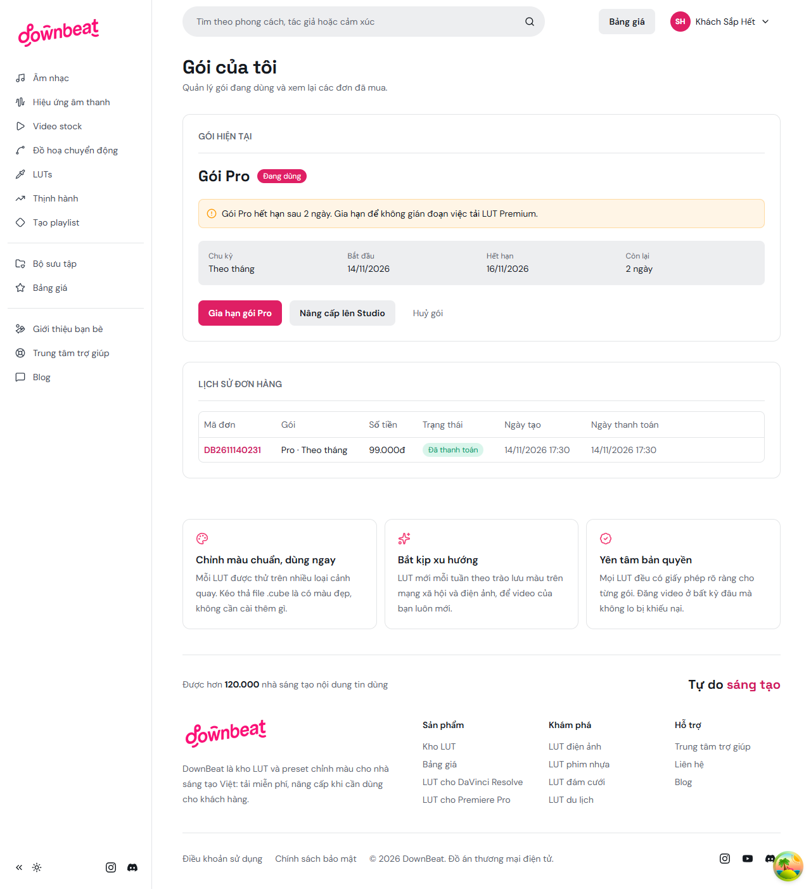

Còn 2 ngày và đang tự gia hạn: khung nhắc gia hạn trong thẻ gói.

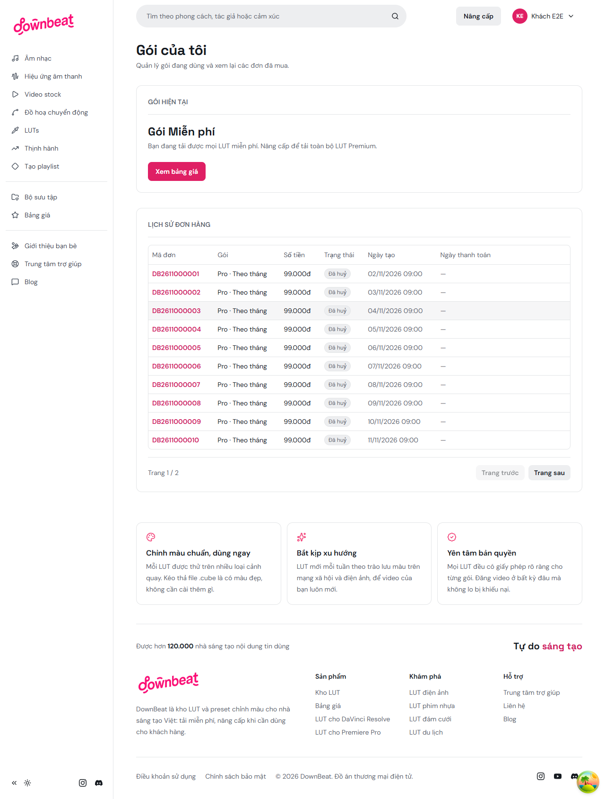

Lịch sử 11 đơn: "Trang 1 / 2", nút "Trang trước" bị khoá.

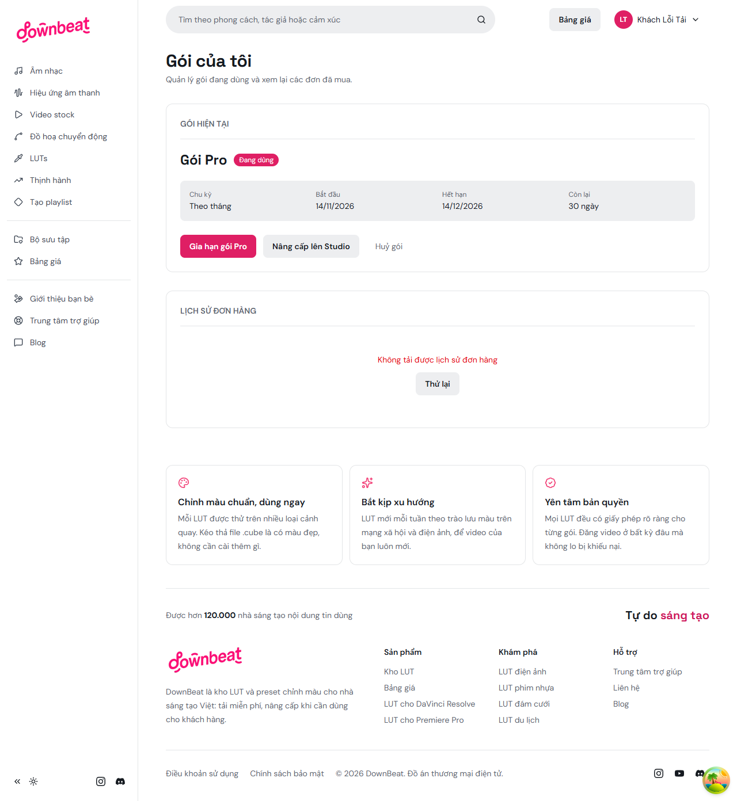

Lịch sử lỗi 500: "Không tải được lịch sử đơn hàng" kèm "Thử lại", khối "Gói hiện tại" vẫn hiện.

## 6. Kiểm thử

Nhóm API của spec `frontend/tests/e2e/goi-cua-toi.spec.ts` tạo đơn qua payOS thật rồi `order/mock-pay` (profile `local`), nên cần khoá payOS trong `backend/.env`. Các ca cần ngày hết hạn gần hoặc nhiều đơn dùng `page.route` giả response.

| ID | Loại | Nội dung | Kết quả |
|---|---|---|---|
| TC-01 | Playwright API | `order/my-list` không token → 401 | Pass |
| TC-02 | Playwright API | `my-list` khách mới: `{ total: 0, page: 1, items: [] }` | Pass |
| TC-03 | Playwright API | `my-list` thứ tự, `checkoutUrl` chỉ ở `PENDING`, không lộ khoá nội bộ | Pass |
| TC-04 | Playwright API | `my-list` chỉ thấy đơn của mình | Pass |
| TC-05 | Playwright API | Phân trang và chuẩn hoá `page` / `limit` | Pass |
| TC-06 | Playwright API | Đơn huỷ: `CANCELLED`, không `checkoutUrl`, không `paidTime` | Pass |
| TC-07 | Playwright API | `subscription/my` không token → 401 | Pass |
| TC-08 | Playwright API | `subscription/my` gói Miễn phí đúng `{ planCode, planName }` | Pass |
| TC-09 | Playwright API | `subscription/my` gói Pro YEAR, không lộ `id`, `status`… | Pass |
| TC-10 | Playwright API | `account/me` có `planAutoRenew` (Miễn phí: không có khoá) | Pass |
| TC-11 | Playwright API | `subscription/cancel` không token → 401 | Pass |
| TC-12 | Playwright API | Huỷ khi Miễn phí → `NO_ACTIVE_PLAN` | Pass |
| TC-13 + 14 | Playwright API | Huỷ thành công, `endDate` giữ nguyên, huỷ lần 2 vẫn 200 (gộp một bài) | Pass |
| TC-15 | Playwright API | Đã huỷ vẫn tải được LUT Premium | Pass |
| TC-16 | Playwright API | Gia hạn sau khi huỷ bật lại `autoRenew = 1`, `endDate` + 1 tháng | Pass |
| TC-17 | Playwright API | Nâng cấp Studio sau khi huỷ: `autoRenew = 1` | Pass |
| TC-18 | JUnit | `cancel` gọi `disableAutoRenew` đúng 1 lần, giữ ngày | Pass |
| TC-19 | JUnit | `cancel` không có gói → `NO_ACTIVE_PLAN` | Pass |
| TC-20 | JUnit | `cancel` dòng ACTIVE đã quá hạn → `NO_ACTIVE_PLAN` | Pass |
| TC-21 | JUnit | `my` gói Miễn phí | Pass |
| TC-22 | JUnit | Gia hạn cùng gói đặt lại `auto_renew = 1` | Pass |
| TC-23 | JUnit | `myList` chuẩn hoá tham số, ẩn `checkoutUrl` đơn không `PENDING` | Pass |
| TC-24 | Playwright giao diện | Menu → trang "Gói của tôi" (h1, tiêu đề tab, hai heading) | Pass |
| TC-25 | Playwright giao diện | Chưa đăng nhập: lời mời, đăng nhập xong ở lại trang | Pass |
| TC-26 | Playwright giao diện | Khách Miễn phí | Pass |
| TC-27 | Playwright giao diện | Thẻ gói Pro (chu kỳ, ngày, số ngày còn lại, ba nút) | Pass |
| TC-28 | Playwright giao diện | Lịch sử đơn: badge, link "Tiếp tục thanh toán", mã đơn → trang kết quả | Pass |
| TC-29 | Playwright giao diện | "Giữ gói": không gọi API huỷ | Pass |
| TC-30 | Playwright giao diện | Huỷ gói thành công (toast, badge, menu, F5 vẫn "Đã huỷ") | Pass |
| TC-31 | Playwright giao diện | Gia hạn / nâng cấp từ trang mở đúng hộp thoại | Pass |
| TC-32 | Playwright giao diện | Nhắc gia hạn ẩn khi đã huỷ (menu, trang, `/pricing`) | Pass |
| TC-33 | Playwright giao diện | Phân trang lịch sử, F5 giữ trang | Pass |
| TC-34 | Playwright giao diện | Lỗi tải một khối, khối kia vẫn hiện | Pass |
| TC-35 | Playwright giao diện | Lỗi huỷ gói hiện nguyên văn, hộp thoại vẫn mở | Pass |

**Tổng**: JUnit 164/164 ở module `business` (phần của chức năng: `SubscriptionServiceTest` 6, `PaymentActivationServiceTest` 6, `OrderServiceTest` 5, `AccountServiceTest` 2, trong đó phủ TC-18 → TC-23); Playwright 28/28 (API 16 + giao diện 12; TC-13 và TC-14 gộp một bài), chạy `--headed --workers=1`. `pnpm build` xanh, `pnpm lint` 0 lỗi (2 cảnh báo có sẵn ở `data-table-advanced`, `hero-section`).

## 7. Điểm lệch plan và vấn đề còn lại

- **Không lệch** hợp đồng §5 và giao diện §6 của plan. BE 0 vòng sửa, FE 1 vòng sửa: sau khi huỷ gói, menu tài khoản vẫn hiện "Hết hạn …" vì `shop-session-sync.tsx` chỉ bật query `account-me` khi chưa có `user`; đã sửa để làm mới mỗi khi có dữ liệu mới.
- Spec do Claude sửa một chỗ: TC-24 chặn ảnh `picsum.photos` (banner `/luts` treo do mạng ngoài làm `networkidle` không đạt).
- **Chạy E2E dùng `--workers=1`**: payOS sandbox trả 429 khi tạo đơn song song (chạy song song có 6 bài API đỏ vì lý do này, không phải lỗi mã).
- Ghi chú không chặn: `myOrdersQueryOptions` chưa có `keepPreviousData` nên chuyển trang lịch sử chớp skeleton; OpenAPI vẫn liệt kê các khoá `WRITE_ONLY` của `Subscription` (response thật không có).
- Đơn `PENDING` quá 24 giờ mà tác vụ 00:10 chưa chạy vẫn hiện "Chờ thanh toán" kèm link payOS đã hết hạn (lệch tối đa dưới 1 ngày); chấp nhận theo plan.
