# Gói và thanh toán payOS (bảng giá, tạo đơn, webhook, kích hoạt / gia hạn / nâng cấp)

> Plan: [plan/goi-thanh-toan.md](../../plan/goi-thanh-toan.md) · Route: `/pricing`, `/thanh-toan/ket-qua/<mã đơn>` · Phạm vi: backend + frontend

## 1. Mục tiêu

Trước chức năng này, bảng giá và việc "mua gói" ở cửa hàng chỉ là dữ liệu và thanh toán giả lập trong frontend. Chức năng này cho **khách hàng mua gói Pro / Studio bằng payOS thật**:

- Bảng giá đọc từ backend (bảng `plan`), không còn viết cứng ở giao diện.
- Bấm mua thì **backend tự tính tiền** (không tin số tiền từ trình duyệt), tạo link thanh toán payOS và chuyển khách sang trang quét VietQR.
- payOS gọi webhook có chữ ký về backend; backend xác thực rồi kích hoạt, gia hạn hoặc nâng cấp gói.
- Trang kết quả hỏi trạng thái đơn đến khi có kết quả; menu tài khoản hiện gói và hạn thật, nhắc gia hạn khi còn ≤ 3 ngày.

Chức năng tách khỏi lát 1.4 của kế hoạch tổng. **Chưa làm** (để lát sau): lịch sử đơn và nút "Huỷ gói" (`goi-cua-toi`); trang quản trị đơn hàng, khách hàng, sửa giá gói và các resource `PLAN` / `ORDER` / `CUSTOMER` (`quan-tri-don-hang`); tải LUT Premium thật (`tai-lut`); gửi email nhắc gia hạn, hoá đơn VAT, thu tiền chênh lệch khi nâng cấp, tự trừ tiền định kỳ.

## 2. Luồng sử dụng

**Luồng chính — mua gói Pro theo năm.**

1. Khách đã đăng nhập (gói Miễn phí) vào `/pricing`, chọn "Theo năm", bấm "Chọn gói Pro". Hộp thoại "Mua gói Pro" hiện đơn giá 79.000đ/tháng, tổng 948.000đ.
2. Bấm "Thanh toán 948.000đ". Backend kiểm tra luật mua gói, tính tiền từ bảng `plan`, sinh mã đơn `DB2611100001`, lưu đơn `PENDING`, gọi payOS tạo link (ký HMAC-SHA256) rồi trả `checkoutUrl`.
3. Trình duyệt chuyển sang trang `pay.payos.vn`; khách quét VietQR và chuyển khoản.
4. payOS gọi webhook về backend. Backend kiểm chữ ký, so số tiền, chuyển đơn sang `PAID` (đúng một lần) và kích hoạt gói.
5. payOS đưa khách về `/thanh-toan/ket-qua/DB2611100001`. Trang **không tin** tham số payOS gắn trên URL mà hỏi `order/get` mỗi 2 giây (tối đa 60 giây) đến khi đơn hết `PENDING`, rồi hiện "Thanh toán thành công". Menu tài khoản đổi sang "Gói Pro".

**Luồng phụ.**

- **Nâng cấp từ LUT Premium**: khách Miễn phí bấm "Tải" ở LUT ★ → hộp thoại "Nâng cấp để tải LUT Premium" → "Mua gói Pro". Đơn nhớ `sourceLutId`, trang kết quả có thêm nút "Quay lại LUT …".
- **Gia hạn bất cứ lúc nào**: mua lại đúng gói đang dùng, hạn được **cộng nối tiếp từ ngày hết hạn cũ** (không mất ngày còn lại).
- **Nâng cấp Pro → Studio bất cứ lúc nào, có hiệu lực ngay**: gói Pro chuyển `CANCELLED`, Studio bắt đầu hôm nay, giá trị phần Pro còn lại được quy đổi thành ngày dùng thêm: `ngày quy đổi = floor(ngày còn lại × giá tháng gói cũ / giá tháng gói mới)`. Ví dụ Pro theo năm (79.000đ/tháng) còn 200 ngày, mua Studio theo tháng (249.000đ): `floor(200 × 79000 / 249000)` = 63 ngày, hạn mới = hôm nay + 1 tháng + 63 ngày. Số tiền đơn luôn là giá gói mới.
- **Khách huỷ trên trang payOS**: payOS đưa về `cancelUrl` kèm `cancel=true`; trang thấy đơn còn `PENDING` thì gọi `order/cancel` một lần (backend huỷ luôn link payOS) và hiện "Đơn đã huỷ".
- **Webhook chưa tới** (chạy local không có tunnel, hoặc payOS chậm): khi `order/get` thấy đơn `PENDING`, backend hỏi payOS (tối đa một lần mỗi 5 giây cho mỗi đơn); payOS báo `PAID` đúng tiền thì xử lý y như webhook. Nhờ đó thử thanh toán thật ở máy cá nhân mà không cần tunnel.
- **Thanh toán giả** `order/mock-pay/{code}`: chỉ có ở profile `local`, dùng để test nhanh.
- **Nhắc gia hạn**: còn ≤ 3 ngày thì `/pricing` hiện khung nhắc, menu tài khoản hiện "Còn n ngày" và mục "Gia hạn gói".
- **Tác vụ 00:10 hằng ngày**: gói quá hạn chuyển `EXPIRED`; đơn `PENDING` quá 24 giờ chuyển `EXPIRED`.

**Ngoại lệ.**

- Hạ gói (mua Pro khi đang có Studio còn > 3 ngày): 400 `PLAN_ACTIVE` "Bạn đang dùng gói Studio, cao hơn gói Pro". Còn ≤ 3 ngày thì được hạ.
- payOS lỗi hoặc thiếu khoá: đơn chuyển `CANCELLED`, 502 `PAYMENT_GATEWAY_ERROR`; hộp thoại giữ nguyên, toast báo lỗi.
- Webhook sai hoặc thiếu chữ ký: 400 `INVALID_SIGNATURE`, không đọc / ghi gì, ghi log WARN.
- Webhook đúng chữ ký nhưng **lệch số tiền**, `code` khác "00", `orderCode` không có (webhook thử `123` của payOS) hoặc gửi lặp: trả 200, không đổi gì.
- Tiền vào đơn đã huỷ / hết hạn (khách để tab payOS mở rồi trả sau): không tự kích hoạt, chỉ ghi log WARN để hoàn tiền tay.
- Đơn không có hoặc của người khác: 404 "Không tìm thấy đơn hàng" (không lộ là có tồn tại). Không token: 401.

```mermaid
sequenceDiagram
  actor K as Khách
  participant FE as Frontend
  participant BE as Backend
  participant DB as MySQL
  participant P as payOS
  K->>FE: "Thanh toán 948.000đ"
  FE->>BE: POST /order/create { planCode, cycle }
  BE->>DB: kiểm luật, tính tiền, INSERT đơn PENDING
  BE->>P: POST /v2/payment-requests (có chữ ký)
  P-->>BE: checkoutUrl, paymentLinkId
  BE-->>FE: { code, amount, checkoutUrl }
  FE->>P: chuyển sang checkoutUrl
  K->>P: quét VietQR, chuyển khoản
  P->>BE: POST /payment/payos/webhook { data, signature }
  BE->>BE: kiểm chữ ký HMAC-SHA256
  BE->>DB: UPDATE đơn PAID WHERE status = 'PENDING'; kích hoạt subscription
  BE-->>P: 200
  loop mỗi 2 giây, tối đa 60 giây
    FE->>BE: GET /order/get
  end
  FE->>K: "Thanh toán thành công"
```

## 3. Cơ sở dữ liệu

Migration `V7__goi_thanh_toan.sql` (V6 là mới nhất). 3 gói nằm ngay trong V7 vì môi trường nào cũng cần. Không có migration phân quyền: lát này chỉ có API khách và công khai, không tạo resource.

**`plan`**: 3 dòng (`free`, `pro`, `studio`).

| Gói | `monthly_price` | `yearly_monthly_price` (thu 12 lần) | Premium | Thành viên |
|---|---|---|---|---|
| free | 0 | 0 | không | 1 |
| pro | 99.000 | 79.000 | có | 1 |
| studio | 249.000 | 199.000 | có | 5 |

Cột khác: `code` (UNIQUE), `name`, `audience`, `license` và `features` (JSON mảng chuỗi), `is_highlight` (chỉ `pro`), `sort_order`, `active`.

**`payment_order`**: mỗi lần bấm mua là một dòng.

| Cột | Ghi chú |
|---|---|
| `code` | UNIQUE, `DB` + yyMMdd + 4 số thứ tự trong ngày (`DB2611100001`); trùng thì thử lại tối đa 3 lần |
| `payos_order_code` | UNIQUE, bằng phần số của `code` (`2611100001`), dưới giới hạn 2^53 của payOS |
| `user_id`, `plan_id`, `cycle` | `cycle` là `MONTH` / `YEAR` |
| `amount` | Backend tính từ bảng `plan` |
| `status` | `PENDING` → `PAID` / `CANCELLED` / `EXPIRED` |
| `payos_payment_link_id`, `checkout_url`, `payos_reference` | Của payOS; `reference` là mã giao dịch ngân hàng (`MOCK` với thanh toán giả) |
| `webhook_payload` | JSON thân webhook đã xác thực (hoặc kết quả payOS khi đối soát) |
| `source_lut_id` | FK `lut`, `ON DELETE SET NULL`; LUT khách đang xem lúc nâng cấp |
| `paid_time` | Lúc chuyển `PAID` |

Chỉ mục `(user_id, created_time)` và `(status, created_time)` (cho tác vụ 00:10).

**`subscription`**: gói của khách theo từng kỳ.

| Cột | Ghi chú |
|---|---|
| `user_id`, `plan_id`, `order_id`, `cycle` | `order_id` là đơn gần nhất sinh / gia hạn kỳ này |
| `status` | `ACTIVE`, `EXPIRED`, `CANCELLED` |
| `start_date`, `end_date` | Khách dùng được đến hết ngày `end_date` |
| `auto_renew` | Mặc định 1; lát `goi-cua-toi` mới dùng |
| `active_user_id` | Cột sinh `IF(status = 'ACTIVE', user_id, NULL)`, UNIQUE: **mỗi khách tối đa một dòng ACTIVE** ngay ở tầng DB |

Không có dòng ACTIVE còn hạn nghĩa là gói Miễn phí (không lưu dòng cho `free`).

**Kích hoạt** (một transaction, dùng chung cho webhook, `mock-pay` và đối soát):

1. `UPDATE payment_order SET status = 'PAID' … WHERE id = ? AND status = 'PENDING'`; 0 dòng thì dừng. Đây là chốt chống trùng: webhook gửi lặp, gửi đồng thời hay đơn đã huỷ đều không kích hoạt hai lần.
2. Khoá dòng subscription ACTIVE của khách (`SELECT … FOR UPDATE`). Không có, hoặc đã quá hạn nhưng tác vụ 00:10 chưa chạy: dòng cũ (nếu có) thành `EXPIRED`, tạo mới từ hôm nay. Cùng gói: cộng một kỳ vào `end_date`. Khác gói: dòng cũ `CANCELLED`, tạo dòng mới từ hôm nay cộng kỳ và ngày quy đổi.
3. Kỳ là `plusMonths(1)` hoặc `plusMonths(12)` (31/01 + 1 tháng = 28/02).

## 4. API

Phản hồi thành công bọc `{ code, message, result }`; lỗi nghiệp vụ trả `{ path, code, errorCode, message }`. Khoá rỗng không ra JSON.

| Method | Đường dẫn | Quyền | Mô tả |
|---|---|---|---|
| GET | `/plan/public/list` | Công khai | Gói `active`, xếp theo `sort_order`; cache Caffeine 5 phút; không trả `id`, `active` |
| POST | `/order/create` | Đăng nhập | Tạo đơn + link payOS; trả `{ code, amount, checkoutUrl }` |
| GET | `/order/get?code=` | Đăng nhập, đơn của mình | Chi tiết đơn; đơn `PENDING` thì đối soát với payOS |
| POST | `/order/cancel/{code}` | Đăng nhập, đơn của mình | Huỷ đơn `PENDING` (kèm huỷ link payOS) |
| POST | `/order/mock-pay/{code}` | Đăng nhập, đơn của mình, **profile `local`** | Thanh toán giả |
| POST | `/payment/payos/webhook` | Công khai (whitelist), xác thực bằng chữ ký | payOS gọi vào |
| GET | `/account/me` | Đăng nhập | Sửa: `plan` và `planExpiresAt` đọc từ subscription thật |

**Tạo đơn** nhận `{ planCode, cycle, sourceLutId? }`, kiểm theo thứ tự và dừng ở lỗi đầu tiên: gói (`pro` / `studio` đang `active`) → chu kỳ (`MONTH` / `YEAR`) → `PLAN_ACTIVE` (chỉ chặn hạ gói khi gói cao hơn còn > 3 ngày) → tính `amount` (`monthly_price` hoặc `yearly_monthly_price × 12`) → lưu `sourceLutId` nếu LUT tồn tại (không có thì bỏ qua, không báo lỗi). Mọi khoá khác trong thân (`amount`, `status`…) bị bỏ qua. Đơn được INSERT và commit **trước**, rồi mới gọi payOS để không giữ transaction trong lúc chờ mạng.

**`order/get`** trả `code`, `planCode`, `planName`, `cycle`, `amount`, `status`, `checkoutUrl`, `createdTime`, và có điều kiện `paidTime`, `sourceLutId` / `sourceLutSlug` / `sourceLutTitle`, `planExpiresAt` (chỉ khi `PAID`). Không bao giờ trả `webhookPayload`, `payosReference`, `payosOrderCode`, `userId`.

**Chữ ký payOS** (lớp `PayosSignature`, tự viết, không dùng SDK):

- Tạo link: ghép `amount`, `cancelUrl`, `description`, `orderCode`, `returnUrl` theo thứ tự A→Z dạng `key=value` nối bằng `&`, rồi `HMAC_SHA256(chuỗi, checksumKey)` hex chữ thường.
- Webhook: lấy mọi khoá của `data` (đọc thành cây JSON, không qua POJO nên khoá lạ payOS thêm sau vẫn được ký), sắp xếp A→Z, `null` thành rỗng, mảng / object thành JSON (khoá con cũng sắp xếp), ghép như trên, so bằng `MessageDigest.isEqual` (so sánh thời gian không đổi).

**Gọi payOS** bằng `RestClient` (timeout kết nối 5 s, đọc 10 s): tạo link `POST /v2/payment-requests`, lấy trạng thái `GET /v2/payment-requests/{orderCode}`, huỷ link `POST /v2/payment-requests/{orderCode}/cancel`. `description` cố định "DownBeat" (payOS giới hạn 9 ký tự với tài khoản ngân hàng chưa liên kết), link hết hạn sau 24 giờ.

**Cấu hình** (`application.yml`, đọc từ `backend/.env`, không bao giờ ra frontend): `PAYOS_BASE_URL`, `PAYOS_CLIENT_ID`, `PAYOS_API_KEY`, `PAYOS_CHECKSUM_KEY`, `FRONTEND_URL` (dựng `returnUrl` / `cancelUrl`). `backend/.env.example` có đủ các biến, để trống.

Lỗi:

| Tình huống | HTTP | errorCode | Message |
|---|---|---|---|
| Không token | 401 | — | Chưa đăng nhập |
| Gói sai / `free` / không active | 400 | `BAD_REQUEST` | Gói không hợp lệ |
| Chu kỳ sai | 400 | `BAD_REQUEST` | Chu kỳ không hợp lệ |
| Hạ gói khi gói cao hơn còn > 3 ngày | 400 | `PLAN_ACTIVE` (mới) | Bạn đang dùng gói Studio, cao hơn gói Pro |
| payOS lỗi / thiếu khoá | 502 | `PAYMENT_GATEWAY_ERROR` (mới) | Không kết nối được cổng thanh toán, vui lòng thử lại |
| Đơn không có hoặc của người khác | 404 | `DATA_NOT_FOUND` | Không tìm thấy đơn hàng |
| Huỷ / mock-pay đơn không còn `PENDING` | 400 | `ORDER_INVALID_STATUS` (mới) | Đơn hàng đã được xử lý |
| Webhook sai / thiếu chữ ký | 400 | `INVALID_SIGNATURE` (mới) | Chữ ký không hợp lệ |

Mã: package `vn.aeoc.business.billing` (`controller`: `PlanPublicController`, `OrderController`, `OrderMockPayController`, `PayosWebhookController`; `service`: `PlanService`, `OrderService`, `PaymentActivationService`, `PayosWebhookService`, `SubscriptionService`, `BillingMaintenanceService`, `PlanCredit`; `payos`: `PayosClient`, `PayosSignature`, `PayosProperties`; `repository`), POJO ở `entity/data/mysql/billing`; `ErrorCode` thêm 4 mã; `JwtAuthenticationFilter` thêm `/payment/payos/webhook` vào danh sách bỏ qua token; `AccountService` đọc gói từ subscription.

## 5. Giao diện

**Bảng giá `/pricing`.** Ba thẻ đọc `GET /plan/public/list` (đang tải: 3 skeleton; lỗi: "Không tải được bảng giá" + "Thử lại"). Theo tháng thẻ Pro là "99.000đ/tháng"; theo năm là "79.000đ/tháng" kèm "Thanh toán 948.000đ mỗi năm". Nhãn nút theo trạng thái khách:

| Khách | Thẻ gói đang dùng | Thẻ gói cao hơn | Thẻ gói thấp hơn |
|---|---|---|---|
| Chưa đăng nhập / Miễn phí | — | "Chọn gói Pro" / "Chọn gói Studio" | — |
| Pro / Studio, còn > 3 ngày | "Gia hạn gói Pro" (kèm badge "Gói hiện tại") | "Nâng cấp lên Studio" | "Đã có trong gói Studio" (khoá) |
| Pro / Studio, còn ≤ 3 ngày | như trên | như trên | "Chọn gói Pro" |

Còn ≤ 3 ngày: khung nhắc đầu trang "Gói Pro của bạn hết hạn ngày dd/MM/yyyy. Gia hạn để không gián đoạn việc tải LUT Premium."

**Hộp thoại "Mua gói …".** Bảng Gói / Chu kỳ / Đơn giá / "Tổng thanh toán" lấy giá từ API; nút đổi chu kỳ ngay trong hộp thoại ("Theo tháng" / "Theo năm") để khách đi từ hộp thoại nâng cấp khỏi quay về `/pricing`; khách đang có gói thấy dòng giải thích gia hạn nối tiếp hoặc quy đổi khi đổi gói. Bấm "Thanh toán 948.000đ" thì nút thành "Đang tạo đơn…", thành công chuyển thẳng sang `checkoutUrl`; lỗi hiện toast nguyên văn từ backend và hộp thoại giữ nguyên.

**Hộp thoại "Nâng cấp để tải LUT Premium".** Nút chính "Mua gói Pro" mở hộp thoại mua (theo năm) mang theo `sourceLutId`; có link phụ "Xem bảng giá" và "Để sau".

**Trang kết quả `/thanh-toan/ket-qua/<mã đơn>`** (layout `_plain`, tiêu đề tab "Kết quả thanh toán | DownBeat"): khung giữa trang, bảng tóm tắt đơn (Mã đơn, Gói, Chu kỳ, Số tiền) và các trạng thái:

| Trạng thái | Heading | Nút |
|---|---|---|
| Chưa đăng nhập | "Đăng nhập để xem đơn hàng" | "Đăng nhập" |
| `PENDING` (≤ 60 s) | "Đang chờ xác nhận thanh toán" (tự cập nhật, không cần tải lại) | — |
| `PENDING` (quá 60 s) | "Chưa nhận được thanh toán" | "Kiểm tra lại", "Tiếp tục thanh toán", "Huỷ đơn" |
| `PAID` | "Thanh toán thành công" — "Gói Pro đã được kích hoạt, dùng đến dd/MM/yyyy" | "Vào kho LUT"; có LUT nguồn thì thêm "Quay lại LUT …" |
| `CANCELLED` | "Đơn đã huỷ" — "Bạn chưa bị trừ tiền…" | "Xem bảng giá" |
| `EXPIRED` | "Đơn đã hết hạn" | "Xem bảng giá" |
| 404 | "Không tìm thấy đơn hàng" | "Xem bảng giá" |

Trang chỉ tin `order/get`, không đọc `status` / `code` payOS gắn trên URL. Ngoại lệ duy nhất: `cancel=true` và đơn còn `PENDING` thì gọi `order/cancel` một lần. Lần đầu thấy `PAID` thì làm mới thông tin tài khoản để header đổi gói. Lỗi 4xx (như 404) không bị thử lại; chỉ lỗi 5xx / mạng thử lại một lần.

**Menu tài khoản.** Hiện "Gói Pro" và "Hết hạn dd/MM/yyyy" từ dữ liệu thật; còn ≤ 3 ngày thêm "Còn n ngày" (0 ngày: "Hết hạn hôm nay") và mục "Gia hạn gói"; gói Pro có thêm "Nâng cấp lên Studio". Ngày luôn hiện `dd/MM/yyyy` có đệm số 0, tách trực tiếp từ chuỗi ngày API (không qua `new Date("yyyy-MM-dd")` vì bị hiểu là giờ UTC).

Mã: `routes/_plain/thanh-toan/ket-qua.$code.tsx`, `components/shop/payment/payment-result-page.tsx`; sửa `components/shop/pricing/*`, `components/shop/account/{checkout-panel,upgrade-panel}.tsx`, `header-actions.tsx`, `home/plans-section.tsx`; `lib/axios/billing.ts`, `lib/tanstack/options/billing.ts`, `lib/utils/plan.ts`; `lib/types/api.gen.ts` sinh lại từ OpenAPI.

### Hình ảnh

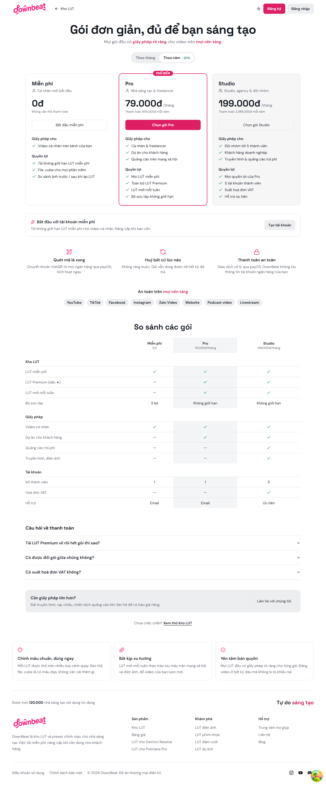

Bảng giá `/pricing` đọc từ API: ba gói, nút đổi chu kỳ, giá theo tháng và theo năm.

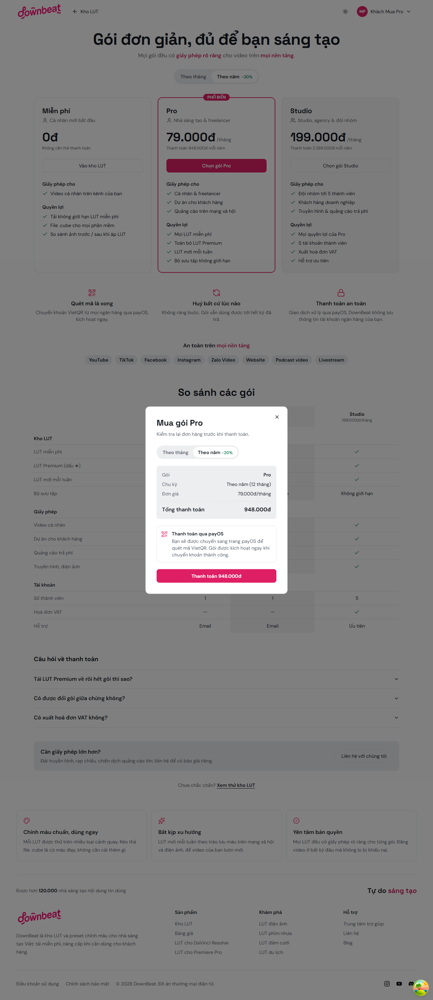

Hộp thoại "Mua gói Pro" theo năm: đơn giá 79.000đ/tháng, "Tổng thanh toán" 948.000đ, nút "Thanh toán 948.000đ".

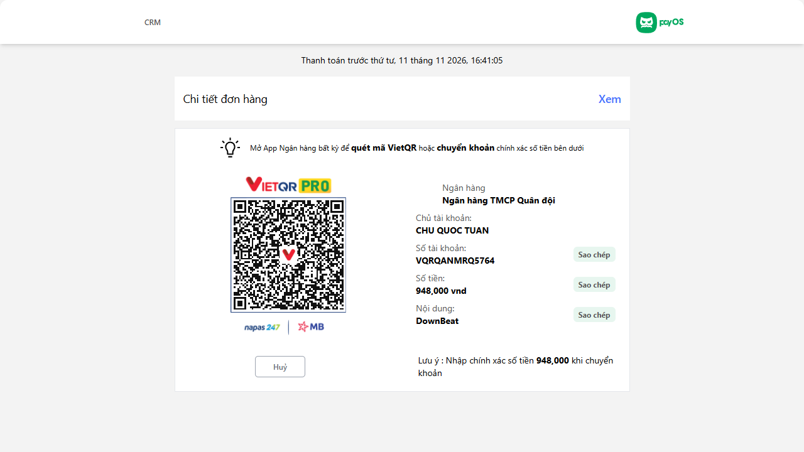

Sau khi tạo đơn, trình duyệt chuyển sang trang `pay.payos.vn` do payOS thật tạo link.

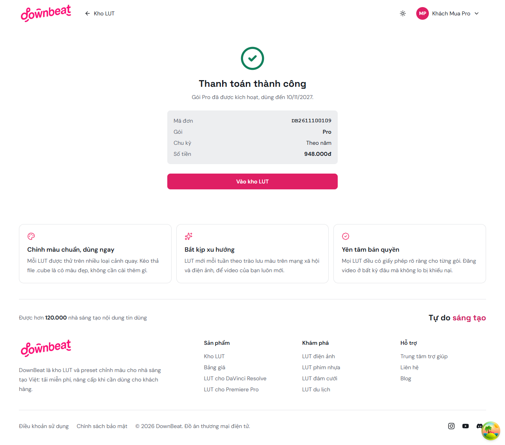

Webhook đến, trang kết quả báo "Thanh toán thành công" và hạn dùng gói.

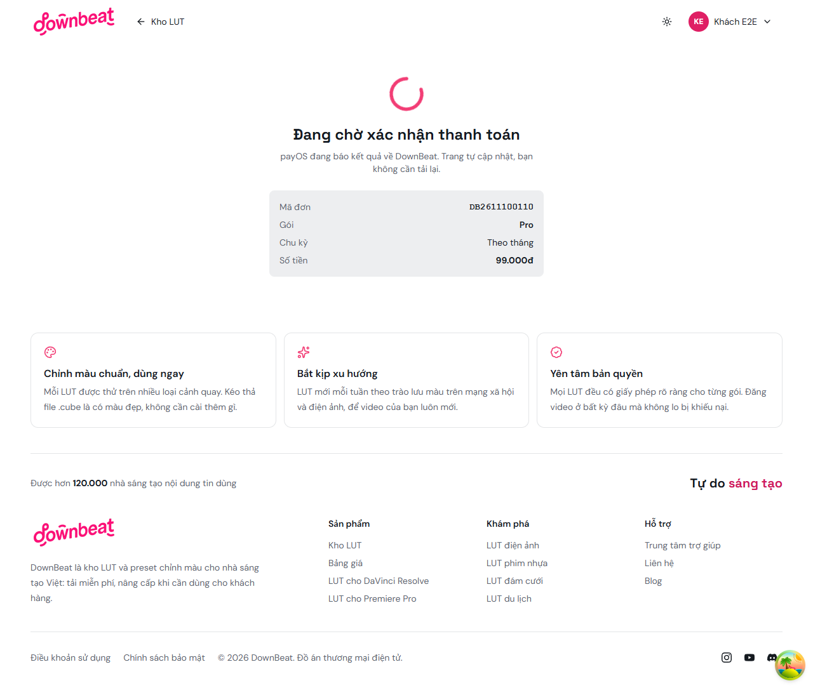

Đơn còn `PENDING`: trang hiện "Đang chờ xác nhận thanh toán" và tự cập nhật.

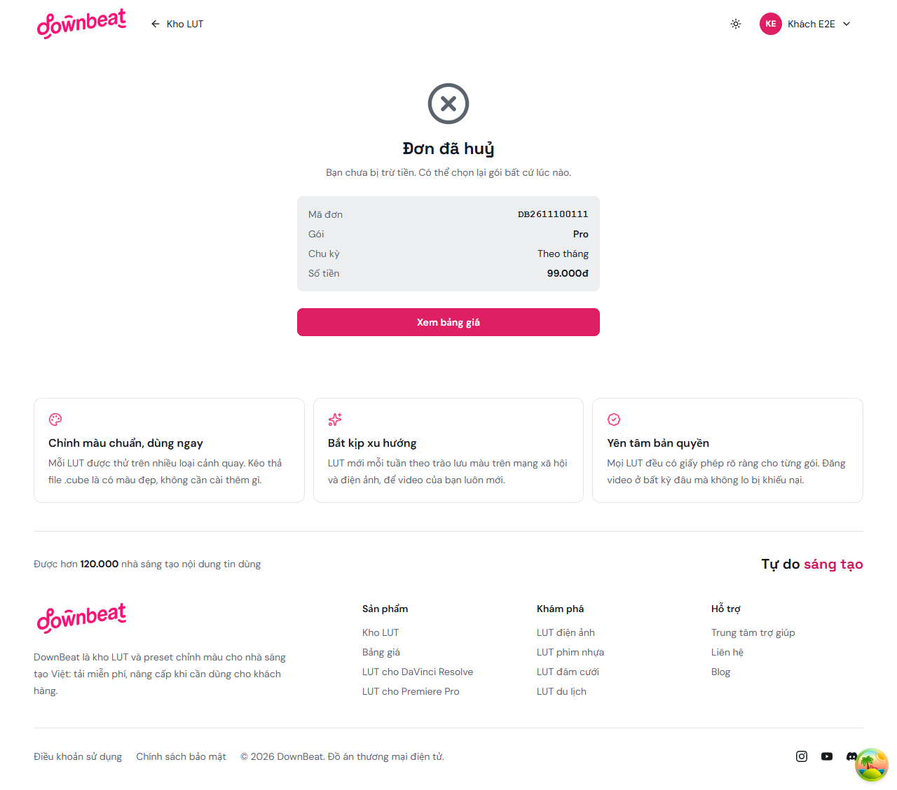

Khách bấm huỷ ở payOS: trang hiện "Đơn đã huỷ", "Bạn chưa bị trừ tiền…".

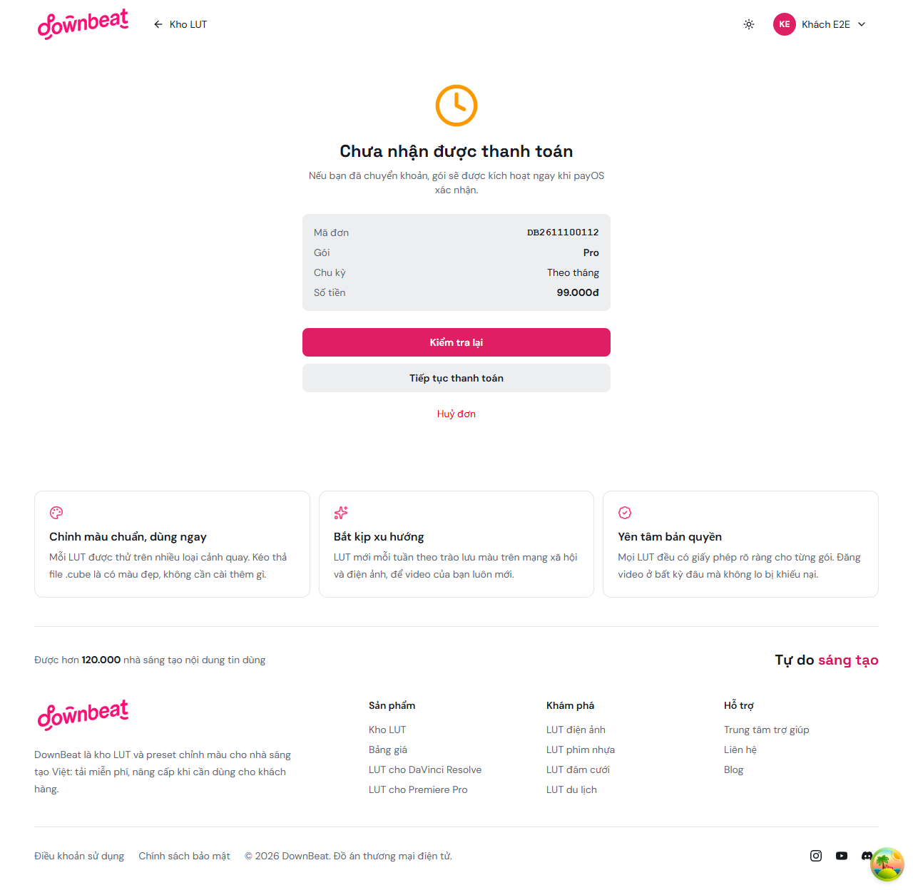

Quá 60 giây chưa có kết quả: có "Kiểm tra lại", "Tiếp tục thanh toán", "Huỷ đơn".

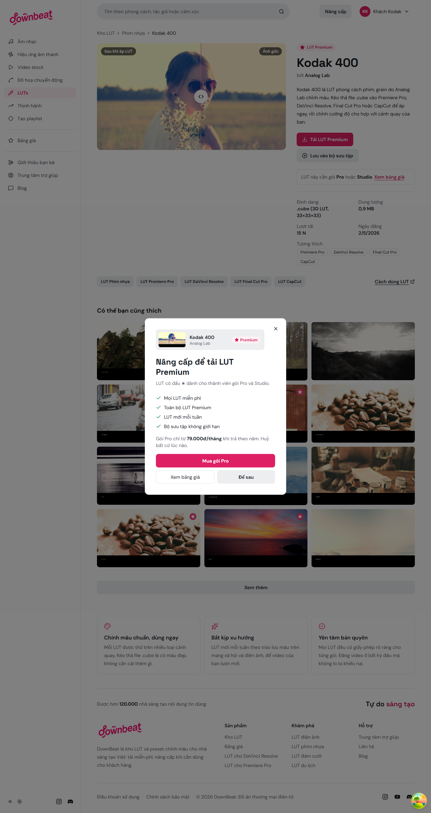

Hộp thoại "Nâng cấp để tải LUT Premium" với nút "Mua gói Pro".

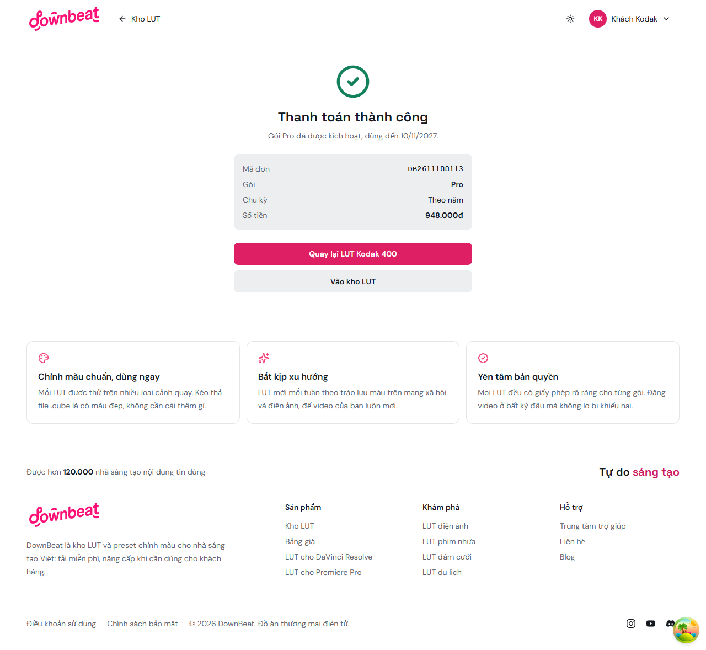

Đơn mua từ LUT Premium nhớ LUT nguồn: trang kết quả có nút "Quay lại LUT Kodak 400".

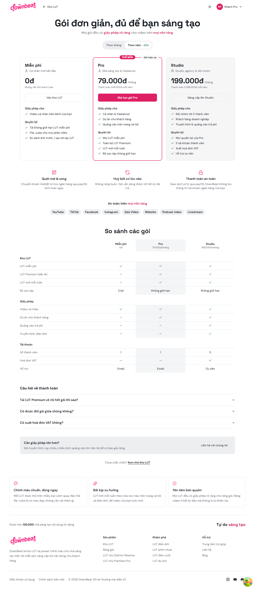

Khách Pro thấy badge "Gói hiện tại", nút "Gia hạn gói Pro" và "Nâng cấp lên Studio".

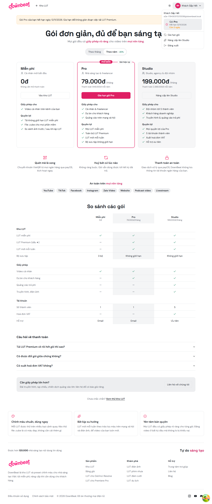

Còn 2 ngày: khung nhắc gia hạn ở đầu trang bảng giá.

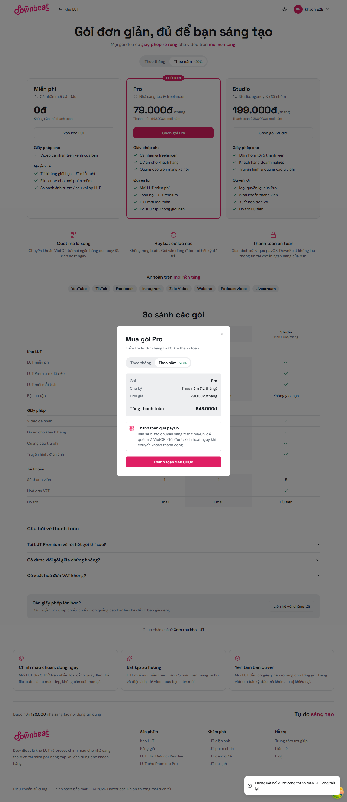

payOS lỗi: toast "Không kết nối được cổng thanh toán, vui lòng thử lại", hộp thoại vẫn mở.

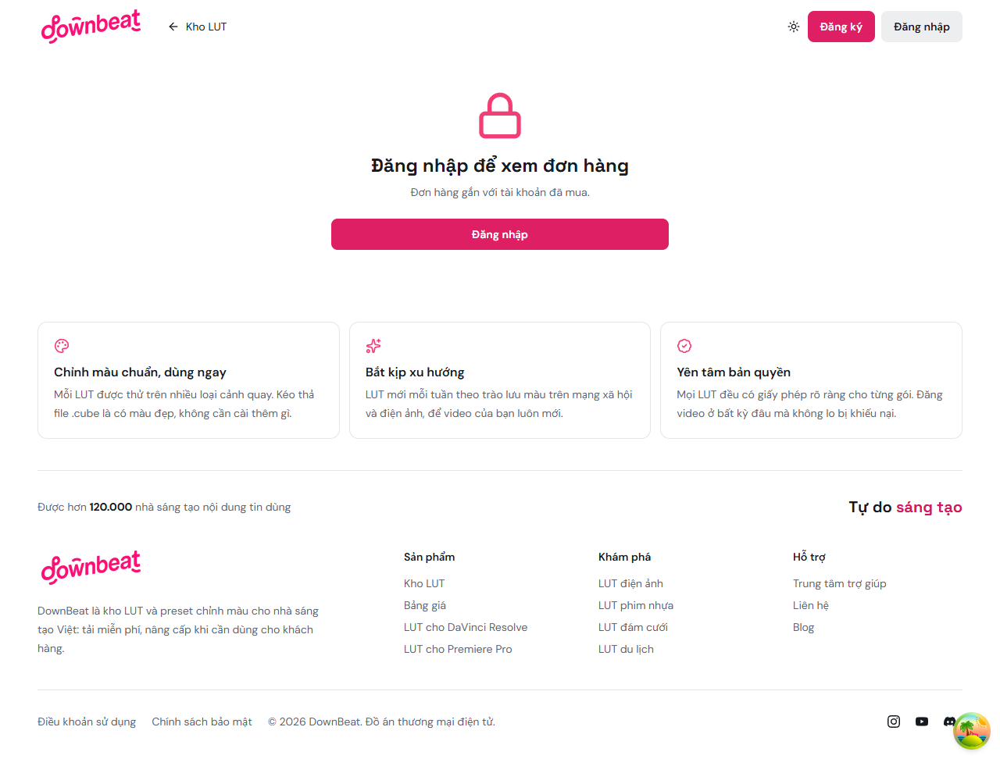

Mở trang kết quả khi chưa đăng nhập: "Đăng nhập để xem đơn hàng" kèm nút "Đăng nhập".

## 6. Kiểm thử

**Cách test webhook mà không cần payOS gọi vào máy**: spec Playwright đọc `PAYOS_CHECKSUM_KEY` từ `backend/.env` (phía Node, không ra trình duyệt), tự dựng thân webhook và ký bằng `crypto.createHmac` của Node, rồi gọi `POST /api/payment/payos/webhook`. Đây là bản cài đặt độc lập với Java nên kiểm chéo được cách ký của backend. Unit test Java đối chiếu với hai vector chữ ký tính sẵn bằng Node. `order/create` gọi payOS thật (tạo link không mất tiền, link tự hết hạn).

| ID | Loại | Nội dung | Kết quả |
|---|---|---|---|
| TC-01 | JUnit | Ký tạo link (vector `de1cc872…`) | Pass |
| TC-02 | JUnit | Ký `data` webhook: sắp xếp khoá, `null` thành rỗng (vector `c96085b6…`) | Pass |
| TC-03 | JUnit | Ký `data` có mảng / object, khoá lạ | Pass |
| TC-04 | JUnit | `verify` từ chối khi sửa 1 trường, chữ ký hoa / thiếu | Pass |
| TC-05 | JUnit | Tính tiền: 99.000 / 948.000 / 249.000 / 2.388.000 | Pass |
| TC-06 | JUnit | Sinh mã đơn `DB2611100001`, `…0002`; trùng UNIQUE thì thử lại | Pass |
| TC-07 | JUnit | Kích hoạt lần đầu (cả ca 31/01 + 1 tháng) | Pass |
| TC-08 | JUnit | Gia hạn cùng gói cộng từ `end_date` | Pass |
| TC-09 | JUnit | Đổi gói có quy đổi ngày (63 ngày) | Pass |
| TC-10 | JUnit | Subscription quá hạn chưa chạy 00:10 | Pass |
| TC-11 | JUnit | `activate` gọi hai lần cùng đơn | Pass |
| TC-12 | JUnit | Luật `PLAN_ACTIVE` (4 ca) | Pass |
| TC-13 | JUnit | payOS lỗi khi tạo link: đơn `CANCELLED`, `PAYMENT_GATEWAY_ERROR` | Pass |
| TC-14 | JUnit | Đối soát khi `get` (PAID đúng / lệch tiền / lỗi, giới hạn 5 s) | Pass |
| TC-15 | JUnit | Tác vụ 00:10 | Pass |
| TC-16 | Playwright API | Bảng giá công khai | Pass |
| TC-17 | Playwright API | 4 endpoint đơn không token → 401 | Pass |
| TC-18 | Playwright API | Tạo đơn qua payOS thật (`checkoutUrl` `https://pay.payos.vn/…`) | Pass |
| TC-19 | Playwright API | Backend không nhận tiền từ trình duyệt | Pass |
| TC-20 | Playwright API | Validate gói / chu kỳ | Pass |
| TC-21 | Playwright API | `sourceLutId` không có | Pass |
| TC-22 | Playwright API | Đơn của người khác / không có → 404 | Pass |
| TC-23 | Playwright API | Webhook hợp lệ kích hoạt gói | Pass |
| TC-24 | Playwright API | Webhook gửi lặp, hạn không đổi | Pass |
| TC-25 | Playwright API | Webhook sai chữ ký (3 kiểu) → `INVALID_SIGNATURE` | Pass |
| TC-26 | Playwright API | Webhook lệch số tiền | Pass |
| TC-27 | Playwright API | Webhook thử / mã không có | Pass |
| TC-28 | Playwright API | Webhook báo không thành công | Pass |
| TC-29 | Playwright API | Huỷ đơn, huỷ lần 2, webhook sau huỷ | Pass |
| TC-30 | Playwright API | `mock-pay` | Pass |
| TC-31 | Playwright API | Gia hạn cùng gói bất cứ lúc nào | Pass |
| TC-32 | Playwright API | Nâng cấp Pro → Studio có quy đổi | Pass |
| TC-33 | Playwright API | Không mua được gói thấp hơn → `PLAN_ACTIVE` | Pass |
| TC-34 | Playwright API | `account/me` khách Miễn phí | Pass |
| TC-35 | Playwright giao diện | Bảng giá đọc API, đổi chu kỳ | Pass |
| TC-36 | Playwright giao diện | Mua Pro theo năm → payOS → trang kết quả | Pass |
| TC-37 | Playwright giao diện | Trang kết quả tự cập nhật ≤ 4 s | Pass |
| TC-38 | Playwright giao diện | Khách huỷ trên payOS | Pass |
| TC-39 | Playwright giao diện | Quá 60 giây chưa có kết quả | Pass |
| TC-40 | Playwright giao diện | Nâng cấp từ LUT Premium nhớ `sourceLutId` | Pass |
| TC-41 | Playwright giao diện | Khách Pro / Studio xem bảng giá | Pass |
| TC-42 | Playwright giao diện | Nhắc gia hạn | Pass |
| TC-43 | Playwright giao diện | payOS lỗi | Pass |
| TC-44 | Playwright giao diện | Trang kết quả: không tìm thấy / chưa đăng nhập | Pass |

**Tổng**: JUnit 46/46 (module `business`, trong đó TC-01 → TC-15 nằm ở 16 test của package `billing`); Playwright 27/27 (API 17 + giao diện 10, bài gộp TC-23+24 và TC-32+33), chạy `--headed --workers=1`, 1,4 phút. Hồi quy các spec cũ `tai-khoan-khach`, `shop-flows`, `shop-ui`: xanh (một ca `shop-ui` tablet `/luts` chạy chậm vì ảnh, chạy lại thì xanh).

**Chưa làm**: kiểm thử tay với tiền thật (plan §9.2: hạ giá tạm, quét QR chuyển 2.000đ, có hoặc không có tunnel webhook). Ảnh "trang payOS" ở trên lấy từ link payOS thật nhưng chưa có ảnh một lần chuyển khoản thành công thật. Người dùng làm khi demo.

## 7. Điểm lệch plan và vấn đề còn lại

- **Không lệch** hợp đồng §5 và giao diện §6; BE 0 vòng sửa, FE 2 vòng sửa (vòng 1: trang kết quả gọi `order/get` khi chưa có token nên đăng nhập xong bị kẹt lỗi, giá viết cứng làm dự phòng, sửa ngoài phạm vi `home-data.ts`, tự huỷ `cancel=true` vẫn hiện toast; vòng 2: `order/get` 404 bị thử lại nên vẫn hiện skeleton).
- Spec do Claude sửa 4 chỗ (đường dẫn ESM, đọc body `order/create` trước khi trang chuyển sang payOS, nút "Đăng nhập" trùng với header, `toContainText` ở spec cũ).
- **Lỗi có sẵn, ngoài phạm vi**: `account/register` gọi song song thỉnh thoảng trả 400 (`DataAccessException`); gọi tuần tự thì chạy. Ghi lại cho lát sau; vì vậy nhóm API chạy với `--workers=1`.
- Bản cũ của thanh toán giả bị gỡ khỏi giao diện nên hai spec cũ phải sửa theo (`tai-khoan-khach` TC-29, `shop-flows`); phần trả tiền và tải LUT ★ nay được kiểm ở TC-36 / TC-40.
- Nút "Tải" LUT Premium vẫn dùng bản giả nhưng đọc `user.plan` thật, nên mua xong là tải được; tải thật làm ở lát `tai-lut`.
