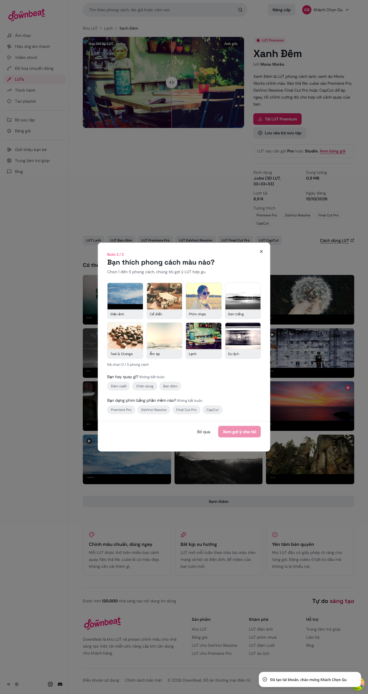
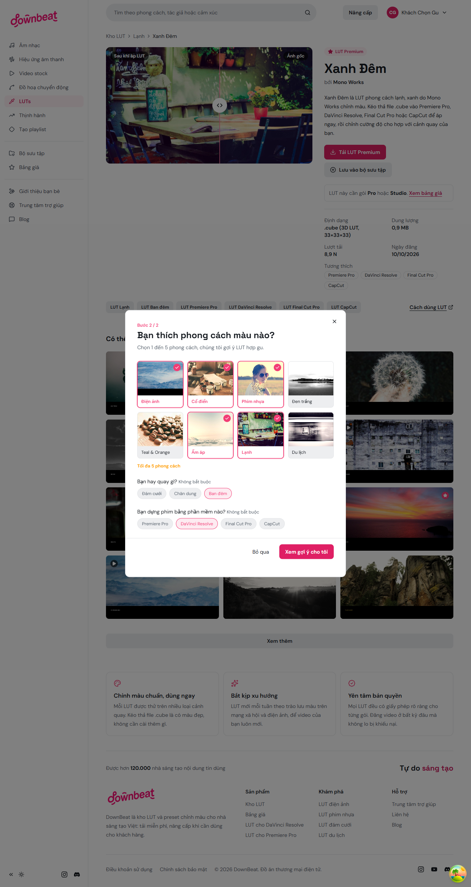
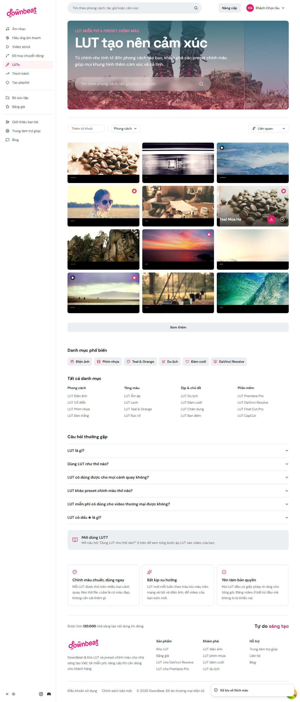
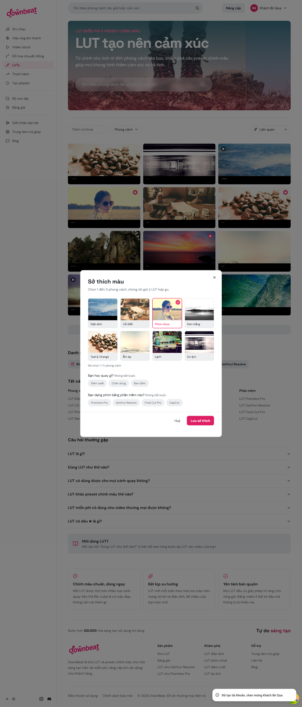
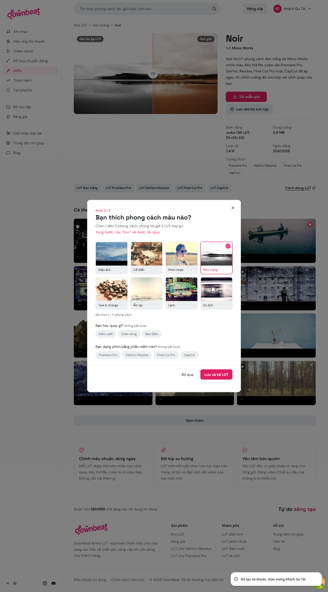
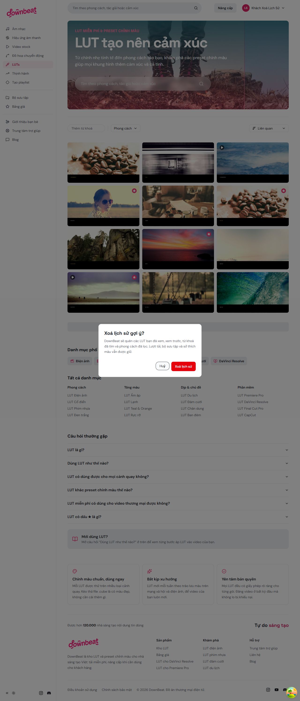
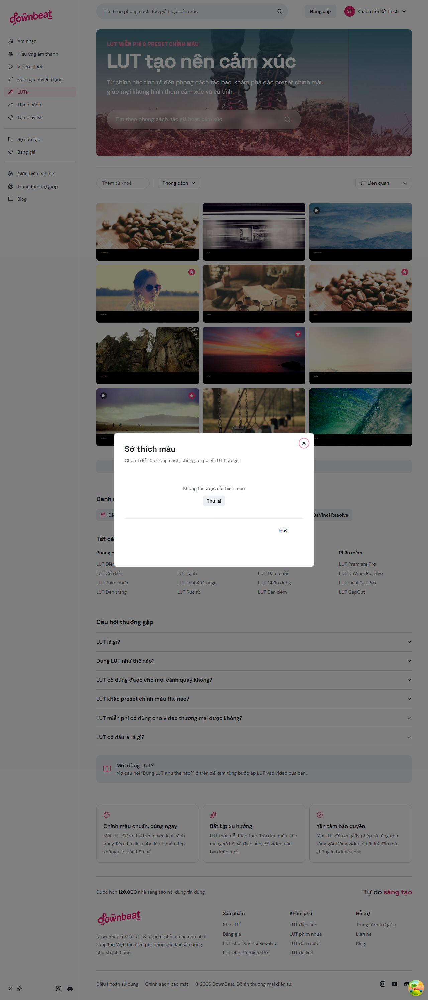
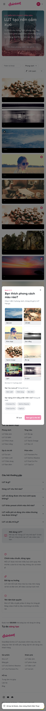

# Hồ sơ người dùng (thu tín hiệu, sở thích màu, gộp phiên ẩn danh, hồ sơ P_u, cold-start)

> Plan: [plan/ho-so-nguoi-dung.md](../../plan/ho-so-nguoi-dung.md) · API: `GET|POST /api/account/preference`, `POST /api/recommend/public/event`, `POST /api/recommend/public/profile`, `POST /api/recommend/merge-anon`, `POST /api/recommend/clear-history` · Giao diện: bước 2 "Bạn thích phong cách màu nào?" sau đăng ký, mục "Sở thích màu" và "Xoá lịch sử gợi ý" ở menu tài khoản · Phạm vi: backend + frontend

## 1. Mục tiêu

Hệ gợi ý cần biết gu màu của từng khách, kể cả khách chưa đăng nhập. Chức năng này làm hai việc:

1. **Thu tín hiệu.** Cửa hàng gửi về backend bốn hành vi nhẹ: mở trang chi tiết (`VIEW`), kéo thanh so sánh hoặc xem video đủ 3 giây (`PREVIEW`), tìm theo từ khoá (`SEARCH`), bật một phong cách trên thanh lọc (`FILTER_STYLE`). Khách vãng lai được nhận diện bằng `anonId` (UUID lưu ở trình duyệt); đăng nhập hoặc đăng ký xong thì các hành vi đó được gộp vào tài khoản. Khách cũng khai báo sở thích ngay sau khi đăng ký (bước 2) hoặc sửa sau ở menu tài khoản.
2. **Dựng hồ sơ người dùng P_u** theo thiết kế §7.4 và §7.5.1: đọc 5 nguồn (sự kiện, bộ sưu tập, lượt tải, đơn đã thanh toán có `source_lut_id`, sở thích khai báo), gộp theo cặp, suy giảm theo thời gian, trộn khai báo với hành vi bằng α = k / (k + n), rồi xác định chiến lược `PROFILE`, `PREFERENCE` hoặc `POPULAR`.

Hồ sơ là đầu vào của lát "Dành cho bạn" (2.3). Để kiểm được ngay ở lát này, có thêm API chỉ đọc `POST /recommend/public/profile` trả bản tóm tắt hồ sơ của chính người gọi.

Chưa làm (để lát sau): `for-you`, `dismiss` (API ghi `DISMISS`), `rec_impression`, resource `RECOMMEND`, câu giải thích, MMR, khối "Dành cho bạn" ở `/luts`, trang quản trị xem hồ sơ khách.

## 2. Luồng hoạt động

**Khách vãng lai xem LUT rồi đăng ký.** Lần đầu mở cửa hàng, trình duyệt sinh `anonId` và lưu ở `localStorage["downbeat.anonId"]`. Mở `/luts/noir` gửi `VIEW`; kéo thanh "Vị trí so sánh trước / sau" gửi `PREVIEW` (đúng một lần mỗi lần mở trang); gõ từ khoá ở `/luts` gửi `SEARCH` sau 1 giây (chỉ khi có kết quả); bật phong cách trên thanh lọc gửi `FILTER_STYLE`. Mọi lần gửi không chờ và bỏ qua lỗi. Khi khách đăng ký hoặc đăng nhập xong, giao diện gọi `merge-anon` để chuyển các dòng ẩn danh sang tài khoản.

**Bước 2 sau đăng ký.** Đăng ký xong, hộp thoại chuyển sang "Bước 2 / 2 — Bạn thích phong cách màu nào?": 8 ô phong cách có ảnh mẫu (chọn 1 đến 5), thêm dịp quay và phần mềm dựng (không bắt buộc), có nút "Bỏ qua". Lưu thì gọi `POST /account/preference`, hiện toast "Đã lưu sở thích màu" và chuyển tới `/luts`. Nếu khách đăng ký vì bấm tải hoặc lưu bộ sưu tập, bước 2 vẫn hiện kèm dòng nhắc việc đang dở và nút chính đổi thành "Lưu và tải LUT" / "Lưu và tiếp tục"; lưu hoặc bỏ qua xong thì việc dở được làm tiếp. Đăng ký để mua gói không hiện bước 2; đăng nhập chỉ gọi `merge-anon`.

**Tính hồ sơ (`UserProfileService.profileOf`).**

1. Khoá cache là `u:{userId}` (có token) hoặc `a:{anonId}`; còn trong 5 phút và chỉ mục chưa bị dựng lại thì trả luôn.
2. Đọc tín hiệu 180 ngày gần nhất: `user_event`; với người đã đăng nhập thêm `collection_item` (FAVORITE), `download_log` (DOWNLOAD), `payment_order` PAID có `source_lut_id` (PURCHASE) và `user_preference`.
3. Bỏ tín hiệu của LUT không còn trong chỉ mục (đã ẩn), `SEARCH` không khớp thẻ hay từ nào, `FILTER_STYLE` không phải phong cách đang có; giữ 200 cặp gần nhất.
4. Tính c = w · (1 + ln(số lần)) · 0.5^(số ngày / 30) cho từng cặp, ra hồ sơ hành vi H_u; từ sở thích ra hồ sơ khai báo E_u; trộn P_u = α · E_u + (1 − α) · H_u.

**Xoá cache.** Thêm hoặc bỏ LUT trong bộ sưu tập, xoá bộ, tải LUT, đơn có `source_lut_id` chuyển PAID, lưu sở thích, `merge-anon` và `clear-history` đều phát `UserSignalChangedEvent`; sau commit, listener xoá cache hồ sơ của khách. `VIEW`, `PREVIEW`, `SEARCH`, `FILTER_STYLE` không xoá cache nên hồ sơ phản ánh chúng chậm tối đa 5 phút. Chỉ mục sản phẩm vừa dựng lại thì bản hồ sơ trong cache bị tính lại ở lần đọc kế tiếp. Lúc 00:30 hằng ngày, `user_event` cũ hơn 180 ngày bị xoá.

**Ngoại lệ.**

- `event` có `type` ngoài 4 loại, `lutId` thiếu hoặc không xuất bản, từ khoá rỗng, phong cách không có, không token mà `anonId` sai định dạng, hoặc trùng trong 30 phút: vẫn trả 200 với `result = false`, không ghi gì.
- `account/preference` có slug không tồn tại hoặc đã ẩn, quá 12 mục, hoặc thiếu `categorySlugs`: 400 `PREFERENCE_INVALID` "Lựa chọn không hợp lệ", lựa chọn cũ giữ nguyên.
- `account/preference`, `merge-anon`, `clear-history` không token: 401 (do bộ lọc có sẵn).
- `merge-anon` có `anonId` thiếu hoặc sai định dạng: 200, `result = 0`, không ghi gì.
- Gửi sự kiện lỗi mạng hoặc 5xx: giao diện bỏ qua, không toast. `localStorage` bị chặn: dùng `anonId` tạm trong bộ nhớ cho phiên đó.

## 3. Hồ sơ người dùng và công thức

| Đại lượng | Cách tính |
|---|---|
| Trọng số sự kiện w | `VIEW` 1, `PREVIEW` 2, `SEARCH` 0,5, `FILTER_STYLE` 0,5, `FAVORITE` 4, `DOWNLOAD` 5, `PURCHASE` 6, `DISMISS` −4 |
| Hệ số c của một cặp (LUT, loại) | w · (1 + ln(số lần)) · 0,5^(số ngày / 30); số ngày âm coi là 0; `half-life-days ≤ 0` thì bỏ suy giảm |
| H_u (5 khối rời rạc: thẻ, danh mục, phong cách, văn bản, tác giả) | Σ c · x / Σ \|c\|, tử và mẫu **chỉ tính cặp có góp vào khối đó**; `DISMISS` kéo hồ sơ ra xa |
| H_u (khối màu) | Trung bình có trọng số c của vector z các LUT có c > 0; `DISMISS` không trừ khối màu |
| `SEARCH` | Từ khoá khớp thẻ nào thì góp vào khối thẻ, đồng thời góp vào khối văn bản; không góp khối khác |
| `FILTER_STYLE` | Chỉ góp vào khối phong cách |
| E_u | Phong cách: one-hot trung bình; danh mục: multi-hot × IDF, bỏ nhóm phần mềm; thẻ, văn bản, màu **mượn trọng tâm** các LUT thuộc danh mục đã chọn |
| n | Số LUT khác nhau có ít nhất một cặp c > 0 |
| α | k / (k + n), k = 5 (`cold-start-k`) |
| P_u | α · E_u + (1 − α) · H_u; màu: một bên thiếu thì lấy nguyên bên còn lại |

| Điều kiện | `strategy` | α |
|---|---|---|
| n ≥ 1, có khai báo | `PROFILE` | 5 / (5 + n) |
| n ≥ 1, không khai báo | `PROFILE` | 0 |
| n = 0, có khai báo | `PREFERENCE` | 1 |
| n = 0, không khai báo, chỉ có `SEARCH` / `FILTER_STYLE` | `PROFILE` | 0 |
| Còn lại (không gì, hoặc chỉ `DISMISS`) | `POPULAR` | 0 |

Ví dụ: khách xem 5 LUT khác nhau và có khai báo sở thích thì n = 5, α = 0,5; xem một LUT nhiều lần vẫn là n = 1, α = 0,8333 (kiểm bằng unit test TC-07).

Cấu hình nằm ở khối `recommend.*` của `application.yml`: `event.*` (trọng số), `half-life-days` (30), `history-days` (180), `history-max-pairs` (200), `cold-start-k` (5), `event-dedup-minutes` (30), `profile-cache-minutes` (5), `preference-max` (12), `event-cleanup-cron` (`0 30 0 * * *`).

## 4. Cơ sở dữ liệu

Migration `V11__ho_so_nguoi_dung.sql`: hai bảng, không seed, không thêm resource phân quyền.

**`user_preference`** (sở thích khai báo)

| Cột | Kiểu | Ghi chú |
|---|---|---|
| `id` | int PK AUTO_INCREMENT | Thêm so với thiết kế vì `AbsMysqlRepository` yêu cầu cột `id` |
| `user_id` | int NOT NULL | FK → `user_app(id)` ON DELETE CASCADE |
| `category_id` | int NOT NULL | FK → `lut_category(id)` ON DELETE CASCADE |
| `created_time` | datetime NOT NULL | Mặc định `CURRENT_TIMESTAMP` |

Ràng buộc `uk_user_preference (user_id, category_id)`. Mỗi lần lưu là DELETE hết dòng của khách rồi INSERT lại trong một giao dịch.

**`user_event`** (hành vi)

| Cột | Kiểu | Ghi chú |
|---|---|---|
| `id` | bigint PK AUTO_INCREMENT | |
| `user_id` | int NULL | FK → `user_app(id)` ON DELETE CASCADE; NULL với khách vãng lai |
| `anon_id` | char(36) NULL | UUID chữ thường; service bảo đảm có ít nhất một trong `user_id`, `anon_id` |
| `event_type` | varchar(20) NOT NULL | `VIEW`, `PREVIEW`, `SEARCH`, `FILTER_STYLE`, `DISMISS` (`DISMISS` do lát 2.3 ghi) |
| `lut_id` | int NULL | FK → `lut(id)` ON DELETE CASCADE; NULL với `SEARCH`, `FILTER_STYLE` |
| `value` | varchar(100) NULL | Từ khoá đã chuẩn hoá hoặc slug phong cách; collation `utf8mb4_0900_as_cs` để "hoàng hôn" và "hoang hon" là hai từ khoá khác nhau |
| `impression_id` | bigint NULL | Không FK (bảng `rec_impression` thuộc lát 2.3) |
| `created_time` | datetime NOT NULL | Service ghi `LocalDateTime.now(clock)` |

Chỉ mục: `idx_user_event_user (user_id, created_time)`, `idx_user_event_anon (anon_id, created_time)`, `idx_user_event_lut (lut_id, event_type)`, `idx_user_event_created (created_time)`. Xoá cứng (`clear-history`, tác vụ 00:30, CASCADE khi xoá người dùng hoặc LUT).

## 5. Backend

- `business.account`: `PreferenceService` (`get`, `save`, `slugs`), `UserPreferenceRepository`, `UserSignalChangedEvent` (record dùng chung để `download`, `collection`, `billing` phát sự kiện mà không phụ thuộc `recommend`); `AccountController` thêm `GET` và `POST /account/preference`.
- `business.recommend`: `EventService` (`record`, `mergeAnon`, `clearHistory`, `cleanup` theo `@Scheduled` 00:30), `UserEventRepository`, `UserProfileService` (cache Caffeine 5 phút, tối đa 10 000 khoá), `UserProfileCacheListener` (`@TransactionalEventListener(AFTER_COMMIT)`), `RecommendController`.
- `business.recommend.profile`: `ProfileBuilder` và `UserProfile` là lớp thuần Java, không phụ thuộc Spring, nhận thời điểm tham chiếu làm tham số để lát đánh giá (3.1) gọi lại được.
- Nguồn tín hiệu thêm vào các package có sẵn: `CollectionRepository.favoriteSignals`, `DownloadLogRepository.downloadSignals`, `PaymentOrderRepository.purchaseSignals` (mỗi hàm một câu `GROUP BY`).
- `LutVectorIndex` thêm `tagDictionary()`, `categoryDictionary()`, `styleSet()`, `slug(id)`; `LutService.existsPublishedStyle`; `LutCategoryService.activeIdsBySlugs`.
- `authenticate`: `JwtAuthenticationFilter` ở đường dẫn công khai (`/x/public/**`) nhận **token tuỳ chọn**: token hợp lệ thì gắn principal; thiếu, sai hoặc hết hạn thì đi tiếp như khách vãng lai, không bao giờ trả 401. Các API công khai cũ bỏ qua principal nên hành vi không đổi.

### API

Thành công: `{ "code": 200, "message": "OK", "result": … }`.

| Method | Đường dẫn | Quyền | Chức năng | `result` |
|---|---|---|---|---|
| GET | `/api/account/preference` | token | Đọc sở thích đã lưu | `{ categorySlugs }` (danh mục đang hiện, sắp theo `sort_order`) |
| POST | `/api/account/preference` | token | Lưu sở thích, thay toàn bộ | `{ categorySlugs }` sau khi lưu |
| POST | `/api/recommend/public/event` | công khai, token tuỳ chọn | Ghi một hành vi | `true` nếu đã ghi, `false` nếu bỏ qua |
| POST | `/api/recommend/public/profile` | công khai, token tuỳ chọn | Tóm tắt hồ sơ của chính người gọi | `{ strategy, alpha, positiveLutCount, preference, topStyles, topCategories, topTags, signals }` |
| POST | `/api/recommend/merge-anon` | token | Gộp sự kiện ẩn danh vào tài khoản | Số dòng đã gộp |
| POST | `/api/recommend/clear-history` | token | Xoá `user_event` của khách (và dòng ẩn danh của `anonId`) | Tổng số dòng đã xoá |

Quy tắc đáng chú ý:

- **Sở thích:** gồm mọi nhóm danh mục; bỏ phần tử rỗng, bỏ trùng, tối đa 12 mục, mọi slug phải là danh mục đang hiện; lỗi thì không ghi gì. Việc kiểm "1 đến 5 phong cách" thuộc giao diện.
- **Sự kiện:** `type` phân biệt hoa thường; `VIEW`, `PREVIEW` cần LUT đã xuất bản; `SEARCH` chuẩn hoá NFC → chữ thường → gộp khoảng trắng → cắt 100 ký tự; `FILTER_STYLE` phải là phong cách của ít nhất một LUT đã xuất bản. Không ghi lặp cùng danh tính, loại và LUT (hoặc `value`) trong 30 phút. Có token thì ghi `user_id` từ token, `userId` không bao giờ lấy từ body.
- **Hồ sơ tóm tắt:** có token thì trả hồ sơ tài khoản, không token thì hồ sơ ẩn danh theo `anonId`, `anonId` sai thì hồ sơ rỗng `POPULAR`. Dùng chung cache với `for-you` sau này. `topStyles`, `topCategories`, `topTags` lấy 3, 3, 5 phần tử đầu của P_u; `signals` là các cặp đã dùng, sắp theo `|weight|` giảm dần.
- **`clear-history`:** không đụng `download_log`, `collection_item`, `payment_order`, `user_preference`, nên hồ sơ vẫn còn các tín hiệu đó.

| Tình huống | HTTP | errorCode | Message |
|---|---|---|---|
| Không token hoặc token sai ở `account/preference`, `merge-anon`, `clear-history` | 401 | `LOGIN` / `UNAUTHORIZED` / `TOKEN_EXPIRED` (bộ lọc có sẵn) | (message của bộ lọc) |
| Sở thích: thiếu `categorySlugs`, slug không có hoặc đã ẩn, quá 12 mục | 400 | `PREFERENCE_INVALID` | Lựa chọn không hợp lệ |

## 6. Giao diện

- **Ghi sự kiện (không có giao diện riêng):** `lib/recommend/anon-id.ts` (`getAnonId()` bọc `try/catch`), `lib/recommend/track.ts` (`trackEvent`, gửi không chờ, chỗ duy nhất nuốt lỗi). `VIEW` ở `lut-detail.tsx`, `PREVIEW` ở `lut-compare.tsx` và `lut-video-preview.tsx` (tối đa một lần mỗi lần mở trang), `SEARCH` (chờ 1 giây, chỉ khi trang đầu có kết quả) và `FILTER_STYLE` ở `lut-browser.tsx`. Ứng dụng chạy `StrictMode` nên mỗi chỗ giữ `useRef` để không gửi lặp.
- **Gộp phiên:** `loginMutationOptions` và `registerMutationOptions` gọi `merge-anon` sau khi đặt người dùng, không chờ.
- **Hộp thoại `preference`** (`components/shop/account/preference-panel.tsx`, chế độ `onboarding` và `edit`): nhãn "Bước 2 / 2" (chỉ ở `onboarding`), tiêu đề "Bạn thích phong cách màu nào?" / "Sở thích màu", lưới 8 ô phong cách có ảnh mẫu (2 cột trên điện thoại, 4 cột từ `sm`), bộ đếm "Đã chọn n / 5 phong cách" (ô thứ 6 không được chọn, hiện "Tối đa 5 phong cách"), nhóm "Bạn hay quay gì?" (Đám cưới, Chân dung, Ban đêm) và "Bạn dựng phim bằng phần mềm nào?" (Premiere Pro, DaVinci Resolve, Final Cut Pro, CapCut). Chân dính đáy gồm "Bỏ qua" và nút chính; nút chính tắt khi chưa chọn phong cách nào. Ở chế độ sửa, mở hộp thoại là gọi `GET /account/preference`; lỗi thì hiện "Không tải được sở thích màu" kèm "Thử lại".
- **Menu tài khoản** (`header-actions.tsx`): thêm "Sở thích màu" (dưới "Bộ sưu tập của tôi") và "Xoá lịch sử gợi ý" (dưới "Sở thích màu", trên "Đăng xuất"). "Xoá lịch sử gợi ý" mở AlertDialog `clear-history-dialog.tsx` với nút "Xoá lịch sử" và "Huỷ".
- **Quyền:** không có resource; mọi người dùng đã đăng nhập thao tác trên dữ liệu của chính mình.

### Hình ảnh

Hộp thoại "Bước 2 / 2" ngay sau khi đăng ký: 8 ô phong cách có ảnh mẫu, nút "Xem gợi ý cho tôi" còn tắt.

Đã chọn vài phong cách, dịp quay và phần mềm; bộ đếm cập nhật và nút chính bật.

Sau khi lưu, toast "Đã lưu sở thích màu" hiện và trang chuyển tới `/luts`.

Mục "Sở thích màu" ở menu tài khoản: cùng bố cục, không có nhãn bước, các ô đã lưu được tích sẵn.

Đăng ký để tải LUT: bước 2 có dòng nhắc việc đang dở và nút "Lưu và tải LUT".

Hộp thoại xác nhận "Xoá lịch sử gợi ý?" với mô tả nói rõ lượt tải, bộ sưu tập và sở thích vẫn được giữ.

Khi `GET /account/preference` lỗi, hộp thoại hiện "Không tải được sở thích màu" cùng nút "Thử lại".

Bước 2 trên màn hình 390 × 844: lưới 2 cột, không tràn ngang, nút chính luôn thấy được.

## 7. Kiểm thử

### JUnit (backend)

Module `business`: 92 test, 0 lỗi, 0 bỏ qua. Module `authenticate`: 37 test, 0 lỗi, 0 bỏ qua (trong đó `JwtAuthenticationFilterTest` 2 test). Phần của lát này gồm `ProfileBuilderTest` (9), `EventServiceTest` (2), `UserProfileServiceTest` (1), `PreferenceServiceTest` (1), `CrossPackageSignalEventTest` (1), cộng các test có sẵn được sửa theo constructor mới.

| TC | Nội dung | Kết quả |
|---|---|---|
| TC-01 | UT-07: hệ số suy giảm (30 ngày còn một nửa, nhiều lần, `half-life-days = 0`, số ngày âm) | Pass |
| TC-02 | Hồ sơ hành vi H1 tính tay trên kho 3 LUT | Pass |
| TC-03 | `DISMISS` kéo hồ sơ ra xa, không đụng khối màu | Pass |
| TC-04 | `SEARCH` / `FILTER_STYLE` vào đúng khối, mẫu số theo khối | Pass |
| TC-05 | Khớp từ khoá với thẻ (kể cả đồng nghĩa "b&w") | Pass |
| TC-06 | UT-08: chỉ có khai báo, α = 1, `PREFERENCE` | Pass |
| TC-07 | UT-09: trộn khai báo và hành vi (α = 0,7143; 0,5; 0,8333) | Pass |
| TC-08 | Bảng strategy (6 tình huống) | Pass |
| TC-09 | Giới hạn 180 ngày, 200 cặp, LUT không có trong chỉ mục, chỉ mục null | Pass |
| TC-10 | `EventService.record`: các trường hợp bỏ qua, chuẩn hoá, token + anonId | Pass |
| TC-11 | `mergeAnon`, `clearHistory`, `cleanup` | Pass |
| TC-12 | `PreferenceService.save` (null, slug lạ, quá 12, bỏ trùng, rỗng) | Pass |
| TC-13 | Cache hồ sơ: đọc một lần, `evict`, chỉ mục đổi, khoá ẩn danh tách biệt | Pass |
| TC-14 | Phát `UserSignalChangedEvent` từ download, collection, billing (9 tình huống) | Pass |
| TC-15 | Token tuỳ chọn ở đường dẫn công khai (5 tình huống) | Pass |

### Playwright (`frontend/tests/e2e/ho-so-nguoi-dung.spec.ts`)

Tổng **28/28 pass** (13 API + 15 giao diện), chạy có giao diện, slowMo 400. Hồi quy các spec cũ có thêm bước "Bỏ qua" (`bo-suu-tap`, `shop-flows`, `tai-khoan-khach`, `tai-lut`): 99/99 pass.

| TC | Nội dung | Kết quả |
|---|---|---|
| TC-16 | Không token: 4 API cần token trả 401; `event`, `profile` vẫn 200 | Pass |
| TC-17 | Lưu và đọc sở thích (bỏ trùng, theo `sort_order`, lưu `[]`) | Pass |
| TC-18 | `PREFERENCE_INVALID`; lỗi không xoá lựa chọn cũ; 12 mục vẫn hợp lệ | Pass |
| TC-19 | API-07: chống ghi lặp 30 phút | Pass |
| TC-20 | Sự kiện bị bỏ qua vẫn 200, hồ sơ `POPULAR` | Pass |
| TC-21 | Chuẩn hoá từ khoá, cắt 100 ký tự, `FILTER_STYLE` lặp | Pass |
| TC-22 | Khách vãng lai xem 3 LUT lạnh: `PROFILE`, `topStyles[0]` = lanh | Pass |
| TC-23 | API-03 (phần hồ sơ) + cache 5 phút | Pass |
| TC-24 | Sự kiện khi có token và khi token hỏng | Pass |
| TC-25 | API-08: gộp phiên | Pass |
| TC-26 | API-09: bộ sưu tập, tải, `clear-history` | Pass |
| TC-27 | Tín hiệu mua gói (`sourceLutId`) | Pass |
| TC-28 | `clear-history` kèm `anonId` xoá cả dòng ẩn danh | Pass |
| TC-29 | UI: `VIEW`, `PREVIEW` ở trang chi tiết | Pass |
| TC-30 | UI: `PREVIEW` bằng video sau 3 giây (chạy thật, không bỏ qua) | Pass |
| TC-31 | UI: `SEARCH` chờ 1 giây, chỉ khi có kết quả, đổi nhanh chỉ gửi một lần | Pass |
| TC-32 | UI: `FILTER_STYLE` chỉ gửi khi bật | Pass |
| TC-33 | UI: lỗi 500 khi gửi sự kiện không ảnh hưởng trang | Pass |
| TC-34 | UI: `localStorage` bị chặn vẫn có `anonId` tạm | Pass |
| TC-35 | UI-02: đăng ký rồi chọn phong cách, `merge-anon`, giới hạn 5, body đúng thứ tự | Pass |
| TC-36 | UI-03: "Bỏ qua" rồi sửa ở menu "Sở thích màu" | Pass |
| TC-37 | Đăng ký để tải: bước 2 rồi tải | Pass |
| TC-38 | Đăng ký để lưu bộ sưu tập: bước 2 rồi hộp thoại lưu | Pass |
| TC-39 | Không hiện bước 2 khi mua gói hoặc đăng nhập | Pass |
| TC-40 | Gộp phiên khi đăng nhập | Pass |
| TC-41 | Xoá lịch sử gợi ý | Pass |
| TC-42 | Lỗi tải sở thích rồi "Thử lại" | Pass |
| TC-43 | Điện thoại 390 × 844: không tràn ngang | Pass |

Ghi chú: TC-16 đến TC-28 là nhóm "API" (13 test), TC-29 đến TC-43 là nhóm giao diện (15 test). `pnpm build` thành công, `pnpm lint` 0 lỗi (1 cảnh báo có sẵn).

## 8. Điểm lệch plan và hạn chế

- **Vòng sửa**: backend 0, frontend 1. Lỗi duy nhất: khi đang ở `/luts`, lưu bước 2 không việc dở vẫn gọi `navigate({ to: "/luts" })` làm mất bộ lọc, trái §6.2 "ở yên". Đã sửa bằng `useLocation` (đang ở `/luts` thì chỉ đóng hộp thoại).
- **TC-34 đổi cách giả lập**: ghi đè `Storage.prototype` làm sập `@tanstack/react-router` vì thư viện gọi `sessionStorage.getItem` lúc nạp module mà không bọc `try/catch`. Spec giả lập đúng kiểu trình duyệt chặn thật (truy cập `window.localStorage` / `sessionStorage` ném `SecurityError`). Code ứng dụng không sai.
- **TC-21 kiểm chuẩn hoá gián tiếp**: `signals` chỉ chứa cặp đã dùng, mà chuỗi "a" × 100 không khớp thẻ nào nên không có trong `signals`. Spec kiểm chuẩn hoá và cắt 100 ký tự bằng chống ghi lặp (gửi lại chuỗi đã chuẩn hoá thì `false`, chuỗi "a" × 99 thì `true`).
- **Ảnh mẫu 8 ô phong cách** lấy bằng 8 lần `POST /lut/public/list` có sẵn (sort `popular`, limit 1, cache 10 phút), không thêm API mới; plan §6.2 ghi nhầm là GET.
- **API `profile` là thêm so với thiết kế**: ai có `anonId` của một trình duyệt thì xem được lịch sử ẩn danh của trình duyệt đó (mã chỉ nằm trong `localStorage`). Dùng lại được cho công cụ "Thử hồ sơ" ở lát 2.4.
- **Hạn chế**: chống ghi lặp không khoá, hai request giống hệt cùng lúc có thể cùng được ghi (ảnh hưởng chỉ là đếm thêm một lần, `ln(số lần)` làm nó gần như không đổi hồ sơ); hộp thoại "Sở thích màu" chỉ có các ô / chip của §6.2 nên slug lưu qua API ngoài danh sách đó sẽ mất khi khách lưu lại từ giao diện; khách cũ chưa từng khai báo không tự thấy bước 2.
