# Kho LUT (API công khai, dữ liệu mẫu thật, cửa hàng đọc từ backend)

> Plan: [plan/kho-lut.md](../../plan/kho-lut.md) · Route: `/`, `/luts`, `/luts/<slug>`, `/luts/danh-muc/<slug>` · Phạm vi: backend + frontend + công cụ nạp dữ liệu mẫu

## 1. Mục tiêu

Trước chức năng này, mọi trang cửa hàng đọc LUT và danh mục từ dữ liệu giả nằm trong mã frontend, ảnh lấy từ picsum và màu "sau khi áp LUT" chỉ được giả lập bằng CSS `filter`. Chức năng này chuyển toàn bộ sang backend thật:

- Lưu LUT, tác giả, danh mục, thẻ vào MySQL (migration `V3`).
- Cung cấp 6 endpoint công khai (không cần đăng nhập) để xem danh sách, lọc, tìm, xem chi tiết, LUT liên quan, gợi ý tìm kiếm và danh mục.
- Nạp 36 LUT mẫu có **file .cube thật** (bucket riêng tư) và **ảnh trước / sau / bìa thật** (bucket công khai). Ảnh sau được sinh bằng cách áp chính file .cube lên ảnh gốc, nên các chức năng sau (tải LUT, gợi ý theo đặc trưng màu) có dữ liệu đúng để dùng.

Đối tượng sử dụng: khách vãng lai, thành viên và quản trị đều xem được như nhau. Mọi endpoint chỉ đọc dữ liệu đã xuất bản, không có quyền hay resource riêng. Màn hình quản trị LUT, upload, tải LUT và thanh toán thuộc các chức năng sau.

## 2. Luồng sử dụng

1. Khách mở `/luts`: giao diện gọi `GET /lut/public/list` (trang 1, 12 LUT) và danh sách danh mục, hiển thị 12 thẻ với ảnh lấy từ bucket `downbeat-public`.
2. Khách nhập từ khoá, thêm từ khoá, chọn phong cách hoặc đổi cách sắp xếp. Bộ lọc được ghi lên URL rồi gọi lại `list`. Cuộn xuống hoặc bấm "Xem thêm" để tải trang tiếp theo tới khi hết.
3. Khách bấm một thẻ: trang chi tiết gọi `get` để hiện thanh so sánh ảnh trước / sau (hoặc video xem trước), rồi gọi `related` cho khối "LUT liên quan".
4. Khách gõ vào ô tìm kiếm ở header: gọi `suggest`, hiện tối đa 4 LUT khớp.
5. Khách bấm một danh mục: gọi `lut-category/public/get` (tiêu đề, mô tả) cùng `list?category=<slug>`.
6. Trang chủ `/` cũng lấy 12 ảnh bìa LUT phổ biến nhất từ API.

Trường hợp đặc biệt:

- Không có LUT khớp: hiện "Không tìm thấy LUT phù hợp" và nút "Xoá bộ lọc".
- LUT dùng video xem trước (`previewType = VIDEO`): thẻ phát video khi rê chuột, trang chi tiết hiện video thay cho thanh so sánh.
- Slug không có, hoặc LUT đang nháp / bị ẩn, hoặc danh mục bị ẩn: backend trả 404, trang hiện "Không tìm thấy LUT" hoặc "Không tìm thấy danh mục" kèm link "Về kho LUT".
- Backend lỗi hoặc mất mạng: lưới hiện "Không tải được danh sách LUT", trang chi tiết hiện "Không tải được LUT", trang danh mục hiện "Không tải được danh mục", cả ba có nút "Thử lại".
- Trình duyệt còn token quản trị hết hạn: các trang cửa hàng vẫn tải bình thường, không bị đẩy về `/login`.

## 3. Cơ sở dữ liệu

Migration `backend/app/src/main/resources/db/migration/V3__kho_lut.sql` tạo 5 bảng và 16 danh mục. Dữ liệu mẫu (chỉ profile local) ở `backend/app/src/main/resources/db/seed/V3_1__seed_kho_lut.sql`, do công cụ `tools/seed/kho-lut/` sinh ra, không viết tay.

| Bảng | Vai trò | Ghi chú |
|---|---|---|
| `creator` | Tác giả (người chỉnh màu) | `slug` duy nhất, `status` 1 hiện / 0 ẩn |
| `lut` | LUT | `slug` duy nhất; `status` `DRAFT` / `PUBLISHED` / `HIDDEN`; `preview_type` `BEFORE_AFTER` / `VIDEO`; `file_key` là khoá file .cube trong bucket riêng tư |
| `lut_category` | Danh mục | 4 nhóm: `phong-cach`, `tong-mau`, `dip`, `phan-mem` |
| `lut_category_map` | LUT ↔ danh mục | khoá chính `(lut_id, category_id)`, xoá theo LUT / danh mục |
| `lut_tag` | Thẻ của LUT | khoá chính `(lut_id, tag)` |

Quy ước đáng chú ý:

- Các cột chữ tiếng Việt dùng để tìm (`lut.title`, `lut.description`, `lut_tag.tag`, `creator.name`) khai báo collation `utf8mb4_0900_as_ci`: phân biệt dấu, không phân biệt hoa thường ("ấm" ≠ "am" ≠ "âm", "Đêm" = "đêm"). Nhờ đó khoá chính `(lut_id, tag)` không coi "cam" và "cấm" là trùng.
- Không dùng FULLTEXT. Kho tối đa vài trăm LUT nên tìm bằng LIKE quét toàn bảng vẫn nhanh và cho kết quả dễ đoán.
- `file_key` không bao giờ được trả ra API.
- 16 danh mục nằm trong `V3` (mọi môi trường). Dữ liệu mẫu `V3_1` gồm 7 tác giả, 38 LUT (36 `PUBLISHED` cộng 2 bản ghi "bẫy" để kiểm quy tắc chỉ hiện dữ liệu đã xuất bản: một LUT `DRAFT`, một LUT `HIDDEN` có 99999 lượt tải), cùng danh mục ẩn `tet` được gán cho một LUT thật.

## 4. API

Tất cả là `GET`, công khai, dưới `/api`. Phản hồi bọc `{ code, message, result }`. Tham số mảng truyền bằng cách lặp lại tên (`keywords=phim&keywords=grain`).

| Method | Đường dẫn | Mô tả |
|---|---|---|
| GET | `/lut/public/list` | Danh sách, lọc, tìm. Tham số: `q`, `keywords`, `styles`, `category`, `sort` (`relevance` / `newest` / `popular`), `page`, `limit`. Trả `{ total, page, items }` |
| GET | `/lut/public/get?slug=` | Chi tiết một LUT |
| GET | `/lut/public/related?slug=&page=&limit=` | LUT liên quan, cùng dạng trang như `list` |
| GET | `/lut/public/suggest?q=&limit=` | Gợi ý ở ô tìm kiếm, trả mảng LUT |
| GET | `/lut-category/public/list` | Danh mục đang hiện, bộ nhớ đệm Caffeine 10 phút |
| GET | `/lut-category/public/get?slug=` | Chi tiết một danh mục |

Quy tắc chính:

- Chỉ LUT `PUBLISHED`, chỉ danh mục `status = 1`. Phản hồi không có `fileKey`, `status`, `createdBy`; trường rỗng bị bỏ khỏi JSON (LUT video không có `beforeUrl` / `afterUrl`, LUT ảnh không có `previewVideoUrl`).
- Tìm kiếm: `q` và từng phần tử `keywords` là một từ khoá, các từ khoá nối nhau bằng AND. Một từ khoá khớp khi tiêu đề, mô tả, tên tác giả hoặc một thẻ chứa nó. Từ khoá được chuẩn hoá (NFC, bỏ rỗng, bỏ trùng, tối đa 10 từ khoá, mỗi từ khoá tối đa 100 ký tự) và escape `\`, `%`, `_` nên không thể dùng làm ký tự đại diện.
- Điểm liên quan = `4·[khớp tiêu đề] + 3·[khớp thẻ] + 2·[khớp tác giả] + 1·[khớp mô tả]`, đồng điểm thì nhiều lượt tải trước. `newest` xếp theo ngày đăng. `relevance` không có từ khoá xếp như `popular`.
- `page` nhỏ hơn 1 thì về 1; `limit` mặc định 12, tối đa 48 (`suggest` tối đa 10).
- LUT liên quan: điểm = `10·[cùng phong cách]` cộng số danh mục chung.
- Thẻ và danh mục của cả trang lấy bằng 2 truy vấn `WHERE lut_id IN (…)`, không truy vấn theo từng LUT.

Lỗi nghiệp vụ:

| Tình huống | HTTP | errorCode |
|---|---|---|
| `get` / `related`: slug không có, LUT nháp / ẩn | 404 | `DATA_NOT_FOUND` ("Không tìm thấy LUT") |
| `lut-category/public/get`: slug không có hoặc danh mục ẩn | 404 | `DATA_NOT_FOUND` ("Không tìm thấy danh mục") |
| Thiếu `slug` | 400 | có sẵn của Spring |
| Đường dẫn không công khai, không token (ví dụ `/lut/download`) | 401 | `LOGIN` |

Phần dùng chung đã sửa: `JwtAuthenticationFilter` cho qua đường dẫn có đoạn thứ hai là `public` (`^/[a-z0-9-]+/public/.*`) và bỏ qua token trước khi đọc, nên token hỏng không làm hỏng trang công khai; `FileStorageService` tạo hai bucket `downbeat-public` (đọc công khai) và `downbeat-lut` (riêng tư, không có policy).

## 5. Giao diện

Bố cục và nhãn của `/`, `/luts`, `/luts/<slug>`, `/luts/danh-muc/<slug>` và ô tìm kiếm header giữ nguyên, chỉ đổi nguồn dữ liệu và cách hiển thị ảnh:

- Ảnh LUT lấy từ URL của API, không còn picsum và không còn CSS `filter` giả lập màu. Chữ trên bìa đã in sẵn vào `coverUrl`.
- Thẻ ở lưới (LUT ảnh trước / sau): lớp dưới là ảnh gốc, lớp trên là ảnh bìa. Lúc nghỉ ảnh bìa phủ trọn thẻ để chữ không bị cắt; rê chuột thì đường chia chạy theo chuột, rời chuột thì về trọn thẻ. LUT video chỉ hiện ảnh bìa và phát video khi rê chuột.
- Trang chi tiết: thanh so sánh "Ảnh gốc" / "Sau khi áp LUT" bắt đầu ở 55%, chỉnh bằng phím ← →. "Định dạng" hiện `.cube (3D LUT, 33×33×33)` theo `lutSize`; "Ngày đăng" lấy từ `publishedTime`.
- Trang chi tiết và trang danh mục có khung báo lỗi riêng cho lỗi tải (khác 404) với nút "Thử lại".
- Mã: `lib/axios/luts.ts` (gọi API, ánh xạ sang kiểu của component, `isNotFoundError`), `lib/tanstack/options/luts.ts` đổi nguồn, `lib/types/lut.ts` thêm kiểu API. Đã xoá `lib/mock/luts.ts` và `lib/mock/data/luts.ts`.

## 6. Công cụ nạp dữ liệu mẫu

`python tools/seed/kho-lut/build.py` (Python 3.12, Pillow, numpy, minio), chạy một lần trên máy dev:

1. Tải ảnh gốc từ picsum (lưu đệm ở `.cache/`).
2. Sinh file .cube 33³ cho từng LUT từ chuỗi bộ lọc màu của dữ liệu giả cũ theo định nghĩa W3C Filter Effects (LUT rỗng ra LUT đồng nhất).
3. Áp chính file .cube lên ảnh gốc để có `after.jpg`; `before.jpg` là ảnh gốc; `cover.jpg` là ảnh sau đã in chữ.
4. Đẩy lên MinIO (ảnh và video ở `downbeat-public`, file .cube ở `downbeat-lut`), bỏ qua object đã có cùng kích thước.
5. Ghi `V3_1__seed_kho_lut.sql`. Chạy lại cho ra đúng file cũ.

`--self-test` kiểm LUT đồng nhất và kích thước file .cube. Video xem trước của 4 LUT video là mẫu CC0 của MDN, không áp LUT (chỉ để minh hoạ kiểu xem trước bằng video).

## 7. Kiểm thử

| ID | Mô tả | Loại | Kết quả |
|---|---|---|---|
| TC-01 | Danh sách mặc định | API | Pass |
| TC-02 | Mới nhất, bỏ LUT ẩn | API | Pass |
| TC-03 | Phổ biến, bỏ LUT ẩn 99999 lượt | API | Pass |
| TC-04 | Tìm theo tác giả + từ khoá (AND) | API | Pass |
| TC-05 | Xếp theo độ liên quan | API | Pass |
| TC-06 | Phân biệt dấu, không phân biệt hoa thường | API | Pass |
| TC-07 | Lọc phong cách | API | Pass |
| TC-08 | Lọc danh mục | API | Pass |
| TC-09 | Phân trang và giới hạn | API | Pass |
| TC-10 | Ký tự đặc biệt không thành ký tự đại diện | API | Pass |
| TC-11 | Chi tiết LUT ảnh trước / sau | API | Pass |
| TC-12 | Chi tiết LUT video | API | Pass |
| TC-13 | Danh mục ẩn không lộ trong LUT | API | Pass |
| TC-14 | LUT không tìm thấy (404 / 400) | API | Pass |
| TC-15 | LUT liên quan | API | Pass |
| TC-16 | LUT liên quan: trang cuối, gốc không hợp lệ | API | Pass |
| TC-17 | Gợi ý tìm kiếm (kể cả `categories`, `tags`) | API | Pass |
| TC-18 | Danh sách danh mục | API | Pass |
| TC-19 | Chi tiết danh mục | API | Pass |
| TC-20 | Endpoint công khai bỏ qua token | API | Pass |
| TC-21 | Không mở quá rộng | API | Pass |
| TC-22 | Ảnh / video công khai đọc được | API | Pass |
| TC-23 | File .cube không đọc công khai được | API | Pass |
| TC-24 | File .cube hợp lệ (35937 dòng, `file_size_kb` khớp DB) | Kiểm tay | Pass |
| TC-25 | Chạy lại công cụ không đổi gì | Kiểm tay | Pass |
| TC-26 | `/luts` lấy dữ liệu từ API | E2E | Pass |
| TC-27 | Thẻ trước / sau dùng ảnh thật | E2E | Pass |
| TC-28 | Lọc, tìm, sắp xếp trên dữ liệu thật | E2E | Pass |
| TC-29 | Liên quan và phân biệt dấu trên giao diện | E2E | Pass |
| TC-30 | Cuộn hết kho (12 → 24 → 36) | E2E | Pass |
| TC-31 | Trang chi tiết LUT ảnh trước / sau | E2E | Pass |
| TC-32 | LUT xem trước bằng video | E2E | Pass |
| TC-33 | 404 với LUT nháp / ẩn, danh mục ẩn | E2E | Pass |
| TC-34 | Trang danh mục | E2E | Pass |
| TC-35 | Gợi ý tìm kiếm ở header | E2E | Pass |
| TC-36 | Lỗi tải danh sách rồi thử lại | E2E | Pass |
| TC-37 | Lỗi tải trang chi tiết rồi thử lại | E2E | Pass |
| TC-38 | Trang chủ dùng API | E2E | Pass |
| TC-39 | Token quản trị hỏng không chặn cửa hàng | E2E | Pass |
| TC-40 | Chuẩn hoá từ khoá | Unit | Pass |
| TC-41 | Escape LIKE | Unit | Pass |
| TC-42 | Kẹp phân trang, đọc sort | Unit | Pass |
| TC-43 | Chi tiết không tìm thấy | Unit | Pass |
| TC-44 | Liên quan: gốc không tìm thấy | Unit | Pass |
| TC-45 | Ghép thẻ, danh mục theo lô | Unit | Pass |
| TC-46 | Gợi ý: kẹp limit, q rỗng | Unit | Pass |
| TC-47 | Danh mục không tìm thấy | Unit | Pass |
| TC-48 | Cache danh mục | Unit | Pass |
| TC-49 | `fileKey` không ra JSON | Unit | Pass |
| TC-50 | Danh sách trắng của JWT filter | Unit | Pass |
| | **Tổng** | | **50/50 pass** |

Số liệu:

- JUnit: 28 test, 0 lỗi (module `business` 11, module `authenticate` 17).
- Playwright `kho-lut.spec.ts`: 37/37 pass (23 test nhóm API + 14 test giao diện), chạy có giao diện với slowMo 400, 1,1 phút. TC-24 và TC-25 kiểm tay ở bước review backend.
- Hồi quy: `shop-flows.spec.ts` đã sửa để chọn thẻ theo tên thay vì theo vị trí và làm chậm `/lut/public/get` 800 ms để thấy khung chờ (API thật trả nhanh hơn ngưỡng 150 ms), kết quả xanh. `shop-ui.spec.ts` có hai test (cuộn tới cuối, axe) đỏ chập chờn khi chạy nhiều worker song song; chạy `--workers=2 --repeat-each=3` thì 24/24 xanh, nguyên nhân là tải máy. `trang-chu.spec.ts` có 4 test (TC-02, 15, 21, 24) đỏ do chỉnh sửa riêng của người dùng ở trang chủ chưa commit, nằm ngoài phạm vi chức năng này.
- Số vòng sửa: backend 2 (fix1 làm tiếp phần dở sau lần giao đầu thất bại; fix2 sửa `suggest` thiếu `categories` / `tags`, thứ tự danh mục, định dạng mã), frontend 0.

## 8. Ảnh minh hoạ

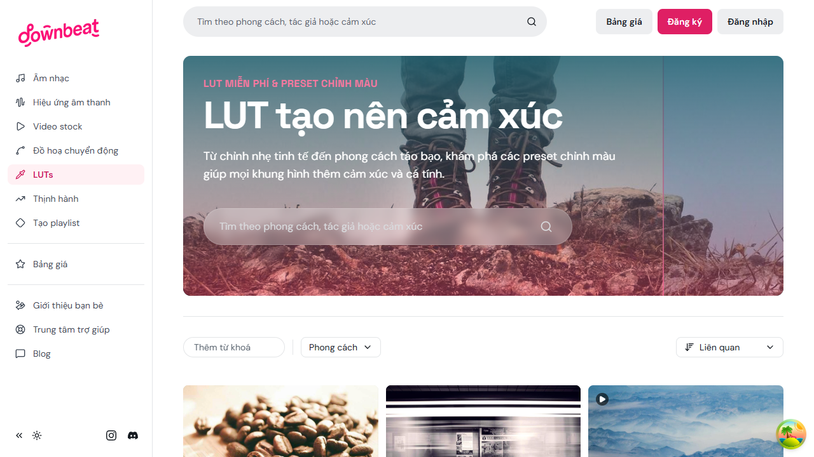

Trang `/luts` với lưới 12 LUT, ảnh bìa lấy từ bucket công khai.

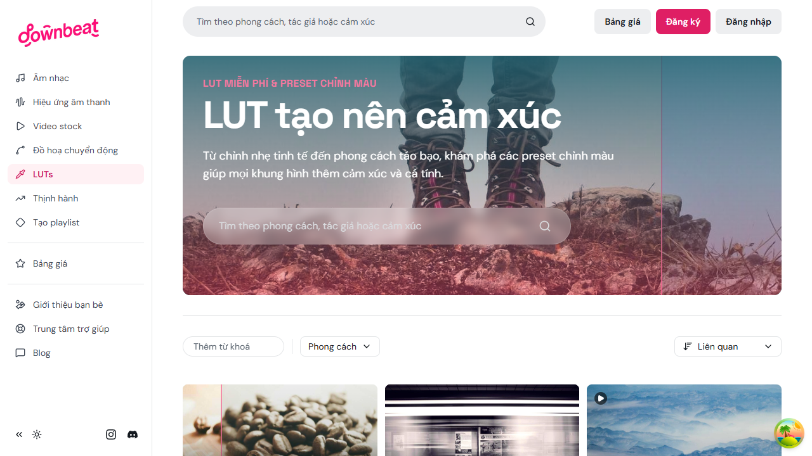

Rê chuột lên thẻ LUT ảnh trước / sau: đường chia chạy theo chuột, nửa trái là ảnh gốc, nửa phải là ảnh sau khi áp LUT.

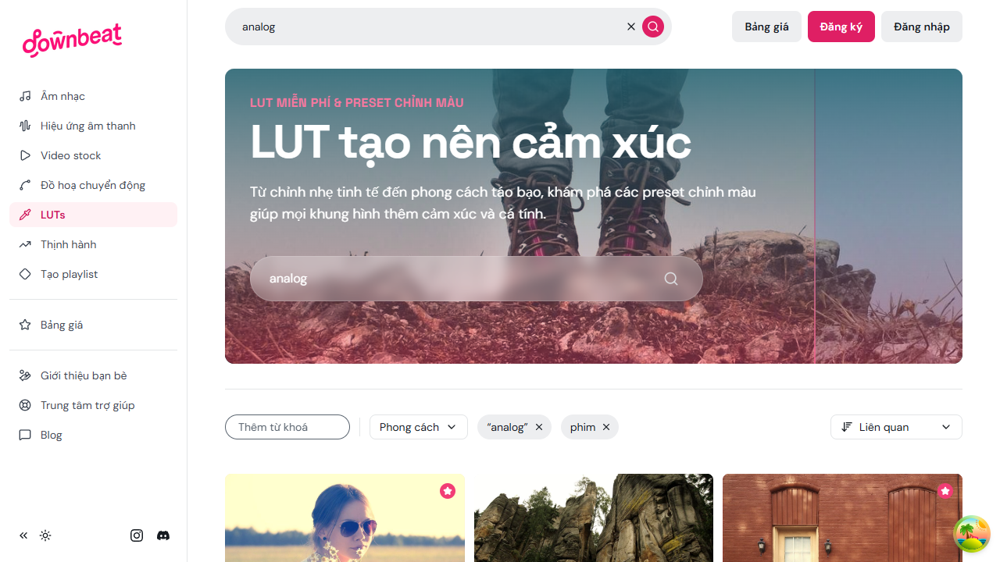

Tìm "analog" kèm từ khoá "phim": URL ghi lại bộ lọc, lưới còn 3 LUT.

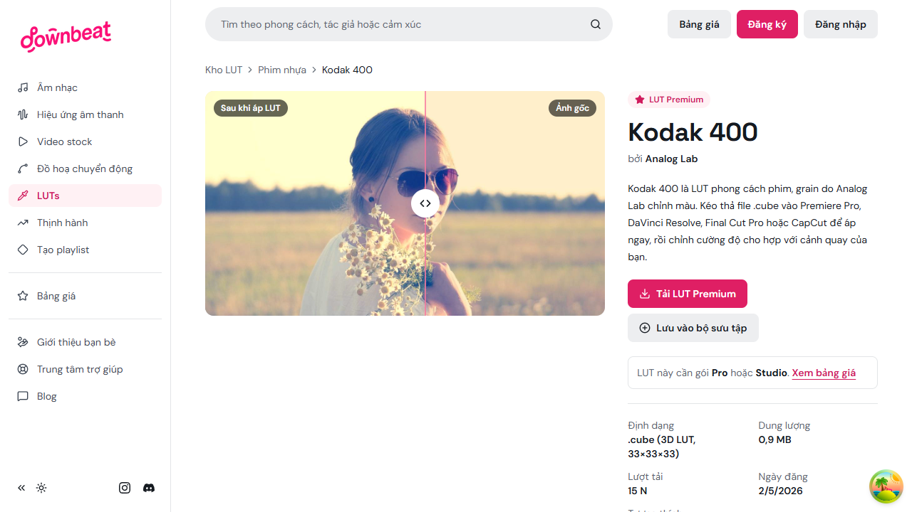

Trang chi tiết "Kodak 400" với thanh so sánh trước / sau, định dạng `.cube (3D LUT, 33×33×33)` và khối "LUT liên quan".

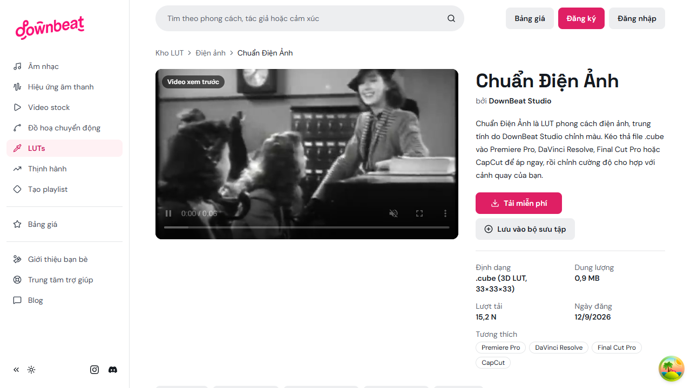

LUT dùng video xem trước: trang chi tiết hiện video thay cho thanh so sánh.

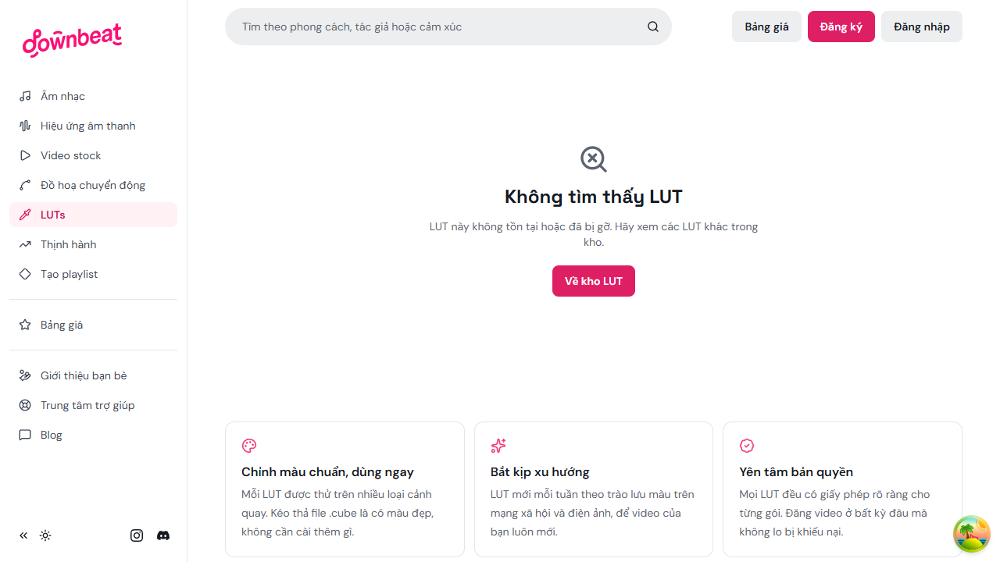

LUT nháp hoặc bị ẩn trả 404 nên trang hiện "Không tìm thấy LUT" kèm link "Về kho LUT".

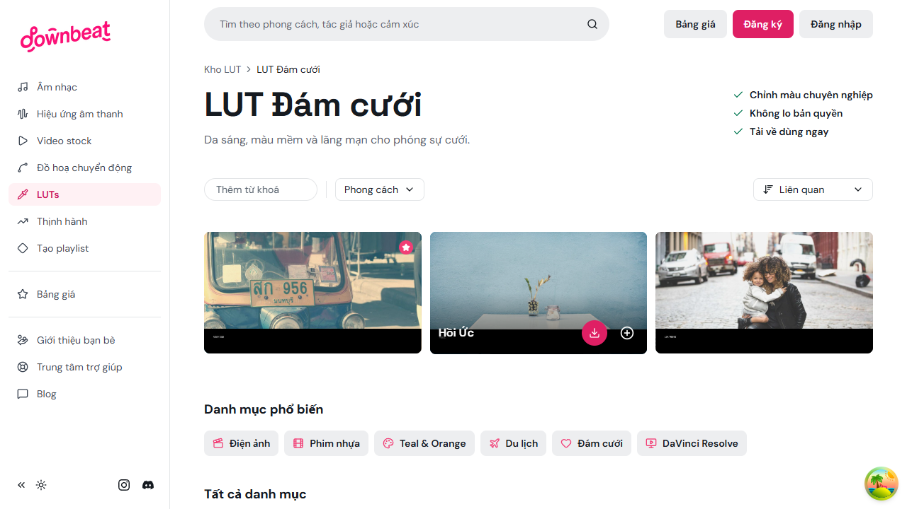

Trang danh mục "Đám cưới" với mô tả và 3 LUT thuộc danh mục.

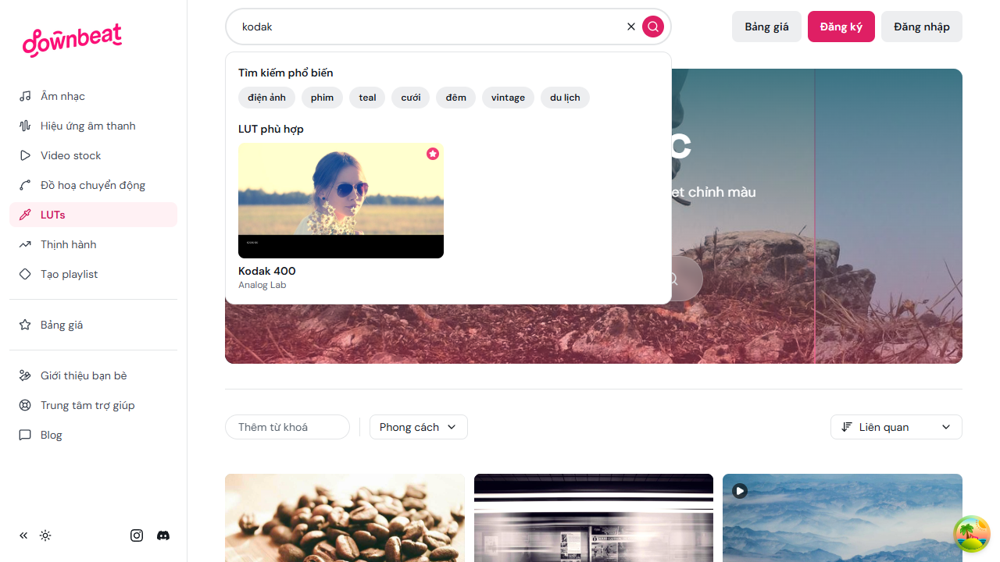

Ô tìm kiếm ở header gợi ý các LUT khớp từ khoá "kodak".

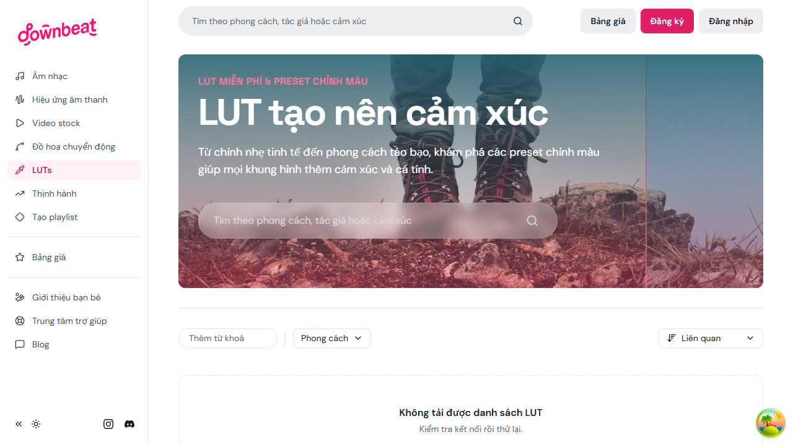

Khi API danh sách lỗi, lưới hiện "Không tải được danh sách LUT" và nút "Thử lại".

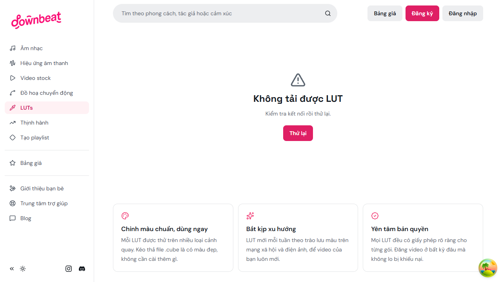

Khi API chi tiết lỗi, trang hiện "Không tải được LUT" và nút "Thử lại".

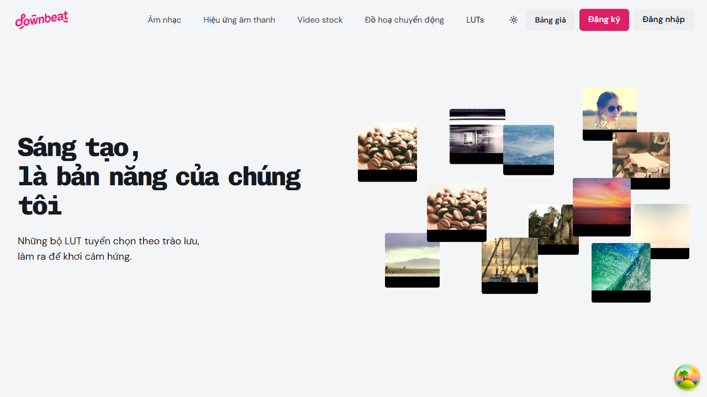

Khối ghép ảnh trên trang chủ dùng ảnh bìa thật của 12 LUT phổ biến nhất.

## 9. Điểm lệch so với plan

- `application-local.yml`: `connectionTimeZone` đổi từ `UTC` sang `LOCAL`. Cột `DATETIME` không có múi giờ và JVM chạy ở +7, nên giữ nguyên `publishedTime` 09:00 như seed. Chỉ ảnh hưởng profile local.
- Chưa làm (đã nêu trong plan): tìm không dấu, tải LUT, màn hình quản trị LUT. Video xem trước là video mẫu, chưa áp LUT.
- Lúc triển khai, `docker-compose.yml` vẫn đặt mặc định `MINIO_BUCKET=crm`; khi deploy cần đặt `MINIO_BUCKET=downbeat-public`.
