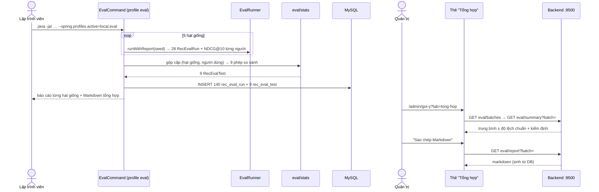
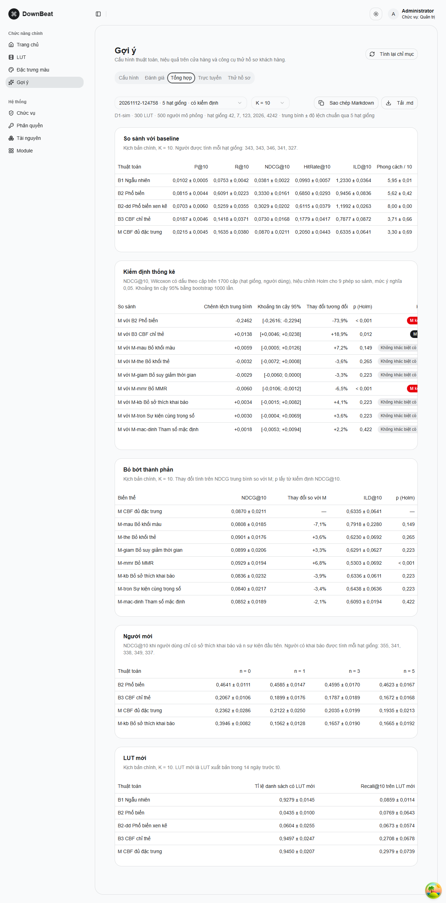
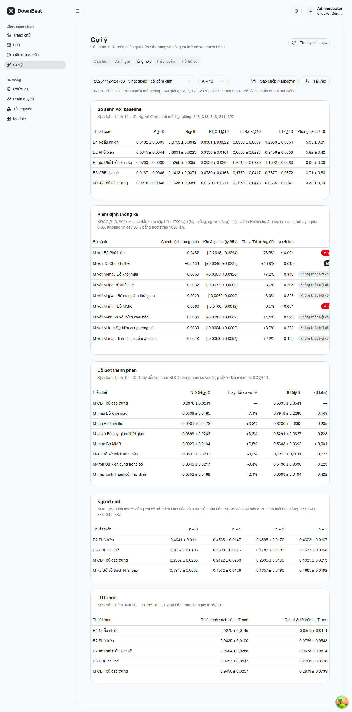
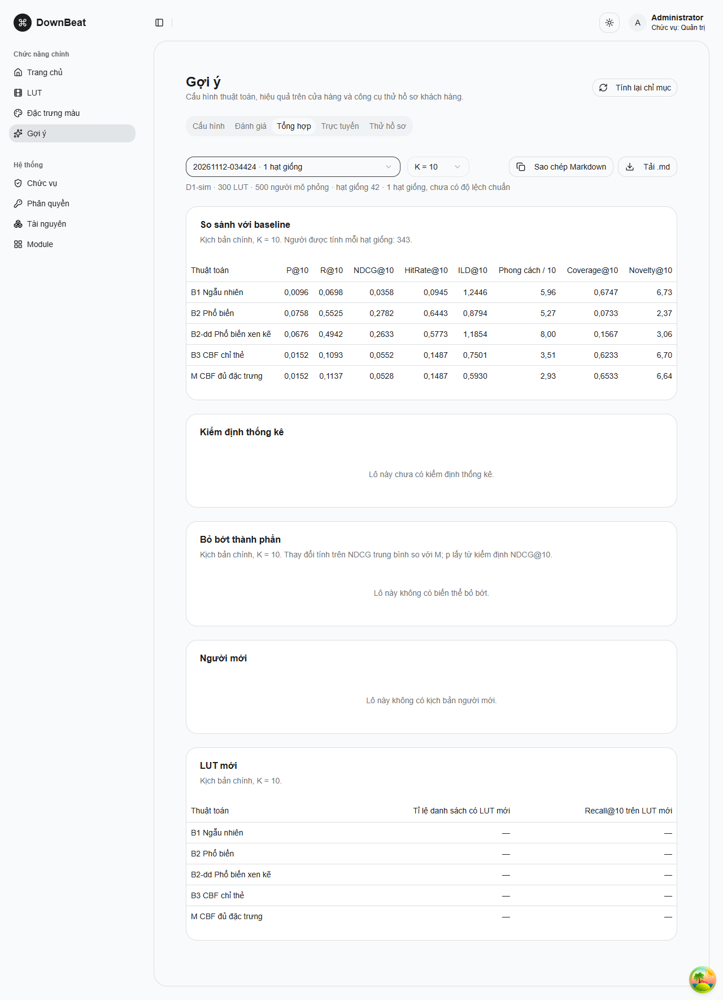
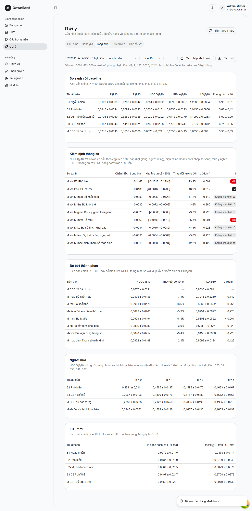
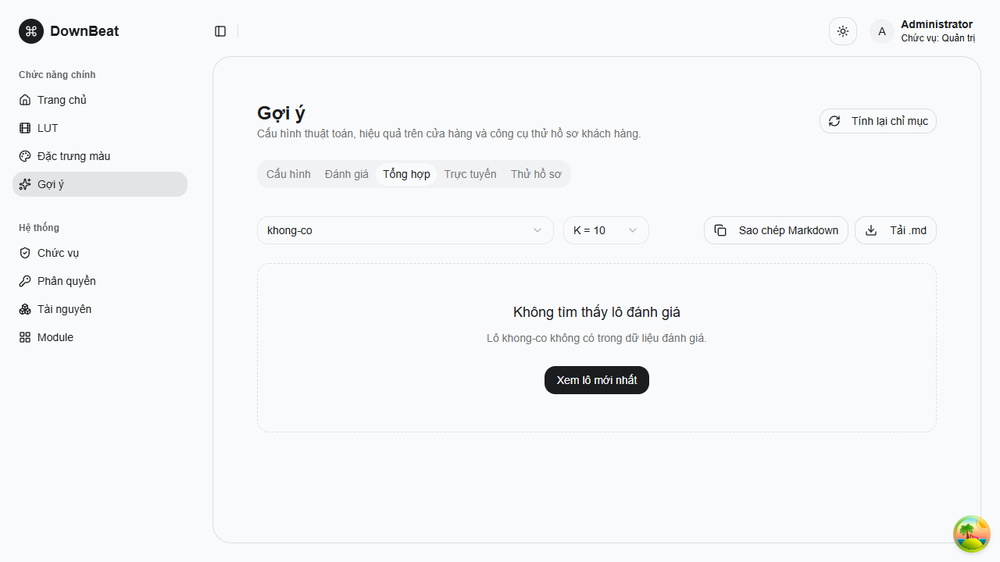
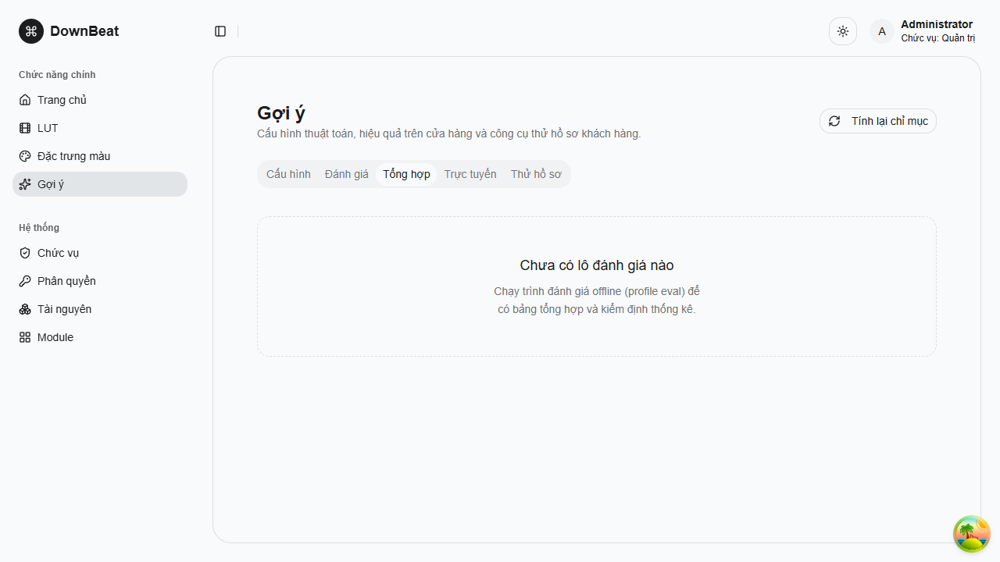
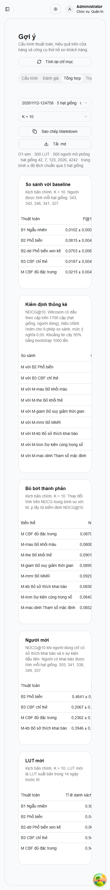

# Kiểm định gợi ý, đánh giá phần 3 (5 hạt giống, trung bình ± độ lệch chuẩn, Wilcoxon + Holm, bootstrap, bảng báo cáo 8.1 → 8.5)

> Plan: [plan/kiem-dinh-goi-y.md](../../plan/kiem-dinh-goi-y.md) · API: `GET /api/recommend/eval/batches`, `GET /api/recommend/eval/summary`, `GET /api/recommend/eval/report` · Dòng lệnh: profile `eval` (mặc định 5 hạt giống) · Giao diện: `/admin/goi-y?tab=tong-hop` · Phạm vi: backend + frontend

## 1. Mục tiêu

Phần 1 (`danh-gia-goi-y`) và phần 2 (`tinh-chinh-goi-y`) mới chạy **một** hạt giống (42), nên các chênh lệch nhỏ giữa các thuật toán chưa kết luận được. Lát này là phần 3 trong ba phần của mục 3.1 kế hoạch tổng (thiết kế §8.2.1, §8.6 bước 6 → 8, §8.7, §8.8; NFR-08):

- **Chạy 5 hạt giống** `42, 7, 123, 2026, 4242` bằng **một lệnh** (mặc định của `eval.seeds`): 140 dòng `rec_eval_run`, mỗi hạt giống 28 dòng như phần 2. Bộ hạt giống được chọn trước khi chạy và không đổi sau khi thấy kết quả.
- **Kiểm định thống kê** trên NDCG@10 của từng người ở kịch bản chính: M (CBF đủ đặc trưng) so với B2, B3 và 7 biến thể bỏ bớt, tổng cộng **9 phép so sánh**. Mỗi phép dùng Wilcoxon có dấu theo cặp trên mọi cặp (hạt giống, người dùng), p hiệu chỉnh Holm, khoảng tin cậy 95% bằng bootstrap 1000 lần, thay đổi tương đối (thiết kế §8.7). Kết quả ghi vào bảng mới `rec_eval_test` (migration V16).
- **Bảng cho báo cáo** (Bảng 8.1 → 8.5, trung bình ± độ lệch chuẩn qua 5 hạt giống) và bảng "Tinh chỉnh theo hạt giống" để bàn về quá khớp. Backend sinh Markdown từ DB mỗi lần gọi (`eval/report`), dòng lệnh in đúng chuỗi đó.
- **Thẻ "Tổng hợp"** ở `/admin/goi-y`: chọn lô, đổi K, 5 card tương ứng 5 bảng, nút "Sao chép Markdown" và "Tải .md".

Không làm ở lát này: kiểm định kịch bản người mới và chỉ số LUT mới (Bảng 8.4, 8.5 chỉ có trung bình ± độ lệch chuẩn), ghi trọng số đã tinh chỉnh vào `recommend.*` của cửa hàng, kết luận H1 → H5 tự động trong code, biểu đồ, dữ liệu D2 / D3, nút chạy đánh giá trên giao diện.

## 2. Luồng hoạt động

**Chạy đánh giá chính thức (dòng lệnh, lập trình viên).**

```
java -jar backend/app/target/aeoc-backend.jar --spring.profiles.active=local,eval
```

Với mỗi hạt giống, `EvalRunner` chạy y hệt phần 2 (sinh D1 → tinh chỉnh → 12 thuật toán → kịch bản người mới) và **giữ thêm** NDCG@10 của từng người ở kịch bản chính (mọi thuật toán trừ `random`). Sau hạt giống cuối, `PairedTests` nối các cặp (hạt giống, người dùng) của cả 5 hạt giống, tính 9 phép so sánh theo thứ tự `popular`, `cbf-tag`, `m-mau`, `m-the`, `m-giam`, `m-mmr`, `m-kb`, `m-tron`, `m-mac-dinh`: Wilcoxon → Holm → bootstrap → kết luận. Cuối cùng ghi 140 dòng `rec_eval_run` và 9 dòng `rec_eval_test` trong **một transaction**, in "== Tổng hợp lô … ==" cùng bảng Markdown, thoát mã 0.

Khoá `eval.*` mới hoặc đổi mặc định:

| Khoá | Mặc định | Hợp lệ |
|---|---|---|
| `eval.seeds` | `42,7,123,2026,4242` | danh sách ≥ 1 số nguyên |
| `eval.bootstrap` | 1000 | 100 → 10000 |
| `eval.alpha` | 0,05 | 0,001 → 0,2 |

Chạy nhanh một hạt giống bằng `--eval.seeds=42`: vẫn có 9 dòng kiểm định (cặp của riêng hạt giống đó), bảng không có độ lệch chuẩn. Kiểm định chỉ chạy khi kịch bản `standard` có chạy và danh sách thuật toán có `cbf-full`; thiếu thì không có dòng kiểm định, không lỗi. Tham số sai thì in "Tham số đánh giá không hợp lệ: {khoá}", không ghi DB, mã 2.

**Xem tổng hợp (quản trị).** `/admin/goi-y` → thẻ "Tổng hợp" → giao diện gọi `eval/batches?page=1&limit=50`, tự chọn lô mới nhất có kiểm định, rồi gọi `eval/summary?batch=`. Đổi "Số gợi ý" sang K = 5 / 20 chỉ đổi giá trị đang hiện, không gọi lại API; card "Kiểm định thống kê" luôn là NDCG@10. **Lấy bảng cho báo cáo:** "Sao chép Markdown" gọi `eval/report` rồi chép vào clipboard; "Tải .md" tải file `ket-qua-danh-gia-<lô>.md`.



## 3. Phương pháp thống kê

Toàn bộ phần thống kê tự cài trong gói `eval/stats` (lớp thuần Java, không thêm thư viện), đối chiếu với số tính tay ở mục 8.

| Bước | Cách làm |
|---|---|
| Phân phối chuẩn | p hai phía = erfc(\|z\| / √2); `erfc` tự cài (xấp xỉ Chebyshev), sai số tương đối nhỏ hơn 1,2 × 10⁻⁷ |
| Wilcoxon có dấu theo cặp | d = a − b; bỏ cặp \|d\| < 10⁻¹²; xếp hạng \|d\|, hạng bằng nhau lấy hạng trung bình; W⁺ = tổng hạng của d > 0; μ = n(n + 1)/4; σ² = n(n + 1)(2n + 1)/24 − Σ(t³ − t)/48; z = (W⁺ − μ)/σ, không hiệu chỉnh liên tục. Khớp scipy `wilcoxon(zero_method="wilcox", correction=False, method="approx")` |
| Hiệu chỉnh Holm | Sắp p tăng dần; p_holm(i) = max_{j ≤ i} min(1, (m − j + 1) · p_(j)); m = 9 |
| Bootstrap | 1000 lần lấy mẫu lại các cặp, hạt giống cố định 42 (cùng một tập chỉ số cho mọi phép so sánh); khoảng phân vị 2,5% → 97,5% của trung bình chênh lệch |
| Kết luận | `pHolm` < α (0,05) và z > 0 → M tốt hơn; `pHolm` < α và z < 0 → M kém hơn; còn lại không khác biệt có ý nghĩa |
| Trung bình ± độ lệch chuẩn | Trung bình của 5 giá trị theo hạt giống (mỗi hạt giống nặng như nhau); độ lệch chuẩn mẫu (chia n − 1) |

Hai điểm cần nhớ khi đọc bảng:

- Bảng 8.2 dùng trung bình **trên các cặp** (hạt giống nhiều người hơn nặng hơn), còn Bảng 8.1 dùng trung bình của 5 trung bình, nên NDCG@10 của M ở hai bảng có thể lệch nhau vài phần vạn.
- Hướng kết luận theo dấu của z, không theo dấu chênh lệch trung bình. Ở lô chính thức, dấu z và dấu chênh lệch của cả 9 phép so sánh trùng nhau.

## 4. Cơ sở dữ liệu

Migration `V16__kiem_dinh_goi_y.sql` thêm bảng `rec_eval_test`; `rec_eval_run` không đổi.

| Cột | Ý nghĩa |
|---|---|
| `batch_code`, `scenario`, `metric`, `k` | Lô, kịch bản (`standard`), chỉ số (`ndcg`), K (10) |
| `algorithm_a`, `algorithm_b` | `cbf-full` (M) và thuật toán so sánh |
| `seed_count`, `pair_count`, `nonzero_count` | Số hạt giống, số cặp (hạt giống, người dùng), số cặp có chênh lệch khác 0 |
| `mean_a`, `mean_b`, `mean_diff`, `rel_change` | Trung bình hai bên, chênh lệch, thay đổi tương đối (NULL khi `mean_b` = 0) |
| `ci_low`, `ci_high` | Khoảng tin cậy 95% bằng bootstrap |
| `w_plus`, `z`, `p_value`, `p_holm` | Kết quả Wilcoxon và p đã hiệu chỉnh Holm |
| `conclusion` | `better` / `worse` / `no-diff` |
| `params` (JSON) | 9 khoá: `method`, `zeroMethod`, `tieCorrection`, `continuityCorrection`, `holmFamilySize`, `alpha`, `bootstrap`, `bootstrapSeed`, `ciLevel` |

Khoá duy nhất `uk_rec_eval_test` (lô, kịch bản, chỉ số, K, thuật toán A, thuật toán B) để không ghi trùng khi lệnh bị gọi lại cùng mã lô. NDCG từng người **không** lưu DB vì sinh lại được từ hạt giống; bảng Markdown cũng không lưu mà sinh từ hai bảng mỗi lần gọi.

## 5. Backend

Package `vn.aeoc.business.recommend.eval` (thêm gói con `stats`) và `vn.aeoc.business.recommend`.

| Lớp | Việc |
|---|---|
| `eval/stats`: `NormalDist`, `WilcoxonSignedRank`, `HolmCorrection`, `BootstrapCi`, `SeedStats` | Các phép thống kê ở mục 3 |
| `eval/stats/PairedTests` | Nối cặp (hạt giống, người dùng), kiểm `userIds` khớp giữa các thuật toán (lệch thì `IllegalStateException`), sinh 9 `RecEvalTest` |
| `eval/stats/EvalSummaryBuilder` | Gộp các dòng `rec_eval_run` thành trung bình ± độ lệch chuẩn theo (kịch bản, thuật toán, K) |
| `eval/stats/EvalReportWriter` | Sinh Markdown Bảng 8.1 → 8.5 và bảng tinh chỉnh; dấu phẩy thập phân, cùng dữ liệu cho cùng chuỗi |
| `EvalRunner` | Chỉ **thêm** việc giữ NDCG@10 từng người ở kịch bản chính; `metrics`, `params`, `userCount` cũ không đổi |
| `EvalProperties`, `EvalCommand` | Mặc định 5 hạt giống, khoá `eval.bootstrap`, `eval.alpha`; gọi `PairedTests` rồi ghi DB, in tổng hợp |
| `RecEvalTestRepository`, `RecEvalRunRepository`, `RecEvalRunService` | Ghi 140 + 9 dòng trong một transaction; `batches`, `summary`, `report` |
| `RecommendAdminController` | 3 endpoint mới, dòng đầu `checkPermission(principal, "/recommend/", "VIEW")` |

### API

Cả ba cần quyền VIEW của resource `RECOMMEND` (không thêm resource mới); không token → 401, thiếu quyền → 403 `FORBIDDEN` "Bạn không có quyền thực hiện thao tác này! Path: /recommend/, Action: VIEW".

| Method | Path | Tham số | Kết quả |
|---|---|---|---|
| GET | `/api/recommend/eval/batches` | `page` (mặc định 1), `limit` (mặc định 20, tối đa 100) | Danh sách lô, `batchCode` giảm dần: `seeds`, `runCount`, `scenarios`, `lutCount`, `simUserCount`, `hasTests`, `createdTime` |
| GET | `/api/recommend/eval/summary` | `batch` | `scenarios` (mỗi hàng: `metrics[K][chỉ số] = {mean, std}`, `userCounts`), `tests` (9 dòng), `kValues`, `newLutDays` |
| GET | `/api/recommend/eval/report` | `batch` | `fileName` `ket-qua-danh-gia-<lô>.md` và `markdown` |

`summary` / `report` với lô không có, thiếu `batch` hoặc `batch` rỗng → 404 `DATA_NOT_FOUND` "Không tìm thấy lô đánh giá"; `batch` được trim. Không có `std` khi lô chỉ có 1 hạt giống. `eval/list`, `eval/get` không đổi.

## 6. Giao diện

Thẻ thứ năm **"Tổng hợp"**, đặt sau "Đánh giá"; bốn thẻ cũ không đổi.

- **Tham số URL**: `tab=tong-hop`, `batch` (không có thì tự chọn lô mới nhất có kiểm định, URL không tự thêm `batch`), `k` dùng chung với thẻ "Đánh giá".
- **Thanh công cụ**: ô "Lô đánh giá" (`{mã lô} · {n} hạt giống · có kiểm định`), ô "Số gợi ý" (K = 5 / 10 / 20), nút "Sao chép Markdown" và "Tải .md"; dòng phụ "D1-sim · 300 LUT · 500 người mô phỏng · hạt giống 42, 7, 123, 2026, 4242 · trung bình ± độ lệch chuẩn qua 5 hạt giống".
- **Năm card**: "So sánh với baseline" (Bảng 8.1), "Kiểm định thống kê" (Bảng 8.2, badge "M tốt hơn" / "M kém hơn" / "Không khác biệt có ý nghĩa"), "Bỏ bớt thành phần" (Bảng 8.3), "Người mới" (Bảng 8.4), "LUT mới" (Bảng 8.5). Ô số có dạng "0,0640 ± 0,0031". Mỗi bảng nằm trong khung cuộn ngang.
- **Trạng thái**: skeleton khi tải; "Chưa có lô đánh giá nào"; "Không tìm thấy lô đánh giá" + nút "Xem lô mới nhất"; "Không tải được dữ liệu" + "Thử lại"; lô cũ thiếu kiểm định / biến thể / người mới thì card tương ứng hiện câu trống. Toast "Đã sao chép bảng Markdown", "Không sao chép được bảng Markdown", "Không tải được bảng Markdown".
- Tệp mới: `summary-tab.tsx`, `summary-cards.tsx`; sửa `routes/admin/goi-y.tsx`, `labels.ts`, `recommend.ts`, `api.gen.ts`, hàm gọi API và TanStack options.

### Hình ảnh



Thẻ "Tổng hợp" mở lần đầu: tự chọn lô 5 hạt giống có kiểm định, dòng phụ nêu số hạt giống, card "So sánh với baseline" có ô dạng "trung bình ± độ lệch chuẩn".


Card "Kiểm định thống kê": 9 dòng M so với B2, B3 và 7 biến thể, kèm chênh lệch, khoảng tin cậy, p đã hiệu chỉnh Holm và badge kết luận.


Card "Bỏ bớt thành phần" lấy dòng M làm gốc, cột "Thay đổi so với M" và p lấy từ phép kiểm định tương ứng.



Hai card "Người mới" (NDCG@10 theo n = 0, 1, 3, 5) và "LUT mới".



Chọn lô cũ chỉ có 1 hạt giống: ô không có độ lệch chuẩn, card kiểm định hiện "Lô này chưa có kiểm định thống kê."



Bấm "Sao chép Markdown": toast "Đã sao chép bảng Markdown".



Mở link có `batch` không tồn tại: "Không tìm thấy lô đánh giá" và nút "Xem lô mới nhất".



Khi `eval/batches` trả 0 lô: "Chưa có lô đánh giá nào", không có thanh công cụ.



Ở 390 × 844: các ô chọn và nút xuống dòng, bảng cuộn ngang trong khung, trang không tràn ngang.

## 7. Kết quả đo lô chính thức

Lô `20261112-124758`: D1-sim, 300 LUT, 500 người mô phỏng, 5 hạt giống (42, 7, 123, 2026, 4242), 140 dòng `rec_eval_run` + 9 dòng `rec_eval_test`. Tổng thời gian 863,3 giây, mỗi hạt giống 163 đến 179 giây (giới hạn 10 phút). Dưới đây là nguyên văn Markdown của `eval/report?batch=20261112-124758`; chỉ hạ một cấp tiêu đề để nằm trong tài liệu này.

D1-sim · 300 LUT · 500 người mô phỏng · 5 hạt giống (42, 7, 123, 2026, 4242) · K = 10

Số liệu là trung bình trên các hạt giống, độ lệch chuẩn trong ngoặc.

### Bảng 8.1. So sánh với baseline (K = 10)

| Thuật toán | P@10 | R@10 | NDCG@10 | HitRate@10 | ILD@10 | Phong cách / 10 | Coverage@10 | Novelty@10 |
|---|---|---|---|---|---|---|---|---|
| B1 Ngẫu nhiên | 0,0102 (0,0005) | 0,0753 (0,0042) | 0,0381 (0,0022) | 0,0993 (0,0057) | 1,2330 (0,0364) | 5,95 (0,01) | 0,6680 (0,0130) | 6,83 (0,04) |
| B2 Phổ biến | 0,0815 (0,0044) | 0,6091 (0,0223) | 0,3330 (0,0161) | 0,6850 (0,0293) | 0,9456 (0,0836) | 5,62 (0,42) | 0,0980 (0,0038) | 3,04 (0,03) |
| B2-dd Phổ biến xen kẽ | 0,0703 (0,0060) | 0,5259 (0,0355) | 0,3029 (0,0202) | 0,6115 (0,0379) | 1,1992 (0,0263) | 8,00 (0,00) | 0,1847 (0,0087) | 3,56 (0,07) |
| B3 CBF chỉ thẻ | 0,0187 (0,0046) | 0,1418 (0,0371) | 0,0730 (0,0168) | 0,1779 (0,0417) | 0,7877 (0,0872) | 3,71 (0,66) | 0,6160 (0,0223) | 6,86 (0,12) |
| M CBF đủ đặc trưng | 0,0215 (0,0045) | 0,1635 (0,0380) | 0,0870 (0,0211) | 0,2050 (0,0443) | 0,6335 (0,0641) | 3,30 (0,69) | 0,6247 (0,0376) | 6,81 (0,06) |

Người được tính mỗi hạt giống: 343, 343, 346, 341, 327.

### Bảng 8.2. Kiểm định (NDCG@10)

Wilcoxon có dấu theo cặp trên 1700 cặp (hạt giống, người dùng), hiệu chỉnh Holm cho 9 phép so sánh, mức ý nghĩa 0,05; khoảng tin cậy 95% bằng bootstrap 1000 lần.

| So sánh | Chênh lệch trung bình | Khoảng tin cậy 95% | Thay đổi tương đối | p (Wilcoxon, đã hiệu chỉnh Holm) | Kết luận |
|---|---|---|---|---|---|
| M với B2 | -0,2462 | [-0,2616; -0,2294] | -73,9% | < 0,001 | M kém hơn |
| M với B3 | +0,0138 | [+0,0046; +0,0238] | +18,9% | 0,012 | M tốt hơn |
| M với M-mau | +0,0059 | [-0,0005; +0,0126] | +7,2% | 0,149 | Không khác biệt có ý nghĩa |
| M với M-the | -0,0032 | [-0,0072; +0,0008] | -3,6% | 0,265 | Không khác biệt có ý nghĩa |
| M với M-giam | -0,0029 | [-0,0060; 0,0000] | -3,3% | 0,223 | Không khác biệt có ý nghĩa |
| M với M-mmr | -0,0060 | [-0,0106; -0,0012] | -6,5% | < 0,001 | M kém hơn |
| M với M-kb | +0,0034 | [-0,0015; +0,0082] | +4,1% | 0,223 | Không khác biệt có ý nghĩa |
| M với M-tron | +0,0030 | [-0,0004; +0,0069] | +3,6% | 0,223 | Không khác biệt có ý nghĩa |
| M với M-mac-dinh | +0,0018 | [-0,0053; +0,0094] | +2,2% | 0,422 | Không khác biệt có ý nghĩa |

### Bảng 8.3. Bỏ bớt thành phần (K = 10)

| Biến thể | NDCG@10 | Thay đổi so với M | ILD@10 | p (Holm) |
|---|---|---|---|---|
| M | 0,0870 (0,0211) | — | 0,6335 (0,0641) | — |
| M-mau | 0,0808 (0,0185) | -7,1% | 0,7918 (0,2280) | 0,149 |
| M-the | 0,0901 (0,0176) | +3,6% | 0,6230 (0,0692) | 0,265 |
| M-giam | 0,0899 (0,0206) | +3,3% | 0,6291 (0,0627) | 0,223 |
| M-mmr | 0,0929 (0,0194) | +6,8% | 0,5303 (0,0692) | < 0,001 |
| M-kb | 0,0836 (0,0232) | -3,9% | 0,6336 (0,0611) | 0,223 |
| M-tron | 0,0840 (0,0217) | -3,4% | 0,6438 (0,0636) | 0,223 |
| M-mac-dinh | 0,0852 (0,0189) | -2,1% | 0,6093 (0,0194) | 0,422 |

### Bảng 8.4. Người mới (NDCG@10 theo số sự kiện n)

| Thuật toán | n = 0 | n = 1 | n = 3 | n = 5 |
|---|---|---|---|---|
| B2 | 0,4641 (0,0111) | 0,4585 (0,0147) | 0,4595 (0,0170) | 0,4623 (0,0167) |
| B3 | 0,2067 (0,0106) | 0,1899 (0,0176) | 0,1787 (0,0189) | 0,1672 (0,0168) |
| M | 0,2362 (0,0286) | 0,2122 (0,0250) | 0,2035 (0,0199) | 0,1935 (0,0213) |
| M-kb | 0,3946 (0,0082) | 0,1562 (0,0128) | 0,1657 (0,0190) | 0,1665 (0,0192) |

Người có khai báo được tính mỗi hạt giống: 355, 341, 338, 349, 337.

### Bảng 8.5. LUT mới (K = 10)

| Thuật toán | Tỉ lệ danh sách có LUT mới | Recall@10 trên LUT mới |
|---|---|---|
| B1 Ngẫu nhiên | 0,9279 (0,0145) | 0,0859 (0,0114) |
| B2 Phổ biến | 0,0435 (0,0100) | 0,0769 (0,0643) |
| B2-dd Phổ biến xen kẽ | 0,0604 (0,0255) | 0,0673 (0,0574) |
| B3 CBF chỉ thẻ | 0,9497 (0,0247) | 0,2708 (0,0678) |
| M CBF đủ đặc trưng | 0,9450 (0,0207) | 0,2979 (0,0739) |

### Tinh chỉnh theo hạt giống

| Hạt giống | Thẻ | Màu | Danh mục | Phong cách | Văn bản | Tác giả | λ | Chu kỳ bán rã | k | NDCG@10 kiểm định (mặc định → cuối) | NDCG@10 phần kiểm: M | NDCG@10 phần kiểm: M-mac-dinh |
|---|---|---|---|---|---|---|---|---|---|---|---|---|
| 42 | 0,05 | 0,20 | 0,25 | 0,35 | 0,00 | 0,15 | 0,7 | 30 | 5 | 0,0632 → 0,0815 | 0,0631 | 0,0608 |
| 7 | 0,20 | 0,05 | 0,00 | 0,60 | 0,00 | 0,15 | 0,7 | 60 | 2 | 0,0698 → 0,1169 | 0,0830 | 0,0858 |
| 123 | 0,00 | 0,20 | 0,05 | 0,15 | 0,40 | 0,20 | 0,6 | 30 | 5 | 0,0807 → 0,1059 | 0,0718 | 0,0728 |
| 2026 | 0,05 | 0,50 | 0,20 | 0,20 | 0,05 | 0,00 | 0,7 | ∞ | 5 | 0,1439 → 0,1868 | 0,1128 | 0,0998 |
| 4242 | 0,00 | 0,65 | 0,00 | 0,00 | 0,00 | 0,35 | 0,9 | 30 | 5 | 0,0698 → 0,1037 | 0,1041 | 0,1067 |

### Kiểm tra giả thuyết H1 → H5

Số đo ở trên là kết quả chạy trên bộ mô phỏng D1, không phải người dùng thật. Mỗi giả thuyết được xét đúng theo tiêu chí ở thiết kế §8.1; giả thuyết bị bác bỏ vẫn được báo cáo như đã đo.

| Giả thuyết | Tiêu chí | Số đo | Kết luận |
|---|---|---|---|
| H1: gợi ý cá nhân đúng hơn phổ biến | M hơn B2 (NDCG@10, Recall@10) | NDCG@10 0,0870 so với 0,3330; Recall@10 0,1635 so với 0,6091. Chênh lệch −0,2462, khoảng tin cậy [−0,2616; −0,2294], p Holm < 0,001 | **Bác bỏ.** M kém B2 73,9% và có ý nghĩa thống kê |
| H2: đủ đặc trưng hơn chỉ dùng thẻ | M hơn B3 (NDCG@10, Recall@10) | NDCG@10 0,0870 so với 0,0730 (+18,9%), chênh lệch +0,0138, khoảng tin cậy [+0,0046; +0,0238], p Holm 0,012; Recall@10 0,1635 so với 0,1418 | **Chấp nhận** theo NDCG@10 (có kiểm định). Recall@10 cùng chiều nhưng không kiểm định. Mức tăng tuyệt đối nhỏ |
| H3: đa dạng và phủ kho | Coverage@10 của M ≥ 3 lần B2 **và** ILD@10 của M không thấp hơn B3 | Coverage@10 0,6247 so với 0,0980 (6,4 lần); ILD@10 0,6335 so với 0,7877 | **Chỉ đạt một vế.** Vế Coverage đạt, vế ILD không (M thấp hơn B3 khoảng 0,15, gấp khoảng 2 lần độ lệch chuẩn của mỗi bên là 0,06 và 0,09; không kiểm định). Xét cả hai vế thì bác bỏ |
| H4: bước chọn phong cách giúp người mới | Người mới có khai báo được gợi ý tốt hơn B2 | NDCG@10 tại n = 0: B2 0,4641, M 0,2362, M-kb 0,3946; B2 giữ 0,4585 → 0,4623 khi n tăng, M giảm 0,2122 → 0,1935 | **Bác bỏ** trên D1: không thuật toán nào dùng khai báo vượt B2 ở bất kỳ n. M có dùng khai báo còn thấp hơn M-kb (bỏ khai báo) ở n = 0 (0,2362 so với 0,3946). Chưa kiểm định thống kê |
| H5: LUT mới được gợi ý | M đưa LUT mới vào gợi ý, B2 thì không | Tỉ lệ danh sách có LUT mới: M 0,9450, B2 0,0435; Recall@10 trên LUT mới: M 0,2979, B2 0,0769 | **Chấp nhận.** M cao hơn B2 rõ rệt ở cả hai chỉ số. Lưu ý B1 (0,9279) và B3 (0,9497) cũng có tỉ lệ cao, nên chỉ số thứ nhất chưa phân biệt M với gợi ý ngẫu nhiên; Recall trên LUT mới (M 0,2979, B3 0,2708, B1 0,0859) mới cho thấy M gợi ý đúng. Chưa kiểm định thống kê |

### Nhận xét về các phép bỏ bớt thành phần

- Chỉ **M-mmr** khác M có ý nghĩa sau hiệu chỉnh Holm (p < 0,001). Bỏ MMR cho NDCG@10 cao hơn M 6,8% (0,0929 so với 0,0870) nhưng ILD@10 giảm từ 0,6335 xuống 0,5303: MMR đổi một phần độ chính xác lấy độ đa dạng.
- Bỏ khối màu (M-mau, −7,1%), khối thẻ (M-the, +3,6%), suy giảm thời gian (M-giam, +3,3%), sở thích khai báo (M-kb, −3,9%) hay trộn (M-tron, −3,4%) đều **không** khác biệt có ý nghĩa (p Holm từ 0,149 đến 0,265). Với dữ liệu D1, chưa đủ bằng chứng nói khối màu đóng góp cho độ chính xác; khoảng tin cậy của M so với M-mau là [−0,0005; +0,0126], chỉ vượt 0 một chút về phía âm.
- **Tinh chỉnh có dấu hiệu quá khớp.** Trên tập kiểm định, M tăng 29% đến 67% so với bộ tham số mặc định ở cả 5 hạt giống (ví dụ 0,0632 → 0,0815 ở hạt giống 42). Trên phần kiểm, M chỉ hơn M-mac-dinh ở 2 hạt giống (42 và 2026) và thua ở 3 hạt giống (7, 123, 4242); trung bình chỉ hơn 2,2% và không có ý nghĩa (p Holm 0,422). Bộ trọng số chọn ở các hạt giống cũng rất khác nhau (khối màu từ 0,05 đến 0,65, khối thẻ từ 0,00 đến 0,20), nên không có bộ trọng số ổn định để ghi vào cấu hình cửa hàng.

## 8. Kiểm thử

### JUnit (backend)

Module `business`: 150 test, 0 lỗi, 0 bỏ qua. Phần của lát này: `EvalPart3UnitTest` (11 test, TC-01 → TC-11); hồi quy `EvalUnitTest`, `EvalPart2UnitTest`, `RecEvalRunServiceTest` xanh, kỳ vọng không đổi (TC-12).

### Dòng lệnh và Playwright

Spec [frontend/tests/e2e/kiem-dinh-goi-y.spec.ts](../../frontend/tests/e2e/kiem-dinh-goi-y.spec.ts): **15/15 pass** (8 API + 7 giao diện), chạy có giao diện (`E2E_SLOWMO=400`). Hồi quy `danh-gia-goi-y.spec.ts`, `tinh-chinh-goi-y.spec.ts`, `quan-tri-goi-y.spec.ts`: 45/45 pass sau khi sửa theo plan §10.

| TC | Loại | Nội dung | Kết quả |
|---|---|---|---|
| TC-01 | unit | `NormalDist.twoSidedP` khớp số tham chiếu, z = 40 không NaN | Pass |
| TC-02 | unit | `WilcoxonSignedRank` 3 ca tính tay, độ dài khác nhau → lỗi | Pass |
| TC-03 | unit | `HolmCorrection` 3 bộ p, đúng thứ tự gốc | Pass |
| TC-04 | unit | `BootstrapCi`: không đổi, phân vị, tái lập, hạt giống khác, rỗng | Pass |
| TC-05 | unit | `SeedStats` trung bình, độ lệch chuẩn mẫu, `null` khi 1 giá trị | Pass |
| TC-06 | unit | `PairedTests.build`: gộp cặp, `holmFamilySize`, `params` 9 khoá, `userIds` lệch → lỗi | Pass |
| TC-07 | unit | `EvalReportWriter` đúng dòng nguyên văn; bản 1 hạt giống không kiểm định | Pass |
| TC-08 | unit | `EvalSummaryBuilder`: thứ tự kịch bản / thuật toán, trường thiếu, không `std` khi 1 hạt giống | Pass |
| TC-09 | unit | `EvalRunner` + `PairedTests` cỡ nhỏ: 56 dòng + 9 kiểm định, tái lập, hạt giống độc lập | Pass |
| TC-10 | unit | `EvalProperties.validate` cho `bootstrap`, `alpha` | Pass |
| TC-11 | unit | Service: `batches`, `summary`, `report`, trim, 404, `saveBatch` | Pass |
| TC-12 | unit | Hồi quy `EvalUnitTest`, `EvalPart2UnitTest`, `RecEvalRunServiceTest` | Pass |
| TC-13 | cli | Hai lô nhỏ S1 `20261112-124011`, S2 `20261112-124059` (2 hạt giống, 80 LUT): mã 0, 56 dòng + 9 kiểm định mỗi lô, có dòng "== Tổng hợp lô" | Pass |
| TC-14 | cli | Lô chính thức `20261112-124758`: mã 0, 140 dòng + 9 kiểm định, 863,3 giây, mỗi hạt giống 163 đến 179 giây | Pass |
| TC-15 | cli | `--eval.bootstrap=50` và `--eval.alpha=0`: mã 2, in đúng khoá, không ghi DB (Claude chạy lại khi viết tài liệu) | Pass |
| TC-16 | api | Phân quyền 3 endpoint: 403 / 401 | Pass |
| TC-17 | api | `eval/batches`: thứ tự, `total`, `seeds`, `runCount`, `hasTests`, `limit`, `page` | Pass |
| TC-18 | api | `summary` của lô chính thức: mọi `mean`, `std` khớp tính lại từ `eval/list` | Pass |
| TC-19 | api | 9 kiểm định: thứ tự, `pairCount`, `meanDiff`, `relChange`, Holm tính lại, `conclusion`, `params` | Pass |
| TC-20 | api | Hạt giống 42 của lô chính thức trùng lô phần 2 (28 cặp giống hệt) | Pass |
| TC-21 | api | Chạy lại ra đúng kết quả: S1 và S2 giống hệt, `markdown` giống sau khi thay mã lô (NFR-08) | Pass |
| TC-22 | api | `report`: đủ 6 tiêu đề, 9 dòng kiểm định, 5 dòng tinh chỉnh; lô một hạt giống rút gọn | Pass |
| TC-23 | api | Lỗi 404 và trim `batch` | Pass |
| TC-24 | e2e | Mở thẻ "Tổng hợp": 1 request `batches`, 1 request `summary`, 5 card, ô "trung bình ± độ lệch chuẩn" | Pass |
| TC-25 | e2e | Card "Kiểm định thống kê": mô tả, 9 dòng, badge, tooltip "p (Holm)" | Pass |
| TC-26 | e2e | Ba card còn lại; đổi K = 5 không gọi lại `summary` | Pass |
| TC-27 | e2e | Đổi lô sang lô 2 hạt giống và lô 1 hạt giống | Pass |
| TC-28 | e2e | Sao chép và tải Markdown khớp `eval/report` | Pass |
| TC-29 | e2e | `batch` sai, không có lô, lỗi `summary` 500 + "Thử lại", lỗi `report` 500 | Pass |
| TC-30 | e2e | Điện thoại 390 × 844 không tràn ngang | Pass |
| | | **Tổng** | **30/30 TC pass** — JUnit 12 TC (150 test module `business` xanh), Playwright 15/15 (8 API + 7 giao diện), 3 TC dòng lệnh; hồi quy 45/45 |

`pnpm build` xanh, `pnpm lint` 0 lỗi (2 cảnh báo có sẵn ngoài phạm vi). `pnpm api:types`: `api.gen.ts` thêm 236 dòng, các schema `RecEvalBatch`, `RecEvalSummary`, `RecEvalTest`, `RecEvalReport` khớp `lib/types/recommend.ts`.

### Quá trình thực hiện

Backend 0 vòng sửa, frontend 1 vòng sửa. Không lệch hợp đồng API §5 và giao diện §6.

- Vòng sửa frontend: card "Bỏ bớt thành phần" in "—" ở "Thay đổi so với M" khi NDCG trung bình của biến thể bằng 0, trong khi chỉ dòng M hoặc thiếu dữ liệu mới được in "—". Đã sửa (`summary-cards.tsx`), build và lint xanh.
- Spec TC-28 chuẩn hoá `\r\n` của clipboard: Chrome trên Windows đổi `\n` thành `\r\n` khi ghi clipboard (lỗi của spec, không phải của ứng dụng). File tải về vẫn so sánh tuyệt đối.
- Spec TC-19 dùng dung sai `relChange` bằng sai số lan truyền từ `meanA`, `meanB` đã làm tròn 4 chữ số, vì ± 0,1 quá chặt khi `meanB` chỉ khoảng 0,06.
- Spec hồi quy được sửa theo plan §10: `tinh-chinh-goi-y.spec.ts` chọn lô phần 2 qua `eval/batches` (hạt giống [42], 28 dòng), `danh-gia-goi-y.spec.ts` chỉ lấy dòng hạt giống 42, `quan-tri-goi-y.spec.ts` thêm thẻ "Tổng hợp" vào danh sách thẻ.
- Spec và unit test nằm trong `.gitignore` (`frontend/tests/`, `backend/**/src/test/`) nên không vào commit, như các lát trước.

## 9. Hạn chế

- Số liệu chỉ có giá trị trên bộ mô phỏng D1 (người dùng mô phỏng chạy theo số đông); kết luận M thua B2 (H1) và H4 chưa chứng minh được trên người dùng thật. Cần D2 / D3 (kế hoạch tổng 3.2).
- Chỉ 9 phép so sánh ở kịch bản chính được kiểm định. Bảng 8.4 (người mới) và Bảng 8.5 (LUT mới) chỉ có trung bình ± độ lệch chuẩn nên H3 (ILD), H4, H5 chưa có p-value.
- Trung bình ± độ lệch chuẩn dựa trên 5 hạt giống; độ lệch chuẩn của mẫu nhỏ như vậy có độ tin cậy thấp. Kiểm định gộp 1700 cặp từ 5 hạt giống coi mỗi cặp là một quan sát độc lập.
- Trọng số đã tinh chỉnh **chưa** ghi vào `recommend.*` của cửa hàng; bảng "Tinh chỉnh theo hạt giống" cho thấy bộ trọng số không ổn định và có dấu hiệu quá khớp (mục 7), nên chưa nên ghi.
- Chưa có biểu đồ (NDCG theo K, đường người mới, phân tán Coverage–NDCG, cột ablation); có thể vẽ từ bảng Markdown khi viết báo cáo (giai đoạn 6).
- Stdout tiếng Việt của dòng lệnh bị vỡ dấu khi chuyển hướng ra file trên Windows; nguồn chính để lấy bảng là `eval/report` hoặc nút "Tải .md".
- Lệnh mặc định (5 hạt giống) mất khoảng 14 phút trên máy phát triển (863,3 giây ở lô chính thức), nên chạy nền; muốn chạy nhanh thì thêm `--eval.seeds=42`.
