# Quản lý LUT (thêm, sửa, tải file, xuất bản, ẩn, xoá)

> Plan: [plan/quan-ly-lut.md](../../plan/quan-ly-lut.md) · Route: `/admin/luts`, `/admin/luts/<id>` · Phạm vi: backend + frontend

## 1. Mục tiêu

Trước chức năng này, kho LUT chỉ có 36 LUT nạp sẵn bằng dữ liệu mẫu. Quản trị muốn thêm một LUT mới phải sửa dữ liệu. Chức năng này cho quản trị **đưa LUT mới lên cửa hàng ngay trên trang quản trị**:

- Tạo bản nháp (tiêu đề, tác giả, phong cách); backend tự sinh slug từ tiêu đề.
- Điền mô tả, thẻ, danh mục, cờ Premium, chọn kiểu xem trước (ảnh trước / sau hoặc video).
- Tải file `.cube` lên bucket riêng tư; backend đọc file và đo 10 đặc trưng màu ngay (dùng lại `CubeParser`, `ColorFeatureExtractor` của lát `dac-trung-mau`).
- Tải ảnh bìa, ảnh trước, ảnh sau hoặc video xem trước lên bucket công khai.
- **Xuất bản** khi đủ điều kiện; **ẩn** để LUT biến khỏi cửa hàng; **xoá** LUT nháp hoặc đã ẩn chưa có lượt tải.

Chưa làm (để lát sau): CRUD danh mục và tác giả (đề xuất lát `danh-muc-tac-gia`), tự sinh ảnh "sau" bằng cách áp .cube lên ảnh gốc, đổi slug sau khi tạo, xoá file cũ trên MinIO khi thay file hoặc xoá LUT, cập nhật chỉ mục gợi ý khi xuất bản / ẩn (lát `chi-muc-tuong-dong`).

## 2. Luồng sử dụng

**Luồng chính.**

1. Ở `/admin/luts` bấm "Thêm LUT", nhập tiêu đề, chọn tác giả và phong cách rồi "Tạo mới". Backend tạo LUT `DRAFT`, sinh slug (tiêu đề bỏ dấu, chữ thường, ký tự lạ thành `-`; trùng thì thêm `-2`, `-3`). Trang chuyển sang `/admin/luts/<id>`, toast "Đã tạo LUT nháp".
2. Ở trang chi tiết, điền mô tả, bật "LUT Premium" nếu cần, thêm thẻ (gõ rồi Enter hoặc dấu phẩy), tick danh mục, chọn "Kiểu xem trước", bấm "Lưu thay đổi".
3. Khối "File LUT (.cube)": chọn file. Backend đọc file, lưu vào bucket riêng tư, ghi `file_key`, `file_size_kb`, `lut_size` và đo đặc trưng màu; thẻ "Đặc trưng màu" hiện ngay.
4. Khối "Ảnh và video xem trước": tải ảnh bìa, ảnh trước, ảnh sau (hoặc video). Mỗi lần chọn file là tải lên và lưu ngay, không cần "Lưu thay đổi".
5. Khối "Điều kiện xuất bản" đủ 5 dấu "Đạt" thì nút "Xuất bản" bật. Backend kiểm lại, chuyển `PUBLISHED`, đặt `published_time` (chỉ lần đầu). LUT có ngay ở `/luts` và `/luts/<slug>`, xếp đầu "Mới nhất".

**Luồng phụ.**

- **Ẩn**: menu ⋮ ở danh sách hoặc nút "Ẩn" ở chi tiết, có hộp xác nhận. Cửa hàng trả 404 cho LUT đó. Xuất bản lại giữ `published_time` cũ.
- **Xoá**: chỉ LUT `DRAFT` hoặc `HIDDEN` có `download_count = 0`; xoá cứng, thẻ, danh mục và đặc trưng màu xoá theo.
- **Thay file**: tải file mới đè lên; .cube mới thì đặc trưng màu tính lại.
- **Sửa LUT đang xuất bản**: được, nhưng kết quả sau khi sửa vẫn phải đủ điều kiện xuất bản. Không đủ thì báo lỗi và **không ghi gì** (ví dụ bớt còn 2 thẻ).
- **Đổi "Kiểu xem trước"** không xoá file của kiểu kia.

**Ngoại lệ.**

- File .cube hỏng: 400 `LUT_FILE_INVALID` kèm lý do, không lưu file, giữ file và đặc trưng cũ.
- Sai đuôi, sai nội dung (kiểm byte đầu file), quá dung lượng: 415 / 413, không lưu.
- Xuất bản thiếu điều kiện: 400 theo thứ tự `PREVIEW_MISSING` → `LUT_FILE_MISSING` → `LUT_FEATURE_MISSING`.
- Tác giả hoặc danh mục không tồn tại: 400. Id không tồn tại: 404 "Không tìm thấy LUT".

## 3. Cơ sở dữ liệu

**Không có migration.** Dùng lại `lut`, `lut_tag`, `lut_category_map`, `lut_category`, `creator` (V3) và `lut_color_feature`, resource `LUT` (V6 của `dac-trung-mau`). Quyền theo resource `LUT`: VIEW (xem), ADD (tạo nháp), UPDATE (sửa, upload, xuất bản, ẩn), DELETE (xoá).

| Cột `lut` | Ai ghi | Quy tắc |
|---|---|---|
| `title`, `description`, `creator_id`, `style`, `is_premium`, `preview_type` | Client qua `update` | Trim; mô tả rỗng thành NULL |
| `slug` | Server khi tạo | Sinh từ tiêu đề, không đổi khi sửa |
| `status` | Server | Tạo là `DRAFT`; đổi chỉ qua `publish` / `hide` |
| `cover_url`, `before_url`, `after_url`, `preview_video_url` | Server qua `upload` | URL công khai của bucket `downbeat-public` |
| `file_key`, `file_size_kb`, `lut_size` | Server qua `upload` kind `CUBE` | `file_size_kb` làm tròn lên (byte / 1024) |
| `download_count`, `created_by` | Server khi tạo | 0; id người đăng nhập |
| `published_time` | Server qua `publish` | Chỉ đặt khi đang NULL |

- Thẻ và danh mục: mỗi lần `update` **thay toàn bộ** (xoá rồi chèn lại) trong một transaction. Thẻ được chuẩn hoá: trim, gộp khoảng trắng, chữ thường, bỏ rỗng, bỏ trùng.
- Khoá object MinIO có UUID để không đụng `Cache-Control: immutable` của bucket công khai: `.cube` ở `downbeat-lut/lut/<id>/<uuid>.cube`; ảnh / video ở `downbeat-public/lut/<id>/<cover|before|after|video>-<uuid>.<đuôi>`.

## 4. API

Phản hồi thành công bọc `{ code, message, result }`; lỗi nghiệp vụ trả `{ path, code, errorCode, message }`. Cả 8 endpoint thuộc resource `LUT` (`/lut/`). `fileKey` không bao giờ ra JSON.

| Method | Đường dẫn | Quyền | Mô tả |
|---|---|---|---|
| GET | `/lut/list` | VIEW | Mọi trạng thái; lọc `keyword` (tên hoặc slug), `status`, `style`; `page`, `limit` (tối đa 100); xếp `updated_time` giảm dần |
| GET | `/lut/get?id=` | VIEW | LUT chi tiết (kèm `tags`, `categories`, `colorFeature`) |
| POST | `/lut/update` | ADD (không `id`) / UPDATE (có `id`) | Tạo nháp hoặc sửa; trả LUT chi tiết |
| POST | `/lut/delete/{id}` | DELETE | Xoá cứng; trả id |
| POST | `/lut/upload` | UPDATE | Multipart `id`, `kind` (`CUBE`, `COVER`, `BEFORE`, `AFTER`, `VIDEO`), `file` |
| POST | `/lut/publish/{id}` | UPDATE | Kiểm điều kiện rồi `PUBLISHED`; đang xuất bản thì trả nguyên |
| POST | `/lut/hide/{id}` | UPDATE | `PUBLISHED` thành `HIDDEN`; đang ẩn thì trả nguyên |
| GET | `/lut/creators` | VIEW | Mọi tác giả (kể cả đang ẩn), xếp tên A→Z, cho ô chọn "Tác giả" |

**Tạo** chỉ nhận `title`, `description`, `creatorId`, `style`, `isPremium`, `previewType`, `tags`, `categories`; mọi khoá khác client gửi (`slug`, `status`, `downloadCount`...) bị bỏ. **Sửa** chỉ ghi 6 cột thông tin, thẻ và danh mục.

**Upload** (kiểm theo thứ tự, gặp lỗi đầu tiên thì dừng, chưa ghi gì):

| kind | Đuôi | Tối đa | Kiểm nội dung | Lưu vào |
|---|---|---|---|---|
| `CUBE` | `.cube` | 10 MB | `CubeParser.parse` | bucket riêng tư; đo đặc trưng màu |
| `COVER`, `BEFORE`, `AFTER` | `.jpg`, `.jpeg`, `.png`, `.webp` | 10 MB | byte đầu file (magic bytes) | bucket công khai |
| `VIDEO` | `.mp4`, `.webm` | 50 MB | mp4 có `ftyp` ở byte 4–7; webm bắt đầu `1A 45 DF A3` | bucket công khai |

Content-type do server quyết định, không tin client; không nhận `svg`, `html`, `gif`. File lớn hơn 50 MB bị Spring chặn ở tầng multipart (`max-file-size` 50MB, `max-request-size` 52MB).

**Điều kiện xuất bản** (một hàm `checkPublishable` dùng cho cả `publish` và sửa LUT đang xuất bản):

1. `PREVIEW_MISSING`: thiếu ảnh bìa; hoặc `BEFORE_AFTER` mà thiếu ảnh trước / sau; hoặc `VIDEO` mà thiếu video.
2. `LUT_FILE_MISSING`: thiếu file .cube hoặc chưa có đặc trưng màu.
3. `LUT_FEATURE_MISSING`: ít hơn 3 thẻ, hoặc không có danh mục nào ngoài nhóm Phần mềm (`phan-mem`).

Lỗi:

| Tình huống | HTTP | errorCode | Message |
|---|---|---|---|
| Id không có (get, update, delete, upload, publish, hide) | 404 | `DATA_NOT_FOUND` | Không tìm thấy LUT |
| Tác giả không có | 400 | `BAD_REQUEST` | Tác giả không tồn tại |
| Danh mục không có | 400 | `BAD_REQUEST` | Danh mục không tồn tại: {slug} |
| Xoá LUT đang xuất bản | 400 | `BAD_REQUEST` | LUT đang xuất bản, hãy ẩn trước khi xoá |
| Xoá LUT đã có lượt tải | 400 | `BAD_REQUEST` | LUT đã có lượt tải, chỉ ẩn được, không xoá được |
| Ẩn LUT nháp | 400 | `BAD_REQUEST` | Chỉ ẩn được LUT đang xuất bản |
| `kind` sai | 400 | `BAD_REQUEST` | Loại file không hợp lệ |
| File rỗng | 400 | `FILE_EMPTY` | File rỗng |
| Sai đuôi | 415 | `FILE_TYPE_NOT_ALLOWED` | Chỉ nhận file .cube / Chỉ nhận ảnh .jpg, .jpeg, .png, .webp / Chỉ nhận video .mp4, .webm |
| Nội dung không khớp đuôi | 415 | `FILE_TYPE_NOT_ALLOWED` | Nội dung file không khớp định dạng .{đuôi} |
| .cube / ảnh quá 10 MB | 413 | `FILE_TOO_LARGE` | File vượt quá dung lượng cho phép (10MB) |
| .cube đọc lỗi | 400 | `LUT_FILE_INVALID` | Ví dụ "File .cube không hợp lệ: thiếu LUT_3D_SIZE" |
| Thiếu ảnh / video xem trước | 400 | `PREVIEW_MISSING` (mới) | LUT chưa có đủ ảnh / video xem trước |
| Thiếu .cube / đặc trưng | 400 | `LUT_FILE_MISSING` (mới) | LUT chưa có file .cube đã đo đặc trưng màu |
| < 3 thẻ hoặc không có danh mục ngoài phần mềm | 400 | `LUT_FEATURE_MISSING` (mới) | LUT cần ít nhất 3 thẻ và 1 danh mục |
| Không token | 401 | — | Chưa đăng nhập |
| Thiếu quyền | 403 | `FORBIDDEN` | Bạn không có quyền thực hiện thao tác này! Path: /lut/, Action: {VIEW/ADD/UPDATE/DELETE} |

Mã: package `vn.aeoc.business.lut` (`LutAdminController`, `LutAdminService`, `LutSlugGenerator`, `constant/LutUploadKind`), `LutRepository` thêm các hàm danh sách quản trị, thẻ, danh mục, cập nhật theo cột; `FileStorageService` thêm `putPublic`, `putPrivate` và các hàm kiểm đuôi, cỡ, magic bytes (thêm mp4, webm); `ErrorCode` thêm 3 mã mới; `application.yml` nâng giới hạn multipart.

## 5. Giao diện

Sidebar nhóm "Chức năng chính" có mục **"LUT"** (icon `Film`, quyền resource `LUT`) đứng trước "Đặc trưng màu". Hai trang đều bọc `AdminPermissionGuard code="LUT"`: người không có quyền không thấy mục sidebar, mở thẳng URL thấy "Truy cập bị từ chối".

**Danh sách `/admin/luts`.**

- Bộ lọc "Tìm kiếm" (theo tên hoặc slug), "Trạng thái" (Nháp, Đã xuất bản, Đã ẩn), "Phong cách".
- Cột: LUT (ảnh bìa, tiêu đề là link, slug), Tác giả, Phong cách, Gói ("Premium" hoặc "Miễn phí"), Trạng thái, Lượt tải (định dạng `vi-VN`), Cập nhật (`dd/MM/yyyy HH:mm`).
- Menu ⋮ theo trạng thái: "Chỉnh sửa"; "Xuất bản" (Nháp, Đã ẩn); "Ẩn" (Đã xuất bản, có hộp xác nhận); "Xem ở cửa hàng" (Đã xuất bản); "Xóa" (chỉ Nháp hoặc Đã ẩn có lượt tải 0).
- Nút "Thêm LUT" mở hộp thoại 3 ô (Tiêu đề, Tác giả, Phong cách) với báo lỗi "Vui lòng nhập tiêu đề", "Vui lòng chọn tác giả", "Vui lòng chọn phong cách"; tạo xong chuyển tới trang chi tiết.

**Chi tiết `/admin/luts/<id>`** (hai cột, xếp dọc trên màn hẹp).

- Hàng đầu: link "← Danh sách LUT", tiêu đề, badge trạng thái, slug, nút "Xem ở cửa hàng", "Xuất bản" (khoá khi còn mục "Chưa đạt"), "Ẩn".
- Cột trái, thẻ "Thông tin": Tiêu đề, Mô tả (đếm n/1000), Tác giả, Phong cách, "LUT Premium", Thẻ (chip, tối đa 20 thẻ, mỗi thẻ ≤ 50 ký tự, chặn trùng ngay trên giao diện), Danh mục (4 nhóm checkbox), "Kiểu xem trước". Người chỉ có quyền xem thì mọi ô bị khoá.
- Cột phải: thẻ "File LUT (.cube)" ("LUT 17³ · n KB"), thẻ "Đặc trưng màu" (dùng lại của lát trước), thẻ "Ảnh và video xem trước" (ô theo kiểu xem trước đang chọn), thẻ "Điều kiện xuất bản" với 5 dòng "Đạt" / "Chưa đạt" tính theo dữ liệu **đã lưu**.
- Giao diện tự kiểm đuôi và cỡ file trước khi gọi API ("Chỉ nhận file .cube", "File tối đa 10 MB"...), còn lỗi từ backend (kể cả `LUT_FILE_INVALID`) hiện nguyên văn qua toast.
- Id không có hoặc không phải số dương: "Không tìm thấy LUT" kèm link "Về danh sách LUT".

Mã: `routes/admin/luts/index.tsx`, `routes/admin/luts/$id.tsx`; `components/admin/lut/` (`columns`, `lut-create-dialog`, `lut-hide-dialog`, `lut-info-form`, `tag-input`, `category-checkboxes`, `file-slot` (một ô upload dùng cho cả 5 kind), `publish-checklist-card`); `lib/lut-admin/` (`publish-checklist.ts`, `tag-utils.ts`), `lib/axios/lut-admin.ts`, `lib/tanstack/options/lut-admin.ts`, `lib/types/lut-admin.ts`.

### Hình ảnh

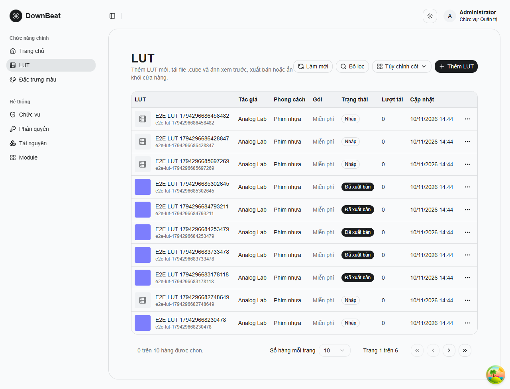

Trang "LUT" ở `/admin/luts`: bảng mọi LUT kèm bộ lọc và nút "Thêm LUT".

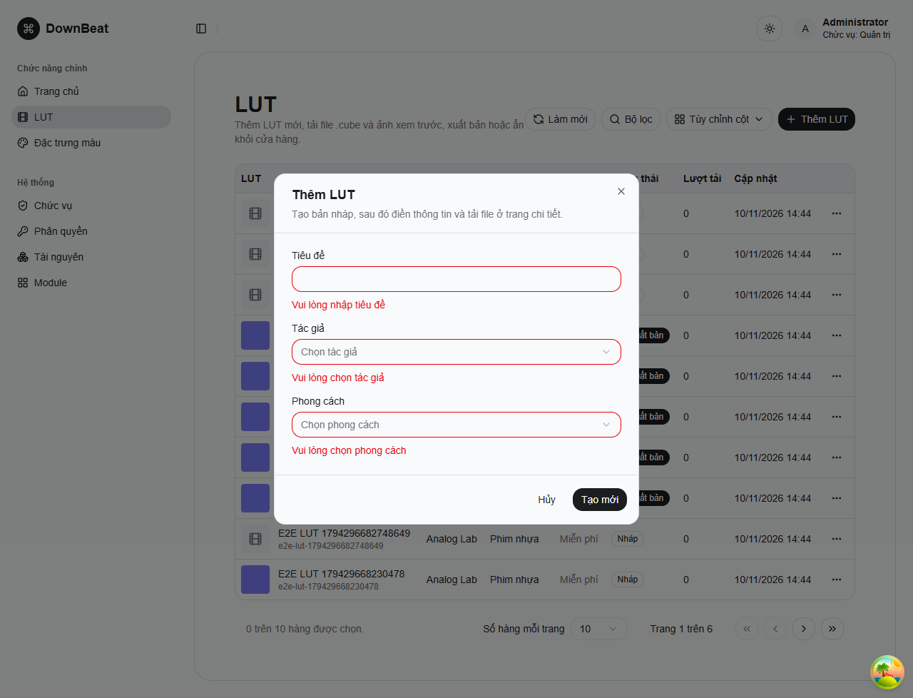

Bấm "Tạo mới" khi chưa nhập gì: ba ô báo "Vui lòng nhập tiêu đề", "Vui lòng chọn tác giả", "Vui lòng chọn phong cách".

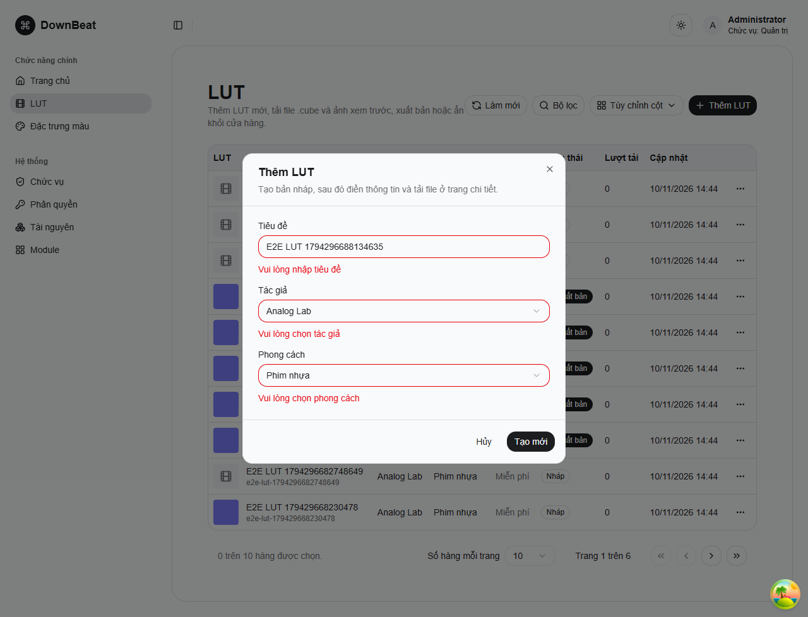

Hộp thoại đã điền tiêu đề, tác giả "Analog Lab", phong cách "Phim nhựa", sẵn sàng tạo.

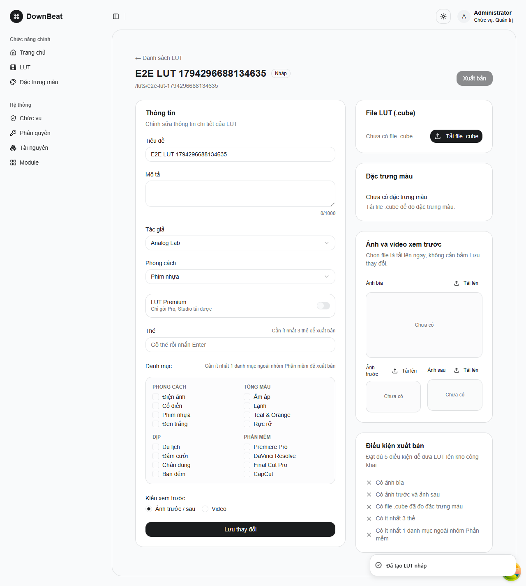

LUT vừa tạo ở trạng thái "Nháp": khối "Điều kiện xuất bản" còn 5 dòng "Chưa đạt", nút "Xuất bản" bị khoá.

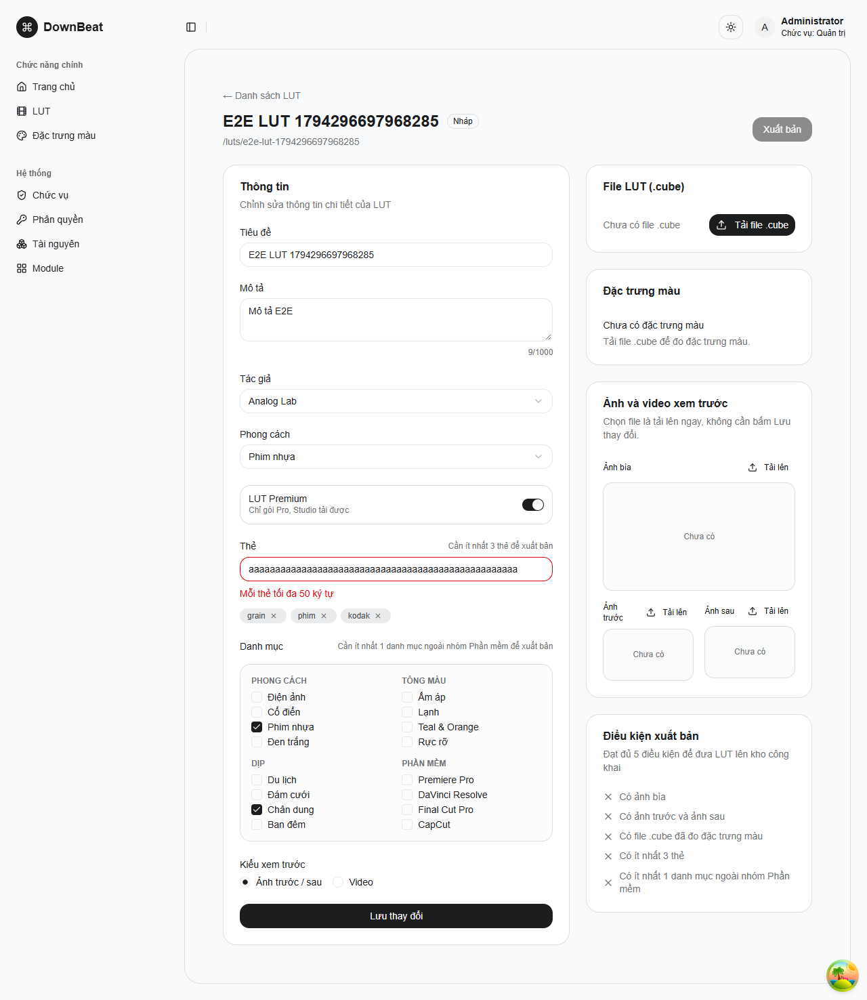

Sau khi điền mô tả, thẻ và danh mục: hai dòng về thẻ và danh mục đã "Đạt".

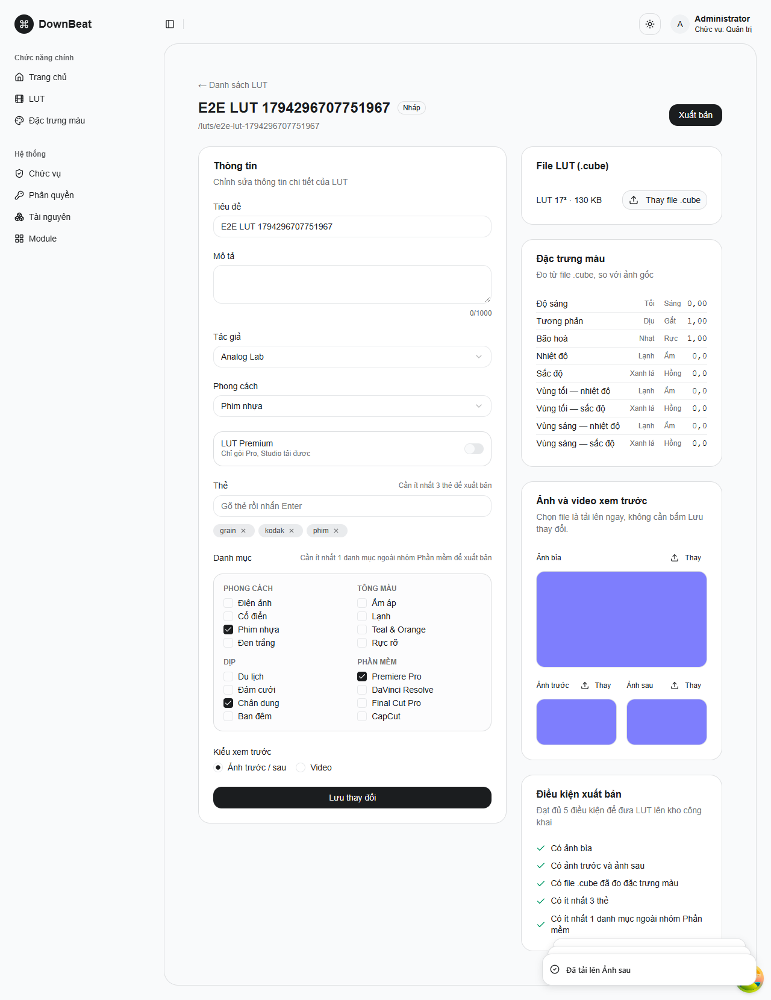

Sau khi tải .cube và ảnh: thẻ "Đặc trưng màu" hiện, cả 5 điều kiện "Đạt", nút "Xuất bản" bật.

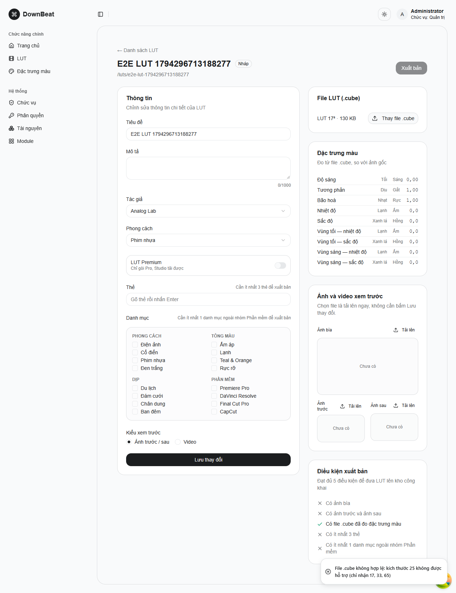

Tải file .cube có `LUT_3D_SIZE 25`: toast báo đúng lý do từ backend, khối file vẫn giữ "LUT 17³".

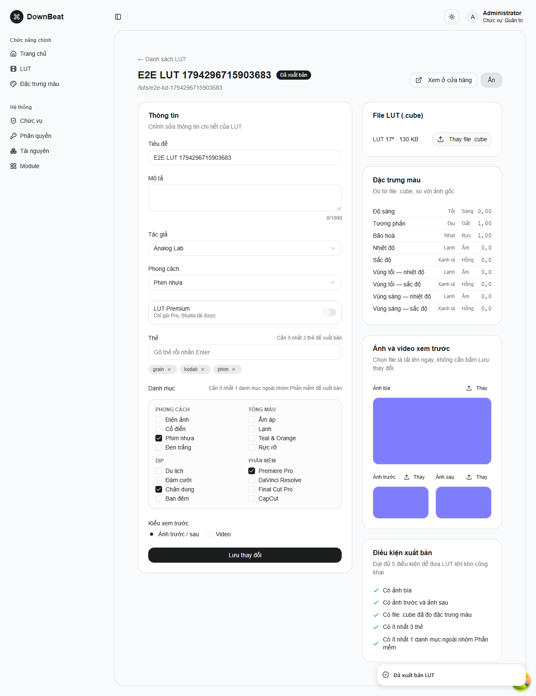

Sau khi bấm "Xuất bản": toast "Đã xuất bản LUT", badge "Đã xuất bản", xuất hiện nút "Xem ở cửa hàng" và "Ẩn".

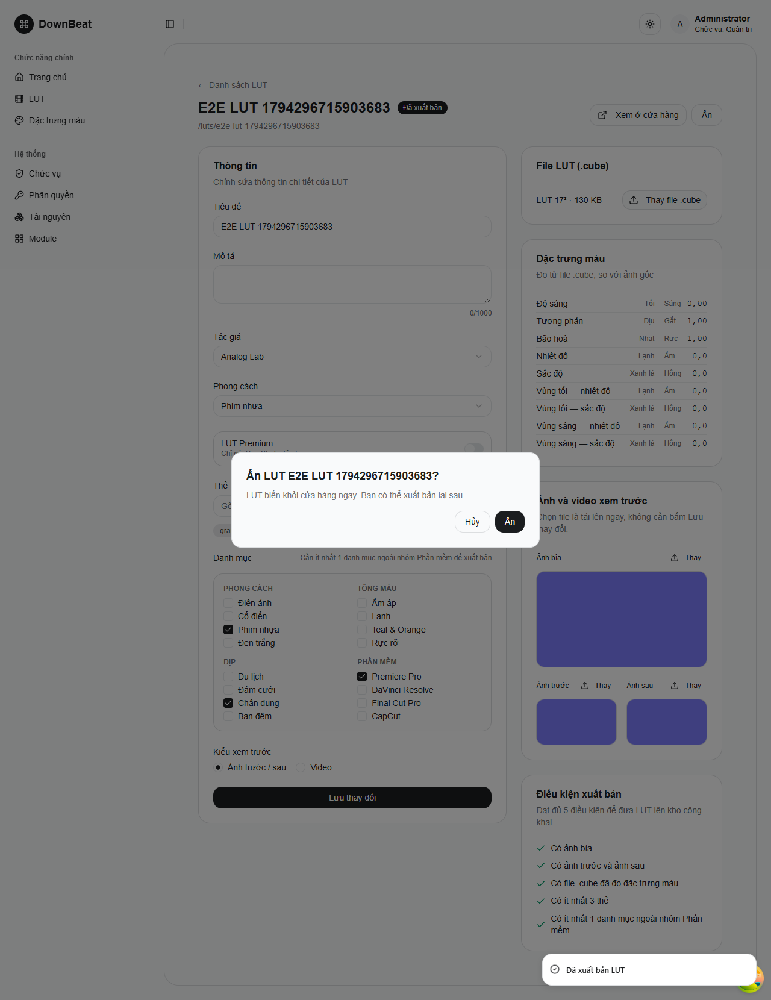

Hộp xác nhận "Ẩn LUT ...?" cho biết LUT biến khỏi cửa hàng ngay và có thể xuất bản lại.

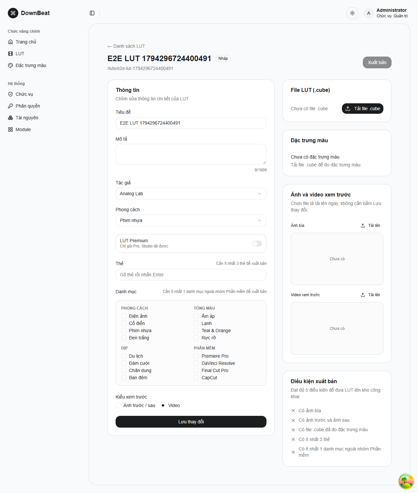

Chọn "Video": ô "Video xem trước" hiện, hai ô ảnh trước / sau ẩn đi.

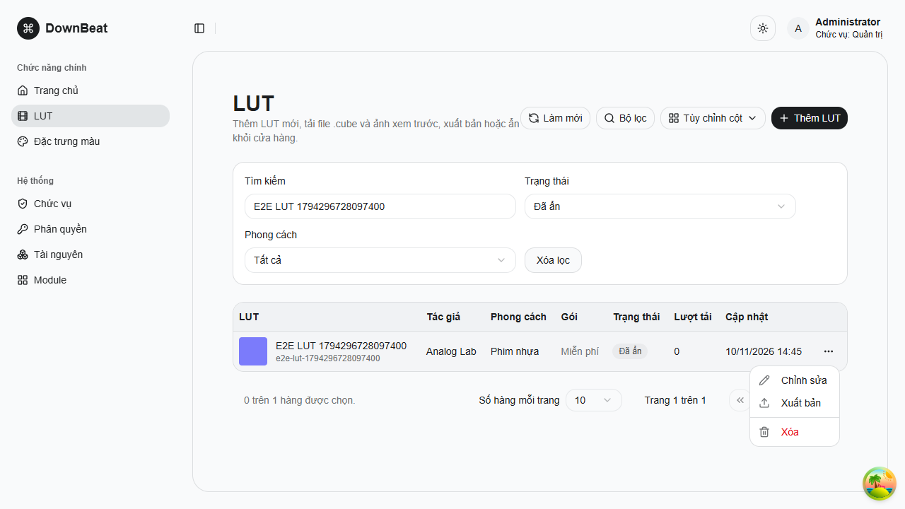

Menu ⋮ của một LUT "Đã ẩn" có "Xuất bản" và "Xóa" nhưng không có "Ẩn".

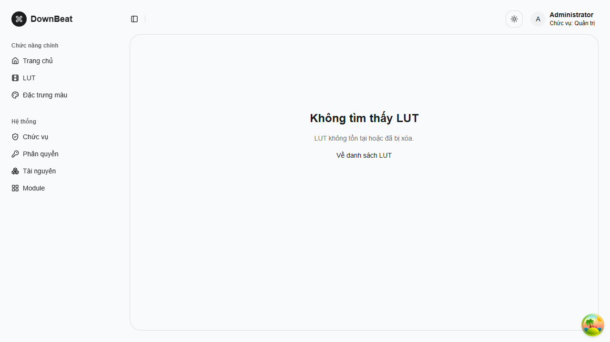

Mở id không tồn tại: khung "Không tìm thấy LUT" và link "Về danh sách LUT".

## 6. Kiểm thử

JUnit (JUnit 5 + AssertJ + Mockito) do worker viết ở `LutSlugGeneratorTest` và `LutAdminServiceTest`. Playwright (`frontend/tests/e2e/quan-ly-lut.spec.ts`) do Claude viết, chạy tuần tự (`--workers=1`). Mỗi test tự tạo LUT qua API (thay vì nối tiếp trên một LUT như plan, vì worker restart sau test đỏ làm mất biến dùng chung) và `afterAll` ẩn rồi xoá mọi LUT tiêu đề "E2E LUT ", không làm sai số liệu của spec khác.

| ID | Mô tả | Loại | Kết quả |
|---|---|---|---|
| TC-01 | Sinh slug (bỏ dấu, ký tự lạ, rỗng thành `lut`, trùng thêm `-2`, `-3`) | JUnit | Pass |
| TC-02 | Tạo: field server ghi đè, thẻ chuẩn hoá | JUnit | Pass |
| TC-03 | Sửa chỉ ghi cột cho phép; tác giả, danh mục, id sai | JUnit | Pass |
| TC-04 | Thứ tự điều kiện xuất bản | JUnit | Pass |
| TC-05 | `published_time` giữ lần đầu; ẩn nháp / ẩn lại | JUnit | Pass |
| TC-06 | Sửa LUT đang xuất bản phải giữ đủ điều kiện | JUnit | Pass |
| TC-07 | Xoá (nháp, đang xuất bản, có lượt tải, id sai) | JUnit | Pass |
| TC-08 | Upload kiểm trước, lỗi thì không ghi | JUnit | Pass |
| TC-09 | Tạo nháp, slug, field server | API | Pass |
| TC-10 | Sửa thông tin, thẻ, danh mục | API | Pass |
| TC-11 | Tham chiếu sai, id sai | API | Pass |
| TC-12 | Upload .cube hợp lệ, đo đặc trưng | API | Pass |
| TC-13 | Upload .cube hỏng / sai đuôi / rỗng | API | Pass |
| TC-14 | Upload ảnh, video | API | Pass |
| TC-15 | Upload ảnh, video sai | API | Pass |
| TC-16 | Xuất bản: từng điều kiện | API | Pass |
| TC-17 | Xuất bản hiện ở cửa hàng | API | Pass |
| TC-18 | Kiểu video | API | Pass |
| TC-19 | Sửa LUT đang xuất bản | API | Pass |
| TC-20 | Ẩn và xuất bản lại | API | Pass |
| TC-21 | Xoá | API | Pass |
| TC-22 | Danh sách, lọc, tác giả | API | Pass |
| TC-23 | Quyền: `noaccess`, khách hàng 403; không token 401 | API | Pass |
| TC-24 | Thêm LUT nháp | E2E | Pass |
| TC-25 | Điền thông tin | E2E | Pass |
| TC-26 | Upload file và đặc trưng màu | E2E | Pass |
| TC-27 | .cube hỏng báo lỗi từ backend | E2E | Pass |
| TC-28 | Xuất bản, xem ở cửa hàng, ẩn | E2E | Pass (xem mục 7) |
| TC-29 | Kiểu xem trước video | E2E | Pass |
| TC-30 | Danh sách: lọc, menu theo trạng thái, xoá | E2E | Pass |
| TC-31 | LUT không tồn tại | E2E | Pass |
| TC-32 | Không có quyền | E2E | Pass |
| | **Tổng** | | **32/32 pass** (Playwright 24/24: 15 API + 9 giao diện; JUnit 8 test TC-01 → TC-08: `LutSlugGeneratorTest` 1, `LutAdminServiceTest` 7) |

Quá trình: backend sạch từ vòng review đầu (**0 vòng sửa**), `mvn -pl business -am test` xanh, E2E `-g API` 15/15. Frontend có **1 vòng sửa** (`plan/tasks/quan-ly-lut-fe-fix1.md`): form mất thay đổi khi upload và chưa dùng `useAppForm`; nút "Ẩn" ghi đè `onSuccess` làm trang không cập nhật ngay; toast upload đọc `kind` từ closure nên có thể sai tên. Sau sửa, build và lint 0 lỗi. Playwright chạy có giao diện (slowMo) 24/24 pass.

## 7. Điểm lệch plan và hạn chế

- Hợp đồng API không lệch. Backend và frontend đều do agy làm (người dùng đổi worker backend từ Codex sang agy giữa chừng).
- Spec: mỗi test tự tạo LUT qua API thay vì nối tiếp theo từng TC; TC-30 lấy số lượt tải thật của "Kodak 400" qua `lut/list` rồi so định dạng `vi-VN` (lần đầu cứng "15.120" lấy từ ví dụ trong plan, trong khi dữ liệu thật là 14.980: lỗi của spec, không phải của code).
- TC-28 từng đỏ một lần khi chạy toàn bộ (không giữ được bằng chứng), chạy riêng 3/3 xanh, các lần chạy sau đều xanh. Ghi nhận flaky nhẹ, chưa rõ nguyên nhân.
- Ghi chú nhỏ ở backend: `update` với id không tồn tại **và** danh mục sai trả 400 "Danh mục không tồn tại" trước 404, vì kiểm danh mục chạy trước kiểm id. Không ảnh hưởng trường hợp thường gặp, chưa sửa.
- CRUD danh mục và tác giả (`/admin/danh-muc`, `/admin/tac-gia`) dời sang lát riêng đề xuất `danh-muc-tac-gia`; trong lúc chờ, ô "Tác giả" đọc `GET /lut/creators` và ô "Danh mục" đọc API công khai.
- File cũ trên MinIO không bị xoá khi thay file hoặc xoá LUT (đơn giản, tránh mất file khi transaction lỗi); dung lượng thừa nhỏ ở quy mô đồ án.
- Ảnh "sau" do người dùng tự tải lên, có thể không khớp file .cube.
- Máy mới chạy Flyway có 36 LUT trong DB nhưng MinIO trống cho tới khi chạy tay `tools/seed/kho-lut/build.py`; đề xuất lát `seed-minio`.
- Chạy sau nginx cần `client_max_body_size` ≥ 52 MB (cấu hình triển khai, ngoài phạm vi code).
- Spec `frontend/tests/e2e/quan-ly-lut.spec.ts` nằm trong thư mục `frontend/tests/` đang bị `.gitignore`, nên không đi kèm commit.
