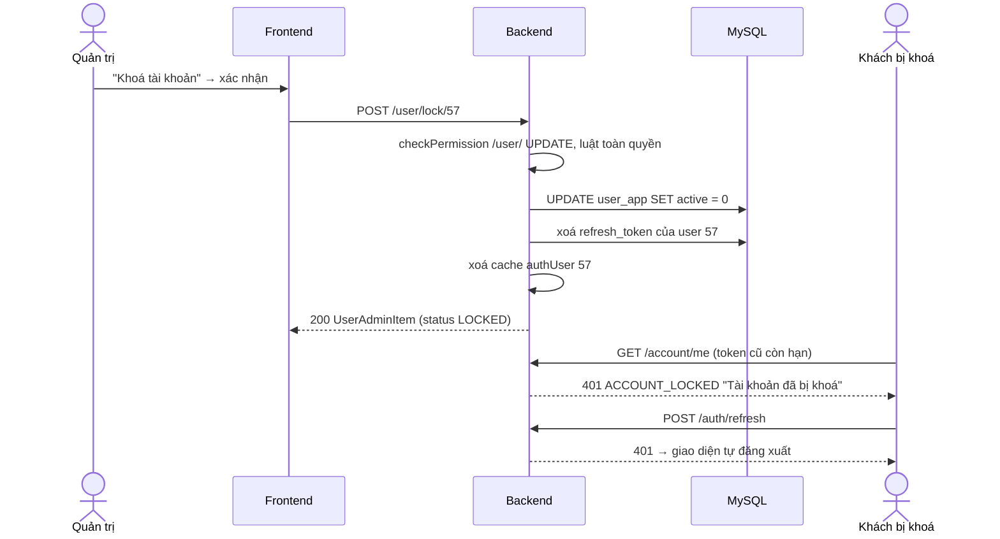
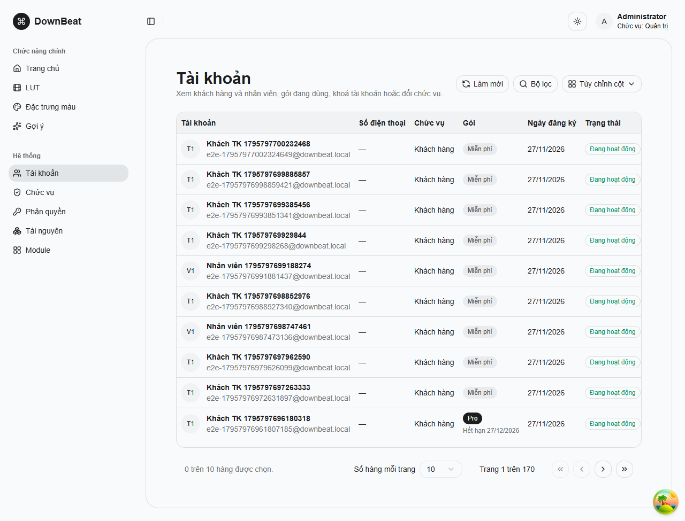
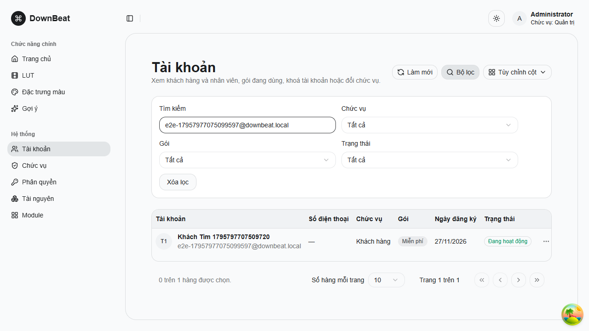
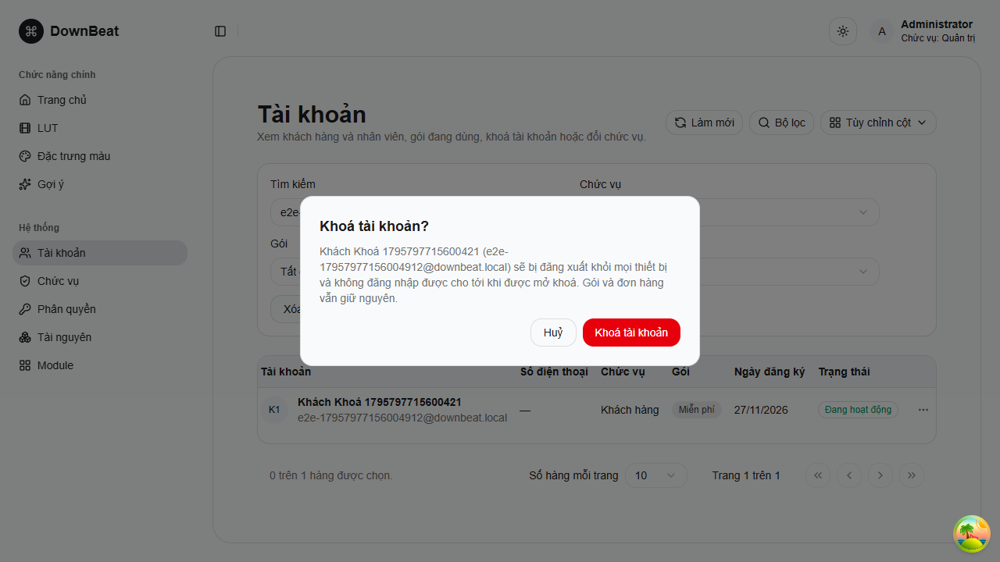
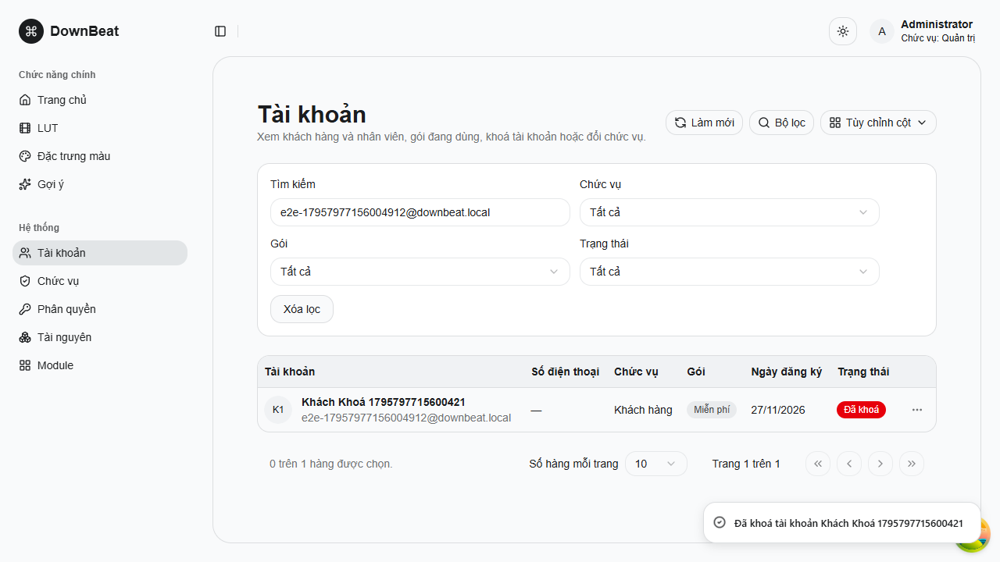
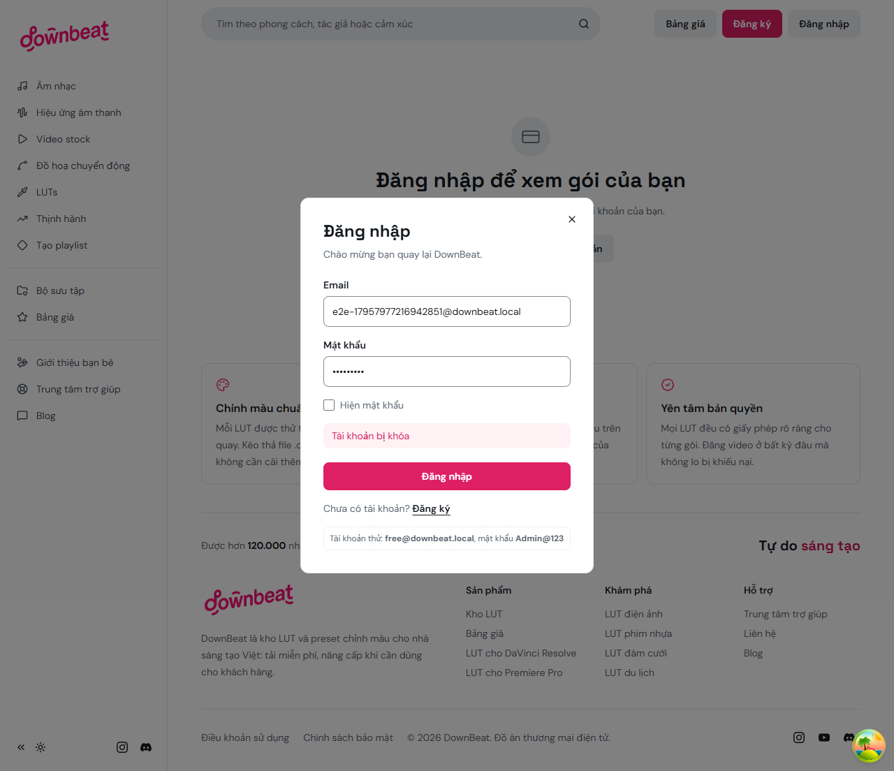
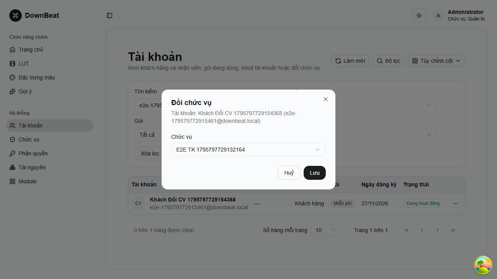
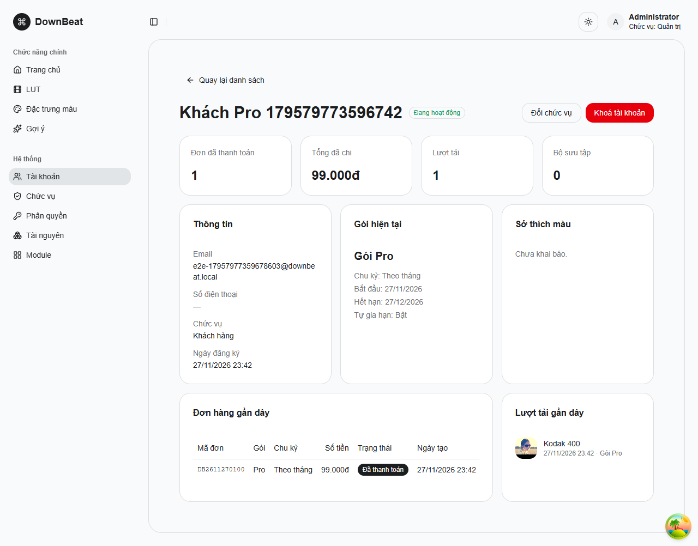
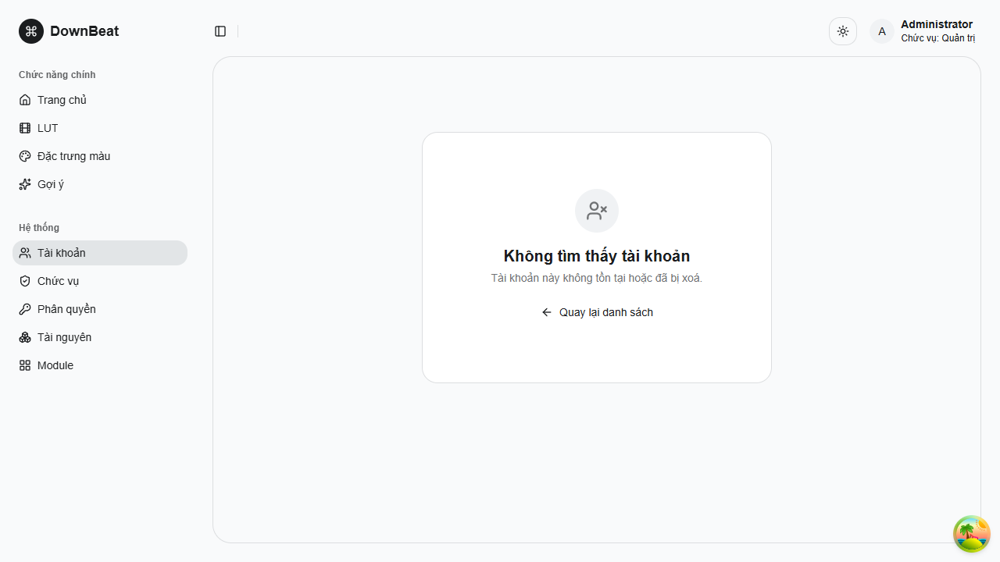

# Quản lý tài khoản (danh sách, chi tiết, khoá / mở khoá, đổi chức vụ)

> Plan: [plan/quan-ly-tai-khoan.md](../../plan/quan-ly-tai-khoan.md) · Route: `/admin/tai-khoan`, `/admin/tai-khoan/$id` · Phạm vi: backend + frontend · Migration: `V18__quan_ly_tai_khoan.sql`

## 1. Mục tiêu

Quản trị viên chưa có chỗ nào để xem ai đã đăng ký, họ dùng gói nào, đã mua và tải những gì, hay chặn một tài khoản vi phạm. Chức năng này thêm trang **"Tài khoản"** ở nhóm "Hệ thống" của trang quản trị, dành cho người có quyền `USER`:

- Xem mọi tài khoản (khách hàng và nhân viên) kèm chức vụ, gói đang dùng, ngày đăng ký, trạng thái; tìm theo tên / email / số điện thoại; lọc theo chức vụ, gói, trạng thái.
- Mở trang chi tiết một tài khoản: thông tin, gói hiện tại, 4 số tổng hợp, sở thích màu, 10 đơn và 10 lượt tải gần nhất.
- **Khoá** tài khoản (đăng xuất khỏi mọi thiết bị ngay, không đăng nhập lại được) và **mở khoá**.
- **Đổi chức vụ** (ví dụ cấp chức vụ nhân viên cho một khách, hoặc trả về "Khách hàng").

**Chưa làm**: tạo tài khoản thay khách, sửa họ tên / email / số điện thoại, đặt lại mật khẩu, xoá tài khoản (chỉ khoá), cấp / huỷ gói thay khách, nhật ký ai khoá ai, lý do khoá. Danh sách toàn bộ đơn hàng và sửa giá gói để lát `quan-tri-don-hang`.

Lát này thay phần "khách hàng" (`customer/list`, `/admin/khach-hang`) của lát 1.8 trong kế hoạch tổng, và gồm cả nhân viên (người dùng chốt ngày 27/11/2026).

## 2. Luồng sử dụng

**Tìm và xem.**

1. Quản trị mở "Tài khoản" ở thanh bên → `/admin/tai-khoan`. Trang gọi `GET /user/role-options` (đổ ô lọc "Chức vụ") và `GET /user/list`.
2. Gõ vào ô tìm kiếm hoặc chọn bộ lọc: bảng tải lại từ trang 1.
3. Bấm một dòng (hoặc "Xem chi tiết" trong menu ⋮) → `/admin/tai-khoan/{id}`, trang gọi `GET /user/get`.

**Khoá.** Bấm "Khoá tài khoản" ở dòng hoặc ở trang chi tiết → hộp thoại "Khoá tài khoản?" → xác nhận. Backend đặt `active = 0`, thu hồi mọi refresh token, xoá cache người dùng. Từ request kế tiếp, token cũ của người bị khoá bị filter JWT chặn bằng 401 `ACCOUNT_LOCKED`; giao diện của họ thử refresh, bị từ chối, tự đăng xuất. Đăng nhập lại nhận 403 "Tài khoản bị khóa".

**Mở khoá.** Bấm "Mở khoá" (không cần xác nhận) → `active = 1`. Người đó đăng nhập lại bình thường (refresh token cũ đã bị thu hồi lúc khoá).

**Đổi chức vụ.** Bấm "Đổi chức vụ" → chọn chức vụ ở ô "Chức vụ" → "Lưu". Backend đặt `role_id` và xoá cache người dùng; quyền mới có hiệu lực ở request kế tiếp, **không** thu hồi phiên đăng nhập.

**Luật chặn** (áp cho khoá, mở khoá, đổi chức vụ):

1. Không ai được thao tác trên **chính mình** (tránh tự khoá mất quyền quản trị cuối cùng).
2. Người không toàn quyền (`is_operator = 0`) không được thao tác trên tài khoản toàn quyền.
3. Người không toàn quyền không được cấp chức vụ toàn quyền.

**Luồng thay thế / ngoại lệ.**

- Role chỉ có VIEW `USER`: bảng không có menu thao tác, trang chi tiết không có nút "Khoá", "Đổi chức vụ".
- Dòng của chính mình có badge "Bạn", menu chỉ có "Xem chi tiết"; dòng tài khoản toàn quyền với người không toàn quyền cũng vậy.
- Khoá đã khoá, mở khoá đang mở, đổi sang đúng chức vụ đang có: vẫn 200, không đổi gì.
- Không có kết quả: "Không tìm thấy tài khoản nào phù hợp."
- `id` không tồn tại: API 404 "Không tìm thấy tài khoản"; trang chi tiết hiện khung "Không tìm thấy tài khoản".
- Không có VIEW `USER`: API 403, thanh bên không có mục, vào thẳng URL thấy màn không có quyền.

## 3. Cơ sở dữ liệu

Migration `V18__quan_ly_tai_khoan.sql` chỉ thêm một dòng resource `USER` (uri `/user/`, hành động `VIEW`, `UPDATE`, module `SYSTEM`), chạy lại không trùng. **Không có bảng hay cột mới**, không cấp permission cho role nào (chức vụ toàn quyền có mọi quyền; chức vụ khác được cấp ở trang "Phân quyền").

| Bảng | Dùng cho |
|---|---|
| `user_app` | Danh sách, chi tiết; **ghi** `active` (khoá / mở khoá) và `role_id` (đổi chức vụ) |
| `role` | Tên chức vụ, cờ toàn quyền, `role-options` |
| `subscription` + `plan` | Gói hiện tại (dòng `ACTIVE` và `end_date >= hôm nay`, như `findActiveByUserId`); không có thì gói Miễn phí |
| `payment_order` | 10 đơn gần đây, số đơn đã thanh toán, tổng đã chi |
| `download_log` + `lut` | 10 lượt tải gần đây, tổng lượt tải |
| `collection` | Số bộ sưu tập |
| `user_preference` + `lut_category` | Sở thích màu đã khai báo |
| `refresh_token` | **Xoá** khi khoá tài khoản |

Trạng thái: `active = 1` → `ACTIVE` ("Đang hoạt động"), khác 1 → `LOCKED` ("Đã khoá").

## 4. API

Phản hồi thành công bọc `{ code, message, result }`; lỗi `{ path, code, errorCode, message }`. Không bao giờ trả `password`, `token`, `facebookId`, `gplusId`.

| Method | Đường dẫn | Quyền | Mô tả |
|---|---|---|---|
| GET | `/user/list?keyword=&roleId=&planCode=&status=&page=1&limit=10` | VIEW `USER` | Danh sách phân trang, mới đăng ký trước |
| GET | `/user/get?id=` | VIEW `USER` | Chi tiết một tài khoản |
| GET | `/user/role-options` | VIEW `USER` | Mọi chức vụ, `id` tăng dần |
| POST | `/user/lock/{id}` | UPDATE `USER` | Khoá, thu hồi phiên |
| POST | `/user/unlock/{id}` | UPDATE `USER` | Mở khoá |
| POST | `/user/change-role` | UPDATE `USER` | Đổi chức vụ `{ id, roleId }` |

**`user/list`**: `keyword` (cắt khoảng trắng, khớp một phần không phân biệt hoa thường với tên, email, số điện thoại), `roleId`, `planCode` (`free` / `pro` / `studio`, `free` = không có gói còn hạn), `status` (`ACTIVE` / `LOCKED`). Tham số sai thì bỏ lọc, không báo lỗi; `page` < 1 thành 1, `limit` mặc định 10, tối đa 100. Sắp `regis_date DESC, id DESC`. Kết quả `{ total, page, items }`; mỗi item (`UserAdminItem`) có `id`, `name`, `email`, `phone`, `roleId`, `roleName`, `isOperator`, `status`, `regisDate`, `planCode`, `planName`, và `planExpiresAt` với gói trả phí.

**`user/get`**: mọi khoá của `UserAdminItem` cùng `subscription` (gói Miễn phí là `{ planCode: "free", planName: "Miễn phí" }`, không `null`), `stats` (`paidOrders`, `totalPaid`, `downloads`, `collections`), `preferences` (tên danh mục màu), `recentOrders` (tối đa 10, cùng dạng với `order/my-list`), `recentDownloads` (tối đa 10, gồm cả LUT đã ẩn).

**`lock` / `unlock` / `change-role`** kiểm theo thứ tự: quyền → tồn tại → (chỉ đổi chức vụ) `roleId` hợp lệ → luật chặn. Trả `UserAdminItem` mới. Quyền kiểm ở dòng đầu controller nên 403 luôn thắng 400 / 404.

**Lỗi nghiệp vụ**

| Tình huống | HTTP | Message |
|---|---|---|
| Không token | 401 | (có sẵn) |
| Thiếu VIEW / UPDATE `USER` | 403 | Bạn không có quyền thực hiện thao tác này! Path: /user/, Action: VIEW (hoặc UPDATE) |
| `id` không tồn tại | 404 | Không tìm thấy tài khoản |
| Thiếu `roleId` | 400 | Vui lòng chọn chức vụ |
| `roleId` không tồn tại | 400 | Chức vụ không tồn tại |
| Khoá / mở khoá chính mình | 400 | Không thể khoá tài khoản của chính bạn |
| Đổi chức vụ chính mình | 400 | Không thể đổi chức vụ của chính bạn |
| Người không toàn quyền đụng tài khoản toàn quyền | 400 | Chỉ tài khoản toàn quyền mới được thao tác trên tài khoản toàn quyền |
| Người không toàn quyền cấp chức vụ toàn quyền | 400 | Chỉ tài khoản toàn quyền mới được cấp chức vụ toàn quyền |
| Gọi bằng token của tài khoản bị khoá | 401 `ACCOUNT_LOCKED` | Tài khoản đã bị khoá |

**Khoá có hiệu lực ngay.** `JwtAuthenticationFilter` đọc người dùng ở mỗi request (từ cache Caffeine, chỉ xuống DB khi cache trống) và trả 401 `ACCOUNT_LOCKED` nếu `active = 0`. Dùng 401 (không phải 403) để interceptor của giao diện thử refresh rồi tự đăng xuất. Chỉ lỗi `ACCOUNT_LOCKED` mới có khoá `errorCode`; các lỗi 401 khác giữ nguyên dạng cũ.

Mã: package `vn.aeoc.business.account` (`UserAdminController`, `UserAdminService`, `UserAdminRepository`); POJO ở `entity/.../account` (`UserAdminItem`, `UserAdminDetail`, `UserAdminStats`, `UserAdminSubscription`, `UserDownloadItem`, `ChangeRoleRequest`); `role-options` trả thẳng POJO `Role`. Sửa `JwtAuthenticationFilter` (lấy `UserService` qua `ObjectProvider` để tránh vòng bean), `UserService.evictAuthUser` (mở public), `ErrorCode.ACCOUNT_LOCKED`, `HttpResponseUtils`.

## 5. Giao diện

**Thanh bên.** Mục "Tài khoản" (icon `Users`) là mục đầu của nhóm "Hệ thống", chỉ hiện khi có VIEW `USER`. Trang chi tiết cũng làm mục này sáng.

**Trang danh sách `/admin/tai-khoan`** (bọc `AdminPermissionGuard code="USER"`): bảng tiêu đề "Tài khoản", không có nút thêm hay xoá hàng loạt.

- Bộ lọc: "Tìm kiếm" ("Tìm theo tên, email hoặc số điện thoại"), "Chức vụ" (từ `role-options`), "Gói" (Miễn phí / Pro / Studio), "Trạng thái" (Đang hoạt động / Đã khoá).
- Cột: "Tài khoản" (ảnh đại diện, tên, email; dòng của mình có badge "Bạn"), "Số điện thoại", "Chức vụ" (badge "Toàn quyền" nếu có), "Gói" (gói trả phí kèm "Hết hạn dd/MM/yyyy"), "Ngày đăng ký", "Trạng thái", và nút ⋮ "Thao tác với {tên}".
- Menu ⋮: "Xem chi tiết"; nếu có UPDATE và luật cho phép thì thêm "Đổi chức vụ" và "Khoá tài khoản" (hoặc "Mở khoá").
- Bấm vào dòng mở chi tiết; bấm nút ⋮ không mở chi tiết.

**Trang chi tiết `/admin/tai-khoan/$id`**: nút "Quay lại danh sách", tên, badge trạng thái, các nút "Đổi chức vụ", "Khoá tài khoản" / "Mở khoá" (cùng điều kiện hiện như menu). Bên dưới là 4 ô số ("Đơn đã thanh toán", "Tổng đã chi", "Lượt tải", "Bộ sưu tập") và các card "Thông tin", "Gói hiện tại" (chu kỳ, bắt đầu, hết hạn, "Tự gia hạn: Bật" / "Đã huỷ"), "Sở thích màu", "Đơn hàng gần đây", "Lượt tải gần đây" (tên LUT là link sang `/admin/luts/{id}` nếu người xem có quyền `LUT`). Có trạng thái đang tải (khung xương), 404, và lỗi tải kèm "Thử lại".

**Hộp thoại "Khoá tài khoản?"**: nói rõ người đó bị đăng xuất khỏi mọi thiết bị, gói và đơn hàng giữ nguyên. Thành công: toast "Đã khoá tài khoản {tên}". Mở khoá không có hộp thoại: toast "Đã mở khoá tài khoản {tên}".

**Hộp thoại "Đổi chức vụ"**: ô "Chức vụ" mặc định chức vụ hiện tại; chức vụ toàn quyền ghi "(toàn quyền)" và bị loại khỏi danh sách với người không toàn quyền; chọn chức vụ toàn quyền thì có dòng cảnh báo. Nút "Lưu" bị khoá khi chưa đổi. Thành công: toast "Đã đổi chức vụ của {tên} thành {chức vụ}".

**Người bị khoá**: không có màn hình riêng. Request kế tiếp nhận 401 `ACCOUNT_LOCKED`, giao diện tự đăng xuất; đăng nhập lại hiện "Tài khoản bị khóa".

Mã: `lib/{types,axios,tanstack/options,utils}/user-admin.ts` (`canManageUser` áp luật chặn ở giao diện), `components/admin/user/*` (cột bảng, menu ⋮, hai hộp thoại, badge, hook `useUserActions` dùng chung cho danh sách và chi tiết, các card chi tiết), `routes/admin/tai-khoan/index.tsx` và `$id.tsx`; sửa `admin-sidebar.tsx`, `admin-main.tsx` (sáng mục theo tiền tố), `data-table-advanced.tsx` (thêm prop `emptyMessage`).

### Hình ảnh

Trang `/admin/tai-khoan` với bộ lọc và bảng tài khoản; dòng của quản trị có badge "Bạn" và "Toàn quyền".

Gõ email vào ô tìm kiếm: bảng còn đúng một dòng khớp.

Hộp thoại "Khoá tài khoản?" nêu hậu quả và hai nút "Huỷ", "Khoá tài khoản".

Sau khi khoá: toast "Đã khoá tài khoản …" và badge "Đã khoá" ở dòng.

Phía khách: sau khi bị khoá, tải lại trang thì mất trạng thái đăng nhập và đăng nhập lại báo "Tài khoản bị khóa".

Hộp thoại "Đổi chức vụ" với ô "Chức vụ" và nút "Lưu".

Trang chi tiết khách có gói Pro: 4 ô số, gói hiện tại, đơn hàng và lượt tải gần đây.

`id` không tồn tại: khung "Không tìm thấy tài khoản" với nút "Quay lại danh sách".

## 6. Kiểm thử

Spec `frontend/tests/e2e/quan-ly-tai-khoan.spec.ts` tạo khách mới bằng `account/register` (email ngẫu nhiên) để khoá / đổi chức vụ không ảnh hưởng spec khác; "nhân viên" là role tạo qua API phân quyền rồi gán bằng `user/change-role`, dọn sau test. Không bao giờ khoá `admin@downbeat.local`.

| ID | Loại | Nội dung | Kết quả |
|---|---|---|---|
| TC-01 | Playwright API | `user/list` không token → 401 | Pass |
| TC-02 | Playwright API | `user/list` không quyền → 403 (Action: VIEW) | Pass |
| TC-03 | Playwright API | `list` phân trang, sắp mới nhất trước, không lộ `password` / `active` | Pass |
| TC-04 | Playwright API | Lọc `keyword` theo email (viết HOA), tên, số điện thoại | Pass |
| TC-05 | Playwright API | Lọc `status`, `roleId`, `planCode` | Pass |
| TC-06 | Playwright API | Tham số sai không báo lỗi, `limit` bị chặn 100 | Pass |
| TC-07 | Playwright API | `get` khách có gói Pro: gói, 4 số, đơn, lượt tải | Pass |
| TC-08 | Playwright API | `get` khách mới: gói Miễn phí, số 0, danh sách rỗng | Pass |
| TC-09 | Playwright API | `get` không tồn tại → 404 | Pass |
| TC-10 | Playwright API | `role-options` có "Quản trị" và "Khách hàng" | Pass |
| TC-11 | Playwright API | `role-options` không quyền → 403 | Pass |
| TC-12 | Playwright API | Khoá: token cũ 401 `ACCOUNT_LOCKED`, refresh 401, đăng nhập 403 | Pass |
| TC-13 | Playwright API | Mở khoá: đăng nhập và `account/me` lại được | Pass |
| TC-14 | Playwright API | Khoá lặp lại vẫn 200 | Pass |
| TC-15 | Playwright API | Khoá / đổi chức vụ chính mình → 400 | Pass |
| TC-16 | Playwright API | Nhân viên chỉ có VIEW: lock / change-role 403 (UPDATE), list 200 | Pass |
| TC-17 | Playwright API | Nhân viên không đụng được tài khoản toàn quyền | Pass |
| TC-18 | Playwright API | Nhân viên không cấp được chức vụ toàn quyền | Pass |
| TC-19 | Playwright API | Nhân viên khoá được khách thường | Pass |
| TC-20 | Playwright API | Đổi chức vụ có hiệu lực ở request kế tiếp (403 → 200 → 403) | Pass |
| TC-21 | Playwright API | `change-role` thiếu / sai `roleId`, `id` không tồn tại | Pass |
| TC-22 | Playwright API | `lock` / `unlock` id không tồn tại → 404 | Pass |
| TC-23 | Playwright API | Không quyền thắng validate (403, không phải 404 / 400) | Pass |
| TC-24 | Playwright giao diện | Thanh bên và quyền vào trang (admin thấy, `noaccess` bị chặn) | Pass |
| TC-25 | Playwright giao diện | Tìm theo email và lọc "Đã khoá" → trạng thái rỗng | Pass |
| TC-26 | Playwright giao diện | Dòng của chính mình: badge "Bạn", "Toàn quyền", menu chỉ "Xem chi tiết" | Pass |
| TC-27 | Playwright giao diện | Khoá rồi mở khoá trên bảng (toast, badge) | Pass |
| TC-28 | Playwright giao diện | Khách bị khoá tự bị đăng xuất, đăng nhập lại báo "Tài khoản bị khóa" | Pass |
| TC-29 | Playwright giao diện | Đổi chức vụ: "Lưu" khoá trước khi chọn, toast, cột "Chức vụ" đổi | Pass |
| TC-30 | Playwright giao diện | Chi tiết khách có gói Pro | Pass |
| TC-31 | Playwright giao diện | Chi tiết khách mới và trang 404 | Pass |
| TC-32 | Playwright giao diện | Nhân viên chỉ xem: không có nút khoá / đổi chức vụ | Pass |
| TC-33 | JUnit | Luật toàn quyền và thứ tự kiểm | Pass |
| TC-34 | JUnit | `lock` thu hồi phiên, `unlock` không | Pass |
| TC-35 | JUnit | 404 trước luật | Pass |
| TC-36 | JUnit | `changeRole` validate | Pass |
| TC-37 | JUnit | Chuẩn hoá tham số `list` | Pass |
| TC-38 | JUnit | Filter JWT chặn tài khoản bị khoá | Pass |

**Tổng**: JUnit 8/8 (`UserAdminServiceTest` 5 ca phủ TC-33 → TC-37, `JwtAuthenticationFilterTest` 3 ca có TC-38); Playwright 28/28 (API 19 bài phủ TC-01 → TC-23 vì một số ca gộp chung một bài + giao diện 9 bài cho TC-24 → TC-32), chạy `--headed --workers=1`. `pnpm build` xanh, `pnpm lint` 0 lỗi.

Hồi quy: `auth` và `phan-quyen` xanh; `goi-cua-toi`, `tai-khoan-khach` 51/52 (xem mục 7).

## 7. Điểm lệch plan và vấn đề còn lại

- **Không có worker**: người dùng bảo Claude tự cook cả backend lẫn frontend nên 0 vòng sửa cho mỗi bên.
- **Sửa lỗi có sẵn** `RefreshTokenRepository.deleteExpiredByUserId`: lệnh DELETE theo `user_id` giữ gap lock, hai lần `account/register` đồng thời gây deadlock (400 "Dữ liệu không hợp lệ"). Nay đọc id trước rồi xoá theo khoá chính.
- **`role-options`** trả thẳng POJO `Role` (đúng 4 khoá của hợp đồng) thay vì tạo lớp riêng.
- **Lỗi 401 của filter vẫn không có `errorCode`** như cũ (spec `tai-khoan-khach` TC-11 khoá điều này); chỉ `ACCOUNT_LOCKED` có `errorCode` (`HttpResponseUtils.writeErrorWithCode`).
- **Toast** đặt ở `meta.successMessage` dạng hàm (đúng `frontend/AGENTS.md`) thay vì "trang tự hiện"; card chi tiết dùng `Card role="region" aria-label`; màn 404 chỉ có một nút "Quay lại danh sách".
- Spec: TC-03 lọc theo tên chung của test vì các test chạy song song cũng tạo tài khoản; TC-30 kiểm "Chu kỳ: Theo tháng" theo nhãn có sẵn `cycleLabel`.
- **Hồi quy đỏ một ca, không do chức năng này**: `tai-khoan-khach` TC-12 đỏ vì dữ liệu local, `admin@downbeat.local` có sẵn gói Pro đang hoạt động (tạo 14/11, hết hạn 14/12/2026). Chạy song song thì `goi-cua-toi` thỉnh thoảng đỏ vì payOS sandbox 502 / `mock-pay` 400; chạy E2E nên dùng `--workers=1`.
- Không có nhật ký ai khoá ai, không có lý do khoá; thu hồi phiên chỉ xảy ra khi khoá, đổi chức vụ không đăng xuất người bị đổi.
