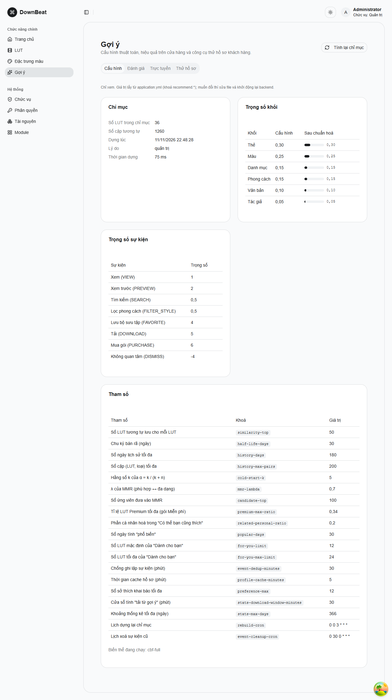
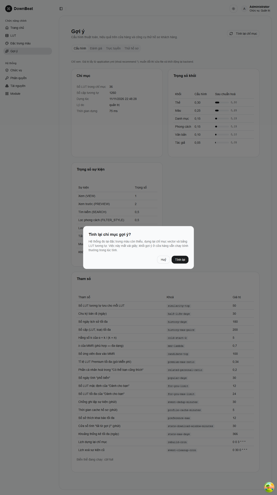
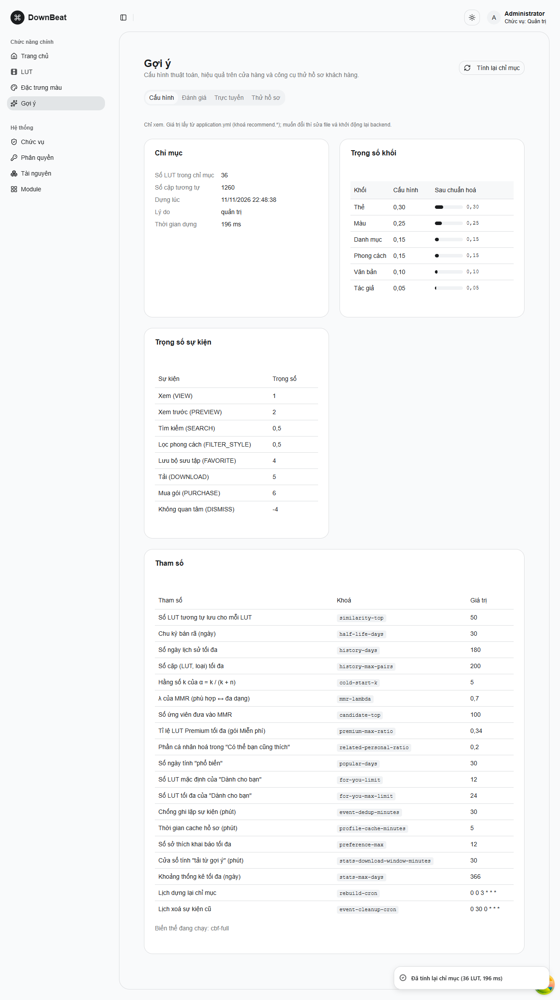
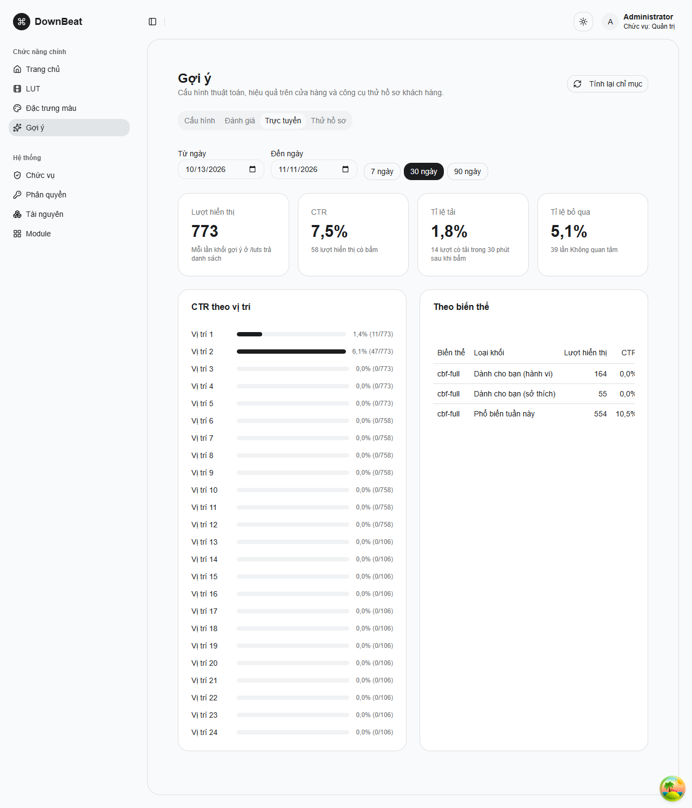
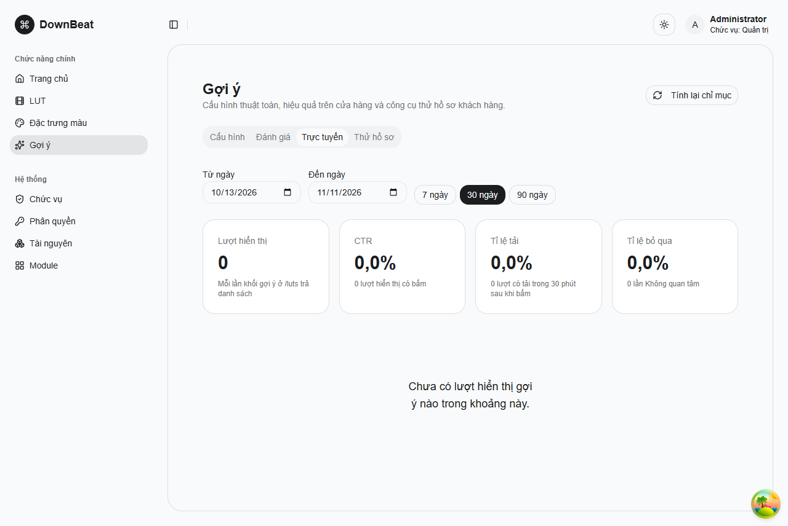
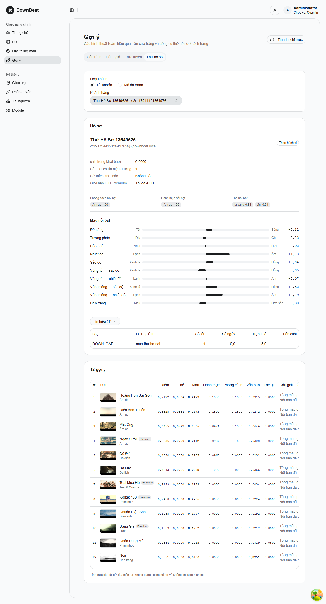
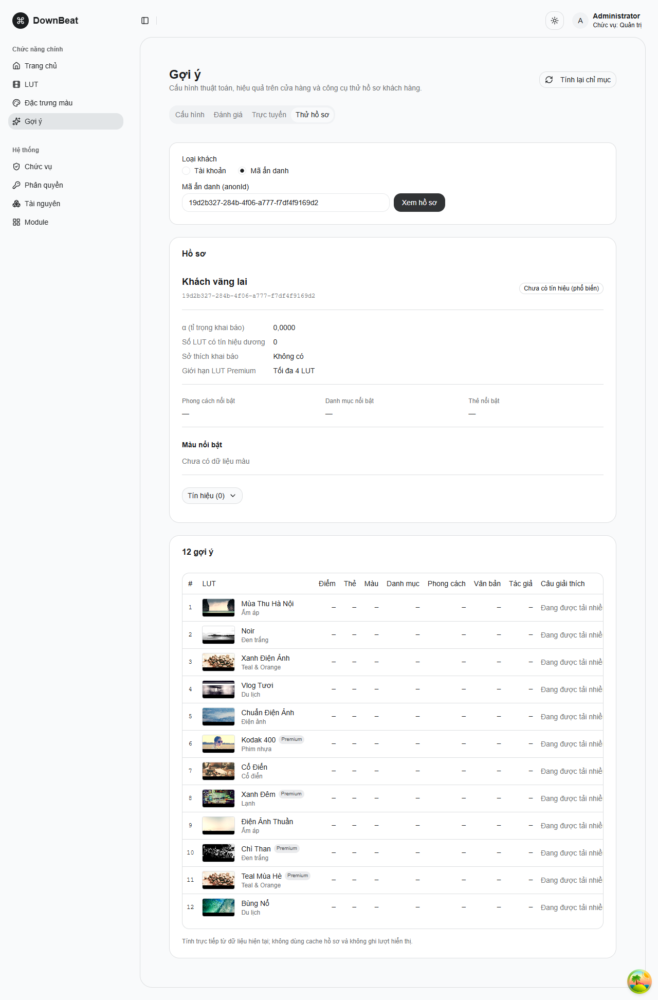
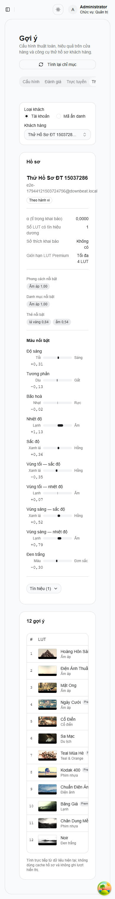

# Quản trị gợi ý (trang `/admin/goi-y`: cấu hình, tính lại chỉ mục, số liệu trực tuyến, thử hồ sơ khách)

> Plan: [plan/quan-tri-goi-y.md](../../plan/quan-tri-goi-y.md) · API: `GET /api/recommend/config`, `POST /api/recommend/rebuild`, `GET /api/recommend/stats`, `GET /api/recommend/customers`, `POST /api/recommend/try-profile` · Giao diện: `/admin/goi-y` · Phạm vi: backend + frontend

## 1. Mục tiêu

Ba lát trước (chỉ mục tương đồng, hồ sơ người dùng, xếp hạng gợi ý) đã làm xong thuật toán, nhưng người quản trị chưa có chỗ nào để nhìn vào nó. Lát này thêm trang **`/admin/goi-y`** với bốn thẻ:

1. **"Cấu hình"** (chỉ đọc): trọng số 6 khối, trọng số 8 loại sự kiện, 19 tham số `recommend.*` đang chạy và trạng thái chỉ mục (số LUT, số cặp tương tự, dựng lúc nào, vì sao). Cấu hình nằm ở `application.yml`; muốn đổi thì sửa file rồi khởi động lại backend.
2. **"Đánh giá"**: chỉ có trạng thái rỗng. Bảng các lần chạy đánh giá offline thuộc lát 3.1 (`danh-gia-goi-y`).
3. **"Trực tuyến"**: CTR, tỉ lệ tải từ gợi ý, tỉ lệ bỏ qua trong một khoảng ngày, tách theo vị trí trong danh sách và theo biến thể / loại khối, tính từ `rec_impression` và `user_event.impression_id`.
4. **"Thử hồ sơ"**: chọn một khách hàng (hoặc nhập mã ẩn danh), xem hồ sơ của họ và đúng 12 gợi ý "Dành cho bạn" họ đang thấy, kèm điểm và đóng góp của từng khối. Công cụ này để giải thích thuật toán khi bảo vệ đồ án.

Đầu trang có nút **"Tính lại chỉ mục"**: đo đặc trưng màu còn thiếu, dựng lại chỉ mục vector và bảng `lut_similarity`.

Chưa làm (để lát sau): sửa cấu hình từ giao diện, bảng `rec_eval_run` và `GET /recommend/eval/list` (3.1), chia A/B nhiều biến thể (3.x), biểu đồ theo ngày, xuất CSV, quản lý khách hàng.

## 2. Luồng hoạt động

**Xem cấu hình.** Quản trị mở `/admin/goi-y` (thẻ "Cấu hình" mặc định). Giao diện gọi `config`; backend đọc `RecommendProperties` và trạng thái chỉ mục từ `LutIndexService.status()`. Bốn card hiện ra: "Chỉ mục", "Trọng số khối" (giá trị gốc và sau chuẩn hoá), "Trọng số sự kiện", "Tham số".

**Tính lại chỉ mục.** Bấm "Tính lại chỉ mục" → hộp thoại "Tính lại chỉ mục gợi ý?" → "Tính lại". Backend (đồng bộ, không `@Transactional`): (1) tìm LUT có file `.cube` mà chưa có dòng `lut_color_feature`, đo đặc trưng cho các LUT đó; (2) dựng lại chỉ mục vector và thay toàn bộ `lut_similarity`; (3) trả bản tóm tắt. Giao diện hiện toast "Đã tính lại chỉ mục (36 LUT, 412 ms)" và làm mới thẻ "Chỉ mục" (Lý do: "quản trị"). LUT không đo được thì có khung cảnh báo liệt kê tên và lý do.

**Số liệu trực tuyến.** Thẻ "Trực tuyến" mặc định 30 ngày gần nhất. Backend lấy các `rec_impression` có `placement = FOR_YOU` trong khoảng, các `user_event` `VIEW` / `DISMISS` gắn `impression_id` của chúng, và các `download_log` của người đã bấm; lớp thuần `StatsCalculator` tính chỉ số.

**Thử hồ sơ.** Ở loại khách "Tài khoản", gõ email hoặc tên vào ô tìm (`customers`, sau 300 ms ngừng gõ), chọn một khách thì giao diện gọi ngay `try-profile { userId }`. Backend tính hồ sơ **mới** (không đọc, không ghi cache 5 phút) rồi xếp hạng đúng như `for-you` của khách đó (cùng loại LUT đã tải / bỏ qua, cùng giới hạn Premium theo gói) nhưng **không** ghi `rec_impression` nên không làm lệch số liệu trực tuyến.

**Luồng thay thế.**

- Loại khách "Mã ẩn danh": nhập `anonId` rồi "Xem hồ sơ"; khách chưa có tín hiệu thì chiến lược `POPULAR`, danh sách là "Phổ biến tuần này" và các cột điểm / đóng góp hiện "—".
- Đổi khoảng ngày bằng hai ô ngày hoặc nút nhanh "7 ngày", "30 ngày", "90 ngày". Khoảng không có lượt hiển thị thì hiện "Chưa có lượt hiển thị gợi ý nào trong khoảng này."
- Role chỉ có VIEW không thấy nút "Tính lại chỉ mục", các thẻ khác dùng bình thường.
- URL `?tab=cau-hinh | danh-gia | truc-tuyen | thu-ho-so` mở đúng thẻ, chia sẻ được.

**Ngoại lệ.**

- Không có quyền VIEW (khách hàng, `noaccess`): API 403, menu không có "Gợi ý", mở `/admin/goi-y` thấy "Truy cập bị từ chối".
- `stats`: ngày sai định dạng, `from` sau `to`, hoặc khoảng quá 366 ngày đều 400; giao diện chặn hai lỗi sau trước khi gọi API.
- `try-profile`: thiếu cả `userId` và `anonId` → 400; `anonId` sai định dạng → 400; `userId` không có → 404. Giao diện hiện message dưới ô nhập, không toast.
- Một thẻ gặp lỗi mạng / 5xx chỉ hiện "Không tải được dữ liệu" kèm "Thử lại" ở thẻ đó, các thẻ khác không ảnh hưởng.

## 3. Cách tính số liệu trực tuyến

| Đại lượng | Cách tính |
|---|---|
| Lượt hiển thị | Số `rec_impression` (`FOR_YOU`) có `created_time` trong khoảng, tính cả hai đầu |
| Lần bấm | `user_event` `VIEW` mang `impression_id` của lượt hiển thị đó và `lut_id` nằm trong danh sách đã trả; đếm theo cặp (lượt hiển thị, LUT) khác nhau nên bấm lặp không tăng |
| CTR | Số lượt hiển thị có ít nhất một lần bấm / lượt hiển thị |
| Tỉ lệ tải | Số lượt hiển thị có lần bấm (của người đã đăng nhập) mà cùng người đó tải đúng LUT đó trong 30 phút sau khi bấm / lượt hiển thị |
| Tỉ lệ bỏ qua | Số dòng `DISMISS` gắn lượt hiển thị / lượt hiển thị (có thể vượt 100% vì mỗi lượt hiển thị có nhiều LUT) |
| Theo vị trí | Vị trí k = chỉ số trong danh sách + 1; CTR vị trí k = số lần bấm ở k / số lượt hiển thị có độ dài ≥ k |
| Theo biến thể | Gom theo (`variant`, `strategy`); sắp biến thể tăng dần rồi PROFILE, PREFERENCE, POPULAR |

Mẫu số bằng 0 thì tỉ lệ bằng 0. Tỉ lệ làm tròn 4 chữ số ở API, giao diện đổi sang phần trăm (`15,0%`). Khách vãng lai không tải được nên chỉ góp vào CTR; lần bấm được tính cho lượt hiển thị kể cả khi xảy ra sau ngày cuối của khoảng.

## 4. Cơ sở dữ liệu

Migration `V13__quan_tri_goi_y.sql`: **không tạo bảng, không thêm cột**. Chỉ thêm module `RECOMMENDER` và resource `RECOMMEND` (`/recommend/`, hành động `VIEW`, `UPDATE`), viết theo kiểu chạy lại được (`WHERE NOT EXISTS`). Không cấp quyền cho role nào vì role operator (admin) có mọi quyền.

## 5. Backend

- `RecommendAdminController` (5 endpoint, mỗi handler gọi `checkPermission(principal, "/recommend/", …)` ở dòng đầu nên 403 thắng 400) và `RecommendAdminService` (`config`, `rebuild`, `customers`).
- `RecommendStatsService` kiểm tra khoảng ngày rồi nạp dữ liệu; `business.recommend.stats.StatsCalculator` là lớp thuần (không Spring) tính chỉ số nên kiểm thử được bằng dữ liệu tay.
- `RecommendService` tách phần xếp hạng dùng chung cho `for-you` và `try-profile`, gọi thẳng `Recommender.recommend`; `UserProfileService.computeFresh` tính hồ sơ không qua cache.
- `LutIndexService` giữ trạng thái lần dựng gần nhất (`status()`), thêm `rebuildOrThrow` cho API; lần dựng lỗi vẫn giữ chỉ mục cũ và ghi `lastError`. `LutRepository.idsMissingFeature` tìm LUT còn thiếu đặc trưng màu; `RecommendCustomerRepository` tìm khách theo email / tên.
- POJO mới ở `entity.data.mysql.recommend`: `RecommendConfig`, `RebuildResult`, `RecommendStats`, `TryProfileRequest`, `TryProfileResult` và các lớp con.

### API

Thành công: `{ "code": 200, "message": "OK", "result": … }`. Tất cả đòi token.

| Method | Đường dẫn | Quyền | Chức năng | `result` |
|---|---|---|---|---|
| GET | `/api/recommend/config` | VIEW | Trọng số, tham số và trạng thái chỉ mục | `{ variant, weights, normalizedWeights, eventWeights, params (19 khoá), index? }` |
| POST | `/api/recommend/rebuild` | UPDATE | Đo đặc trưng màu còn thiếu, dựng lại chỉ mục và `lut_similarity` | `{ featureMissing, featureComputed, featureFailed[], lutCount, similarityRows, elapsedMs, builtTime, reason }` |
| GET | `/api/recommend/stats?from=&to=` | VIEW | Số liệu trực tuyến (mặc định 30 ngày) | `{ from, to, summary, byVariant[], byPosition[] }` |
| GET | `/api/recommend/customers?keyword=&limit=` | VIEW | Tìm khách để chọn (mặc định 10, tối đa 20) | `[{ id, name, email }]` |
| POST | `/api/recommend/try-profile` | VIEW | Hồ sơ và 12 gợi ý của một khách (body `{ userId?, anonId?, limit? }`) | `{ customer?, anonId?, strategy, premiumLimited, premiumQuota?, profile, color[], categoryNames, items[] }`, mỗi item có `score` và `contributions` (6 khối) trừ `POPULAR` |

| Tình huống | HTTP | errorCode | Message |
|---|---|---|---|
| Không token / token sai | 401 | `LOGIN` / `UNAUTHORIZED` / `TOKEN_EXPIRED` | (message của bộ lọc) |
| `config`, `stats`, `customers`, `try-profile` khi thiếu VIEW | 403 | `FORBIDDEN` | Bạn không có quyền thực hiện thao tác này! Path: /recommend/, Action: VIEW |
| `rebuild` khi thiếu UPDATE | 403 | `FORBIDDEN` | … Action: UPDATE |
| `stats`: ngày sai định dạng (kể cả `2026-02-30`) | 400 | `BAD_REQUEST` | Ngày không hợp lệ |
| `stats`: `from` sau `to` | 400 | `BAD_REQUEST` | Ngày bắt đầu phải trước hoặc bằng ngày kết thúc |
| `stats`: quá 366 ngày | 400 | `BAD_REQUEST` | Khoảng thời gian tối đa 366 ngày |
| `try-profile`: thiếu `userId` và `anonId` | 400 | `BAD_REQUEST` | Chọn một khách hàng hoặc nhập mã ẩn danh |
| `try-profile`: `anonId` sai định dạng | 400 | `BAD_REQUEST` | Mã ẩn danh không hợp lệ |
| `try-profile`: `userId` không có | 404 | `DATA_NOT_FOUND` | Không tìm thấy khách hàng |
| `rebuild`: dựng chỉ mục lỗi | 500 | `INTERNAL_ERROR` | Không dựng được chỉ mục gợi ý |

Quy tắc đáng chú ý của `try-profile`: có `userId` hợp lệ thì bỏ qua `anonId`; `anonId` được đưa về chữ thường; `categoryNames` có tên phong cách của mọi slug trong sở thích, `topStyles`, `topCategories` và `style` của mọi item; `topStyles` / `topCategories` / `topTags` có dạng `{ key, weight }` như lát hồ sơ người dùng, còn `color` dùng `{ key, value }` (z-score).

## 6. Giao diện

- Route `/admin/goi-y` bọc `AdminPermissionGuard code="RECOMMEND"`; mục **"Gợi ý"** (icon `Sparkles`) ở thanh bên nhóm "Chức năng chính", chỉ hiện khi có VIEW `RECOMMEND`. Search param `tab` chọn thẻ; mỗi thẻ chỉ gọi API khi được mở lần đầu.
- Nút **"Tính lại chỉ mục"** chỉ hiện khi có UPDATE. Hộp thoại xác nhận khoá Esc / bấm ngoài khi đang chạy ("Đang tính…").
- **"Cấu hình"**: bốn card; card "Tham số" chiếm cả hai cột từ `lg` để ở màn 1280 px bảng hiện đủ ba cột. Số theo `vi-VN` (`0,30`, `-4`).
- **"Trực tuyến"**: hai ô ngày + ba nút nhanh, bốn ô số, "CTR theo vị trí" (thanh ngang tự vẽ, không dùng thư viện biểu đồ), bảng "Theo biến thể". Kiểm ngày ngay trên giao diện, thiếu ngày thì không gọi API.
- **"Thử hồ sơ"**: combobox khách hoặc ô mã ẩn danh; card "Hồ sơ" (chiến lược, α, sở thích, giới hạn Premium, chip phong cách / danh mục / thẻ nổi bật, 10 thanh màu, bảng "Tín hiệu" thu gọn) và bảng "Gợi ý thử" 10 cột nằm trong khung cuộn ngang, ô đóng góp lớn nhất mỗi dòng in đậm.
- Thêm component shadcn `empty`. Layout quản trị (`admin-layout.tsx`) được sửa chung cho mọi trang `/admin`: `min-w-0` cho `SidebarInset` và chặn `ScrollArea` làm trang giãn rộng ở màn hẹp.

### Hình ảnh

Thẻ "Cấu hình": trọng số khối, trọng số sự kiện, trạng thái chỉ mục và bảng 19 tham số, vừa khít màn 1280 px.

Hộp thoại "Tính lại chỉ mục gợi ý?" với mô tả và hai nút "Tính lại", "Huỷ".

Sau khi tính lại: toast "Đã tính lại chỉ mục (… LUT, … ms)" và dòng "Lý do" của thẻ "Chỉ mục" đổi thành "quản trị".

Thẻ "Trực tuyến": bốn ô số, "CTR theo vị trí" và bảng "Theo biến thể" (cbf-full, "Phổ biến tuần này").

Khoảng không có lượt hiển thị: các ô số về 0 và hiện "Chưa có lượt hiển thị gợi ý nào trong khoảng này."

Thẻ "Thử hồ sơ" của một khách đã tải LUT: badge "Theo hành vi", chip "Ấm áp 1,00", 12 gợi ý kèm điểm và đóng góp từng khối.

Khách vãng lai chưa có tín hiệu: badge "Chưa có tín hiệu (phổ biến)", cột điểm và đóng góp hiện "—".

Màn hình 390 × 844: trang không tràn ngang, bảng "Gợi ý thử" cuộn ngang trong khung của nó.

## 7. Kiểm thử

### JUnit (backend)

Module `business`: 115 test, 0 lỗi, 0 bỏ qua. Phần của lát này: `RecommendAdminServiceTest` (3), `StatsCalculatorTest` (3), `RecommendStatsServiceTest` (1), `RecommendServiceTest` (3), `LutIndexServiceTest` (2).

| TC | Nội dung | Kết quả |
|---|---|---|
| TC-01 | `config`: 6 trọng số và bản chuẩn hoá (đổi `tag` 0,6 → 0,4615), 8 trọng số sự kiện, 19 tham số đúng thứ tự, có / không có `index`, `lastError` | Pass |
| TC-02 | `rebuild`: không thiếu đặc trưng, thiếu 2 (1 đo được, 1 lỗi), dựng chỉ mục lỗi → 500 | Pass |
| TC-03 | `StatsCalculator` trên dữ liệu tay 4 lượt hiển thị (CTR 0,75, tải 0,25, bỏ qua 0,5, 4 vị trí) | Pass |
| TC-04 | `StatsCalculator` biên: không lượt hiển thị, không sự kiện, thứ tự biến thể / loại khối | Pass |
| TC-05 | `RecommendStatsService`: khoảng mặc định, ngày sai, `from` > `to`, 367 ngày bị chặn, 366 ngày hợp lệ | Pass |
| TC-06 | `tryProfile`: khớp `forYou`, không ghi `rec_impression`, gói trả phí, ẩn danh chữ hoa, POPULAR, 3 lỗi | Pass |
| TC-07 | `forYou` không đổi sau khi tách hàm dùng chung (bộ test cũ chạy nguyên vẹn) | Pass |
| TC-08 | `LutIndexService.status` / `rebuildOrThrow`: chưa dựng, dựng được, lỗi qua hai đường | Pass |
| TC-09 | `customers`: cắt khoảng trắng, `limit` 10 / 10 / 5 / 20 | Pass |

### Playwright (`frontend/tests/e2e/quan-tri-goi-y.spec.ts`)

Tổng **19/19 pass** (9 TC API + 10 TC giao diện; tính theo tiêu đề test thì nhóm "API" khớp 10 test vì TC-21 có chữ "API"), chạy có giao diện, slowMo 400. Hồi quy `dac-trung-mau`, `phan-quyen`, `quan-ly-lut`, `xep-hang-goi-y`, `ho-so-nguoi-dung`: 101 pass, 0 lỗi.

| TC | Nội dung | Kết quả |
|---|---|---|
| TC-10 | API-11: khách mới và `noaccess` 403 (VIEW, riêng `rebuild` là UPDATE), không token 401, 403 thắng 400 | Pass |
| TC-11 | `config`: 6 + 8 + 19 khoá, `index.lutCount` bằng `total` của kho | Pass |
| TC-12 | `rebuild`: `reason` "quản trị", `builtTime` mới hơn, `for-you` và `related` vẫn có item | Pass |
| TC-13 | `stats`: ba lỗi 400 và khoảng mặc định theo giờ VN | Pass |
| TC-14 | `stats` đếm đúng bấm, bấm trùng, tải, bỏ qua, theo vị trí | Pass |
| TC-15 | `try-profile` khớp thứ tự `for-you`, đóng góp cộng lại bằng `score`, không ghi impression | Pass |
| TC-16 | `try-profile` ẩn danh, khách chưa có tín hiệu, ba lỗi 400 / 404 | Pass |
| TC-17 | `customers`: tìm theo email, theo tên, mặc định, `limit` | Pass |
| TC-18 | Role chỉ có VIEW: ba API đầu 200, `rebuild` 403 (UPDATE), thu hồi quyền xong lại 403 | Pass |
| TC-19 | Thẻ "Cấu hình" đúng số liệu, bảng "Tham số" không tràn ngang ở 1280 px | Pass |
| TC-20 | "Tính lại chỉ mục": "Huỷ" không gửi request, "Tính lại" gửi đúng 1 request, toast, "Lý do" đổi | Pass |
| TC-21 | Thẻ "Đánh giá" rỗng, không gọi `/recommend/eval` | Pass |
| TC-22 | Thẻ "Trực tuyến": bốn ô, "CTR theo vị trí", "Theo biến thể", nút "7 ngày", ngày sai | Pass |
| TC-23 | Thẻ "Trực tuyến" rỗng và lỗi 500 → "Thử lại" | Pass |
| TC-24 | "Thử hồ sơ" theo tài khoản: 1 request đúng body, badge, "Tối đa 4 LUT", chip không "NaN", 12 dòng, "Tín hiệu (1)" | Pass |
| TC-25 | "Thử hồ sơ" mã ẩn danh: "abc" báo lỗi đỏ, mã mới hiện "Khách vãng lai" và "—" | Pass |
| TC-26 | `noaccess` không thấy "Gợi ý", mở trang thấy "Truy cập bị từ chối" | Pass |
| TC-27 | Role chỉ VIEW: có trang, không có nút "Tính lại chỉ mục" | Pass |
| TC-28 | Điện thoại 390 × 844: không tràn ngang ở "Thử hồ sơ" và "Trực tuyến", bảng cuộn ngang trong khung | Pass |

Tổng cả lát: 28 TC (9 JUnit + 19 Playwright), 28/28 pass. `pnpm build` thành công, `pnpm lint` 0 lỗi (2 cảnh báo có sẵn ở `data-table-advanced.tsx` và `hero-section.tsx`).

## 8. Điểm lệch plan và hạn chế

- **Vòng sửa**: backend 3, frontend 4.
  - Backend: (1) `builtTime` có nano giây nên TC-11 / TC-12 đỏ, cắt về giây; so lượt tải với lượt bấm cần dung sai vì `download_log` và `user_event` làm tròn giây khác nhau. (2) Worker sửa lan sang `LutDownloadService` (ngoài phạm vi), đã hoàn lại và gom dung sai thành hằng số `CLOCK_SKEW_SECONDS = 2`. (3) `categoryNames` bổ sung `style` của mọi item.
  - Frontend: (1) bốn điểm nhỏ ở §6.5 / §6.6 (ngày theo giờ trình duyệt, lỗi dưới từng ô ngày, lỗi 4xx ở chế độ "Tài khoản", tiêu đề card "Hồ sơ"). (2) Trên điện thoại, `ScrollArea` của layout quản trị làm trang rộng 1103 px, sửa chung cho mọi trang `/admin`. (3) Chip hiện "NaN" và card "Tham số" tràn ngang ở 1280 px. (4) Thẻ "Thử hồ sơ" làm vùng cuộn rộng 1409 px ở desktop, thêm `min-w-0` cho các tổ tiên flex.
- **Plan đã sửa trong lúc làm** (người dùng duyệt): `categoryNames` mở rộng cho cả `style` của item (nếu không, khách ẩn danh hay POPULAR sẽ thấy slug thô ở cột LUT); `topStyles` / `topCategories` / `topTags` là `{ key, weight }` (plan cũ ghi nhầm `value`, trái với hợp đồng lát 2.2 nên FE hiện "Ấm áp NaN"); card "Tham số" chiếm hai cột từ `lg`.
- **Dung sai 2 giây khi đếm "tải sau khi bấm"**: lệnh tải được tính là sau lần bấm nếu muộn hơn lần bấm không quá 2 giây về trước, để tránh bỏ sót do làm tròn giây. Định nghĩa trong §3 không đổi.
- **Lỗi nằm ở spec, không ở code** (Claude đã sửa): TC-24 từng kiểm "Mùa Thu Hà Nội" vắng mặt trong cả bảng, trong khi tên đó hợp lệ nằm trong câu giải thích, nay chỉ kiểm không có link tiêu đề; TC-19 bỏ kiểm `toBeInViewport()` (kiểm cả chiều dọc nên sai); spec chạy `mode: "default"` thay `serial` để một test đỏ không làm bỏ qua các test sau.
- **Sự cố quy trình**: worker backend treo vì `curl -I` trong PowerShell (chờ nhập liệu, đã kết thúc tiến trình khi người dùng cho phép); hai worker hết hạn mức mô hình nên phải mở worker mới.
- **Hạn chế**: cấu hình chỉ đọc; thẻ "Đánh giá" chỉ có trạng thái rỗng tới lát 3.1; chưa có biểu đồ theo ngày; `variant` hiện chỉ có `cbf-full`; "Xoá lịch sử gợi ý" của khách xoá `user_event` nên làm mất cả lần bấm và `DISMISS` đã ghi; `rebuild` chạy đồng bộ (kho 36 LUT dưới một giây) và có thể làm chỉ mục dựng hai lần trong một lần bấm khi vừa đo thêm đặc trưng màu; số liệu E2E trên DB dùng chung chỉ kiểm "bằng" khi chạy `--workers=1`.
