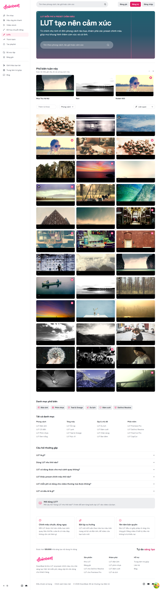
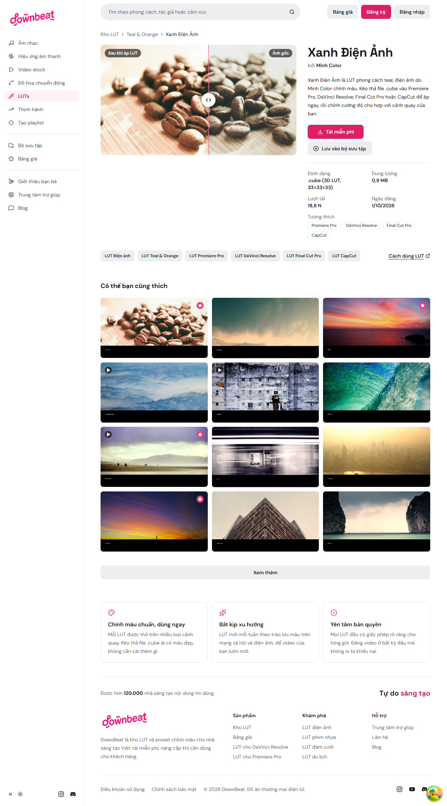
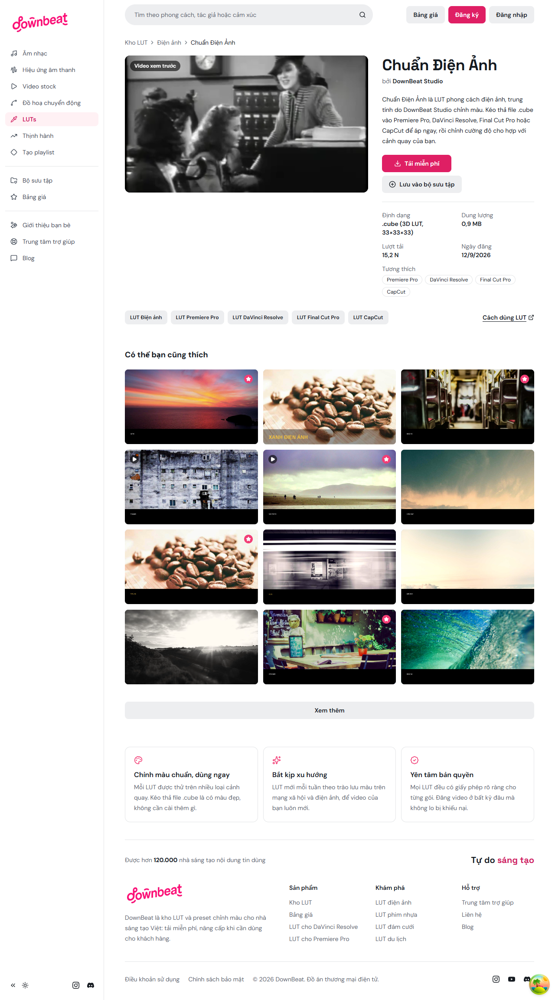

# Nạp sẵn file mẫu lên MinIO (SeedAssetLoader, sinh .cube / ảnh bằng Java, chỉ đẩy object còn thiếu)

> Plan: [plan/seed-minio.md](../../plan/seed-minio.md) · API: không có · Giao diện: không đổi (kho `/luts` và trang chi tiết `/luts/<slug>` tự có ảnh, video) · Phạm vi: chỉ backend

## 1. Mục tiêu

Flyway nạp 38 LUT mẫu vào bảng `lut` (`V3_1__seed_kho_lut.sql`), nhưng các file mà 38 dòng đó trỏ tới (ảnh bìa, ảnh trước / sau, video xem trước, file `.cube`) nằm trên MinIO. Trước chức năng này, máy mới phải chạy tay `tools/seed/kho-lut/build.py`, cần Python 3.12, numpy, Pillow, minio và mạng (tải ảnh từ picsum.photos, video từ MDN). Khi chưa chạy: ảnh hỏng, `POST /lut/download` báo `LUT_FILE_UNAVAILABLE`, `LutColorFeatureBootstrap` log "lỗi 38 LUT", chỉ mục gợi ý thiếu khối màu.

Sau chức năng này, máy mới chỉ cần `docker compose up` và chạy backend profile `local`. Khi khởi động, `SeedAssetLoader` tự sinh bằng Java rồi đẩy lên MinIO mọi object còn thiếu; không cần Python, không cần mạng.

Chưa làm: nạp dữ liệu mẫu cho môi trường deploy (profile `dev` không chạy `db/seed`, sẽ xử lý ở lát 3.2); đổi URL tuyệt đối `http://localhost:9020/...` trong `V3_1`; endpoint "nạp lại" (muốn nạp lại thì xoá object rồi restart).

## 2. Luồng hoạt động

**Máy mới, MinIO trống.** Backend khởi động với profile `local`, Flyway chạy xong thì `ApplicationReadyEvent` kích hoạt các listener theo thứ tự `@Order`:

| Thứ tự | Thành phần | Việc làm |
|---|---|---|
| -100 | `SeedAssetLoader` | `ensureBucket()` rồi kiểm và đẩy object còn thiếu (chi tiết bên dưới) |
| 0 | `LutColorFeatureBootstrap` | Đọc `.cube` vừa đẩy, tính đặc trưng màu cho LUT chưa có |
| 100 | `LutIndexListener` | Dựng chỉ mục tương đồng có khối màu |

`SeedAssetLoader` xử lý lần lượt từng mục trong `luts.json`:

1. Lấy dòng `lut` theo `id`. Không có dòng (ví dụ quản trị đã xoá LUT nháp id 37) thì bỏ qua.
2. Lập danh sách object cần có từ **chính dòng DB**: khoá lấy từ phần URL sau `/{bucket}/` hoặc từ `file_key`, không dựng lại từ slug.
3. `statObject` từng khoá. Có thì đếm "đã có"; thiếu thì sinh nội dung, đẩy lên MinIO và đếm "đã nạp".
4. Cuối cùng ghi một dòng log tổng kết.

Chỉ khi LUT thật sự thiếu ít nhất một object cần đến lưới màu (`.cube`, `after.jpg`, `cover.jpg`) thì mới tính lưới 33³ và ảnh `after`, nên lần khởi động thường chỉ tốn khoảng 150 lần `statObject`.

**Ngoại lệ.**

- MinIO đã đủ object (đã chạy `build.py` hoặc đã khởi động một lần): chỉ kiểm, log "đã nạp 0 object". Không ghi đè object có sẵn, kể cả khác kích thước.
- Thiếu một số object: chỉ sinh và đẩy đúng các object đó.
- Quản trị đã thay ảnh bìa bằng ảnh upload (`cover_url` thành `.../2026/11/14/<uuid>.jpg`): URL không khớp mẫu khoá seed nên bỏ qua trường đó, các trường khác vẫn được kiểm.
- `seed.minio.enabled = false` (mặc định ở `application.yml`, nên profile `dev`, deploy và `mvn test` không chạy): không gọi MinIO, không log.
- MinIO chưa chạy hoặc sai khoá: `WARN` "Nạp dữ liệu mẫu MinIO thất bại: …", backend vẫn khởi động.
- Lỗi ở một LUT (ví dụ thiếu ảnh gốc trong resource): `WARN` theo slug, đếm vào "lỗi", chạy tiếp các LUT khác.

**Dòng log tổng kết** (`INFO`, logger `SeedAssetLoader`):

```
Nạp dữ liệu mẫu MinIO: 38 LUT, đã có 148 object, đã nạp 0 object, bỏ qua 0 LUT, lỗi 0 LUT
```

148 object = 34 LUT BEFORE_AFTER × 4 (bìa, trước, sau, `.cube`) + 4 LUT VIDEO × 3 (bìa, video, `.cube`).

## 3. Khoá object và nội dung sinh ra

| Loại | Bucket | Khoá | Content-Type |
|---|---|---|---|
| File LUT | `downbeat-lut` (riêng tư) | `lut/{slug}.cube` | `text/plain` |
| Ảnh bìa | `downbeat-public` | `lut/{slug}/cover.jpg` | `image/jpeg` |
| Ảnh trước | `downbeat-public` | `lut/{slug}/before.jpg` | `image/jpeg` |
| Ảnh sau | `downbeat-public` | `lut/{slug}/after.jpg` | `image/jpeg` |
| Video | `downbeat-public` | `lut/{slug}/preview.mp4` | `video/mp4` |

Các khoá giữ đúng như `build.py` đã đẩy. Ảnh và video đi qua `FileStorageService.putPublic` (kèm `Cache-Control: public, max-age=31536000, immutable`), `.cube` đi qua `putPrivate`.

**`.cube`** (`CubeFilter`): tiêu đề `TITLE "<title>"` (lấy từ `luts.json`, không đọc từ DB vì quản trị có thể đã đổi tên), `LUT_3D_SIZE 33`, rồi 35 937 dòng `%.6f %.6f %.6f` (UTF-8, không BOM, có `\n` cuối). Dòng thứ i ứng với `b = i / 1089`, `g = (i / 33) % 33`, `r = i % 33`; màu vào là `(r/32, g/32, b/32)`. Chuỗi `filter` được áp theo đúng thứ tự xuất hiện, mỗi phép cắt về [0, 1]. Chép nguyên văn từ `build.py`:

| Phép | Công thức |
|---|---|
| `grayscale(a)` | `(1 − a)·I + a·M`, M có cả 3 hàng `[.2126, .7152, .0722]` |
| `sepia(a)` | `(1 − a)·I + a·M`, M = `[[.393, .769, .189], [.349, .686, .168], [.272, .534, .131]]` |
| `saturate(v)` | ma trận saturate chuẩn CSS (hệ số .213 / .715 / .072) |
| `hue-rotate(θ)` | ma trận hue-rotate chuẩn CSS, đơn vị `deg` hoặc `turn` |
| `brightness(v)` | `x · v` |
| `contrast(v)` | `(x − 0.5) · v + 0.5` |

`filter` rỗng (LUT id 38 "Hoàng Hôn Cũ") ra LUT đồng nhất.

**Ảnh** (`SeedImageRenderer`, JPEG chất lượng 0,85, `java.awt` + `ImageIO`, chạy headless):

- `before.jpg`: ảnh gốc `photos/{picsumSeed}.jpg` co về 1280 × 720.
- `after.jpg`: áp lưới 33³ lên `before`, nội suy ba chiều.
- `cover.jpg`: `after` co về 960 × 540; nếu `coverText` khác rỗng thì vẽ dải đen mờ 40 % ở đáy và chữ viết hoa (vàng `(245, 197, 66)` khi kiểu `bold`, trắng với các kiểu khác).
- `preview.mp4`: chép nguyên byte `videos/{videoSource}.mp4`.

## 4. Cơ sở dữ liệu và cấu hình

Không có migration, không sửa `V3_1__seed_kho_lut.sql`.

| File | Khoá | Giá trị |
|---|---|---|
| `application.yml` | `seed.minio.enabled` | `false` (chỉ bật ở local, nơi `db/seed` chạy) |
| `application-local.yml` | `seed.minio.enabled` | `${SEED_MINIO_ENABLED:true}` |

Dữ liệu nguồn nằm trong repo, thư mục `backend/business/src/main/resources/seed/kho-lut/` (tổng khoảng 5,5 MB):

| Đường dẫn | Nội dung |
|---|---|
| `luts.json` | Manifest 38 LUT, chuyển bằng `git mv` từ `tools/seed/kho-lut/` nên chỉ còn một nguồn cho cả Java và `build.py` |
| `photos/<picsumSeed>.jpg` | 38 ảnh gốc 1280 × 720 từ picsum.photos (giấy phép Unsplash), 3,9 MB |
| `videos/flower.mp4`, `videos/friday.mp4` | 2 video CC0 của MDN, 1,6 MB |
| `README.md` | Ghi nguồn và giấy phép |

## 5. Backend

Package mới `vn.aeoc.business.lut.seed`:

- `SeedManifest`: POJO đọc `luts.json` bằng Jackson (`id`, `slug`, `title`, `filter`, `picsumSeed`, `videoSource`, `coverText`, `coverTextStyle`; bỏ qua field lạ).
- `CubeFilter`: thuần Java, `parse`, `apply`, `grid`, `writeCube`.
- `SeedImageRenderer`: `before`, `after`, `cover`.
- `SeedAssetLoader`: `@Component`, `@EventListener(ApplicationReadyEvent)` + `@Order(-100)`, chạy đồng bộ (đúng quy tắc không xử lý bất đồng bộ ở `backend/AGENTS.md`), bọc try/catch theo từng LUT và toàn hàm.

Module `authenticate`: `FileStorageService` thêm `existsPublic(key)` (chép khuôn `existsPrivate`, `NoSuchKey` trả `false`, lỗi khác ném `UPLOAD_FILE_FAILED`) và `publicBucket()`.

Công cụ: `tools/seed/kho-lut/build.py` đọc `luts.json`, ảnh và video từ chỗ mới (chỉ tải về `.cache` khi thiếu); README của tool ghi rõ chỉ cần chạy script khi đổi `luts.json` và cần sinh lại `V3_1`.

Không có endpoint mới và không đổi endpoint cũ.

## 6. Giao diện

Không đổi giao diện. Các trang có sẵn tự hiện đủ ảnh và video khi MinIO đã được nạp.

### Hình ảnh



Trang `/luts` với 38 thẻ LUT đều có ảnh bìa (không ảnh hỏng).



Trang chi tiết "Xanh Điện Ảnh" (BEFORE_AFTER): ảnh trước và sau đều hiện.



Trang chi tiết "Chuẩn Điện Ảnh" (VIDEO): video xem trước phát được.

## 7. Kiểm thử

Kết quả thực tế: sau khi xoá 5 object và 2 dòng `lut_color_feature` rồi restart, loader log "38 LUT, đã có 143 object, đã nạp 5 object, bỏ qua 0 LUT, lỗi 0 LUT"; `.cube` của `xanh-dien-anh` dài 970 341 byte, `preview.mp4` của `chuan-dien-anh` dài 515 198 byte, đặc trưng màu của id 1 và 2 được tính lại.

### JUnit (backend)

Module `business`: 180 test, 0 lỗi, 0 bỏ qua. Phần của lát này (`lut/seed`): `CubeFilterTest` 6, `SeedAssetLoaderTest` 8, `SeedImageRendererTest` 2, tổng 16 test (phủ TC-01 → TC-15; worker tách một số TC thành nhiều test nên nhiều hơn 15).

| TC | Nội dung | Kết quả |
|---|---|---|
| TC-01 | `.cube` đồng nhất đúng định dạng, đủ 35 937 dòng | Pass |
| TC-02 | Phân tích chuỗi filter (`deg`, `turn`, `null`) | Pass |
| TC-03 | Từng phép biến đổi, tính tay | Pass |
| TC-04 | Khớp 4 giá trị tham chiếu của bản Python | Pass |
| TC-05 | Kích thước file 970 341 và 970 344 byte | Pass |
| TC-06 | `.cube` sinh ra đọc được bằng `CubeParser`, `isMono` đúng | Pass |
| TC-07 | Ảnh sinh ra đúng kích thước (1280 × 720, 1280 × 720, 960 × 540) | Pass |
| TC-08 | Lưới đồng nhất không đổi ảnh (lệch ≤ 3 mỗi kênh) | Pass |
| TC-09 | Loader: đủ object thì không đẩy gì | Pass |
| TC-10 | Loader: chỉ đẩy object thiếu, đúng khoá và content-type | Pass |
| TC-11 | Loader: LUT video đẩy đúng video nguồn | Pass |
| TC-12 | Loader: khoá lấy từ URL, bỏ trường đã thay bằng ảnh upload | Pass |
| TC-13 | Loader: LUT bị xoá khỏi DB thì bỏ qua | Pass |
| TC-14 | Loader: tắt thì không làm gì | Pass |
| TC-15 | Loader: MinIO lỗi không làm hỏng khởi động | Pass |

### Playwright (`frontend/tests/e2e/seed-minio.spec.ts`)

Tổng **5/5 pass** (3 API + 2 giao diện); nhóm "API" chạy riêng cũng 3/3.

| TC | Nội dung | Kết quả |
|---|---|---|
| TC-16 | Mọi LUT công khai có ảnh / video đọc được (200, đúng content-type) | Pass |
| TC-17 | Tải LUT miễn phí ra `.zip` chứa `.cube` hợp lệ | Pass |
| TC-18 | Mọi LUT mẫu có đặc trưng màu | Pass |
| TC-19 | UI: `/luts` không có ảnh hỏng | Pass |
| TC-20 | UI: chi tiết có ảnh trước / sau, video phát được | Pass |

### Kiểm tay (ở bước review BE)

| TC | Nội dung | Kết quả |
|---|---|---|
| TC-21 | Xoá 5 object + `lut_color_feature` id 1, 2, restart: tự khôi phục | Pass (đã có 143, đã nạp 5, lỗi 0) |
| TC-22 | Restart lần nữa không đẩy gì | Pass (đã nạp 0) |
| TC-23 | `build.py --self-test` in `OK`, `luts.json` chỉ được đổi tên | Pass |

**Tổng: 23/23 pass** (15 unit, 3 API, 2 giao diện, 3 kiểm tay). Không có thay đổi frontend nên không chạy `pnpm build` / `pnpm lint`.

## 8. Điểm lệch plan và hạn chế

- **Vòng sửa**: backend 0, frontend không có worker.
- **Đọc ảnh gốc hai lần**: khi một LUT thiếu cả `before` lẫn `after` / `cover`, loader đọc ảnh gốc hai lần (plan §7.6 nói một lần). Chỉ tốn thêm chút CPU ở máy mới, không đổi kết quả.
- **Ảnh bìa khác bản Python từng điểm ảnh**: font và cách vẽ chữ của Java khác Pillow. Máy đang có object từ `build.py` giữ nguyên vì loader không ghi đè; ảnh chụp ở các tài liệu cũ có thể khác nhẹ so với máy mới.
- **Dung lượng**: repo và file jar tăng khoảng 5,5 MB do ảnh và video nguồn (người dùng đã chấp nhận).
- **Môi trường deploy chưa có**: profile `dev` không chạy `db/seed` nên kho rỗng; cần lát riêng ở 3.2 (kèm xử lý URL `localhost:9020` ghi cứng trong `V3_1`).
