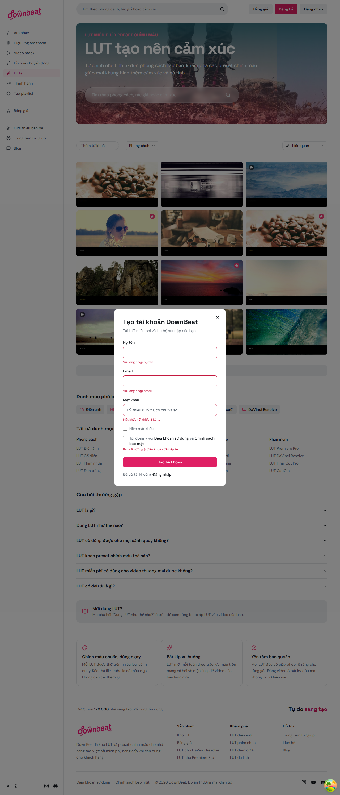
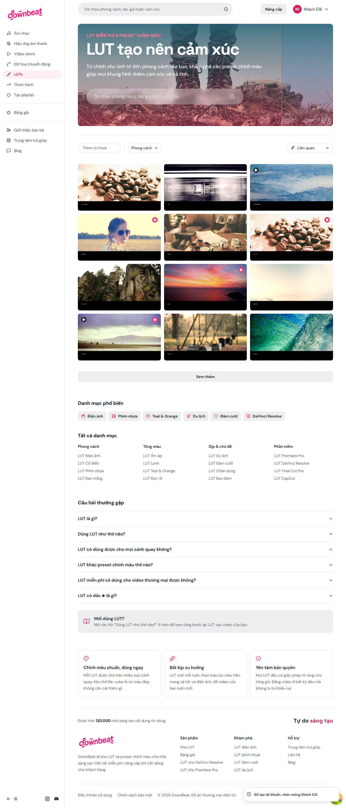
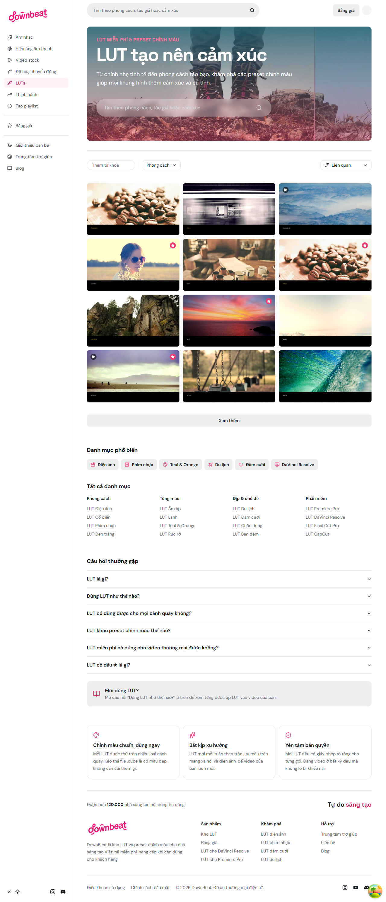
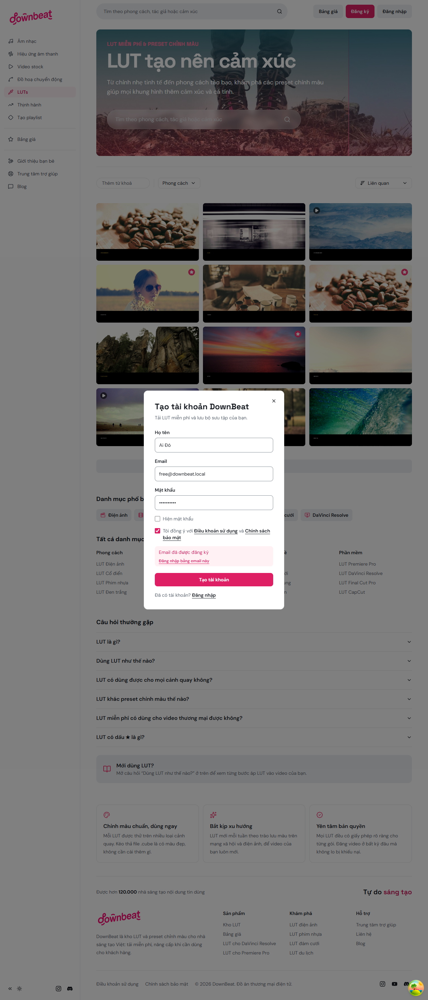
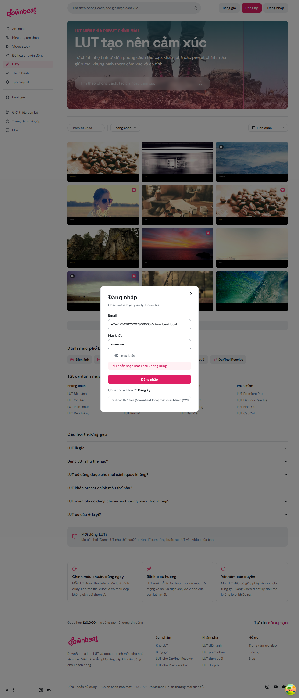
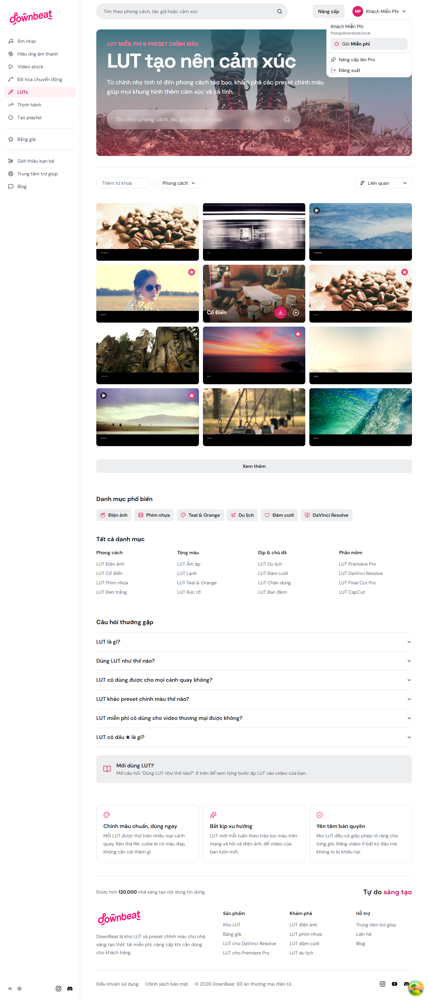
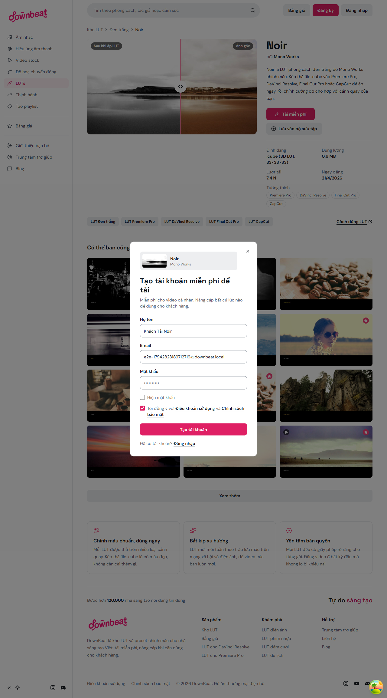
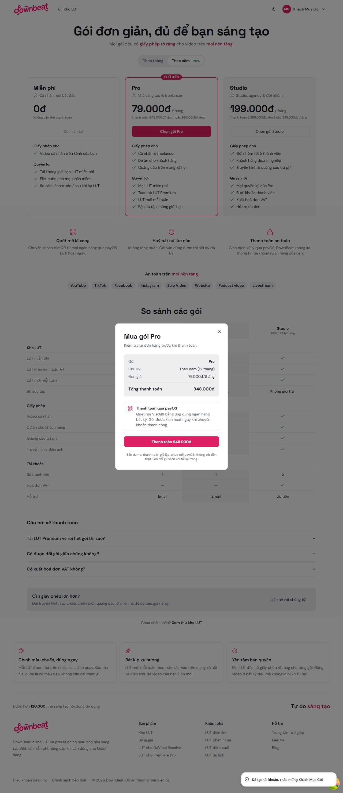

# Tài khoản khách hàng (đăng ký, đăng nhập, menu tài khoản dùng API thật)

> Plan: [plan/tai-khoan-khach.md](../../plan/tai-khoan-khach.md) · Route: `/`, `/luts/**`, `/pricing` (không thêm route) · Phạm vi: backend + frontend

## 1. Mục tiêu

Trước chức năng này, đăng nhập và đăng ký ở cửa hàng chạy trên dữ liệu giả trong `lib/mock/account.ts` (lưu ở localStorage). Chức năng này chuyển sang backend thật:

- Khách tự **đăng ký bằng email** và được đăng nhập ngay. Tài khoản mới mang role **Khách hàng**, không có quyền quản trị nào.
- Đăng nhập, xem menu tài khoản (tên, email, gói), đăng xuất đều gọi API thật. Phiên dùng chung token với trang quản trị `/admin`.
- Gỡ `POST /file/upload`: khi ai cũng tự đăng ký được thì endpoint này (chỉ cần đăng nhập, không kiểm quyền) cho phép mọi khách đẩy file lên bucket công khai.

Đây là nền cho các chức năng cần biết "ai đang dùng": tải LUT, bộ sưu tập, mua gói, hồ sơ gợi ý.

Chưa làm (để chức năng sau): bước "Chọn phong cách" sau đăng ký, gói và thanh toán thật (`plan` luôn là `free`), tải LUT thật, quên mật khẩu, đăng nhập mạng xã hội, xác minh email, giới hạn tần suất đăng ký.

## 2. Luồng sử dụng

**Đăng ký.**
1. Khách mở hộp thoại đăng ký từ nút "Đăng ký" ở header, nút "Bắt đầu miễn phí", nút tải LUT khi chưa đăng nhập, hoặc nút chọn gói trả phí khi chưa đăng nhập. Tiêu đề hộp thoại đổi theo nơi mở.
2. Khách nhập họ tên, email, mật khẩu, tick điều khoản. Frontend kiểm định dạng trước khi gửi.
3. Backend chuẩn hoá dữ liệu, tạo tài khoản role Khách hàng và trả `{ token, refreshToken, userId }`. Frontend lưu token vào `auth-storage`, gọi `GET /account/me`, đặt người dùng vào phiên cửa hàng.
4. Toast "Đã tạo tài khoản, chào mừng {tên}", hộp thoại đóng. Mở từ nút tải thì tải tiếp LUT đó; mở từ nút chọn gói thì mở hộp thoại mua gói.

**Đăng nhập.** Như đăng ký nhưng gọi `POST /user/authenticate`, toast "Xin chào, {tên}".

**Mở lại trang.** Có token trong storage thì header hiện khung chờ hình tròn (không nháy nút "Đăng nhập"), gọi `GET /account/me`, rồi hiện menu tài khoản.

**Đăng xuất.** Menu tài khoản → "Đăng xuất": gọi `POST /auth/logout` (không chờ), xoá token và phiên, toast "Đã đăng xuất", header về trạng thái khách, ở nguyên trang hiện tại.

Trường hợp đặc biệt:

- Email đã có (kể cả khác hoa thường): hộp thoại hiện "Email đã được đăng ký" kèm nút "Đăng nhập bằng email này", chuyển sang hộp thoại đăng nhập đã điền sẵn email và focus ô mật khẩu.
- Sai email hoặc mật khẩu: "Tài khoản hoặc mật khẩu không đúng." hiện trong hộp thoại; sai 10 lần trong 15 phút thì bị chặn (429, có sẵn từ trước).
- Tài khoản bị khoá: 403 "Tài khoản bị khóa".
- Phiên hết hạn và làm mới thất bại: ở trang cửa hàng thì về trạng thái khách, **không** chuyển sang `/login`; ở `/admin/**` thì về `/login` như trước.
- Khách hàng mở `/admin`: sidebar không có mục nào; mở thẳng `/admin/chuc-vu` thì thấy "Truy cập bị từ chối".
- Không có role mặc định hợp lệ (quản trị bỏ cờ mặc định, hoặc đặt nhầm role toàn quyền làm mặc định): đăng ký trả 403 "Hệ thống không mở đăng ký", chặn việc ai đăng ký cũng thành quản trị.

## 3. Cơ sở dữ liệu

Không thêm bảng, không đổi cột. Migration `backend/app/src/main/resources/db/migration/V5__vai_tro_khach_hang.sql` (chạy mọi môi trường, chạy lại không đổi gì):

- Thêm role `Khách hàng` với `is_default = 1`, `is_operator = 0` nếu chưa có.
- Đặt `is_default = 0` cho mọi role khác, để chỉ có một role mặc định: role được gán khi khách tự đăng ký.

Seed local `backend/app/src/main/resources/db/seed/V5_1__seed_khach_hang.sql`: tài khoản `free@downbeat.local` / `Admin@123` (tên "Khách Miễn Phí", role Khách hàng), viết bằng `INSERT … WHERE NOT EXISTS`, không ghi cứng `id`.

Quy ước đáng chú ý:

- Role mặc định tra theo cờ (`is_default = 1 AND is_operator = 0`), không theo tên.
- `user_app.email` là UNIQUE với collation `utf8mb4_0900_ai_ci` nên không phân biệt hoa thường; email còn được lưu chữ thường.
- Role Khách hàng không có dòng `permission` nào và không thêm `resource` mới.

## 4. API

Phản hồi thành công bọc `{ code, message, result }`. Lỗi nghiệp vụ trả `{ path, code, errorCode, message }`.

| Method | Đường dẫn | Quyền | Mô tả |
|---|---|---|---|
| POST | `/account/register` | Công khai (token gửi kèm bị bỏ qua) | Đăng ký, body `{ name, email, plainPassword }`, trả `{ token, refreshToken, userId }` |
| GET | `/account/me` | Mọi người đã đăng nhập | Trả `{ id, name, email, plan }`; `plan` luôn là `free` ở chức năng này |
| POST | `/user/authenticate` | Công khai (có sẵn) | Đăng nhập, frontend cửa hàng dùng lại |
| POST | `/auth/refresh`, `/auth/logout` | Có sẵn | Làm mới và thu hồi phiên |
| POST | `/file/upload` | — | **Đã gỡ**, mọi request trả 404 "Không tìm thấy API" |

Quy tắc của `register` (theo thứ tự, gặp lỗi đầu tiên thì dừng, chưa ghi gì):

1. Họ tên trim, rỗng thì lỗi.
2. Email trim và chữ thường; rỗng hoặc không có `@` thì lỗi.
3. Mật khẩu 8 ký tự đến 72 byte (`PasswordPolicy`).
4. Tìm role mặc định; không có thì `REGISTRATION_DISABLED`.
5. Email đã có thì `EMAIL_EXISTS`. Hai request cùng email đồng thời: request sau vấp UNIQUE ở DB cũng trả `EMAIL_EXISTS`.
6. Tạo `user_app` từ **đối tượng mới** với mật khẩu BCrypt, `active = 1`, `first_time = 1`. Mọi field khác client gửi (`roleId`, `isOperator`, `active`, `phone`…) bị bỏ qua.
7. Trả token như đăng nhập.

Backend kiểm họ tên, email, mật khẩu ở `register` dù quy ước chung để việc này cho frontend, vì đây là endpoint công khai ai cũng gọi thẳng được.

Lỗi nghiệp vụ:

| Tình huống | HTTP | errorCode | Message |
|---|---|---|---|
| Họ tên trống | 400 | `BAD_REQUEST` | Vui lòng nhập họ tên |
| Email trống / không có `@` | 400 | `BAD_REQUEST` | Email không hợp lệ |
| Mật khẩu thiếu, < 8 ký tự, > 72 byte | 400 | `WEAK_PASSWORD` | Mật khẩu phải có từ 8 đến 72 ký tự |
| Không có role mặc định hợp lệ | 403 | `REGISTRATION_DISABLED` | Hệ thống không mở đăng ký |
| Email đã có | 400 | `EMAIL_EXISTS` (mới) | Email đã được đăng ký |
| `account/me` không token / token hỏng | 401 | — | Chưa đăng nhập / Token không hợp lệ hoặc sai chữ ký |
| Tài khoản bị khoá | 403 | `LOCK_ACCOUNT` | Tài khoản bị khóa |
| Khách hàng gọi API quản trị | 403 | `FORBIDDEN` | Bạn không có quyền thực hiện thao tác này! … |

Mã: package `vn.aeoc.business.account` (`AccountController`, `AccountService`); `UserService.register` và `RoleService.getDefaultCustomerRole` ở `authenticate`; `JwtAuthenticationFilter` thêm `/account/register` vào danh sách công khai và bỏ `/user/create`; `User` thêm hai field không phải cột DB `plan`, `planExpiresAt`; đã xoá `FileController`.

## 5. Giao diện

Không thêm route. Thay đổi nằm ở header, hộp thoại và phiên của khu cửa hàng.

- **Một phiên cho cả trình duyệt:** token nằm ở `useAuthStore` (`auth-storage`, nhớ đăng nhập) dùng chung với trang quản trị; `useShopSession` chỉ giữ người dùng trong bộ nhớ (lấy từ `/account/me`), không lưu localStorage; khoá cũ `downbeat-shop-session` bị xoá khi nạp. Đăng xuất ở một nơi là đăng xuất cả hai.
- **Header:** chưa đăng nhập có "Đăng ký", "Đăng nhập", "Bảng giá". Lúc đang hỏi `/account/me` hiện khung chờ tròn (`aria-label="Đang tải tài khoản"`), không hiện nút khách. Đã đăng nhập có link "Nâng cấp" và nút "Tài khoản {tên}".
- **Menu tài khoản:** tên, email, ô "Gói Miễn phí", mục "Nâng cấp lên Pro", mục "Đăng xuất".
- **Hộp thoại đăng ký:** họ tên, email, mật khẩu (có "Hiện mật khẩu"), tick điều khoản; kiểm tại client (trống, sai dạng, mật khẩu 8–72 ký tự có chữ và số); lỗi server hiện đúng message backend trong khung `role="alert"`.
- **Hộp thoại đăng nhập:** email, mật khẩu, "Hiện mật khẩu"; có thể được điền sẵn email từ hộp thoại đăng ký; chỉ ở môi trường dev có gợi ý tài khoản thử.
- **Hộp thoại mua gói:** vẫn giả lập, chú thích đổi thành "Bản demo: thanh toán giả lập, chưa nối payOS, không trừ tiền thật. Gói chỉ giữ đến khi tải lại trang."
- Mã: `lib/axios/account.ts` (mới: `register`, `loginShop`, `getAccountMe`), `components/shop/account/shop-session-sync.tsx` (mới, gắn ở `shop-shell`), `lib/axios/instance.ts` (chỉ chuyển `/login` khi đang ở `/admin`), `lib/mock/account.ts` (chỉ còn phần giả: gói, thanh toán, tải file).

### Hình ảnh

Hộp thoại đăng ký khi bấm "Tạo tài khoản" lúc còn trống: các ô báo lỗi tại chỗ.

Sau khi đăng ký thành công: toast chào mừng, hộp thoại đóng, header hiện nút "Tài khoản {tên}".

Tải lại trang khi đã có token: header hiện khung chờ tròn, không nháy nút "Đăng nhập".

Đăng ký bằng email đã có: khung lỗi kèm nút "Đăng nhập bằng email này".

Đăng nhập sai mật khẩu: thông báo hiện trong hộp thoại, hộp thoại vẫn mở.

Menu tài khoản của gói Miễn phí: tên, email, gói, "Nâng cấp lên Pro", "Đăng xuất".

Bấm "Tải miễn phí" khi chưa đăng nhập: hộp thoại đăng ký kèm thẻ LUT đang chờ tải.

Hộp thoại mua gói sau khi đăng ký, kèm chú thích gói chỉ giữ trong phiên.

## 6. Kiểm thử

JUnit (Mockito, không dựng Spring) do worker viết; Playwright (`frontend/tests/e2e/tai-khoan-khach.spec.ts`) do Claude viết, gồm 14 test API và 10 test giao diện, chạy tuần tự vì TC-30 đổi cờ role mặc định dùng chung.

| ID | Mô tả | Loại | Kết quả |
|---|---|---|---|
| TC-01 | Migration role Khách hàng (đúng 1 role mặc định) | API | Pass |
| TC-02 | Đăng ký thành công | API | Pass |
| TC-03 | `account/me` của tài khoản mới (chỉ 4 khoá) | API | Pass |
| TC-04 | Chuẩn hoá họ tên và email | API | Pass |
| TC-05 | Email đã đăng ký (kể cả viết hoa, email quản trị) | API | Pass |
| TC-06 | Kiểm dữ liệu đăng ký, lỗi không tạo tài khoản | API | Pass |
| TC-07 | Bỏ qua field do server quản (`roleId`, `isOperator`…) | API | Pass |
| TC-08 | Khách hàng bị chặn ở API quản trị | API | Pass |
| TC-09 | `/file/upload` đã gỡ (404) | API | Pass |
| TC-10 | Đăng ký công khai bỏ qua token hỏng | API | Pass |
| TC-11 | `account/me` không đăng nhập (401) | API | Pass |
| TC-12 | Tài khoản seed và quản trị | API | Pass |
| TC-13 | Đăng nhập sai, làm mới, đăng xuất | API | Pass |
| TC-30 | Không mở đăng ký khi không có role mặc định hợp lệ | API | Pass |
| TC-14 | `register` thành công | JUnit | Pass |
| TC-15 | Kiểm theo thứ tự, lỗi thì không ghi | JUnit | Pass |
| TC-16 | Email trùng | JUnit | Pass |
| TC-17 | Không có role mặc định hợp lệ | JUnit | Pass |
| TC-18 | Đăng ký đồng thời cùng email | JUnit | Pass |
| TC-19 | `AccountService.me` | JUnit | Pass |
| TC-20 | Đăng ký từ header | E2E | Pass |
| TC-21 | Giữ phiên sau khi tải lại, không nháy nút khách | E2E | Pass |
| TC-22 | Email đã đăng ký, chuyển sang đăng nhập | E2E | Pass |
| TC-23 | Đăng nhập sai rồi đúng | E2E | Pass |
| TC-24 | Menu tài khoản và đăng xuất | E2E | Pass |
| TC-25 | Bấm tải khi chưa đăng nhập, đăng ký, tải tiếp | E2E | Pass |
| TC-26 | Gói Miễn phí bấm tải LUT Premium | E2E | Pass |
| TC-27 | Khách hàng mở trang quản trị | E2E | Pass |
| TC-28 | Phiên hỏng ở cửa hàng không đá sang `/login` | E2E | Pass |
| TC-29 | Mua gói giả lập trong phiên | E2E | Pass |
| | **Tổng** | | **30/30 pass** (Playwright 24/24, JUnit 7 test mới: `UserServiceRegisterTest` 5 + `AccountServiceTest` 2) |

Các spec cũ `shop-flows`, `shop-ui`, `trang-chu`, `phan-quyen` đã được sửa theo tài khoản thật.

Quá trình: lần chạy giao diện đầu 17/24, 7 test đỏ, gồm 5 test do spec chọn sai landmark (header không có vai trò `banner` ở `/luts`) và 2 lỗi thật của frontend (header kẹt khung chờ sau đăng ký). Sau một vòng sửa frontend và chỉnh spec, 24/24 xanh.

## 7. Điểm lệch plan và hạn chế

- Backend do agy làm thay Codex (Codex hết quota, người dùng quyết định). Backend sạch từ vòng review đầu (0 vòng sửa); frontend 1 vòng sửa (lỗi `loading` không tắt sau đăng ký).
- Spec dùng `header` thay landmark `banner`; TC-23 dùng tài khoản đăng ký mới (tránh dồn lượt sai mật khẩu vào `free@`); TC-21 đăng ký qua API rồi nạp token. Hợp đồng §5 và giao diện §6 của plan không đổi.
- Body đăng ký dùng `plainPassword` thay `password` (dùng chung POJO `User`); tài liệu thiết kế đã sửa theo.
- Hạn chế: `plan` luôn là `free`, mua gói chỉ giả lập trong phiên; chưa xác minh email; chưa giới hạn tần suất đăng ký; mỗi lần chạy E2E tạo tài khoản `e2e-*@downbeat.local` (dọn tay: `DELETE FROM user_app WHERE email LIKE 'e2e-%@downbeat.local'`); tài khoản giả `pro@downbeat.local` đã mất cho tới chức năng gói thanh toán.
