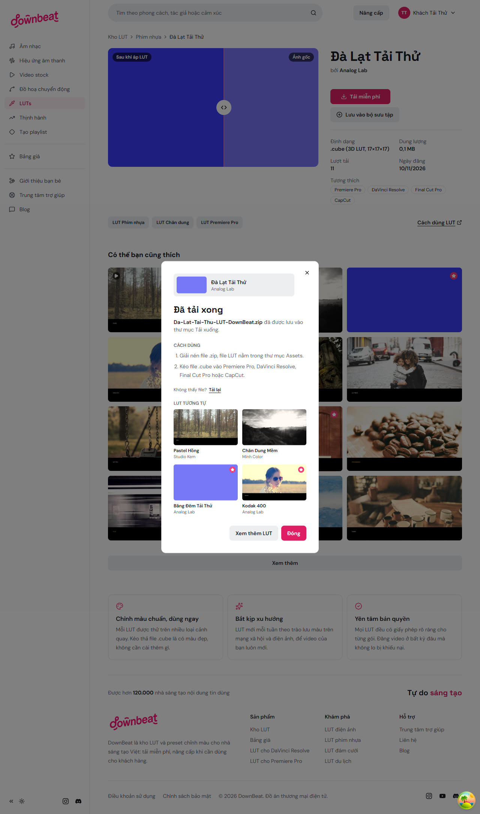
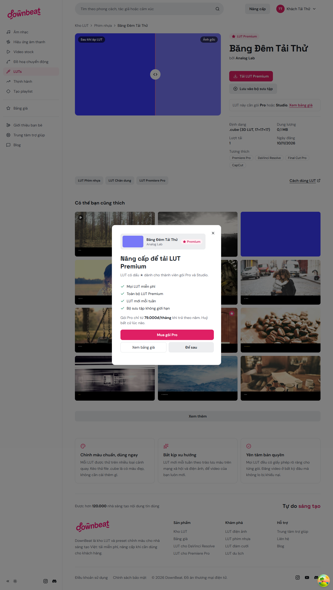
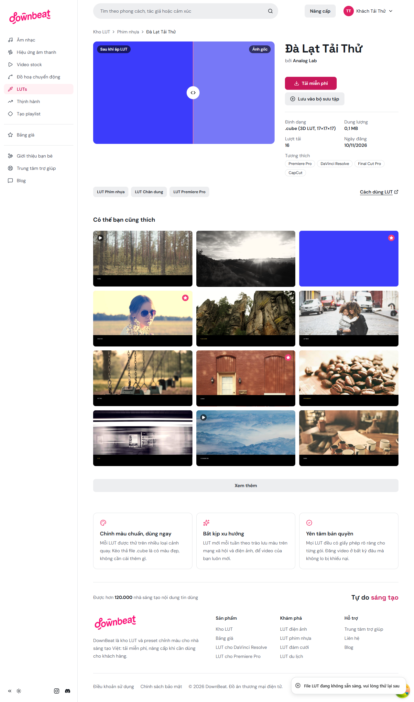
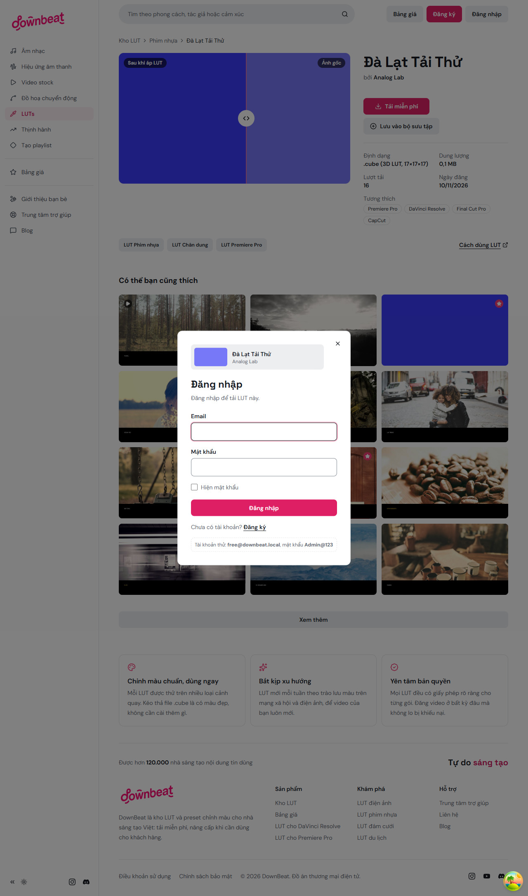
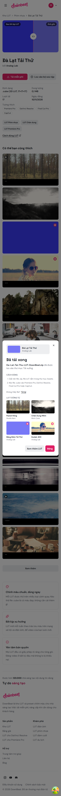

# Tải LUT (kiểm gói, đóng gói .zip, link ký sẵn 5 phút, hộp thoại "Đã tải xong")

> Plan: [plan/tai-lut.md](../../plan/tai-lut.md) · Route: `/luts`, `/luts/<slug>` (nút tải) · Phạm vi: backend + frontend

## 1. Mục tiêu

Trước chức năng này, nút "Tải" ở cửa hàng chỉ là bản giả: frontend tự dựng một file `.cube` giả rồi báo "Đã tải". Chức năng này cho **khách đã đăng nhập tải LUT thật**:

- Backend kiểm LUT đã xuất bản và, với LUT Premium (★), kiểm gói trả phí còn hạn.
- File `.cube` trong bucket riêng tư được đóng thành một file `.zip` theo cấu trúc của file mẫu người dùng đưa, rồi cất lại để các lần tải sau dùng lại.
- Backend trả link MinIO **ký sẵn, sống 5 phút**; trình duyệt tải thẳng từ MinIO, không đi qua backend.
- Mỗi lượt tải ghi một dòng `download_log` và tăng `download_count` bằng một câu UPDATE.
- Tải xong, cửa hàng hiện hộp thoại "Đã tải xong" kèm hướng dẫn dùng và 4 "LUT tương tự".

Cấu trúc file tải về (tên lấy từ tiêu đề LUT, bỏ dấu, giữ hoa thường):

```
Xanh-Dien-Anh-LUT-DownBeat.zip
└── Xanh-Dien-Anh-LUT/
    └── Assets/
        └── Xanh-Dien-Anh.cube      ← đúng từng byte file .cube trong bucket downbeat-lut
```

Chưa làm (để lát sau): xoá cache hồ sơ gợi ý sau khi tải (lát `ho-so-nguoi-dung`), lịch sử "LUT đã tải" của khách, thống kê lượt tải ở quản trị (`dashboard-admin`), giới hạn số lượt tải (đã chốt không giới hạn), link ký sẵn cho môi trường deploy qua nginx.

## 2. Luồng sử dụng

**Luồng chính.** Khách Miễn phí đăng nhập, mở `/luts/xanh-dien-anh`, bấm "Tải miễn phí" (nút quay spinner). Backend kiểm LUT, đóng gói zip nếu chưa có, ký link, ghi log, trả `{ fileName, url }`. Trình duyệt tải file bằng thẻ `<a>` tạm (không rời trang), hộp thoại "Đã tải xong" mở, "Lượt tải" trên trang tăng 1 ngay.

**Luồng phụ.**

- **LUT ★**: khách Pro / Studio còn hạn tải được; `plan_code` ghi `pro` / `studio`.
- **Tải lần sau** của cùng LUT: zip đã có thì chỉ ký link mới. Mỗi lần bấm là một dòng log và một lượt tải, không chống lặp.
- **Quản trị sửa tiêu đề hoặc tải .cube mới**: khoá zip đổi nên lần tải kế tiếp tự đóng gói lại; zip cũ nằm lại trong bucket (không dọn).
- **Chưa đăng nhập** bấm "Tải": hộp thoại đăng ký kèm thẻ LUT; đăng ký / đăng nhập xong tự tải tiếp.
- **Nút tải trên thẻ ở lưới `/luts`** (hiện khi rê chuột): cùng hook, cùng hộp thoại.
- **"Tải lại"** trong hộp thoại "Đã tải xong": gọi lại API, tính thêm một lượt.
- Giao diện vẫn chặn trước: LUT ★ mà phiên ghi gói Miễn phí thì mở hộp thoại nâng cấp, không gọi API.

**Ngoại lệ.**

- Không token, hoặc token hết hạn mà refresh hỏng: 401; giao diện xoá phiên và mở hộp thoại đăng nhập kèm thẻ LUT.
- `lutId` thiếu, không có, hoặc LUT không `PUBLISHED` (nháp, ẩn): 404 `DATA_NOT_FOUND`, không ghi log.
- LUT ★ mà khách không có gói trả phí còn hạn (kể cả dòng `ACTIVE` đã quá `end_date`): 403 `PLAN_REQUIRED`, không ghi log. Giao diện mở hộp thoại "Nâng cấp để tải LUT Premium", không toast.
- `file_key` rỗng hoặc MinIO không đọc / ghi / ký được: 503 `LUT_FILE_UNAVAILABLE`, không ghi log, không tăng lượt tải; giao diện hiện toast với message của server.

## 3. Cơ sở dữ liệu

Migration mới `V8__tai_lut.sql`, bảng `download_log`. Không có seed, không có migration phân quyền (API khách, chỉ cần token, không tạo resource).

| Cột | Kiểu | Ghi chú |
|---|---|---|
| `id` | int PK AUTO_INCREMENT | |
| `user_id` | int NOT NULL | FK → `user_app(id)` |
| `lut_id` | int NOT NULL | FK → `lut(id)` (LUT đã có lượt tải chỉ ẩn được, không xoá được) |
| `plan_code` | varchar(20) NOT NULL | Gói lúc tải: `free` / `pro` / `studio` |
| `ip` | varchar(45) NULL | Phần tử đầu `X-Forwarded-For`, không có thì `remoteAddr`; cắt 45 ký tự |
| `created_time` | datetime NOT NULL | Mặc định `CURRENT_TIMESTAMP` |

Index `idx_download_log_user (user_id, created_time)` và `idx_download_log_lut (lut_id, created_time)`; không UNIQUE vì mỗi lần bấm là một dòng.

`lut.download_count` có sẵn từ V3, tăng bằng `UPDATE lut SET download_count = download_count + 1 WHERE id = ?` (một câu, không đọc rồi ghi). Số lượt tải của 36 LUT mẫu là số giả nạp sẵn, không có dòng log tương ứng.

Khoá zip **suy ra** từ `file_key` và tiêu đề nên không thêm cột nào: `zip/{file_key bỏ .cube}/{Tên}-LUT-DownBeat.zip`, ví dụ `lut/xanh-dien-anh.cube` → `zip/lut/xanh-dien-anh/Xanh-Dien-Anh-LUT-DownBeat.zip`.

## 4. API

Phản hồi thành công bọc `{ code, message, result }`; lỗi nghiệp vụ trả `{ path, code, errorCode, message }`.

| Method | Đường dẫn | Quyền | Mô tả |
|---|---|---|---|
| POST | `/api/lut/download` | Chỉ cần token | Body `{ "lutId": 1 }`; trả `{ "fileName", "url" }` |

`/lut/download` không khớp mẫu công khai nên tự cần token, không nằm trong whitelist, controller không gọi `checkPermission`. `result` chỉ có hai khoá `fileName` và `url` (không trả `id`, `userId`, `planCode`, `ip`, `fileKey`, khoá zip).

**Quy tắc** (theo thứ tự, gặp lỗi đầu tiên thì dừng):

1. Lấy LUT `PUBLISHED` theo `lutId`; không có thì 404.
2. LUT ★: lấy subscription `ACTIVE` còn hạn (`end_date >= hôm nay`) và gói của nó; thiếu hoặc `can_download_premium != 1` thì 403. `plan_code` ghi log là mã gói của subscription, không có thì `free` (LUT thường cũng ghi đúng gói đang dùng).
3. `file_key` NULL thì 503.
4. Đảm bảo có zip trong bucket riêng tư, rồi ký link GET. Lỗi MinIO ở bước nào cũng là 503.
5. Trong **một** transaction, **sau** bước 4: INSERT `download_log` và UPDATE `download_count`. MinIO lỗi thì không có dòng log nào.

**Tên gốc** từ tiêu đề: `đ` → `d`, bỏ dấu, mỗi chuỗi ký tự ngoài `[A-Za-z0-9]` thành một dấu `-`, bỏ `-` hai đầu, giữ hoa thường, cắt tối đa 60 ký tự (rồi bỏ `-` cuối); rỗng thì `LUT-{id}`.

| Tiêu đề | Tên file tải về |
|---|---|
| Xanh Điện Ảnh | `Xanh-Dien-Anh-LUT-DownBeat.zip` |
| Đà Lạt Sương | `Da-Lat-Suong-LUT-DownBeat.zip` |
| Kodak 400 | `Kodak-400-LUT-DownBeat.zip` |
| `  !!! ` (id 37) | `LUT-37-LUT-DownBeat.zip` |

**Zip**: đúng một entry `{base}-LUT/Assets/{base}.cube` (không có entry thư mục), nén DEFLATE, byte `.cube` giữ nguyên, content-type `application/zip`. Có object (`statObject`) thì dùng lại, chưa có thì đọc `.cube`, nén trong bộ nhớ, `putObject`. Hai lượt tải đầu chạy cùng lúc có thể cùng ghi một khoá; nội dung như nhau nên không khoá.

**Link ký**: `getPresignedObjectUrl` GET, hạn `lut.download.url-ttl` (mặc định `5m`, biến môi trường `LUT_DOWNLOAD_URL_TTL`, ứng với `X-Amz-Expires=300`), kèm `response-content-disposition: attachment; filename="{fileName}"` và `response-content-type: application/zip` để trình duyệt lưu đúng tên. Bucket riêng tư không có policy đọc công khai nên bỏ chữ ký thì MinIO trả 403.

Lỗi:

| Tình huống | HTTP | errorCode | Message |
|---|---|---|---|
| Không token / token sai | 401 | `LOGIN` / `UNAUTHORIZED` (filter có sẵn) | Chưa đăng nhập / Token không hợp lệ hoặc sai chữ ký |
| LUT không có / chưa xuất bản / đã ẩn / thiếu `lutId` | 404 | `DATA_NOT_FOUND` | Không tìm thấy LUT |
| LUT ★, không có gói trả phí còn hạn | 403 | `PLAN_REQUIRED` (mới) | LUT Premium cần gói Pro hoặc Studio |
| Thiếu `file_key` hoặc MinIO lỗi | 503 | `LUT_FILE_UNAVAILABLE` (mới) | File LUT đang không sẵn sàng, vui lòng thử lại sau |

Mã: package `vn.aeoc.business.download` (`LutDownloadController`, `LutDownloadService`, `LutPackage` là lớp tiện ích thuần để unit test, `DownloadLogRepository`); `FileStorageService` thêm `existsPrivate`, `presignPrivateGet`; `LutRepository` thêm `getPublishedById`, `increaseDownloadCount`; `ErrorCode` thêm 2 mã; POJO `DownloadLog` ở module `entity`.

## 5. Giao diện

**Nút tải** (`hooks/use-lut-download.ts`): giữ nguyên nhãn cũ ("Tải miễn phí" / "Tải LUT Premium", nút tải trên thẻ ở lưới). Đang gọi API thì spinner trên đúng nút và nút bị khoá. Thành công: tải file bằng thẻ `<a>` tạm, **không** toast, mở hộp thoại "Đã tải xong", làm mới query chi tiết và danh sách để "Lượt tải" cập nhật. Lỗi rẽ theo `errorCode`: `PLAN_REQUIRED` mở hộp thoại nâng cấp; 401 mở hộp thoại đăng nhập kèm thẻ LUT; còn lại (404, 503, mạng) hiện toast với message của server, không có thì "Không tải được LUT, vui lòng thử lại".

**Hộp thoại "Đã tải xong"** (`download-done-panel.tsx`, loại `downloaded` trong `ShopDialogs`):

- Đầu: thẻ LUT nhỏ; tiêu đề "Đã tải xong"; mô tả "{fileName} đã được lưu vào thư mục Tải xuống." (tên file in đậm).
- Khối "Cách dùng": (1) giải nén file .zip, file LUT nằm trong thư mục Assets; (2) kéo file .cube vào Premiere Pro, DaVinci Resolve, Final Cut Pro hoặc CapCut.
- Dòng "Không thấy file?" kèm nút chữ "Tải lại".
- Khối "LUT tương tự": gọi `GET /lut/public/related?slug=…&page=1&limit=4`, lưới 2 cột (`ul` có `aria-label="LUT tương tự"`), mỗi ô gồm ảnh bìa 16:9, tiêu đề, tác giả, sao ★ nếu Premium; bấm ô thì đóng hộp thoại và sang `/luts/{slug}`. Đang tải hiện 4 ô `Skeleton`; lỗi hoặc rỗng thì ẩn cả khối.
- Chân: nút "Xem thêm LUT" (→ `/luts`) và nút "Đóng".
- Điện thoại (≤ 640 px): hộp thoại gần hết chiều rộng, lưới vẫn 2 cột, cuộn được trong hộp thoại.

Mã: `lib/axios/luts.ts` (`requestLutDownload` gọi API thật), `lib/axios/error.ts` (`apiErrorOf`, gom hàm đọc `errorCode` từ `AxiosError` dùng chung với form đăng ký), `lib/tanstack/options/account.ts`, `lib/tanstack/options/luts.ts` (`createRelatedLutsQueryOptions`), `lib/stores/shop-dialog.ts`; xoá `lib/mock/account.ts` (bản tải giả).

### Hình ảnh


Trang chi tiết LUT với nút "Tải miễn phí" và số "Lượt tải" trước khi tải.


Hộp thoại "Đã tải xong" sau khi tải: tên file zip, khối "Cách dùng", nút "Tải lại".



Khối "LUT tương tự" trong hộp thoại: lưới 2 cột tối đa 4 LUT khác, mỗi ô là link tới trang chi tiết.



Khách Miễn phí bấm LUT Premium: hộp thoại "Nâng cấp để tải LUT Premium", không gọi API.



Backend trả 503 `LUT_FILE_UNAVAILABLE`: toast "File LUT đang không sẵn sàng, vui lòng thử lại sau", nút hết spinner.



Hết phiên giữa chừng (API 401, refresh hỏng): hộp thoại đăng nhập kèm thẻ LUT vừa bấm.



Hộp thoại "Đã tải xong" ở viewport 390×844: không tràn ngang, lưới "LUT tương tự" vẫn 2 cột.

## 6. Kiểm thử

JUnit (module `business`): `LutPackageTest` 3 test, `LutDownloadServiceTest` 6 test (mock `FileStorageService`, `SubscriptionRepository`, `PlanRepository`), 9/9 pass. Playwright `frontend/tests/e2e/tai-lut.spec.ts`: 21/21 pass (API 10, giao diện 11). Spec tạo hai LUT riêng ("Đà Lạt Tải Thử", "Băng Đêm Tải Thử") để không đụng số lượt tải của 36 LUT mẫu, cuối spec ẩn lại hai LUT này.

| ID | Loại | Nội dung | Kết quả |
|---|---|---|---|
| TC-01 | unit | Tên gốc từ tiêu đề (5 dòng bảng, tiêu đề 80 ký tự ≤ 60) | Pass |
| TC-02 | unit | Khoá zip từ `file_key` và tên file | Pass |
| TC-03 | unit | Zip đúng 1 entry, byte đúng, method DEFLATED | Pass |
| TC-04 | unit | 404 trước mọi bước khác, không gọi MinIO, không insert | Pass |
| TC-05 | unit | Luật gói với LUT ★ (không gói, Pro hết hạn đúng hôm nay, Studio, quá hạn) | Pass |
| TC-06 | unit | LUT thường ghi đúng gói đang dùng (`pro` / `free`) | Pass |
| TC-07 | unit | Zip đã có thì không đóng gói lại | Pass |
| TC-08 | unit | Zip chưa có thì đọc, nén, ghi rồi ký | Pass |
| TC-09 | unit | MinIO lỗi / thiếu `file_key` thì 503, không ghi DB | Pass |
| TC-10 | api | Không token → 401 | Pass |
| TC-11 | api | `lutId` không có / thiếu / nháp / ẩn → 404 | Pass |
| TC-12 | api | Khách Miễn phí tải LUT thường: 2 khoá, link có `X-Amz-Expires=300`, `downloadCount` + 1 | Pass |
| TC-13 | api | Link tải được đúng file zip, đúng tên, đúng byte | Pass |
| TC-14 | api | Bỏ chữ ký → 403 | Pass |
| TC-15 | api | Tải 2 lần: mỗi lần một lượt, zip dùng lại | Pass |
| TC-16 | api | Khách Miễn phí tải LUT ★ → 403 `PLAN_REQUIRED`, lượt tải không đổi | Pass |
| TC-17 | api | Khách Pro tải LUT ★ → 200, đúng entry, lượt tải + 1 | Pass |
| TC-18 | api | Sửa tiêu đề thì đóng gói lại, tên và đường dẫn mới | Pass |
| TC-19 | api | Đổi .cube thì đóng gói lại, byte mới | Pass |
| TC-20 | e2e | Tải ở trang chi tiết: sự kiện download, hộp thoại, "Lượt tải" + 1, không toast | Pass |
| TC-21 | e2e | "LUT tương tự" có 1–4 ô, không có chính LUT; bấm ô sang trang đó | Pass |
| TC-22 | e2e | "Tải lại", "Xem thêm LUT", "Đóng" | Pass |
| TC-23 | e2e | Tải từ thẻ ở lưới | Pass |
| TC-24 | e2e | Chưa đăng nhập: đăng ký xong tự tải | Pass |
| TC-25 | e2e | Khách Miễn phí bấm LUT ★: hộp thoại nâng cấp, 0 request | Pass |
| TC-26 | e2e | Phiên cũ ghi Pro, server 403: hộp thoại nâng cấp, không toast | Pass |
| TC-27 | e2e | Khách Pro tải LUT ★ | Pass |
| TC-28 | e2e | MinIO lỗi (503 giả lập): toast, nút bấm lại được | Pass |
| TC-29 | e2e | Hết phiên giữa chừng: hộp thoại đăng nhập kèm thẻ LUT | Pass |
| TC-30 | e2e | Hộp thoại trên điện thoại không tràn ngang | Pass |
| | | **Tổng** | **30/30 pass** (JUnit 9 + Playwright 21) |

Hồi quy: `shop-flows.spec.ts` và `tai-khoan-khach.spec.ts` (đã sửa theo bản tải thật: `Noir-LUT-DownBeat.zip`, hộp thoại "Đã tải xong" thay cho toast) 47/47 pass. Số vòng sửa: backend 0, frontend 0.

Kiểm tay còn lại theo §10 của plan: giải nén zip bằng Windows và kéo `.cube` vào DaVinci Resolve / Premiere do người dùng thử một lần.

## 7. Điểm lệch plan và vấn đề còn lại

- **401**: dùng phản hồi có sẵn của filter JWT ("Chưa đăng nhập") thay cho message của thiết kế §5.7 ("Vui lòng đăng nhập để tải LUT"); giao diện không đọc message 401, chỉ mở hộp thoại đăng nhập. `LUT_FILE_UNAVAILABLE` và `PLAN_REQUIRED` là hai mã mới.
- Frontend mở hộp thoại đăng nhập khi gặp HTTP 401 **hoặc** `errorCode` `LOGIN` / `UNAUTHORIZED`; vô hại, thêm cho chắc.
- Spec E2E tự tải lại trong từng test (TC-13, 14, 18, 19) thay vì dùng kết quả TC-12 để các test độc lập; TC-18 trả tiêu đề cũ ở `finally`.
- `shop-flows.spec.ts` tải thật `noir` và `xanh-dien-anh` nên `download_count` của hai LUT mẫu này tăng mỗi lần chạy E2E.
- **Còn lại**: link ký sẵn chỉ chạy ở local (`minio.endpoint` = `http://localhost:9020`); môi trường deploy cần `minio.public-endpoint` và cấu hình nginx `/s3/` (đưa vào giai đoạn 6). Zip cũ không được dọn khi sửa LUT (dọn tay bằng `mc rm --recursive downbeat-lut/zip/`). Hộp thoại "Đã tải xong" mở sau **mỗi** lượt tải, kể cả tải liên tiếp từ lưới. "Tải lại" tính thêm một lượt.
