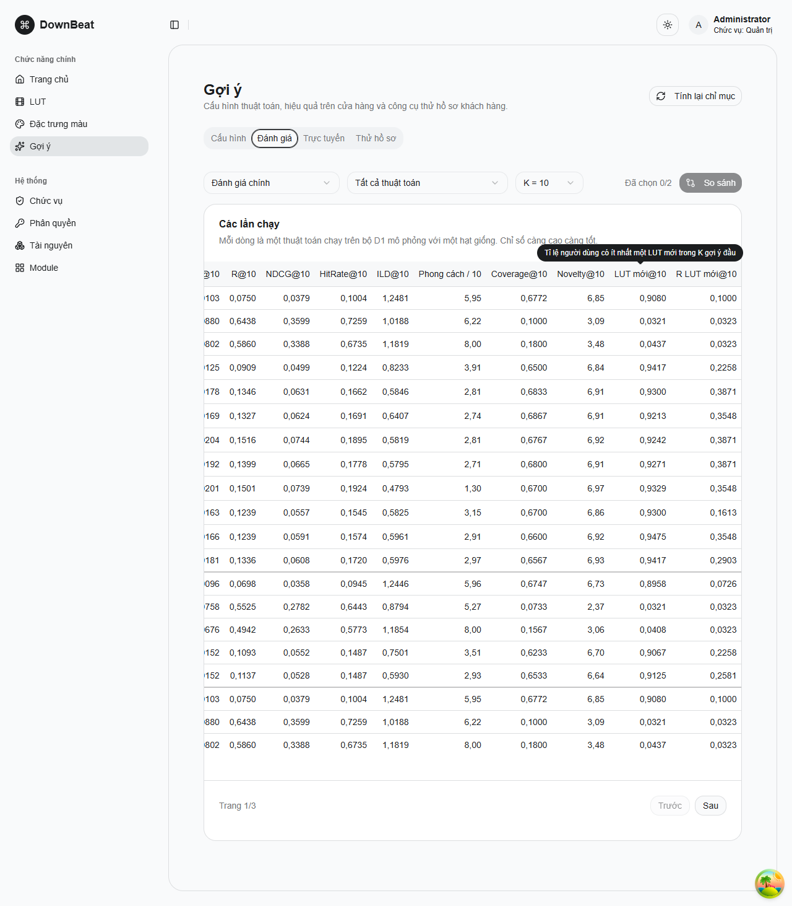
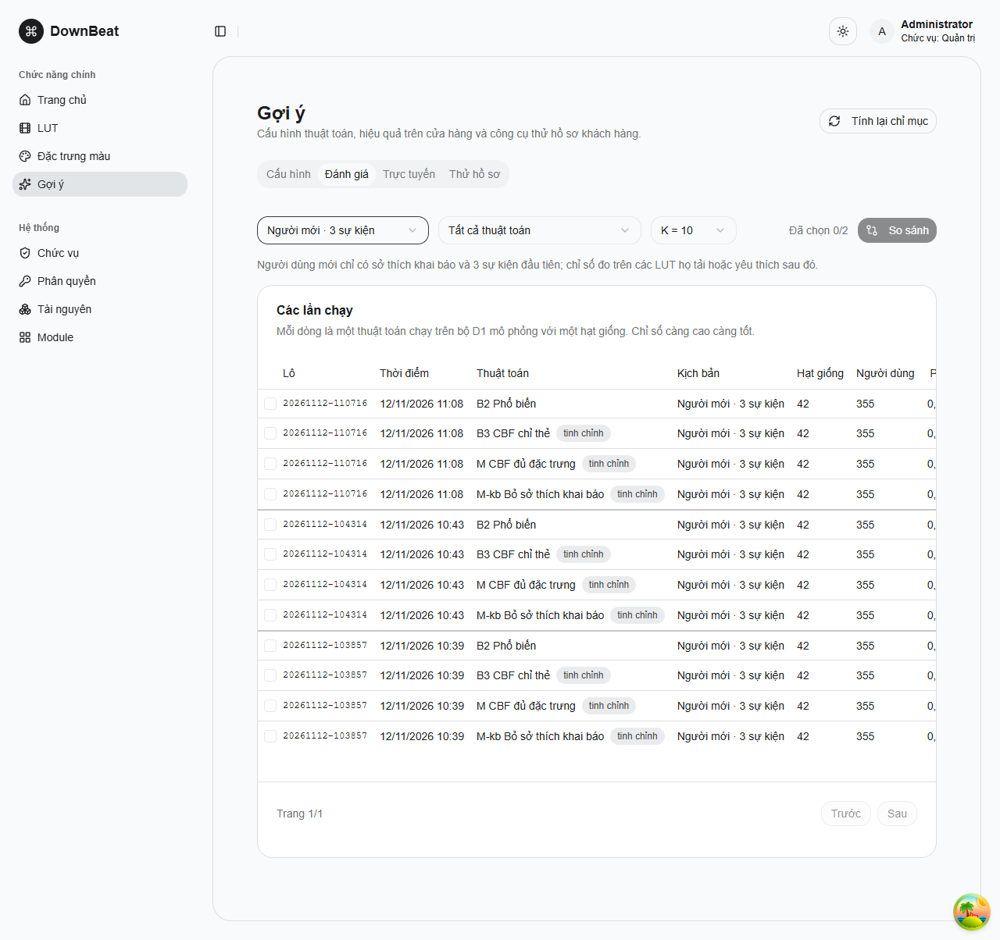
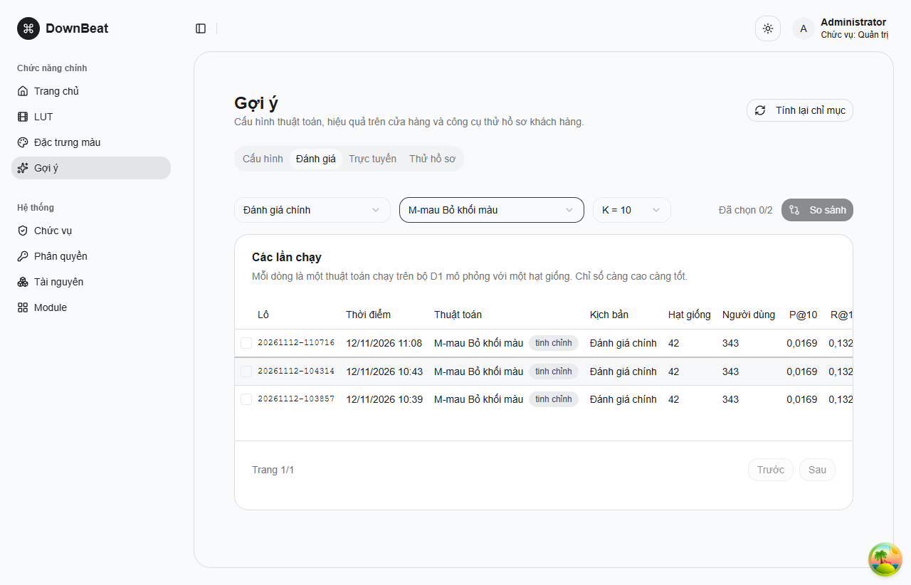
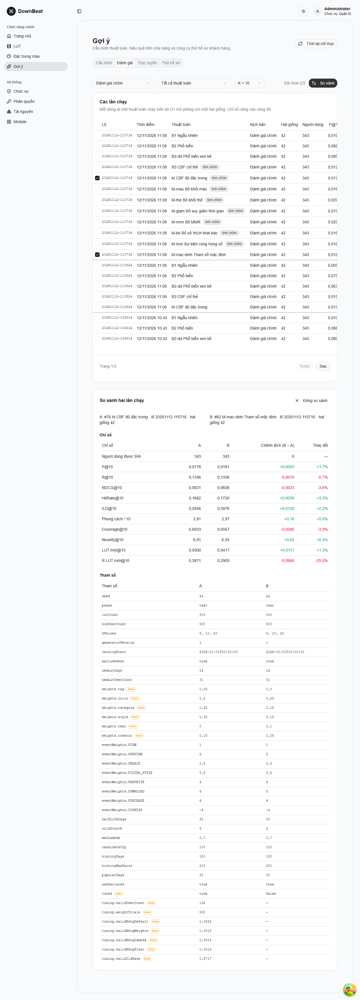
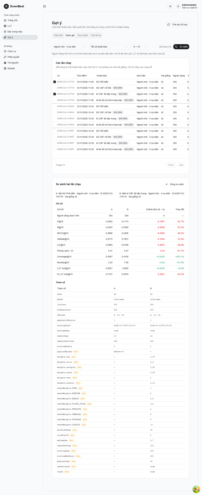
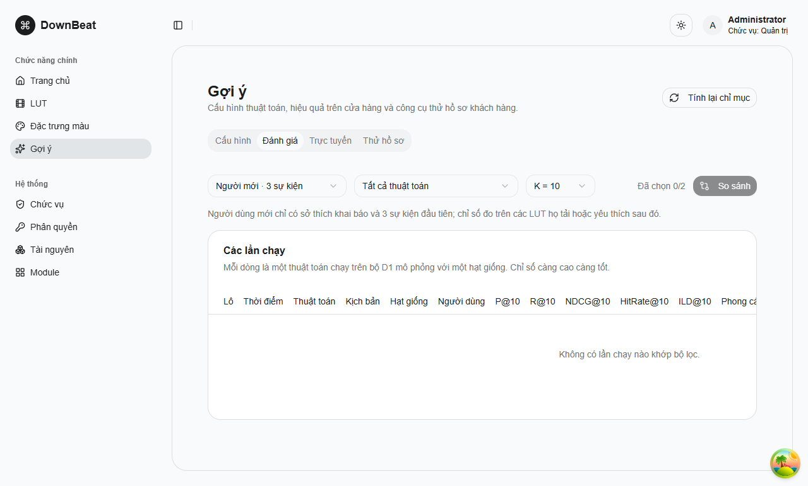
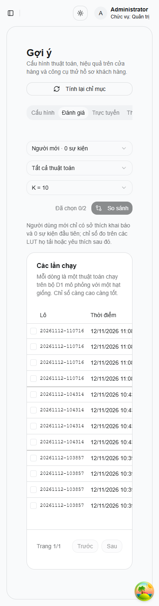

# Tinh chỉnh gợi ý, đánh giá phần 2 (tập kiểm định, 7 biến thể bỏ bớt, kịch bản người mới, chỉ số LUT mới)

> Plan: [plan/tinh-chinh-goi-y.md](../../plan/tinh-chinh-goi-y.md) · API: `GET /api/recommend/eval/list` (thêm `scenario`), `GET /api/recommend/eval/get` · Dòng lệnh: profile `eval` · Giao diện: `/admin/goi-y?tab=danh-gia` · Phạm vi: backend + frontend

## 1. Mục tiêu

Phần 1 (`danh-gia-goi-y`) đo 5 thuật toán với tham số mặc định và cho kết quả đáng ngờ: M (CBF đủ đặc trưng) chỉ đạt NDCG@10 0,0528, thua xa B2 Phổ biến (0,2782). Phần 1 nêu hai nguyên nhân: ứng viên của CBF vẫn chứa LUT người dùng đã xem ở phần dựng hồ sơ (các LUT này luôn có rel = 0), và trình mô phỏng lấy một nửa số LUT người dùng thấy từ danh sách phổ biến. Lát này (phần 2 trong ba phần của mục 3.1 kế hoạch tổng) làm các việc sau, vẫn chạy bằng **một lệnh** ở profile `eval`:

- **Sửa giao thức chia dữ liệu**: loại khỏi ứng viên mọi LUT người dùng đã có sự kiện `VIEW` / `PREVIEW` / `FAVORITE` / `DOWNLOAD` ở phần dựng, áp cho **mọi** thuật toán (`eval.exclude-seen`, mặc định bật).
- **Tinh chỉnh trên tập kiểm định** (thiết kế §8.6 bước 3): M thử 500 bộ trọng số khối, rồi λ của MMR, rồi chu kỳ bán rã × k. B3 giữ trọng số chỉ thẻ, chỉ tinh chỉnh λ, chu kỳ bán rã, k. Phần tìm tham số chạy trên một đường tính nhanh (ma trận tương đồng tính trước); số liệu cuối vẫn đi qua `ProfileBuilder` + `Recommender` thật.
- **12 thuật toán** trên phần kiểm: 5 thuật toán cũ cộng 7 biến thể bỏ bớt `m-mau`, `m-the`, `m-giam`, `m-mmr`, `m-kb`, `m-tron`, `m-mac-dinh` (thiết kế §8.5).
- **Kịch bản người mới** (§8.4.4, giả thuyết H4): chỉ giữ sở thích khai báo và n = 0, 1, 3, 5 sự kiện đầu; đo B2, B3, M, M-kb.
- **Chỉ số LUT mới** (H5): `newLutHit` (tỉ lệ danh sách có LUT mới) và `newLutRecall` (Recall trên LUT mới liên quan).
- Thẻ **"Đánh giá"** thêm bộ lọc "Kịch bản", nhãn 7 biến thể, 2 cột LUT mới, badge "tinh chỉnh".

Chưa làm (để lát `kiem-dinh-goi-y` và sau đó): 5 hạt giống chính thức, trung bình ± độ lệch chuẩn, Wilcoxon + Holm, bootstrap, xuất Bảng 8.1 → 8.5; ghi trọng số đã tinh chỉnh vào cấu hình cửa hàng; bỏ LUT đã xem khỏi "Dành cho bạn" ở cửa hàng; đổi bộ mô phỏng D1; dữ liệu D2 / D3.

## 2. Luồng hoạt động

**Chạy đánh giá (dòng lệnh, lập trình viên).**

```
java -jar backend/app/target/aeoc-backend.jar --spring.profiles.active=local,eval [--eval.seeds=42]
```

Với mỗi hạt giống: sinh D1 y hệt phần 1 → `LutVectorIndex.build` → `TimeSplitter` chế độ `valid` (có exclude-seen) → `Tuner` tinh chỉnh M rồi B3 → `TimeSplitter` chế độ `test` → chạy 12 thuật toán (`scenario = standard`) → `TimeSplitter.coldUser` với n = 0, 1, 3, 5 → chạy `popular`, `cbf-tag`, `cbf-full`, `m-kb` cho từng n (`scenario = cold-user-{n}`) → ghi **28 dòng** `rec_eval_run` trong một transaction → in các bảng ra stdout, thoát mã 0. Tinh chỉnh chỉ nhận ca `valid`; ca `test` không bao giờ vào `Tuner`.

Khoá `eval.*` thêm mới ở lát này (các khoá phần 1 giữ nguyên):

| Khoá | Mặc định | Hợp lệ |
|---|---|---|
| `eval.algorithms` | 12 mã | tập con của 12 mã, chạy theo thứ tự cố định |
| `eval.tune` | `true` | `true` / `false` |
| `eval.tune-trials` | 500 | 1 → 5000 (đã gồm bộ trọng số mặc định) |
| `eval.exclude-seen` | `true` | `true` / `false` |
| `eval.new-lut-days` | 14 | 1 → 60 |
| `eval.scenarios` | `standard,cold-user` | tập con khác rỗng |
| `eval.cold-user-events` | `0,1,3,5` | mỗi số 0 → 10, không trùng |

Tham số sai thì in "Tham số đánh giá không hợp lệ: {khoá}", không ghi DB, mã thoát 2.

**Chạy lại đúng phần 1.** `--eval.tune=false --eval.exclude-seen=false --eval.scenarios=standard --eval.algorithms=random,popular,popular-dd,cbf-tag,cbf-full` cho đúng 8 chỉ số cũ và `userCount` của lô phần 1 cùng hạt giống (đã kiểm ở TC-14).

**Xem theo kịch bản.** Quản trị mở thẻ "Đánh giá": giao diện gọi `eval/list?scenario=standard&page=1&limit=20`, bảng hiện 12 dòng mỗi lô. Chọn "Kịch bản" → "Người mới · 3 sự kiện" thì gọi lại với `scenario=cold-user-3`, bảng hiện 4 dòng mỗi lô và một dòng giải thích kịch bản. "Tất cả kịch bản" gọi `list` không có `scenario`.

**Xem tinh chỉnh thay đổi gì.** Tích "M CBF đủ đặc trưng" và "M-mac-dinh Tham số mặc định" của cùng lô → "So sánh": bảng "Chỉ số" cho thấy mức tăng giảm trên phần kiểm; bảng "Tham số" đánh dấu "khác" ở `tuned`, trọng số, λ, chu kỳ bán rã, k và cho thấy `tuning.validNdcg*` trên tập kiểm định.

**Luồng thay thế và ngoại lệ.**

- `--eval.tune=false`: bỏ tinh chỉnh, B3 / M / biến thể dùng tham số mặc định; `m-mac-dinh` khi đó trùng `cbf-full`.
- Mở link `?tab=danh-gia&scen=cold-user-0&a=..&b=..`: bộ lọc và thẻ so sánh hiện ngay. `scen` sai thì quay về `standard`.
- Không token: 401. Khách hàng, `noaccess`: 403 `FORBIDDEN` "Bạn không có quyền thực hiện thao tác này! Path: /recommend/, Action: VIEW".
- `eval/get` id không có hoặc thiếu: 404 `DATA_NOT_FOUND` "Không tìm thấy lần chạy đánh giá".
- Không có dữ liệu: "Chưa có lần chạy đánh giá nào" (chưa lọc gì) hoặc "Không có lần chạy nào khớp bộ lọc." (đang lọc kịch bản người mới hoặc thuật toán). Lỗi mạng / 5xx: "Không tải được dữ liệu" kèm "Thử lại".

## 3. Cách đo

**Loại LUT đã xem khỏi ứng viên.** Thiết kế §8.3 định nghĩa LUT liên quan là LUT chưa có tín hiệu dương ở phần dựng, và phần 1 tính cả `VIEW` / `PREVIEW` là tín hiệu dương, nên gợi ý lại LUT đã xem chắc chắn bị tính sai. Từ nay ứng viên của mọi thuật toán bỏ các LUT đã `VIEW` / `PREVIEW` / `FAVORITE` / `DOWNLOAD` ở phần dựng (`DISMISS` để thuật toán tự loại như cũ). Chỉ trình đánh giá đổi; `Recommender` của cửa hàng **không đổi**, nên "Dành cho bạn" ngoài cửa hàng vẫn có thể hiện LUT khách đã xem.

**Tinh chỉnh một lượt, theo thứ tự thiết kế §8.6.**

1. **Trọng số (chỉ M)**: bộ số 0 là trọng số mặc định đã chuẩn hoá; 499 bộ còn lại do `WeightSampler` rút bằng RNG riêng (rút 5 điểm cắt trong 1..25, 6 phần tổng 20, mỗi trọng số = phần / 20). Chọn bộ có NDCG@10 kiểm định cao nhất.
2. **λ ∈ {0,5; 0,6; 0,7; 0,8; 0,9; 1,0}**: với trọng số đã chọn, chỉ xét λ có ILD@10 ≥ 95% ILD ở λ = 0,7; trong số đó chọn NDCG@10 cao nhất.
3. **Chu kỳ bán rã ∈ {7, 14, 30, 60, ∞} × k ∈ {2, 5, 10}**: chọn NDCG@10 cao nhất. Chu kỳ ∞ ghi là `halfLifeDays = 0` (đúng ngữ nghĩa sẵn có của `ProfileBuilder`).

Mỗi bước đều có sẵn giá trị đang dùng làm ứng viên, nên `validNdcgDefault ≤ validNdcgWeights ≤ validNdcgLambda ≤ validNdcgFinal`. **B3** giữ trọng số `{tag 1, còn lại 0}` và chỉ chạy bước 2 và 3.

**Đường nhanh.** Tìm 500 bộ trọng số bằng `Recommender.recommend` thật mất cỡ một giờ, nên `Tuner` dùng `ItemSimMatrix` (6 độ tương đồng thô của từng cặp LUT có thứ tự), `UserBlockSims` và `FastCbfRanker`, tính số thực đúng thứ tự như code gốc và gọi lại `Recommender.selectPool`, `Recommender.mmr`. Unit test (TC-03) chứng minh đường nhanh cho **cùng danh sách id** với đường thật ở mọi tổ hợp thử. Chỉ việc chọn tham số dùng đường nhanh; số ghi DB luôn tính bằng đường thật.

**Mười hai thuật toán.** Ký hiệu D = cấu hình mặc định của cửa hàng, T = kết quả tinh chỉnh M, T3 = kết quả tinh chỉnh B3.

| Mã | Nhãn | Tham số |
|---|---|---|
| `random`, `popular`, `popular-dd` | B1, B2, B2-dd | như phần 1 |
| `cbf-tag` | B3 CBF chỉ thẻ | trọng số `{tag 1}`, λ / chu kỳ bán rã / k = T3 |
| `cbf-full` | M CBF đủ đặc trưng | T |
| `m-mau` | M-mau Bỏ khối màu | T, khối `color` = 0 rồi chia lại |
| `m-the` | M-the Bỏ khối thẻ | T, khối `tag` = 0 rồi chia lại |
| `m-giam` | M-giam Bỏ suy giảm thời gian | T, `halfLifeDays` = 0 |
| `m-mmr` | M-mmr Bỏ MMR | T, λ = 1,0 |
| `m-kb` | M-kb Bỏ sở thích khai báo | T, không truyền sở thích khai báo |
| `m-tron` | M-tron Sự kiện cùng trọng số | T, 7 loại dương = 1,0, `DISMISS` = −1,0 |
| `m-mac-dinh` | M-mac-dinh Tham số mặc định | toàn bộ D (trọng số, λ, chu kỳ bán rã, k) |

**Kịch bản người mới.** Chỉ xét người có sở thích khai báo và nhiều hơn max(n) sự kiện. Với từng n: phần dựng là n sự kiện đầu, t0 là thời điểm sự kiện thứ n, phần kiểm là phần còn lại; rel, ứng viên, exclude-seen tính đúng như chế độ `test`. Chỉ giữ người có ít nhất một LUT rel ≥ 2 ở **mọi** n, nên bốn mức n dùng cùng một tập người và đường NDCG theo n so sánh được.

**Chỉ số LUT mới.** LUT mới là LUT trong ứng viên có ngày xuất bản trong 14 ngày trước t0. `newLutHit` = 1 nếu danh sách K đầu có LUT mới, trung bình trên mọi người; `newLutRecall` = |danh sách ∩ LUT mới liên quan| / |LUT mới liên quan|, chỉ trung bình trên người có LUT mới liên quan (số người này ghi ở `params.newLutUserCount`).

## 4. Cơ sở dữ liệu

Migration `V15__tinh_chinh_goi_y.sql`: thêm vào `rec_eval_run` cột `scenario VARCHAR(30) NOT NULL DEFAULT 'standard'` (sau `algorithm`) và chỉ mục `idx_rec_eval_run_scenario (scenario, batch_code)`. Dòng của phần 1 nhận `scenario = 'standard'`. Không thêm bảng, không xoá. Dữ liệu D1 và bảng chi tiết tinh chỉnh **không** ghi DB (sinh lại được từ `seed`); trong `params` chỉ có phần tóm tắt `tuning`.

Khoá mới trong `params`: `excludeSeen`, `newLutDays`, `newLutUserCount`, `historyEvents` (chỉ dòng `cold-user-*`), và ở dòng CBF: `useDeclared`, `tuned`, `tuning` (chỉ có ở `cbf-tag` / `cbf-full` kịch bản `standard` khi tinh chỉnh bật). `metrics` mỗi K có thêm `newLutHit`, `newLutRecall` (10 trường). Dòng cũ của phần 1 không có các trường này.

## 5. Backend

- Migration V15; `RecEvalRun` thêm `scenario`, mở rộng `CANONICAL_PARAM_ORDER` và `CANONICAL_METRIC_ORDER`, thêm thứ tự khoá con của `tuning`. jOOQ sinh lại `REC_EVAL_RUN.SCENARIO`.
- `RecEvalRunRepository` / `RecEvalRunService` / `RecommendAdminController`: `eval/list` thêm điều kiện `scenario` (trim, rỗng coi như không lọc).
- `EvalProperties` thêm 6 khoá `eval.*` và `ALGORITHM_ORDER` 12 mã; `application-eval.yml` thêm mặc định.
- `TimeSplitter`: thêm `split(…, excludeSeen, newLutDays)` và `coldUser(…)`; `EvalCase` thêm `newLutIds`. Chữ ký cũ giữ nguyên để test phần 1 không đổi. `EvalMetrics` thêm `newLutHit`, `newLutRecall`.
- Gói mới `eval.tune`: `WeightSampler`, `ItemSimMatrix`, `UserBlockSims`, `FastCbfRanker`, `Tuner`, `TuningResult`. Gói `eval.algo` thêm `ConfiguredCbfAlgorithm` và `EvalVariants`.
- `EvalRunner` (thêm `runWithReport`) và `EvalCommand` (in Bảng 8.1, 8.3, 8.4, 8.5 và chi tiết tinh chỉnh).
- `ProfileBuilder`, `Recommender`, `ScoreCalculator`, `LutVectorIndex`, `CubeParser`, `ColorFeatureExtractor`, `CatalogGenerator`, `UserSimulator`, `CubeWriter` **không đổi**; D1 sinh y hệt phần 1 (`generatorVersion` vẫn 1).

### API

Thành công: `{ "code": 200, "message": "OK", "result": … }`. Cả hai endpoint đòi token và quyền VIEW `RECOMMEND`; không thêm resource hay endpoint.

| Method | Đường dẫn | Chức năng |
|---|---|---|
| GET | `/api/recommend/eval/list?algorithm=&scenario=&batch=&page=&limit=` | Danh sách lần chạy, lô mới nhất trước, trong lô theo thứ tự chạy. `scenario` khớp đúng sau trim; bỏ trống = không lọc; giá trị không có thì `total` 0, `items` rỗng |
| GET | `/api/recommend/eval/get?id=` | Một lần chạy (có thêm `scenario`) |

Thứ tự trong một hạt giống (28 dòng): 12 dòng `standard` (`random`, `popular`, `popular-dd`, `cbf-tag`, `cbf-full`, `m-mau`, `m-the`, `m-giam`, `m-mmr`, `m-kb`, `m-tron`, `m-mac-dinh`), rồi `cold-user-0`, `-1`, `-3`, `-5`, mỗi kịch bản 4 dòng `popular`, `cbf-tag`, `cbf-full`, `m-kb`. Lỗi 401 / 403 / 404 giữ nguyên như phần 1.

## 6. Giao diện

Chỉ đổi nội dung thẻ "Đánh giá"; ba thẻ còn lại không đổi.

- **Tham số URL** thêm `scen` (`standard` mặc định, `all`, `cold-user-0`, `cold-user-1`, `cold-user-3`, `cold-user-5`; giá trị khác về `standard` nhờ Zod `.catch`). Đổi `scen` thì `page` về 1, giữ `algo`, `k`, `a`, `b`. `scen=all` thì request không có `scenario`.
- **Thanh công cụ**: `Select` "Kịch bản" (6 mục) đặt trước "Thuật toán"; "Thuật toán" có đủ 12 nhãn. Ở 390 px các `Select` xuống dòng. Khi chọn kịch bản người mới có dòng phụ "Người dùng mới chỉ có sở thích khai báo và {n} sự kiện đầu tiên; chỉ số đo trên các LUT họ tải hoặc yêu thích sau đó."
- **Bảng "Các lần chạy"**: thêm cột "Kịch bản" sau "Thuật toán"; `Badge` "tinh chỉnh" ở dòng có `params.tuned = true`; thêm hai cột cuối "LUT mới@K" và "R LUT mới@K" có tooltip (dòng của phần 1 hiện "—").
- **Thẻ "So sánh hai lần chạy"**: kịch bản khác `standard` chèn nhãn kịch bản vào nhãn A / B ("A: #… B2 Phổ biến · Người mới · 0 sự kiện · lô … · hạt giống 42"); bảng "Chỉ số" thêm hai dòng LUT mới, trường thiếu hiện "—"; bảng "Tham số" gồm cả `tuning.*`.
- Tệp sửa: `eval-runs-table.tsx`, `eval-compare-card.tsx`, `eval-tab.tsx`, `labels.ts`, `routes/admin/goi-y.tsx`, kiểu `recommend.ts`, `api.gen.ts`, hàm gọi API, TanStack options.

### Hình ảnh



Thẻ "Đánh giá" mặc định ở kịch bản "Đánh giá chính": 12 dòng của lô mới nhất, badge "tinh chỉnh" ở 8 dòng, thêm hai cột LUT mới.



Chọn "Người mới · 3 sự kiện": 4 dòng mỗi lô và dòng giải thích kịch bản dưới thanh công cụ.



Lọc "M-mau Bỏ khối màu": mọi dòng cùng nhãn, URL có `algo=m-mau`.



So sánh M đã tinh chỉnh với M-mac-dinh: bảng "Chỉ số" có hai dòng LUT mới, bảng "Tham số" đánh dấu "khác" ở `tuned` và các trọng số.



So sánh hai dòng kịch bản "Người mới · 0 sự kiện": nhãn A / B có kèm nhãn kịch bản.



Kịch bản người mới không có dữ liệu: "Không có lần chạy nào khớp bộ lọc."



Màn hình 390 × 844: các `Select` xuống dòng, trang không tràn ngang, bảng cuộn ngang trong khung riêng.

## 7. Kết quả đo lô seed 42

Lô L2 `20261112-104314` (`--eval.seeds=42`, 300 LUT, 500 người mô phỏng, 343 người được tính ở kịch bản chính, 355 người ở kịch bản người mới, 132 người ở tập kiểm định). K = 10. Đây là số đo thật; lô L1 `20261112-103857` cho đúng kết quả này (NFR-08). Đây **chưa phải bảng báo cáo cuối** (một hạt giống).

**Bảng 8.1: so sánh với baseline (kịch bản chính).**

| Thuật toán | P@10 | R@10 | NDCG@10 | HitRate@10 | ILD@10 | Phong cách / 10 | Coverage@10 | Novelty@10 |
|---|---|---|---|---|---|---|---|---|
| B1 Ngẫu nhiên | 0,0103 | 0,0750 | 0,0379 | 0,1004 | 1,2481 | 5,95 | 0,6772 | 6,85 |
| B2 Phổ biến | 0,0880 | 0,6438 | 0,3599 | 0,7259 | 1,0188 | 6,22 | 0,1000 | 3,09 |
| B2-dd Phổ biến xen kẽ | 0,0802 | 0,5860 | 0,3388 | 0,6735 | 1,1819 | 8,00 | 0,1800 | 3,48 |
| B3 CBF chỉ thẻ (tinh chỉnh) | 0,0125 | 0,0909 | 0,0499 | 0,1224 | 0,8233 | 3,91 | 0,6500 | 6,84 |
| M CBF đủ đặc trưng (tinh chỉnh) | 0,0178 | 0,1346 | 0,0631 | 0,1662 | 0,5846 | 2,81 | 0,6833 | 6,91 |

**Tinh chỉnh trên tập kiểm định (132 người, NDCG@10).**

| | Trọng số chọn (thẻ / màu / danh mục / phong cách / văn bản / tác giả) | λ | Chu kỳ bán rã | k | Mặc định | Sau trọng số | Sau λ | Cuối |
|---|---|---|---|---|---|---|---|---|
| M | 0,05 / 0,20 / 0,25 / 0,35 / 0 / 0,15 | 0,7 | 30 | 5 | 0,0632 | 0,0815 | 0,0815 | 0,0815 |
| B3 | 1 / 0 / 0 / 0 / 0 / 0 | 0,7 | 7 | 2 | 0,0622 | 0,0622 | 0,0622 | 0,0630 |

Thời gian tinh chỉnh M 14,2 giây, B3 2,8 giây (500 bộ trọng số, đường nhanh).

**Bảng 8.5: bỏ bớt thành phần (kịch bản chính, K = 10).**

| Biến thể | NDCG@10 | Thay đổi so với M | ILD@10 | LUT mới@10 | R LUT mới@10 |
|---|---|---|---|---|---|
| M | 0,0631 | — | 0,5846 | 0,9300 | 0,3871 |
| M-mau Bỏ khối màu | 0,0624 | −1,1% | 0,6407 | 0,9213 | 0,3548 |
| M-the Bỏ khối thẻ | 0,0744 | +17,9% | 0,5819 | 0,9242 | 0,3871 |
| M-giam Bỏ suy giảm thời gian | 0,0665 | +5,4% | 0,5795 | 0,9271 | 0,3871 |
| M-mmr Bỏ MMR | 0,0739 | +17,1% | 0,4793 | 0,9329 | 0,3548 |
| M-kb Bỏ sở thích khai báo | 0,0557 | −11,7% | 0,5825 | 0,9300 | 0,1613 |
| M-tron Sự kiện cùng trọng số | 0,0591 | −6,3% | 0,5961 | 0,9475 | 0,3548 |
| M-mac-dinh Tham số mặc định | 0,0608 | −3,6% | 0,5976 | 0,9417 | 0,2903 |

**Bảng 8.4: người mới (NDCG@10 theo số sự kiện n, 355 người có khai báo).**

| Thuật toán | n = 0 | n = 1 | n = 3 | n = 5 |
|---|---|---|---|---|
| B2 Phổ biến | 0,4686 | 0,4665 | 0,4707 | 0,4686 |
| B3 CBF chỉ thẻ | 0,2063 | 0,1637 | 0,1489 | 0,1431 |
| M CBF đủ đặc trưng | 0,2426 | 0,2181 | 0,2001 | 0,1867 |
| M-kb Bỏ sở thích khai báo | 0,3883 | 0,1443 | 0,1476 | 0,1463 |

**LUT mới (kịch bản chính, 31 người có LUT mới liên quan, K = 10).**

| Thuật toán | Tỉ lệ danh sách có LUT mới | Recall@10 trên LUT mới |
|---|---|---|
| B1 Ngẫu nhiên | 0,9080 | 0,1000 |
| B2 Phổ biến | 0,0321 | 0,0323 |
| B2-dd Phổ biến xen kẽ | 0,0437 | 0,0323 |
| B3 CBF chỉ thẻ | 0,9417 | 0,2258 |
| M CBF đủ đặc trưng | 0,9300 | 0,3871 |

**Nhận xét (đúng số đo, không chỉnh theo kỳ vọng).**

- **M vẫn thua B2 Phổ biến** ở kịch bản chính: NDCG@10 0,0631 so với 0,3599, dù đã loại LUT đã xem và đã tinh chỉnh. So với phần 1, M từ 0,0528 lên 0,0631, nhưng B2 cũng tăng (0,2782 → 0,3599) vì exclude-seen áp cho mọi thuật toán. Nguyên nhân còn lại nằm ở bộ mô phỏng (theo thiết kế §8.2.1, §8.9, người mô phỏng chạy theo số đông và lấy một nửa LUT từ danh sách phổ biến). Plan đã quyết không đổi D1 để M thắng, vì như vậy là chỉnh dữ liệu theo kết quả.
- **Tinh chỉnh có tác dụng nhưng nhỏ trên phần kiểm.** M tinh chỉnh hơn M-mac-dinh 3,8% (0,0631 so với 0,0608), trong khi trên tập kiểm định mức tăng là 29% (0,0632 → 0,0815). Chênh lệch này là dấu hiệu quá khớp, đúng như rủi ro đã nêu ở plan (tập kiểm định chỉ 132 người, chọn 1 trong 500 bộ). Với B3, tinh chỉnh gần như không đổi kết quả ngay trên tập kiểm định (0,0622 → 0,0630). Cần 5 hạt giống ở `kiem-dinh-goi-y` mới kết luận được độ ổn định.
- **Bỏ bớt thành phần.** Bỏ khối thẻ (M-the) và bỏ MMR (M-mmr) cho NDCG cao hơn M (+17,9% và +17,1%); bỏ MMR làm ILD@10 giảm từ 0,5846 xuống 0,4793 và số phong cách / 10 từ 2,81 xuống 1,30, tức đổi độ đa dạng lấy độ chính xác. Bỏ sở thích khai báo (M-kb) làm giảm mạnh Recall trên LUT mới (0,3871 → 0,1613) và NDCG (−11,7%). Bỏ khối màu hay suy giảm thời gian thay đổi ít (−1,1% và +5,4%); các chênh lệch này chưa có kiểm định thống kê vì mới một hạt giống.
- **Người mới.** B2 Phổ biến vượt xa CBF ở mọi n (≈ 0,47). Với M và B3, NDCG **giảm** khi có thêm sự kiện (M: 0,2426 → 0,1867) (số đo; chưa phân tích nguyên nhân, vì ứng viên bỏ thêm LUT đã xem khi n tăng và tập rel cũng đổi theo n). M-kb ở n = 0 rơi về phổ biến xen kẽ nên đạt 0,3883, cao hơn M (0,2426) và vượt cả B3; từ n = 1 trở đi M-kb thấp hơn M, cho thấy sở thích khai báo giúp CBF khi còn rất ít hành vi.
- **LUT mới.** B2 và B2-dd gần như không đưa LUT mới vào danh sách (0,03 đến 0,04) vì chỉ xếp theo lượt tải; B1, B3, M đều có LUT mới trong ≈ 93% danh sách. Trong số này M cho Recall LUT mới cao nhất (0,3871 so với 0,2258 của B3 và 0,1000 của B1).

## 8. Kiểm thử

### JUnit (backend)

Module `business`: 139 test, 0 lỗi, 0 bỏ qua. Phần của lát này: `EvalPart2UnitTest` (11 test, TC-01 → TC-11); hồi quy `EvalUnitTest` (10 test) và `RecEvalRunServiceTest` (3 test) xanh, kỳ vọng không đổi.

### Dòng lệnh và Playwright

Spec [frontend/tests/e2e/tinh-chinh-goi-y.spec.ts](../../frontend/tests/e2e/tinh-chinh-goi-y.spec.ts): **13/13 pass** (7 API + 6 giao diện), chạy có giao diện (`E2E_SLOWMO=400`). Hồi quy `danh-gia-goi-y.spec.ts` 13/13 sau khi sửa theo plan §10 (L1, L2 là hai lô của phần 1; bảng giao diện lọc `standard`).

| TC | Loại | Nội dung | Kết quả |
|---|---|---|---|
| TC-01 | unit | `WeightSampler`: 500 bộ khác nhau, bộ 0 = mặc định, tổng 1, tái lập theo seed | Pass |
| TC-02 | unit | `EvalVariants.props`: 9 mã CBF đúng bảng, bean gốc không đổi | Pass |
| TC-03 | unit | Đường nhanh cho đúng danh sách như `Recommender.recommend` thật ở mọi tổ hợp | Pass |
| TC-04 | unit | Quy tắc chọn của `Tuner` (trọng số, λ, lưới chu kỳ bán rã × k) | Pass |
| TC-05 | unit | `Tuner` chạy thật cỡ nhỏ, hai lần giống hệt, thứ tự không giảm | Pass |
| TC-06 | unit | `TimeSplitter.split` exclude-seen và `newLutIds` | Pass |
| TC-07 | unit | `TimeSplitter.coldUser` n = 0, 1, 3, 5 | Pass |
| TC-08 | unit | `EvalMetrics` LUT mới, biên không có LUT mới liên quan | Pass |
| TC-09 | unit | `EvalRunner` cỡ nhỏ: 28 dòng, khoá `params`, `tuning`, `tune=false` | Pass |
| TC-10 | unit | `EvalProperties.validate` các khoá mới | Pass |
| TC-11 | unit | Service lọc `scenario` (trim, rỗng → `null`) | Pass |
| TC-12 | unit | Hồi quy phần 1 (`EvalUnitTest`, `RecEvalRunServiceTest`) | Pass |
| TC-13 | cli | Lệnh mặc định: mã 0, 430,5 giây (220,6 giây khi máy rảnh), đủ tiêu đề, 28 dòng cùng `batch_code` | Pass (Claude chạy ở bước review BE) |
| TC-14 | cli | Chạy lại đúng phần 1: 8 chỉ số × 3 K và `userCount` trùng khít lô `20261112-034424` | Pass |
| TC-15 | cli | Tham số sai: mã 2, in đúng khoá, không ghi DB | Pass |
| TC-16 | api | Phân quyền `list`, `get`: 403 / 401 | Pass |
| TC-17 | api | Kịch bản chính của L2: 12 dòng, thứ tự, `tuned`, `tuning` | Pass |
| TC-18 | api | Biến thể suy ra đúng từ M và cấu hình | Pass |
| TC-19 | api | `metrics` 3 K × 10 trường, khoảng hợp lệ, CBF hơn ngẫu nhiên | Pass |
| TC-20 | api | Kịch bản người mới: 4 × 4 dòng, cùng `userCount`, `historyEvents` = n | Pass |
| TC-21 | api | Chạy lại ra đúng kết quả: L1 và L2, 28 cặp giống hệt (NFR-08) | Pass |
| TC-22 | api | Lọc `scenario`, `get` và 404 | Pass |
| TC-23 | e2e | Kịch bản mặc định: nhãn, badge "tinh chỉnh", 2 cột LUT mới, tooltip, "—" ở dòng phần 1 | Pass |
| TC-24 | e2e | Đổi kịch bản "Người mới · 3 sự kiện" rồi "Tất cả kịch bản" | Pass |
| TC-25 | e2e | Lọc biến thể M-mau | Pass |
| TC-26 | e2e | So sánh M với M-mac-dinh; so sánh dòng người mới | Pass |
| TC-27 | e2e | URL `scen` sai, trạng thái rỗng theo kịch bản | Pass |
| TC-28 | e2e | Điện thoại 390 × 844 | Pass |
| | | **Tổng** | **28/28 TC pass** — JUnit 12 TC (139 test module `business` xanh), Playwright 13/13 (7 API + 6 giao diện), 3 TC dòng lệnh chạy tay |

`pnpm build` xanh, `pnpm lint` 0 lỗi (2 cảnh báo có sẵn ngoài phạm vi). `pnpm api:types`: `api.gen.ts` thêm `scenario`, khớp `lib/types/recommend.ts`.

### Quá trình thực hiện

Mỗi bên 0 vòng sửa. Không lệch hợp đồng API. Hai ghi chú nhỏ, không chặn:

- `Tuner` bước 1 gắn cứng chu kỳ bán rã 30, k 5, λ 0,7 thay vì đọc từ cấu hình mặc định; hiện trùng giá trị trong `application.yml`, nhưng nếu đổi cấu hình thì phải sửa cả `Tuner`.
- Thời gian lệnh mặc định 220 đến 430 giây tuỳ tải máy, trong giới hạn 10 phút. Stdout tiếng Việt bị vỡ dấu khi chuyển hướng ra file vì bảng mã console Windows (như phần 1); số liệu trong DB không ảnh hưởng.

## 9. Hạn chế

- Mới một hạt giống, chưa có độ lệch chuẩn hay kiểm định thống kê; các chênh lệch nhỏ (ví dụ M-mau, M-giam) chưa kết luận được.
- Tập kiểm định nhỏ (132 người) nên tinh chỉnh dễ quá khớp; trọng số đã tinh chỉnh **chưa** ghi vào cấu hình cửa hàng và "Dành cho bạn" ngoài cửa hàng vẫn có thể hiện LUT khách đã xem.
- Bảng chi tiết tinh chỉnh (5 bộ trọng số tốt nhất, bảng λ, lưới chu kỳ bán rã × k) chỉ in ra stdout, không lưu DB; DB chỉ có phần tóm tắt `params.tuning`.
- Bộ mô phỏng D1 không đổi, nên kết quả M thua B2 là hệ quả của giả định mô phỏng (người dùng chạy theo số đông) chứ chưa chứng minh được trên người dùng thật.
