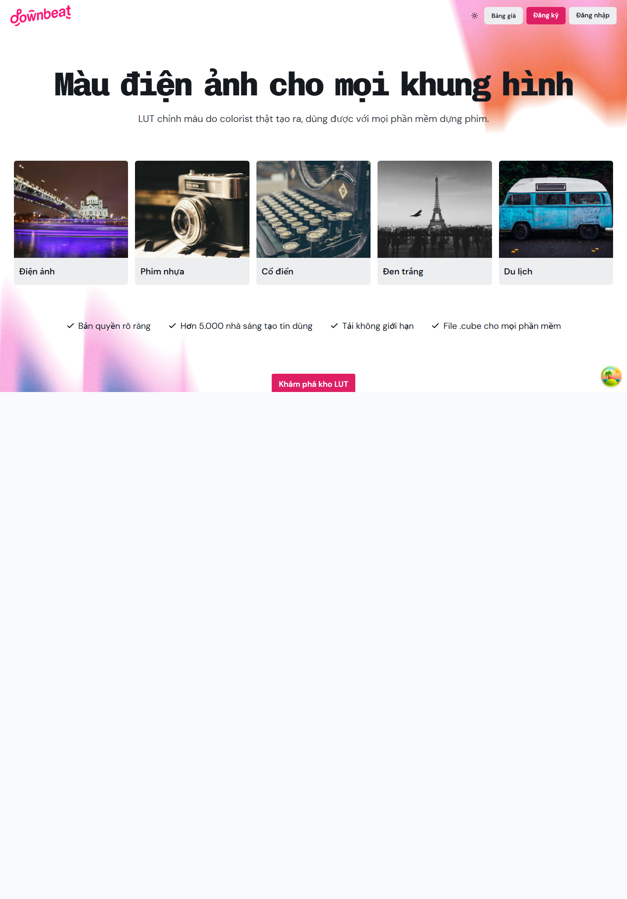
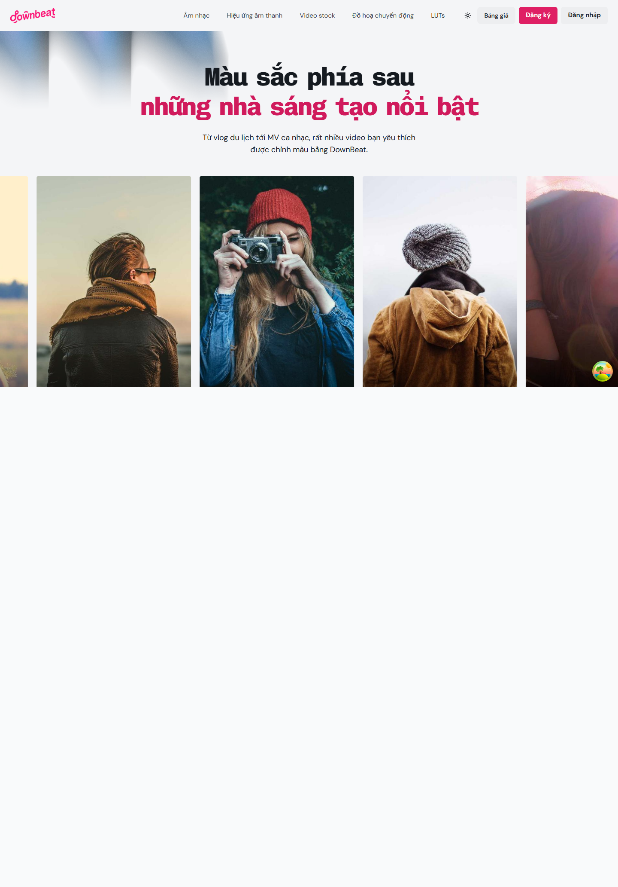
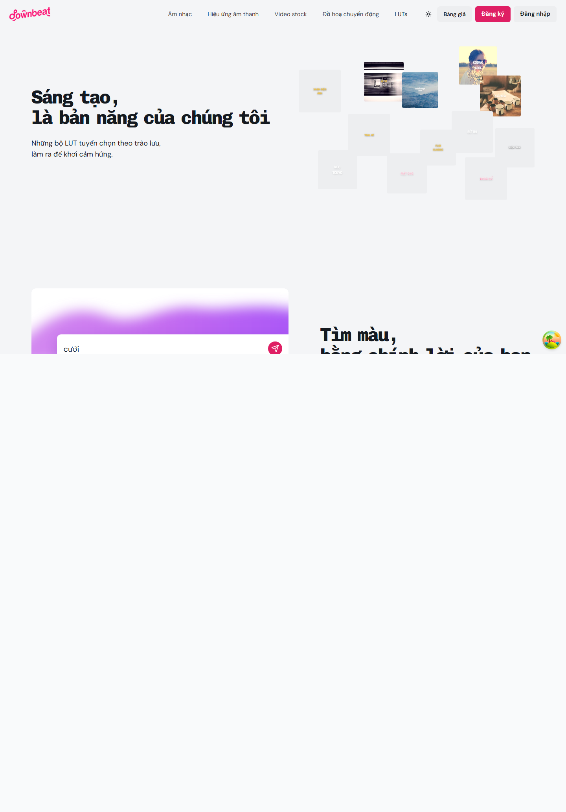
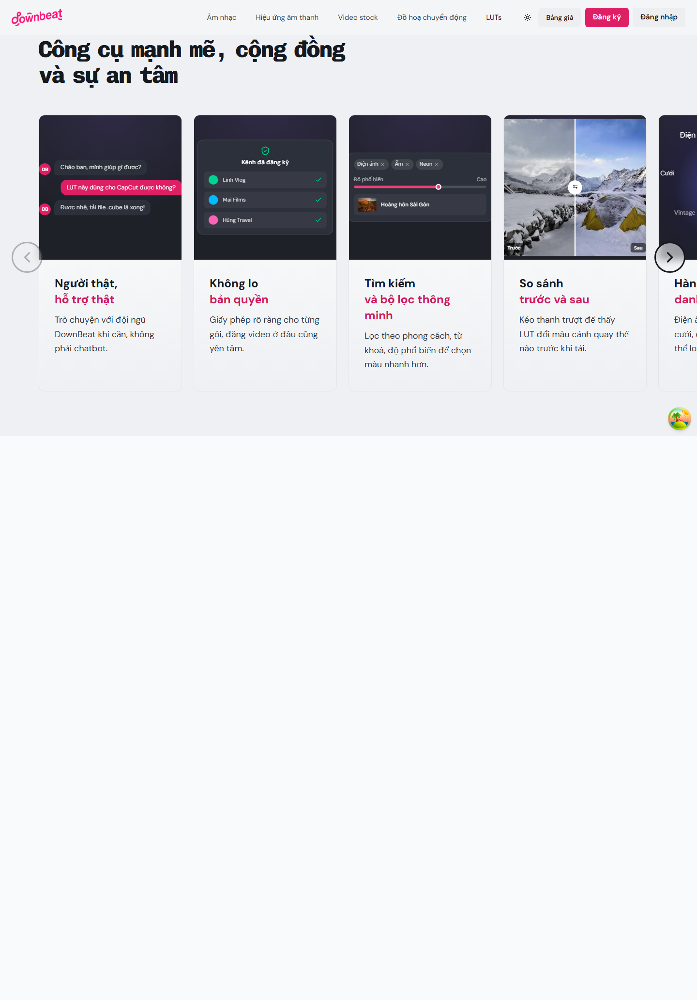
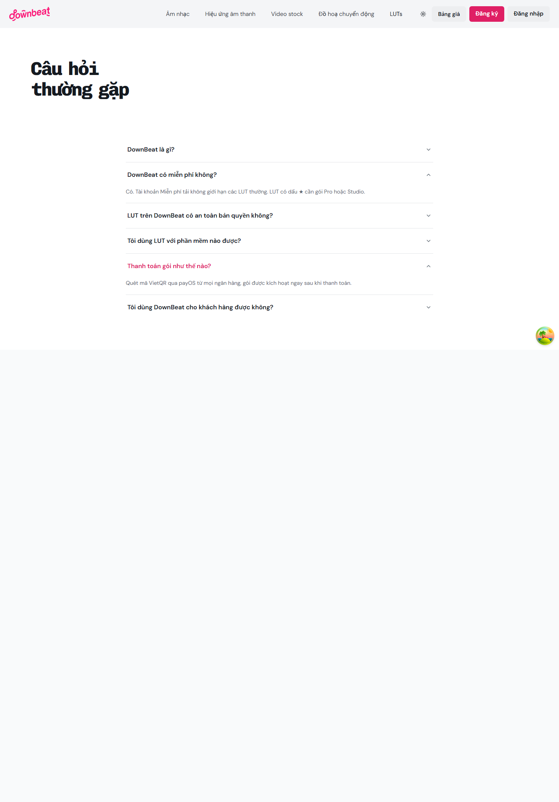
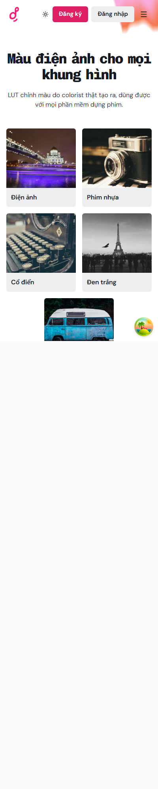
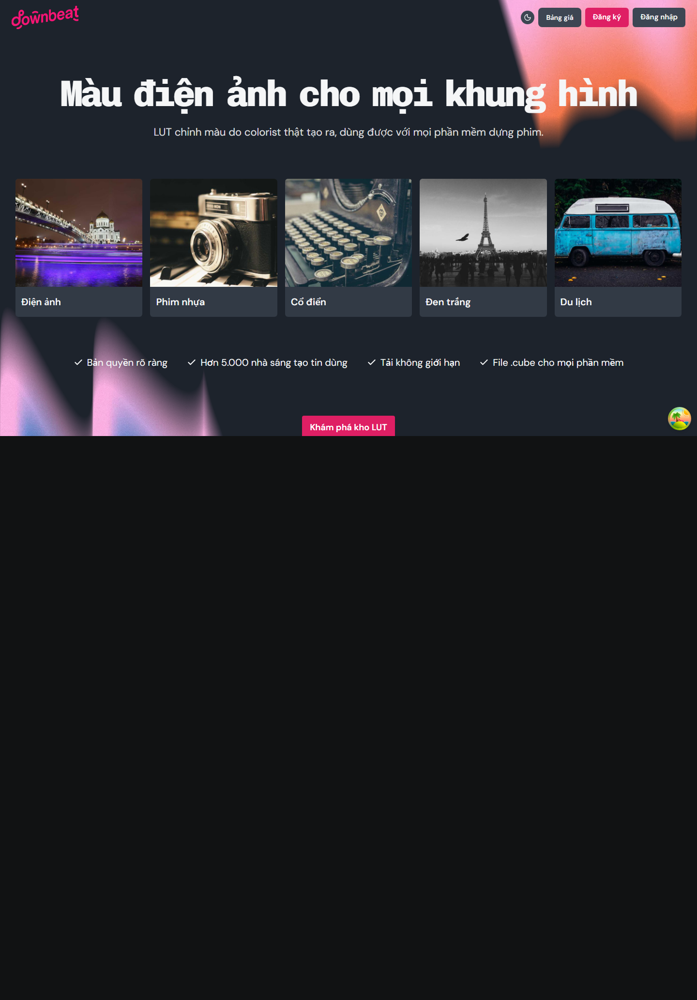

# Trang chủ (landing page cửa hàng)

> Plan: [plan/trang-chu.md](../../plan/trang-chu.md) · Route: `/` · Phạm vi: chỉ frontend, dữ liệu giả

## 1. Mục tiêu

Trước đây truy cập `/` bị chuyển thẳng sang kho LUT `/luts`. Chức năng này thay bằng một trang giới thiệu DownBeat: kho LUT, các colorist, tính năng, giấy phép, bảng giá rút gọn và câu hỏi thường gặp, đồng thời dẫn khách sang kho LUT, bảng giá hoặc đăng ký. Bố cục và nhịp các khối bám theo video tham khảo của một trang kho tài nguyên sáng tạo. Nội dung, thương hiệu và ảnh là của DownBeat, xoay quanh LUT.

Đối tượng sử dụng: khách vãng lai (header hiện "Bảng giá", "Đăng ký", "Đăng nhập") và thành viên đã đăng nhập (header hiện menu tài khoản, nút chọn gói mở hộp thoại thanh toán). Trang công khai nên không có quyền hay resource riêng.

## 2. Luồng sử dụng

1. Khách mở `/`, thấy hero, bấm một ô danh mục (ví dụ "Phim nhựa" dẫn tới `/luts/danh-muc/phim-nhua`) hoặc nút "Khám phá kho LUT" dẫn tới `/luts`.
2. Khi cuộn qua hero, menu loại tài nguyên hiện trên header. Mục "LUTs" dẫn tới `/luts`, các mục chưa có hiện chú thích "Sắp ra mắt" và không chuyển trang.
3. Ở khối "Tìm màu bằng lời", khách gõ mô tả hoặc bấm một gợi ý ("Hoàng hôn", "Cưới", "Neon", "Vintage") rồi bấm "Tìm LUT" để chuyển sang `/luts?q=<nội dung>`. Ô trống hoặc chỉ có khoảng trắng thì nút bị vô hiệu.
4. Bấm thẻ colorist chuyển sang `/luts?q=<tên colorist>`; bấm ảnh LUT trong khối ghép ảnh chuyển sang `/luts/<slug>`.
5. Ở khối bảng giá, khách chưa đăng nhập bấm chọn gói thì mở hộp thoại đăng ký; người đã đăng nhập mở hộp thoại xác nhận mua gói (cùng logic với `/pricing`).
6. Nút sáng / tối trên header đổi giao diện cả trang, riêng hai dải màu hồng và xanh lá giữ nguyên màu ở cả hai giao diện.

## 3. Cấu trúc trang

Trang có đúng một `h1` ("Màu điện ảnh cho mọi khung hình"), mỗi khối còn lại là một `section` có tiêu đề `h2`.

| # | Khối | Nội dung chính |
|---|---|---|
| 1 | Hero | 5 ô danh mục (Điện ảnh, Phim nhựa, Cổ điển, Đen trắng, Du lịch), 4 cam kết, nút "Khám phá kho LUT", hai dải lụa trang trí |
| 2 | Nhà sáng tạo | Băng 8 ảnh chân dung chạy ngang (dừng khi rê chuột), hàng phần mềm hỗ trợ dạng chữ |
| 3 | Dải hồng giá trị | "Màu thật, từ người chỉnh màu thật", hai nút dẫn tới kho LUT và bảng giá |
| 4 | Colorist | 7 thẻ so le, mỗi thẻ dẫn tới tìm kiếm theo tên |
| 5 | Ghép ảnh LUT | 12 ảnh bìa LUT phổ biến nhất, bố cục tự do, trôi nhẹ lên xuống |
| 6 | Tìm màu bằng lời | Ô nhập có placeholder tự gõ, 4 gợi ý, nút gửi |
| 7 | Băng tính năng | 8 thẻ cuộn ngang với hai nút "Trước" / "Sau" |
| 8 | Dải xanh giấy phép | "Cấp phép an tâm" |
| 9 | Bảng giá rút gọn | 3 gói theo chu kỳ tháng, link "So sánh chi tiết các gói" |
| 10 | Lời mời cuối | "Kể câu chuyện của bạn bằng màu sắc", 3 ảnh chồng nhau, dải sóng ở đáy |
| 11 | Câu hỏi thường gặp | 6 câu, mở nhiều câu cùng lúc được |

Header riêng của trang chủ (`HomeHeader`) dính trên cùng, cao 72px. Ở đầu trang header trong suốt, logo lớn, để dải lụa của hero lộ ra phía sau. Khi tiêu đề hero cuộn khuất, header chuyển nền tối, logo thu nhỏ và hiện menu 5 mục ở bên phải sát các nút (chỉ từ màn hình `lg`). Menu lấy từ cấu hình điều hướng của sidebar nên luôn khớp. Ngoài ra có nút sáng / tối, nhóm nút tài khoản và menu mobile. Logo cửa hàng nay trỏ về `/` thay vì `/luts`.

Về hình thức, giao diện được chỉnh theo trang tham chiếu mà người dùng cung cấp. Kích thước đo trên khung 1858×996 rồi so từng khối:

- Ở giao diện tối, các khối xen kẽ hai tông nền #1d232c và #151a20. Các token này nằm trong lớp `.shop-home` nên chỉ áp cho trang chủ.
- Tiêu đề `h1`/`h2` dùng font đơn cách Chivo Mono 800.
- Hai dải lụa ở hero là ảnh `public/hero-wave-upper.webp` và `public/hero-wave-lower.webp`. Dải dưới tràn xuống khối nhà sáng tạo.
- Kích thước thẻ:

  | Khối | Kích thước |
  |---|---|
  | Hero | 272×232, nhãn cao 62px |
  | Nhà sáng tạo | 360×540 |
  | Colorist | rộng 308px, cao xen kẽ 480/400 |
  | Ghép ảnh | ô vuông |
  | Tìm bằng lời | thẻ 654×367 |
  | Tính năng | 296px, băng tràn hết bề ngang |

- Thẻ bảng giá có phần đầu tô nền và nút trắng.
- Dải sóng ở khối 10 có đỉnh lớn và đỉnh nhỏ xen kẽ, mép tan thành hạt.

Về trợ năng và hiệu năng: bản lặp của băng chạy được ẩn khỏi trình đọc màn hình; khi người dùng bật giảm chuyển động, băng chạy, ảnh trôi và hiệu ứng gõ chữ đều tắt; không cuộn ngang ở 360–400px; mọi ảnh có `width`/`height` để không nhảy bố cục.

## 4. Dữ liệu và API

Không có migration, không có endpoint mới. Trang đọc qua các query options sẵn có (vẫn là dữ liệu giả ở `lib/mock`, sau này đổi sang API thật mà không sửa giao diện):

| Khối | Query options | Tham số |
|---|---|---|
| Ghép ảnh LUT | `homeFeaturedLutsQueryOptions` (mới, `["luts", "home-featured"]`) | `sort: popular`, trang 1, giới hạn 12 |
| Bảng giá rút gọn | `plansQueryOptions` (có sẵn) | — |

Query lỗi thì khối liên quan ẩn phần lưới, các khối khác vẫn hiện. Nội dung tĩnh (ô danh mục, colorist, tính năng, FAQ…) nằm trong `components/shop/home/home-data.ts`. Ảnh dùng picsum theo id cố định, chọn sẵn cho đúng chủ đề; khi có ảnh thật chỉ cần đổi id / URL ở file này.

## 5. Thay đổi chính trong mã nguồn

- Thư mục mới `frontend/src/components/shop/home/`: mỗi khối một file, cùng `home-header.tsx`, `home-page.tsx`, `home-data.ts`.
- `routes/index.tsx`: bỏ chuyển hướng, hiển thị `HomePage`, đặt tiêu đề trang "DownBeat | Kho LUT chỉnh màu cho nhà sáng tạo".
- `pricing/use-plan-select.ts`: tách logic chọn gói khỏi trang `/pricing` thành hook dùng chung (hành vi `/pricing` giữ nguyên).
- `luts/lut-card.tsx`: tách phần bìa thành `LutCover` để khối ghép ảnh dùng lại; thẻ LUT trong `/luts` không đổi.
- `shop-theme.css`: thêm biến `--sh-band-pink`, `--sh-band-green` và keyframe `shop-marquee`, `shop-float` (tắt khi giảm chuyển động).
- `layout/shop-logo.tsx`: logo trỏ về `/`.
- `home/feature-art.tsx`: tranh minh hoạ dạng giao diện thu nhỏ cho 8 thẻ tính năng. `home/grain-filter.tsx`: bộ lọc SVG tạo mép hạt cho dải sóng.
- `pricing/plan-card.tsx`: thêm kiểu `home` cho thẻ gói ở trang chủ; trang `/pricing` không đổi.
- `layout/shop-shell.tsx`: nạp thêm font Chivo Mono. `shop-theme.css`: token riêng `.shop-home` và quy tắc font cho tiêu đề.

## 6. Kiểm thử

Kiểm thử hoàn toàn bằng Playwright (lát không có backend nên không có JUnit và nhóm test API). File: `frontend/tests/e2e/trang-chu.spec.ts`.

| Mã | Nội dung | Kết quả |
|---|---|---|
| TC-01 | `/` là trang chủ, đúng một `h1`, đủ các vùng chính | Pass |
| TC-02 | 5 ô danh mục ở hero, bấm "Phim nhựa" | Pass |
| TC-03 | 4 cam kết và nút "Khám phá kho LUT" | Pass |
| TC-04 | Menu header ẩn ở đầu trang, hiện sau khi cuộn, đúng 5 mục | Pass |
| TC-04b | Mục menu chưa có: `aria-disabled`, tooltip "Sắp ra mắt", không chuyển trang | Pass |
| TC-05 | Nút Đăng ký / Đăng nhập / Bảng giá khi là khách | Pass |
| TC-06 | Header khi đã đăng nhập | Pass |
| TC-07 | Logo về trang chủ | Pass |
| TC-08 | Băng nhà sáng tạo (8 tên, không logo hãng) và link phần mềm | Pass |
| TC-09 | Dải hồng, link "Xem bảng giá" | Pass |
| TC-10 | 7 thẻ colorist, bấm "Analog Lab" dẫn tới tìm kiếm | Pass |
| TC-11 | Ghép ảnh LUT phổ biến (12 link) | Pass |
| TC-12 | Ô tìm trống thì nút bị vô hiệu | Pass |
| TC-13 | Gõ "cưới" rồi tìm | Pass |
| TC-14 | Bấm gợi ý "Neon" rồi Enter | Pass |
| TC-15 | Băng tính năng và hai nút "Trước" / "Sau" | Pass |
| TC-16 | Dải xanh giấy phép | Pass |
| TC-17 | Bảng giá rút gọn khi là khách | Pass |
| TC-18 | Bảng giá rút gọn khi đã đăng nhập | Pass |
| TC-19 | Lời mời cuối (khách và đã đăng nhập) | Pass |
| TC-20 | FAQ mở / đóng | Pass |
| TC-21 | Mobile 400px | Pass |
| TC-22 | Giảm chuyển động | Pass |
| TC-22b | Có chuyển động khi không bật giảm chuyển động | Pass |
| TC-23 | Nút sáng / tối, hai dải màu cố định | Pass |
| TC-24 | Ảnh đúng nguồn picsum đã chọn | Pass |
| **Tổng** | | **26/26 pass** |

TC-15 được sửa để cú bấm "Sau" có giới hạn thời gian, tránh treo khi nút vừa tắt lúc băng thẻ cuộn tới cuối. Kiểm tra hồi quy: `shop-flows.spec.ts` 24/24 pass (test cũ "/ chuyển về /luts" được đổi thành "/ là trang chủ"). `pnpm build` và `pnpm lint` xanh.

## 7. Ảnh minh hoạ

Ảnh nằm ở `docs/chuc-nang/img/trang-chu/`.

Hình 1. Trang chủ trên desktop, giao diện sáng: header trong suốt, hero với 5 ô danh mục và hai dải lụa.

Hình 2. Sau khi tiêu đề hero cuộn khuất, header chuyển nền đặc và hiện menu loại tài nguyên ở bên phải.

Hình 3. Khối colorist với 7 thẻ so le.

Hình 4. Khối "Tìm màu bằng lời" với ô nhập và các gợi ý.

Hình 5. Băng tính năng tràn bề ngang, mỗi thẻ có tranh minh hoạ giao diện, hai nút tròn ở hai mép.

Hình 6. Bảng giá rút gọn với 3 gói theo chu kỳ tháng.

Hình 7. Khối câu hỏi thường gặp, các câu mở độc lập nhau.

Hình 8. Trang chủ trên điện thoại (400px), hero xếp 2 cột.

Hình 9. Giao diện tối: các khối xen kẽ hai tông nền như trang tham chiếu; hai dải hồng và xanh lá giữ nguyên màu.

## 8. Điểm lệch plan và hạn chế

- Sau khi người dùng so với video tham khảo, plan §6 khối 1, 5, 10 được sửa: dải lụa hero rõ nét hơn, cụm ảnh khối 5 bố cục tự do không khung và không xoay ±4° (bản đầu dạng lưới và bị cắt mép), khối 10 tràn bề ngang thay vì thẻ bo góc. Tài liệu này theo bản đã làm.
- Dải lụa hero ban đầu bị nền che mất; đã sửa bằng cách tạo ngữ cảnh xếp chồng riêng cho hero và làm mờ dần phần đáy.
- Sau khi mở PR, người dùng so với video trang tham chiếu và yêu cầu chỉnh cho giống nhất có thể. Lần chỉnh này do Claude làm trực tiếp, không giao cho agy. Phần giao diện ở §3 theo bản đã chỉnh, và dải sóng khối 10 nay đã đủ đỉnh, có hạt ở mép.
- Một số điểm vẫn khác trang tham chiếu. Tiêu đề tiếng Việt dài hơn nên vài tiêu đề chiếm 3 dòng. Font tiêu đề chỉ là font gần giống. Hình trái tim ở dải xanh là icon. Tranh minh hoạ thẻ tính năng do nhóm tự dựng.
- Tìm bằng lời hiện là tìm giả khớp nguyên cụm `q`; câu dài có thể không ra kết quả cho đến khi làm chức năng kho LUT thật.
- Ảnh tải từ picsum.photos lúc chạy; mất mạng thì ô ảnh để trống trên nền `--sh-surface`, bố cục không vỡ. Số liệu minh hoạ ("Hơn 5.000 nhà sáng tạo") và tên nhà sáng tạo là dữ liệu mẫu.

## 9. Quy trình thực hiện

Một vòng sửa với worker frontend (agy) theo `plan/tasks/trang-chu-fe-fix1.md` (9 mục), cộng một bản sửa nhỏ của Claude cho khối hero và bìa LUT. Không có việc backend.
