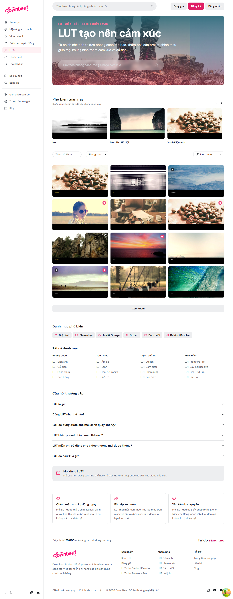
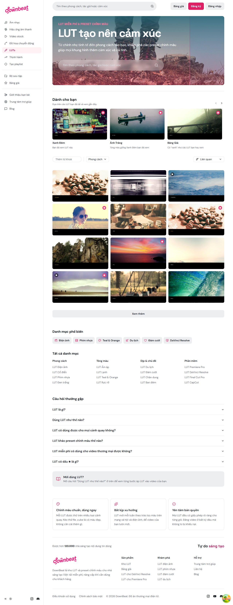
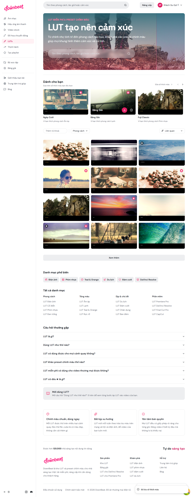
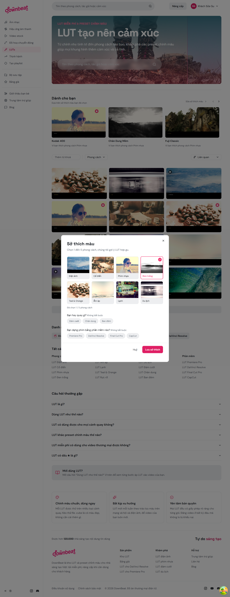
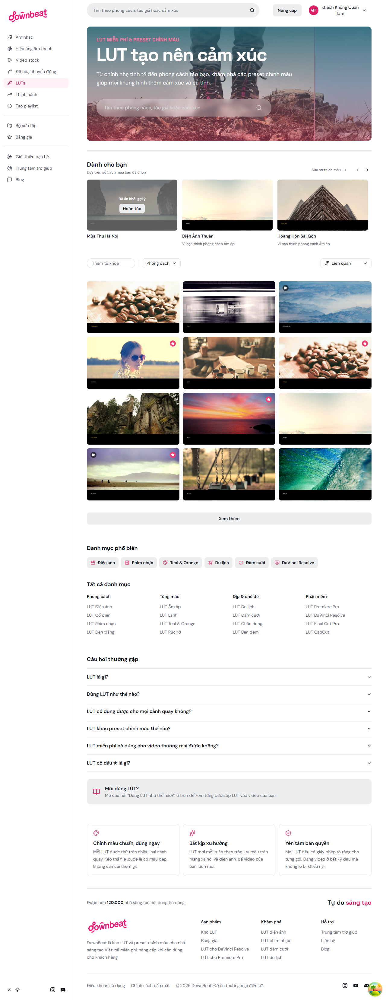
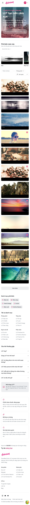
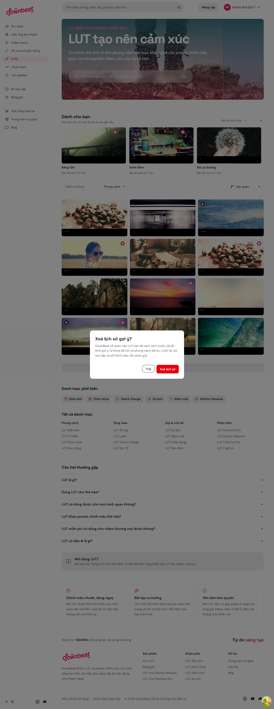

# Xếp hạng gợi ý (khối "Dành cho bạn", MMR, giới hạn LUT Premium, câu giải thích, "Không quan tâm")

> Plan: [plan/xep-hang-goi-y.md](../../plan/xep-hang-goi-y.md) · API: `POST /api/recommend/public/for-you`, `POST /api/recommend/dismiss`, `GET /api/lut/public/related` (thêm cá nhân hoá) · Giao diện: khối gợi ý đầu trang `/luts` · Phạm vi: backend + frontend

## 1. Mục tiêu

Sau lát hồ sơ người dùng (2.2), hệ thống đã biết gu màu của từng khách. Lát này dùng hồ sơ đó để **xếp hạng LUT và hiển thị gợi ý**:

1. **Khối gợi ý 12 LUT** cuộn ngang ở đầu `/luts`, đổi theo mức hiểu biết về khách:
   - chưa có tín hiệu gì: **"Phổ biến tuần này"** (LUT tải nhiều trong 30 ngày, xen kẽ các phong cách màu);
   - đã khai báo sở thích hoặc có hành vi: **"Dành cho bạn"**, tính `score(u, i)` trên toàn kho, lấy top 100, xếp lại bằng MMR để 12 LUT không giống hệt nhau, kèm một **câu giải thích** dưới mỗi thẻ.
2. **Giới hạn LUT Premium**: khách vãng lai và khách không có gói trả phí chỉ thấy tối đa `floor(K × 0.34)` LUT Premium (4 trên 12). Đây là câu trả lời cho vấn đề mở số 6 của thiết kế.
3. **"Không quan tâm"**: khách đã đăng nhập ẩn một LUT khỏi gợi ý (có "Hoàn tác" trong 5 giây); LUT đó không quay lại và hồ sơ bị kéo ra xa phong cách của nó.
4. **Đo lường**: mỗi lần trả danh sách ghi một dòng `rec_impression`; khi khách bấm thẻ từ khối, sự kiện `VIEW` kế tiếp mang `impressionId`, làm dữ liệu cho thống kê CTR ở lát 2.4.
5. **"Có thể bạn cũng thích"** ở trang chi tiết (và "LUT tương tự" sau khi tải) được cá nhân hoá nhẹ khi khách có hồ sơ: `0,8 · sim(c, j) + 0,2 · score(u, j)`.

Thuật toán nằm trong các lớp Java thuần (`ScoreCalculator`, `Recommender`, `ReasonBuilder`), nhận vector và cấu hình làm tham số, nên lát đánh giá (3.1) gọi lại đúng mã này được.

Chưa làm (để lát sau): resource `RECOMMEND`, API cấu hình / thống kê / dựng lại chỉ mục, công cụ "Thử hồ sơ", trang `/admin/goi-y` (lát 2.4); biến thể A/B (lát 3.x); khối gợi ý ở trang danh mục và trang chủ.

## 2. Luồng hoạt động

**Khách vãng lai xem vài LUT lạnh.** Mở `/luts` (không có bộ lọc) thì giao diện gọi `for-you { anonId, limit: 12 }`. Khách chưa có sự kiện nên hồ sơ rỗng, chiến lược `POPULAR`: backend đếm lượt tải 30 ngày, nhóm LUT theo phong cách, lấy lần lượt LUT nổi nhất của từng nhóm (tối đa 4 Premium), ghi `rec_impression` và trả `impressionId`. Khối hiện "Phổ biến tuần này", không có câu giải thích. Khách xem "Xanh Đêm", "Đà Lạt Sương", "Băng Giá", quay lại `/luts`: hồ sơ rỗng không được cache nên tính lại ngay, thành `PROFILE`, khối đổi sang "Dành cho bạn" và 6 LUT đầu đều là LUT lạnh.

**Tính "Dành cho bạn" (`RecommendService.forYou`).**

1. Danh tính: có token thì lấy `userId`; không thì `anonId` hợp lệ; không có cả hai thì hồ sơ rỗng. `limit` chuẩn hoá về [1, 24], mặc định 12.
2. Lấy hồ sơ qua `UserProfileService.profileOf` (cache 5 phút như lát 2.2).
3. Ứng viên là mọi LUT trong chỉ mục, trừ LUT có tín hiệu `DOWNLOAD` hoặc `DISMISS` trong hồ sơ. LUT đã xem hoặc đã lưu vẫn là ứng viên.
4. Giới hạn Premium áp cho mọi danh tính, **trừ** người đăng nhập có subscription ACTIVE hôm nay.
5. `POPULAR` thì xếp phổ biến xen kẽ phong cách. `PROFILE` / `PREFERENCE` thì tính `score` toàn kho, lấy top 100 (thêm LUT miễn phí vào pool nếu bị giới hạn Premium), rồi MMR có quota.
6. Gắn `score` (làm tròn 4 chữ số, chỉ khi khác `POPULAR`) và `reason` cho từng LUT; ghi một dòng `rec_impression`; trả `{ impressionId, strategy, items }`.

**Luồng thay thế.**

- *Đăng ký, chọn phong cách:* sau "Xem gợi ý cho tôi", khối tải lại thành `PREFERENCE` với câu "Vì bạn thích phong cách Phim nhựa".
- *"Sửa sở thích màu"* ở đầu khối (chỉ khi đăng nhập) mở hộp thoại của lát 2.2; lưu xong khối tải lại.
- *"Không quan tâm":* thẻ mờ đi, hiện "Đã ẩn khỏi gợi ý" và "Hoàn tác". Hết 5 giây mới gửi `dismiss`; "Hoàn tác" trước đó thì không gửi gì. Hẹn giờ không gắn với trang nên rời `/luts` sớm vẫn gửi đúng hạn.
- *Tải một LUT:* lần `for-you` sau LUT đó không còn trong danh sách. *Ẩn LUT ở quản trị:* chỉ mục dựng lại, LUT biến khỏi `for-you` và `related`.
- *Trang chi tiết:* "Có thể bạn cũng thích" gửi kèm `anonId`; có hồ sơ thì 50 LUT gần nhất trong `lut_similarity` được xếp lại theo công thức trên, không có hồ sơ thì kết quả như lát 2.1.
- *Có bộ lọc hoặc từ khoá* (`q`, `kw`, `style`) thì không hiện khối. *Xoá lịch sử gợi ý* xoá cả `DISMISS` nên LUT đã bỏ qua có thể quay lại, khối tải lại ngay.

**Ngoại lệ.**

- `dismiss` với `lutId` thiếu, không có, chưa xuất bản hoặc đã ẩn: 404 `DATA_NOT_FOUND` "Không tìm thấy LUT"; giao diện trả thẻ về trạng thái thường và hiện toast. Không token: 401 (bộ lọc có sẵn). `dismiss` lần hai cùng LUT: 200, `result = false`, không ghi thêm.
- `for-you` lỗi mạng hoặc 5xx: giao diện ẩn cả khối, trang vẫn dùng được, không toast. Chỉ mục chưa dựng hoặc hết ứng viên: `items = []`, không có `impressionId`, không ghi `rec_impression`.

## 3. Thuật toán xếp hạng

| Bước | Cách làm |
|---|---|
| Điểm | `score(u, i) = Σ w_b · sim_b(P_u, x_i)` trên 6 khối (thẻ, màu, danh mục, phong cách, văn bản, tác giả). Cosine cho 5 khối rời rạc, RBF `exp(−‖a − b‖² / (2D))` (D = số chiều) cho khối màu. **Không** cắt về [0, 1], nên có thể âm khi hồ sơ có `DISMISS` |
| Pool | Top `candidate-top` (100) theo `score`, hoà thì `download_count` giảm dần rồi `id` tăng dần. Khi bị giới hạn Premium, thêm tiếp LUT miễn phí đứng sau cho tới khi pool có ít nhất K LUT miễn phí |
| MMR | Chọn lần lượt phần tử có `λ · score − (1 − λ) · max_{j ∈ S} sim(i, j)` lớn nhất, λ = 0,7; bỏ qua LUT Premium khi đã đủ quota `floor(K × 0,34)` |
| Phổ biến | Khoá (lượt tải 30 ngày, `download_count`, mới nhất, `id`); nhóm theo phong cách rồi lấy xen kẽ từng vòng. Kho chưa có lượt tải thì tự rơi về "mới nhất" |
| Cá nhân hoá `related` | `(1 − r) · sim(c, j) + r · score(u, j)`, r = 0,2; không đổi hành vi khi hồ sơ là `POPULAR` hoặc LUT chưa có dòng `lut_similarity` |

Ví dụ tính tay (5 LUT A–E, trọng số thẻ 0,4 / phong cách 0,3 / màu 0,3): hồ sơ P có điểm D 0,7942, B 0,7350, E 0,2969, C 0,1367 và thứ tự D, B, E, C ở cả λ = 1 lẫn λ = 0,7. Thêm `DISMISS` D thì thứ tự MMR với λ = 0,7 thành B, C, E vì E giống B nên bị phạt. Hai ví dụ này là TC-01 và TC-02.

### Câu giải thích

Xét theo thứ tự, gặp dòng đầu tiên khớp thì dừng; khối đóng góp lớn nhất là b\* (bỏ khối văn bản).

| Điều kiện | Câu |
|---|---|
| `POPULAR` | "Đang được tải nhiều" hoặc "Mới thêm vào kho" (giao diện không hiện) |
| Chính LUT có trong lịch sử dương | "Bạn đã chọn LUT này khi mua gói" / "Có trong bộ sưu tập của bạn" / "Bạn đã xem LUT này" |
| `PREFERENCE` | "Vì bạn thích phong cách …", "Thuộc danh mục … bạn quan tâm", hoặc "Hợp với sở thích màu bạn đã chọn" |
| b\* là phong cách | "Vì bạn thích phong cách …", "Cùng phong cách … với {LUT neo} bạn đã tải", hoặc "Vì bạn hay lọc phong cách …" |
| b\* là màu | "Tông màu giống {LUT neo} bạn đã tải" |
| b\* là thẻ / danh mục / tác giả | "Có “…” như các LUT bạn hay xem" / "Thuộc danh mục … bạn quan tâm" / "Cùng tác giả …" |
| Còn lại | "Có thể hợp gu của bạn" |

Động từ của LUT neo theo sự kiện mạnh nhất: "đã chọn khi mua gói", "đã tải", "đã lưu", "đã xem". LUT neo luôn khác chính LUT đang giải thích.

Cấu hình ở khối `recommend.*` của `application.yml`: `mmr-lambda` (0,7), `candidate-top` (100), `premium-max-ratio` (0,34), `related-personal-ratio` (0,2), `popular-days` (30), `for-you-limit` (12), `for-you-max-limit` (24), `variant` (`cbf-full`).

## 4. Cơ sở dữ liệu

Migration `V12__xep_hang_goi_y.sql`: một bảng, không seed, không thêm resource phân quyền, không đổi bảng cũ.

**`rec_impression`** (mỗi lần `for-you` trả một danh sách khác rỗng)

| Cột | Kiểu | Ghi chú |
|---|---|---|
| `id` | bigint PK AUTO_INCREMENT | Trả cho giao diện làm `impressionId` |
| `user_id` | int NULL | FK → `user_app(id)` ON DELETE SET NULL (giữ số liệu thống kê khi xoá người dùng) |
| `anon_id` | char(36) NULL | UUID chữ thường, ghi cả khi có token nếu body có `anonId` hợp lệ |
| `placement` | varchar(20) NOT NULL | `FOR_YOU` (lát này chỉ ghi giá trị này) |
| `variant` | varchar(20) NOT NULL | Lấy từ `recommend.variant`, mặc định `cbf-full` |
| `strategy` | varchar(20) NOT NULL | `PROFILE` / `PREFERENCE` / `POPULAR`. Thêm so với thiết kế §4.7 để lát 2.4 tách CTR từng loại khối |
| `lut_ids` | json NOT NULL | Mảng id LUT theo đúng thứ tự đã trả |
| `created_time` | datetime NOT NULL | Mặc định `CURRENT_TIMESTAMP`, service ghi tường minh |

Chỉ mục: `idx_rec_impression_created (created_time)`, `idx_rec_impression_user (user_id, created_time)`. Chưa có tác vụ dọn dòng cũ.

## 5. Backend

- `business.recommend.rank` (lớp thuần, không Spring): `ScoreCalculator` (cosine, RBF, đóng góp từng khối, `score`, `itemSim` khớp `SimilarityService.sim`), `Recommender` (loại ứng viên, `rankByProfile`, `selectPool`, `mmr`, `rankPopular`, `recommend`), `ReasonBuilder`, `RankedItem`.
- `business.recommend.service.RecommendService`: `forYou` và `related`. `business.recommend.repository.RecImpressionRepository`. `RecommendController` thêm `POST /recommend/public/for-you`, `POST /recommend/dismiss` và nhận handler `GET /lut/public/related` từ `LutPublicController` (cùng đường dẫn) để package `lut` không phụ thuộc `recommend`.
- `EventService.dismiss` (ghi `DISMISS`, phát `UserSignalChangedEvent` sau commit để xoá cache hồ sơ); `UserEventRepository.existsDismiss`.
- `LutVectorIndex` dựng sẵn `ItemVector` cho mọi LUT (thêm `item`, `items`, `title`, `isPremium`, `publishedTime`); `DownloadLogRepository.countByLutSince` đếm lượt tải gần đây; `LutService.similarAll` lấy mọi LUT tương tự của một LUT.
- Hai chỉnh nhỏ ở lát 2.2: hồ sơ `POPULAR` **không** vào cache (để khách xem 3 LUT lạnh quay lại là thấy "Dành cho bạn" ngay, không chờ 5 phút); `VIEW` có `impressionId > 0` bỏ bước chống ghi lặp 30 phút (để CTR không bị đếm thiếu).
- Quyền: không có resource, controller không gọi `checkPermission`. `/recommend/public/**` và `/lut/public/**` công khai (token tuỳ chọn); `/recommend/dismiss` đòi token.

### API

Thành công: `{ "code": 200, "message": "OK", "result": … }`.

| Method | Đường dẫn | Quyền | Chức năng | `result` |
|---|---|---|---|---|
| POST | `/api/recommend/public/for-you` | công khai, token tuỳ chọn | Danh sách gợi ý của người gọi (body `{ anonId, limit }`) | `{ impressionId?, strategy, items[] }`; mỗi item là LUT như `lut/public/get` thêm `reason`, và `score` khi khác `POPULAR` |
| POST | `/api/recommend/dismiss` | token | "Không quan tâm" một LUT (body `{ lutId, impressionId }`) | `true` nếu đã ghi, `false` nếu đã ẩn từ trước |
| GET | `/api/lut/public/related?slug=&page=&limit=&anonId=` | công khai, token tuỳ chọn | "Có thể bạn cũng thích"; thêm `anonId`, và `score` khi đã cá nhân hoá | `Page { total, page, items }` |

Quy tắc đáng chú ý:

- **`for-you`:** có token thì dùng hồ sơ của tài khoản, bỏ qua `anonId` khi tính (nhưng vẫn ghi `anonId` hợp lệ vào `rec_impression`). `limit` null hoặc ≤ 0 là 12, lớn hơn 24 là 24. Quota Premium là `floor(limit × 0,34)`: 12 thì 4, 24 thì 8, 5 thì 1, 2 thì 0.
- **`dismiss`:** kiểm `lutId` là LUT đã xuất bản, rồi kiểm đã có `DISMISS` cùng LUT chưa (không giới hạn thời gian), cuối cùng mới ghi `user_event` với `weight` −4 và xoá cache hồ sơ.
- **`related` cá nhân hoá:** sắp theo `0,8 · sim + 0,2 · score`, hoà thì `download_count` giảm dần rồi `id` tăng dần; `similarity` vẫn là `sim(c, j)` gốc, `score` là điểm xếp hạng; `total` là số ứng viên (tối đa 50). Không loại LUT đã tải, chỉ loại chính LUT c.

| Tình huống | HTTP | errorCode | Message |
|---|---|---|---|
| `dismiss` không token / token sai | 401 | `LOGIN` / `UNAUTHORIZED` / `TOKEN_EXPIRED` (bộ lọc có sẵn) | (message của bộ lọc) |
| `dismiss`: `lutId` thiếu, không có, DRAFT hoặc HIDDEN | 404 | `DATA_NOT_FOUND` | Không tìm thấy LUT |
| `related`: `slug` không có hoặc chưa xuất bản | 404 | `DATA_NOT_FOUND` | Không tìm thấy LUT |

`for-you` không có lỗi nghiệp vụ (không xác định được ai thì trả `POPULAR`).

## 6. Giao diện

- **Khối gợi ý** (`components/shop/luts/for-you/for-you-section.tsx`, `for-you-item.tsx`) nằm giữa hero và `LutBrowser` ở `routes/_shop/luts/index.tsx`, chỉ hiện khi không có bộ lọc. Là `section` có `h2` ("Dành cho bạn" hoặc "Phổ biến tuần này"), dòng phụ nhỏ, hai nút "LUT trước" / "LUT tiếp theo" từ `sm` trở lên, hàng thẻ cuộn ngang có `scroll-snap`. Mỗi thẻ gồm `LutCard` của lưới (cùng nút "Tải …", "Thêm … vào bộ sưu tập"), tiêu đề và câu giải thích (không có với `POPULAR`).
- **Trạng thái:** đang tải thì hiện skeleton (`aria-busy`); lỗi API hoặc danh sách rỗng thì không render gì, không toast. Danh sách gọi lại mỗi lần khối mount, đổi tài khoản, lưu sở thích hoặc xoá lịch sử đều làm tải lại.
- **"Không quan tâm"** (chỉ khi đăng nhập): nút `EyeOff` ở góc thẻ, bấm thì thẻ mờ và vô hiệu (`inert`), hiện "Đã ẩn khỏi gợi ý" và "Hoàn tác". Hẹn giờ 5 giây nằm trong store `for-you-dismiss` (zustand, ngoài component) nên không phụ thuộc trang còn mở.
- **`impressionId`:** bấm thẻ từ khối thì `rememberImpression` nhớ `{ lutId, impressionId }` 60 giây; `lut-detail.tsx` lấy ra bằng `takeImpression` khi gửi `VIEW`. `useViewerKey` đưa người xem vào khoá query để đổi tài khoản là tải lại.
- **Trang chi tiết:** không đổi bố cục; "Có thể bạn cũng thích" và "LUT tương tự" gửi thêm `anonId`.
- **Hộp thoại "Xoá lịch sử gợi ý"** đổi mô tả để nói rõ việc xoá cả các LUT đã ẩn khỏi gợi ý.
- **Quyền:** không có resource; "Không quan tâm" và "Sửa sở thích màu" chỉ hiện cho người đã đăng nhập.

### Hình ảnh

Khách vãng lai lần đầu mở `/luts`: khối "Phổ biến tuần này" với 12 thẻ, không có câu giải thích và không có nút "Không quan tâm".

Sau khi xem 3 LUT lạnh, khối đổi thành "Dành cho bạn", mỗi thẻ có câu giải thích và các LUT lạnh đứng đầu.

Khách vừa đăng ký và chọn vài phong cách: khối "Dành cho bạn" theo sở thích màu, có nút "Sửa sở thích màu".

Hộp thoại "Sở thích màu" mở từ khối gợi ý với các phong cách đã lưu được tích sẵn.

Bấm "Không quan tâm": thẻ mờ đi, hiện "Đã ẩn khỏi gợi ý" và nút "Hoàn tác" trong 5 giây.

Màn hình 390 × 844: hàng thẻ vuốt ngang, thấy mép thẻ kế tiếp, không có nút cuộn, trang không tràn ngang.

Hộp thoại "Xoá lịch sử gợi ý" với mô tả mới nói rõ các LUT đã ẩn khỏi gợi ý cũng bị quên.

## 7. Kiểm thử

### JUnit (backend)

Module `business`: 106 test, 0 lỗi, 0 bỏ qua. Phần của lát này nằm ở `ScoreCalculatorTest` (2), `RecommenderTest` (5), `ReasonBuilderTest` (2), `RecommendServiceTest` (2), `EventServiceTest` (3), `UserProfileServiceTest` (2), `LutVectorIndexTest` (6), mỗi TC unit là một phương thức.

| TC | Nội dung | Kết quả |
|---|---|---|
| TC-01 | UT-12: ví dụ tính tay (0,794 / 0,735 / 0,297 / 0,137; thứ tự D, B, E, C ở λ = 1 và 0,7) | Pass |
| TC-02 | UT-10: `DISMISS` loại LUT và kéo hồ sơ ra xa (λ = 0,7 cho B, C, E) | Pass |
| TC-03 | UT-11: quota Premium (4 trên 12, 8 trên 24, `premiumQuota` k = 1 → 24) | Pass |
| TC-04 | Pool bổ sung LUT miễn phí khi bị giới hạn | Pass |
| TC-05 | Hoà điểm: `download_count` lớn trước, rồi `id` nhỏ | Pass |
| TC-06 | `ScoreCalculator` khớp `SimilarityService.sim` trên chỉ mục thật | Pass |
| TC-07 | Xếp phổ biến xen kẽ phong cách, kho mới (5 tình huống) | Pass |
| TC-08 | Câu giải thích trên ví dụ tính tay | Pass |
| TC-09 | Bảng câu giải thích §5.5 (13 nhóm tình huống) | Pass |
| TC-10 | `RecommendService.forYou`: `limit`, quota, subscription, loại DOWNLOAD / DISMISS, `rec_impression` | Pass |
| TC-11 | `EventService.dismiss` và VIEW có `impressionId` miễn chống lặp | Pass |
| TC-12 | Hồ sơ `POPULAR` không cache | Pass |
| TC-13 | `RecommendService.related`: cá nhân hoá, phân trang, hoà điểm | Pass |
| TC-14 | `LutVectorIndex.item` / `items` | Pass |

### Playwright (`frontend/tests/e2e/xep-hang-goi-y.spec.ts`)

Tổng **22/22 pass** (11 API + 11 giao diện), chạy có giao diện, slowMo 400.

| TC | Nội dung | Kết quả |
|---|---|---|
| TC-15 | API-01: khách vãng lai lần đầu, `POPULAR`, 12 item, 8 phong cách khác nhau, ≤ 4 Premium | Pass |
| TC-16 | `limit` 24 / 100 / 0 / −3 / 5 và quota tương ứng | Pass |
| TC-17 | API-02: 3 VIEW LUT lạnh, hồ sơ đổi ngay thành `PROFILE`, LUT lạnh dẫn đầu | Pass |
| TC-18 | API-03: chỉ khai báo, `PREFERENCE`, câu "Vì bạn thích phong cách Phim nhựa" | Pass |
| TC-19 | API-05: LUT đã tải biến mất, `score` khớp `similarity` của `related` | Pass |
| TC-20 | API-06: `dismiss`, lặp lại, 404 các trường hợp, 401 | Pass |
| TC-21 | API-10: ẩn LUT ở quản trị thì biến khỏi `for-you` và `related`, xuất bản lại thì quay về | Pass |
| TC-22 | Khách trả phí không bị giới hạn Premium | Pass |
| TC-23 | `related` cá nhân hoá (công thức, thứ tự, phân trang, 404, 400) | Pass |
| TC-24 | VIEW có `impressionId` không bị chống ghi lặp | Pass |
| TC-25 | Có token thì bỏ qua `anonId` khi tính hồ sơ | Pass |
| TC-26 | UI-01: từ "Phổ biến tuần này" sang "Dành cho bạn" | Pass |
| TC-27 | UI-02: đăng ký, chọn phong cách, khối đổi ngay | Pass |
| TC-28 | UI-03: "Sửa sở thích màu" từ khối | Pass |
| TC-29 | UI-04: "Không quan tâm" + "Hoàn tác", request đúng sau ≥ 4,9 giây | Pass |
| TC-30 | `impressionId` gắn vào VIEW từ khối, không gắn với thẻ ở lưới | Pass |
| TC-31 | Không hiện khối khi có từ khoá, lỗi 500, đang tải chậm | Pass |
| TC-32 | Nút "Tải {LUT}" trên thẻ trong khối mở hộp thoại đăng ký | Pass |
| TC-33 | `related` gửi `anonId` | Pass |
| TC-34 | Nút cuộn "LUT trước" / "LUT tiếp theo" | Pass |
| TC-35 | Điện thoại 390 × 844: không tràn ngang, vuốt ngang được | Pass |
| TC-36 | Xoá lịch sử làm khối đổi sang "Phổ biến tuần này" | Pass |

Ghi chú: TC-15 đến TC-25 là nhóm "API" (11 test), TC-26 đến TC-36 là nhóm giao diện (11 test). Tổng cả lát: 36 TC (14 JUnit + 22 Playwright), 36/36 pass. `pnpm build` thành công, `pnpm lint` 0 lỗi (1 cảnh báo có sẵn ở `data-table-advanced.tsx`). Hồi quy 8 spec cửa hàng mở `/luts` (`kho-lut`, `shop-flows`, `shop-ui`, `bo-suu-tap`, `tai-lut`, `tai-khoan-khach`, `chi-muc-tuong-dong`, `ho-so-nguoi-dung`) xanh khi chạy `--workers=1`; TC-41 của `ho-so-nguoi-dung` đã sửa theo mô tả hộp thoại mới.

## 8. Điểm lệch plan và hạn chế

- **Vòng sửa**: backend 1, frontend 1.
  - Backend: worker đã nới luật "≥ 3 thẻ" khi xuất bản lại LUT HIDDEN ở `LutAdminService` (ngoài phạm vi); đã hoàn lại.
  - Frontend: thẻ đã ẩn dùng `pointer-events-none` nên bàn phím vẫn tab vào được; đổi sang `inert` đúng §6.2.
- **Lỗi nằm ở spec, không ở code** (Claude đã sửa): TC-21 ẩn / xuất bản lại `mua-pho` thay vì `bac-cuc` (seed `bac-cuc` chỉ có 2 thẻ nên không đủ điều kiện xuất bản lại); TC-29 lấy thời điểm bấm thật trong trang vì `slowMo` làm `Date.now()` trễ; TC-31 bước (c) kiểm hàng thẻ thay vì tiêu đề; TC-24 lấy `impressionId` từ `anonId` khác, vì `for-you` của chính `anonId` sẽ cache hồ sơ `PROFILE` mà `VIEW` không xoá cache.
- **`RecommendService.forYou` lặp lại các bước của `Recommender.recommend`** thay vì gọi thẳng (kết quả như nhau; lát 3.1 vẫn gọi `Recommender.recommend` được).
- **Quyết định đã chốt**: LUT đã xem hoặc đã lưu vẫn được gợi ý (chỉ loại đã tải và đã bỏ qua), nên khách vừa xem 3 LUT lạnh thấy chính 3 LUT đó kèm "Bạn đã xem LUT này"; "LUT đã tải" chỉ tính trong 180 ngày / 200 cặp của hồ sơ; `score` có thể âm khi có `DISMISS` và chỉ để kiểm thử, trình bày.
- **Hạn chế**: không có thao tác bỏ "Không quan tâm" riêng (chỉ "Xoá lịch sử gợi ý" hoặc tác vụ 180 ngày); tiêu đề "Phổ biến tuần này" nhưng cửa sổ thực là 30 ngày; mỗi lần mở `/luts` ghi một dòng `rec_impression` và chưa có tác vụ dọn; lượt tải 30 ngày ở DB local bị các spec E2E làm lệch nên test `POPULAR` chỉ kiểm tính chất danh sách, không kiểm thứ tự. Hồi quy nhiều spec chạy song song bị nhiễu (spec bật tắt đăng ký, tạo LUT), nên chạy `--workers=1`.
- Spec không có ảnh số 06 (đánh số ảnh nhảy từ 05 sang 07); không ảnh hưởng nội dung.
