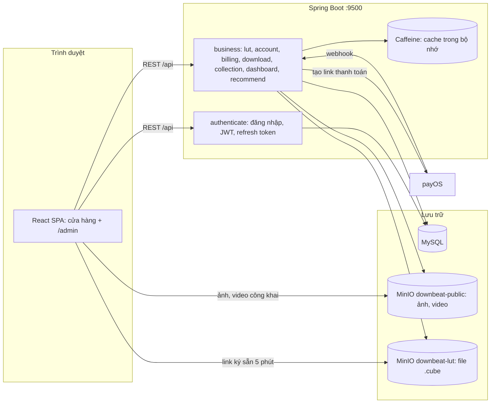
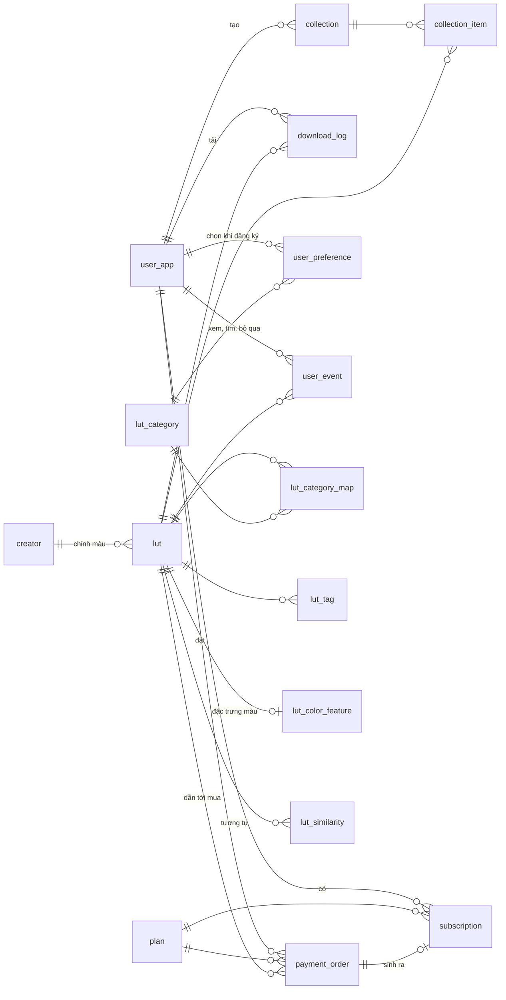
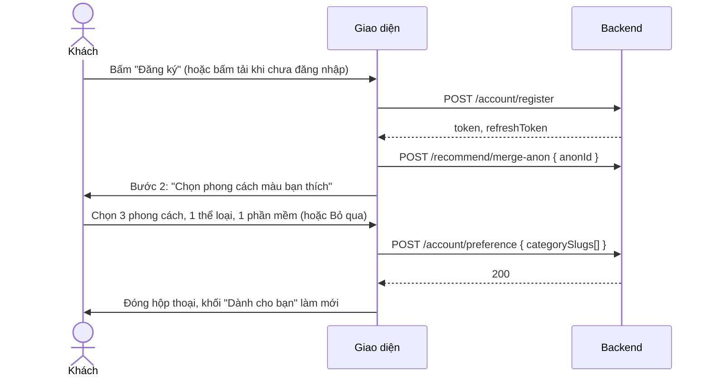
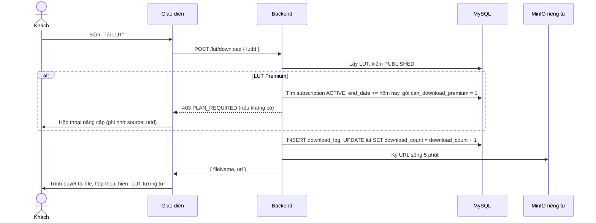
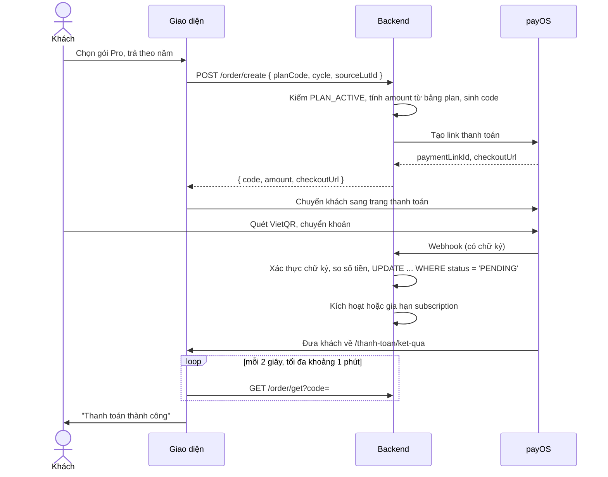
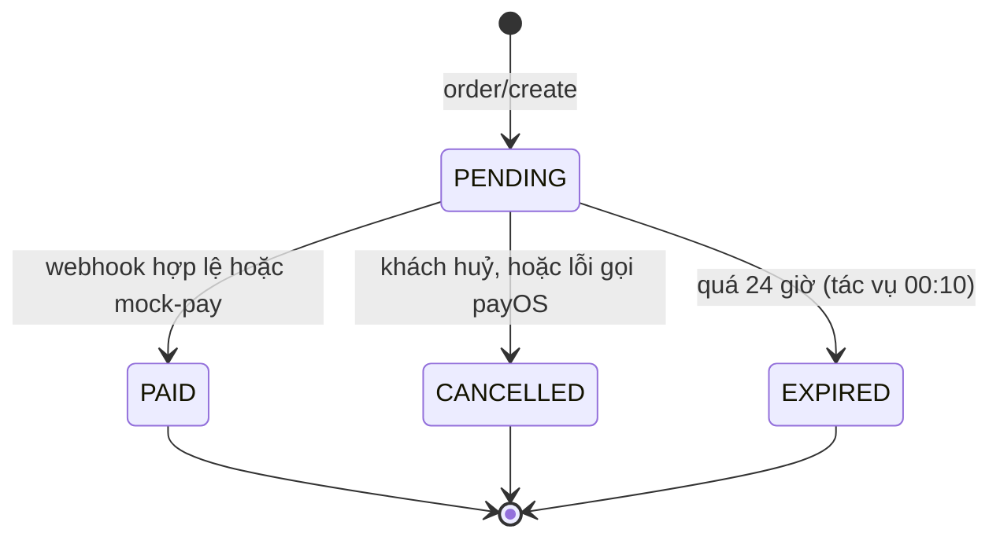
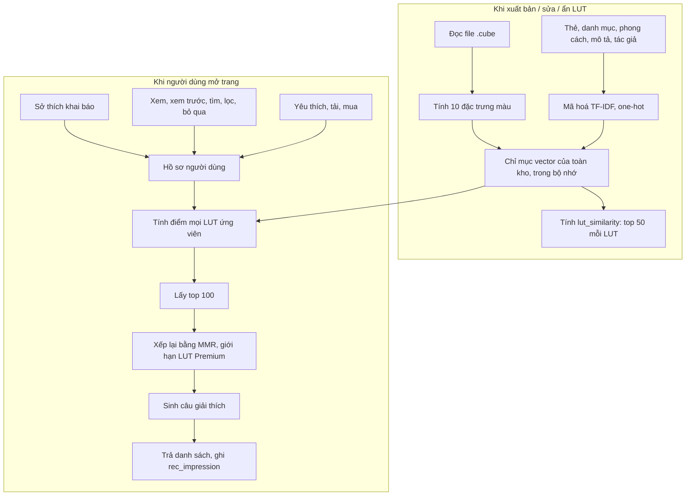
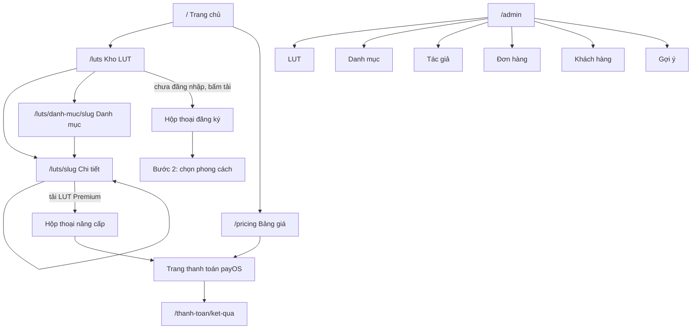

# TÀI LIỆU THIẾT KẾ HỆ THỐNG DOWNBEAT

Nền tảng kinh doanh LUT và plugin cho ngành sản xuất phim và hậu kỳ, sử dụng thuật toán lọc theo nội dung (Content-Based Filtering)

| Mục | Nội dung |
|---|---|
| Phiên bản | 1.0 |
| Ngày | 05/11/2026 |
| Trạng thái | Bản thiết kế, chưa cài đặt phần gợi ý |
| Nguồn sự thật | `plan/thiet-ke-tong-quat.md` (khi tài liệu này và plan khác nhau, plan đúng) |

## MỤC LỤC

1. Giới thiệu
2. Tổng quan bài toán và yêu cầu
3. Kiến trúc hệ thống
4. Thiết kế cơ sở dữ liệu
5. Thiết kế API
6. Thiết kế chức năng và luồng nghiệp vụ
7. Thiết kế thuật toán gợi ý theo nội dung
8. Đánh giá thuật toán gợi ý
9. Thiết kế giao diện
10. Mở rộng cho plugin
11. Kiểm thử
12. Kế hoạch triển khai và vấn đề còn mở

Phụ lục A. Định dạng file .cube
Phụ lục B. Bảng tham số của bộ gợi ý
Phụ lục C. Tài liệu tham khảo

---

## CHƯƠNG 1. GIỚI THIỆU

### 1.1 Mục đích tài liệu

Tài liệu mô tả thiết kế đầy đủ của DownBeat, một cửa hàng trực tuyến bán LUT màu (và về sau là plugin) cho người làm video, theo mô hình thuê bao. Tài liệu gom lại trong một chỗ những quyết định đã chốt về kiến trúc, cơ sở dữ liệu, API, luồng nghiệp vụ, giao diện, và trình bày chi tiết phần trọng tâm của đề tài: hệ gợi ý sản phẩm dùng thuật toán lọc theo nội dung, cùng phương pháp đánh giá thuật toán đó.

Tài liệu phục vụ ba việc:

- Làm căn cứ để lập plan cho từng lát chức năng (mỗi lát là một phần nhỏ gồm backend, frontend và kiểm thử).
- Làm khung cho chương thiết kế và chương thực nghiệm của báo cáo đồ án.
- Giúp người mới đọc hiểu hệ thống mà không cần đọc mã nguồn.

### 1.2 Phạm vi hệ thống

Trong phạm vi:

- Kho LUT: danh sách, lọc, tìm kiếm, danh mục, trang chi tiết, xem trước bằng ảnh trước / sau hoặc video.
- Tài khoản khách hàng: đăng ký bằng email, đăng nhập, hồ sơ, chọn phong cách màu yêu thích.
- Gói thuê bao Miễn phí, Pro, Studio; mua gói qua cổng payOS (chuyển khoản VietQR).
- Tải LUT có kiểm quyền: LUT Premium cần gói trả phí còn hạn, không giới hạn số lượt tải.
- Bộ sưu tập LUT yêu thích.
- Hệ gợi ý theo nội dung: khối "Dành cho bạn", "Có thể bạn cũng thích", xử lý người dùng mới (cold-start), bộ đánh giá offline.
- Trang quản trị: quản lý LUT, danh mục, tác giả, gói, đơn hàng, khách hàng, bảng số liệu, cấu hình và kết quả đánh giá gợi ý.

Ngoài phạm vi của bản này:

- Lọc cộng tác (collaborative filtering) và gợi ý lai. Có nhắc tới ở chương 12 như hướng phát triển.
- Đăng nhập bằng Google, Facebook; quên mật khẩu (đã gỡ cùng dịch vụ gửi mail).
- Tự trừ tiền định kỳ (payOS là chuyển khoản từng lần).
- Thành viên nhóm của gói Studio.
- Âm nhạc, hiệu ứng âm thanh, video stock (hiện ghi "Sắp ra mắt" trên giao diện).
- Plugin mới ở mức thiết kế (chương 10), chưa có lát cài đặt.

### 1.3 Đối tượng đọc

| Người đọc | Phần nên đọc |
|---|---|
| Giảng viên hướng dẫn, hội đồng | Chương 2, 7, 8 |
| Người lập trình backend | Chương 3, 4, 5, 6, 7 |
| Người lập trình frontend | Chương 5, 6, 9 |
| Người kiểm thử | Chương 5, 8, 11 |

### 1.4 Thuật ngữ và viết tắt

| Thuật ngữ | Giải thích |
|---|---|
| LUT (Look-Up Table) | Bảng tra màu: với mỗi màu đầu vào cho ra một màu đầu ra. LUT 3D chia khối màu RGB thành lưới N x N x N điểm, màu nằm giữa các điểm được nội suy |
| .cube | Định dạng file văn bản phổ biến nhất của LUT 3D, đọc được bởi Premiere Pro, DaVinci Resolve, Final Cut Pro, CapCut |
| Plugin | Phần mềm bổ trợ cài vào phần mềm dựng phim (hiệu ứng chuyển cảnh, giảm nhiễu, mô phỏng phim nhựa...) |
| Color grading | Chỉnh màu hậu kỳ, công việc mà LUT hỗ trợ |
| LUT Premium | LUT chỉ tải được khi có gói trả phí còn hạn |
| CBF (Content-Based Filtering) | Lọc theo nội dung: gợi ý sản phẩm giống với những gì người dùng đã thích, dựa trên đặc trưng của sản phẩm |
| CF (Collaborative Filtering) | Lọc cộng tác: gợi ý dựa trên hành vi của những người dùng tương tự |
| Hồ sơ sản phẩm (item profile) | Vector đặc trưng mô tả một sản phẩm |
| Hồ sơ người dùng (user profile) | Vector cùng không gian với hồ sơ sản phẩm, tóm tắt gu của một người |
| Cold-start | Tình trạng thiếu dữ liệu: người dùng mới chưa có hành vi, hoặc sản phẩm mới chưa có tương tác |
| TF-IDF | Cách đánh trọng số từ: từ xuất hiện nhiều ở một sản phẩm nhưng hiếm trong toàn kho thì có trọng số cao |
| CIELAB (Lab) | Không gian màu gần với cảm nhận của mắt: L là độ sáng, a là trục xanh lá - hồng, b là trục xanh dương - vàng |
| MMR (Maximal Marginal Relevance) | Cách xếp lại danh sách để cân bằng giữa mức phù hợp và mức đa dạng |
| Precision@K, Recall@K, NDCG@K | Các chỉ số đánh giá danh sách K gợi ý đầu tiên (chương 8) |
| Baseline | Thuật toán đơn giản dùng làm mốc so sánh |
| Presigned URL | Đường dẫn tải có chữ ký, hết hạn sau một thời gian ngắn |
| payOS, VietQR | Cổng thanh toán và chuẩn mã QR chuyển khoản ngân hàng ở Việt Nam |
| JWT | Chuỗi mã thông báo đăng nhập có chữ ký |
| Lát (slice) | Một phần chức năng trọn vẹn gồm backend, frontend, kiểm thử, làm trong một lượt |

### 1.5 Tài liệu liên quan

| Tài liệu | Nội dung |
|---|---|
| `plan/thiet-ke-tong-quat.md` | Thiết kế khung: bảng, API, lộ trình. Nguồn sự thật cho mọi lát |
| `plan/<slug>.md` | Plan chi tiết từng lát, kèm test case |
| `docs/chuc-nang/<slug>.md` | Tài liệu chức năng sau khi lát làm xong |
| `AGENTS.md`, `backend/AGENTS.md`, `frontend/AGENTS.md` | Quy tắc viết mã cho backend và frontend |

---

## CHƯƠNG 2. TỔNG QUAN BÀI TOÁN VÀ YÊU CẦU

### 2.1 Bối cảnh

Người làm video ở Việt Nam (vlogger, người quay cưới, freelancer làm quảng cáo, sinh viên ngành điện ảnh) ngày càng nhiều, và khâu chỉnh màu là khâu tốn công nhất của hậu kỳ. LUT giúp áp một "tông màu" có sẵn chỉ bằng một thao tác, sau đó người dùng tinh chỉnh thêm. Plugin mở rộng thêm các hiệu ứng mà phần mềm dựng không có sẵn.

Các kho LUT hiện có phần lớn là trang nước ngoài, giá theo đô la, mô tả bằng tiếng Anh, thanh toán bằng thẻ quốc tế. DownBeat nhắm tới người dùng trong nước: giao diện tiếng Việt, giá theo VND, thanh toán bằng chuyển khoản quét mã QR, kho LUT có những tông màu quen thuộc (Hoàng Hôn Sài Gòn, Đà Lạt Sương, Mùa Thu Hà Nội...).

Khi kho có vài trăm LUT, người dùng gặp hai khó khăn:

1. Không biết bắt đầu từ đâu. Tên LUT ít nói lên màu thật, và ảnh bìa chỉ cho thấy một khung hình.
2. Tìm được một LUT ưng ý rồi nhưng muốn thêm vài LUT "cùng gu" để làm một bộ màu thống nhất cho cả dự án.

Hệ gợi ý giải quyết cả hai: đưa những LUT hợp gu lên trước, và từ một LUT đang xem chỉ ra các LUT gần giống.

### 2.2 Mô hình kinh doanh

DownBeat bán theo thuê bao chứ không bán lẻ từng LUT:

| Gói | Giá theo tháng | Giá theo năm (quy ra tháng) | Quyền lợi chính |
|---|---|---|---|
| Miễn phí | 0 | 0 | Tải không giới hạn LUT thường, giấy phép video cá nhân, 3 bộ sưu tập |
| Pro | 99.000 | 79.000 | Thêm toàn bộ LUT Premium, dự án cho khách hàng, bộ sưu tập không giới hạn |
| Studio | 249.000 | 199.000 | Mọi quyền lợi của Pro, quảng cáo trả phí, truyền hình, 5 thành viên (chưa làm) |

Hệ quả cho hệ gợi ý: không có hành vi "mua một LUT". Hành vi gần nhất với "mua" là tải về (người dùng đã lấy sản phẩm), và LUT Premium khiến người dùng bấm nâng cấp rồi trả tiền (tín hiệu mạnh nhất). Chương 7 dùng đúng hai tín hiệu này cho phần "mua" trong hồ sơ người dùng.

### 2.3 Vai trò của hệ gợi ý và lý do chọn lọc theo nội dung

Có ba họ thuật toán gợi ý thường gặp:

| Họ | Ý tưởng | Điểm mạnh | Điểm yếu với DownBeat |
|---|---|---|---|
| Theo độ phổ biến | Gợi ý cái nhiều người tải nhất | Đơn giản, không cần hồ sơ | Ai cũng nhận cùng một danh sách, LUT mới không bao giờ lên |
| Lọc cộng tác | Người giống bạn đã thích gì | Phát hiện được gu "khó mô tả" | Cần nhiều tương tác; cửa hàng mới gần như không có. LUT mới không được gợi ý tới khi có người tải |
| Lọc theo nội dung | Sản phẩm giống với cái bạn đã thích | Chạy được ngay từ ngày đầu, LUT mới được gợi ý ngay, giải thích được | Dễ gợi ý quá giống nhau, phụ thuộc chất lượng đặc trưng |

Đề tài chọn lọc theo nội dung vì bốn lý do:

1. Dữ liệu tương tác ban đầu rất ít, lọc cộng tác không học được gì.
2. LUT có đặc trưng nội dung giàu và đo được bằng số. Ngoài phong cách, danh mục, thẻ, mô tả, chính file .cube cho biết LUT làm ảnh ấm lên hay lạnh đi, tăng hay giảm bão hoà, vùng tối ngả màu gì. Đây là điểm khác biệt so với nhiều hệ gợi ý thương mại điện tử chỉ dựa vào thẻ và mô tả.
3. Kho LUT ra thêm sản phẩm mới hằng tuần; lọc theo nội dung gợi ý được LUT mới ngay khi xuất bản.
4. Gợi ý giải thích được ("Cùng tông ấm với Hoàng Hôn Sài Gòn bạn đã tải"), giúp người dùng tin vào gợi ý và giúp nhóm làm đồ án kiểm tra bằng mắt.

Hai điểm yếu của lọc theo nội dung được xử lý trong thiết kế: gợi ý quá giống nhau thì dùng MMR để xếp lại (mục 7.6), chất lượng đặc trưng thì bắt buộc mỗi LUT có tối thiểu 3 thẻ và 1 danh mục khi xuất bản, còn đặc trưng màu tính tự động từ file nên không phụ thuộc người nhập.

### 2.4 Tác nhân

| Tác nhân | Là ai trong hệ thống | Làm được |
|---|---|---|
| Khách vãng lai | Chưa đăng nhập, nhận diện bằng mã trình duyệt `anon_id` | Xem kho, chi tiết, xem trước, bảng giá; nhận gợi ý theo phiên |
| Thành viên Miễn phí | `user_app` có role Khách hàng, không có gói trả phí còn hạn | Thêm: tải LUT thường, bộ sưu tập, chọn phong cách yêu thích, gợi ý cá nhân |
| Thành viên trả phí | Như trên và có `subscription` ACTIVE gói `pro` hoặc `studio` | Thêm: tải LUT Premium |
| Quản trị | `user_app` có role quản trị | Trang `/admin`: quản lý dữ liệu, đơn, số liệu, cấu hình gợi ý |
| payOS | Hệ thống ngoài | Gọi webhook báo kết quả thanh toán |

Khách hàng và quản trị dùng chung bảng `user_app` và cùng luồng đăng nhập, phân biệt bằng role. Endpoint dành cho khách chỉ cần đăng nhập; endpoint quản trị kiểm thêm quyền theo resource, khách gọi vào bị từ chối (403).

### 2.5 Yêu cầu chức năng

| Mã | Yêu cầu | Tác nhân |
|---|---|---|
| FR-01 | Xem danh sách LUT đã xuất bản, lọc theo từ khoá, phong cách, danh mục; sắp xếp theo phù hợp, mới nhất, phổ biến | Mọi người |
| FR-02 | Xem chi tiết LUT: xem trước trước / sau hoặc video, thông tin file, danh mục, LUT liên quan | Mọi người |
| FR-03 | Gợi ý tìm kiếm ở ô tìm kiếm đầu trang | Mọi người |
| FR-04 | Đăng ký bằng email, đăng nhập, đăng xuất | Khách |
| FR-05 | Chọn phong cách màu, thể loại quay và phần mềm yêu thích khi đăng ký; sửa lại sau | Thành viên |
| FR-06 | Tải LUT thường; tải LUT Premium khi có gói trả phí | Thành viên |
| FR-07 | Mua và gia hạn gói qua payOS; xem lịch sử đơn; tắt tự gia hạn | Thành viên |
| FR-08 | Tạo bộ sưu tập, thêm / bớt LUT | Thành viên |
| FR-09 | Nhận danh sách "Dành cho bạn" có câu giải thích | Mọi người (vãng lai theo phiên) |
| FR-10 | Nhận "Có thể bạn cũng thích" theo độ tương đồng nội dung | Mọi người |
| FR-11 | Bấm "Không quan tâm" để ẩn một gợi ý | Thành viên |
| FR-12 | Xoá lịch sử dùng cho gợi ý | Thành viên |
| FR-13 | Quản lý LUT: thêm, sửa, upload .cube và ảnh / video, chọn kiểu xem trước, xuất bản, ẩn | Quản trị |
| FR-14 | Quản lý danh mục, tác giả, gói, xem đơn và khách hàng | Quản trị |
| FR-15 | Bảng số liệu: doanh thu, đơn, khách mới, gói đang dùng, top LUT | Quản trị |
| FR-16 | Xem cấu hình gợi ý, kết quả các lần đánh giá, CTR; tính lại chỉ mục | Quản trị |

### 2.6 Yêu cầu phi chức năng

| Mã | Yêu cầu |
|---|---|
| NFR-01 | Giao diện, thông báo lỗi, tài liệu bằng tiếng Việt |
| NFR-02 | API danh sách và gợi ý trả về dưới 200 ms (p95) với kho 1000 LUT trên máy cá nhân |
| NFR-03 | File .cube nằm trong kho lưu trữ riêng tư, chỉ lấy được qua link ký sẵn sống 5 phút sau khi kiểm quyền |
| NFR-04 | Khoá payOS chỉ nằm ở backend; số tiền đơn hàng do backend tính, không nhận từ trình duyệt |
| NFR-05 | Webhook thanh toán xử lý được khi bị gửi lặp, không kích hoạt gói hai lần |
| NFR-06 | Ghi sự kiện cho gợi ý không làm chậm trang (gửi không chờ kết quả) |
| NFR-07 | Dữ liệu hành vi giữ tối đa 180 ngày; người dùng xoá được lịch sử của mình |
| NFR-08 | Kết quả đánh giá thuật toán tái lập được (hạt giống ngẫu nhiên cố định, cấu hình lưu kèm kết quả) |
| NFR-09 | Hạ tầng tối thiểu: chỉ MySQL và MinIO, chạy một instance backend |
| NFR-10 | Giao diện dùng được trên điện thoại từ chiều rộng 360 px, có giao diện sáng và tối |

---

## CHƯƠNG 3. KIẾN TRÚC HỆ THỐNG

### 3.1 Kiến trúc tổng thể

Hệ thống theo mô hình ba lớp: ứng dụng web chạy trên trình duyệt, máy chủ API, và lớp lưu trữ.



Một số quyết định kiến trúc:

- Một cửa hàng duy nhất, không có khái niệm chi nhánh. Phân quyền quản trị bằng role, permission, resource.
- Hạ tầng chỉ còn MySQL và MinIO. Redis và dịch vụ gửi mail đã gỡ: refresh token lưu trong MySQL, bộ đếm đăng nhập sai và cache dùng Caffeine trong bộ nhớ. Đổi lại, backend chạy một instance; chấp nhận được với quy mô đồ án.
- Hệ gợi ý chạy ngay trong backend (module `business.recommend`), không tách dịch vụ riêng. Với vài nghìn LUT, toàn bộ vector đặc trưng vừa trong bộ nhớ và tính điểm hết kho mất vài mili giây, nên không cần máy chủ tìm kiếm vector hay hàng đợi.
- Ghi dữ liệu đồng bộ, đơn giản. Chống ghi trùng bằng ràng buộc của cơ sở dữ liệu và câu cập nhật có điều kiện, không dùng hàng đợi tin nhắn.

### 3.2 Công nghệ

| Lớp | Công nghệ | Ghi chú |
|---|---|---|
| Giao diện | React 19, Vite, TanStack Router, TanStack Query, Tailwind | Route theo file, dữ liệu qua `lib/tanstack/options` |
| Kiểm thử giao diện | Playwright | Có nhóm kiểm thử API và kiểm thử có giao diện |
| Máy chủ | Spring Boot 3.2, Java 21 | Nhiều module Maven |
| Truy cập dữ liệu | jOOQ | Sinh mã từ schema, viết SQL có kiểu |
| Cơ sở dữ liệu | MySQL 8 | Migration bằng Flyway, FULLTEXT ngram cho tiếng Việt |
| Lưu file | MinIO (tương thích S3) | Một bucket công khai, một bucket riêng tư |
| Cache | Caffeine | Trong bộ nhớ của backend |
| Thanh toán | payOS | Link thanh toán VietQR, webhook có chữ ký |

### 3.3 Cấu trúc backend

| Module | Vai trò |
|---|---|
| `app` | Điểm chạy, cấu hình, migration Flyway (`db/migration`), dữ liệu mẫu |
| `base` | Thành phần dùng chung: `ApiResponse`, xử lý lỗi, tiện ích |
| `entity` | Lớp sinh từ schema bằng jOOQ, POJO |
| `authenticate` | Đăng nhập, JWT, refresh token, role, permission, resource |
| `business` | Toàn bộ nghiệp vụ cửa hàng, chia gói con theo miền |

Các gói con trong `business`:

| Gói | Trách nhiệm |
|---|---|
| `lut` | Kho LUT, danh mục, tác giả, upload, xuất bản, trích đặc trưng màu khi upload |
| `account` | Đăng ký, hồ sơ, sở thích |
| `billing` | Gói, đơn hàng, subscription, payOS, tác vụ hằng ngày |
| `download` | Kiểm quyền và cấp link tải |
| `collection` | Bộ sưu tập |
| `dashboard` | Số liệu tổng hợp cho quản trị |
| `recommend` | Chỉ mục vector, hồ sơ người dùng, xếp hạng, ghi sự kiện, đánh giá |

Quy ước viết mã (theo `backend/AGENTS.md`): không dùng DTO riêng, thân request và response là POJO của bảng, cột lấy thêm qua JOIN được thêm vào POJO; kiểm định dạng dữ liệu ở giao diện, backend chỉ giữ quy tắc cần tra cơ sở dữ liệu. Endpoint quản trị theo khuôn `/<x>/list`, `get`, `update`, `delete/{id}`.

### 3.4 Cấu trúc frontend

| Route | Nội dung |
|---|---|
| `/` | Trang chủ cửa hàng (landing page) |
| `/luts` | Kho LUT: hero, khối "Dành cho bạn", thanh lọc, lưới LUT, danh mục, câu hỏi thường gặp |
| `/luts/$slug` | Chi tiết LUT, xem trước, nút tải, "Có thể bạn cũng thích" |
| `/luts/danh-muc/$category` | Trang danh mục |
| `/pricing` | Bảng giá, so sánh gói |
| `/thanh-toan/ket-qua` | Kết quả thanh toán (hỏi trạng thái đơn) |
| `/login`, `/logout` | Đăng nhập trang quản trị |
| `/admin/**` | Trang quản trị |

Dữ liệu hiện lấy từ hàm giả trong `frontend/src/lib/mock/**`. Mỗi hàm giả có cùng chữ ký với hàm gọi API sau này; khi backend xong chỉ cần tạo `lib/axios/<x>.ts` và đổi import, component không phải sửa.

### 3.5 Lưu trữ tệp

| Bucket | Quyền đọc | Nội dung | Cách truy cập |
|---|---|---|---|
| `downbeat-public` | Công khai | Ảnh bìa, ảnh trước / sau, video xem trước, ảnh tác giả | URL lưu thẳng trong bảng |
| `downbeat-lut` | Riêng tư | File .cube | Chỉ qua link ký sẵn sống 5 phút do API tải cấp |

Upload ở trang quản trị nhận `.cube`, ảnh (jpg, png, webp) và video (mp4, webm tối đa 50 MB); không nhận svg, html để tránh chèn mã. Khi upload `.cube`, backend đọc file ngay để kiểm tra hợp lệ và tính đặc trưng màu (mục 7.2.4); file lỗi bị từ chối với mã `LUT_FILE_INVALID`.

### 3.6 Bảo mật và phân quyền

- Đăng nhập trả access token (JWT, sống ngắn) và refresh token (32 byte ngẫu nhiên, bảng chỉ lưu SHA-256, sống 30 ngày, dùng một lần).
- Sai mật khẩu 10 lần trong 15 phút thì tạm khoá đăng nhập (trả 429).
- Role `Khách hàng` là role mặc định khi đăng ký, không có permission nào. Role quản trị được cấp permission trên từng resource qua migration: `LUT`, `LUT_CATEGORY`, `CREATOR`, `PLAN`, `ORDER`, `CUSTOMER`, `DASHBOARD`, `RECOMMEND`.
- Endpoint công khai (có `/public/` trong đường dẫn, và webhook payOS) được mở trong cấu hình bảo mật. Endpoint gợi ý công khai đọc thông tin đăng nhập nếu có token, không có thì dùng `anon_id`.
- Webhook payOS xác thực chữ ký bằng khoá checksum trước khi đổi bất kỳ dữ liệu nào.
- `anon_id` là UUID ngẫu nhiên sinh ở trình duyệt, không gắn với danh tính; chỉ dùng để gom sự kiện của một trình duyệt.

### 3.7 Môi trường chạy

| Thành phần | Local |
|---|---|
| MySQL, MinIO | `docker compose -f docker-compose.local.yml --env-file backend/.env up -d` |
| Backend | cổng 9500, khởi động lại bằng `sh scripts/ai/backend-restart.sh` |
| Frontend | Vite dev server |
| payOS | Khoá thử nghiệm, hoặc endpoint `mock-pay` chỉ có ở profile local |
| Dữ liệu đánh giá gợi ý | Schema riêng `downbeat_eval`, không lẫn với dữ liệu cửa hàng |

---

## CHƯƠNG 4. THIẾT KẾ CƠ SỞ DỮ LIỆU

### 4.1 Nguyên tắc chung

- Tiền tệ là VND, lưu kiểu `bigint` vì không có phần lẻ.
- Thời điểm dùng `datetime`, ngày dùng `date`.
- Trạng thái lưu `varchar` kèm hằng số trong mã (ví dụ `PUBLISHED`), dễ đọc khi tra trực tiếp trong cơ sở dữ liệu.
- Xoá mềm cho dữ liệu cần giữ lịch sử (tác giả, danh mục: cột `status`), xoá cứng kèm CASCADE cho bảng nối.
- Chống trùng bằng ràng buộc UNIQUE và câu cập nhật có điều kiện, không đọc rồi ghi.
- Migration Flyway đánh số tiếp theo `V1__auth_schema.sql`, `V2__refresh_token.sql`, nên bảng mới bắt đầu từ `V3`.

### 4.2 Sơ đồ quan hệ



Các bảng chia thành năm nhóm: xác thực (có sẵn), kho LUT, gói và thanh toán, tải và bộ sưu tập, gợi ý.

### 4.3 Nhóm xác thực (có sẵn)

| Bảng | Vai trò |
|---|---|
| `module` | Nhóm chức năng của trang quản trị |
| `resource` | Một nhóm trang / API, có `uri` khớp hằng `URI` của controller |
| `role` | Vai trò. Thêm role `Khách hàng` với `is_default = 1`; role `Không quyền` của dữ liệu mẫu đổi `is_default = 0` |
| `permission` | Quyền của một role trên một resource |
| `user_app` | Người dùng, cả khách hàng và quản trị |
| `refresh_token` | Hash SHA-256 của refresh token, hạn 30 ngày |

### 4.4 Nhóm kho LUT

Bảng `creator` (tác giả, người chỉnh màu):

| Cột | Kiểu | Ràng buộc, ghi chú |
|---|---|---|
| id | int PK tự tăng | |
| name | varchar(100) | NOT NULL |
| slug | varchar(120) | UNIQUE |
| bio | varchar(500) | |
| avatar_url | varchar(500) | |
| status | tinyint | 1 hiện, 0 ẩn |
| created_time, updated_time | datetime | |

Bảng `lut`:

| Cột | Kiểu | Ràng buộc, ghi chú |
|---|---|---|
| id | int PK tự tăng | |
| slug | varchar(150) | UNIQUE, sinh từ title bỏ dấu, trùng thì thêm `-2`, `-3` |
| title | varchar(150) | NOT NULL |
| description | varchar(1000) | |
| creator_id | int FK -> creator | NOT NULL |
| style | varchar(30) | Một trong 8 phong cách: `dien-anh`, `co-dien`, `phim-nhua`, `den-trang`, `teal-orange`, `am-ap`, `lanh`, `du-lich` |
| is_premium | tinyint | 1 là LUT Premium |
| status | varchar(20) | `DRAFT`, `PUBLISHED`, `HIDDEN`. Kho chỉ hiện `PUBLISHED` |
| cover_url | varchar(500) | Ảnh bìa |
| preview_type | varchar(20) | `BEFORE_AFTER` (mặc định) hoặc `VIDEO` |
| before_url, after_url | varchar(500) | Bắt buộc khi xuất bản nếu `preview_type = BEFORE_AFTER` |
| preview_video_url | varchar(500) | Bắt buộc khi xuất bản nếu `preview_type = VIDEO` |
| file_key | varchar(300) | Key file .cube trong bucket riêng tư, không trả ra API công khai |
| file_size_kb | int | |
| lut_size | smallint | 17, 33 hoặc 65 |
| download_count | int | Mặc định 0, tăng khi tải |
| published_time | datetime | Sắp xếp "Mới nhất" |
| created_by | int FK -> user_app | |
| created_time, updated_time | datetime | |

Index: `(status, published_time)`, `(status, download_count)`, `(creator_id)`, `(style)`. Tìm kiếm dùng `FULLTEXT(title, description) WITH PARSER ngram` cho tiếng Việt, kết hợp `LIKE` trên tên tác giả và thẻ.

Bảng `lut_category` (danh mục):

| Cột | Kiểu | Ghi chú |
|---|---|---|
| id | int PK tự tăng | |
| slug | varchar(80) | UNIQUE |
| name | varchar(80) | NOT NULL |
| group_code | varchar(20) | `phong-cach`, `tong-mau`, `dip`, `phan-mem` |
| description | varchar(300) | Mô tả đầu trang danh mục |
| is_popular | tinyint | Hiện ở "Danh mục phổ biến" |
| sort_order | int | |
| status | tinyint | 1 hoặc 0 |

Dữ liệu mẫu có 16 danh mục: nhóm phong cách (Điện ảnh, Cổ điển, Phim nhựa, Đen trắng), nhóm tông màu (Ấm áp, Lạnh, Teal & Orange, Rực rỡ), nhóm dịp (Du lịch, Đám cưới, Chân dung, Ban đêm), nhóm phần mềm (Premiere Pro, DaVinci Resolve, Final Cut Pro, CapCut).

Bảng `lut_category_map`: `lut_id`, `category_id`, khoá chính `(lut_id, category_id)`, xoá LUT thì xoá theo.

Bảng `lut_tag`: `lut_id`, `tag` varchar(50), khoá chính `(lut_id, tag)`, index `(tag)`. Thẻ là từ khoá tự do (grain, hoàng hôn, neon), lưu chữ thường, bỏ khoảng trắng thừa.

### 4.5 Nhóm gói và thanh toán

Bảng `plan`: tạo sẵn bằng migration, quản trị chỉ sửa giá và mô tả.

| Cột | Kiểu | Ghi chú |
|---|---|---|
| id | int PK | |
| code | varchar(20) | UNIQUE: `free`, `pro`, `studio` |
| name, audience | varchar | |
| monthly_price | bigint | Giá trả theo tháng |
| yearly_monthly_price | bigint | Giá mỗi tháng khi trả theo năm, thu 12 lần giá này |
| can_download_premium | tinyint | free 0, pro và studio 1 |
| max_members | int | 1, 1, 5 |
| license, features | json | Mảng chuỗi hiển thị trên bảng giá |
| is_highlight, sort_order, active | | |

Bảng `payment_order`:

| Cột | Kiểu | Ghi chú |
|---|---|---|
| id | int PK | |
| code | varchar(20) | UNIQUE, dạng `DB` + yyMMdd + 4 số, ví dụ `DB2611050001` |
| payos_order_code | bigint | UNIQUE, mã số gửi sang payOS |
| user_id, plan_id | int FK | |
| cycle | varchar(10) | `MONTH` hoặc `YEAR` |
| amount | bigint | Backend tính từ bảng `plan` |
| status | varchar(20) | `PENDING`, `PAID`, `CANCELLED`, `EXPIRED` |
| payos_payment_link_id, checkout_url | varchar | Do payOS trả về |
| payos_reference | varchar(100) | Mã giao dịch ngân hàng |
| webhook_payload | json | Bản webhook đã xác thực gần nhất |
| source_lut_id | int FK -> lut, NULL | LUT Premium khiến khách mở hộp thoại nâng cấp. Là tín hiệu "mua" cho hồ sơ gợi ý |
| paid_time, created_time | datetime | |

Bảng `subscription`:

| Cột | Kiểu | Ghi chú |
|---|---|---|
| id | int PK | |
| user_id, plan_id, order_id | int FK | |
| cycle | varchar(10) | |
| status | varchar(20) | `ACTIVE`, `EXPIRED`, `CANCELLED` |
| start_date, end_date | date | end = start + 1 tháng hoặc 12 tháng |
| auto_renew | tinyint | Tắt khi khách bấm "Huỷ gói", vẫn dùng tới end_date |
| active_user_id | int, cột sinh | `IF(status = 'ACTIVE', user_id, NULL)`, UNIQUE: mỗi khách tối đa một gói ACTIVE |

Không có dòng ACTIVE nghĩa là đang ở gói Miễn phí.

### 4.6 Nhóm tải và bộ sưu tập

| Bảng | Cột | Ghi chú |
|---|---|---|
| `download_log` | id, user_id, lut_id, plan_code, ip, created_time | Index `(user_id, created_time)`, `(lut_id, created_time)`. Dùng thống kê và làm tín hiệu "tải" cho gợi ý, không dùng để chặn |
| `collection` | id, user_id, name, created_time, updated_time | UNIQUE `(user_id, name)` |
| `collection_item` | collection_id, lut_id, created_time | Khoá chính `(collection_id, lut_id)`. Là tín hiệu "yêu thích" cho gợi ý |

### 4.7 Nhóm gợi ý

Bảng `lut_color_feature`: đặc trưng màu tính từ file .cube khi upload (mục 7.2.4). Bản đã làm (lát `dac-trung-mau`) có thêm cột `id` tự tăng, `lut_id` là UNIQUE (vì `AbsMysqlRepository` bắt buộc cột `id`), và dùng kiểu `DOUBLE` thay `float`.

| Cột | Kiểu | Ý nghĩa |
|---|---|---|
| lut_id | int PK, FK -> lut | |
| brightness | float | Thay đổi độ sáng trung bình |
| contrast | float | Tỉ lệ độ lệch chuẩn độ sáng sau / trước |
| saturation | float | Tỉ lệ độ bão hoà sau / trước |
| warmth | float | Dịch trên trục b: dương là ấm, âm là lạnh |
| tint | float | Dịch trên trục a: dương ngả hồng, âm ngả xanh lá |
| shadow_a, shadow_b | float | Dịch màu ở vùng tối |
| highlight_a, highlight_b | float | Dịch màu ở vùng sáng |
| is_mono | tinyint | 1 nếu là LUT đen trắng |
| computed_time | datetime | |

Bảng `user_preference`: sở thích người dùng khai báo (cold-start).

| Cột | Kiểu | Ghi chú |
|---|---|---|
| user_id | int FK -> user_app | |
| category_id | int FK -> lut_category | Thuộc nhóm phong cách, tông màu, dịp hoặc phần mềm |
| created_time | datetime | |

Khoá chính `(user_id, category_id)`. Vì cả 8 phong cách đều có danh mục cùng slug, một lựa chọn "Phim nhựa" vừa là danh mục vừa là phong cách. Mỗi lần lưu thay toàn bộ lựa chọn cũ.

Bảng `user_event`: các hành vi chưa có bảng riêng.

| Cột | Kiểu | Ghi chú |
|---|---|---|
| id | bigint PK | |
| user_id | int FK, NULL | NULL với khách vãng lai |
| anon_id | char(36), NULL | Mã trình duyệt. Phải có ít nhất một trong hai cột |
| event_type | varchar(20) | `VIEW`, `PREVIEW`, `SEARCH`, `FILTER_STYLE`, `DISMISS` |
| lut_id | int FK, NULL | NULL với `SEARCH`, `FILTER_STYLE` |
| value | varchar(100) | Từ khoá đã chuẩn hoá, hoặc slug phong cách |
| impression_id | bigint, NULL | Bấm từ danh sách gợi ý nào |
| created_time | datetime | |

Index `(user_id, created_time)`, `(anon_id, created_time)`, `(lut_id, event_type)`. Tải, yêu thích, mua không ghi ở đây mà đọc từ bảng gốc (`download_log`, `collection_item`, `payment_order`), để một sự thật chỉ nằm một chỗ. Một tác vụ hằng ngày xoá dòng cũ hơn 180 ngày.

Bảng `lut_similarity`: top 50 LUT gần nhất của mỗi LUT.

| Cột | Kiểu | Ghi chú |
|---|---|---|
| lut_id | int FK | |
| similar_lut_id | int FK | |
| score | float | `sim(i, j)` ở mục 7.3 |

Khoá chính `(lut_id, similar_lut_id)`, index `(lut_id, score)`.

Bảng `rec_impression`: mỗi lần API trả một danh sách gợi ý.

| Cột | Kiểu | Ghi chú |
|---|---|---|
| id | bigint PK | |
| user_id, anon_id | | Ai nhận |
| placement | varchar(20) | `FOR_YOU` hoặc `RELATED` |
| variant | varchar(20) | Tên thuật toán, phục vụ so sánh trực tuyến |
| lut_ids | json | Danh sách đã hiện, theo thứ tự |
| created_time | datetime | |

Bảng `rec_eval_run`: kết quả mỗi lần chạy đánh giá offline.

| Cột | Kiểu | Ghi chú |
|---|---|---|
| id | int PK | |
| dataset | varchar(30) | `D1-sim`, `D2-real` |
| algorithm | varchar(30) | `random`, `popular`, `cbf-tag`, `cbf-full`, các biến thể |
| params | json | Trọng số, tham số, hạt giống ngẫu nhiên |
| metrics | json | Giá trị các chỉ số theo K |
| user_count | int | Số người dùng được tính |
| created_time | datetime | |

### 4.8 Danh sách migration dự kiến

| Migration | Lát | Nội dung |
|---|---|---|
| V3 | kho-lut | creator, lut, lut_category, lut_category_map, lut_tag |
| V4 | quan-ly-lut | (thực tế V4 dùng cho phân quyền; resource LUT nằm ở V6, lát `quan-ly-lut` không có migration) |
| V5 | tai-khoan-khach | role Khách hàng, đổi `is_default` |
| V6 | dac-trung-mau | lut_color_feature, module Kho LUT (CATALOG), resource LUT (đã làm) |
| V7 | goi-thanh-toan | plan (kèm dữ liệu 3 gói), payment_order, subscription, resource PLAN, ORDER, CUSTOMER |
| V8 | tai-lut | download_log |
| V9 | dashboard-admin | resource DASHBOARD |
| V10 | bo-suu-tap | collection, collection_item |
| V11 | goi-y-lut | user_preference, user_event, lut_similarity, rec_impression, cột payment_order.source_lut_id, resource RECOMMEND |
| V12 | danh-gia-goi-y | rec_eval_run |

Số thứ tự thực tế theo thứ tự làm các lát; bảng trên chỉ để thấy bảng nào thuộc lát nào.

---

## CHƯƠNG 5. THIẾT KẾ API

### 5.1 Quy ước

- Mọi endpoint nằm dưới `/api`.
- Response bọc chung `{ code, message, result }`. Lỗi nghiệp vụ có thêm `errorCode`, giao diện rẽ nhánh theo mã này nên mã phải đúng như bảng 5.7.
- Danh sách trả `{ total, page, items }`.
- Endpoint công khai có `/public/` trong đường dẫn.
- Thân request và response là POJO của bảng, không có lớp DTO riêng.

### 5.2 API công khai

| Phương thức, đường dẫn | Dùng ở | Ghi chú |
|---|---|---|
| `POST /lut/public/list` | Lưới `/luts`, trang danh mục | Thân `{ q, keywords[], styles[], category, sort, page, limit }`, sort là `relevance`, `newest` hoặc `popular`. Chỉ LUT `PUBLISHED`, không trả `fileKey` |
| `GET /lut/public/get?slug=` | Trang chi tiết | 404 `DATA_NOT_FOUND` nếu không có hoặc chưa xuất bản |
| `GET /lut/public/related?slug=&page=&limit=` | "Có thể bạn cũng thích" | Lát đầu dùng luật (cùng phong cách, cùng danh mục, phổ biến). Lát gợi ý đổi sang độ tương đồng nội dung, giữ nguyên hợp đồng |
| `GET /lut/public/suggest?q=&limit=4` | Bảng gợi ý ô tìm kiếm | q rỗng trả LUT nhiều lượt tải |
| `GET /lut-category/public/list` | Khối danh mục, footer, bước chọn phong cách | Cache trong bộ nhớ |
| `GET /lut-category/public/get?slug=` | Đầu trang danh mục | |
| `GET /plan/public/list` | Bảng giá, hộp thoại nâng cấp | Cache trong bộ nhớ |

### 5.3 API tài khoản

| Phương thức, đường dẫn | Ghi chú |
|---|---|
| `POST /account/register` | Thân `{ name, email, plainPassword }` (cùng kiểu thân với `/user/authenticate`). Tạo người dùng role Khách hàng, trả token như đăng nhập |
| `POST /user/authenticate`, `/auth/refresh`, `/auth/logout` | Có sẵn, dùng chung với quản trị |
| `GET /account/me` | `{ id, name, email, plan, planExpiresAt }`, plan lấy từ subscription ACTIVE, không có thì `free` |
| `GET /account/preference` | `{ categorySlugs[] }` |
| `POST /account/preference` | Thân `{ categorySlugs[] }`, thay toàn bộ. Slug phải tồn tại, tối đa 12 mục |

### 5.4 API tải, mua gói, bộ sưu tập (cần đăng nhập)

| Phương thức, đường dẫn | Ghi chú |
|---|---|
| `POST /lut/download` | Thân `{ lutId }`, trả `{ fileName, url }` với url ký sẵn 5 phút |
| `POST /order/create` | Thân `{ planCode, cycle, sourceLutId }` (sourceLutId không bắt buộc). Trả `{ code, amount, checkoutUrl }` |
| `GET /order/get?code=` | Trạng thái đơn của chính khách |
| `POST /order/cancel/{code}` | Huỷ đơn còn `PENDING` |
| `POST /payment/payos/webhook` | Công khai, payOS gọi, xác thực chữ ký |
| `POST /order/mock-pay/{code}` | Chỉ có ở profile local |
| `GET /order/my-list` | Lịch sử mua gói |
| `POST /subscription/cancel` | Tắt tự gia hạn |
| `GET /collection/my-list`, `POST /collection/update`, `POST /collection/delete/{id}`, `POST /collection/item/add`, `POST /collection/item/remove` | Bộ sưu tập |

### 5.5 API gợi ý

| Phương thức, đường dẫn | Đăng nhập | Ghi chú |
|---|---|---|
| `POST /recommend/public/for-you` | Không bắt buộc | Thân `{ anonId, limit }` |
| `POST /recommend/public/event` | Không bắt buộc | Thân `{ anonId, type, lutId, value, impressionId }` |
| `POST /recommend/dismiss` | Có | Thân `{ lutId }` |
| `POST /recommend/merge-anon` | Có | Thân `{ anonId }` |
| `POST /recommend/clear-history` | Có | Xoá `user_event` của chính khách |

Ví dụ response của `for-you`:

```json
{
  "code": 200,
  "message": "OK",
  "result": {
    "impressionId": 1532,
    "strategy": "PROFILE",
    "items": [
      {
        "id": 17, "slug": "mua-thu-ha-noi", "title": "Mùa Thu Hà Nội",
        "creatorName": "Minh Color", "style": "am-ap", "isPremium": 0,
        "coverUrl": "https://.../mua-thu.webp",
        "reason": "Cùng phong cách Ấm áp với Hoàng Hôn Sài Gòn bạn đã tải"
      }
    ]
  }
}
```

`strategy` cho giao diện biết đang ở mức nào: `PROFILE` (đủ hành vi), `PREFERENCE` (chỉ có sở thích khai báo), `POPULAR` (chưa có gì). Giao diện đổi tiêu đề khối theo giá trị này ("Dành cho bạn" hoặc "Phổ biến tuần này").

Quy tắc của `event`:

- `type` thuộc `VIEW`, `PREVIEW`, `SEARCH`, `FILTER_STYLE`. Các loại khác bị bỏ qua.
- Luôn trả 200 kể cả khi bỏ qua, để giao diện không phải xử lý lỗi.
- Cùng người (hoặc cùng anon_id), cùng LUT, cùng loại trong 30 phút chỉ ghi một dòng, tránh một lần xem bị đếm nhiều lần do tải lại trang.
- `SEARCH`: backend chuẩn hoá từ khoá (chữ thường, gộp khoảng trắng, cắt 100 ký tự) trước khi lưu.

### 5.6 API quản trị

| Nhóm | Endpoint |
|---|---|
| lut | `list`, `get`, `update`, `delete/{id}`, `upload` (multipart), `publish/{id}`, `hide/{id}`, `creators` (8 endpoint) |
| lut-category, creator | `list`, `get`, `update`, `delete/{id}` |
| plan | `list`, `update` |
| order | `list` (lọc trạng thái, khoảng ngày), `get` |
| customer | `list` (kèm gói hiện tại), `get` (đơn, lượt tải gần đây) |
| dashboard | `GET /dashboard/summary?from=&to=` |
| recommend | `GET /recommend/config`, `POST /recommend/rebuild`, `GET /recommend/eval/list`, `GET /recommend/stats?from=&to=` |

`publish/{id}` kiểm ba điều trước khi đổi trạng thái: có đủ file xem trước theo kiểu đã chọn, có file .cube đã trích được đặc trưng màu, có ít nhất 3 thẻ và 1 danh mục. Xuất bản xong, backend cập nhật chỉ mục vector và tính lại `lut_similarity`.

### 5.7 Mã lỗi nghiệp vụ

| Tình huống | HTTP | errorCode | Thông báo |
|---|---|---|---|
| Email đăng ký đã có | 400 | `EMAIL_EXISTS` | Email đã được đăng ký |
| Sai email hoặc mật khẩu | 400 | có sẵn | Tài khoản hoặc mật khẩu không đúng. |
| Tải khi chưa đăng nhập | 401 | `UNAUTHORIZED` | Vui lòng đăng nhập để tải LUT |
| Tải LUT Premium khi không có gói trả phí | 403 | `PLAN_REQUIRED` | LUT Premium cần gói Pro hoặc Studio |
| LUT hoặc danh mục không có | 404 | `DATA_NOT_FOUND` | Không tìm thấy LUT |
| Hạ gói khi gói cao hơn còn hạn trên 3 ngày | 400 | `PLAN_ACTIVE` | Bạn đang dùng gói Studio, cao hơn gói Pro |
| Huỷ hoặc thanh toán đơn không còn PENDING | 400 | `ORDER_INVALID_STATUS` | Đơn hàng đã được xử lý |
| Không tạo được link payOS | 502 | `PAYMENT_GATEWAY_ERROR` | Không kết nối được cổng thanh toán, vui lòng thử lại |
| Webhook sai chữ ký | 400 | `INVALID_SIGNATURE` | Chỉ ghi log |
| Xuất bản thiếu file xem trước | 400 | `PREVIEW_MISSING` | LUT chưa có đủ ảnh / video xem trước |
| Xuất bản thiếu file .cube hoặc đặc trưng màu | 400 | `LUT_FILE_MISSING` | LUT chưa có file .cube đã đo đặc trưng màu |
| File .cube không đọc được | 400 | `LUT_FILE_INVALID` | File .cube không hợp lệ |
| Xuất bản thiếu thẻ hoặc danh mục | 400 | `LUT_FEATURE_MISSING` | LUT cần ít nhất 3 thẻ và 1 danh mục |
| Sở thích không hợp lệ | 400 | `PREFERENCE_INVALID` | Lựa chọn không hợp lệ |

---

## CHƯƠNG 6. THIẾT KẾ CHỨC NĂNG VÀ LUỒNG NGHIỆP VỤ

### 6.1 Duyệt và tìm kiếm

1. Khách mở `/luts`. Thanh lọc gồm ô từ khoá, các nút phong cách, ô sắp xếp; trạng thái lọc lưu trên URL để chia sẻ được.
2. Giao diện gọi `POST /lut/public/list`. Backend chỉ lấy LUT `PUBLISHED`.
3. Từ khoá `q` và từng phần tử `keywords[]` là các điều kiện nối bằng AND; mỗi điều kiện khớp tiêu đề, mô tả (FULLTEXT ngram), tên tác giả hoặc thẻ (LIKE).
4. Sắp xếp: `relevance` theo điểm FULLTEXT rồi lượt tải; `newest` theo `published_time` giảm dần; `popular` theo `download_count` giảm dần.
5. Lưới hiện 24 LUT, nút "Xem thêm" rồi tự tải khi cuộn.
6. Song song, giao diện gửi sự kiện `SEARCH` (khi đổi từ khoá) và `FILTER_STYLE` (khi bấm một phong cách) cho bộ gợi ý.

### 6.2 Đăng ký và chọn phong cách yêu thích



Bước 2 có ba câu hỏi, không câu nào bắt buộc:

| Câu hỏi | Lựa chọn | Số lượng |
|---|---|---|
| Bạn thích phong cách màu nào? | 8 ô có ảnh mẫu: Điện ảnh, Cổ điển, Phim nhựa, Đen trắng, Teal & Orange, Ấm áp, Lạnh, Du lịch | 1 đến 5, khuyên chọn 3 |
| Bạn hay quay gì? | Du lịch, Đám cưới, Chân dung, Ban đêm | 0 đến 4 |
| Bạn dựng phim bằng phần mềm nào? | Premiere Pro, DaVinci Resolve, Final Cut Pro, CapCut | 0 đến 4 |

Ảnh mẫu của mỗi ô phong cách là ảnh "sau" của LUT nhiều lượt tải nhất thuộc phong cách đó, để người dùng chọn bằng mắt chứ không phải bằng tên gọi. Có nút "Bỏ qua"; người dùng sửa lại được trong menu tài khoản mục "Sở thích màu".

### 6.3 Tải LUT



Quy tắc:

1. Chưa đăng nhập trả 401.
2. LUT không `PUBLISHED` trả 404.
3. LUT Premium mà khách không có gói trả phí còn hạn trả 403 `PLAN_REQUIRED`.
4. Ghi `download_log` và tăng `download_count` bằng một câu UPDATE (không đọc rồi ghi).
5. Không giới hạn lượt tải ở mọi gói.
6. Sau khi tải, bộ gợi ý xoá cache hồ sơ của khách để lần gọi kế tiếp phản ánh lượt tải mới.

### 6.4 Mua gói qua payOS



Trạng thái của đơn:



Điểm cần chú ý:

- Số tiền do backend tính từ bảng `plan` (theo năm bằng 12 lần giá tháng ưu đãi), không lấy từ trình duyệt.
- Trang kết quả không tin tham số payOS gắn trên URL, chỉ tin `GET /order/get`.
- Chống xử lý webhook hai lần bằng câu `UPDATE payment_order SET status = 'PAID' WHERE id = ? AND status = 'PENDING'`: cập nhật 0 dòng nghĩa là đã xử lý, trả 200 và không làm gì thêm.
- Số tiền trong webhook khác số tiền đơn thì không kích hoạt, ghi log để đối soát.
- `sourceLutId` được lưu vào đơn; khi đơn chuyển `PAID`, LUT này trở thành tín hiệu "mua" mạnh nhất trong hồ sơ gợi ý của khách.

### 6.5 Vòng đời gói thuê bao

| Sự kiện | Xử lý |
|---|---|
| Thanh toán gói giống gói đang ACTIVE | Cộng thêm một kỳ vào `end_date` |
| Thanh toán gói khác (nâng cấp) | Gói cũ chuyển `CANCELLED`, gói mới bắt đầu hôm nay; giá trị phần còn lại của gói cũ quy đổi thành ngày dùng thêm: floor(số ngày còn lại × giá tháng cũ / giá tháng mới). Số tiền đơn vẫn là giá gói mới. Hạ gói chỉ được khi gói cao hơn còn ≤ 3 ngày |
| Khách bấm "Huỷ gói" | `auto_renew = 0`, vẫn dùng tới `end_date` |
| Còn 3 ngày | Menu tài khoản và trang bảng giá hiện nhắc gia hạn (không gửi email) |
| Quá `end_date` | Tác vụ 00:10 chuyển `EXPIRED`; khách về gói Miễn phí |

### 6.6 Quản trị LUT và xuất bản

1. Quản trị tạo LUT ở trạng thái `DRAFT`: nhập tiêu đề, mô tả, tác giả, phong cách, thẻ, danh mục, cờ Premium.
2. Upload file .cube. Backend đọc file, kiểm định dạng, lưu vào bucket riêng tư, tính và lưu `lut_color_feature`. File lỗi trả `LUT_FILE_INVALID`.
3. Chọn kiểu xem trước: "Ảnh trước / sau" (hai ô tải ảnh) hoặc "Video" (một ô tải video). Đổi kiểu không xoá file của kiểu kia.
4. Bấm "Xuất bản". Backend kiểm file xem trước, đặc trưng màu, thẻ và danh mục; đạt thì chuyển `PUBLISHED`, đặt `published_time`, cập nhật chỉ mục gợi ý.
5. "Ẩn" chuyển `HIDDEN`; LUT biến khỏi kho và khỏi mọi danh sách gợi ý ngay sau khi chỉ mục cập nhật.

Trang `/admin/luts` hiện thêm một thẻ "Đặc trưng màu" cho mỗi LUT: 10 thanh nhỏ thể hiện các giá trị (ví dụ thanh "Ấm / Lạnh" lệch phải là LUT ấm). Quản trị nhìn vào đây để kiểm tra file .cube có đúng như tên gọi không, ví dụ LUT tên "Băng Giá" mà thanh ấm / lạnh lệch về ấm là đáng ngờ.

### 6.7 Bộ sưu tập

- Khách tạo bộ sưu tập có tên (gói Miễn phí tối đa 3 bộ), thêm hoặc bớt LUT.
- Thêm LUT vào bất kỳ bộ nào được tính là "yêu thích" cho gợi ý; bỏ LUT khỏi mọi bộ thì tín hiệu mất theo, vì hồ sơ đọc trực tiếp từ `collection_item`.

### 6.8 Tác vụ định kỳ

| Giờ | Tác vụ |
|---|---|
| 00:10 hằng ngày | Subscription quá hạn chuyển `EXPIRED`; đơn `PENDING` quá 24 giờ chuyển `EXPIRED` |
| 00:30 hằng ngày | Xoá `user_event` cũ hơn 180 ngày |
| 03:00 hằng ngày | Dựng lại toàn bộ chỉ mục gợi ý và `lut_similarity` (phòng khi có thay đổi trực tiếp trong cơ sở dữ liệu) |

---

## CHƯƠNG 7. THIẾT KẾ THUẬT TOÁN GỢI Ý THEO NỘI DUNG

### 7.1 Tổng quan

Ý tưởng của lọc theo nội dung: biểu diễn mỗi LUT bằng một vector đặc trưng (hồ sơ sản phẩm), biểu diễn gu của mỗi người dùng bằng một vector cùng không gian (hồ sơ người dùng, tổng hợp từ các LUT họ đã tương tác), rồi gợi ý những LUT có vector gần với hồ sơ người dùng nhất.

Hệ gợi ý của DownBeat gồm hai phần chạy ở hai thời điểm:



Phần thứ nhất chỉ chạy khi kho thay đổi, phần thứ hai chạy mỗi lần gọi API nhưng rất nhẹ vì mọi vector sản phẩm đã có sẵn trong bộ nhớ.

### 7.2 Hồ sơ sản phẩm

Mỗi LUT được biểu diễn bằng 6 khối đặc trưng. Tách thành khối thay vì nối thành một vector dài vì hai lý do: mỗi khối cần cách mã hoá và cách đo tương đồng riêng (khối màu là số thực, các khối còn lại là tập rời rạc), và trọng số theo khối dễ giải thích, dễ tinh chỉnh, dễ làm thí nghiệm bỏ bớt khối.

| Khối | Nguồn | Số chiều (kho 300 LUT) | Mã hoá | Trọng số mặc định |
|---|---|---|---|---|
| Thẻ | `lut_tag` | khoảng 150 | TF-IDF, chuẩn L2 | 0.30 |
| Màu | file .cube | 10 | z-score, cắt [-3, 3] | 0.25 |
| Danh mục | `lut_category_map` | 12 | multi-hot nhân IDF, chuẩn L2 | 0.15 |
| Phong cách | `lut.style` | 8 | one-hot | 0.15 |
| Văn bản | `title`, `description` | khoảng 1500 | TF-IDF, chuẩn L2 | 0.10 |
| Tác giả | `creator_id` | số tác giả | one-hot | 0.05 |

Lý do chọn trọng số mặc định: thẻ và màu là hai nguồn mô tả "nhìn ra sao" chi tiết nhất nên nặng nhất; danh mục và phong cách là nhãn thô hơn; văn bản nhiều nhiễu (tên LUT thường mang tính đặt tên hơn là mô tả); tác giả chỉ là tín hiệu phụ (người thích một colorist thường thích các LUT khác của họ). Trọng số mặc định là điểm xuất phát, sau đó được tinh chỉnh trên tập kiểm định (mục 8.6).

#### 7.2.1 Khối thẻ

Thẻ là từ khoá do quản trị nhập (ví dụ "grain", "hoàng hôn", "neon"). Mỗi LUT có ít nhất 3 thẻ. Trọng số TF-IDF:

```
tf(t, i)  = 1 nếu LUT i có thẻ t, ngược lại 0
idf(t)    = ln( (N + 1) / (df(t) + 1) ) + 1
x_i[t]    = tf(t, i) * idf(t)
x_i       = x_i / ||x_i||          (chuẩn hoá L2)
```

Trong đó N là số LUT đã xuất bản, df(t) là số LUT có thẻ t. Thẻ hiếm như "super 8" có idf cao hơn thẻ phổ biến như "ấm", nên hai LUT cùng có "super 8" được coi là giống nhau hơn hai LUT cùng có "ấm".

Chuẩn hoá thẻ trước khi mã hoá: chữ thường, gộp khoảng trắng, giữ dấu tiếng Việt. Một bảng đồng nghĩa nhỏ trong cấu hình gộp các cách viết khác nhau (ví dụ "đen trắng" và "b&w", "vintage" và "cổ điển").

#### 7.2.2 Khối danh mục

Multi-hot trên các danh mục của LUT, nhân IDF như khối thẻ rồi chuẩn L2. Bỏ nhóm `phan-mem` ra khỏi khối này: file .cube nào cũng dùng được ở cả 4 phần mềm, nên danh mục phần mềm không phân biệt được LUT nào với LUT nào. Thông tin phần mềm người dùng chọn sẽ có ích khi có plugin (chương 10).

#### 7.2.3 Khối phong cách

One-hot 8 chiều theo `lut.style`. Phong cách trùng một phần với danh mục (mỗi phong cách đều có danh mục cùng tên), nhưng vẫn để thành khối riêng vì `style` là phong cách chính duy nhất do quản trị chọn, còn danh mục là các nhãn phụ có thể nhiều. Một LUT "Đà Lạt Sương" có phong cách chính `lanh` và các danh mục Lạnh, Du lịch.

#### 7.2.4 Khối màu: trích đặc trưng từ file .cube

Đây là khối quan trọng nhất về mặt chuyên môn của đề tài. Thẻ và danh mục do con người gán nên có thể thiếu, sai hoặc không nhất quán giữa các tác giả. Còn file .cube mô tả chính xác LUT làm gì với từng màu, nên có thể đo bằng số.

Bước 1, đọc file. File .cube là văn bản: phần đầu có `LUT_3D_SIZE N`, tuỳ chọn `DOMAIN_MIN`, `DOMAIN_MAX`, sau đó là N^3 dòng, mỗi dòng 3 số thực là màu đầu ra R G B, theo thứ tự R thay đổi nhanh nhất, rồi G, rồi B (chi tiết ở phụ lục A). Điểm thứ (r, g, b) của lưới ứng với màu đầu vào (r / (N-1), g / (N-1), b / (N-1)). File thiếu dòng, có giá trị không phải số, hoặc là LUT 1D thì bị từ chối.

Bước 2, lấy mẫu. Dùng lưới 17 x 17 x 17 = 4913 điểm cho mọi kích thước: LUT 17 lấy hết, LUT 33 lấy bước 2, LUT 65 lấy bước 4. Như vậy các LUT khác kích thước được đo trên cùng một tập màu.

Bước 3, đổi sang CIELAB. Với mỗi điểm, đổi cả màu vào và màu ra từ sRGB sang Lab (giả định LUT dùng cho video Rec.709, gần với sRGB; giá trị ngoài [0, 1] bị cắt):

```
tuyến tính hoá:  c_lin = c / 12.92                    nếu c <= 0.04045
                 c_lin = ((c + 0.055) / 1.055) ^ 2.4   nếu c >  0.04045
sang XYZ (D65):  X = 0.4124 R + 0.3576 G + 0.1805 B
                 Y = 0.2126 R + 0.7152 G + 0.0722 B
                 Z = 0.0193 R + 0.1192 G + 0.9505 B
sang Lab:        f(t) = t ^ (1/3)                       nếu t > 0.008856
                 f(t) = 7.787 t + 16/116                ngược lại
                 L = 116 f(Y / 1.0) - 16
                 a = 500 ( f(X / 0.95047) - f(Y / 1.0) )
                 b = 200 ( f(Y / 1.0) - f(Z / 1.08883) )
                 C = sqrt(a^2 + b^2)                    (độ bão hoà)
```

Lab được chọn vì khoảng cách trong Lab gần với cảm nhận của mắt hơn RGB, và các trục có ý nghĩa trực quan: L là sáng tối, a là xanh lá sang hồng, b là xanh dương sang vàng (tức lạnh sang ấm).

Bước 4, tính 10 đặc trưng. Ký hiệu chỉ số "vào" cho màu đầu vào, "ra" cho màu đầu ra; trung bình lấy trên các điểm mẫu:

| Đặc trưng | Công thức | Ý nghĩa |
|---|---|---|
| brightness | mean(L_ra - L_vao) / 100 | Làm sáng (dương) hay tối (âm) |
| contrast | std(L_ra) / std(L_vao) | Lớn hơn 1 là tăng tương phản |
| saturation | mean(C_ra) / mean(C_vao), chỉ trên điểm có C_vao > 10 | Lớn hơn 1 là tăng bão hoà, gần 0 là đen trắng |
| warmth | mean(b_ra - b_vao) | Dương là ấm, âm là lạnh |
| tint | mean(a_ra - a_vao) | Dương ngả hồng, âm ngả xanh lá |
| shadow_a, shadow_b | mean(a_ra - a_vao), mean(b_ra - b_vao) trên điểm có L_vao < 30 | Màu của vùng tối |
| highlight_a, highlight_b | như trên với L_vao > 70 | Màu của vùng sáng |
| is_mono | 1 nếu mean(C_ra) < 5 | LUT đen trắng |

Các đặc trưng này khớp với cách colorist mô tả một "look". Ví dụ:

| LUT | Đặc điểm đo được |
|---|---|
| LUT không đổi gì (identity) | brightness 0, contrast 1, saturation 1, các dịch màu 0. Dùng làm kiểm thử đơn vị |
| Noir (đen trắng tương phản) | saturation gần 0, is_mono 1, contrast lớn hơn 1 |
| Teal & Orange | shadow_b âm (vùng tối ngả xanh), highlight_b dương (vùng sáng ngả cam) |
| Hoàng Hôn Sài Gòn (ấm) | warmth dương rõ, saturation lớn hơn 1 |
| Đà Lạt Sương (lạnh, nhạt) | warmth âm, contrast nhỏ hơn 1, brightness dương nhẹ |

Bước 5, chuẩn hoá. Các đặc trưng có thang đo khác nhau (contrast quanh 1, warmth có thể tới 20), nên trước khi dùng phải đưa về cùng thang bằng z-score trên toàn kho rồi cắt ngoại lai:

```
z_i[k] = (v_i[k] - mean_k) / std_k,   cắt về [-3, 3]
```

Giá trị gốc lưu trong `lut_color_feature`; `mean_k`, `std_k` tính lại mỗi lần dựng chỉ mục.

Chi phí: 4913 điểm, mỗi điểm vài chục phép tính, xong trong vài mili giây cho một file; chạy một lần lúc upload.

#### 7.2.5 Khối văn bản

Tiêu đề và mô tả được tách từ theo âm tiết tiếng Việt:

1. Chữ thường, chuẩn hoá Unicode dạng dựng sẵn (NFC), giữ dấu.
2. Tách theo ký tự không phải chữ hoặc số.
3. Bỏ từ dừng (ví dụ: của, và, cho, là, những, các, với, một, được, có, này, như, rất, khi).
4. Lấy cả âm tiết đơn và cặp âm tiết liền nhau, vì từ tiếng Việt thường gồm hai âm tiết ("hoàng hôn", "điện ảnh"). Chỉ giữ cặp xuất hiện ở ít nhất 2 LUT để bớt nhiễu.
5. TF-IDF với tf dạng `1 + ln(số lần)`, rồi chuẩn L2.

Không dùng bộ tách từ tiếng Việt chuyên dụng để giữ hệ thống đơn giản; dùng cặp âm tiết đã bắt được phần lớn từ ghép.

#### 7.2.6 Khối tác giả

One-hot theo `creator_id`. Trọng số nhỏ (0.05) để chỉ có tác dụng phân định khi các khối khác gần bằng nhau.

#### 7.2.7 Điều kiện đủ đặc trưng

Một LUT chỉ được xuất bản khi có file .cube đã trích đặc trưng màu, ít nhất 3 thẻ và ít nhất 1 danh mục ngoài nhóm phần mềm. Nhờ vậy mọi khối đều có dữ liệu, không cần xử lý trường hợp khối rỗng (nếu cho phép khối rỗng rồi chia lại trọng số, một LUT chỉ có phong cách khớp có thể được điểm tối đa, sai lệch rõ).

### 7.3 Độ tương đồng giữa hai LUT

```
sim(i, j) = sum_b  w_b * sim_b(x_i^b, x_j^b),      với sum_b w_b = 1
```

Với các khối rời rạc (thẻ, danh mục, phong cách, văn bản, tác giả) dùng cosine:

```
cos(x, y) = (x . y) / (||x|| * ||y||)
```

Với khối màu dùng hàm RBF trên khoảng cách Euclid:

```
sim_mau(z_i, z_j) = exp( -||z_i - z_j||^2 / (2 * D) ),   D = 10 (số chiều)
```

Lý do không dùng cosine cho khối màu: cosine chỉ xét hướng, nên "hơi ấm" (warmth z = 0.5) và "rất ấm" (warmth z = 2.5) có cosine bằng 1. Với màu, độ mạnh của biến đổi là điều người dùng cảm nhận được, nên phải dùng khoảng cách. Chia cho 2D để giá trị không phụ thuộc số chiều: hai LUT ngẫu nhiên trong kho có khoảng cách bình phương trung bình khoảng 2D, cho sim_mau khoảng 0.37; hai LUT giống hệt cho 1.

Tính chất: `sim(i, i) = 1`, `sim(i, j) = sim(j, i)`, giá trị nằm trong [0, 1].

Bảng `lut_similarity` lưu 50 LUT có sim cao nhất với mỗi LUT. Với N LUT cần N^2 / 2 phép so sánh; N = 1000 là 500 nghìn phép so sánh trên vector thưa, dưới 1 giây, nên mỗi lần xuất bản / sửa / ẩn tính lại cả bảng cho đơn giản.

### 7.4 Hồ sơ người dùng

#### 7.4.1 Hồ sơ gồm những gì

| Nhóm | Tín hiệu | Lấy từ | Trọng số w | Ghi chú |
|---|---|---|---|---|
| Khai báo | Phong cách, tông màu, dịp quay, phần mềm chọn khi đăng ký | `user_preference` | trộn theo alpha (7.5) | Dùng cho cold-start, giảm dần khi có hành vi |
| Xem | Mở trang chi tiết LUT | `user_event` VIEW | 1 | Tín hiệu yếu: xem chưa chắc đã thích |
| Xem | Xem trước: kéo thanh so sánh trước / sau, hoặc xem video từ 3 giây | `user_event` PREVIEW | 2 | Có chủ đích hơn xem |
| Tìm | Từ khoá tìm kiếm | `user_event` SEARCH | 0.5 | Chỉ vào khối thẻ và văn bản |
| Tìm | Bấm lọc theo phong cách | `user_event` FILTER_STYLE | 0.5 | Chỉ vào khối phong cách |
| Yêu thích | LUT đang nằm trong bộ sưu tập | `collection_item` | 4 | |
| Tải | LUT đã tải | `download_log` | 5 | Tương đương "mua" trong mô hình thuê bao |
| Mua | LUT Premium dẫn tới mua gói thành công | `payment_order.source_lut_id`, đơn PAID | 6 | Tín hiệu mạnh nhất: người dùng trả tiền vì LUT này |
| Phản hồi âm | Bấm "Không quan tâm" | `user_event` DISMISS | -4 | Đồng thời loại LUT khỏi "Dành cho bạn" |

Không đưa vào hồ sơ:

- Lượt hiển thị mà người dùng không bấm: quá nhiễu (người dùng có thể chưa kịp nhìn).
- Gói đang dùng: không nói lên gu màu, chỉ dùng khi xếp hạng (giới hạn LUT Premium, mục 7.6).
- Thông tin cá nhân (tuổi, giới tính, nơi ở): hệ thống không thu thập.

Bậc trọng số phản ánh mức cam kết của hành vi: xem (1) < xem trước (2) < yêu thích (4) < tải (5) < trả tiền (6). Các giá trị này là mặc định có lý do, và được kiểm lại bằng thí nghiệm ở chương 8.

#### 7.4.2 Gộp sự kiện và suy giảm theo thời gian

Các sự kiện được gộp theo cặp (LUT, loại sự kiện). Mỗi cặp e có hệ số:

```
c_e = w(loai_e) * (1 + ln(so_lan_e)) * 0.5 ^ (so_ngay_e / 30)
```

- `so_lan_e`: số lần xảy ra. Dùng logarit để xem một LUT 10 lần không nặng gấp 10 lần xem 1 lần.
- `so_ngay_e`: số ngày tính từ lần gần nhất. Suy giảm theo hàm mũ với chu kỳ bán rã 30 ngày: sự kiện 30 ngày trước còn một nửa sức nặng, 90 ngày trước còn 1/8. Gu của người làm video thay đổi theo dự án (tháng này làm phim cưới, tháng sau làm vlog du lịch) nên hành vi gần đây đáng tin hơn.
- Chỉ lấy 180 ngày gần nhất và tối đa 200 cặp gần nhất, để thời gian tính có giới hạn.

#### 7.4.3 Công thức hồ sơ hành vi

Với các khối rời rạc (thẻ, danh mục, phong cách, văn bản, tác giả):

```
H_u^b = sum_e( c_e * x_{i(e)}^b ) / sum_e( |c_e| )
```

Sự kiện SEARCH đóng góp vector one-hot của các thẻ khớp với từ khoá (vào khối thẻ) và vector TF-IDF của từ khoá (vào khối văn bản). FILTER_STYLE đóng góp vector one-hot của phong cách (vào khối phong cách). DISMISS có c âm nên kéo hồ sơ ra xa LUT bị bỏ qua.

Với khối màu, hồ sơ là trung bình có trọng số của các LUT có tín hiệu dương:

```
H_u^mau = sum_{e: c_e > 0}( c_e * z_{i(e)} ) / sum_{e: c_e > 0}( c_e )
```

Khối màu không trừ bằng DISMISS vì hồ sơ màu là một "vị trí" trong không gian màu (vùng màu người dùng thích), không phải một hướng; trừ đi có thể đẩy hồ sơ tới vùng màu không có LUT nào.

#### 7.4.4 Khách vãng lai và gộp phiên

Khách chưa đăng nhập vẫn có hồ sơ theo `anon_id` (UUID sinh ở trình duyệt, lưu localStorage), gồm các sự kiện VIEW, PREVIEW, SEARCH, FILTER_STYLE. Khi khách đăng nhập hoặc đăng ký, giao diện gọi `merge-anon`, backend chạy:

```sql
UPDATE user_event SET user_id = ? WHERE anon_id = ? AND user_id IS NULL;
```

Như vậy những gì khách đã xem trước khi đăng ký không bị mất, và gợi ý ngay sau đăng ký đã có ngữ cảnh.

#### 7.4.5 Cache và cập nhật

Hồ sơ tính khi cần và cache 5 phút (Caffeine, khoá theo user_id hoặc anon_id). Cache bị xoá ngay khi khách tải, thêm vào bộ sưu tập, bấm "Không quan tâm" hoặc lưu sở thích, vì đây là các hành vi người dùng mong thấy kết quả thay đổi. VIEW và PREVIEW không xoá cache (đổi chậm 5 phút là chấp nhận được và tránh tính lại liên tục).

### 7.5 Xử lý cold-start

Cold-start có ba dạng, mỗi dạng một cách xử lý.

#### 7.5.1 Người dùng mới

Bước "Chọn phong cách màu bạn thích" sau đăng ký (mục 6.2) tạo hồ sơ khai báo E_u:

- Khối phong cách: one-hot trung bình của các phong cách đã chọn.
- Khối danh mục: multi-hot của các danh mục đã chọn (phong cách, tông màu, dịp), nhân IDF, chuẩn L2.
- Khối thẻ, màu, văn bản: trọng tâm (trung bình vector) của các LUT thuộc những danh mục đã chọn. Đây là cách "mượn" đặc trưng chi tiết từ sản phẩm: người chọn "Phim nhựa" và "Ấm áp" nhận hồ sơ màu là trung bình màu của các LUT phim nhựa và ấm áp trong kho.
- Khối tác giả: rỗng.

Khi đã có hành vi, hồ sơ cuối cùng trộn hai phần:

```
P_u^b = alpha * E_u^b + (1 - alpha) * H_u^b
alpha = k / (k + n),   k = 5
```

n là số LUT khác nhau có tín hiệu dương. Chưa có hành vi thì alpha = 1 (chỉ dùng khai báo); có 5 LUT thì alpha = 0.5; có 20 LUT thì alpha = 0.2. Khai báo không bao giờ mất hẳn nhưng dần nhường chỗ cho hành vi thật, vì người dùng thường chọn phong cách theo cảm tính lúc đăng ký và hành vi mới phản ánh đúng nhu cầu.

#### 7.5.2 Không có gì cả

Khách vãng lai lần đầu, hoặc người dùng bỏ qua bước chọn phong cách và chưa có hành vi: trả danh sách phổ biến trong 30 ngày, nhưng xếp xen kẽ theo phong cách (lấy LUT phổ biến nhất của từng phong cách lần lượt) để người dùng thấy đủ các kiểu màu và có thể bấm vào kiểu mình thích. Mỗi lần bấm tạo sự kiện VIEW, nên chỉ sau vài lần bấm hệ thống đã chuyển sang gợi ý theo hồ sơ.

| Mức | Điều kiện | strategy | Tiêu đề khối trên giao diện |
|---|---|---|---|
| 1 | Có ít nhất 1 sự kiện dương | `PROFILE` | Dành cho bạn |
| 2 | Chỉ có sở thích khai báo | `PREFERENCE` | Dành cho bạn |
| 3 | Không có gì | `POPULAR` | Phổ biến tuần này |

#### 7.5.3 LUT mới

LUT vừa xuất bản có đầy đủ đặc trưng nội dung ngay lúc xuất bản, nên được tính điểm như mọi LUT khác và có thể xuất hiện ở đầu danh sách của người hợp gu ngay trong ngày. Đây là ưu điểm cơ bản của lọc theo nội dung: gợi ý theo độ phổ biến không bao giờ đưa LUT mới lên (lượt tải bằng 0), lọc cộng tác cũng không (chưa ai tương tác). Mục 8.5 đo riêng ưu điểm này.

#### 7.5.4 Kho mới

Khi cả kho mới mở, mọi LUT đều chưa có lượt tải. Lọc theo nội dung vẫn hoạt động bình thường với người dùng có khai báo sở thích; chỉ mức 3 (phổ biến) là kém ý nghĩa, khi đó xếp theo `published_time` mới nhất, xen kẽ phong cách.

### 7.6 Sinh và xếp hạng gợi ý

#### 7.6.1 Tính điểm

```
score(u, i) = sum_b  w_b * sim_b(P_u^b, x_i^b)
```

Cùng công thức với sim(i, j) ở mục 7.3, chỉ thay vector LUT thứ nhất bằng hồ sơ người dùng.

#### 7.6.2 Các bước

1. Ứng viên: mọi LUT `PUBLISHED`; với "Dành cho bạn" loại LUT đã tải và LUT đã bấm "Không quan tâm"; với "Có thể bạn cũng thích" loại chính LUT đang xem.
2. Tính score cho mọi ứng viên. Với 1000 LUT, mỗi khối là phép nhân vector thưa, tổng cộng dưới 10 ms.
3. Lấy 100 LUT điểm cao nhất.
4. Xếp lại bằng MMR để tránh 12 LUT gần như giống hệt nhau:

```
S = rỗng
lặp cho tới khi |S| = K:
    chọn i trong (top100 - S) có giá trị lớn nhất của
        lambda * score(u, i) - (1 - lambda) * max_{j thuộc S} sim(i, j)
    thêm i vào S
```

Với lambda = 0.7: LUT đầu tiên luôn là LUT điểm cao nhất; các LUT sau bị trừ điểm nếu quá giống những LUT đã chọn.

5. Giới hạn LUT Premium: với khách gói Miễn phí và khách vãng lai, LUT Premium chiếm tối đa 1/3 danh sách (đủ để người dùng thấy và muốn nâng cấp, nhưng không biến khối gợi ý thành quảng cáo). Khi đã đủ quota, bỏ qua LUT Premium tiếp theo trong vòng MMR. Khách trả phí không bị giới hạn.
6. Điểm bằng nhau xếp theo `download_count` giảm dần, rồi theo id.

#### 7.6.3 "Có thể bạn cũng thích"

Ở trang chi tiết LUT c:

```
related(u, j) = 0.8 * sim(c, j) + 0.2 * score(u, j)     nếu có hồ sơ
related(u, j) = sim(c, j)                               nếu không
```

Ứng viên lấy từ `lut_similarity` (50 LUT gần c nhất) nên không phải tính lại toàn kho. Phần 0.2 cá nhân hoá nhẹ: hai người cùng xem "Kodak 400" nhưng người hay tải LUT ấm sẽ thấy các LUT phim nhựa ấm lên trước.

#### 7.6.4 Câu giải thích

Với mỗi LUT được gợi ý, tìm khối đóng góp nhiều nhất `w_b * sim_b`, và LUT "neo" là LUT trong lịch sử có sim cao nhất với LUT được gợi ý:

| Khối đóng góp nhiều nhất | Câu giải thích |
|---|---|
| Phong cách, từ khai báo | Vì bạn thích phong cách Phim nhựa |
| Phong cách, từ hành vi | Cùng phong cách Ấm áp với Hoàng Hôn Sài Gòn bạn đã tải |
| Màu | Tông màu giống Kodak 400 bạn đã xem |
| Thẻ | Có "grain" như các LUT bạn hay xem |
| Danh mục | Thuộc danh mục Đám cưới bạn quan tâm |
| Tác giả | Cùng tác giả Minh Color |
| strategy POPULAR | Đang được tải nhiều |

Động từ trong câu ("đã tải", "đã xem", "đã lưu") lấy theo loại sự kiện mạnh nhất của LUT neo.

### 7.7 Ví dụ tính tay

Để dễ theo dõi, ví dụ chỉ dùng 3 khối với trọng số minh hoạ w_the = 0.4, w_phongcach = 0.3, w_mau = 0.3; coi idf của mọi thẻ bằng 1; khối màu rút gọn còn 2 chiều (warmth, saturation) đã z-score, nên công thức RBF dùng D = 2.

Kho có 5 LUT:

| LUT | Phong cách | Thẻ | Màu (warmth, saturation) |
|---|---|---|---|
| A Hoàng Hôn Sài Gòn | am-ap | hoàng hôn, ấm | (1.2, 0.8) |
| B Mật Ong | am-ap | vàng, ấm, chân dung | (1.5, 1.0) |
| C Xanh Đêm | lanh | lạnh, xanh, đêm | (-1.3, -0.2) |
| D Mùa Thu Hà Nội | am-ap | ấm, lá vàng | (1.0, 0.5) |
| E Cam Cháy | teal-orange | cam, tương phản | (0.9, 0.9) |

Người dùng u hôm nay tải A (w = 5, suy giảm 1, c = 5) và 30 ngày trước xem C (w = 1, suy giảm 0.5, c = 0.5). Tổng c = 5.5.

Hồ sơ khối thẻ. Vector thẻ của A sau chuẩn L2 có hai thành phần bằng 1/sqrt(2) = 0.707; của C có ba thành phần bằng 1/sqrt(3) = 0.577.

```
P_the[hoàng hôn] = P_the[ấm] = 5 * 0.707 / 5.5 = 0.643
P_the[lạnh] = P_the[xanh] = P_the[đêm] = 0.5 * 0.577 / 5.5 = 0.0525
||P_the|| = sqrt(2 * 0.643^2 + 3 * 0.0525^2) = 0.914
```

Hồ sơ khối phong cách: `am-ap = 5 / 5.5 = 0.909`, `lanh = 0.5 / 5.5 = 0.0909`, chuẩn bằng 0.914.

Hồ sơ khối màu: `((5 * 1.2 + 0.5 * (-1.3)) / 5.5, (5 * 0.8 + 0.5 * (-0.2)) / 5.5) = (0.973, 0.709)`.

Tính điểm cho các ứng viên (A đã tải nên bị loại):

| LUT | cos thẻ | cos phong cách | sim màu | Điểm đủ khối | Điểm chỉ thẻ |
|---|---|---|---|---|---|
| D | 0.643 x 0.707 / 0.914 = 0.497 | 0.909 / 0.914 = 0.995 | exp(-0.044 / 4) = 0.989 | 0.4 x 0.497 + 0.3 x 0.995 + 0.3 x 0.989 = 0.794 | 0.497 |
| B | 0.643 x 0.577 / 0.914 = 0.406 | 0.995 | exp(-0.362 / 4) = 0.913 | 0.735 | 0.406 |
| E | 0 | 0 | exp(-0.042 / 4) = 0.990 | 0.297 | 0 |
| C | 3 x 0.0525 x 0.577 / 0.914 = 0.099 | 0.0909 / 0.914 = 0.099 | exp(-5.99 / 4) = 0.224 | 0.137 | 0.099 |

Thứ tự đủ khối: D, B, E, C. Thứ tự chỉ dùng thẻ: D, B, C, E.

Nhận xét:

- Cả hai cách đều đưa D và B (cùng phong cách ấm, cùng thẻ "ấm") lên đầu.
- Khác biệt nằm ở E "Cam Cháy": không chung thẻ nào với A nên cách chỉ dùng thẻ cho điểm 0, xếp sau cả C (LUT lạnh mà người dùng chỉ lướt qua một lần từ lâu). Nhưng đo từ file thì E ấm và bão hoà gần y như A, nên cách đủ khối xếp E thứ ba. Đây đúng là trường hợp thẻ do người gán không đủ mô tả (tác giả của E dùng thẻ "cam" thay vì "ấm"), và đặc trưng màu bù lại được.
- Câu giải thích cho D: khối phong cách đóng góp 0.2985, lớn nhất, nên câu là "Cùng phong cách Ấm áp với Hoàng Hôn Sài Gòn bạn đã tải".

Ví dụ nhỏ này cũng là giả thuyết H2 của chương 8 ở dạng thu nhỏ: thêm đặc trưng màu giúp tìm ra những LUT hợp gu mà thẻ bỏ sót.

### 7.8 Cài đặt

| Thành phần | Lớp | Trách nhiệm |
|---|---|---|
| Đọc .cube | `CubeParser` | Đọc file, kiểm hợp lệ, trả mảng màu |
| Đặc trưng màu | `ColorFeatureExtractor` | Lấy mẫu 17^3, đổi Lab, tính 10 đặc trưng |
| Chỉ mục | `LutVectorIndex` | Giữ vector 6 khối của mọi LUT đã xuất bản, từ điển thẻ / văn bản, idf, mean / std màu. Dựng lại khi kho đổi |
| Tương đồng | `SimilarityService` | sim(i, j), score(u, i), tính `lut_similarity` |
| Hồ sơ | `UserProfileService` | Đọc 5 nguồn tín hiệu, gộp, suy giảm, trộn khai báo |
| Xếp hạng | `Recommender` | Ứng viên, top 100, MMR, quota Premium, giải thích |
| Sự kiện | `EventService` | Ghi user_event, chống ghi lặp 30 phút, gộp anon |
| Đánh giá | `EvalRunner` | Chạy chương 8, gọi đúng `Recommender` thật |

Toàn bộ trọng số và tham số đặt trong `application.yml` dưới khoá `recommend.*` (phụ lục B) và được truyền vào các lớp trên qua một đối tượng cấu hình, để trình đánh giá chạy được nhiều cấu hình mà không sửa mã.

Thay đổi chỉ mục khi xuất bản dùng cách "dựng bản mới rồi thay tham chiếu": dựng `LutVectorIndex` mới ở một luồng, xong thì gán vào biến dùng chung. Request đang chạy vẫn dùng bản cũ, không cần khoá.

Hiệu năng ước tính với 1000 LUT: chỉ mục khoảng vài MB bộ nhớ; tính hồ sơ (một truy vấn mỗi nguồn, 200 dòng) dưới 20 ms; tính điểm toàn kho dưới 10 ms; MMR trên 100 ứng viên dưới 1 ms. Khi kho lớn hơn nhiều (trên 50 nghìn LUT), có thể lọc trước ứng viên bằng chỉ mục ngược theo phong cách và danh mục; chưa cần ở quy mô đồ án.

---

## CHƯƠNG 8. ĐÁNH GIÁ THUẬT TOÁN GỢI Ý

### 8.1 Mục tiêu và giả thuyết

Chương này mô tả cách đo xem thuật toán ở chương 7 có thật sự tốt không. Một đánh giá có giá trị cần đủ ba thứ: dữ liệu đánh giá, chỉ số đo, và mốc so sánh (baseline). Thiếu baseline thì một con số như "Precision@10 = 0.18" không nói lên điều gì.

Các câu hỏi cần trả lời và giả thuyết tương ứng:

| Mã | Câu hỏi | Giả thuyết | Chỉ số chính |
|---|---|---|---|
| H1 | Gợi ý cá nhân có đúng hơn gợi ý phổ biến không? | M hơn B2 | NDCG@10, Recall@10 |
| H2 | Dùng đủ đặc trưng (đặc biệt là màu từ file) có hơn chỉ dùng thẻ không? | M hơn B3 | NDCG@10, Recall@10 |
| H3 | Gợi ý có đa dạng và phủ được kho không, hay chỉ quanh quẩn vài LUT? | Coverage@10 của M ít nhất gấp 3 lần B2; ILD@10 của M không thấp hơn B3 | Coverage@10, ILD@10 |
| H4 | Bước chọn phong cách khi đăng ký có giúp người mới không? | Người mới có khai báo được gợi ý tốt hơn B2 | NDCG@10 theo số sự kiện |
| H5 | LUT mới có được gợi ý không? | M đưa LUT mới vào gợi ý, B2 thì không | Tỉ lệ có LUT mới, Recall@10 trên LUT mới |

Kết quả được báo cáo đúng như đo được, kể cả khi giả thuyết bị bác bỏ. Một giả thuyết bị bác bỏ kèm phân tích nguyên nhân vẫn là kết quả có giá trị cho báo cáo.

Ký hiệu: M là thuật toán đề xuất (chương 7, đủ 6 khối), B1 ngẫu nhiên, B2 phổ biến, B3 lọc theo nội dung chỉ dùng thẻ.

### 8.2 Dữ liệu đánh giá

Khó khăn chính: cửa hàng chưa vận hành nên không có dữ liệu hành vi thật quy mô lớn. Thiết kế dùng ba bộ dữ liệu bổ sung cho nhau.

#### 8.2.1 Bộ D1: dữ liệu mô phỏng

Kho đánh giá. 36 LUT của dữ liệu mẫu quá ít (Precision@10 trên kho 36 LUT gần như vô nghĩa), nên công cụ trong `tools/seed` sinh thêm khoảng 300 LUT:

- Mỗi LUT sinh từ một bộ tham số màu (độ sáng, tương phản, bão hoà, nhiệt độ màu, tint, màu vùng tối, màu vùng sáng, đen trắng hay không), xuất ra file .cube thật kích thước 33. Đặc trưng màu vì thế được trích bằng đúng `ColorFeatureExtractor` như LUT thật.
- Tham số được lấy mẫu quanh 8 "nguyên mẫu" ứng với 8 phong cách, có nhiễu, để mỗi phong cách có nhiều biến thể và có LUT nằm giữa hai phong cách.
- Thẻ và danh mục gán theo luật từ tham số (ví dụ warmth cao thì có thẻ "ấm"), sau đó làm nhiễu có chủ đích: 10% thẻ bị thay bằng thẻ ngẫu nhiên, 15% LUT dùng từ đồng nghĩa ít gặp ("cam" thay vì "ấm"). Lý do: thẻ thật do nhiều tác giả nhập không bao giờ hoàn hảo; nếu thẻ mô phỏng hoàn hảo thì B3 sẽ được lợi không công bằng.
- Tiêu đề và mô tả sinh từ mẫu câu.
- Ngày xuất bản rải đều trong 120 ngày, để có LUT mới trong giai đoạn kiểm tra.

Người dùng mô phỏng. 500 người, mỗi người có "gu ẩn" mà thuật toán không nhìn thấy:

| Thành phần gu ẩn | Cách sinh |
|---|---|
| Phong cách ưa thích | 1 đến 2 phong cách, chọn ngẫu nhiên có trọng số (phong cách phổ biến được chọn nhiều hơn) |
| Vùng màu ưa thích c_u | Một điểm trong không gian màu z-score, lấy quanh nguyên mẫu của phong cách ưa thích, có nhiễu |
| Mức chạy theo số đông beta_u | Ngẫu nhiên trong [0, 0.5] |
| Mức hoạt động | 20 đến 60 sự kiện trong 90 ngày |

Độ thích của người u với LUT i:

```
U(u, i) = 1.0 * [style_i thuộc phong cách ưa thích]
        + 1.5 * exp( -||z_i - c_u||^2 / 20 )
        + beta_u * ln(1 + luot_tai_i)
        + nhiễu N(0, 0.3)
```

Sinh hành vi theo phiên. Mỗi phiên, người dùng thấy 24 LUT (trộn: một nửa từ danh sách phổ biến hiện tại, một nửa ngẫu nhiên, mô phỏng việc lướt kho), chọn LUT để xem theo xác suất softmax của U, rồi:

| Hành vi | Xác suất |
|---|---|
| Xem (VIEW) | theo softmax(U) trên 24 LUT đang thấy |
| Xem trước (PREVIEW), khi đã xem | sigmoid(2 * (U - 1)) |
| Yêu thích, khi đã xem trước | 0.4 * sigmoid(2 * (U - 1.5)) |
| Tải, khi đã xem trước | 0.6 * sigmoid(2 * (U - 1.5)) |
| Bỏ qua (DISMISS) | 0.05 nếu U thấp hơn 0.3 |

Sở thích khai báo: với xác suất 0.8 người dùng khai báo đúng phong cách ưa thích, 0.2 khai báo lệch (một phong cách ngẫu nhiên), và 30% người dùng bỏ qua bước khai báo. Lượt tải được cộng dồn theo thời gian để danh sách phổ biến thay đổi như thật.

Mọi bước ngẫu nhiên dùng một hạt giống cố định (mặc định 42), lưu trong `rec_eval_run.params`, để chạy lại cho đúng kết quả cũ (NFR-08). Báo cáo chạy với 5 hạt giống khác nhau và ghi trung bình, độ lệch chuẩn.

#### 8.2.2 Bộ D2: dữ liệu thật thử nghiệm

- 20 đến 30 người dùng thật (sinh viên ngành truyền thông, điện ảnh; người làm video tự do) dùng DownBeat trong 2 tuần, với kho khoảng 300 LUT của D1 (có ảnh xem trước sinh từ chính file .cube).
- Hệ thống ghi đầy đủ user_event, download_log, collection_item. Không cần thanh toán thật: người tham gia được cấp gói Pro thử để tải được mọi LUT, nên tín hiệu "mua" không có trong D2.
- Trong tuần đầu, khối "Dành cho bạn" hiện kết quả của B2 (phổ biến) để hành vi không bị thuật toán M dẫn dắt, tránh việc M được đánh giá trên dữ liệu do chính nó tạo ra.
- D2 nhỏ nên chỉ dùng để xác nhận xu hướng của D1, không dùng để kết luận thống kê mạnh.

#### 8.2.3 Bộ D3: khảo sát cảm nhận

Cuối đợt thử nghiệm, mỗi người tham gia nhận 20 LUT gợi ý cho chính mình: 10 từ M, 10 từ B3, trộn ngẫu nhiên, không ghi nguồn. Người dùng chấm từng LUT theo thang 1 đến 5 cho câu "LUT này hợp gu của tôi", và chọn có / không cho câu "Tôi chưa biết LUT này trước đó". Kết quả cho điểm cảm nhận trung bình và tỉ lệ "mới lạ" của mỗi thuật toán.

Chỉ số offline đo khả năng đoán lại hành vi đã xảy ra; khảo sát D3 đo điều người dùng thật sự cảm thấy, bù cho hạn chế của đánh giá offline.

### 8.3 Chia dữ liệu

Chia theo thời gian cho từng người dùng (không chia ngẫu nhiên, vì chia ngẫu nhiên cho phép dùng hành vi tương lai để đoán quá khứ):

```
|------------ 80% sự kiện đầu: phần dựng hồ sơ ------------|---- 20% sau: phần kiểm tra ----|
|-------- 90% đầu: huấn luyện --------|-- 10%: kiểm định --|
```

- Phần dựng hồ sơ: dùng để tính hồ sơ người dùng (và lượt tải cho B2).
- Phần kiểm tra: LUT liên quan R_u là các LUT được tải, yêu thích hoặc dẫn tới mua trong phần này, mà chưa có tín hiệu dương trong phần dựng hồ sơ.
- Tập kiểm định (10% cuối phần dựng hồ sơ) dùng để tinh chỉnh trọng số và tham số, không bao giờ dùng phần kiểm tra để chỉnh.
- Mốc thời gian t0 là thời điểm bắt đầu phần kiểm tra của từng người. Hồ sơ và danh sách phổ biến chỉ dùng dữ liệu trước t0; ứng viên là LUT đã xuất bản trước thời điểm sự kiện kiểm tra đầu tiên.
- Chỉ tính người có ít nhất 5 sự kiện trong phần dựng hồ sơ và ít nhất 1 LUT liên quan trong phần kiểm tra. Số người được tính ghi vào `rec_eval_run.user_count`.

### 8.4 Chỉ số

Ký hiệu: L_u^K là K LUT đầu trong danh sách gợi ý cho u; R_u là tập LUT liên quan; U là tập người dùng được tính; I là tập LUT. Mọi chỉ số tính cho từng người rồi lấy trung bình trên U (trừ Coverage). K = 5, 10, 20; K = 10 là chỉ số chính vì khối "Dành cho bạn" hiện 12 LUT.

#### 8.4.1 Độ chính xác

Precision@K: trong K gợi ý có bao nhiêu phần đúng.

```
Precision@K(u) = |L_u^K giao R_u| / K
```

Recall@K: trong các LUT người dùng thật sự thích, bao nhiêu phần được gợi ý.

```
Recall@K(u) = |L_u^K giao R_u| / |R_u|
```

HitRate@K: tỉ lệ người dùng có ít nhất một gợi ý đúng.

```
HitRate@K = (1 / |U|) * sum_u [ |L_u^K giao R_u| > 0 ]
```

#### 8.4.2 Thứ hạng

NDCG@K có xét vị trí (gợi ý đúng ở vị trí 1 có giá trị hơn ở vị trí 10) và mức độ liên quan có bậc:

```
rel(u, i) = 3  nếu u tải hoặc mua nhờ i trong phần kiểm tra
          = 2  nếu u yêu thích i
          = 1  nếu u chỉ xem trước i
          = 0  còn lại

DCG@K(u)  = sum_{k=1..K} (2^rel(u, i_k) - 1) / log2(k + 1)
IDCG@K(u) = DCG@K của danh sách lý tưởng (xếp LUT theo rel giảm dần)
NDCG@K(u) = DCG@K(u) / IDCG@K(u)
```

Precision, Recall, HitRate dùng mức liên quan nhị phân (rel lớn hơn hoặc bằng 2). NDCG tận dụng thêm cả tín hiệu xem trước.

#### 8.4.3 Đa dạng và độ phủ

Đa dạng trong danh sách (ILD, Intra-List Diversity): trung bình khoảng cách giữa mọi cặp LUT trong danh sách.

```
ILD@K(u) = (2 / (K (K - 1))) * sum_{i < j, i, j thuộc L_u^K} d(i, j)
d(i, j)  = ||z_i - z_j|| / sqrt(D)     (khoảng cách màu, D = 10)
```

Khoảng cách dùng đặc trưng màu thô, không dùng trọng số của mô hình. Nếu đo đa dạng bằng chính hàm sim của M thì M có lợi không công bằng (MMR của M tối ưu đúng đại lượng đó).

Số phong cách trong danh sách: số giá trị `style` khác nhau trong L_u^K, tối đa 8. Đây là chỉ số dễ hiểu cho người đọc báo cáo.

Độ phủ kho (Coverage): tỉ lệ LUT từng xuất hiện trong danh sách của ít nhất một người.

```
Coverage@K = |hợp các L_u^K trên mọi u| / |I|
```

B2 có Coverage rất thấp (ai cũng nhận gần như cùng một danh sách); B1 có Coverage gần 1 nhưng vô dụng. Cần đọc Coverage cùng với độ chính xác.

Độ mới lạ (Novelty): gợi ý LUT ít người biết có giá trị hơn gợi ý LUT ai cũng đã tải.

```
Novelty@K(u) = (1 / K) * sum_{i thuộc L_u^K} -log2( (so_nguoi_da_tai_i + 1) / (|U| + 1) )
```

#### 8.4.4 Chỉ số cho cold-start

| Tình huống | Cách đo |
|---|---|
| Người mới (H4) | Lấy người dùng có khai báo, chỉ giữ khai báo và n sự kiện đầu tiên (n = 0, 1, 3, 5), đoán các LUT liên quan sau đó. Vẽ đường NDCG@10 theo n cho M, B3, B2 |
| LUT mới (H5) | LUT mới là LUT xuất bản trong giai đoạn kiểm tra. Đo tỉ lệ danh sách có ít nhất 1 LUT mới, và Recall@10 chỉ tính trên LUT liên quan là LUT mới |

#### 8.4.5 Chỉ số trực tuyến

Khi có người dùng thật (D2 và sau này), đo từ `rec_impression` và `user_event.impression_id`:

| Chỉ số | Công thức |
|---|---|
| CTR | số impression có ít nhất một lần bấm / số impression |
| Tỉ lệ tải từ gợi ý | số lượt tải trong 30 phút sau khi bấm từ gợi ý / số impression |
| Tỉ lệ bỏ qua | số DISMISS / số impression |

So sánh trực tuyến giữa hai thuật toán chia người dùng theo `user_id` chẵn, lẻ; cột `variant` ghi thuật toán nào đã sinh danh sách.

### 8.5 Baseline và biến thể

Mọi thuật toán chạy trên cùng bộ chia dữ liệu, cùng tập ứng viên, cùng loại LUT đã tải, cùng K.

| Mã | Tên | Mô tả | Vai trò |
|---|---|---|---|
| B1 | Ngẫu nhiên | Chọn ngẫu nhiên K LUT trong ứng viên. Chạy 20 lần, lấy trung bình | Mốc dưới: thuật toán nào cũng phải hơn |
| B2 | Phổ biến | K LUT nhiều lượt tải nhất trong phần dựng hồ sơ (trước t0) | Mốc mạnh thường gặp, không cá nhân hoá |
| B3 | CBF chỉ thẻ | Giống M nhưng chỉ có khối thẻ (w_the = 1): cùng hồ sơ, cùng suy giảm, cùng cold-start, cùng MMR | Tách riêng giá trị của các đặc trưng ngoài thẻ |
| M | CBF đủ đặc trưng | Chương 7, trọng số đã tinh chỉnh trên tập kiểm định | Thuật toán đề xuất |

Lưu ý quan trọng cho B2: phải đếm lượt tải chỉ trong phần dựng hồ sơ. Nếu dùng `download_count` hiện tại (đã gồm cả lượt tải trong giai đoạn kiểm tra), B2 được "nhìn trước đáp án" và mạnh giả tạo.

B3 được thiết kế để so sánh công bằng với M: mọi thứ giống hệt, chỉ khác tập đặc trưng. Nếu M hơn B3 thì phần hơn chỉ có thể đến từ các khối màu, danh mục, phong cách, văn bản, tác giả.

Biến thể bỏ bớt (ablation), để biết từng thành phần đóng góp bao nhiêu:

| Mã | Thay đổi so với M |
|---|---|
| M-mau | Bỏ khối màu (chia lại trọng số cho các khối còn lại theo tỉ lệ) |
| M-the | Bỏ khối thẻ |
| M-giam | Bỏ suy giảm theo thời gian (mọi sự kiện như nhau) |
| M-mmr | Bỏ MMR (xếp thẳng theo score) |
| M-kb | Bỏ hồ sơ khai báo (alpha = 0) |
| M-tron | Trọng số sự kiện đều bằng 1 (không phân biệt xem, tải, mua) |
| M-mac-dinh | Trọng số khối mặc định, không tinh chỉnh |

Thêm một baseline phụ B2-dd (phổ biến xen kẽ phong cách, đúng như mức cold-start 3) để thấy riêng tác dụng của việc xen kẽ.

### 8.6 Quy trình chạy

1. Sinh dữ liệu D1 vào schema `downbeat_eval` bằng công cụ trong `tools/seed` với hạt giống s.
2. Dựng chỉ mục vector cho kho đánh giá bằng đúng `LutVectorIndex` của hệ thống.
3. Tinh chỉnh trên tập kiểm định:
   - Trọng số khối: tìm ngẫu nhiên 500 bộ trọng số (mỗi bộ có tổng bằng 1, mỗi trọng số bội số của 0.05), chọn bộ có NDCG@10 cao nhất trên tập kiểm định.
   - lambda của MMR trong {0.5, 0.6, 0.7, 0.8, 0.9, 1.0}: chọn giá trị cao nhất của NDCG@10 mà ILD@10 không thấp hơn quá 5% so với lambda = 0.7.
   - Chu kỳ bán rã trong {7, 14, 30, 60, vô hạn} ngày, k của alpha trong {2, 5, 10}.
   - B3 được tinh chỉnh các tham số chung (lambda, chu kỳ bán rã, k) theo cùng cách, để không thua vì tham số kém.
4. Chạy mọi thuật toán và biến thể trên phần kiểm tra, tính mọi chỉ số với K = 5, 10, 20.
5. Ghi mỗi (thuật toán, hạt giống) thành một dòng `rec_eval_run`.
6. Lặp lại bước 1 đến 5 với 5 hạt giống. Báo cáo trung bình và độ lệch chuẩn.
7. Chạy kiểm định thống kê (8.7).
8. In bảng Markdown để đưa vào báo cáo.

Trình chạy là lớp `EvalRunner` trong backend, chạy bằng profile `eval`, gọi đúng lớp `Recommender` và `UserProfileService` của hệ thống thật. Không viết lại thuật toán riêng cho đánh giá, vì khi đó kết quả đo là của một chương trình khác với chương trình đang chạy.

Khi chạy trên D1, "thời điểm hiện tại" của hồ sơ người dùng là t0 của từng người, nên `UserProfileService` nhận thời điểm tham chiếu làm tham số thay vì lấy giờ hệ thống.

### 8.7 Kiểm định thống kê

Chênh lệch trung bình nhỏ có thể chỉ do ngẫu nhiên. Vì vậy:

- So sánh từng cặp (M với B2, M với B3, M với từng biến thể) bằng kiểm định Wilcoxon có dấu theo cặp trên NDCG@10 của từng người dùng. Chọn Wilcoxon thay vì t-test vì NDCG của từng người không có phân phối chuẩn (nhiều giá trị 0).
- Mức ý nghĩa 0.05. Có nhiều phép so sánh nên dùng hiệu chỉnh Holm.
- Khoảng tin cậy 95% cho chênh lệch trung bình bằng bootstrap 1000 lần trên tập người dùng.
- Báo cáo thêm độ lớn hiệu ứng: chênh lệch tương đối (M - B) / B tính theo phần trăm.

### 8.8 Mẫu bảng kết quả

Các bảng dưới đây là khung để điền sau khi chạy; chưa có số liệu.

Bảng 8.1. So sánh với baseline trên D1 (K = 10, trung bình 5 hạt giống, độ lệch chuẩn trong ngoặc)

| Thuật toán | P@10 | R@10 | NDCG@10 | HitRate@10 | ILD@10 | Phong cách / 10 | Coverage@10 | Novelty@10 |
|---|---|---|---|---|---|---|---|---|
| B1 Ngẫu nhiên | | | | | | | | |
| B2 Phổ biến | | | | | | | | |
| B2-dd Phổ biến xen kẽ | | | | | | | | |
| B3 CBF chỉ thẻ | | | | | | | | |
| M CBF đủ đặc trưng | | | | | | | | |

Bảng 8.2. Kiểm định (NDCG@10)

| So sánh | Chênh lệch trung bình | Khoảng tin cậy 95% | p (Wilcoxon, đã hiệu chỉnh Holm) | Kết luận |
|---|---|---|---|---|
| M với B2 | | | | |
| M với B3 | | | | |

Bảng 8.3. Bỏ bớt thành phần (NDCG@10 và ILD@10)

| Biến thể | NDCG@10 | Thay đổi so với M | ILD@10 |
|---|---|---|---|
| M | | | |
| M-mau | | | |
| M-the | | | |
| M-giam | | | |
| M-mmr | | | |
| M-kb | | | |
| M-tron | | | |
| M-mac-dinh | | | |

Bảng 8.4. Cold-start người dùng mới (NDCG@10 theo số sự kiện n)

| Thuật toán | n = 0 | n = 1 | n = 3 | n = 5 |
|---|---|---|---|---|
| B2 | | | | |
| B3 | | | | |
| M | | | | |

Bảng 8.5. LUT mới

| Thuật toán | Tỉ lệ danh sách có LUT mới | Recall@10 trên LUT mới |
|---|---|---|
| B2 | | |
| B3 | | |
| M | | |

Bảng 8.6. Khảo sát D3

| Thuật toán | Điểm hợp gu trung bình (1 đến 5) | Tỉ lệ "chưa biết trước đó" |
|---|---|---|
| B3 | | |
| M | | |

Biểu đồ nên có trong báo cáo: NDCG@K theo K cho 4 thuật toán; đường cold-start của bảng 8.4; biểu đồ phân tán Coverage và NDCG (mỗi thuật toán một điểm) để thấy sự đánh đổi giữa độ chính xác và độ phủ; biểu đồ cột của bảng ablation.

### 8.9 Hạn chế và mối đe doạ tính hợp lệ

| Vấn đề | Ảnh hưởng | Cách giảm |
|---|---|---|
| Bộ mô phỏng dựng gu từ phong cách và màu, cũng là đặc trưng M dùng | M có thể được lợi | Gu ẩn có thành phần chạy theo số đông và nhiễu; thẻ có nhiễu; công thức U dùng vùng màu c_u không trùng với hồ sơ của M; đối chiếu bằng D2, D3; ghi rõ trong báo cáo |
| Hành vi mô phỏng bị ảnh hưởng bởi cách hiển thị (nửa phổ biến, nửa ngẫu nhiên) | B2 có thể được lợi vì LUT phổ biến được thấy nhiều hơn | Đây là thiên lệch có thật ở cửa hàng thật; giữ nguyên và ghi rõ |
| D2 ít người | Kết luận thống kê yếu | Chỉ dùng D2 để xác nhận xu hướng, báo cáo khoảng tin cậy |
| Đánh giá offline chỉ đo khả năng đoán lại quá khứ | Không đo được giá trị khám phá | Bổ sung Novelty, Coverage, khảo sát D3 |
| Kho đánh giá sinh tham số, khác LUT do colorist làm | Đặc trưng màu có thể "sạch" hơn thật | Thêm 36 LUT mẫu và LUT thật có giấy phép vào kho đánh giá nếu có |
| Rò rỉ dữ liệu theo thời gian | Kết quả đẹp giả tạo | Chia theo thời gian, B2 chỉ đếm trước t0, tinh chỉnh chỉ trên tập kiểm định |

---

## CHƯƠNG 9. THIẾT KẾ GIAO DIỆN

### 9.1 Sơ đồ trang



### 9.2 Các màn hình của cửa hàng

| Màn hình | Thành phần chính |
|---|---|
| Trang chủ `/` | Hero với 5 ô danh mục, băng nhà sáng tạo, thẻ colorist, ghép ảnh LUT, ô "Tìm màu bằng lời", băng tính năng, bảng giá rút gọn, câu hỏi thường gặp |
| Kho `/luts` | Hero, khối "Dành cho bạn" (mới), thanh lọc (từ khoá, phong cách, sắp xếp), lưới LUT, danh mục phổ biến, câu hỏi thường gặp |
| Chi tiết `/luts/$slug` | Thanh so sánh trước / sau kéo được hoặc video tự phát không tiếng, nút tải (LUT Premium có ghi chú cần gói), thông tin file, danh mục, "Có thể bạn cũng thích" |
| Danh mục | Tiêu đề, mô tả, thanh lọc và lưới chỉ LUT thuộc danh mục |
| Bảng giá `/pricing` | 3 gói, chọn chu kỳ tháng / năm, bảng so sánh, câu hỏi về thanh toán |
| Kết quả thanh toán | Trạng thái chờ, rồi "Thanh toán thành công" hoặc "Đơn đã huỷ" |
| Header | Ô tìm kiếm có bảng gợi ý, menu tài khoản (gói, hạn, nhắc gia hạn, sở thích màu, xoá lịch sử gợi ý, đăng xuất) |

### 9.3 Giao diện của hệ gợi ý

Khối "Dành cho bạn" ở đầu `/luts`:

```
+--------------------------------------------------------------------------+
| Dành cho bạn                                          Sửa sở thích màu > |
| Dựa trên các LUT bạn đã tải và xem gần đây                               |
|                                                                          |
| [ảnh LUT] [ảnh LUT] [ảnh LUT] [ảnh LUT] [ảnh LUT] [ảnh LUT]   < >        |
|  Mùa Thu   Mật Ong   Cam Cháy  Kodak 400 ...                             |
|  Cùng phong cách Ấm áp với Hoàng Hôn Sài Gòn bạn đã tải                  |
+--------------------------------------------------------------------------+
```

- Hàng cuộn ngang 12 thẻ, dùng lại thẻ LUT của lưới (rê chuột phát video nếu là LUT video).
- Dưới mỗi thẻ là câu giải thích một dòng, chữ nhỏ, màu nhạt.
- Rê chuột vào thẻ hiện nút "Không quan tâm" (chỉ khi đã đăng nhập). Bấm thì thẻ mờ đi, hiện "Đã ẩn. Hoàn tác", sau 5 giây mới gửi API; bấm hoàn tác thì không gửi.
- `strategy = POPULAR` thì tiêu đề là "Phổ biến tuần này" và không có câu giải thích riêng từng thẻ.
- Khung chờ (skeleton) khi đang tải; lỗi API thì ẩn cả khối, không làm hỏng trang.

Bước chọn phong cách sau đăng ký:

```
+--------------------------------------------------------+
| Bạn thích phong cách màu nào?            Bước 2 / 2     |
| Chọn 1 đến 5 phong cách, chúng tôi gợi ý LUT hợp gu.    |
|                                                        |
| [Điện ảnh] [Cổ điển] [Phim nhựa] [Đen trắng]            |
| [Teal & Orange] [Ấm áp] [Lạnh] [Du lịch]                |
|   (mỗi ô là một ảnh mẫu, chọn thì có viền và dấu chọn)  |
|                                                        |
| Bạn hay quay gì?   ( ) Du lịch ( ) Đám cưới             |
|                    ( ) Chân dung ( ) Ban đêm            |
| Phần mềm dựng?     ( ) Premiere Pro ( ) DaVinci Resolve |
|                    ( ) Final Cut Pro ( ) CapCut         |
|                                                        |
|                         [Bỏ qua]  [Xem gợi ý cho tôi]   |
+--------------------------------------------------------+
```

Nút "Xem gợi ý cho tôi" bị vô hiệu khi chưa chọn phong cách nào. Chọn tới ô thứ 6 thì hiện nhắc "Tối đa 5 phong cách".

Ghi sự kiện từ giao diện:

| Sự kiện | Khi nào gửi |
|---|---|
| VIEW | Trang chi tiết hiển thị xong |
| PREVIEW | Lần đầu kéo thanh so sánh trong trang, hoặc video phát đủ 3 giây |
| SEARCH | Từ khoá trên URL thay đổi và có kết quả (chờ 1 giây sau lần gõ cuối) |
| FILTER_STYLE | Bật một phong cách trên thanh lọc |

Mọi sự kiện gửi không chờ kết quả, lỗi thì bỏ qua. Bấm thẻ từ khối gợi ý thì gắn `impressionId` vào sự kiện VIEW kế tiếp. `anonId` sinh một lần, lưu localStorage; đọc localStorage được bọc kiểm lỗi, không đọc được thì sinh mã tạm cho phiên.

### 9.4 Trang quản trị

| Trang | Nội dung |
|---|---|
| `/admin` | Bảng số liệu: doanh thu theo ngày / tháng, đơn PAID, khách mới, gói đang dùng theo loại, top 10 LUT, tỉ lệ LUT Premium trong lượt tải |
| `/admin/luts` | Bảng LUT có lọc trạng thái; form thêm / sửa có "Kiểu xem trước", upload .cube, ảnh, video; thẻ "Đặc trưng màu"; nút xuất bản / ẩn |
| `/admin/danh-muc`, `/admin/tac-gia` | Thêm, sửa, ẩn |
| `/admin/don-hang` | Lọc theo trạng thái và khoảng ngày, xem chi tiết đơn và webhook |
| `/admin/khach-hang` | Khách và gói hiện tại; chi tiết có đơn, lượt tải gần đây, sở thích màu đã khai báo |
| `/admin/goi-y` | Ba thẻ: "Cấu hình" (trọng số khối, trọng số sự kiện, tham số, chỉ đọc), "Đánh giá" (bảng các lần chạy `rec_eval_run`, chọn hai lần để so sánh), "Trực tuyến" (CTR, tỉ lệ tải, tỉ lệ bỏ qua theo vị trí và biến thể); nút "Tính lại chỉ mục" |

Trang `/admin/goi-y` còn có công cụ "Thử hồ sơ": chọn một khách hàng, xem hồ sơ của họ (phong cách, thẻ, màu nổi bật) và 12 gợi ý kèm điểm từng khối. Công cụ này giúp giải thích thuật toán khi bảo vệ đồ án và giúp tìm lỗi.

---

## CHƯƠNG 10. MỞ RỘNG CHO PLUGIN

Tên đề tài gồm cả LUT và plugin. Bản cài đặt hiện tại làm trọn phần LUT; chương này trình bày thiết kế dự kiến cho plugin, và cách hệ gợi ý mở rộng mà không phải thiết kế lại.

### 10.1 Plugin khác LUT ở đâu

| Khía cạnh | LUT | Plugin |
|---|---|---|
| File | Một file .cube dùng cho mọi phần mềm | Bộ cài riêng cho từng phần mềm và hệ điều hành |
| Tương thích | Không cần kiểm | Bắt buộc: plugin cho Premiere không chạy trên CapCut |
| Phiên bản | Không có | Có phiên bản, ghi chú thay đổi |
| Xem trước | Ảnh trước / sau hoặc video | Video minh hoạ |
| Đặc trưng nội dung | Có đặc trưng màu đo được từ file | Không đo được từ file; dựa vào loại, thẻ, mô tả |

### 10.2 Dữ liệu dự kiến

Bảng `plugin`:

| Cột | Kiểu | Ghi chú |
|---|---|---|
| id, slug, title, description | | Như `lut` |
| creator_id | int FK -> creator | Dùng chung bảng tác giả |
| plugin_type | varchar(30) | `chuyen-canh`, `hieu-ung`, `sua-mau`, `giam-nhieu`, `on-dinh`, `tieu-de`, `phim-nhua`, `am-thanh` |
| is_premium, status, cover_url, preview_video_url | | Như `lut` |
| version | varchar(20) | Phiên bản mới nhất |
| changelog | varchar(2000) | |
| download_count, published_time, created_time, updated_time | | |

Bảng `plugin_host` (mỗi dòng là một bản cài):

| Cột | Kiểu | Ghi chú |
|---|---|---|
| plugin_id | int FK | |
| host_category_id | int FK -> lut_category | Danh mục nhóm `phan-mem` (Premiere Pro, DaVinci Resolve...) |
| os | varchar(10) | `WIN` hoặc `MAC` |
| file_key, file_size_kb | | Trong bucket riêng tư |
| min_host_version | varchar(20) | |

Khoá chính `(plugin_id, host_category_id, os)`. Bảng `plugin_tag`, `plugin_category_map` giống bảng của LUT. Mô hình kinh doanh giữ nguyên: plugin Premium cần gói trả phí, tải không giới hạn.

### 10.3 Hệ gợi ý với plugin

- Hồ sơ sản phẩm của plugin có các khối thẻ, danh mục (loại plugin), văn bản, tác giả, và thêm khối "phần mềm hỗ trợ". Không có khối màu.
- Từ điển thẻ dùng chung giữa LUT và plugin, nên người tải nhiều LUT có thẻ "grain", "phim" sẽ được gợi ý plugin mô phỏng phim nhựa có cùng thẻ. Đây là gợi ý chéo loại sản phẩm, làm được vì hai loại cùng không gian đặc trưng ở các khối chung.
- Phần mềm người dùng chọn ở bước 2 khi đăng ký (hiện chưa dùng cho LUT) trở thành bộ lọc cứng: chỉ gợi ý plugin có bản cài cho ít nhất một phần mềm người dùng dùng. Chưa khai báo phần mềm thì không lọc.
- Khi tính điểm plugin cho người dùng, trọng số khối màu bằng 0 và các trọng số còn lại chia lại theo tỉ lệ.
- Bảng `user_event` thêm cột `plugin_id` (NULL được), `lut_similarity` đổi thành `item_similarity` có cột loại sản phẩm.

### 10.4 Lát dự kiến

| Lát | Nội dung |
|---|---|
| `kho-plugin` | Bảng plugin, API công khai, trang `/plugins`, quản trị plugin, tải có kiểm tương thích |
| `goi-y-plugin` | Mở rộng chỉ mục và hồ sơ sang plugin, bộ lọc phần mềm, khối gợi ý chéo LUT và plugin |

---

## CHƯƠNG 11. KIỂM THỬ

### 11.1 Chiến lược

| Mức | Công cụ | Phạm vi |
|---|---|---|
| Đơn vị (backend) | JUnit | Đọc .cube, đặc trưng màu, TF-IDF, sim, hồ sơ, MMR, chỉ số đánh giá |
| Tích hợp (backend) | JUnit + MySQL thật | Truy vấn jOOQ, migration, câu UPDATE chống trùng |
| API | Playwright (nhóm "API") | Mọi endpoint của chương 5 và mọi mã lỗi ở 5.7 |
| Giao diện | Playwright có giao diện | Luồng người dùng chính, chụp ảnh cho tài liệu |
| Thuật toán | `EvalRunner` | Chương 8 |

### 11.2 Kiểm thử đơn vị cho hệ gợi ý

| Mã | Đầu vào | Kết quả mong đợi |
|---|---|---|
| UT-01 | File .cube identity kích thước 17, 33, 65 | brightness 0, contrast 1, saturation 1, mọi dịch màu 0 (sai số 0.01), cả ba kích thước cho cùng kết quả |
| UT-02 | LUT đổi mọi màu sang xám | is_mono 1, saturation gần 0 |
| UT-03 | LUT tăng kênh đỏ, giảm kênh xanh dương | warmth dương |
| UT-04 | LUT làm vùng tối ngả xanh, vùng sáng ngả cam | shadow_b âm, highlight_b dương |
| UT-05 | File thiếu dòng, có chữ, hoặc là LUT 1D | Lỗi `LUT_FILE_INVALID` |
| UT-06 | Hai LUT bất kỳ | sim(i, i) = 1, sim(i, j) = sim(j, i), giá trị trong [0, 1] |
| UT-07 | Hai sự kiện giống nhau, cách nhau 30 ngày | Sự kiện cũ có hệ số bằng một nửa |
| UT-08 | Người dùng chỉ có khai báo | alpha = 1, strategy PREFERENCE |
| UT-09 | Người dùng có 5 LUT tín hiệu dương và có khai báo | alpha = 0.5 |
| UT-10 | DISMISS một LUT | LUT đó không có trong "Dành cho bạn" |
| UT-11 | Khách gói Miễn phí, kho toàn LUT Premium điểm cao | Tối đa 4 trên 12 LUT là Premium |
| UT-12 | Ví dụ tính tay ở mục 7.7 | Thứ tự D, B, E, C; điểm khớp tới 3 chữ số |
| UT-13 | Danh sách và R_u nhỏ tự tính tay | Precision, Recall, NDCG, ILD, Coverage đúng giá trị tính tay |

### 11.3 Kiểm thử API cho hệ gợi ý

| Mã | Kịch bản | Kết quả mong đợi |
|---|---|---|
| API-01 | Gọi `for-you` không token, anonId mới | 200, strategy POPULAR, 12 LUT, các phong cách xen kẽ |
| API-02 | Gửi 3 VIEW cho LUT phong cách `lanh` bằng anonId, gọi lại `for-you` | strategy PROFILE, đa số LUT đầu thuộc phong cách lạnh |
| API-03 | Đăng ký, lưu sở thích `phim-nhua`, gọi `for-you` | strategy PREFERENCE, có câu "Vì bạn thích phong cách Phim nhựa" |
| API-04 | Lưu sở thích có slug không tồn tại | 400 `PREFERENCE_INVALID` |
| API-05 | Tải một LUT rồi gọi `for-you` | LUT vừa tải không còn trong danh sách |
| API-06 | `dismiss` một LUT rồi gọi `for-you` | LUT đó không còn |
| API-07 | Gửi VIEW cùng LUT 5 lần trong 1 phút | Chỉ có 1 dòng user_event |
| API-08 | Đăng nhập rồi `merge-anon` | Sự kiện ẩn danh chuyển sang user_id |
| API-09 | `clear-history` | user_event của khách bị xoá, download_log còn nguyên |
| API-10 | Ẩn một LUT ở trang quản trị | LUT không xuất hiện trong `for-you` và `related` |
| API-11 | Khách hàng gọi `GET /recommend/config` | 403 |
| API-12 | Xuất bản LUT có 2 thẻ | 400 `LUT_FEATURE_MISSING` |

### 11.4 Kiểm thử giao diện

| Mã | Luồng |
|---|---|
| UI-01 | Khách vãng lai mở `/luts` thấy "Phổ biến tuần này"; xem 3 LUT lạnh, quay lại thấy "Dành cho bạn" |
| UI-02 | Đăng ký, chọn 3 phong cách ở bước 2, thấy khối "Dành cho bạn" có câu giải thích theo phong cách đã chọn |
| UI-03 | Bỏ qua bước 2, menu tài khoản có mục "Sở thích màu" để chọn lại |
| UI-04 | Bấm "Không quan tâm", thẻ mờ đi; bấm "Hoàn tác" thẻ trở lại |
| UI-05 | Trang chi tiết có "Có thể bạn cũng thích" không chứa chính LUT đang xem |
| UI-06 | Quản trị mở `/admin/goi-y`, thấy cấu hình và bảng các lần đánh giá |

---

## CHƯƠNG 12. KẾ HOẠCH TRIỂN KHAI VÀ VẤN ĐỀ CÒN MỞ

### 12.1 Các lát chức năng

Mỗi lát được lập plan riêng, làm theo thứ tự (lát sau dùng bảng của lát trước):

| # | Lát | Nội dung | Phụ thuộc |
|---|---|---|---|
| 1 | `kho-lut` | API công khai kho LUT, dữ liệu mẫu 36 LUT và 16 danh mục, giao diện đổi từ dữ liệu giả sang API | |
| 2 | `quan-ly-lut` | Quản trị LUT, danh mục, tác giả; upload; xuất bản, ẩn | 1 |
| 3 | `tai-khoan-khach` | Đăng ký, `/account/me`, role Khách hàng | |
| 4 | `goi-thanh-toan` | Gói, đơn, payOS, subscription, tác vụ hằng ngày, quản trị đơn hàng | 3 |
| 5 | `tai-lut` | Tải có kiểm quyền, link ký sẵn, log | 1, 4 |
| 6 | `dashboard-admin` | Bảng số liệu quản trị | 4, 5 |
| 7 | `bo-suu-tap` | Bộ sưu tập | 1, 3 |
| 8 | `goi-y-lut` | Đặc trưng màu, chỉ mục, hồ sơ, cold-start, API gợi ý, khối "Dành cho bạn", "Có thể bạn cũng thích", `/admin/goi-y` | 1, 3, 5, 7 |
| 9 | `danh-gia-goi-y` | Kho đánh giá 300 LUT, bộ mô phỏng, `EvalRunner`, baseline, kiểm định, bảng kết quả | 8 |
| 10 | `kho-plugin`, `goi-y-plugin` | Chương 10 (nếu làm) | 9 |

Lát 1 và 3 làm song song được. Lát 8 có thể bắt đầu trước lát 7; khi đó tạm bỏ tín hiệu yêu thích và thêm lại sau.

### 12.2 Vấn đề còn mở

| # | Vấn đề | Đề xuất | Chốt ở lát |
|---|---|---|---|
| 1 | Nâng cấp giữa kỳ có tính tiền chênh lệch không | Đã chốt (10/11/2026): không thu chênh lệch, quy đổi phần còn lại thành ngày dùng thêm ở gói mới; gia hạn bất cứ lúc nào | 4 |
| 2 | Gói Studio 5 thành viên | Cần bảng nhóm, để sau | sau 6 |
| 3 | Demo thanh toán bằng khoá payOS thật hay chỉ `mock-pay` | Khoá thử nghiệm của payOS | 4 |
| 4 | Plugin làm thật hay chỉ trình bày thiết kế | Tuỳ thời gian còn lại sau lát 9 | sau 9 |
| 5 | Số người dùng thử cho D2, D3 | Mục tiêu 20 đến 30 người, 2 tuần; không đủ thì báo cáo chỉ dựa trên D1 và ghi rõ hạn chế | 9 |
| 6 | Giới hạn LUT Premium trong gợi ý cho gói Miễn phí | Tối đa 1/3 danh sách | 8 |

### 12.3 Hướng phát triển

- Gợi ý lai: khi có đủ tương tác (vài nghìn lượt tải), kết hợp lọc theo nội dung với lọc cộng tác (ví dụ phân rã ma trận), giữ lọc theo nội dung cho cold-start.
- Đặc trưng ảnh: trích vector đặc trưng từ ảnh "sau" bằng mạng nơ-ron học sẵn, bổ sung cho đặc trưng màu tính từ file.
- Tìm LUT bằng ảnh: người dùng tải lên một khung hình mẫu có màu mong muốn, hệ thống so đặc trưng màu của khung hình với đặc trưng của LUT.
- Tìm màu bằng lời: ô "Tìm màu bằng lời" ở trang chủ hiện chỉ chuyển sang tìm từ khoá; có thể ánh xạ các từ như "ấm", "lạnh", "phai" sang vùng trong không gian đặc trưng màu.

---

## PHỤ LỤC A. ĐỊNH DẠNG FILE .CUBE

Ví dụ một file LUT 3D kích thước 2 (thực tế dùng 17, 33 hoặc 65):

```
TITLE "Vi du"
LUT_3D_SIZE 2
DOMAIN_MIN 0.0 0.0 0.0
DOMAIN_MAX 1.0 1.0 1.0
0.0 0.0 0.0
1.0 0.0 0.0
0.0 1.0 0.0
1.0 1.0 0.0
0.0 0.0 1.0
1.0 0.0 1.0
0.0 1.0 1.0
1.0 1.0 1.0
```

Quy tắc đọc:

- Dòng bắt đầu bằng `#` là chú thích, dòng trống bỏ qua.
- `LUT_3D_SIZE N` bắt buộc, N từ 2 tới 256; DownBeat chỉ nhận 17, 33, 65.
- `DOMAIN_MIN`, `DOMAIN_MAX` không bắt buộc, mặc định 0 và 1. Khác mặc định thì đổi thang về [0, 1] trước khi tính.
- Sau phần đầu là đúng N^3 dòng dữ liệu, mỗi dòng 3 số thực.
- Thứ tự: dòng thứ `r + g * N + b * N * N` (đếm từ 0) là màu đầu ra của màu vào `(r, g, b) / (N - 1)`. Tức là R đổi nhanh nhất, B đổi chậm nhất.
- File có `LUT_1D_SIZE` là LUT 1D, không nhận.

## PHỤ LỤC B. BẢNG THAM SỐ CỦA BỘ GỢI Ý

Đặt trong `application.yml`, khoá `recommend.*`:

| Khoá | Mặc định | Ý nghĩa |
|---|---|---|
| `weights.tag` | 0.30 | Trọng số khối thẻ |
| `weights.color` | 0.25 | Trọng số khối màu |
| `weights.category` | 0.15 | Trọng số khối danh mục |
| `weights.style` | 0.15 | Trọng số khối phong cách |
| `weights.text` | 0.10 | Trọng số khối văn bản |
| `weights.creator` | 0.05 | Trọng số khối tác giả |
| `event.view` | 1 | Trọng số xem |
| `event.preview` | 2 | Trọng số xem trước |
| `event.search` | 0.5 | Trọng số tìm kiếm |
| `event.filter-style` | 0.5 | Trọng số lọc phong cách |
| `event.favorite` | 4 | Trọng số yêu thích |
| `event.download` | 5 | Trọng số tải |
| `event.purchase` | 6 | Trọng số LUT dẫn tới mua |
| `event.dismiss` | -4 | Trọng số không quan tâm |
| `half-life-days` | 30 | Chu kỳ bán rã |
| `history-days` | 180 | Số ngày lịch sử tối đa |
| `history-max-pairs` | 200 | Số cặp (LUT, loại) tối đa |
| `cold-start-k` | 5 | Hằng số k trong alpha = k / (k + n) |
| `mmr-lambda` | 0.7 | Cân bằng phù hợp và đa dạng |
| `candidate-top` | 100 | Số ứng viên đưa vào MMR |
| `premium-max-ratio` | 0.34 | Tỉ lệ LUT Premium tối đa với gói Miễn phí |
| `related-personal-ratio` | 0.2 | Phần cá nhân hoá trong "Có thể bạn cũng thích" |
| `similarity-top` | 50 | Số LUT lưu mỗi dòng trong lut_similarity |
| `event-dedup-minutes` | 30 | Khoảng chống ghi lặp sự kiện |
| `profile-cache-minutes` | 5 | Thời gian cache hồ sơ |
| `popular-days` | 30 | Khoảng tính "phổ biến" cho cold-start |

## PHỤ LỤC C. TÀI LIỆU THAM KHẢO

1. Lops, P., de Gemmis, M., Semeraro, G. (2011). Content-based Recommender Systems: State of the Art and Trends. Trong Recommender Systems Handbook, Springer.
2. Pazzani, M. J., Billsus, D. (2007). Content-Based Recommendation Systems. Trong The Adaptive Web, Springer.
3. Ricci, F., Rokach, L., Shapira, B. (2022). Recommender Systems Handbook, ấn bản 3. Springer.
4. Jarvelin, K., Kekalainen, J. (2002). Cumulated Gain-Based Evaluation of IR Techniques. ACM Transactions on Information Systems 20(4).
5. Carbonell, J., Goldstein, J. (1998). The Use of MMR, Diversity-Based Reranking for Reordering Documents and Producing Summaries. SIGIR 1998.
6. Ziegler, C.-N., McNee, S. M., Konstan, J. A., Lausen, G. (2005). Improving Recommendation Lists Through Topic Diversification. WWW 2005.
7. Herlocker, J. L., Konstan, J. A., Terveen, L. G., Riedl, J. T. (2004). Evaluating Collaborative Filtering Recommender Systems. ACM Transactions on Information Systems 22(1).
8. Schein, A. I., Popescul, A., Ungar, L. H., Pennock, D. M. (2002). Methods and Metrics for Cold-Start Recommendations. SIGIR 2002.
9. Castells, P., Hurley, N. J., Vargas, S. (2022). Novelty and Diversity in Recommender Systems. Trong Recommender Systems Handbook, ấn bản 3.
10. Fairchild, M. D. (2013). Color Appearance Models, ấn bản 3. Wiley (không gian màu CIELAB).
11. Adobe (2013). Cube LUT Specification, phiên bản 1.0.
12. Wilcoxon, F. (1945). Individual Comparisons by Ranking Methods. Biometrics Bulletin 1(6).
