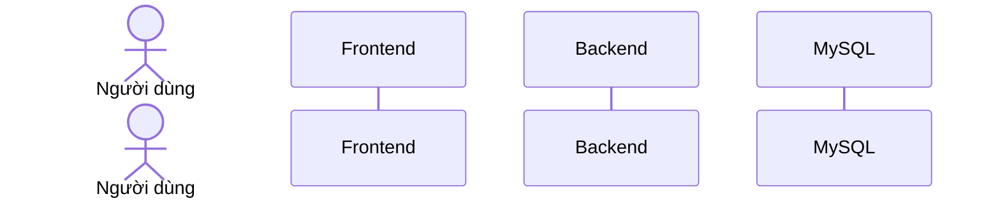

# <Tên chức năng>

## 1. Mục tiêu và phạm vi

<1–3 câu: người dùng nào làm được gì sau khi xong plan này.>

| Có làm | Không làm (để plan khác) |
|---|---|
| | |

## 2. Tác nhân và phân quyền

| Tác nhân | Quyền (resource `<MA_RESOURCE>`, uri `/<x>/`) | Ghi chú |
|---|---|---|
| Quản trị doanh nghiệp | VIEW, ADD, UPDATE, DELETE | |

## 3. Luồng nghiệp vụ

**Luồng chính:** 1. … 2. …
**Luồng thay thế / ngoại lệ:** A1. … E1. …



## 4. Cơ sở dữ liệu

Migration: `V<n>__<mo_ta>.sql` (số tiếp theo trong `backend/app/src/main/resources/db/migration/`).

| Bảng | Cột | Kiểu | Ràng buộc / ghi chú |
|---|---|---|---|

Unique: `(…)` · Index: … · Xoá: mềm (`status = 0`) / cứng.

## 5. Hợp đồng API (cố định — nguồn sự thật cho cả BE và FE)

Mọi response bọc `{ "code": …, "message": …, "result": … }` như `ApiResponse` hiện có.

### 5.1 `POST /api/<x>/list` — quyền VIEW
Request:
```json
{}
```
Response `result`:
```json
{ "total": 0, "page": 1, "items": [] }
```

### 5.2 `POST /api/<x>/update` — quyền ADD (không có id) / UPDATE (có id)

### 5.3 `POST /api/<x>/delete/{id}` — quyền DELETE

### 5.4 Lỗi nghiệp vụ

| Tình huống | HTTP | Message (tiếng Việt, FE hiện nguyên văn) |
|---|---|---|

## 6. Giao diện (chuỗi cố định — test E2E chọn theo đúng các chuỗi này)

- Route: `/admin/<x>` (quản trị) hoặc route cửa hàng · Sidebar: nhóm "…", mục "…"
- Tiêu đề trang: "…" · Ô tìm kiếm placeholder: "…"
- Cột bảng: …
- Nút: "Thêm …", "Lưu", "Huỷ", "Xoá"
- Dialog "Thêm …" / "Sửa …": field (label → kiểu → bắt buộc → validate client):

| Label | Kiểu | Bắt buộc | Validate |
|---|---|---|---|

- Toast: tạo "…", sửa "…", xoá "…"

## 7. Việc backend (agy BE)

Module `<module>`. File cần tạo/sửa:

1. …

Unit test bắt buộc: các TC loại `unit` ở §9 + bộ tối thiểu trong `backend/AGENTS.md` (mục "Thêm 1 CRUD").

## 8. Việc frontend (agy)

File cần tạo/sửa:

1. …

Component shadcn dùng (skill `shadcn` ở `.agents/skills/`): <có sẵn trong `components/ui/`: …; cần `shadcn add`: …>

## 9. Test case

| ID | Loại | Mô tả | Tiền điều kiện | Bước | Kết quả mong đợi |
|---|---|---|---|---|---|
| TC-01 | e2e | | | | |
| TC-02 | api | | | | |
| TC-03 | unit | | | | |

Loại: `unit` = agy BE viết JUnit · `api` / `e2e` = Claude viết trong `frontend/tests/e2e/<slug>.spec.ts`.

## 10. Tiêu chí hoàn thành

- [ ] Mọi TC ở §9 pass
- [ ] `mvn test`, `pnpm build`, `pnpm lint` xanh
- [ ] Có `docs/chuc-nang/<slug>.md`

## 11. Rủi ro / câu hỏi mở

## 12. Nhật ký thực hiện (do /cook và /doc-chuc-nang ghi — nối các phiên A/B/C)

| Thời điểm | Sự kiện |
|---|---|
