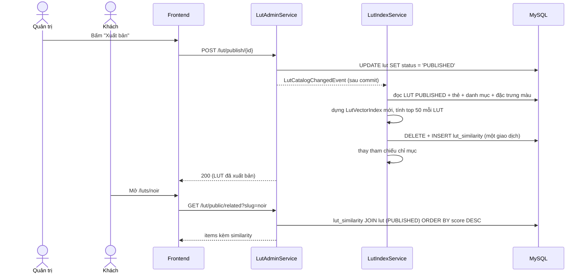

# Chỉ mục tương đồng

## 1. Mục tiêu và phạm vi

Sau plan này, mỗi LUT đã xuất bản được biểu diễn bằng **hồ sơ sản phẩm 6 khối** (thẻ, màu, danh mục, phong cách, văn bản, tác giả) đúng công thức thiết kế §7.2, và backend tính được **độ tương đồng nội dung `sim(i, j)`** giữa hai LUT bất kỳ (§7.3). Bảng `lut_similarity` giữ 50 LUT gần nhất của mỗi LUT, được dựng lại khi backend khởi động, ngay sau khi quản trị xuất bản / ẩn / sửa / đổi file .cube của một LUT, và lúc 03:00 hằng ngày.

Khách thấy kết quả ở hai chỗ có sẵn: khối **"Có thể bạn cũng thích"** ở trang chi tiết và khối **"LUT tương tự"** trong hộp thoại "Đã tải xong". Cả hai gọi `GET /lut/public/related`, giờ trả LUT theo `sim(c, j)` giảm dần thay cho luật "cùng phong cách, cùng danh mục". Ví dụ ở trang Kodak 400, "Super 8" (phong cách Cổ điển nhưng chung thẻ grain, phim và danh mục Phim nhựa) đứng thứ 2, trên các LUT cùng phong cách mà khác màu. Chỉ mục vector trong bộ nhớ (`LutVectorIndex`) là nền cho các lát 2.2 (hồ sơ người dùng) và 2.3 (xếp hạng "Dành cho bạn").

| Có làm | Không làm (để plan khác) |
|---|---|
| Cấu hình `recommend.*` cho phần sản phẩm: trọng số 6 khối, `similarity-top`, bảng đồng nghĩa thẻ, danh sách từ dừng, giờ dựng lại | Các khoá `recommend.event.*`, `half-life-days`, `mmr-lambda`… của Phụ lục B (thêm ở lát 2.2, 2.3) |
| Hồ sơ sản phẩm 6 khối (§7.2.1 → §7.2.6) và `LutVectorIndex` giữ trong bộ nhớ, "dựng bản mới rồi thay tham chiếu" | Hồ sơ người dùng, `score(u, i)`, cold-start (lát `ho-so-nguoi-dung` 2.2) |
| `sim(i, j)`: cosine cho 5 khối rời rạc, RBF cho khối màu, tổng có trọng số (§7.3) | Phần cá nhân hoá `0.2 · score(u, j)` của "Có thể bạn cũng thích", MMR, quota Premium, `for-you` (lát `xep-hang-goi-y` 2.3) |
| Migration `V10`: bảng `lut_similarity`, top 50 mỗi LUT, tính lại toàn bảng | `GET /recommend/config`, `POST /recommend/rebuild`, `/admin/goi-y`, resource `RECOMMEND` (lát `quan-tri-goi-y` 2.4) |
| Dựng lại khi khởi động, sau xuất bản / ẩn / sửa LUT đang xuất bản / đổi .cube / tính lại đặc trưng màu, và 03:00 | Sửa giao diện cửa hàng (hợp đồng `related` giữ nguyên, chỉ thêm một field) |
| `GET /lut/public/related` đổi ruột sang `sim(c, j)`, thêm field `similarity`; giữ luật cũ làm dự phòng khi LUT chưa có dòng trong bảng | Gợi ý plugin (`item_similarity`, chương 10) |

## 2. Tác nhân và phân quyền

| Tác nhân | Quyền | Ghi chú |
|---|---|---|
| Khách (vãng lai hoặc đã đăng nhập) | `GET /lut/public/related` công khai, không cần token | Giống hiện tại |
| Quản trị có quyền resource `LUT` (uri `/lut/`) | Xuất bản, ẩn, sửa, upload, tính lại đặc trưng màu như lát `quan-ly-lut` / `dac-trung-mau` | Không có quyền mới. Các thao tác này giờ kéo theo dựng lại chỉ mục |
| `noaccess@downbeat.local`, khách hàng | Không gọi được API quản trị LUT (403, đã phủ ở `quan-ly-lut`) | Vì vậy họ không thể kích hoạt dựng lại chỉ mục |

Lát này không thêm endpoint quản trị nào nên không có test quyền mới; quyền của các API quản trị LUT đã được kiểm ở `quan-ly-lut.spec.ts`.

## 3. Luồng nghiệp vụ

**Luồng chính 1 — dựng chỉ mục khi backend khởi động:**
1. Flyway chạy xong, app phát `ApplicationReadyEvent`.
2. `LutColorFeatureBootstrap` (đã có, giờ chạy trước) tính đặc trưng màu cho LUT còn thiếu.
3. `LutIndexListener` (chạy sau) gọi `LutIndexService.rebuild("khởi động")`:
   1. Đọc mọi LUT `PUBLISHED` kèm thẻ, danh mục (đang hiện, khác nhóm `phan-mem`), đặc trưng màu.
   2. Dựng `LutVectorIndex` mới: từ điển thẻ / danh mục / văn bản, idf, mean / std màu, vector 6 khối của từng LUT.
   3. Tính `sim(i, j)` cho mọi cặp, giữ 50 LUT cao nhất mỗi LUT.
   4. Trong một giao dịch: xoá hết `lut_similarity`, chèn lại các dòng mới.
   5. Gán chỉ mục mới vào tham chiếu dùng chung, ghi log `Chỉ mục gợi ý: 36 LUT, 1260 dòng lut_similarity, 48 ms (khởi động)`.

**Luồng chính 2 — khách xem "Có thể bạn cũng thích":**
1. Trang `/luts/noir` gọi `GET /lut/public/related?slug=noir&page=1&limit=12`.
2. Backend kiểm `noir` đã xuất bản (không thì 404), đọc các dòng `lut_similarity` của Noir JOIN `lut` còn `PUBLISHED`, xếp `score` giảm dần.
3. Trả "Chì Than" (0.8574), "Bạc Xám" (0.7975), rồi các LUT khác điểm thấp hơn nhiều (≤ 0.12). Hộp thoại "LUT tương tự" sau khi tải Noir hiện đúng 4 LUT đầu của danh sách này.

**Luồng chính 3 — quản trị thay đổi kho:**
1. Quản trị xuất bản LUT mới (hoặc ẩn, sửa LUT đang xuất bản, upload .cube mới cho LUT đang xuất bản, tính lại đặc trưng màu).
2. Service phát `LutCatalogChangedEvent`. Giao dịch commit xong, `LutIndexListener` dựng lại chỉ mục **ngay trong request đó** rồi API mới trả về.
3. Lần gọi `related` kế tiếp đã phản ánh thay đổi: LUT vừa xuất bản có mặt trong danh sách của các LUT giống nó (không bị cold-start phía sản phẩm, §7.5.3); LUT vừa ẩn biến khỏi mọi danh sách.

**Luồng thay thế / ngoại lệ:**
- A1. 03:00 hằng ngày dựng lại toàn bộ (phòng khi có ai sửa thẳng trong DB).
- A2. LUT đang xem chưa có dòng nào trong `lut_similarity` (chỉ mục chưa dựng xong hoặc lần dựng gần nhất lỗi): `related` dùng luật cũ (cùng phong cách, cùng danh mục, phổ biến), item không có `similarity`.
- A3. LUT đã xuất bản nhưng thiếu đặc trưng màu (máy mới, MinIO trống): khối màu của LUT đó lấy z = 0 (bằng trung bình kho), log cảnh báo số LUT thiếu.
- A4. Sửa / upload trên LUT nháp hoặc đã ẩn: không dựng lại (LUT đó không nằm trong chỉ mục).
- E1. Dựng lỗi (mất kết nối DB…): log ERROR, giữ nguyên chỉ mục cũ và bảng cũ; thao tác của quản trị vẫn thành công vì giao dịch của nó đã commit.
- E2. `slug` không tồn tại, nháp hoặc đã ẩn → 404 "Không tìm thấy LUT". Thiếu `slug` → 400.
- E3. LUT vừa bị ẩn vẫn còn trong `lut_similarity` của LUT khác khi chưa dựng lại xong: bị loại lúc đọc vì truy vấn JOIN `lut.status = 'PUBLISHED'`.



## 4. Cơ sở dữ liệu

Migration: `V10__chi_muc_tuong_dong.sql` (mới nhất hiện tại là `V9__bo_suu_tap.sql`).

| Bảng | Cột | Kiểu | Ràng buộc / ghi chú |
|---|---|---|---|
| `lut_similarity` | `id` | INT AUTO_INCREMENT | PK. Thêm so với thiết kế §4.7 vì `AbsMysqlRepository` bắt buộc cột `id` (giống `lut_color_feature`) |
| | `lut_id` | INT NOT NULL | FK → `lut(id)` ON DELETE CASCADE |
| | `similar_lut_id` | INT NOT NULL | FK → `lut(id)` ON DELETE CASCADE |
| | `score` | DOUBLE NOT NULL | `sim(lut_id, similar_lut_id)` trong [0, 1], lưu nguyên giá trị (không làm tròn) |

Unique: `uk_lut_similarity_pair (lut_id, similar_lut_id)` · Index: `idx_lut_similarity_score (lut_id, score)` · Xoá: cứng, cả bảng được thay mới mỗi lần dựng (DELETE + INSERT trong một giao dịch, **không dùng TRUNCATE** vì TRUNCATE tự commit và khách sẽ thấy bảng rỗng giữa chừng).

Không có dòng `(i, i)`. Với 36 LUT mẫu: mỗi LUT có 35 dòng, cả bảng 1260 dòng. Không thêm `resource` (lát không có endpoint quản trị).

```sql
SET NAMES utf8mb4;

CREATE TABLE IF NOT EXISTS lut_similarity (
  id INT NOT NULL AUTO_INCREMENT PRIMARY KEY,
  lut_id INT NOT NULL,
  similar_lut_id INT NOT NULL,
  score DOUBLE NOT NULL,
  CONSTRAINT uk_lut_similarity_pair UNIQUE (lut_id, similar_lut_id),
  KEY idx_lut_similarity_score (lut_id, score),
  CONSTRAINT fk_lut_similarity_lut FOREIGN KEY (lut_id) REFERENCES lut(id) ON DELETE CASCADE,
  CONSTRAINT fk_lut_similarity_similar FOREIGN KEY (similar_lut_id) REFERENCES lut(id) ON DELETE CASCADE
) ENGINE=InnoDB DEFAULT CHARSET=utf8mb4 COLLATE=utf8mb4_0900_ai_ci;
```

## 5. Hợp đồng API (cố định — nguồn sự thật cho cả BE và FE)

Mọi response bọc `{ "code": …, "message": …, "result": … }` như `ApiResponse` hiện có.

### 5.1 `GET /api/lut/public/related` — công khai (đổi ruột, giữ hợp đồng, thêm `similarity`)

Query: `slug` (bắt buộc), `page` (mặc định 1), `limit` (mặc định 12, tối đa 48, giữ `LutQuerySupport` như cũ).

Quy tắc:
- Chỉ trả LUT `PUBLISHED`, không bao giờ có chính LUT `slug`, không có `fileKey` / `status` (giữ `publicFields()`).
- Thứ tự: `score` giảm dần, rồi `downloadCount` giảm dần, rồi `id` tăng dần.
- `total` = số dòng `lut_similarity` của LUT đó mà LUT đích còn `PUBLISHED`, nên `total ≤ similarity-top` (50). Với kho 36 LUT: `total = 35`.
- `similarity` = `score` làm tròn 4 chữ số thập phân (`Math.round(score * 10000) / 10000.0`).
- Dự phòng (A2): LUT chưa có dòng nào trong bảng → dùng nguyên truy vấn luật cũ (`relatedPublished` / `countRelatedPublished`), item **không có** field `similarity` (POJO `Lut` là `NON_NULL`).

Ví dụ `GET /api/lut/public/related?slug=noir&page=1&limit=2` (kho 36 LUT mẫu):
```json
{
  "code": 200,
  "message": "OK",
  "result": {
    "total": 35,
    "page": 1,
    "items": [
      {
        "id": 26, "slug": "chi-than", "title": "Chì Than",
        "description": "Chì Than là LUT phong cách đen trắng, tương phản do Mono Works chỉnh màu. Kéo thả file .cube vào Premiere Pro, DaVinci Resolve, Final Cut Pro hoặc CapCut để áp ngay, rồi chỉnh cường độ cho hợp với cảnh quay của bạn.",
        "creatorId": 4, "creatorName": "Mono Works", "style": "den-trang", "isPremium": 1,
        "coverUrl": "http://localhost:9020/downbeat-public/lut/chi-than/cover.jpg",
        "previewType": "BEFORE_AFTER",
        "beforeUrl": "http://localhost:9020/downbeat-public/lut/chi-than/before.jpg",
        "afterUrl": "http://localhost:9020/downbeat-public/lut/chi-than/after.jpg",
        "fileSizeKb": 948, "lutSize": 33, "downloadCount": 5020,
        "publishedTime": "2026-06-02T09:00:00",
        "categories": ["den-trang", "premiere-pro", "davinci-resolve", "final-cut-pro", "capcut"],
        "tags": ["đen trắng", "tương phản"],
        "similarity": 0.8574
      },
      {
        "id": 15, "slug": "bac-xam", "title": "Bạc Xám",
        "creatorId": 4, "creatorName": "Mono Works", "style": "den-trang", "isPremium": 0,
        "coverUrl": "http://localhost:9020/downbeat-public/lut/bac-xam/cover.jpg",
        "downloadCount": 4410, "publishedTime": "2026-08-08T09:00:00",
        "categories": ["den-trang", "premiere-pro", "davinci-resolve", "final-cut-pro", "capcut"],
        "tags": ["mềm", "đen trắng"],
        "similarity": 0.7975
      }
    ]
  }
}
```
(Item thứ hai rút gọn cho dễ đọc; thực tế đủ field như item đầu.)

### 5.2 Tác động lên API quản trị có sẵn (hợp đồng không đổi, thêm việc dựng lại chỉ mục)

| API có sẵn | Khi nào phát `LutCatalogChangedEvent` | Không phát khi |
|---|---|---|
| `POST /lut/publish/{id}` | Trạng thái thật sự đổi sang `PUBLISHED` | LUT đã `PUBLISHED` từ trước (hàm trả sớm), hoặc lỗi kiểm điều kiện |
| `POST /lut/hide/{id}` | `PUBLISHED` → `HIDDEN` | LUT đã `HIDDEN`; LUT nháp (400 như cũ) |
| `POST /lut/update` | Sửa LUT đang `PUBLISHED` (tiêu đề, mô tả, tác giả, phong cách, thẻ, danh mục đều là đặc trưng) | Tạo mới, sửa LUT nháp / đã ẩn |
| `POST /lut/upload` (`kind = CUBE`) | LUT đang `PUBLISHED` (đặc trưng màu đổi) | `kind` khác (ảnh, video), LUT nháp / đã ẩn |
| `POST /lut/feature/recompute` | Có ít nhất 1 LUT tính lại thành công (phát **một** sự kiện cho cả lô) | Không LUT nào tính được |
| `POST /lut/delete/{id}` | Không phát (chỉ xoá được LUT không xuất bản; FK CASCADE dọn dòng `lut_similarity` nếu có) | |

Dựng lại xảy ra **sau commit và trước khi API trả về**: khi client nhận 200 của các API trên, `related` đã phản ánh thay đổi. Dựng lỗi không làm API đó lỗi (E1).

### 5.3 Cấu hình `recommend.*` (thêm vào `backend/app/src/main/resources/application.yml`)

```yaml
recommend:
  weights:                 # tự chia cho tổng nếu tổng khác 1; có trọng số âm hoặc tổng = 0 → app không khởi động
    tag: 0.30
    color: 0.25
    category: 0.15
    style: 0.15
    text: 0.10
    creator: 0.05
  similarity-top: 50       # số LUT lưu cho mỗi LUT trong lut_similarity
  build-on-startup: true   # dựng chỉ mục khi ApplicationReadyEvent
  rebuild-cron: "0 0 3 * * *"
  tag-synonyms:            # mỗi nhóm một dòng, phần tử đầu là dạng chuẩn
    - [đen trắng, trắng đen, b&w, bw, black and white]
    - [vintage, cổ điển, retro]
    - [phim, film]
  text-stopwords: [của, và, cho, là, những, các, với, một, được, có, này, như, rất, khi]
```

Bảng đồng nghĩa dùng `List<List<String>>` chứ không dùng map: Spring Boot bỏ ký tự đặc biệt và chữ có dấu khỏi khoá map khi bind (`"b&w"`, `"cổ điển"` sẽ bị đổi), còn giá trị trong danh sách được giữ nguyên.

### 5.4 Lỗi nghiệp vụ

Không thêm mã lỗi mới. `related` giữ nguyên các lỗi cũ:

| Tình huống | HTTP | errorCode | Message (nguyên văn) |
|---|---|---|---|
| `slug` không tồn tại, LUT nháp hoặc đã ẩn | 404 | `DATA_NOT_FOUND` | Không tìm thấy LUT |
| Thiếu tham số `slug` | 400 | (lỗi tham số của Spring, như hiện tại) | (không kiểm message) |

## 6. Giao diện (chuỗi cố định — test E2E chọn theo đúng các chuỗi này)

**Không sửa giao diện.** Frontend đọc `related` qua `getRelatedLuts` / `toLutDTO` và bỏ qua field `similarity`. Các chuỗi có sẵn mà E2E dựa vào:

- Trang chi tiết `/luts/$slug`: tiêu đề khối `h2` "Có thể bạn cũng thích"; lưới `ul[aria-label="LUT liên quan"]`, 12 thẻ mỗi lần tải, cuộn để tải thêm; tên LUT là `h3` trong thẻ; link thẻ có `aria-label` "Xem LUT {tên}".
- Hộp thoại "Đã tải xong": tiêu đề nhỏ "LUT tương tự", danh sách `ul[aria-label="LUT tương tự"]`, tối đa 4 mục, mỗi mục là link `/luts/{slug}`.
- Nút tải ở trang chi tiết: "Tải miễn phí" (LUT thường).

## 7. Việc backend (agy BE)

Package mới `vn.aeoc.business.recommend` (chỉ phụ thuộc một chiều vào `business.lut`, `lut` không gọi bean nào của `recommend`, tránh vòng phụ thuộc). Thứ tự làm theo `backend/AGENTS.md`:

1. **Migration** `app/src/main/resources/db/migration/V10__chi_muc_tuong_dong.sql` đúng §4 → `sh scripts/ai/backend-restart.sh` → `mvn -q -DskipTests package` để sinh `LUT_SIMILARITY`.
2. **Entity**
   - `entity/.../data/mysql/recommend/LutSimilarity.java`: `id`, `lutId`, `similarLutId`, `score` (Double).
   - `entity/.../data/mysql/lut/Lut.java`: thêm `private Double similarity;` (chỉ có giá trị ở `related`).
3. **Cấu hình**: `application.yml` thêm khối §5.3; `recommend/config/RecommendProperties.java` (`@ConfigurationProperties(prefix = "recommend")`, đăng ký như `PayosProperties`), có hàm `normalizedWeights()` trả 6 trọng số đã chia cho tổng; trọng số âm hoặc tổng = 0 thì ném `IllegalStateException("recommend.weights không hợp lệ")` lúc khởi tạo bean.
4. **Phía `lut` (nguồn dữ liệu, sự kiện, related)**
   - `lut/event/LutCatalogChangedEvent.java`: `record LutCatalogChangedEvent(Integer lutId, String reason)`. `lutId = null` khi là cả lô (`recompute`).
   - `LutAdminService`: nhận thêm `ApplicationEventPublisher`, phát sự kiện đúng các trường hợp ở §5.2 (`reason`: `"xuất bản"`, `"ẩn"`, `"sửa"`, `"đổi file .cube"`). Sửa `LutAdminServiceTest` cho constructor mới.
   - `LutColorFeatureService.recompute`: phát một sự kiện `reason = "tính lại đặc trưng màu"` khi có ít nhất 1 LUT thành công.
   - `LutColorFeatureBootstrap.onApplicationReady(ApplicationReadyEvent)`: thêm `@Order(0)` để luôn chạy trước khi dựng chỉ mục.
   - `LutCategoryRepository.getActiveNonSoftwareSlugsByLutIds(ids)`: như `getActiveSlugsByLutIds` thêm điều kiện `group_code <> 'phan-mem'`.
   - `LutRepository`:
     - `listPublishedForIndex()`: LUT `PUBLISHED`, cột `id, title, description, creator_id, style, download_count`.
     - `similarPublished(Integer baseId, Pageable)`: `publicFields()` + `LUT_SIMILARITY.SCORE.as("similarity")`, bảng `LUT.join(LUT_SIMILARITY).on(LUT_SIMILARITY.SIMILAR_LUT_ID.eq(LUT.ID).and(LUT_SIMILARITY.LUT_ID.eq(baseId)))` + left join `CREATOR`; điều kiện `published()`; thứ tự `SCORE desc, DOWNLOAD_COUNT desc, ID asc`.
     - `countSimilarPublished(Integer baseId)`: `getCountWithCriteria(published().and(DSL.exists(selectOne().from(LUT_SIMILARITY).where(LUT_SIMILARITY.LUT_ID.eq(baseId).and(LUT_SIMILARITY.SIMILAR_LUT_ID.eq(LUT.ID))))))`.
     - Giữ nguyên `relatedPublished` / `countRelatedPublished` làm dự phòng.
   - `LutService`:
     - `listPublishedForIndex()`: gọi repository trên, ghép thẻ (`getTagsByLutIds`), danh mục (`getActiveNonSoftwareSlugsByLutIds`), đặc trưng màu (`LutColorFeatureRepository.getByLutIds` → `setColorFeature`). Ba truy vấn `IN (…)`, không truy vấn theo từng LUT.
     - `related(slug, page, limit)`: `requirePublished(slug)`; `countSimilarPublished > 0` thì `pageQuery` với `similarPublished` / `countSimilarPublished`, làm tròn `similarity` 4 chữ số; bằng 0 thì `pageQuery` luật cũ như hiện nay. Cuối cùng `enrich` như cũ.
5. **Thuật toán (`recommend/index`, lớp thuần Java, không phụ thuộc Spring, để lát 3.1 gọi lại được)**
   - `TagNormalizer`: NFC → `toLowerCase(Locale.ROOT)` → trim → gộp mọi chuỗi khoảng trắng thành 1 dấu cách → tra bảng đồng nghĩa (các từ trong bảng cũng được chuẩn hoá cùng cách) → dạng chuẩn. Thẻ trùng sau chuẩn hoá tính một lần.
   - `TextTokenizer`: xử lý **riêng** tiêu đề và mô tả (cặp không nối qua ranh giới hai trường):
     1. NFC, `toLowerCase(Locale.ROOT)`.
     2. Token = chuỗi liên tiếp dài nhất các ký tự `Character.isLetterOrDigit`.
     3. Âm tiết đơn: mọi token không thuộc từ dừng.
     4. Cặp âm tiết: hai token **liền nhau trong câu gốc** mà cả hai đều không phải từ dừng, nối bằng một dấu cách. Không ghép qua từ dừng: "cam của hoàng" không sinh "cam hoàng".
     5. Đếm số lần của từng âm tiết / cặp trên cả tiêu đề và mô tả.
   - `LutVectorIndex` (bất biến), dựng bằng `static LutVectorIndex build(List<Lut> luts, RecommendProperties props)`. N = số LUT truyền vào; `idf(df) = ln((N + 1) / (df + 1)) + 1` dùng chung cho thẻ, danh mục, văn bản.
     - Thẻ: tf nhị phân × idf, chuẩn L2.
     - Danh mục: các slug đã lọc (đang hiện, khác `phan-mem`), multi-hot × idf, chuẩn L2.
     - Phong cách: one-hot theo chuỗi `style` (chuẩn = 1). `style` null → khối rỗng.
     - Văn bản: âm tiết đơn giữ hết; cặp âm tiết chỉ giữ khi df ≥ 2 (df tính trên số LUT có cặp đó); trọng số `(1 + ln(số lần)) × idf`, chuẩn L2.
     - Tác giả: one-hot `creatorId`.
     - Màu: 10 chiều theo thứ tự `brightness, contrast, saturation, warmth, tint, shadowA, shadowB, highlightA, highlightB, isMono`. Mean và std **tổng thể (chia n)** chỉ tính trên LUT có đặc trưng; `z = (v − mean) / std` cắt về [-3, 3]; chiều có std < 1e-12 thì z = 0; LUT thiếu đặc trưng thì z = vector 0 và log `warn` số LUT thiếu.
     - Truy xuất cho test và lát sau: `size()`, `ids()`, `contains(id)`, `tagIdf(String)`, `categoryIdf(String)`, `textIdf(String)`, `tagVector(id)`, `categoryVector(id)`, `textVector(id)` (đều trả `Map<String, Double>` đã chuẩn L2), `colorZ(id)` (`double[10]`), `colorMean()`, `colorStd()`, `downloadCount(id)`. Cách lưu bên trong tuỳ worker (vector thưa đã sắp xếp hay map), miễn bất biến.
   - Vector rỗng (ví dụ tiêu đề toàn từ dừng, LUT không còn danh mục nào) có cosine = 0 với mọi vector, kể cả chính nó. Không chia lại trọng số cho khối rỗng (đúng tinh thần §7.2.7).
6. **Độ tương đồng (`recommend/service/SimilarityService`, `@Component`, không trạng thái)**
   - `Map<String, Double> blockSims(LutVectorIndex ix, int i, int j)`: khoá `tag, color, category, style, text, creator`. Khối rời rạc = tích vô hướng hai vector đã chuẩn L2; khối màu = `rbf(z_i, z_j) = exp(-‖z_i − z_j‖² / (2 · 10))`, D = 10 cố định.
   - `double sim(ix, i, j) = Σ w_b · blockSims_b` với trọng số đã chuẩn hoá, kẹp về [0, 1].
   - `List<LutSimilarity> topSimilar(ix)`: với mỗi i, xếp mọi j ≠ i theo `sim` giảm dần → `downloadCount` giảm dần → `id` tăng dần, lấy `similarity-top` dòng đầu. Tính mỗi cặp một lần rồi dùng cho cả (i, j) và (j, i).
7. **Dựng và lưu (`recommend/service/LutIndexService extends BaseService<LutSimilarityRepository, LutSimilarity, Integer>`)**
   - Giữ `AtomicReference<LutVectorIndex>`; `current()` trả bản đang dùng (null trước lần dựng đầu).
   - `rebuild(String reason)`: chạy tuần tự bằng một khoá riêng (`ReentrantLock`); đọc `LutService.listPublishedForIndex()` → `LutVectorIndex.build` → `topSimilar` → `repository.replaceAll(rows)` → thay tham chiếu → log `info` `Chỉ mục gợi ý: {N} LUT, {M} dòng lut_similarity, {ms} ms ({reason})`. **Bắt mọi exception**, log `error`, giữ chỉ mục cũ, không ném ra ngoài.
   - Dựng **đồng bộ** trong luồng gọi (AGENTS cấm xử lý bất đồng bộ); vẫn đúng tinh thần "dựng bản mới rồi thay tham chiếu" của §7.8: request khác đang đọc chỉ mục dùng bản cũ, không khoá đọc.
8. **`recommend/repository/LutSimilarityRepository extends AbsMysqlRepository<LutSimilarityRecord, LutSimilarity, Integer>`**: `replaceAll(List<LutSimilarity> rows)` có `@Transactional(propagation = Propagation.REQUIRES_NEW)` (được gọi trong pha after-commit, phải mở giao dịch mới): `DELETE FROM lut_similarity` rồi chèn nhiều dòng một câu, lô 1000 dòng.
9. **`recommend/service/LutIndexListener` (`@Component`)**
   - `@TransactionalEventListener(phase = AFTER_COMMIT, fallbackExecution = true)` nhận `LutCatalogChangedEvent` → `rebuild("LUT {id}: {reason}")` (`fallbackExecution` để `recompute` không có giao dịch vẫn chạy).
   - `@EventListener(ApplicationReadyEvent.class)` + `@Order(100)`: `build-on-startup = true` thì `rebuild("khởi động")`.
   - `@Scheduled(cron = "${recommend.rebuild-cron:0 0 3 * * *}", zone = "Asia/Ho_Chi_Minh")`: `rebuild("định kỳ 03:00")` (app đã `@EnableScheduling`).
10. **Unit test** (JUnit 5 + AssertJ + Mockito, không dựng Spring): mọi TC loại `unit` ở §9, đặt ở `business/src/test/java/vn/aeoc/business/recommend/...` và cập nhật `lut/service/LutAdminServiceTest`, `LutServiceTest`. Dữ liệu kho 3 LUT ở §9.1 dùng chung, nên viết một lớp tiện ích `RecommendFixtures`.

Quyết định đã chốt, worker không tự đổi: đồng bộ sau commit (không `@Async`, không executor riêng); xoá cứng và thay cả bảng; dự phòng luật cũ khi chưa có dòng; `similarity` làm tròn 4 chữ số chỉ ở API, bảng lưu nguyên giá trị; std tổng thể; cặp âm tiết không ghép qua từ dừng; LUT thiếu đặc trưng màu lấy z = 0.

Nghiệm thu riêng của lát này (thêm vào "Nghiệm thu chuẩn"): sau `backend-restart.sh`, log có dòng `Chỉ mục gợi ý: 36 LUT, 1260 dòng lut_similarity`; dán vào `worker_done` response `related?slug=noir&limit=3` và `related?slug=kodak-400&limit=3`.

## 8. Việc frontend (agy)

**Không có.** Hợp đồng `related` giữ nguyên, field `similarity` thêm vào bị bỏ qua. `/cook` chỉ giao cho agy BE.

Việc của Claude ở `frontend/tests/e2e/`:
- Viết `chi-muc-tuong-dong.spec.ts` theo §9.
- Sửa `kho-lut.spec.ts` TC-15 (đang khẳng định thứ tự luật cũ "Fuji Classic, Pastel Hồng, Chân Dung Mềm, Lụa Trắng, Super 8"): đổi sang 2 LUT đầu "Fuji Classic", "Super 8" và 3 LUT kế là tập {"Chân Dung Mềm", "Lụa Trắng", "Pastel Hồng"} (không khoá thứ tự 3 LUT này vì Chân Dung Mềm và Lụa Trắng chỉ chênh 0.006). TC-16 (trang 3 có 11 LUT) và TC-31 (thẻ đầu "Fuji Classic") vẫn đúng.

Component shadcn dùng: không có.

## 9. Test case

Loại: `unit` = agy BE viết JUnit · `api` / `e2e` = Claude viết trong `frontend/tests/e2e/chi-muc-tuong-dong.spec.ts`.

### 9.1 Kho 3 LUT tính tay (dùng cho TC-03 → TC-09, TC-11, TC-13)

Trọng số mặc định, từ dừng mặc định, không đồng nghĩa nào liên quan. Cả ba `PUBLISHED`.

| | A (id 1) | B (id 2) | C (id 3) |
|---|---|---|---|
| Tiêu đề | Hoàng Hôn Ấm | Hoàng Hôn Biển | Đêm Lạnh |
| Mô tả | Tông cam của hoàng hôn | Biển lúc hoàng hôn | Xanh lạnh ban đêm |
| Tác giả | 1 | 2 | 1 |
| Phong cách | am-ap | am-ap | lanh |
| Thẻ | ấm, hoàng hôn, grain | ấm, biển, hoàng hôn | lạnh, xanh, đêm |
| Danh mục (đã lọc nhóm) | am-ap, du-lich (+ premiere-pro bị bỏ) | am-ap (+ premiere-pro bị bỏ) | lanh, ban-dem (+ capcut bị bỏ) |
| `downloadCount` | 10 | 5 | 0 |
| Màu (brightness, contrast, saturation, warmth, tint, shadowA, shadowB, highlightA, highlightB, isMono) | 0.05, 1.10, 1.20, 8.0, 1.0, 0.0, 2.0, 1.0, 6.0, 0 | 0.02, 1.05, 1.30, 6.0, 0.5, 0.5, 1.0, 1.5, 5.0, 0 | −0.03, 0.90, 0.80, −7.0, −1.0, −0.5, −4.0, −0.5, −3.0, 0 |

Kết quả mong đợi (sai số 0.0001, tính bằng script độc lập):

| Đại lượng | Giá trị |
|---|---|
| idf thẻ | grain, biển, lạnh, xanh, đêm = 1.6931; ấm, hoàng hôn = 1.2877 |
| Vector thẻ A | grain 0.6809, ấm 0.5179, hoàng hôn 0.5179 |
| idf danh mục; vector danh mục | am-ap = 1.2877, du-lich = lanh = ban-dem = 1.6931; A = {du-lich 0.7960, am-ap 0.6053}, B = {am-ap 1.0}, C = {lanh 0.7071, ban-dem 0.7071} |
| Âm tiết / cặp của A | âm tiết {hoàng 2, hôn 2, ấm 1, tông 1, cam 1}; cặp {"hoàng hôn" 2, "hôn ấm" 1, "tông cam" 1} |
| Âm tiết / cặp của B | âm tiết {hoàng 2, hôn 2, biển 2, lúc 1}; cặp {"hoàng hôn" 2, "hôn biển" 1, "biển lúc" 1, "lúc hoàng" 1} |
| Trọng số văn bản A (trước chuẩn L2) | hoàng 2.1802, hôn 2.1802, ấm 1.6931, tông 1.6931, cam 1.6931, "hoàng hôn" 2.1802 (cặp duy nhất có df ≥ 2; "hôn ấm", "tông cam" bị loại) |
| Màu | mean warmth 2.3333, std warmth 6.6500; z(A) = 1.1112, 0.9806, 0.4629, 0.8521, 0.9806, 0.0, 0.8890, 0.3922, 0.8276, 0 (isMono std = 0 → z = 0) |
| Khối của (A, B) | tag 0.5363, category 0.6053, style 1, text 0.5924, creator 0, color 0.8238 (‖z_A − z_B‖² = 3.8765) |
| `sim` | sim(A, B) = 0.6669 · sim(A, C) = 0.0833 (chỉ creator 1 và color 0.1333) · sim(B, C) = 0.0397 (chỉ color 0.1587) · sim(A, A) = 1 |

### 9.2 Giá trị tham chiếu trên 36 LUT mẫu (dùng cho TC-16, TC-25, TC-26)

Tính bằng script độc lập theo đúng §7 trên dữ liệu thật của DB local (đặc trưng màu đọc từ `lut_color_feature`). Chỉ đúng khi kho có **đúng 36 LUT đã xuất bản** của seed.

| LUT đang xem | Các LUT đầu của `related` (similarity) | Ghi chú |
|---|---|---|
| noir | chi-than 0.8574, bac-xam 0.7975, rồi anh-trang 0.1189 | Hai LUT đen trắng cùng tác giả, cách xa phần còn lại |
| kodak-400 | fuji-classic 0.7380, super-8 0.5944, chan-dung-mem 0.4952, lua-trang 0.4892, pastel-hong 0.4559 | super-8 khác phong cách (`co-dien`) vẫn đứng thứ 2; luật cũ xếp nó thứ 5 |
| xanh-dem | anh-trang 0.8378, bang-gia 0.7673, da-lat-suong 0.6029, bac-cuc 0.5884, mua-pho 0.5241, rồi pho-dem 0.4440 (`dien-anh`) | 5 LUT đầu đều `lanh` |
| hoang-hon-sai-gon | mua-thu-ha-noi 0.7172, dien-anh-thuan 0.6577, mat-ong 0.6465, ngay-cuoi 0.5422, rồi co-dien 0.4518 | 4 LUT đầu đều `am-ap`; hoang-hon-cu (HIDDEN, cùng thẻ "hoàng hôn", "ấm") không có mặt |

### 9.3 Bảng test case

| ID | Loại | Mô tả | Tiền điều kiện | Bước | Kết quả mong đợi |
|---|---|---|---|---|---|
| TC-01 | unit | Chuẩn hoá thẻ và đồng nghĩa | Bảng đồng nghĩa mặc định §5.3 | `TagNormalizer.normalize` với `"  Hoàng   Hôn "`, `"B&W"`, `"Black and White"`, `"Trắng Đen"`, `"Cổ Điển"`, `"Film"`, chuỗi NFD `"hoàng hôn"` | Lần lượt `"hoàng hôn"`, `"đen trắng"`, `"đen trắng"`, `"đen trắng"`, `"vintage"`, `"phim"`, `"hoàng hôn"`. LUT có thẻ `["b&w", "Đen trắng"]` chỉ có 1 chiều `"đen trắng"` trong vector thẻ |
| TC-02 | unit | Tách âm tiết | Từ dừng mặc định | `TextTokenizer` với tiêu đề / mô tả của A và B (§9.1) | Âm tiết và cặp đúng bảng §9.1; không có `"cam của"`, `"của hoàng"`, `"cam hoàng"`, `"ấm tông"` (ranh giới tiêu đề / mô tả); `"Retro 1970"` cho âm tiết `retro`, `1970` |
| TC-03 | unit | Khối thẻ TF-IDF | Kho §9.1 | `LutVectorIndex.build`; đọc `tagIdf`, `tagVector`; tính `blockSims(A, B).tag`, `blockSims(A, C).tag` | idf và vector A đúng §9.1; tag(A, B) = 0.5363; tag(A, C) = 0 |
| TC-04 | unit | Khối danh mục bỏ nhóm phần mềm | Kho §9.1; thêm kho phụ 2 LUT chỉ chung `premiere-pro` | Đọc `categoryVector`, `blockSims(...).category` | Vector đúng §9.1, không có chiều `premiere-pro` / `capcut`; category(A, B) = 0.6053; kho phụ: category = 0 (cả hai vector rỗng) |
| TC-05 | unit | Khối văn bản | Kho §9.1 | Đọc `textIdf`, `textVector`, `blockSims(A, B).text` | Trọng số trước chuẩn hoá đúng §9.1; `textVector(A)` có khoá `"hoàng hôn"`, không có `"hôn ấm"`; text(A, B) = 0.5924; text(A, C) = 0 |
| TC-06 | unit | Khối màu: z-score, cắt, thiếu đặc trưng | Kho §9.1; kho phụ 11 LUT (10 LUT warmth = 0, 1 LUT warmth = 100, các chiều khác bằng nhau); kho phụ thứ hai: kho §9.1 + LUT D không có đặc trưng | Đọc `colorMean`, `colorStd`, `colorZ` | Kho §9.1: mean / std / z(A) đúng §9.1, chiều isMono z = 0. Kho 11 LUT: z warmth của LUT ngoại lai = 3.0 (chưa cắt là 3.1623), 10 LUT còn lại = −0.3162. Kho có D: `colorZ(D)` toàn 0, mean / std bằng đúng kho §9.1 (D không góp vào) |
| TC-07 | unit | RBF, cosine rỗng, one-hot | | `rbf((1,0,…,0), (0,1,0,…,0))`; `rbf(z, z)`; LUT tiêu đề `"Của Và"`, mô tả rỗng; hai LUT cùng / khác `style`, `creatorId` | 0.904837 (= e^−0.1); 1.0; `blockSims(X, X).text` = 0; style, creator = 1 khi trùng, 0 khi khác |
| TC-08 | unit | sim tổng | Kho §9.1, trọng số mặc định | `blockSims(A, B)`, `sim` cho (A, B), (A, C), (B, C) | Từng khối và ba giá trị `sim` đúng §9.1 (sai số 0.0001) |
| TC-09 | unit | UT-06: tính chất của sim | Kho §9.1 và kho 30 LUT sinh ngẫu nhiên (hạt giống 7, LUT nào cũng đủ 6 khối) | Mọi cặp (i, j) | `sim(i, i)` = 1 (sai số 1e-9); `sim(i, j)` = `sim(j, i)`; mọi giá trị trong [0, 1] |
| TC-10 | unit | Chuẩn hoá trọng số | | `RecommendProperties` với tag 0.6, năm khối kia 0.1; với tag = −0.1; với tất cả 0 | `normalizedWeights()`: tag 0.5455, mỗi khối kia 0.0909, tổng 1; hai trường hợp sau ném `IllegalStateException("recommend.weights không hợp lệ")` |
| TC-11 | unit | Top-K và thứ tự hoà điểm | Kho §9.1; kho phụ 4 LUT: A và ba LUT X, Y, Z giống hệt nhau về nội dung, `downloadCount` X = 5, Y = 10, Z = 10, id X < Y < Z | `topSimilar` với `similarity-top` = 1 rồi = 50 | top 1: (A→B 0.6669), (B→A 0.6669), (C→A 0.0833), đúng 3 dòng. top 50 với 3 LUT: 6 dòng, không có (i, i). Kho phụ: danh sách của A theo thứ tự Y, Z, X |
| TC-12 | unit | Hiệu năng | 1000 LUT sinh ngẫu nhiên (hạt giống 42: 40 thẻ, 8 phong cách, 12 danh mục, 20 tác giả, tiêu đề từ 200 âm tiết, màu ngẫu nhiên) | `build` + `topSimilar` với `similarity-top` 50 | Xong dưới 3 giây trên máy dev; đúng 50 000 dòng, mỗi LUT 50 dòng |
| TC-13 | unit | `LutIndexService.rebuild` và giữ bản cũ khi lỗi | Mock `LutService.listPublishedForIndex` trả kho §9.1; mock `LutSimilarityRepository` | (1) `rebuild("test")`; (2) cho `replaceAll` ném `RuntimeException`, `rebuild` lần nữa; (3) cho `listPublishedForIndex` ném lỗi, `rebuild` lần nữa | (1) `replaceAll` nhận 6 dòng, `current().size()` = 3. (2) và (3) không ném ra ngoài, `current()` vẫn là đúng đối tượng của lần (1) |
| TC-14 | unit | Sự kiện từ phía `lut` | Mock `ApplicationEventPublisher`, repository như `LutAdminServiceTest` | Gọi: publish LUT nháp đủ điều kiện; publish LUT đã PUBLISHED; hide LUT PUBLISHED; hide LUT HIDDEN; update LUT PUBLISHED; update LUT DRAFT; upload CUBE cho LUT PUBLISHED; upload CUBE cho LUT DRAFT; upload COVER cho LUT PUBLISHED; `recompute` 2 LUT thành công; `recompute` toàn lỗi | Số sự kiện lần lượt: 1, 0, 1, 0, 1, 0, 1, 0, 0, 1, 0. Sự kiện có đúng `lutId` và `reason` ("xuất bản", "ẩn", "sửa", "đổi file .cube", "tính lại đặc trưng màu") |
| TC-15 | unit | `LutService.related` | Mock repository | (1) `countSimilarPublished` = 35, `similarPublished` trả item có `similarity` 0.857412; (2) `countSimilarPublished` = 0; (3) slug không có | (1) dùng `similarPublished`, `similarity` = 0.8574, không gọi `relatedPublished`. (2) dùng `relatedPublished` / `countRelatedPublished`, item không có `similarity`. (3) `AppException` `DATA_NOT_FOUND` "Không tìm thấy LUT", không gọi truy vấn related nào |
| TC-16 | api | Giá trị tham chiếu trên 36 LUT mẫu | `GET /lut/public/list` có `total` = 36 (khác thì `test.skip` kèm lý do "kho không còn đúng 36 LUT mẫu") | Gọi `related` (không token, `limit` 6) cho noir, kodak-400, xanh-dem, hoang-hon-sai-gon | Thứ tự slug đúng §9.2 ở các vị trí đã nêu; `similarity` khớp §9.2 sai số 0.005; noir: item thứ 3 có `similarity` < 0.2; xanh-dem: 5 item đầu đều `style` = `lanh`; hoang-hon-sai-gon: 4 item đầu đều `am-ap` |
| TC-17 | api | Mọi LUT đã xuất bản có danh sách đúng dạng | N = `total` của `/lut/public/list` | Với mỗi LUT trong `/lut/public/list?limit=48` (lấy hết các trang): `related?slug=…&limit=48` không token | `total` = min(N − 1, 50); mọi item có `similarity` trong [0, 1], không tăng dần theo thứ tự; không item nào trùng slug gốc; không có khoá `fileKey`, `status` |
| TC-18 | api | LUT nháp / ẩn không bao giờ xuất hiện | Seed có `hoang-hon-cu` (HIDDEN) và `thu-nghiem-nhap` (DRAFT) | `related?slug=hoang-hon-sai-gon&limit=48`, `related?slug=kodak-400&limit=48` | Không slug nào là `hoang-hon-cu` hoặc `thu-nghiem-nhap` (dù `hoang-hon-cu` có cùng thẻ "hoàng hôn", "ấm" với Hoàng Hôn Sài Gòn) |
| TC-19 | api | Phân trang | | `related?slug=noir` với (page 1, limit 4), (page 2, limit 4), (page 1, limit 8), (limit 100), (page 10, limit 12) | Nối trang 1 và 2 bằng đúng 8 item của limit 8, cùng thứ tự, không trùng; `limit` 100 trả tối đa 48 item (kho 36: 35 item); trang 10: `items` rỗng, `total` không đổi |
| TC-20 | api | Lỗi | | `related` với slug `khong-ton-tai-xyz`, `hoang-hon-cu`, `thu-nghiem-nhap`; gọi không có `slug` | Ba lần đầu: 404, `errorCode` `DATA_NOT_FOUND`, message "Không tìm thấy LUT"; không có `slug`: 400 |
| TC-21 | api | LUT mới xuất bản có mặt ngay (§7.5.3) | Admin token. Tạo T1 đã xuất bản: tiêu đề "E2E Chỉ Mục {uid}", mô tả "Bản sinh đôi để kiểm chỉ mục", tác giả Analog Lab, `style` `du-lich`, thẻ `cm-{uid}-a`, `cm-{uid}-b`, `cm-{uid}-c`, danh mục `du-lich`, `capcut`, file .cube identity 17, ảnh bìa / trước / sau | Ghi `total` của `related(T1)`. Tạo T2 **giống hệt nội dung** T1 rồi `POST /lut/publish/{T2}`; ngay sau khi nhận 200 (không chờ) gọi `related(T1)` và `related(T2)` | `related(T1).items[0].slug` = slug T2, `similarity` = 1.0 (≥ 0.9999); `related(T2).items[0]` là T1; `total` của `related(T1)` tăng đúng 1 |
| TC-22 | api | Ẩn rồi xuất bản lại | Sau TC-21 | `POST /lut/hide/{T2}`, gọi ngay `related(T1)`; rồi `POST /lut/publish/{T2}`, gọi ngay `related(T1)` | Sau ẩn: không item nào là T2 (kiểm bằng `limit` 48), `total` giảm 1. Sau xuất bản lại: T2 về `items[0]`, `similarity` 1.0 |
| TC-23 | api | Sửa LUT đang xuất bản thì tính lại | Sau TC-22 | `POST /lut/update` cho T2 (gửi đủ khoá): thẻ đổi thành `cm2-{uid}-a`, `cm2-{uid}-b`, `cm2-{uid}-c`, `style` `lanh`, danh mục `lanh`; gọi ngay `related(T1)` | `similarity` của T2 trong `related(T1)` = 0.4000 (sai số 0.0001: chỉ còn văn bản 0.10 + tác giả 0.05 + màu 0.25 vì cùng tiêu đề, mô tả, tác giả, file identity) |
| TC-24 | api | Đổi file .cube của LUT đang xuất bản thì tính lại | Sau TC-23 | Upload .cube 17 "ấm" cho T2 (đỏ × 1.15 cắt về 1, xanh dương × 0.75); gọi ngay `related(T1)` | `similarity` của T2 < 0.35 (script ước tính 0.26: warmth của file mới ≈ +18, khối màu chỉ còn ≈ 0.43, nên 0.15 + 0.25 · 0.43) |
| TC-25 | e2e | UI-05 "Có thể bạn cũng thích" ở trang chi tiết | Kho đúng 36 LUT mẫu (như TC-16, không thì skip) | Mở `/luts/noir`, cuộn tới "Có thể bạn cũng thích" | Lưới `LUT liên quan` có 12 thẻ; thẻ 1 tên "Chì Than", thẻ 2 "Bạc Xám"; không thẻ nào tên "Noir". Chụp ảnh `01-co-the-ban-cung-thich` |
| TC-26 | e2e | "LUT tương tự" sau khi tải | Kho đúng 36 LUT mẫu; khách gói Miễn phí mới đăng ký | Đăng nhập, mở `/luts/noir`, bấm "Tải miễn phí" | Hộp thoại "Đã tải xong" có danh sách "LUT tương tự" 4 mục; link 1 `/luts/chi-than`, link 2 `/luts/bac-xam`; không có `/luts/noir`. Chụp ảnh `02-lut-tuong-tu` |
| TC-27 | e2e | LUT mới xuất bản hiện ngay ở trang của LUT giống nó | T1, T2 sinh đôi đều đã xuất bản (dựng như TC-21, cặp riêng của test này) | Mở `/luts/{slug T1}` | Thẻ đầu của "Có thể bạn cũng thích" là link `/luts/{slug T2}`. Chụp ảnh `03-lut-moi-xuat-ban` |

Sau mỗi nhóm có tạo T1 / T2: `afterAll` ẩn rồi xoá mọi LUT có tiền tố tiêu đề "E2E Chỉ Mục" (theo cách `quan-ly-lut.spec.ts` dọn dẹp). Xoá xong, chỉ mục được dựng lại ở lần ẩn cuối nên kho trở về 36 LUT.

Thứ tự chạy trong spec: TC-16, TC-25, TC-26 (cần kho đúng 36 LUT) chạy trước nhóm TC-21 → TC-24 (`test.describe.serial`) và TC-27.

## 10. Tiêu chí hoàn thành

- [x] Mọi TC ở §9 pass (TC-16, TC-25, TC-26 chạy thật, không bị skip)
- [x] `kho-lut.spec.ts` sửa TC-15 xong và cả file pass; `tai-lut.spec.ts` TC-21 vẫn pass
- [x] `mvn test` xanh; `pnpm build`, `pnpm lint` không đổi (frontend không sửa)
- [x] Sau `backend-restart.sh`: log có `Chỉ mục gợi ý: 36 LUT, 1260 dòng lut_similarity`; `SELECT COUNT(*) FROM lut_similarity` = 1260, mỗi `lut_id` 35 dòng
- [x] Có `docs/chuc-nang/chi-muc-tuong-dong.md`

## 11. Rủi ro / câu hỏi mở

> **Đã chốt (10/11/2026):** người dùng duyệt và để Claude chọn; cả 8 mục dưới đây theo đúng phương án "Đề xuất" (giữ `similarity`, dựng lại đồng bộ sau commit, giữ luật cũ làm dự phòng, bảng đồng nghĩa / từ dừng như §5.3, không thêm câu mô tả mẫu vào từ dừng, cặp âm tiết không ghép qua từ dừng, LUT thiếu đặc trưng màu lấy z = 0, `lut_similarity` có cột `id`).

1. **Thêm field `similarity` vào `related`.** Thiết kế nói "giữ nguyên hợp đồng"; field mới chỉ thêm, frontend bỏ qua. Lợi ích: E2E phân biệt được kết quả lấy từ bảng với kết quả của luật dự phòng, và báo cáo có số để trình bày. Đề xuất: giữ. Nếu không muốn, TC-16, TC-17, TC-21 → TC-24 phải đổi sang so thứ tự.
2. **Dựng lại đồng bộ trong request** thay vì "ở một luồng riêng" như §7.8, vì `backend/AGENTS.md` cấm xử lý bất đồng bộ. Vẫn là "dựng bản mới rồi thay tham chiếu". Với 36 LUT mất vài chục ms; theo §7.3, 1000 LUT dưới 1 giây, nút "Xuất bản" chậm thêm chừng đó. Đề xuất: đồng ý, ghi lại khác biệt khi cập nhật tài liệu thiết kế ở giai đoạn 6.
3. **Dự phòng luật cũ** khi LUT chưa có dòng `lut_similarity` (A2), để "Có thể bạn cũng thích" không bao giờ trống vì chỉ mục chưa dựng. Đề xuất: giữ.
4. **Bảng đồng nghĩa và từ dừng mặc định** (§5.3): đồng nghĩa lấy theo ví dụ của thiết kế (đen trắng / b&w, vintage / cổ điển) cộng "trắng đen", "retro", "film". Bạn muốn thêm cặp nào không? 36 LUT mẫu hiện không có thẻ nào bị gộp.
5. **Mô tả của 36 LUT mẫu dùng chung một câu dài** ("Kéo thả file .cube vào Premiere Pro, DaVinci Resolve, Final Cut Pro hoặc CapCut…"). Script tính thử cho thấy khối văn bản giữa hai LUT bất kỳ có cosine trung bình 0.28 (thấp nhất 0.18): nhiễu gần như đều nên ít đổi thứ hạng, nhưng làm `sim` của mọi cặp cao thêm khoảng 0.02 đến 0.03. Đề xuất: giữ nguyên thiết kế (không thêm các từ của câu mẫu vào từ dừng), ghi nhận là hạn chế của dữ liệu mẫu. Nếu muốn, có thể thêm từ dừng sau mà không sửa mã.
6. **Cách hiểu "cặp âm tiết liền nhau"** (§7.2.5): plan chốt là liền nhau trong câu gốc và không ghép qua từ dừng ("tông cam của hoàng hôn" không sinh "cam hoàng"). Cách hiểu khác (bỏ từ dừng trước rồi mới ghép) sinh thêm cặp vô nghĩa. Đề xuất: giữ như plan.
7. **LUT thiếu đặc trưng màu** (máy mới chưa nạp MinIO, xem đề xuất lát `seed-minio`): lấy z = 0. Hai LUT cùng thiếu sẽ có khối màu = 1, nên cần chạy `tools/seed/kho-lut/build.py` trước khi demo.
8. **Bảng `lut_similarity` có thêm cột `id`** (lệch thiết kế §4.7, cùng lý do với `lut_color_feature`). Mỗi lần dựng, `id` tăng thêm số dòng của bảng (1260 với 36 LUT); INT đủ dùng cho đồ án.

## 12. Nhật ký thực hiện (do /cook và /doc-chuc-nang ghi — nối các phiên A/B/C)

| Thời điểm | Sự kiện |
|---|---|
| 2026-11-10 | Phiên A bắt đầu: status → `in-progress` (plan/README.md, docs/plan/README.md "đang cook"). Preflight xanh (Orca ready, MySQL/MinIO healthy, BE :9500 = 200). File bẩn có sẵn trước khi giao (không phải của worker): `.env.example`, `AGENTS.md`, `CLAUDE.md`, `README.md`, `backend/.env.example`, `backend/CLAUDE.md`, `backend/app/src/main/resources/application.yml`, `backend/authenticate/.../RestService.java`, `backend/business/.../billing/service/OrderService.java`, `docker-compose*.yml`, `docs/plan/README.md`, `docs/tai-lieu-thiet-ke.md`, `frontend/.env.example`, `frontend/AGENTS.md`, `frontend/playwright.config.ts`, `frontend/vite.config.ts`, `plan/*.md` (README, _template, go-redis-mail, goi-thanh-toan, kho-lut, tai-lut, thiet-ke-tong-quat, trang-chu), `plan/tasks/kho-lut-*.md`, `scripts/ai/chup-anh-readme.mjs` |
| 2026-11-10 | E2E: viết `frontend/tests/e2e/chi-muc-tuong-dong.spec.ts` (12 test: TC-16 → TC-27; nhóm "API" + "API thay đổi kho" phủ §5.1, §5.2, §5.4) — `--list` OK, eslint sạch. Sửa `kho-lut.spec.ts` TC-15 theo §8 (2 đầu Fuji Classic, Super 8; 3 kế là tập) |
| 2026-11-10 | Task spec: `plan/tasks/chi-muc-tuong-dong-be.md` (không có task FE — §8). Orca run `run_225f131bea23`, coordinator `term_9684e52e-0cf0-4f36-be3c-feb0b35e5d90` (mọi lệnh kèm `--from`, `check` kèm `--terminal`; worktree `path:C:/Users/JulytusChu/Desktop/Code/DownBeat`) |
| 2026-11-10 | agy BE (gemini-3.8-flash-high): dispatch `ctx_6ea3ac168956`, task `task_d485548b5ea8`, terminal `term_46b543b3-f439-41a6-a46a-344b57590711`, `turnStart: observed`. Không có worker FE |
| 2026-11-10 | **phiên A xong** — phiên B bắt đầu ở bước 4 (check `--run run_225f131bea23 --terminal term_9684e52e-…`), chỉ chờ một `worker_done` (BE); bước 6 chỉ cần `pnpm build` / `pnpm lint` để xác nhận frontend không đổi |
| 2026-11-10 | Phiên B: worker treo ở `curl` từ 20:58 vì tiến trình backend do worker khởi động đã chết; Claude restart backend (21:14) và nhắn worker huỷ curl. Không phải lỗi code |
| 2026-11-10 | Spec sai (không phải code): TC-16 so `tags` của chi-than theo thứ tự mẫu §5.1 `["tương phản","đen trắng"]`, nhưng repository có sẵn sắp tag theo chữ cái (`orderBy(LUT_TAG.TAG.asc())`, không thuộc diff lát này) → Claude sửa spec so tag không phụ thuộc thứ tự, sửa mẫu §5.1 thành `["đen trắng","tương phản"]`. Worker cũng hỏi đúng điểm này (question msg_e142d9336860), đã trả lời |
| 2026-11-10 | agy BE `worker_done` (outcome succeeded): 78 unit test xanh; log khởi động `Chỉ mục gợi ý: 36 LUT, 1260 dòng lut_similarity, 385 ms`; noir → chi-than 0.8574, bac-xam 0.7975, anh-trang 0.1189; kodak-400 → fuji-classic 0.7376, super-8 0.5932 |
| 2026-11-10 | Bước 5 review BE: diff chỉ `backend/**`, khớp §7 (sự kiện 4 trường hợp + recompute, `@Order(0)`/`@Order(100)`, `REQUIRES_NEW` + DELETE/INSERT lô 1000, dự phòng luật cũ, làm tròn 4 chữ số ở API). `mvn test` business xanh; E2E `-g "API"` 9/9. **0 vòng sửa** |
| 2026-11-10 | Bước 6: frontend không đổi (chỉ file bẩn có sẵn); `pnpm build` OK, `pnpm lint` 0 lỗi (2 warning có sẵn) |
| 2026-11-10 | Bước 7: E2E có giao diện `--headed` slowMo 400: **12/12 pass** (TC-16 → TC-27, 20,3 s). Ảnh tài liệu: `docs/chuc-nang/img/chi-muc-tuong-dong/` (01-co-the-ban-cung-thich, 02-lut-tuong-tu, 03-lut-moi-xuat-ban). Hồi quy `kho-lut.spec.ts` TC-15: pass |
| 2026-11-10 | Bước 8: release dispatch `ctx_6ea3ac168956` (reclaimable rỗng). Vòng sửa: BE 0, FE không có worker. Lệch plan: chỉ mẫu §5.1 (thứ tự tags, đã sửa plan + spec); dựng chỉ mục đồng bộ sau commit (đúng §7, khác ghi chú "luồng riêng" ở docs/plan/README.md). **phiên B xong** |
| 2026-11-10 | **/doc-chuc-nang xong**: `docs/chuc-nang/chi-muc-tuong-dong.md` (3 ảnh), JUnit 78 xanh, Playwright 12/12; status → `done`; commit + push + PR |
