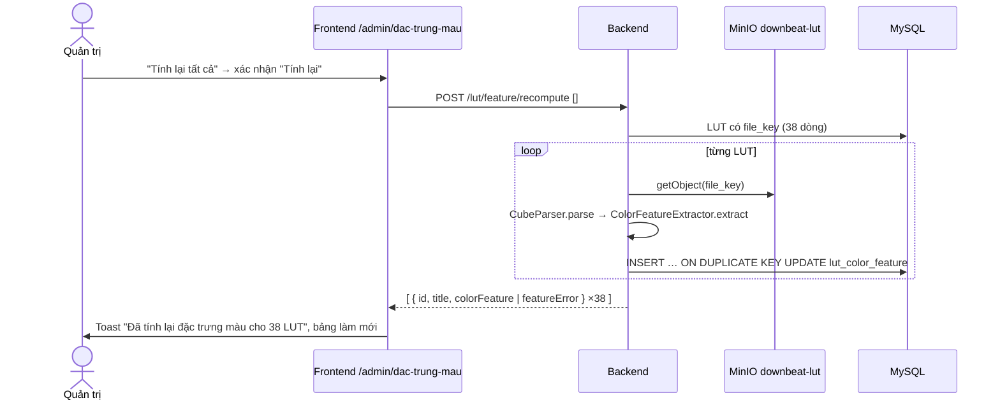

# Đặc trưng màu

## 1. Mục tiêu và phạm vi

Sau plan này, backend **đọc được file .cube** (17 / 33 / 65) và **đo 10 đặc trưng màu** (sáng tối, tương phản, bão hoà, ấm lạnh, sắc độ, dịch màu vùng tối / vùng sáng, đen trắng) theo đúng công thức thiết kế §7.2.4. Đặc trưng lưu ở bảng `lut_color_feature`; cả 38 LUT mẫu được tính tự động khi backend khởi động. Quản trị mở **`/admin/dac-trung-mau`** để xem đặc trưng của từng LUT, so các LUT với nhau (ví dụ phát hiện "Băng Giá" thuộc phong cách lạnh mà đo ra hơi ấm) và bấm tính lại. Bộ đọc file và thẻ "Đặc trưng màu" được viết để lát `quan-ly-lut` dùng lại khi upload .cube.

| Có làm | Không làm (để plan khác) |
|---|---|
| `CubeParser` (đọc .cube, từ chối LUT 1D / file lỗi bằng `LUT_FILE_INVALID`), `ColorFeatureExtractor` (lấy mẫu 17³, sRGB → CIELAB, 10 đặc trưng) | Upload .cube, form LUT, xuất bản / ẩn (lát `quan-ly-lut`, gọi lại hàm của lát này) |
| Migration `V6`: bảng `lut_color_feature`, module "Kho LUT", resource `LUT` (`/lut/`) | Chuẩn hoá z-score trên toàn kho, chỉ mục vector, `lut_similarity` (lát `chi-muc-tuong-dong` 2.1) |
| Tính đặc trưng cho LUT còn thiếu khi backend khởi động; API tính lại một / nhiều / tất cả LUT | Tác vụ định kỳ 03:00 dựng lại chỉ mục (lát 2.1) |
| `GET /lut/feature/list`, `POST /lut/feature/recompute` | Hiện đặc trưng màu ở cửa hàng (khách không thấy) |
| Trang `/admin/dac-trung-mau`: bảng + bộ lọc + ngăn chi tiết có thẻ "Đặc trưng màu" (9 thanh + nhãn "Đen trắng") | Sửa tay giá trị đặc trưng |

## 2. Tác nhân và phân quyền

| Tác nhân | Quyền (resource `LUT`, uri `/lut/`) | Ghi chú |
|---|---|---|
| Quản trị (role toàn quyền `is_operator = 1`) | Mọi quyền | Không cần cấp, `UserService.checkPermission` cho qua |
| Chức vụ được cấp `LUT` ở `/admin/phan-quyen` | VIEW: xem danh sách; UPDATE: tính lại | ADD, DELETE khai báo sẵn cho lát `quan-ly-lut` |
| `noaccess@downbeat.local`, khách hàng | Không | API 403; sidebar không có mục; mở thẳng URL thấy "Truy cập bị từ chối" |

Resource `LUT` là resource chung của mọi trang quản trị LUT (lát này và `quan-ly-lut`), nên actions khai báo đủ 4 ngay từ đầu.

## 3. Luồng nghiệp vụ

**Luồng chính — tự tính khi khởi động:**
1. Backend lên (sau Flyway), `LutColorFeatureBootstrap` lấy các LUT có `file_key` mà **chưa có** dòng `lut_color_feature`.
2. Với từng LUT: đọc file từ bucket riêng tư (`downbeat-lut`) → `CubeParser.parse` → `ColorFeatureExtractor.extract` → ghi `lut_color_feature`.
3. In một dòng log `Đặc trưng màu: đã tính X LUT, lỗi Y LUT`. LUT lỗi (file mất, file hỏng) ghi log cảnh báo kèm slug và lý do, **không chặn** backend khởi động. MinIO chưa lên thì cũng chỉ ghi cảnh báo.

**Luồng chính — xem:** quản trị mở sidebar "Đặc trưng màu" → bảng LUT (mọi trạng thái) với 3 thanh nhỏ "Nhiệt độ", "Bão hoà", "Tương phản" → bấm "Xem đặc trưng" → ngăn bên phải có thẻ "Đặc trưng màu" đủ 9 thanh.

**Luồng chính — tính lại:** trong ngăn chi tiết bấm "Tính lại" (một LUT), hoặc nút "Tính lại tất cả" ở đầu trang (hỏi xác nhận) → `POST /lut/feature/recompute` → toast số LUT đã tính; LUT lỗi hiện trong khung cảnh báo ở đầu trang.

**Ngoại lệ:**
- E1. LUT không có `file_key` → không tính, kết quả của LUT đó có `featureError` "LUT chưa có file .cube".
- E2. Không đọc được object trên MinIO → `featureError` "Không đọc được file .cube".
- E3. File sai định dạng → `featureError` = message của `LUT_FILE_INVALID` (ví dụ "File .cube không hợp lệ: cần 35937 dòng dữ liệu, file có 35900"). Dòng đặc trưng cũ (nếu có) **giữ nguyên**.
- E4. Một id trong danh sách tính lại không tồn tại → 404, không tính LUT nào.
- E5. LUT đen trắng (`isMono = 1`): các dịch màu đo được chỉ phản ánh việc bỏ hết màu, nên thẻ ẩn 6 thanh dịch màu, chỉ giữ "Độ sáng", "Tương phản", "Bão hoà" và nhãn "Đen trắng".



## 4. Cơ sở dữ liệu

Migration `backend/app/src/main/resources/db/migration/V6__dac_trung_mau.sql` (chạy mọi môi trường, chạy lại không đổi gì):

```sql
SET NAMES utf8mb4;

CREATE TABLE IF NOT EXISTS lut_color_feature (
  id INT NOT NULL AUTO_INCREMENT PRIMARY KEY,
  lut_id INT NOT NULL,
  brightness DOUBLE NOT NULL,
  contrast DOUBLE NOT NULL,
  saturation DOUBLE NOT NULL,
  warmth DOUBLE NOT NULL,
  tint DOUBLE NOT NULL,
  shadow_a DOUBLE NOT NULL, shadow_b DOUBLE NOT NULL,
  highlight_a DOUBLE NOT NULL, highlight_b DOUBLE NOT NULL,
  is_mono TINYINT NOT NULL DEFAULT 0,
  computed_time DATETIME NOT NULL DEFAULT CURRENT_TIMESTAMP,
  CONSTRAINT uk_lut_color_feature_lut UNIQUE (lut_id),
  CONSTRAINT fk_lut_color_feature_lut FOREIGN KEY (lut_id) REFERENCES lut(id) ON DELETE CASCADE
) ENGINE=InnoDB DEFAULT CHARSET=utf8mb4 COLLATE=utf8mb4_0900_ai_ci;

INSERT INTO `module` (`name`, `code`, `description`, `active`)
SELECT 'Kho LUT', 'CATALOG', 'Quản trị LUT, danh mục, tác giả', 1 FROM DUAL
WHERE NOT EXISTS (SELECT 1 FROM `module` WHERE `code` = 'CATALOG');

INSERT INTO `resource` (`name`, `description`, `code`, `uri`, `actions`, `active`, `module_id`)
SELECT 'Quản lý LUT', 'LUT, file .cube, đặc trưng màu, xuất bản', 'LUT', '/lut/',
       '["VIEW", "ADD", "UPDATE", "DELETE"]', 1, (SELECT `id` FROM `module` WHERE `code` = 'CATALOG')
FROM DUAL WHERE NOT EXISTS (SELECT 1 FROM `resource` WHERE `code` = 'LUT');
```

| Cột | Ý nghĩa | Công thức (thiết kế §7.2.4) |
|---|---|---|
| `brightness` | Làm sáng (+) / tối (−) | mean(L_ra − L_vào) / 100 |
| `contrast` | > 1 tăng tương phản | std(L_ra) / std(L_vào), **độ lệch chuẩn tổng thể** (chia n, không chia n − 1) |
| `saturation` | > 1 tăng bão hoà, ≈ 0 đen trắng | mean(C_ra) / mean(C_vào), chỉ trên điểm có C_vào > 10 |
| `warmth` | + ấm, − lạnh | mean(b_ra − b_vào) |
| `tint` | + hồng, − xanh lá | mean(a_ra − a_vào) |
| `shadow_a`, `shadow_b` | Dịch màu vùng tối | như `tint`, `warmth` trên điểm có L_vào < 30 |
| `highlight_a`, `highlight_b` | Dịch màu vùng sáng | như trên với L_vào > 70 |
| `is_mono` | LUT đen trắng | 1 nếu mean(C_ra) < 5 (trên mọi điểm mẫu) |

- **Lệch thiết kế §4.7**: thiết kế để `lut_id` làm khoá chính; plan thêm cột `id` vì `AbsMysqlRepository` bắt buộc cột `id`, `lut_id` thành UNIQUE. Ý nghĩa không đổi: mỗi LUT tối đa một dòng.
- Kiểu `DOUBLE` thay `float` để giá trị đọc ra khớp giá trị tính (không lệch ở chữ số thứ 7).
- Ghi bằng `INSERT … ON DUPLICATE KEY UPDATE` (theo `lut_id`), cập nhật cả `computed_time = NOW()`.
- Xoá: theo LUT (`ON DELETE CASCADE`). Không có API xoá riêng.
- Không có seed: 38 LUT mẫu được tính lúc khởi động (§3).

**Giá trị tham chiếu** (Claude tính bằng script Python độc lập trên chính file .cube của `tools/seed/kho-lut/out/`, đúng công thức trên; dùng ở TC-12, sai số cho phép ±0,01):

| LUT (slug) | brightness | contrast | saturation | warmth | tint | shadow_a | shadow_b | highlight_a | highlight_b | is_mono |
|---|---|---|---|---|---|---|---|---|---|---|
| `hoang-hon-cu` (identity, HIDDEN) | 0.000 | 1.000 | 1.000 | 0.000 | 0.000 | 0.000 | 0.000 | 0.000 | 0.000 | 0 |
| `noir` | −0.062 | 1.439 | 0.000 | −3.956 | −7.494 | −27.929 | 25.001 | 29.850 | −32.947 | 1 |
| `hoang-hon-sai-gon` | 0.021 | 1.023 | 0.894 | 7.204 | 0.005 | −5.823 | 5.095 | 7.568 | 9.423 | 0 |
| `xanh-dien-anh` (teal & orange) | 0.035 | 1.024 | 1.281 | 1.218 | 3.697 | 11.375 | −11.982 | −4.872 | 14.112 | 0 |
| `bang-gia` (lạnh, đo ra hơi ấm) | 0.021 | 1.047 | 0.924 | 1.695 | −1.687 | 1.024 | 10.633 | −3.275 | −14.289 | 0 |

## 5. Hợp đồng API (cố định — nguồn sự thật cho cả BE và FE)

Mọi response thành công bọc `{ "code": 200, "message": "OK", "result": … }`. Lỗi nghiệp vụ trả `{ "path", "code", "errorCode", "message" }`. Cả hai endpoint thuộc resource `LUT`, controller có `URI = "/lut/"`, gọi `checkPermission` đầu tiên. Không có endpoint công khai mới; API công khai của kho (`/lut/public/**`) **không** trả `colorFeature`.

Đối tượng `colorFeature` (POJO `LutColorFeature`, `NON_NULL`; giá trị là số thực đầy đủ, FE tự làm tròn khi hiện):

```json
{
  "lutId": 9,
  "brightness": 0.0213, "contrast": 1.0228, "saturation": 0.8941,
  "warmth": 7.2041, "tint": 0.0052,
  "shadowA": -5.8231, "shadowB": 5.0948,
  "highlightA": 7.5681, "highlightB": 9.4226,
  "isMono": 0,
  "computedTime": "2026-11-10T09:15:02"
}
```

(Không trả cột `id` của `lut_color_feature`: POJO đánh `@JsonIgnore` trên `id`.)

### 5.1 `GET /api/lut/feature/list` — quyền VIEW

Tham số (đều không bắt buộc): `keyword` (khớp `title` hoặc `slug`, LIKE, escape `\ % _`), `style` (một trong 8 phong cách), `status` (`DRAFT` / `PUBLISHED` / `HIDDEN`), `hasFeature` (`1` = đã có đặc trưng, `0` = chưa có), `page` (mặc định 1), `limit` (mặc định 10, tối đa 100). Lấy **mọi trạng thái** LUT. Thứ tự `lut.id` ASC.

Response `result`:
```json
{
  "total": 38,
  "page": 1,
  "items": [
    {
      "id": 9, "slug": "hoang-hon-sai-gon", "title": "Hoàng Hôn Sài Gòn",
      "creatorName": "Minh Color", "style": "am-ap", "status": "PUBLISHED",
      "coverUrl": "http://localhost:9020/downbeat-public/lut/hoang-hon-sai-gon/cover.jpg",
      "lutSize": 33,
      "colorFeature": { "lutId": 9, "brightness": 0.0213, "contrast": 1.0228, "saturation": 0.8941, "warmth": 7.2041, "tint": 0.0052, "shadowA": -5.8231, "shadowB": 5.0948, "highlightA": 7.5681, "highlightB": 9.4226, "isMono": 0, "computedTime": "2026-11-10T09:15:02" }
    },
    { "id": 40, "slug": "lut-moi", "title": "LUT mới", "creatorName": "Minh Color", "style": "lanh", "status": "DRAFT", "lutSize": null }
  ]
}
```

- Mỗi item chỉ có các khoá trên (`id`, `slug`, `title`, `creatorName`, `style`, `status`, `coverUrl`, `lutSize`, `colorFeature`); khoá rỗng bị bỏ (`NON_NULL`). LUT chưa có đặc trưng thì **không có** khoá `colorFeature`.
- Đặc trưng của cả trang lấy bằng **một** truy vấn `WHERE lut_id IN (…)`.

### 5.2 `POST /api/lut/feature/recompute` — quyền UPDATE

Body là **mảng id LUT**. Mảng rỗng `[]` = mọi LUT có `file_key`.

Request:
```json
[11]
```

Response `result`: mảng, mỗi phần tử ứng với một LUT đã xử lý (thứ tự `id` ASC), cùng shape item của 5.1, thêm khoá `featureError` khi LUT đó lỗi:
```json
[
  { "id": 11, "slug": "noir", "title": "Noir", "creatorName": "Mono Works", "style": "den-trang", "status": "PUBLISHED", "coverUrl": "http://localhost:9020/downbeat-public/lut/noir/cover.jpg", "lutSize": 33,
    "colorFeature": { "lutId": 11, "brightness": -0.0617, "contrast": 1.4391, "saturation": 0.0, "warmth": -3.9563, "tint": -7.4941, "shadowA": -27.9289, "shadowB": 25.0012, "highlightA": 29.8503, "highlightB": -32.9467, "isMono": 1, "computedTime": "2026-11-10T09:20:41" } }
]
```

Phần tử lỗi:
```json
{ "id": 40, "slug": "lut-moi", "title": "LUT mới", "creatorName": "Minh Color", "style": "lanh", "status": "DRAFT", "featureError": "LUT chưa có file .cube" }
```

Quy tắc:
1. Có id không tồn tại → 404 `DATA_NOT_FOUND` "Không tìm thấy LUT", **chưa tính LUT nào**.
2. Từng LUT xử lý độc lập (không gói chung một transaction): LUT lỗi không làm hỏng LUT khác; LUT lỗi giữ nguyên dòng đặc trưng cũ, phần tử trả về kèm `colorFeature` cũ (nếu có) và `featureError`.
3. `featureError` là một trong: "LUT chưa có file .cube" · "Không đọc được file .cube" · message của `LUT_FILE_INVALID` (§5.3).
4. Gọi lại với cùng file cho cùng giá trị (chỉ `computedTime` đổi).

### 5.3 Quy tắc đọc file .cube (`CubeParser`) và message `LUT_FILE_INVALID`

Theo Phụ lục A, đọc từng dòng (UTF-8, bỏ BOM, cắt khoảng trắng hai đầu):
- Dòng trống và dòng bắt đầu bằng `#` bỏ qua ở mọi vị trí.
- Phần đầu (trước dòng dữ liệu đầu tiên): `LUT_3D_SIZE N`; `DOMAIN_MIN r g b`, `DOMAIN_MAX r g b` (không bắt buộc, mặc định 0 0 0 và 1 1 1); `LUT_3D_INPUT_RANGE min max` (coi như DOMAIN cho cả 3 kênh); `TITLE …` và mọi từ khoá khác (token đầu toàn chữ in hoa, số, `_`) bỏ qua. Gặp `LUT_1D_SIZE` → lỗi.
- Dòng dữ liệu: đúng 3 token, mỗi token là số thực hữu hạn (`Double.parseDouble`, loại `NaN`, `Infinity`). Dòng dữ liệu thứ i (đếm từ 0) là màu ra của màu vào `(r, g, b) / (N − 1)` với `i = r + g·N + b·N²`.
- Giá trị đổi thang: `(v − min) / (max − min)` theo từng kênh. Không cắt ở bước đọc; `ColorFeatureExtractor` cắt về [0, 1] trước khi đổi màu.

| Lỗi | `message` (errorCode `LUT_FILE_INVALID`, HTTP 400) |
|---|---|
| Không có `LUT_3D_SIZE` (kể cả file rỗng) | File .cube không hợp lệ: thiếu LUT_3D_SIZE |
| Có `LUT_1D_SIZE` | File .cube không hợp lệ: là LUT 1D, chỉ nhận LUT 3D |
| N không phải 17, 33, 65 | File .cube không hợp lệ: kích thước {N} không được hỗ trợ (chỉ nhận 17, 33, 65) |
| `DOMAIN_MIN` ≥ `DOMAIN_MAX` ở một kênh | File .cube không hợp lệ: DOMAIN_MIN phải nhỏ hơn DOMAIN_MAX |
| Dòng dữ liệu không phải 3 số thực (có chữ, thiếu / thừa số) | File .cube không hợp lệ: dòng {số dòng trong file, đếm từ 1} không phải 3 số thực |
| Số dòng dữ liệu ≠ N³ | File .cube không hợp lệ: cần {N³} dòng dữ liệu, file có {số dòng} |

`ErrorCode` thêm `LUT_FILE_INVALID(400, "File .cube không hợp lệ")`; mọi lỗi trên dùng `new AppException(ErrorCode.LUT_FILE_INVALID, "<message>")`.

### 5.4 Lỗi nghiệp vụ

| Tình huống | HTTP | `errorCode` | Message |
|---|---|---|---|
| `recompute`: có id không tồn tại | 404 | `DATA_NOT_FOUND` | Không tìm thấy LUT |
| Không token | 401 | (không có) | Chưa đăng nhập |
| Thiếu quyền VIEW (`list`) | 403 | `FORBIDDEN` | Bạn không có quyền thực hiện thao tác này! Path: /lut/, Action: VIEW |
| Thiếu quyền UPDATE (`recompute`) | 403 | `FORBIDDEN` | Bạn không có quyền thực hiện thao tác này! Path: /lut/, Action: UPDATE |
| File .cube hỏng (không phải lỗi HTTP ở lát này; nằm trong `featureError`) | — | `LUT_FILE_INVALID` | Theo bảng §5.3 |

## 6. Giao diện (chuỗi cố định — test E2E chọn theo đúng các chuỗi này)

- Route: `/admin/dac-trung-mau` · Sidebar: nhóm "Chức năng chính", mục **"Đặc trưng màu"** (code `LUT`, icon `Palette`).
- `DataTableAdvanced`: tiêu đề **"Đặc trưng màu"**, mô tả "Đặc trưng màu đo từ file .cube của từng LUT. Dùng để kiểm tra LUT có đúng như tên gọi và làm dữ liệu cho gợi ý."
- Bộ lọc:

| Key | Label | Kiểu | Lựa chọn / placeholder |
|---|---|---|---|
| `keyword` | Tìm kiếm | text | "Tìm theo tên hoặc slug LUT" |
| `style` | Phong cách | select | "Tất cả" + 8 nhãn `LUT_STYLE_LABEL` (`lib/types/lut.ts`) |
| `status` | Trạng thái | select | "Tất cả", "Nháp", "Đã xuất bản", "Đã ẩn" |
| `hasFeature` | Đặc trưng | select | "Tất cả", "Đã tính", "Chưa tính" |

- Cột bảng (header là chuỗi):

| Header | Nội dung |
|---|---|
| LUT | Ảnh bìa 40×40 bo góc (`alt=""`; không có `coverUrl` thì ô xám) + tiêu đề (đậm) + slug (chữ nhỏ, màu nhạt) |
| Phong cách | Nhãn tiếng Việt |
| Trạng thái | Badge "Nháp" (`outline`) / "Đã xuất bản" (`default`) / "Đã ẩn" (`secondary`) |
| Nhiệt độ | Thanh nhỏ `warmth` + số |
| Bão hoà | Thanh nhỏ `saturation` + số |
| Tương phản | Thanh nhỏ `contrast` + số |
| Đen trắng | "Có" khi `isMono = 1`, ngược lại "—" |
| Tính lúc | `dd/MM/yyyy HH:mm` theo `computedTime`; chưa có đặc trưng thì "Chưa tính" (chữ màu cảnh báo) |

  Chưa có `colorFeature` thì 3 ô thanh hiện "—". Cột thao tác: nút ⋮ `aria-label="Thao tác {title}"`, mục "Xem đặc trưng" (luôn có) và "Tính lại" (chỉ khi có quyền UPDATE). Bấm vào hàng cũng mở ngăn chi tiết.
- `toolbarActions`: nút **"Tính lại tất cả"** (chỉ khi có quyền UPDATE) → `AlertDialog` tiêu đề "Tính lại đặc trưng màu cho mọi LUT?", mô tả "Backend đọc lại file .cube của mọi LUT có file. Thường mất vài giây.", nút "Tính lại" / "Hủy". Đang chạy: nút đổi chữ "Đang tính…" và bị khoá.
- Không có nút "Thêm", không có cột chọn, không có xoá.
- **Ngăn chi tiết** (`Sheet` bên phải, rộng `sm:max-w-md`): tiêu đề = tiêu đề LUT; mô tả "{Nhãn phong cách} · LUT {lutSize}³" (không có `lutSize` thì chỉ nhãn phong cách); ảnh bìa rộng hết ngăn (tỉ lệ 16:9, `alt` = tiêu đề); thẻ **"Đặc trưng màu"**; dòng "Tính lúc {dd/MM/yyyy HH:mm}"; nút "Tính lại" (quyền UPDATE; đang chạy "Đang tính…"). Chưa có đặc trưng: thay thẻ bằng khung trống "Chưa có đặc trưng màu" + mô tả "Bấm Tính lại để đọc file .cube của LUT này." Sau khi tính lại, ngăn hiện số mới ngay (không cần đóng mở lại).
- **Thẻ "Đặc trưng màu"** (`components/admin/lut/lut-color-feature-card.tsx`, lát `quan-ly-lut` dùng lại): `Card` tiêu đề "Đặc trưng màu", mô tả "Đo từ file .cube, so với ảnh gốc". Mỗi hàng là một thanh hai phía (tâm là "không đổi", lệch phải là cực phải), có tên hàng, hai cực hai đầu, số bên phải:

| Tên hàng | Cực trái | Cực phải | Field | Tâm | Đầy thanh khi lệch | Số hiện |
|---|---|---|---|---|---|---|
| Độ sáng | Tối | Sáng | `brightness` | 0 | 0,15 | 2 số lẻ, có dấu: `+0,02` |
| Tương phản | Dịu | Gắt | `contrast` | 1 | 0,5 | 2 số lẻ, không dấu: `1,02` |
| Bão hoà | Nhạt | Rực | `saturation` | 1 | 1 | 2 số lẻ, không dấu: `0,89` |
| Nhiệt độ | Lạnh | Ấm | `warmth` | 0 | 15 | 1 số lẻ, có dấu: `+7,2` |
| Sắc độ | Xanh lá | Hồng | `tint` | 0 | 15 | 1 số lẻ, có dấu |
| Vùng tối — nhiệt độ | Lạnh | Ấm | `shadowB` | 0 | 30 | 1 số lẻ, có dấu |
| Vùng tối — sắc độ | Xanh lá | Hồng | `shadowA` | 0 | 30 | 1 số lẻ, có dấu |
| Vùng sáng — nhiệt độ | Lạnh | Ấm | `highlightB` | 0 | 30 | 1 số lẻ, có dấu |
| Vùng sáng — sắc độ | Xanh lá | Hồng | `highlightA` | 0 | 30 | 1 số lẻ, có dấu |

  - Số định dạng `vi-VN` (dấu phẩy thập phân), làm tròn trước rồi mới xét dấu: làm tròn ra 0 thì không có dấu (`0,00`, `0,0`). Thanh vượt quá "đầy thanh" thì dừng ở mép.
  - Mỗi hàng là `role="meter"`, `aria-label` = tên hàng, `aria-valuetext` = số hiện, `aria-valuemin` / `aria-valuemax` = tâm ∓ mức đầy, `aria-valuenow` = giá trị gốc.
  - `isMono = 1`: đầu thẻ có badge **"Đen trắng"**, chỉ hiện 3 hàng "Độ sáng", "Tương phản", "Bão hoà", dưới cùng ghi "LUT đen trắng: các thanh dịch màu không có ý nghĩa nên được ẩn."
  - Thanh nhỏ ở bảng dùng cùng component thanh (`components/admin/lut/feature-bar.tsx`) bản gọn: không tên hàng, không cực, chỉ thanh + số; `title` của ô = "{Cực trái} ← → {Cực phải}".
- Toast: tính lại thành công "Đã tính lại đặc trưng màu cho {số LUT không lỗi} LUT"; có LUT lỗi thì thêm ", {số} LUT lỗi" (ví dụ "Đã tính lại đặc trưng màu cho 37 LUT, 1 LUT lỗi"). Lỗi HTTP → toast message backend (MutationCache có sẵn); dự phòng "Không tính lại được đặc trưng màu".
- Có LUT lỗi sau lần tính lại gần nhất: khung `Alert` (variant `destructive`) ngay trên bảng, tiêu đề "Một số LUT chưa tính được", mỗi dòng "{title}: {featureError}", nút "Đóng" ẩn khung.
- Danh sách lỗi tải → khung "Không tải được danh sách" + "Thử lại" (`AdminListError` có sẵn). Bảng rỗng → "Không có dữ liệu." (có sẵn).

## 7. Việc backend (Codex)

Module chính `business` (package `vn.aeoc.business.lut`), sửa nhỏ ở `base`, `entity`, `authenticate`.

1. `app/src/main/resources/db/migration/V6__dac_trung_mau.sql`: đúng nội dung §4. Restart (Flyway tạo bảng) → `mvn -q -DskipTests package` (sinh jOOQ `LUT_COLOR_FEATURE`).
2. `base/.../constant/ErrorCode.java`: thêm `LUT_FILE_INVALID(400, "File .cube không hợp lệ")`.
3. `entity/.../data/mysql/lut/LutColorFeature.java`: POJO `@Data @JsonInclude(NON_NULL)` các cột §4 (camelCase, `isMono` là `Integer`, `computedTime` là `LocalDateTime`); `@JsonIgnore` trên `id`.
4. `entity/.../data/mysql/lut/Lut.java`: thêm `private LutColorFeature colorFeature;` và `private String featureError;` (không phải cột DB, comment "chỉ trả ở /lut/feature/**").
5. `authenticate/.../service/FileStorageService.java`: thêm `byte[] readPrivate(String key)` đọc object từ `privateBucket` (lỗi MinIO ném `AppException(ErrorCode.UPLOAD_FILE_FAILED, "Không đọc được file .cube")` hoặc exception riêng, service bắt lại). File tối đa 65³ dòng (~8 MB) nên đọc hết vào bộ nhớ được.
6. `business/.../lut/feature/CubeLut.java`: `record CubeLut(int size, double[] data)` — `data` dài `3·N³`, đã đổi thang domain, thứ tự R nhanh nhất.
7. `business/.../lut/feature/CubeParser.java`: lớp thuần (không Spring), `static CubeLut parse(InputStream in)` đúng §5.3, message lỗi đúng từng chữ.
8. `business/.../lut/feature/ColorFeatureExtractor.java`: lớp thuần, `static LutColorFeature extract(CubeLut lut)`:
   - Lưới mẫu 17³: chỉ số `ri, gi, bi` ∈ [0, 16], điểm lưới gốc `(ri·s, gi·s, bi·s)` với `s = (N − 1) / 16` (17 → 1, 33 → 2, 65 → 4); màu vào = `(ri, gi, bi) / 16`.
   - Màu ra cắt [0, 1]; đổi sRGB → Lab đúng công thức §7.2.4 (ma trận D65, `f(t)`, trắng chuẩn 0.95047 / 1.0 / 1.08883); `C = √(a² + b²)`.
   - Tính 10 đặc trưng theo bảng §4 (`contrast` dùng độ lệch chuẩn tổng thể; `saturation` chỉ trên điểm `C_vào > 10`; vùng tối `L_vào < 30`, vùng sáng `L_vào > 70`; `isMono` = `mean(C_ra) < 5`). Không làm tròn khi lưu.
9. `business/.../lut/repository/LutColorFeatureRepository.java` `extends AbsMysqlRepository<LutColorFeatureRecord, LutColorFeature, Integer>`: `upsert(LutColorFeature)` (`insertInto … onDuplicateKeyUpdate`, đặt `computed_time = now()`), `getByLutIds(List<Integer>)`, `getLutIdsWithFeature()` (cho bootstrap).
10. `business/.../lut/repository/LutRepository.java`: thêm `adminList(keyword, style, status, hasFeature, pageable)` + `adminCount(...)` dùng chung `getAdminCondition(...)` (chỉ tham chiếu `LUT`; `hasFeature` viết bằng `DSL.exists(selectOne().from(LUT_COLOR_FEATURE)…)`), cột §5.1 + `creator_name` (JOIN `creator`), thứ tự `LUT.ID.asc()`; `getAdminByIds(ids)` (cùng cột, cho recompute); `getWithFile()` (LUT có `file_key`). Lát `quan-ly-lut` sẽ dùng lại `adminList` cho `/lut/list`, nên đặt tên chung, không gắn "feature".
11. `business/.../lut/service/LutColorFeatureService.java` `extends BaseService<LutColorFeatureRepository, LutColorFeature, Integer>` (inject thêm `LutRepository`, `FileStorageService`):
    - `Page<Lut> list(...)` → `pageQuery` + gắn `colorFeature` cho cả trang bằng một lần `getByLutIds`. `limit` > 100 → 100.
    - `List<Lut> recompute(List<Integer> ids)`: theo §5.2 (kiểm mọi id trước, rồi xử lý từng LUT, bắt lỗi từng LUT thành `featureError`).
    - `LutColorFeature computeAndSave(Integer lutId, byte[] cube)`: parse + extract + upsert, ném `LUT_FILE_INVALID` nếu file hỏng (lát `quan-ly-lut` gọi khi upload, nên đặt `public`, không bắt lỗi).
12. `business/.../lut/service/LutColorFeatureBootstrap.java`: `@Component`, `@EventListener(ApplicationReadyEvent.class)`, bật / tắt bằng `lut.feature.compute-on-startup` (mặc định `true`, khai báo trong `application.yml`); tính cho LUT có `file_key` chưa có đặc trưng; bắt mọi lỗi, log như §3; không ném ra ngoài.
13. `business/.../lut/controller/LutFeatureController.java` `extends BaseController`, `URI = "/lut/"`: `GET /lut/feature/list` (VIEW), `POST /lut/feature/recompute` body `@RequestBody List<Integer>` (UPDATE).

Quyết định đã chốt, worker không tự đổi: lưới mẫu 17³ cho mọi kích thước; độ lệch chuẩn tổng thể; không làm tròn khi lưu; LUT lỗi giữ dòng cũ; mảng rỗng = tính tất cả; danh sách gồm mọi trạng thái; tính khi khởi động chỉ cho LUT **chưa có** đặc trưng.

Unit test bắt buộc (JUnit 5 + AssertJ, file .cube dựng trong code bằng hàm sinh, không đọc file ngoài repo): TC-01 → TC-09 ở §9.
- `business/src/test/java/vn/aeoc/business/lut/feature/CubeParserTest.java` (TC-05, TC-06)
- `business/src/test/java/vn/aeoc/business/lut/feature/ColorFeatureExtractorTest.java` (TC-01 → TC-04)
- `business/src/test/java/vn/aeoc/business/lut/service/LutColorFeatureServiceTest.java` (TC-07, TC-08; Mockito)
- `business/src/test/java/vn/aeoc/business/lut/service/LutColorFeatureBootstrapTest.java` (TC-09)

Nghiệm thu: `mvn -q "-Djooq.codegen.skip=true" -pl business -am test` xanh; `sh scripts/ai/backend-restart.sh` in Flyway áp `6` và log "Đặc trưng màu: đã tính 38 LUT, lỗi 0 LUT"; curl `list` (có `colorFeature` của `noir`), `recompute [11]`, `recompute [999999]`, `list` bằng token `noaccess`; so 5 LUT ở bảng tham chiếu §4 (±0,01) và dán kết quả vào `worker_done`.

## 8. Việc frontend (agy)

Trang không phải CRUD: chép khung `routes/admin/chuc-vu.tsx` (bảng + lọc + guard), bỏ thêm / sửa / xoá, thêm `Sheet` chi tiết.

1. `lib/types/lut-feature.ts`: `LutColorFeatureDTO` (§5 `colorFeature`), `LutFeatureItemDTO` (`id`, `slug`, `title`, `creatorName?`, `style: LutStyle`, `status: "DRAFT" | "PUBLISHED" | "HIDDEN"`, `coverUrl?`, `lutSize?`, `colorFeature?`, `featureError?`), `LutFeatureListApiRequest` (`keyword?`, `style?`, `status?`, `hasFeature?: 0 | 1`, `paging?`), `LutFeatureListResponseDTO = PagedResult<LutFeatureItemDTO>`, `LUT_STATUS_LABEL` ("Nháp", "Đã xuất bản", "Đã ẩn").
2. `lib/axios/lut-feature.ts`: `getLutFeatureList(req)` → `GET /lut/feature/list` (chỉ gửi tham số có giá trị); `recomputeLutFeatures(ids: number[])` → `POST /lut/feature/recompute` body là mảng.
3. `lib/tanstack/options/lut-feature.ts`: `LUT_FEATURES_QUERY_KEY = ["lut-features"]`; `createLutFeatureListQueryOptions(req)` (`keepPreviousData`); `recomputeLutFeaturesMutationOptions` với `meta.successMessage` là hàm theo §6, `errorMessage` "Không tính lại được đặc trưng màu", `invalidatesQuery: [LUT_FEATURES_QUERY_KEY]`.
4. `lib/lut-feature/feature-rows.ts`: mảng cấu hình 9 hàng của bảng §6 (`key`, `label`, `left`, `right`, `neutral`, `span`, `digits`, `signed`) + `formatFeatureValue(value, row)` (Intl `vi-VN`, làm tròn trước rồi xét dấu) + `featureRatio(value, row)` ∈ [−1, 1]. Hàm thuần để lát `quan-ly-lut` dùng lại.
5. `components/admin/lut/feature-bar.tsx`: thanh hai phía (tâm ở giữa, phần tô lệch trái / phải theo `featureRatio`, màu `primary`; bản `compact` cho ô bảng), `role="meter"` + aria theo §6.
6. `components/admin/lut/lut-color-feature-card.tsx`: thẻ "Đặc trưng màu" (`Card`, `Badge` "Đen trắng", quy tắc `isMono` §6). Props `{ feature: LutColorFeatureDTO }`.
7. `components/admin/lut-feature/columns.tsx`: `createLutFeatureColumns({ canUpdate, onView, onRecompute })` theo bảng cột §6.
8. `components/admin/lut-feature/lut-feature-sheet.tsx`: ngăn chi tiết §6. Props `{ item, open, canUpdate, isRecomputing, onOpenChange, onRecompute }`; trang cha giữ mutation, sau khi tính lại cập nhật `item` của ngăn từ kết quả trả về.
9. `routes/admin/dac-trung-mau.tsx`: `RESOURCE_CODE = "LUT"`, `AdminPermissionGuard`, bộ lọc §6 (giá trị `hasFeature` "1" / "0" đổi sang số khi gọi API), `toolbarActions` "Tính lại tất cả" + `AlertDialog`, khung `Alert` lỗi tính lại.
10. `components/admin/sidebar/admin-sidebar.tsx`: `FEATURE_ITEMS` thêm `{ code: "LUT", title: "Đặc trưng màu", url: "/admin/dac-trung-mau", icon: Palette }`.

Không sửa: khu cửa hàng, `tests/e2e/**`.

Component shadcn dùng: có sẵn trong `components/ui/`: `sheet`, `card`, `badge`, `alert`, `alert-dialog`, `dropdown-menu`, `skeleton`, `tooltip`, `table`, `select`. Cần `shadcn add`: không.

## 9. Test case

LUT mẫu dùng trong TC (tra `id` qua `list?keyword=<slug>`): `noir` (đen trắng), `hoang-hon-sai-gon` (ấm), `xanh-dien-anh` (teal & orange), `bang-gia` (lạnh nhưng đo ra hơi ấm), `hoang-hon-cu` (HIDDEN, file identity), `thu-nghiem-nhap` (DRAFT). Kho mẫu có 38 LUT, 6 LUT phong cách `lanh` (`xanh-dem`, `da-lat-suong`, `bang-gia`, `bac-cuc`, `mua-pho`, `anh-trang`). E2E của lát sau (`quan-ly-lut`) có thể tạm thêm LUT, nên TC **không khoá cứng tổng số**: "N" là `total` của `GET /lut/feature/list` đọc ngay trong test.

| ID | Loại | Mô tả | Tiền điều kiện | Bước | Kết quả mong đợi |
|---|---|---|---|---|---|
| TC-01 | unit | Identity ở 3 kích thước (UT-01) | — | Sinh file identity N = 17, 33, 65 → `parse` → `extract` | brightness 0, contrast 1, saturation 1, warmth / tint / 4 dịch vùng 0 (±0,01), isMono 0; ba kích thước cho cùng kết quả (±1e-9) |
| TC-02 | unit | LUT đổi mọi màu sang xám (UT-02) | — | N = 17, màu ra = (Y, Y, Y) với Y = 0.2126 R + 0.7152 G + 0.0722 B của màu vào | isMono 1; saturation < 0,01 |
| TC-03 | unit | Tăng đỏ, giảm xanh dương (UT-03) | — | N = 33, ra = (min(R + 0.1, 1), G, max(B − 0.1, 0)) | warmth > 3 |
| TC-04 | unit | Vùng tối ngả xanh dương, vùng sáng ngả cam (UT-04) | — | N = 33; độ sáng vào `m = (R+G+B)/3`: m < 0.35 → B + 0.12; m > 0.65 → (R + 0.08, G + 0.03, B − 0.12); còn lại giữ nguyên; cắt [0, 1] | shadowB < 0; highlightB > 0; contrast trong (0,9; 1,1) |
| TC-05 | unit | File lỗi → `LUT_FILE_INVALID` (UT-05) | — | (a) N = 17 thiếu 1 dòng; (b) một dòng "0.1 abc 0.3" ở dòng 5 của file; (c) có `LUT_1D_SIZE 1024`; (d) `LUT_3D_SIZE 25`; (e) file rỗng; (f) `DOMAIN_MIN 1 1 1` + `DOMAIN_MAX 0 0 0`; (g) dòng "0.1 0.2" | errorCode `LUT_FILE_INVALID`, message đúng từng chữ §5.3: (a) "…cần 4913 dòng dữ liệu, file có 4912"; (b) "…dòng 5 không phải 3 số thực"; (c) "…là LUT 1D, chỉ nhận LUT 3D"; (d) "…kích thước 25 không được hỗ trợ (chỉ nhận 17, 33, 65)"; (e) "…thiếu LUT_3D_SIZE"; (f) "…DOMAIN_MIN phải nhỏ hơn DOMAIN_MAX"; (g) "…dòng {n} không phải 3 số thực" |
| TC-06 | unit | Phần đầu và domain | — | File identity N = 17 có BOM, `TITLE "x"`, dòng `# chú thích` giữa dữ liệu, dòng trống, `LUT_3D_INPUT_RANGE 0 1`; file thứ hai `DOMAIN_MIN 0 0 0` `DOMAIN_MAX 2 2 2` với dữ liệu = identity × 2 | Cả hai đọc được, `extract` ra kết quả identity như TC-01 |
| TC-07 | unit | `recompute`: kiểm id trước, lỗi từng LUT | Mock: id 1 có `file_key` đọc được file identity; id 2 không `file_key`; id 3 `readPrivate` ném lỗi; id 4 file hỏng | (a) `recompute([1, 999])`; (b) `recompute([1, 2, 3, 4])` | (a) `DATA_NOT_FOUND` "Không tìm thấy LUT", không gọi `readPrivate`, không `upsert`; (b) 4 phần tử theo id; 1 có `colorFeature` identity, `upsert` gọi đúng 1 lần; 2 "LUT chưa có file .cube"; 3 "Không đọc được file .cube"; 4 message `LUT_FILE_INVALID` |
| TC-08 | unit | `recompute([])` = mọi LUT có file | Mock `getWithFile()` trả 3 LUT | `recompute(List.of())` | Xử lý đúng 3 LUT đó; trả mảng 3 phần tử |
| TC-09 | unit | Bootstrap chỉ tính LUT còn thiếu, không ném lỗi | Mock 3 LUT có file, 1 đã có đặc trưng; `readPrivate` của 1 LUT ném lỗi | Gọi hàm xử lý `ApplicationReadyEvent`; lần 2 với cờ `compute-on-startup = false` | Lần 1: đọc đúng 2 LUT, `upsert` 1 lần, không ném exception; lần 2: không đọc LUT nào |
| TC-10 | api | Migration resource `LUT` | Đã áp `V6` | Admin `GET /resource/list?keyword=LUT&limit=50`; `GET /module/list?limit=50` | Có resource `code` "LUT", `uri` "/lut/", actions đủ VIEW, ADD, UPDATE, DELETE, thuộc module `code` "CATALOG" tên "Kho LUT" |
| TC-11 | api | Tự tính khi khởi động | Backend đã restart sau V6 | Admin `GET /lut/feature/list?hasFeature=0`; `GET /lut/feature/list?limit=100` | `total` 0; `total` N ≥ 38, có đủ 38 slug mẫu, mọi item có `colorFeature` với đủ 12 khoá `lutId, brightness, contrast, saturation, warmth, tint, shadowA, shadowB, highlightA, highlightB, isMono, computedTime`; không item nào có `featureError`, `description`, `fileKey` |
| TC-12 | api | Giá trị khớp bảng tham chiếu | TC-11 | `list?keyword=<slug>` cho 5 LUT ở bảng §4 | Mỗi đặc trưng lệch ≤ 0,01 so với bảng; `isMono` đúng |
| TC-13 | api | Lọc và phân trang | — | (a) `keyword=noir`; (b) `style=lanh&limit=100`; (c) `status=DRAFT`; (d) `status=HIDDEN`; (e) `keyword=khong-co-lut-nay`; (f) `limit=5&page=2`; (g) `keyword=%`; (h) `limit=500` | (a) total 1, title "Noir"; (b) mọi item style "lanh", có đủ 6 slug lạnh mẫu; (c) mọi item status "DRAFT", có slug "thu-nghiem-nhap"; (d) mọi item status "HIDDEN", có slug "hoang-hon-cu"; (e) total 0; (f) 5 item, item đầu là item thứ 6 của trang `limit=100`, `id` tăng dần; (g) total 0; (h) số item = min(N, 100) |
| TC-14 | api | Tính lại một LUT | Id `noir` | Đọc `computedTime` cũ; `POST /lut/feature/recompute [id]` | 200; mảng 1 phần tử `id` đúng, không có `featureError`; 10 đặc trưng bằng giá trị cũ (±1e-9); `computedTime` mới ≥ cũ; `list?keyword=noir` thấy `computedTime` mới |
| TC-15 | api | Tính lại tất cả | — | `POST /lut/feature/recompute []` | 200; N phần tử (N = số LUT có file .cube, ≥ 38), `id` tăng dần, không phần tử nào có `featureError` |
| TC-16 | api | Id không tồn tại | Id `noir`, `computedTime` hiện tại T | `recompute [999999]`; `recompute [idNoir, 999999]`; đọc lại `noir` | Cả hai 404 `errorCode` "DATA_NOT_FOUND", `message` "Không tìm thấy LUT"; `computedTime` của `noir` vẫn là T |
| TC-17 | api | Quyền | Token `noaccess`; token khách hàng (đăng ký mới); không token | `GET list`, `POST recompute [idNoir]` bằng từng loại | `noaccess`, khách hàng: 403 `FORBIDDEN`, message `list` "Bạn không có quyền thực hiện thao tác này! Path: /lut/, Action: VIEW", `recompute` "… Action: UPDATE"; không token: 401 "Chưa đăng nhập" |
| TC-18 | api | API công khai không lộ đặc trưng | — | `GET /lut/public/get?slug=noir`; `GET /lut/public/list?limit=48` | Không có khoá `colorFeature`, `featureError` ở mọi item |
| TC-19 | e2e | Mở trang, tìm LUT đáng ngờ | Đăng nhập admin | Sidebar "Đặc trưng màu"; gõ "Băng Giá" vào "Tìm theo tên hoặc slug LUT" | Heading "Đặc trưng màu"; còn 1 hàng "Băng Giá", ô "Nhiệt độ" "+1,7", ô "Đen trắng" "—", ô "Tính lúc" dạng `dd/MM/yyyy HH:mm` |
| TC-20 | e2e | Ngăn chi tiết đủ 9 thanh | Sau TC-19 | Bấm ⋮ "Thao tác Băng Giá" → "Xem đặc trưng" | Sheet tiêu đề "Băng Giá", mô tả "Lạnh · LUT 33³"; thẻ "Đặc trưng màu" có 9 `meter`; meter "Nhiệt độ" valuetext "+1,7"; meter "Vùng sáng — nhiệt độ" valuetext "−14,3" hoặc "-14,3"; meter "Tương phản" valuetext "1,05"; không có badge "Đen trắng" |
| TC-21 | e2e | LUT đen trắng | Đăng nhập admin | Tìm "noir" → bấm hàng "Noir" | Sheet có badge "Đen trắng", đúng 3 `meter` ("Độ sáng", "Tương phản", "Bão hoà"), meter "Bão hoà" valuetext "0,00", có dòng "LUT đen trắng: các thanh dịch màu không có ý nghĩa nên được ẩn."; ô "Đen trắng" của hàng là "Có" |
| TC-22 | e2e | Tính lại một LUT trong ngăn | Sheet "Noir" đang mở | Bấm "Tính lại" | Toast "Đã tính lại đặc trưng màu cho 1 LUT"; ngăn vẫn mở, vẫn 3 meter |
| TC-23 | e2e | Tính lại tất cả | Đăng nhập admin, trang `/admin/dac-trung-mau` | "Tính lại tất cả" → dialog "Tính lại đặc trưng màu cho mọi LUT?" → "Hủy"; lại "Tính lại tất cả" → "Tính lại" | Bấm "Hủy" không gọi API; lần sau toast "Đã tính lại đặc trưng màu cho {N} LUT" (N đọc từ API trước khi bấm); không có khung "Một số LUT chưa tính được" |
| TC-24 | e2e | Bộ lọc | Đăng nhập admin | Lọc "Phong cách" = "Lạnh"; xoá lọc; "Trạng thái" = "Đã ẩn"; xoá lọc; "Đặc trưng" = "Chưa tính" | Mọi ô "Phong cách" là "Lạnh", có hàng "Băng Giá"; có hàng "Hoàng Hôn Cũ", mọi badge là "Đã ẩn"; "Không có dữ liệu." |
| TC-25 | e2e | Lỗi tính lại hiện khung cảnh báo | Chặn `**/api/lut/feature/recompute` trả 200 kèm 2 phần tử, phần tử 2 có `featureError` "File .cube không hợp lệ: cần 35937 dòng dữ liệu, file có 35900" (title "Noir") | "Tính lại tất cả" → "Tính lại" | Toast "Đã tính lại đặc trưng màu cho 1 LUT, 1 LUT lỗi"; khung "Một số LUT chưa tính được" có dòng "Noir: File .cube không hợp lệ: cần 35937 dòng dữ liệu, file có 35900"; bấm "Đóng" khung biến mất |
| TC-26 | e2e | Không có quyền | Đăng nhập `noaccess@downbeat.local` | Mở `/admin`; mở `/admin/dac-trung-mau` | Sidebar không có link "Đặc trưng màu"; heading "Truy cập bị từ chối" |
| TC-27 | e2e | Backend lỗi khi tải danh sách | Chặn `**/api/lut/feature/list*` trả 500 | Mở trang | Khung "Không tải được danh sách" + nút "Thử lại"; không toast |

Loại: `unit` = Codex viết JUnit · `api` / `e2e` = Claude viết trong `frontend/tests/e2e/dac-trung-mau.spec.ts`.

Tổng: 9 `unit` · 9 `api` (TC-10 → TC-18) · 9 `e2e` (TC-19 → TC-27). TC-22, TC-23 ghi DB (chỉ `computed_time`), chạy `--workers=1`. Mọi endpoint §5.1, §5.2 có TC `api`; mọi dòng lỗi §5.4 có TC `api`; message `LUT_FILE_INVALID` phủ bằng TC-05 (API upload .cube hỏng sẽ phủ ở lát `quan-ly-lut`).

## 10. Tiêu chí hoàn thành

- [x] Mọi TC ở §9 pass (TC-01 → TC-09 bằng JUnit, còn lại bằng `dac-trung-mau.spec.ts`)
- [x] `mvn test` (business), `pnpm build`, `pnpm lint` xanh
- [x] Restart backend trên DB đã có dữ liệu: log "Đặc trưng màu: đã tính 0 LUT, lỗi 0 LUT" (không tính lại LUT đã có)
- [x] `LutColorFeatureCard`, `feature-rows.ts`, `LutColorFeatureService.computeAndSave` dùng lại được (không phụ thuộc trang `/admin/dac-trung-mau`)
- [x] Claude cập nhật `docs/tai-lieu-thiet-ke.md` §4.7 (cột `id`, kiểu DOUBLE) và §4.8 (V6 = dac-trung-mau)
- [x] Có `docs/chuc-nang/dac-trung-mau.md`

## 11. Rủi ro / câu hỏi mở

1. **Trang riêng `/admin/dac-trung-mau`.** Thiết kế §6.6 chỉ nói thẻ "Đặc trưng màu" nằm trong `/admin/luts`. Plan làm thêm trang riêng vì lát này đứng trước `quan-ly-lut` (chưa có `/admin/luts` để gắn thẻ), và một bảng so tất cả LUT cùng lúc giúp tìm LUT đặt tên sai nhanh hơn mở từng LUT. Sau lát `quan-ly-lut`, giữ trang này làm công cụ rà soát (đề xuất), hay gộp vào `/admin/luts` rồi bỏ?
2. **Dữ liệu mẫu cho kết quả "lạ"**: 4 LUT phong cách lạnh (`bang-gia` +1,7; `xanh-dem` +1,1; `anh-trang` +0,6; `bac-cuc` +0,2) có `warmth` hơi dương, vì file .cube mẫu sinh từ bộ lọc CSS cũ chỉ làm lạnh vùng sáng (highlight_b từ −12 tới −21). Đây là đúng việc đặc trưng màu phải phát hiện (§6.6) và là ví dụ tốt cho báo cáo, nên plan **không** sửa dữ liệu mẫu. Lát gợi ý dùng cả 4 dịch vùng nên vẫn tách được LUT lạnh. Có muốn sinh lại .cube cho 6 LUT lạnh không?
3. **Đặc trưng của LUT đen trắng**: dịch màu (warmth, shadow, highlight) của LUT đen trắng chỉ là "bỏ hết màu" (ví dụ `noir` highlight_b −32,9) nên giao diện ẩn đi. Giá trị vẫn lưu nguyên. Lát 2.1 cần nhớ điều này khi tính z-score (đề xuất: giữ nguyên, vì 3 LUT đen trắng giống nhau nên vẫn gần nhau).
4. **Tính khi khởi động** thêm khoảng 1–2 giây lúc backend lên (38 file × đọc MinIO + vài ms tính). Chỉ chạy cho LUT chưa có đặc trưng nên từ lần thứ hai gần như 0. Tắt bằng `lut.feature.compute-on-startup=false` nếu cần.
5. **Resource `LUT` tạo ở lát này** thay vì ở `quan-ly-lut` (thiết kế §4.8 xếp vào `quan-ly-lut`), vì trang này cần mã quyền. `quan-ly-lut` dùng lại, không tạo thêm.
6. Backend giao cho Codex theo quy trình; nếu Codex còn hết quota như lát `tai-khoan-khach` thì giao agy (người dùng quyết khi `/cook`).

## 12. Nhật ký thực hiện (do /cook và /doc-chuc-nang ghi — nối các phiên A/B/C)

| Thời điểm | Sự kiện |
|---|---|
| 2026-11-10 | Phiên A bắt đầu: status → in-progress (plan/README.md, docs/plan/README.md "đang cook", tích "Plan → duyệt"). File bẩn có sẵn trước khi giao: `docs/plan/README.md`, `docs/tai-lieu-thiet-ke.md`, `plan/README.md`, `plan/thiet-ke-tong-quat.md` (M), `plan/dac-trung-mau.md`, `plan/quan-ly-lut.md` (??) |
| 2026-11-10 | Preflight xanh: Orca runtime ready, Docker mysql/minio healthy, backend :9500 200 (DB đang có 38 LUT, chưa có V6) |
| 2026-11-10 | **Người dùng quyết định (§11 câu 6): Codex hết quota → backend giao cho agy** (gemini-3.8-flash-high). Review BE vẫn theo `backend/CLAUDE.md` / `backend/AGENTS.md` |
| 2026-11-10 | Spec E2E: `frontend/tests/e2e/dac-trung-mau.spec.ts` (17 test: 9 API TC-10 → TC-18 + 8 Giao diện TC-19 → TC-27, TC-21 và TC-22 gộp một test vì TC-22 nối tiếp ngăn Noir đang mở; `describe.configure({ mode: "default" })` chạy tuần tự). `--list` OK. Lệch nhỏ: TC-23 lấy N từ chính response recompute (số phần tử không lỗi, ≥ 38) thay vì đọc list trước, để không vỡ khi có LUT không file; TC-25 chặn recompute trả item thật của `hoang-hon-sai-gon` + `noir` (kèm featureError) |
| 2026-11-10 | Task spec: `plan/tasks/dac-trung-mau-be.md` (agy), `plan/tasks/dac-trung-mau-fe.md` (agy) |
| 2026-11-10 | Orca run `run_9b658abe4468`, coordinator `term_9684e52e-0cf0-4f36-be3c-feb0b35e5d90` (mọi lệnh kèm `--from`, `check` kèm `--terminal`; worktree `path:C:/Users/JulytusChu/Desktop/Code/DownBeat`) |
| 2026-11-10 | agy (BE): dispatch `ctx_dcecc8a54a8c`, task `task_a8122f7600da`, terminal `term_8beb1ef8-1921-4ed1-86bb-997a61946b34`. agy (FE): dispatch `ctx_7eed731d4c73`, task `task_8892dbd1ddbd`, terminal `term_44539d76-cc36-4674-a84d-b0d3c1634571`. Cả hai gemini-3.8-flash-high, đã nhận đề (đang chạy) |
| 2026-11-10 | **phiên A xong** |
| 2026-11-10 | Phiên B bắt đầu. agy FE `worker_done` succeeded (ctx_7eed731d4c73): 9 file mới + sidebar + `DataTableAdvanced` thêm prop `onRowClick` (bỏ qua click trên button/menuitem). Review FE: khớp §6/§8, `pnpm build` xanh, `pnpm lint` 0 error (2 warning có sẵn). Chưa `api:types` vì BE chưa xong. Không có lỗi chặn |
| 2026-11-10 | 3 lần chờ trống (~27 phút): agy BE vẫn live (stage input_accepted, outcome in_progress), đã viết đủ file §7 + unit test, đang gỡ lỗi backend khởi động / đọc file .cube từ MinIO |
| 2026-11-10 | Review BE (agy, chưa gửi worker_done; dừng lượt sau khi chạy `java -jar` nền): `mvn test` business xanh (ColorFeatureExtractor 4, CubeParser 2 phủ đủ 6 message §5.3, Service 2, Bootstrap 1); list 38/38 có colorFeature, 5 LUT tham chiếu §4 khớp 3 số lẻ, item đúng 9 khoá; E2E `-g API` 9/9 pass. Ghi chú không chặn: `LutRepository.joined()` đổi join → leftJoin (ảnh hưởng nhẹ API công khai), Bootstrap thừa overload. Không vòng sửa BE. Spec: đổi tiêu đề TC-23 "không gọi API" → "không gửi yêu cầu" vì `-g API` bắt nhầm test giao diện. Đã nhắn worker gửi worker_done |
| 2026-11-10 | Claude chạy `backend-restart.sh` (dừng `java -jar` tiền cảnh làm worker kẹt; Flyway up to date). agy BE `worker_done` succeeded (ctx_dcecc8a54a8c). `pnpm api:types` sinh lại `api.gen.ts`, khớp `lib/types/lut-feature.ts` |
| 2026-11-10 | E2E có giao diện (`--headed`, slowMo 400): **17/17 pass** (49,1 s; 9 API TC-10 → TC-18, 8 giao diện TC-19 → TC-27). Ảnh tài liệu: `docs/chuc-nang/img/dac-trung-mau/` 01-danh-sach, 02-tim-bang-gia, 03-ngan-chi-tiet, 04-lut-den-trang, 05-xac-nhan-tinh-lai, 06-loc-phong-cach, 07-canh-bao-lut-loi. Unit BE: 9 test TC-01 → TC-09 xanh |
| 2026-11-10 | Đóng phiên B: release ctx_7eed731d4c73 + ctx_dcecc8a54a8c (reclaimable còn 0). Vòng sửa: BE 0, FE 0. Lệch plan: cả BE lẫn FE đều do agy làm (Codex hết quota, §11 câu 6); FE thêm prop `onRowClick` vào `DataTableAdvanced` dùng chung; BE đổi `LutRepository.joined()` sang leftJoin; spec đổi tiêu đề TC-23. Thẻ đặc trưng hiện 9 thanh + badge "Đen trắng" (isMono) đúng §6. **phiên B xong** |
| 2026-11-10 | Phiên C: viết `docs/chuc-nang/dac-trung-mau.md` (7 ảnh), cập nhật `docs/tai-lieu-thiet-ke.md` §4.7 / §4.8 (V6 = dac-trung-mau, các V sau dời một số). Kết quả: 26/26 pass (Playwright 17/17, JUnit 9), 0 vòng sửa. Plan → **done**. Commit + push + PR vào `main`. Để ngoài commit: `plan/quan-ly-lut.md`, `plan/thiet-ke-tong-quat.md` (file bẩn có sẵn của lát khác) |
