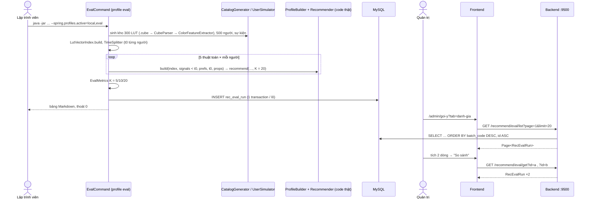

# Đánh giá gợi ý (phần 1)

## 1. Mục tiêu và phạm vi

Lát 3.1 của kế hoạch tổng quá lớn cho một lượt worker (bộ mô phỏng, 4 thuật toán + 7 biến thể, tinh chỉnh 500 bộ trọng số, 5 hạt giống, Wilcoxon, bảng báo cáo), nên tách thành 3 lát (§11 câu 1). Plan này là **phần 1**.

Sau plan này:

- Lập trình viên chạy **một lệnh** (profile `eval`) là có: kho đánh giá 300 LUT sinh từ tham số màu (file .cube thật, đo bằng đúng `CubeParser` + `ColorFeatureExtractor`), 500 người dùng mô phỏng có gu ẩn, chia dữ liệu theo thời gian, chạy **B1 Ngẫu nhiên, B2 Phổ biến, B2-dd Phổ biến xen kẽ, B3 CBF chỉ thẻ, M CBF đủ đặc trưng** (trọng số mặc định) bằng đúng `ProfileBuilder` + `Recommender` của hệ thống, tính 8 chỉ số ở K = 5, 10, 20, ghi mỗi (thuật toán, hạt giống) thành một dòng `rec_eval_run` và in bảng Markdown theo mẫu Bảng 8.1.
- Quản trị mở `/admin/goi-y?tab=danh-gia` thấy bảng các lần chạy, đổi K, lọc theo thuật toán, chọn hai lần chạy để so sánh chỉ số và tham số.

| Có làm (lát này) | Không làm (để plan khác) |
|---|---|
| Migration `V14__danh_gia_goi_y.sql`: bảng `rec_eval_run` | Tinh chỉnh trên tập kiểm định (500 bộ trọng số, λ, chu kỳ bán rã, k), 7 biến thể M-*, chỉ số cold-start §8.4.4 (lát `tinh-chinh-goi-y`) |
| Bộ D1 sinh trong bộ nhớ theo hạt giống (§11 câu 2): kho LUT + người dùng mô phỏng + sở thích khai báo | Wilcoxon + Holm, bootstrap, gộp 5 hạt giống thành trung bình ± độ lệch chuẩn, xuất các bảng 8.1–8.5 ra `docs/` (lát `kiem-dinh-goi-y`) |
| `TimeSplitter` có sẵn cả chế độ `test` và `valid` (lát sau chỉ việc dùng) | Schema `downbeat_eval`, ghi dữ liệu D1 vào MySQL (§11 câu 2) |
| `EvalMetrics` (UT-13): Precision, Recall, HitRate, NDCG, ILD, số phong cách, Coverage, Novelty | D2 / D3 (người dùng thật, kế hoạch tổng 3.2) |
| `EvalRunner` 5 thuật toán, profile `eval` (`EvalCommand` chạy xong thì thoát) | Nút "Chạy đánh giá" trên giao diện (§11 câu 4) |
| API `GET /recommend/eval/list`, `GET /recommend/eval/get` (quyền VIEW `RECOMMEND` có sẵn) | Xoá lần chạy |
| Thẻ "Đánh giá" ở `/admin/goi-y`: bảng, chọn K, lọc thuật toán, so sánh hai lần chạy | Biểu đồ (NDCG theo K, Coverage–NDCG) |

## 2. Tác nhân và phân quyền

| Tác nhân | Quyền (resource `RECOMMEND`, uri `/recommend/`) | Ghi chú |
|---|---|---|
| Quản trị (operator, `admin@downbeat.local`) | VIEW | Xem bảng, so sánh |
| Role được cấp VIEW `RECOMMEND` | VIEW | Như trên |
| Khách hàng, `noaccess@downbeat.local` | Không | 403 `FORBIDDEN` "Bạn không có quyền thực hiện thao tác này! Path: /recommend/, Action: VIEW"; không token → 401 |
| Lập trình viên (máy local) | — | Chạy `EvalCommand` bằng dòng lệnh, không qua API |

Không thêm resource mới (đã có `RECOMMEND` từ V13). Hai API mới gọi `checkPermission(principal, "/recommend/", "VIEW")` ở dòng đầu.

## 3. Luồng nghiệp vụ

**Luồng chính 1 — chạy đánh giá (dòng lệnh):**
1. Từ gốc repo: `java -jar backend/app/target/aeoc-backend.jar --spring.profiles.active=local,eval [--eval.seeds=42] [--eval.users=500] [--eval.luts=300]`.
2. App lên không có web server (`web-application-type: none`), không dựng chỉ mục cửa hàng, không đo đặc trưng LUT thật.
3. `EvalCommand` đọc `eval.*`, kiểm tham số, sinh `batchCode` = giờ VN lúc bắt đầu `yyyyMMdd-HHmmss`.
4. Với mỗi hạt giống s: `CatalogGenerator` sinh kho → `LutVectorIndex.build` → `UserSimulator` sinh hành vi → `TimeSplitter` (chế độ `test`) dựng ca đánh giá của từng người → chạy lần lượt 5 thuật toán → `EvalMetrics` → 5 đối tượng `RecEvalRun`.
5. Ghi mọi dòng của lô trong một transaction; in bảng Markdown mỗi hạt giống (§5.4); thoát mã 0.

**Luồng chính 2 — xem kết quả:**
1. Quản trị mở `/admin/goi-y` → thẻ "Đánh giá" → `GET /recommend/eval/list?page=1&limit=20`.
2. Bảng hiện các dòng theo lô mới nhất trước, trong lô theo thứ tự chạy (B1 → M); chỉ số ở K = 10 (mặc định).
3. Đổi "Số gợi ý" sang K = 5 / 20 → cột đổi tên và giá trị ngay (không gọi lại API, `metrics` đã có cả 3 K).

**Luồng chính 3 — so sánh hai lần chạy:**
1. Tích 2 dòng → nút "So sánh" sáng → bấm → URL thêm `a=<id>&b=<id>`.
2. Giao diện gọi `GET /recommend/eval/get?id=` cho từng id; hiện thẻ "So sánh hai lần chạy": bảng chỉ số A, B, chênh lệch, % thay đổi; bảng tham số đánh dấu dòng khác nhau.

**Luồng thay thế:**
- A1. Lọc "Thuật toán" → gọi lại `list` có `algorithm`; về trang 1.
- A2. Mở link có sẵn `?tab=danh-gia&a=..&b=..` (chia sẻ link) → thẻ so sánh hiện ngay, kể cả khi hai dòng không nằm ở trang đang xem.
- A3. Nhiều hạt giống trong một lệnh (`--eval.seeds=42,7,2026`) → cùng một `batchCode`, 5 dòng mỗi hạt giống.
- A4. Bấm "Đóng so sánh" → URL bỏ `a`, `b`.

**Ngoại lệ:**
- E1. Không quyền → 403 / 401 (§2).
- E2. `get` với id không có (hoặc thiếu id) → 404 "Không tìm thấy lần chạy đánh giá"; thẻ so sánh hiện "Không tìm thấy lần chạy đánh giá #{id}".
- E3. Tham số dòng lệnh sai (§5.4) → in "Tham số đánh giá không hợp lệ: {khoá}", không ghi DB, thoát mã 2.
- E4. Chưa có lần chạy nào → "Chưa có lần chạy đánh giá nào"; lọc không ra dòng nào → "Không có lần chạy nào khớp bộ lọc."
- E5. API lỗi mạng / 5xx → "Không tải được dữ liệu" + "Thử lại".



## 4. Cơ sở dữ liệu

Migration: `V14__danh_gia_goi_y.sql` (mới nhất hiện tại `V13__quan_tri_goi_y.sql`). Chỉ một bảng, theo thiết kế §4.7, thêm cột `batch_code` (§11 câu 6):

```sql
SET NAMES utf8mb4;

CREATE TABLE IF NOT EXISTS `rec_eval_run` (
  `id`           INT          NOT NULL AUTO_INCREMENT,
  `batch_code`   VARCHAR(20)  NOT NULL COMMENT 'Mã lô yyyyMMdd-HHmmss: các dòng ghi trong cùng một lần chạy EvalCommand',
  `dataset`      VARCHAR(30)  NOT NULL COMMENT 'D1-sim (D2-real ở lát 3.2)',
  `algorithm`    VARCHAR(30)  NOT NULL COMMENT 'random, popular, popular-dd, cbf-tag, cbf-full (biến thể ở lát sau)',
  `params`       JSON         NOT NULL COMMENT 'Hạt giống, cỡ dữ liệu, trọng số, tham số',
  `metrics`      JSON         NOT NULL COMMENT 'Chỉ số theo K',
  `user_count`   INT          NOT NULL COMMENT 'Số người dùng được tính',
  `created_time` DATETIME     NOT NULL,
  PRIMARY KEY (`id`),
  KEY `idx_rec_eval_run_batch` (`batch_code`, `id`),
  KEY `idx_rec_eval_run_algorithm` (`algorithm`, `batch_code`)
) ENGINE=InnoDB DEFAULT CHARSET=utf8mb4 COLLATE=utf8mb4_unicode_ci;
```

Không unique (một lô nhiều dòng). Không xoá (không có API xoá). Dữ liệu D1 **không** ghi DB: sinh lại được y hệt từ `params.seed` + `params.generatorVersion`.

## 5. Hợp đồng API (cố định — nguồn sự thật cho cả BE và FE)

Thành công `{ "code": 200, "message": "OK", "result": … }`; lỗi `{ "path", "code", "errorCode", "message" }`. POJO `NON_NULL`. Thời điểm `yyyy-MM-dd'T'HH:mm:ss` (giờ VN). Số chỉ số làm tròn 4 chữ số.

### 5.1 `GET /api/recommend/eval/list?algorithm=&batch=&page=&limit=` — quyền VIEW

- `algorithm`, `batch`: khớp đúng (sau trim), bỏ trống = không lọc. Giá trị không có → `total` 0, `items` [] (không lỗi).
- `page` mặc định 1 (≤ 0 → 1); `limit` mặc định 20, ≤ 0 → 20, > 100 → 100.
- Thứ tự `batch_code` DESC, `id` ASC (lô mới trước; trong lô theo thứ tự chạy).

Response `result`:
```json
{
  "total": 10, "page": 1,
  "items": [
    {
      "id": 6, "batchCode": "20261112-101530", "dataset": "D1-sim", "algorithm": "random", "userCount": 471,
      "createdTime": "2026-11-12T10:16:08",
      "params": { "seed": 42, "phase": "test", "lutCount": 300, "simUserCount": 500, "kValues": [5, 10, 20],
                  "generatorVersion": 1, "catalogStart": "2026-01-01T00:00:00", "elapsedMs": 812, "repeats": 20 },
      "metrics": {
        "5":  { "precision": 0.0089, "recall": 0.0071, "ndcg": 0.0102, "hitRate": 0.0425, "ild": 0.9012, "styles": 4.2101, "coverage": 1.0, "novelty": 3.1820 },
        "10": { "precision": 0.0091, "recall": 0.0148, "ndcg": 0.0131, "hitRate": 0.0849, "ild": 0.9050, "styles": 5.9822, "coverage": 1.0, "novelty": 3.1795 },
        "20": { "precision": 0.0090, "recall": 0.0290, "ndcg": 0.0188, "hitRate": 0.1592, "ild": 0.9061, "styles": 7.3410, "coverage": 1.0, "novelty": 3.1801 }
      }
    },
    {
      "id": 10, "batchCode": "20261112-101530", "dataset": "D1-sim", "algorithm": "cbf-full", "userCount": 471,
      "createdTime": "2026-11-12T10:16:08",
      "params": { "seed": 42, "phase": "test", "lutCount": 300, "simUserCount": 500, "kValues": [5, 10, 20],
                  "generatorVersion": 1, "catalogStart": "2026-01-01T00:00:00", "elapsedMs": 21345,
                  "weights": { "tag": 0.30, "color": 0.25, "category": 0.15, "style": 0.15, "text": 0.10, "creator": 0.05 },
                  "eventWeights": { "VIEW": 1.0, "PREVIEW": 2.0, "SEARCH": 0.5, "FILTER_STYLE": 0.5, "FAVORITE": 4.0, "DOWNLOAD": 5.0, "PURCHASE": 6.0, "DISMISS": -4.0 },
                  "halfLifeDays": 30.0, "coldStartK": 5.0, "mmrLambda": 0.7, "candidateTop": 100,
                  "historyDays": 180, "historyMaxPairs": 200, "popularDays": 30 },
      "metrics": { "5": { "…": 0 }, "10": { "…": 0 }, "20": { "…": 0 } }
    }
  ]
}
```
(Số trong ví dụ chỉ để minh hoạ kiểu; kết quả thật do chạy.)

**`params` theo thuật toán** (đúng các khoá, đúng thứ tự):

| algorithm | Khoá chung | Khoá thêm |
|---|---|---|
| mọi thuật toán | `seed`, `phase`, `lutCount`, `simUserCount`, `kValues`, `generatorVersion`, `catalogStart`, `elapsedMs` (thời gian chạy riêng thuật toán đó) | |
| `random` | | `repeats` (20) |
| `popular` | | `popularWindow` = `"before-t0"` |
| `popular-dd` | | `popularDays` (30) |
| `cbf-tag`, `cbf-full` | | `weights` (6 khoá, **sau chuẩn hoá**, 4 chữ số), `eventWeights` (8 khoá như `config`), `halfLifeDays`, `coldStartK`, `mmrLambda`, `candidateTop`, `historyDays`, `historyMaxPairs`, `popularDays` |

`cbf-tag`: `weights` = `{tag: 1.0, color: 0.0, category: 0.0, style: 0.0, text: 0.0, creator: 0.0}`, các tham số khác giống `cbf-full`. `cbf-full`: lấy từ `RecommendProperties` đang chạy (cùng giá trị `GET /recommend/config` → `normalizedWeights`).

**`metrics`**: object có đúng các khoá chuỗi trong `kValues` (`"5"`, `"10"`, `"20"`); mỗi khoá có đúng 8 trường `precision`, `recall`, `ndcg`, `hitRate`, `ild`, `styles`, `coverage`, `novelty` (định nghĩa §7 mục 9).

### 5.2 `GET /api/recommend/eval/get?id=` — quyền VIEW

Response `result`: một phần tử đúng như trong `items` của §5.1. `id` thiếu hoặc không có → 404.

### 5.3 Lỗi nghiệp vụ

| Tình huống | HTTP | errorCode | Message (FE hiện nguyên văn) |
|---|---|---|---|
| Không token | 401 | có sẵn | (có sẵn của filter) |
| Không có VIEW `RECOMMEND` | 403 | `FORBIDDEN` | Bạn không có quyền thực hiện thao tác này! Path: /recommend/, Action: VIEW |
| `get` id không có / thiếu id | 404 | `DATA_NOT_FOUND` | Không tìm thấy lần chạy đánh giá |

### 5.4 Dòng lệnh `EvalCommand` (không phải HTTP, nhưng là hợp đồng cho Claude chạy E2E)

Khoá `eval.*` (`EvalProperties`, mặc định trong `application-eval.yml`):

| Khoá | Mặc định | Hợp lệ |
|---|---|---|
| `eval.seeds` | `42` | danh sách ≥ 1 số nguyên |
| `eval.luts` | 300 | 40 → 2000 |
| `eval.users` | 500 | 20 → 5000 |
| `eval.k-values` | `5,10,20` | mỗi số 1 → 50, không trùng; chạy một lần với K lớn nhất rồi lấy tiền tố |
| `eval.algorithms` | `random,popular,popular-dd,cbf-tag,cbf-full` | tập con, giữ thứ tự này khi chạy |
| `eval.random-repeats` | 20 | 1 → 100 |
| `eval.phase` | `test` | `test` / `valid` |
| `eval.dataset` | `D1-sim` | chỉ `D1-sim` |

Sai → stdout/stderr "Tham số đánh giá không hợp lệ: {khoá}" (ví dụ `eval.algorithms`), không ghi DB, mã thoát 2. Thành công → mã thoát 0, mỗi hạt giống in:

```
== Đánh giá gợi ý · lô 20261112-101530 · D1-sim · hạt giống 42 ==
300 LUT · 500 người mô phỏng · 471 người được tính · 38.2 giây
| Thuật toán | P@10 | R@10 | NDCG@10 | HitRate@10 | ILD@10 | Phong cách / 10 | Coverage@10 | Novelty@10 |
|---|---|---|---|---|---|---|---|---|
| B1 Ngẫu nhiên | 0.0091 | 0.0148 | 0.0131 | 0.0849 | 0.9050 | 5.98 | 1.0000 | 3.18 |
| B2 Phổ biến | … |
| B2-dd Phổ biến xen kẽ | … |
| B3 CBF chỉ thẻ | … |
| M CBF đủ đặc trưng | … |
```
(K của bảng in = 10 nếu có trong `k-values`, không thì K lớn nhất.)

## 6. Giao diện (chuỗi cố định — test E2E chọn theo đúng các chuỗi này)

Trang `/admin/goi-y` có sẵn (lát 2.4); chỉ thay nội dung thẻ **"Đánh giá"** (`tab=danh-gia`). Số `vi-VN`: chỉ số `precision`, `recall`, `ndcg`, `hitRate`, `ild`, `coverage` 4 chữ số thập phân (`0,1520`); `styles`, `novelty` 2 chữ số (`5,98`); thời điểm `dd/MM/yyyy HH:mm`.

### 6.1 Tham số URL (chỉ có nghĩa khi `tab=danh-gia`)

`algo` (mã thuật toán, rỗng = tất cả), `k` ∈ {5, 10, 20} (mặc định 10; giá trị khác → 10), `page` (≥ 1, mặc định 1), `a`, `b` (id số nguyên dương; thiếu một trong hai → không hiện so sánh). Zod `.catch` để URL sai không vỡ trang. Đổi bộ lọc / K / trang thì `navigate({ replace: true })`.

### 6.2 Thanh công cụ

- `Select` "Thuật toán" (aria-label "Thuật toán"): "Tất cả thuật toán", "B1 Ngẫu nhiên", "B2 Phổ biến", "B2-dd Phổ biến xen kẽ", "B3 CBF chỉ thẻ", "M CBF đủ đặc trưng". Đổi → `page` = 1.
- `Select` "Số gợi ý" (aria-label "Số gợi ý"): "K = 5", "K = 10", "K = 20".
- Bên phải: chữ "Đã chọn {n}/2" và nút **"So sánh"** (icon `GitCompare`), disabled khi n ≠ 2.

### 6.3 Bảng "Các lần chạy"

- Tiêu đề card "Các lần chạy"; dòng phụ "Mỗi dòng là một thuật toán chạy trên bộ D1 mô phỏng với một hạt giống. Chỉ số càng cao càng tốt."
- Cột: (checkbox, aria-label "Chọn lần chạy #{id}"), "Lô", "Thời điểm", "Thuật toán", "Hạt giống", "Người dùng", "P@{K}", "R@{K}", "NDCG@{K}", "HitRate@{K}", "ILD@{K}", "Phong cách / {K}", "Coverage@{K}", "Novelty@{K}".
  - "Lô": `batchCode`; "Thuật toán": nhãn §6.2 (mã lạ → hiện nguyên mã); "Hạt giống": `params.seed`; "Người dùng": `userCount`.
  - Dòng đầu tiên của mỗi lô có viền trên đậm hơn để tách lô.
- Tooltip trên tiêu đề cột chỉ số (rê chuột / focus):
  - P: "Tỉ lệ gợi ý đúng trong K gợi ý đầu"
  - R: "Tỉ lệ LUT liên quan được gợi ý trong K gợi ý đầu"
  - NDCG: "Chất lượng thứ hạng: gợi ý đúng càng ở trên càng tốt"
  - HitRate: "Tỉ lệ người dùng có ít nhất một gợi ý đúng"
  - ILD: "Độ khác nhau về màu giữa các LUT trong danh sách"
  - Phong cách: "Số phong cách khác nhau trong danh sách"
  - Coverage: "Tỉ lệ LUT của kho từng được gợi ý cho ít nhất một người"
  - Novelty: "Mức ít phổ biến của các LUT được gợi ý"
- Đã tích 2 dòng thì checkbox các dòng còn lại disabled. Dòng đang so sánh (`a`, `b`) được tích sẵn khi mở link.
- Phân trang 20 dòng: "Trang {page}/{số trang}", nút "Trước", "Sau".
- Bảng nằm trong khung cuộn ngang riêng; trang không tràn ngang ở 390 px.
- Đang tải: `Skeleton` 5 dòng. Rỗng không lọc: giữ `Empty` "Chưa có lần chạy đánh giá nào" + mô tả "Chạy trình đánh giá offline (profile eval) để có Precision, Recall, NDCG và độ đa dạng của từng thuật toán." Rỗng có lọc: "Không có lần chạy nào khớp bộ lọc." Lỗi: `TabLoadError` ("Không tải được dữ liệu" + "Thử lại").

### 6.4 Thẻ "So sánh hai lần chạy"

Hiện dưới bảng khi URL có `a` và `b`; gọi `get` cho từng id.

- Tiêu đề "So sánh hai lần chạy"; nút "Đóng so sánh" (icon `X`).
- Hai nhãn: "A: #{id} {nhãn thuật toán} · lô {batchCode} · hạt giống {seed}" và tương tự "B: …".
- Bảng "Chỉ số" (theo K đang chọn): cột "Chỉ số", "A", "B", "Chênh lệch (B − A)", "Thay đổi". Dòng: "Người dùng được tính", "P@{K}", "R@{K}", "NDCG@{K}", "HitRate@{K}", "ILD@{K}", "Phong cách / {K}", "Coverage@{K}", "Novelty@{K}".
  - "Chênh lệch" có dấu: `+0,0412`, `-0,0031`, `0,0000` (cùng số chữ số như cột); "Thay đổi" = (B − A) / A dạng `+12,3%`; A = 0 → "—". Dương chữ xanh (`text-emerald-600`), âm chữ đỏ (`text-destructive`). Dòng "Người dùng được tính" là số nguyên, "Thay đổi" "—".
- Bảng "Tham số": hợp các khoá của hai `params`, làm phẳng bằng dấu chấm (`weights.tag`, `eventWeights.VIEW`), bỏ `elapsedMs`; cột "Tham số", "A", "B"; thiếu khoá → "—"; mảng hiện "5, 10, 20". Dòng có giá trị khác nhau có `Badge` "khác".
- Một id không có (404) → trong thẻ: "Không tìm thấy lần chạy đánh giá #{id}" (mỗi id lỗi một dòng), không có bảng.
- Đang tải: `Skeleton`.

## 7. Việc backend (agy BE)

Package `vn.aeoc.business.recommend.eval` (không tạo module Maven). **Không sửa** `ProfileBuilder`, `Recommender`, `ScoreCalculator`, `LutVectorIndex`, `CubeParser`, `ColorFeatureExtractor`: trình đánh giá phải gọi đúng code đang chạy (thiết kế §8.6). Cần thêm hàm public nhỏ nào ở các lớp đó thì `ask` trước.

1. **Migration** `app/src/main/resources/db/migration/V14__danh_gia_goi_y.sql` đúng §4. Restart → build lại để sinh jOOQ `REC_EVAL_RUN`.
2. **Entity** `entity/…/mysql/recommend/RecEvalRun.java`: `id`, `batchCode`, `dataset`, `algorithm`, `params` (`Map<String, Object>`, `LinkedHashMap` giữ thứ tự), `metrics` (`Map<String, Map<String, Double>>`, `LinkedHashMap`), `userCount`, `createdTime`. Setter nhận `org.jooq.JSON` / `String` / `Map` như `RecImpression.setLutIds`; ghi DB bằng `JSON.json(objectMapper.writeValueAsString(...))`.
3. **Repository** `recommend/repository/RecEvalRunRepository extends AbsMysqlRepository<RecEvalRunRecord, RecEvalRun, Integer>`: `list(algorithm, batch, pageable)` (`getListByCriteria`, thứ tự §5.1), `count(...)`, `insertAll(List<RecEvalRun>)`.
4. **Service** `recommend/service/RecEvalRunService extends BaseService`: `list(algorithm, batch, page, limit)` qua `pageQuery` (chuẩn hoá page/limit §5.1), `get(id)` (null hoặc không có → `AppException(DATA_NOT_FOUND, "Không tìm thấy lần chạy đánh giá")`), `saveBatch(List<RecEvalRun>)` `@Transactional`.
5. **Controller**: thêm vào `RecommendAdminController` `@GetMapping("/recommend/eval/list")`, `@GetMapping("/recommend/eval/get")` (`@RequestParam(required = false) Integer id`), `checkPermission(principal, URI, "VIEW")` dòng đầu.
6. **`eval/sim/CubeWriter`** — tham số màu → nội dung .cube kích thước 33 (`TITLE`, `LUT_3D_SIZE 33`, 35 937 dòng, R chạy nhanh nhất, 6 chữ số). Biến đổi một màu vào (r, g, b) ∈ [0, 1], theo đúng thứ tự:
   1. `Y = 0.2126r + 0.7152g + 0.0722b`; nếu `mono` thì r = g = b = Y.
   2. Bão hoà: c = Y + s · (c − Y).
   3. Tương phản: c = 0.5 + k · (c − 0.5).
   4. Độ sáng: c = c + br.
   5. Nhiệt độ / tint: r += 0.08 · t, b −= 0.08 · t; g −= 0.06 · m.
   6. Tách tông: Y' = luma màu hiện tại, ws = (1 − Y')², wh = Y'²; `tone(h)` = RGB của HSV(h, 1, 1) trừ trung bình 3 kênh; c += strS · ws · tone(hueS) + strH · wh · tone(hueH).
   7. Kẹp [0, 1].
   Sau đó **đọc lại bằng `CubeParser.parse`** (từ byte UTF-8) rồi `ColorFeatureExtractor.extract`, để đặc trưng màu đi qua đúng đường của LUT thật.
7. **`eval/sim/CatalogGenerator`** — `generate(int n, SplittableRandom rng)` → `List<Lut>` (có `tags`, `categories`, `colorFeature`, `style`, `creatorId`, `title`, `description`, `isPremium`, `publishedTime`, `status` PUBLISHED, `downloadCount` **0**, `slug` `eval-{id 3 chữ số}`, `id` 1..n).
   - 8 phong cách và nguyên mẫu (giá trị trung bình; nhiễu chuẩn σ: br 0.02, k 0.06, s 0.10, t 0.25, m 0.08, hue 15°, str 0.03; kẹp s ≥ 0.3, k ≥ 0.5, str ≥ 0):

     | style | br | k | s | t | m | hueS, strS | hueH, strH | mono |
     |---|---|---|---|---|---|---|---|---|
     | am-ap | 0.02 | 1.05 | 1.10 | 0.8 | 0.1 | 30°, 0.05 | 35°, 0.10 | |
     | lanh | −0.02 | 1.05 | 0.95 | −0.8 | −0.1 | 210°, 0.08 | 200°, 0.05 | |
     | phim-nhua | 0.03 | 0.88 | 0.85 | 0.2 | 0.1 | 180°, 0.06 | 40°, 0.06 | |
     | dien-anh | −0.04 | 1.20 | 0.95 | 0.0 | 0.0 | 200°, 0.10 | 30°, 0.08 | |
     | teal-orange | 0.00 | 1.15 | 1.20 | 0.1 | 0.0 | 185°, 0.16 | 28°, 0.16 | |
     | du-lich | 0.04 | 1.10 | 1.35 | 0.2 | 0.0 | 190°, 0.04 | 45°, 0.04 | |
     | co-dien | 0.02 | 0.85 | 0.70 | 0.5 | 0.15 | 35°, 0.08 | 45°, 0.08 | |
     | den-trang | 0.00 | 1.15 | — | 0.0 | 0.0 | 35°, 0.00 (30% LUT: 0.03) | 35°, 0.00 (cùng LUT: 0.03) | có |

   - Phong cách của LUT thứ i: `STYLES[(i − 1) % 8]` theo thứ tự bảng. 10% LUT (chọn ngẫu nhiên) là "LUT giữa hai phong cách": các tham số số học = (1 − w) · nguyên mẫu chính + w · nguyên mẫu của một phong cách khác ngẫu nhiên, w ∈ [0.3, 0.5); `style`, hue, mono theo phong cách chính.
   - **Thẻ theo luật** (từ tham số đã có nhiễu): t ≥ 0.4 "ấm"; t ≤ −0.4 "lạnh"; s ≥ 1.25 "rực rỡ"; s ≤ 0.8 và không mono "phai màu"; k ≥ 1.15 "tương phản"; k ≤ 0.9 "mềm"; br ≥ 0.03 "sáng"; br ≤ −0.03 "tối"; mono "đen trắng"; hueS ∈ [170°, 220°] và hueH ∈ [15°, 50°] và cả hai str ≥ 0.1 "teal". Thẻ phong cách: am-ap "hoàng hôn"; lanh "xanh"; phim-nhua "phim", "grain"; dien-anh "điện ảnh"; teal-orange "teal", "điện ảnh"; du-lich "phong cảnh", "tươi"; co-dien "vintage"; den-trang "đen trắng". Chưa đủ 3 thẻ thì thêm lần lượt từ: am-ap ["vàng", "mùa thu"], lanh ["trầm", "đêm"], phim-nhua ["kodak", "fuji"], dien-anh ["trầm", "đêm"], teal-orange ["cam", "biển"], du-lich ["biển", "rừng"], co-dien ["cũ", "hoài niệm"], den-trang ["chân dung", "cổ điển"]. Tối đa 6 thẻ, bỏ trùng.
   - **Nhiễu thẻ**: mỗi thẻ có xác suất 0.10 bị thay bằng một thẻ ngẫu nhiên trong toàn bộ từ vựng ở trên; 15% LUT (chọn ngẫu nhiên) đổi thẻ sang đồng nghĩa ít gặp: "ấm"→"cam", "lạnh"→"lam", "rực rỡ"→"chói", "phai màu"→"bạc màu", "tương phản"→"gắt", "đen trắng"→"đơn sắc" (các cặp này **không** có trong `recommend.tag-synonyms`, có chủ đích). Sau nhiễu vẫn phải ≥ 3 thẻ khác nhau (thiếu thì thêm từ danh sách bổ sung).
   - **Danh mục**: slug phong cách; tông màu theo luật (t ≥ 0.4 `am-ap`, t ≤ −0.4 `lanh`, s ≥ 1.25 `ruc-ro`, có thẻ "teal" `teal-orange`); xác suất 0.5 thêm một dịp (`ban-dem` nếu br ≤ −0.03, không thì ngẫu nhiên trong `du-lich`, `dam-cuoi`, `chan-dung`); luôn có 4 phần mềm `premiere-pro`, `davinci-resolve`, `final-cut-pro`, `capcut` (chỉ mục bỏ qua nhóm này). Bỏ trùng.
   - **Tác giả**: 12 tác giả id 1..12; tác giả c chuyên phong cách `STYLES[c % 8]` và `STYLES[(c + 3) % 8]`; LUT chọn tác giả chuyên phong cách của nó với xác suất 0.8, còn lại ngẫu nhiên.
   - **Tiêu đề / mô tả** từ mẫu: tiêu đề = một danh từ trong danh sách 4 danh từ của phong cách (worker tự đặt, ví dụ am-ap "Hoàng Hôn", "Nắng Chiều", "Mùa Thu", "Phố Cổ") + thẻ đầu tiên viết hoa chữ đầu + số 3 chữ số (`Hoàng Hôn Ấm 017`); mô tả = "LUT {tên phong cách} {thẻ 1}, {thẻ 2}, hợp quay {tên dịp hoặc "video hằng ngày"}." (tên phong cách / dịp đúng `lut_category.name`).
   - `isPremium` = 1 với xác suất 0.3. `publishedTime` = `2026-01-01T00:00` + U[0, 120) ngày (cắt giây).
8. **`eval/sim/UserSimulator`** — `simulate(List<Lut> luts, LutVectorIndex ix, int n, long seed, SplittableRandom rng)` → `SimDataset { luts, users[ {id, preferredStyles, declaredSlugs} ], events[ {userId, type, lutId, time} ] }`, `events` sắp theo (time, userId, thứ tự sinh).
   - Gu ẩn: số phong cách ưa thích 1 (xác suất 0.6) hoặc 2, chọn không lặp theo trọng số am-ap 0.20, phim-nhua 0.17, lanh 0.15, dien-anh 0.13, du-lich 0.11, co-dien 0.10, teal-orange 0.08, den-trang 0.06; `c_u` = trung bình `ix.colorZ` của các LUT có phong cách ưa thích đầu tiên + N(0, 0.5) từng chiều; β_u ∈ U[0, 0.5]; số sự kiện E_u ∈ U{20..60}.
   - `U(u, i) = 1.0·[style_i ∈ S_u] + 1.5·exp(−‖z_i − c_u‖² / 20) + β_u·ln(1 + lượt tải hiện tại của i) + ε(u, i)`, z_i = `ix.colorZ(i)`, ε ~ N(0, 0.3) **cố định cho từng cặp** (sinh từ `new SplittableRandom(mix(seed, u, i))`, không phụ thuộc thứ tự xử lý).
   - Phiên: S_u = ceil(E_u / 2) mốc thời gian U[ngày 30, ngày 120) tính từ `2026-01-01`, sắp tăng. Xử lý **mọi phiên của mọi người theo thời gian toàn cục** (để lượt tải cộng dồn và danh sách phổ biến đổi như thật). Mỗi phiên:
     - Tập thấy (24 LUT, chỉ LUT đã xuất bản tới lúc đó, bỏ LUT người này đã tải hoặc đã bỏ qua): 12 LUT đầu của danh sách phổ biến hiện tại (lượt tải cộng dồn giảm dần, rồi xuất bản mới hơn, rồi id) + 12 LUT ngẫu nhiên khác. Thiếu thì lấy hết.
     - Xem v ∈ {1, 2, 3} LUT (đều), rút không hoàn lại theo softmax(U) trên tập thấy → `VIEW`; mỗi LUT đã xem: `PREVIEW` với xác suất σ(2(U − 1)); nếu đã xem trước: `FAVORITE` (nếu chưa từng yêu thích) xác suất 0.4·σ(2(U − 1.5)), `DOWNLOAD` xác suất 0.6·σ(2(U − 1.5)) (độc lập); tải xong cộng lượt tải ngay.
     - Mỗi LUT thấy mà không xem có U < 0.3: `DISMISS` xác suất 0.05.
     - Thời điểm sự kiện = mốc phiên + 45 giây × thứ tự trong phiên. Đủ E_u sự kiện thì người đó dừng (cắt phần dư).
   - Khai báo: 70% người khai báo; trong đó 80% khai đúng các phong cách ưa thích, 20% khai một phong cách ngẫu nhiên. `declaredSlugs` là slug phong cách (cũng là slug danh mục).
   - Thứ tự dùng RNG cố định: `rng.split()` cho kho, rồi cho người dùng, rồi cho phiên. Không lặp qua `HashMap` khi quyết định thứ tự.
9. **`eval/metric/EvalMetrics`** (hàm tĩnh thuần, UT-13). Ký hiệu L = danh sách (cắt K đầu), rel(i) ∈ {0..3}, R = {i: rel ≥ 2}:
   - `precision` = |L ∩ R| / K (chia K kể cả khi L ngắn hơn K); `recall` = |L ∩ R| / |R|; `hitRate` = 1 nếu |L ∩ R| > 0.
   - `ndcg` = DCG / IDCG, DCG = Σ (2^rel − 1) / log2(k + 1); IDCG trên mọi LUT có rel ≥ 1 sắp giảm dần, cắt K; IDCG = 0 → 0.
   - `ild` = trung bình d(i, j) mọi cặp trong L, d = ‖z_i − z_j‖ / √10 (z = `ix.colorZ`); |L| < 2 → 0.
   - `styles` = số `style` khác nhau trong L.
   - `coverage` = |hợp các L của mọi người| / số LUT của kho (tính một lần cho cả thuật toán).
   - `novelty` = (1/K) Σ_{i ∈ L} −log2((n_i + 1) / (N + 1)), n_i = số người mô phỏng (trong N người) đã tải i **trước t0 của người đang xét**, N = `eval.users`.
   - Mọi chỉ số trừ `coverage` lấy trung bình trên người được tính; làm tròn 4 chữ số khi ghi.
10. **`eval/split/TimeSplitter`** — mỗi người: sự kiện sắp theo thời gian, n sự kiện; `nProfile = n * 8 / 10` (số nguyên).
    - Chế độ `test`: phần dựng = `[0, nProfile)`, phần kiểm = `[nProfile, n)`, t0 = thời điểm sự kiện `nProfile`.
    - Chế độ `valid`: `nTrain = nProfile * 9 / 10`; phần dựng = `[0, nTrain)`, phần kiểm = `[nTrain, nProfile)`, t0 = thời điểm sự kiện `nTrain`.
    - Ứng viên: LUT có `publishedTime ≤ t0`.
    - rel trong phần kiểm (lấy mức cao nhất): `DOWNLOAD` 3, `FAVORITE` 2, `PREVIEW` 1; LUT đã có sự kiện trọng số dương (`VIEW`, `PREVIEW`, `FAVORITE`, `DOWNLOAD`) ở phần dựng, hoặc xuất bản sau t0, thì rel = 0.
    - Chỉ giữ người có ≥ 5 sự kiện phần dựng và ≥ 1 LUT rel ≥ 2.
    - Tín hiệu đưa vào `ProfileBuilder`: gộp phần dựng theo (type, lutId) → `new UserSignal(type, lutId, slug, null, count, max(time))`, **đúng cách** `UserEventRepository.signalsByUser` / `DownloadLogRepository.downloadSignals` / `CollectionRepository.favoriteSignals` đang gộp.
11. **`eval/algo/`** — interface `EvalAlgorithm { String code(); List<Integer> rank(EvalCase c, int k); }`, mọi thuật toán dùng cùng ứng viên, loại LUT đã tải / bỏ qua trước t0 (`Recommender.excludedIds`), `premiumLimited = false` (người mô phỏng coi như gói Pro, giống D2):
    - `random`: rút K từ ứng viên; chạy `repeats` lần với `SplittableRandom(mix(seed, rep, userId))`, mỗi chỉ số của người = trung bình các lần; `coverage` = trung bình coverage từng lần.
    - `popular`: đếm lượt tải của **mọi** người mô phỏng có thời điểm < t0 (không cửa sổ ngày), giảm dần, rồi xuất bản mới hơn, rồi id.
    - `popular-dd`: `Recommender.rankPopular(candidates, đếm lượt tải trong [t0 − popularDays, t0), k, false, props)`.
    - `cbf-tag`, `cbf-full`: `profile = ProfileBuilder.build(ix, signals, declaredSlugs, t0, props)`; `Recommender.recommend(profile, candidates, đếm 30 ngày trước t0, k, false, props)` (hồ sơ POPULAR tự rơi về `rankPopular` như cửa hàng). `props` là **bản sao sâu** của bean `RecommendProperties` (thêm `RecommendProperties.copy()` hoặc tạo trong eval, `ask` nếu phải sửa lớp gốc); `cbf-tag` đặt `weights` = {1, 0, 0, 0, 0, 0}. Bean gốc không được đổi.
    - Chạy một lần với K = max(`k-values`) rồi lấy tiền tố cho K nhỏ (MMR tham lam và không giới hạn Premium nên tiền tố đúng bằng kết quả chạy riêng).
    - Chỉ mục: một `LutVectorIndex.build(luts, props)` cho cả kho mỗi hạt giống (IDF / z-score dùng cả LUT xuất bản sau t0, chấp nhận — §11 câu 7).
12. **`eval/EvalRunner`** (`@Service`) — `List<RecEvalRun> run(long seed, EvalProperties p, String batchCode)`: sinh dữ liệu → chỉ mục → chia → từng thuật toán → chỉ số → `RecEvalRun` (`dataset` "D1-sim", `params` đúng §5.1, `createdTime` theo `Clock` VN, cắt giây). Không đụng DB.
13. **`eval/EvalProperties`** (`@ConfigurationProperties("eval")`, `validate()` theo §5.4) và **`eval/EvalCommand`** (`@Component @Profile("eval") implements ApplicationRunner`): validate → chạy từng hạt giống → `RecEvalRunService.saveBatch` cả lô → in bảng §5.4 → `System.exit(SpringApplication.exit(ctx, () -> 0))`; lỗi tham số → mã 2; lỗi khác → in stack, mã 1, không ghi gì.
14. **`app/src/main/resources/application-eval.yml`**: `spring.main.web-application-type: none`, `recommend.build-on-startup: false`, `lut.feature.compute-on-startup: false`, mặc định `eval.*` §5.4.
15. Hiệu năng: lần chạy mặc định (300 LUT, 500 người, 5 thuật toán, 1 hạt giống) **≤ 5 phút** trên máy dev; báo thời gian thật trong `worker_done`.

Lệnh tự kiểm (từ gốc repo, sau `mvn -q -DskipTests package` trong `backend/`): `java -jar backend/app/target/aeoc-backend.jar --spring.profiles.active=local,eval --eval.seeds=42`. Không chạy lệnh này ở terminal foreground không có timeout.

Unit test bắt buộc: TC loại `unit` ở §9 + bộ tối thiểu của `backend/AGENTS.md` cho list/get.

## 8. Việc frontend (agy FE)

1. `lib/types/recommend.ts`: thêm `EvalMetricSetDTO { precision; recall; ndcg; hitRate; ild; styles; coverage; novelty }` (number), `RecEvalRunDTO { id; batchCode; dataset; algorithm; userCount; createdTime; params: Record<string, unknown>; metrics: Record<string, EvalMetricSetDTO> }`, `EvalListParams { algorithm?; batch?; page?; limit? }`.
2. `lib/axios/recommend-admin.ts`: `listEvalRuns(params)` → `GET /recommend/eval/list`, `getEvalRun(id)` → `GET /recommend/eval/get?id=`.
3. `lib/tanstack/options/recommend-admin.ts`: `createEvalRunsQueryOptions(params)` (key `[...RECOMMEND_ADMIN_QUERY_KEY, "eval", "list", algorithm, page]`, `keepPreviousData`), `createEvalRunQueryOptions(id)` (key `[…, "eval", "get", id]`, `retry` không thử lại khi 404). Không toast.
4. `components/admin/recommend/labels.ts`: `EVAL_ALGORITHM_LABELS` (5 nhãn §6.2), `EVAL_METRICS` (thứ tự, tiêu đề cột theo K, số chữ số, tooltip §6.3), hàm định dạng `vi-VN` và chênh lệch có dấu.
5. `components/admin/recommend/eval-runs-table.tsx`: thanh công cụ §6.2 + bảng §6.3 + phân trang.
6. `components/admin/recommend/eval-compare-card.tsx`: §6.4 (làm phẳng `params`, đánh dấu "khác").
7. `components/admin/recommend/eval-tab.tsx`: viết lại, ghép 5 + 6; trạng thái rỗng / lỗi §6.3.
8. `routes/admin/goi-y.tsx`: search schema thêm `algo`, `k`, `page`, `a`, `b` (§6.1), truyền xuống `EvalTab`. Không đổi 3 thẻ còn lại.

Component shadcn dùng: có sẵn `table`, `checkbox`, `select`, `tooltip`, `card`, `badge`, `button`, `skeleton`, `empty`; không cần `shadcn add`.

## 9. Test case

### 9.1 Ví dụ tính tay cho UT-13 (TC-01)

Kho 20 LUT, N = 9 người. Người u1, danh sách L = [A, B, C, D, E]; rel: B = 3, D = 2, C = 1, F = 3 (F không có trong L) → R = {B, D, F}. Người u2: L = [A, F, G, B, H], R = {Z} (rel 3), không trúng.
z (10 chiều, các chiều khác 0): A = D = (0, 0), B = E = (0.3, 0.4), C = (0.6, 0.8). style: A am-ap, B lanh, C am-ap, D phim-nhua, E lanh. Số người đã tải trước t0: A 9, B 4, C 1, D 0, E 3.

| Chỉ số (u1) | K = 3 (A, B, C) | K = 5 |
|---|---|---|
| precision | 0.3333 | 0.4000 |
| recall | 0.3333 | 0.6667 |
| hitRate | 1 | 1 |
| ndcg | 0.3806 (4.9165 / 12.9165) | 0.4652 (6.2085 / 13.3472) |
| ild | 0.2108 | 0.1581 |
| styles | 2 | 3 |
| novelty | 1.1073 | 1.5932 |

Trung bình hai người (K = 5): precision 0.2000, recall 0.3333, hitRate 0.5000, ndcg 0.2326. Coverage hai người: K = 3 → {A, B, C, F, G} = 5 / 20 = 0.2500; K = 5 → 8 / 20 = 0.4000.
Danh sách ngắn: L = [B, D], K = 5 → precision 0.4000, recall 0.6667, ndcg 0.6663.

### 9.2 Bảng test case

Tiền điều kiện chung cho `api` / `e2e`: backend :9500 đã có V14; Claude đã chạy **hai lần** lệnh mặc định `--eval.seeds=42` (gọi lô L1 rồi L2, L2 mới hơn) trước khi chạy spec.

| ID | Loại | Mô tả | Tiền điều kiện | Bước | Kết quả mong đợi |
|---|---|---|---|---|---|
| TC-01 | unit | UT-13 `EvalMetrics` | Dữ liệu §9.1 | Tính từng chỉ số K = 3, 5; trung bình 2 người; coverage; danh sách ngắn | Khớp mọi số §9.1 sai số 1e-4 |
| TC-02 | unit | `EvalMetrics` biên | | (a) L rỗng; (b) L 1 phần tử; (c) không LUT nào rel ≥ 1; (d) K lớn hơn kho | (a) mọi chỉ số 0, styles 0; (b) ild 0; (c) ndcg 0 không lỗi chia 0; (d) precision chia K, không ngoại lệ |
| TC-03 | unit | `TimeSplitter` | Người 1, 10 sự kiện: t1 VIEW X, t2 PREVIEW X, t3 VIEW Y, t4 VIEW Y, t5 VIEW P, t6 VIEW Q, t7 DISMISS W, t8 VIEW V, t9 DOWNLOAD M, t10 FAVORITE N; N xuất bản sau t9, các LUT khác trước t1. Người 2: 4 sự kiện. Người 3: 10 sự kiện, phần kiểm chỉ VIEW. Người 4: như người 1 nhưng t9 là DOWNLOAD X | Chế độ `test`, rồi `valid` | `test`: người 1 có 8 sự kiện dựng, t0 = t9, rel M = 3, N bị loại (xuất bản sau t0) nên R = {M}, ứng viên không có N; tín hiệu gộp có `VIEW Y` count 2, lastTime t4, và `DISMISS W` count 1. `valid`: người 1 nTrain 7, t0 = t8, phần kiểm chỉ VIEW V nên bị loại. Người 2 (< 5 sự kiện dựng), người 3 (R rỗng) bị loại ở cả hai chế độ. Người 4: X đã VIEW ở phần dựng nên rel X = 0, R rỗng, bị loại |
| TC-04 | unit | `CubeWriter` | Tham số trung tính (br 0, k 1, s 1, t 0, m 0, str 0) và nguyên mẫu `am-ap`, `lanh`, `den-trang` | Ghi .cube → `CubeParser.parse` → `extract` | Trung tính: dòng `LUT_3D_SIZE 33`, 35 937 dòng số, brightness 0, contrast 1, saturation 1, các dịch màu 0 (± 0.01); am-ap warmth > 0; lanh warmth < 0; den-trang is_mono 1 |
| TC-05 | unit | `CatalogGenerator` | seed 42, n 300 | Sinh hai lần; sinh với seed 7 | Hai lần seed 42 giống hệt (tiêu đề, thẻ, danh mục, đặc trưng, thời điểm); seed 7 khác; 300 LUT, mỗi phong cách 37–38 LUT; mỗi LUT ≥ 3 thẻ khác nhau, ≤ 6, có danh mục slug = style, có 4 danh mục phần mềm; mọi đặc trưng hữu hạn; `publishedTime` trong [2026-01-01, 2026-05-01); `downloadCount` 0; tỉ lệ LUT có thẻ đồng nghĩa ít gặp trong [0.10, 0.20]; trung bình warmth am-ap > 0 > lanh |
| TC-06 | unit | `UserSimulator` | Kho seed 42 (n 300), 500 người | Mô phỏng hai lần; seed khác | Giống hệt / khác; 500 người, mỗi người 20–60 sự kiện; loại chỉ VIEW/PREVIEW/FAVORITE/DOWNLOAD/DISMISS; không sự kiện trên LUT trước `publishedTime`; mỗi DOWNLOAD / FAVORITE có PREVIEW cùng LUT cùng người trước đó; mỗi (người, LUT) tối đa 1 DOWNLOAD và 1 FAVORITE; tỉ lệ khai báo trong [0.64, 0.76]; top 10 phổ biến ngày 60 ≠ top 10 ngày 120 |
| TC-07 | unit | B2 / B2-dd không rò rỉ | Dữ liệu tay: X tải 10 lần sau t0, Y 2 lần trước t0 (cách t0 40 ngày), Z 1 lần trước t0 (cách 5 ngày); W xuất bản sau t0; người đã tải Z | `popular` và `popular-dd` K = 3 | `popular`: Y trước X, không có W, không có Z (đã tải); `popular-dd` gọi `Recommender.rankPopular` với bảng đếm chỉ gồm lượt trong 30 ngày trước t0 (Y không được đếm) |
| TC-08 | unit | CBF dùng đúng code thật | Một `EvalCase` từ kho nhỏ | `cbf-full.rank(c, 20)`; so với gọi thẳng `Recommender.recommend(ProfileBuilder.build(ix, signals, prefs, t0, props), candidates, counts30, 20, false, props)` | Hai danh sách id bằng nhau; `cbf-tag` dùng weights {1, 0, …}; sau khi chạy, bean `RecommendProperties` vẫn có `weights.tag` 0.30 |
| TC-09 | unit | `EvalRunner` nhỏ | luts 80, users 60, seed 7, 5 thuật toán | Chạy hai lần | 5 `RecEvalRun` đúng thứ tự `random, popular, popular-dd, cbf-tag, cbf-full`, cùng `userCount` > 0; `params` đúng khoá §5.1 theo từng thuật toán; `metrics` đủ khoá "5", "10", "20" × 8 trường; precision/recall/ndcg/hitRate/coverage ∈ [0, 1], ild ∈ [0, 6], styles ≤ min(K, 8); recall và hitRate không giảm theo K; coverage random > coverage popular; styles@10 popular-dd ≥ popular; hai lần chạy `metrics` giống hệt |
| TC-10 | unit | `EvalProperties.validate` | | luts 39; users 6000; seeds rỗng; k-values [0]; k-values [10, 10]; algorithms [xyz]; phase "abc"; mặc định | Lỗi theo đúng khoá `eval.luts`, `eval.users`, `eval.seeds`, `eval.k-values` ×2, `eval.algorithms`, `eval.phase`; mặc định hợp lệ |
| TC-11 | unit | `RecEvalRunService` | Mock repository | `list` page/limit null, 0, 500, 3; `get(null)`, `get(999)`; `saveBatch` | limit 20, 20, 100, 3; page 1 khi null/0; `get` ném `DATA_NOT_FOUND` "Không tìm thấy lần chạy đánh giá"; `saveBatch` gọi `insertAll` một lần |
| TC-12 | cli | Lệnh đánh giá | Backend đã build | Claude chạy (a) mặc định seed 42 (đo thời gian); (b) `--eval.algorithms=xyz`; (c) `--eval.users=10` | (a) mã 0, ≤ 5 phút, stdout có tiêu đề "== Đánh giá gợi ý · lô" và bảng 5 dòng đủ 5 nhãn; `rec_eval_run` thêm 5 dòng cùng `batch_code`; (b), (c) mã 2, in "Tham số đánh giá không hợp lệ: eval.algorithms" / "…: eval.users", số dòng `rec_eval_run` không đổi |
| TC-13 | api | Phân quyền | | `eval/list`, `eval/get?id=<id có>` với khách mới, `noaccess`, không token | Khách mới, noaccess: 403 `FORBIDDEN` "… Path: /recommend/, Action: VIEW"; không token: 401 |
| TC-14 | api | `list` lô mới nhất | Lô L1, L2 | `eval/list?limit=5` | `total` ≥ 10; 5 item cùng `batchCode` = L2, `algorithm` theo thứ tự random, popular, popular-dd, cbf-tag, cbf-full, `id` tăng dần; `dataset` "D1-sim"; `userCount` bằng nhau, 1 → 500; `params.seed` 42, `lutCount` 300, `simUserCount` 500, `kValues` [5, 10, 20]; `random.params.repeats` 20; `cbf-tag.params.weights.tag` 1, các khoá khác 0; `cbf-full.params.weights` = `GET /recommend/config` → `normalizedWeights` |
| TC-15 | api | `metrics` hợp lệ + kiểm tra hợp lý | Lô L2 | Đọc 5 item | Mỗi item đủ "5", "10", "20" × 8 trường; khoảng giá trị như TC-09; recall, hitRate không giảm theo K; coverage@10 random > popular; styles@10 popular-dd ≥ popular; **ndcg@10 và recall@10 của cbf-full > random** (B2 so với M không kiểm: báo cáo đúng số đo) |
| TC-16 | api | Chạy lại ra đúng kết quả (NFR-08) | Lô L1, L2 cùng seed 42 | So từng thuật toán L1 với L2 | `metrics` và `userCount` giống hệt; `params` giống hệt trừ `elapsedMs` |
| TC-17 | api | Lọc và phân trang | Lô L1, L2 | `algorithm=cbf-full`; `batch=<L1>`; `limit=2&page=2`; `limit=500`; `algorithm=khong-co`; `algorithm=%20cbf-full%20` | (1) mọi item cbf-full, item đầu thuộc L2; (2) `total` 5, đều L1; (3) `page` 2, 2 item = item thứ 3, 4 của `limit=4`; (4) ≤ 100 item; (5) `total` 0, `items` []; (6) như (1) |
| TC-18 | api | `get` | Lô L2 | `get?id=<id cbf-full L2>`; `get?id=999999`; `get` không id | Lần 1 bằng đúng item tương ứng của `list` (so sâu); hai lần sau 404 `DATA_NOT_FOUND` "Không tìm thấy lần chạy đánh giá" |
| TC-19 | e2e | UI-06: bảng các lần chạy | admin | `/admin/goi-y` → bấm "Đánh giá" | URL có `tab=danh-gia`; đúng 1 request `eval/list` có `page=1&limit=20`; card "Các lần chạy"; tiêu đề cột "P@10" … "Novelty@10"; 5 dòng đầu lô L2 nhãn "B1 Ngẫu nhiên", "B2 Phổ biến", "B2-dd Phổ biến xen kẽ", "B3 CBF chỉ thẻ", "M CBF đủ đặc trưng"; ô NDCG@10 dòng M = `metrics["10"].ndcg` định dạng `vi-VN` 4 chữ số; rê chuột "NDCG@10" thấy "Chất lượng thứ hạng: gợi ý đúng càng ở trên càng tốt" |
| TC-20 | e2e | Đổi K | Như TC-19 | "Số gợi ý" → "K = 5" | Cột thành "P@5" … "Novelty@5", ô NDCG dòng M = `metrics["5"].ndcg`; URL `k=5`; không có request `eval/list` mới |
| TC-21 | e2e | Lọc thuật toán | Như TC-19 | "Thuật toán" → "M CBF đủ đặc trưng" | Request `eval/list` có `algorithm=cbf-full&page=1`; mọi dòng nhãn "M CBF đủ đặc trưng"; URL `algo=cbf-full` |
| TC-22 | e2e | So sánh hai lần chạy | Lô L2 | Tích dòng B2 và M của L2 → kiểm checkbox thứ ba → "So sánh"; tải lại trang; "Đóng so sánh" | "Đã chọn 2/2", checkbox các dòng khác disabled; URL `a=<id B2>&b=<id M>`; 2 request `eval/get`; card "So sánh hai lần chạy", nhãn "A: #… B2 Phổ biến · lô L2 · hạt giống 42"; dòng "NDCG@10": cột "Chênh lệch (B − A)" = B − A có dấu, "Thay đổi" = % có dấu (hoặc "—" nếu A = 0); bảng "Tham số" có dòng `weights.tag` A "—", B "0,3" (hoặc "0,30") kèm "khác", dòng `seed` không có "khác"; tải lại vẫn hiện card và 2 dòng được tích; "Đóng so sánh" → URL không còn `a`, `b`, card biến mất |
| TC-23 | e2e | So sánh id không có | Lô L2 | Mở `/admin/goi-y?tab=danh-gia&a=999999&b=<id M L2>` | Card hiện "Không tìm thấy lần chạy đánh giá #999999", không có bảng "Chỉ số" |
| TC-24 | e2e | Rỗng và lỗi | admin | (a) chặn `**/recommend/eval/list*` trả `{ total 0, page 1, items [] }`; (b) như (a) khi URL `algo=cbf-full`; (c) trả 500 rồi bỏ chặn → "Thử lại" | (a) "Chưa có lần chạy đánh giá nào"; (b) "Không có lần chạy nào khớp bộ lọc."; (c) "Không tải được dữ liệu", bấm "Thử lại" thì thấy bảng |
| TC-25 | e2e | Điện thoại | Viewport 390×844, admin | `/admin/goi-y?tab=danh-gia&a=<id B2>&b=<id M>` | `findHorizontalOverflow` rỗng; khung bảng "Các lần chạy" cuộn ngang được (`scrollWidth > clientWidth`); card so sánh hiện đủ 9 dòng chỉ số |

Loại: `unit` = agy BE (JUnit) · `cli` = Claude chạy tay ở bước review BE · `api` / `e2e` = Claude trong `frontend/tests/e2e/danh-gia-goi-y.spec.ts`.

### 9.3 Đối chiếu

- Endpoint §5 → TC `api`: `eval/list` TC-13, 14, 15, 16, 17 · `eval/get` TC-13, 18.
- Lỗi §5.3 → TC `api`: 401 / 403 TC-13 · 404 TC-18. Lỗi dòng lệnh §5.4 → TC-10 (unit), TC-12 (cli).
- Luồng §3: chính 1 TC-04 → 09, 12 · chính 2 TC-19, 20 · chính 3 TC-22 · A1 TC-21 · A2 TC-22, 25 · A3 TC-12 (ghi chú: Claude chạy thêm `--eval.seeds=42,7` nếu còn thời gian) · A4 TC-22 · E1 TC-13 · E2 TC-18, 23 · E3 TC-10, 12 · E4 TC-24 · E5 TC-24.
- Thiết kế: UT-13 TC-01, 02 · UI-06 phần "bảng các lần đánh giá" TC-19 · NFR-08 TC-16 · §8.5 "B2 chỉ đếm trước t0" TC-07.
- Tổng: 11 `unit` (TC-01 → 11), 1 `cli` (TC-12), 6 `api` (TC-13 → 18), 7 `e2e` (TC-19 → 25).

## 10. Tiêu chí hoàn thành

- [x] Mọi TC ở §9 pass; hồi quy `quan-tri-goi-y`, `xep-hang-goi-y` vẫn pass (Claude sửa TC-21 cũ của `quan-tri-goi-y.spec.ts`, vốn kiểm thẻ "Đánh giá" rỗng)
- [x] `mvn test`, `pnpm build`, `pnpm lint` xanh
- [x] `ProfileBuilder`, `Recommender`, `ScoreCalculator`, `LutVectorIndex`, `CubeParser`, `ColorFeatureExtractor` không đổi (diff rỗng)
- [x] Bảng Markdown của lô seed 42 chép vào `docs/chuc-nang/danh-gia-goi-y.md` (số liệu thật, chưa phải bảng báo cáo cuối)
- [x] Có `docs/chuc-nang/danh-gia-goi-y.md`

## 11. Rủi ro / câu hỏi mở

Các mục dưới plan đã chọn sẵn một phương án (đã viết vào §4 → §9). Nói "duyệt" là giữ cả; muốn đổi mục nào thì ghi số mục.

1. **Tách 3.1 thành 3 lát**, làm theo thứ tự:
   - `danh-gia-goi-y` (plan này): D1, chia dữ liệu, chỉ số, 5 thuật toán với tham số mặc định, `rec_eval_run`, API, thẻ "Đánh giá".
   - `tinh-chinh-goi-y`: tinh chỉnh trên tập kiểm định (500 bộ trọng số, λ, chu kỳ bán rã, k; B3 cũng tinh chỉnh), 7 biến thể M-mau → M-mac-dinh, chỉ số cold-start §8.4.4 (người mới n = 0/1/3/5, LUT mới). Cần tính trước ma trận sim từng khối để 500 bộ trọng số chạy kịp.
   - `kiem-dinh-goi-y`: 5 hạt giống → trung bình ± độ lệch chuẩn, Wilcoxon + Holm, bootstrap 1000 lần, chênh lệch tương đối, xuất Bảng 8.1 → 8.5 ra `docs/`.
2. **D1 sinh trong bộ nhớ bằng Java, không có schema `downbeat_eval`, không ở `tools/seed`** (lệch thiết kế §8.2.1, §8.6 bước 1): công thức gu ẩn U(u, i) cần z-score đặc trưng màu từ `ColorFeatureExtractor`, nên viết bộ mô phỏng bằng Python thì phải viết lại bộ trích đặc trưng (trái với nguyên tắc "đo bằng đúng code thật"); thêm schema thứ hai thì cần datasource, Flyway và jOOQ riêng. Dữ liệu sinh lại y hệt từ `seed` + `generatorVersion`, nên vẫn đạt NFR-08. Kho 300 LUT cho người dùng thật (D2) là việc của 3.2: khi đó xuất file .cube từ `CatalogGenerator`.
3. **Người mô phỏng coi như gói Pro** (`premiumLimited = false`, giống D2 §8.2.2): không áp quota Premium 1/3, để chỉ số đo thuật toán chứ không đo luật kinh doanh, và để lấy tiền tố K = 5, 10 từ danh sách K = 20.
4. **Không có nút chạy đánh giá trên giao diện**: thiết kế chỉ ghi chạy bằng profile `eval`; một lần chạy mất cỡ phút, gọi qua HTTP đồng bộ sẽ quá thời gian chờ, mà AGENTS cấm xử lý bất đồng bộ.
5. **Các định nghĩa thiết kế chưa nói rõ** (chọn để không rò rỉ và so sánh công bằng):
   - (a) "LUT liên quan" chỉ tính LUT đã xuất bản ≤ t0 (thuật toán nào cũng không thể gợi ý LUT chưa có), và loại LUT đã có bất kỳ sự kiện trọng số dương (cả VIEW, PREVIEW) ở phần dựng hồ sơ.
   - (b) B2 đếm mọi lượt tải trước t0 (không cửa sổ ngày); B2-dd dùng đúng `rankPopular` 30 ngày như cửa hàng.
   - (c) Novelty: n_i đếm người đã tải trước t0, mẫu số N + 1 với N = số người mô phỏng (500), không phải số người được tính, để tỉ lệ không vượt 1.
   - (d) Nhiễu ε(u, i) cố định cho từng cặp (gu ổn định), không đổi theo lần gặp.
6. **Thêm cột `batch_code`** (thiết kế §4.7 không có): gom các dòng của cùng một lần chạy, để bảng chia lô và lát `kiem-dinh-goi-y` lấy đúng cặp cần so.
7. **Chỉ mục dựng một lần cho cả kho** mỗi hạt giống: IDF và z-score có tính cả LUT xuất bản sau t0. Đây là đặc trưng nội dung, không phải hành vi, nên rò rỉ rất nhỏ; dựng lại theo từng t0 tốn 500 lần dựng. Ghi vào phần hạn chế của báo cáo.
8. **Nguyên mẫu màu, luật thẻ, tỉ lệ phiên (§7 mục 7, 8)** là số plan tự đặt cho bộ mô phỏng, thiết kế chỉ mô tả định tính. Kết quả phụ thuộc các số này; báo cáo phải ghi rõ (thiết kế §8.9 hàng đầu).
9. **Hiệu năng**: MMR gọi `itemSim` khoảng 19 nghìn lần mỗi người mỗi thuật toán; ước tính lần chạy mặc định vài chục giây đến vài phút. Quá 5 phút thì worker `ask` trước khi tối ưu (không được viết lại MMR).

## 12. Nhật ký thực hiện (do /cook và /doc-chuc-nang ghi — nối các phiên A/B/C)

| Thời điểm | Sự kiện |
|---|---|
| 2026-11-12 | Lập plan (draft) |
| 2026-11-12 | Người dùng duyệt (approved), giữ cả 9 phương án mặc định §11 (tách 3 lát; D1 trong bộ nhớ, không có schema `downbeat_eval`) |
| 2026-11-12 | /cook phiên A: status → in-progress (plan/README.md, docs/plan/README.md "đang cook"). Preflight: Orca ready, `downBeat-mysql`/`downBeat-minio` healthy, backend :9500 ban đầu tắt → `backend-restart.sh` (200, schema up to date V13). File bẩn có sẵn trước khi giao (của người dùng, không phải worker): `.env.example`, `AGENTS.md`, `CLAUDE.md`, `README.md`, `backend/.env.example`, `backend/CLAUDE.md`, `backend/app/src/main/resources/application.yml`, `backend/authenticate/.../RestService.java`, `backend/business/.../billing/service/OrderService.java`, `docker-compose.local.yml`, `docker-compose.yml`, `docs/tai-lieu-thiet-ke.md`, `frontend/.env.example`, `frontend/AGENTS.md`, `frontend/playwright.config.ts`, `frontend/src/components/shop/home/{hero-section.tsx,home-data.ts}`, `frontend/vite.config.ts`, `plan/{_template,go-redis-mail,goi-thanh-toan,kho-lut,tai-lut,thiet-ke-tong-quat,trang-chu}.md`, `plan/tasks/kho-lut-{be-fix1,fe}.md`, `scripts/ai/chup-anh-readme.mjs` |
| 2026-11-12 | Spec `frontend/tests/e2e/danh-gia-goi-y.spec.ts`: 13 test (API TC-13 → 18, UI TC-19 → 25), `--list` OK, lint sạch. L2 = lô mới nhất, L1 = lô ngay trước (cả hai seed 42 mặc định). Sửa TC-21 cũ của `quan-tri-goi-y.spec.ts` (plan §10): chặn `eval/list` trả rỗng, kiểm mô tả rỗng mới §6.3 |
| 2026-11-12 | Task spec: `plan/tasks/danh-gia-goi-y-be.md` (BE tự chạy lệnh đánh giá 2 lần → có sẵn L1, L2), `plan/tasks/danh-gia-goi-y-fe.md`. Orca run `run_5c8d3728a775`, coordinator `term_9684e52e-0cf0-4f36-be3c-feb0b35e5d90` (mọi lệnh kèm `--from`, `check` kèm `--terminal`; worktree `path:C:/Users/JulytusChu/Desktop/Code/DownBeat`) |
| 2026-11-12 | agy BE: dispatch `ctx_29c9bbef1823` (task `task_8d7e62af0237`), terminal `term_d74504f9-663a-4ca2-addc-0b66d3ef4f16` · agy FE: dispatch `ctx_b72734c83cda` (task `task_c77a515ae75f`), terminal `term_44186996-beb0-455b-b1cb-1545ee276181` (model gemini-3.8-flash-high, cả hai đã nhận đề, đang đọc file). **phiên A xong** — phiên B: `/cook danh-gia-goi-y` → bước 4 (check run `run_5c8d3728a775`) |
| 2026-11-12 | /cook phiên B: agy FE `worker_done` succeeded (8 file `frontend/src/**`, không đụng `tests/e2e`). Review FE: diff khớp §6/§8, `pnpm build` OK, `pnpm lint` 0 lỗi (2 warning có sẵn ngoài phạm vi). Chưa chạy E2E UI (chờ BE). Ghi chú nhỏ không chặn: icon trong `Button` dùng `mr-2 size-4` thủ công. agy BE còn `implementing`, backend :9500 đang tắt (worker đang build) |
| 2026-11-12 | agy BE `worker_done` succeeded (28 file `backend/**`; thêm `jackson-databind` vào `entity/pom.xml`; entity tự sắp lại khoá JSON theo thứ tự chuẩn vì MySQL JSON không giữ thứ tự). Lệnh eval mặc định 37,2 giây, 343 người được tính; lô L1, L2 khớp nhau. Review BE: chỉ `backend/**`, 6 lớp cấm sửa không đổi, `mvn test` business 128/0/0, restart OK (V14 đã áp), E2E `-g "API"` **6/6 pass**. Không cần fix |
| 2026-11-12 | Bước 7: E2E có giao diện `danh-gia-goi-y.spec.ts` **13/13 pass** (36,2 s, lần đầu), hồi quy `quan-tri-goi-y.spec.ts` 19/19. Ảnh tài liệu `docs/chuc-nang/img/danh-gia-goi-y/` (5 ảnh: 01-bang-cac-lan-chay, 02-so-sanh-hai-lan-chay, 03-so-sanh-khong-tim-thay, 04-chua-co-lan-chay, 05-dien-thoai). `pnpm api:types` khớp `lib/types/recommend.ts` |
| 2026-11-12 | Bước 8: release `ctx_29c9bbef1823`, `ctx_b72734c83cda` (reclaimable rỗng). Vòng sửa: BE 0, FE 0. Lệch plan: không (BE thêm `jackson-databind` vào `entity/pom.xml`; entity sắp lại khoá JSON). Kết quả lô seed 42 (K = 10): B2 NDCG 0,2782 > B2-dd 0,2633 > B3 0,0552 ≈ M 0,0528 > B1 0,0358 — CBF thua Phổ biến trên D1 (xem ghi chú cho lát `tinh-chinh-goi-y`: ứng viên không loại LUT đã xem/xem thử ở phần dựng trong khi các LUT đó có rel = 0; trình mô phỏng cho 12/24 LUT thấy lấy từ danh sách phổ biến). **phiên B xong** — tiếp: `/doc-chuc-nang danh-gia-goi-y` |
| 2026-11-12 | /doc-chuc-nang: viết `docs/chuc-nang/danh-gia-goi-y.md` (5 ảnh, bảng lô seed 42), JUnit 128 (module `business`, phần lát 13), Playwright 13/13, plan → done; commit + PR |
