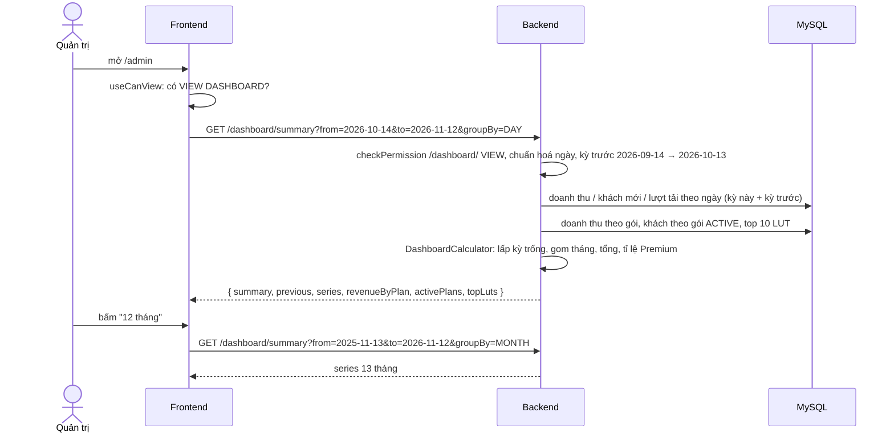

# Bảng số liệu quản trị

## 1. Mục tiêu và phạm vi

Sau plan này, quản trị viên có quyền `DASHBOARD` mở **`/admin`** (trang đầu tiên sau khi đăng nhập) và thấy ngay tình hình kinh doanh trong một khoảng ngày (mặc định 30 ngày gần nhất):

- 4 ô số: **Doanh thu**, **Đơn đã thanh toán**, **Khách mới**, **Lượt tải**, mỗi ô có dòng so sánh với kỳ trước cùng độ dài.
- **Diễn biến**: biểu đồ cột theo ngày hoặc theo tháng, đổi được giữa 4 chỉ số, mở được bảng số liệu.
- **Gói đang dùng** (số khách theo Miễn phí / Pro / Studio, tính tại lúc xem), **Doanh thu theo gói**, **Lượt tải Premium** (tỉ lệ LUT Premium trong lượt tải), **Top 10 LUT tải nhiều**.

Người không có quyền `DASHBOARD` (khách hàng, `noaccess`, role chỉ quản LUT) vẫn thấy trang chào như hiện nay.

| Có làm (lát này) | Không làm (để plan khác) |
|---|---|
| Migration `V17__dashboard_admin.sql`: module `SALES` "Kinh doanh", resource `DASHBOARD` (`/dashboard/`, chỉ VIEW), index `payment_order (status, paid_time)`. Không có bảng mới | Danh sách đơn, khách hàng, sửa giá gói (lát `quan-tri-don-hang`, resource `PLAN` / `ORDER` / `CUSTOMER`) |
| 1 API `GET /dashboard/summary?from=&to=&groupBy=` | Xuất CSV / Excel, in báo cáo |
| Lớp thuần `DashboardCalculator` (gom ngày → tháng, lấp kỳ trống, tổng, kỳ trước) | Cache số liệu, bảng tổng hợp dựng sẵn |
| Frontend: `/admin` thành bảng số liệu khi có quyền; biểu đồ bằng component `chart` của shadcn (recharts) | Số liệu gợi ý (đã có ở `/admin/goi-y` thẻ "Trực tuyến") |
| Giữ nguyên trang chào cho người không có quyền `DASHBOARD` | Dữ liệu demo cho bảng số liệu (§11 câu 8) |

## 2. Tác nhân và phân quyền

| Tác nhân | Quyền (resource `DASHBOARD`, uri `/dashboard/`) | Ghi chú |
|---|---|---|
| Quản trị (role operator, `admin@downbeat.local`) | VIEW | Role `is_operator = 1` có mọi quyền, migration không cấp permission |
| Role được cấp VIEW `DASHBOARD` | `summary` | Không có VIEW `LUT` thì tên LUT ở "Top 10 LUT tải nhiều" là chữ thường, không phải link |
| Khách hàng, `noaccess@downbeat.local` | Không | API 403 `FORBIDDEN` "Bạn không có quyền thực hiện thao tác này! Path: /dashboard/, Action: VIEW"; `/admin` hiện trang chào cũ, **không** gọi API `dashboard/summary` |

API không có `/public/` nên filter đòi token (401 khi thiếu). Controller gọi `checkPermission(principal, "/dashboard/", "VIEW")` ở **dòng đầu** handler, trước mọi validate (403 thắng 400).

## 3. Luồng nghiệp vụ

**Luồng chính 1 — xem tổng quan:**
1. Quản trị đăng nhập → `/admin`. Giao diện thấy có VIEW `DASHBOARD` → gọi `GET /dashboard/summary?from=<hôm nay − 29>&to=<hôm nay>&groupBy=DAY`.
2. Backend kiểm quyền, chuẩn hoá khoảng ngày, tính kỳ trước (cùng số ngày, liền trước `from`), chạy các truy vấn gom (§5.1) cho kỳ này và kỳ trước, trả một khối JSON.
3. Giao diện hiện 4 ô số kèm dòng so sánh, card "Diễn biến" (biểu đồ "Doanh thu" theo ngày), "Gói đang dùng", "Doanh thu theo gói", "Lượt tải Premium", "Top 10 LUT tải nhiều".

**Luồng chính 2 — đổi khoảng ngày:**
1. Bấm nút nhanh "7 ngày" / "30 ngày" / "90 ngày" (gom theo ngày) hoặc "12 tháng" (gom theo tháng); hoặc sửa ô "Từ ngày" / "Đến ngày" (gom tự chọn: ≤ 92 ngày theo ngày, dài hơn theo tháng).
2. Giao diện gọi lại `summary`; trong lúc chờ vẫn hiện số liệu cũ (mờ đi), có số liệu mới thì thay.

**Luồng chính 3 — xem diễn biến:**
1. Ở card "Diễn biến", chọn chỉ số "Doanh thu" / "Đơn đã thanh toán" / "Khách mới" / "Lượt tải" (không gọi API, dùng `series` đã có).
2. Chọn "Ngày" / "Tháng" → gọi lại `summary` với `groupBy` tương ứng.
3. Bấm "Xem bảng số liệu" → bảng các kỳ + dòng "Tổng".

**Luồng thay thế:**
- A1. Role có VIEW `DASHBOARD` nhưng không có VIEW `LUT` → tên LUT ở bảng top là chữ thường.
- A2. Khoảng ngày không có dữ liệu → mỗi card hiện câu rỗng riêng (§6), 4 ô số hiện 0.
- A3. Kỳ trước bằng 0 → dòng so sánh "Kỳ trước: 0" (không tính phần trăm).
- A4. Gọi API không truyền `groupBy` (hoặc giá trị lạ) → backend tự chọn theo số ngày như bước 1 luồng 2.

**Ngoại lệ:**
- E1. Không có VIEW `DASHBOARD` → API 403; giao diện hiện trang chào cũ, không gọi API.
- E2. Ngày sai định dạng / `from` sau `to` / quá 366 ngày → 400 (§5.2). Giao diện chặn trước hai lỗi sau, không gọi API.
- E3. API lỗi mạng / 5xx → khung "Không tải được số liệu" + nút "Thử lại", bộ lọc ngày vẫn dùng được.



## 4. Cơ sở dữ liệu

Migration: `V17__dashboard_admin.sql` (mới nhất hiện tại là `V16__kiem_dinh_goi_y.sql`). **Không** tạo bảng, không thêm cột. Thêm module + resource theo khuôn `V13__quan_tri_goi_y.sql`, và index cho truy vấn doanh thu (thiết kế tổng quát §4.4 ghi `(status, paid_time)`, V7 mới có `(status, created_time)`):

```sql
SET NAMES utf8mb4;

INSERT INTO `module` (`name`, `code`, `description`, `active`)
SELECT 'Kinh doanh', 'SALES', 'Bảng số liệu, gói, đơn hàng, khách hàng', 1 FROM DUAL
WHERE NOT EXISTS (SELECT 1 FROM `module` WHERE `code` = 'SALES');

INSERT INTO `resource` (`name`, `description`, `code`, `uri`, `actions`, `active`, `module_id`)
SELECT 'Bảng số liệu', 'Doanh thu, đơn đã thanh toán, khách mới, gói đang dùng, top LUT, tỉ lệ Premium', 'DASHBOARD', '/dashboard/',
       '["VIEW"]', 1, (SELECT `id` FROM `module` WHERE `code` = 'SALES')
FROM DUAL WHERE NOT EXISTS (SELECT 1 FROM `resource` WHERE `code` = 'DASHBOARD');

ALTER TABLE `payment_order` ADD KEY `idx_payment_order_status_paid` (`status`, `paid_time`);
```

Không cấp permission cho role nào (admin là operator). Các bảng đọc và cột dùng:

| Bảng | Cột | Dùng cho |
|---|---|---|
| `payment_order` | `status = 'PAID'`, `paid_time`, `amount`, `plan_id` | Doanh thu, đơn đã thanh toán, doanh thu theo gói |
| `plan` | `code`, `name`, `sort_order`, `active` | Tên gói, thứ tự hiển thị |
| `subscription` | `status = 'ACTIVE'`, `end_date ≥ hôm nay`, `plan_id`, `user_id` | Gói đang dùng (như `SubscriptionRepository.findActiveByUserId`) |
| `user_app` + `role` | `regis_date`, `role_id` → role `is_default = 1 AND is_operator = 0` ("Khách hàng") | Khách mới, tổng khách hàng |
| `download_log` + `lut` + `creator` | `created_time`, `lut_id`, `lut.is_premium`, `lut.status`, `creator.name` | Lượt tải, lượt tải Premium, top 10 LUT |

Định nghĩa **khách hàng** dùng chung cả lát: `user_app.role_id` thuộc role `is_default = 1 AND is_operator = 0` (cùng điều kiện `RoleRepository` dùng khi đăng ký). Quản trị và `noaccess` không phải khách hàng.

## 5. Hợp đồng API (cố định — nguồn sự thật cho cả BE và FE)

Thành công: `{ "code": 200, "message": "OK", "result": … }`. Lỗi nghiệp vụ: `{ "path", "code", "errorCode", "message" }`. POJO `NON_NULL`. Ngày `yyyy-MM-dd`, tháng `yyyy-MM`, "hôm nay" theo `Clock` Asia/Ho_Chi_Minh. Tiền là số nguyên VND (`long`). Tỉ lệ là số thập phân trong [0, 1], làm tròn 4 chữ số; giao diện tự đổi sang phần trăm.

### 5.1 `GET /api/dashboard/summary?from=&to=&groupBy=` — quyền VIEW

Tham số (đều tuỳ chọn):

| Tham số | Giá trị | Thiếu / rỗng |
|---|---|---|
| `to` | `yyyy-MM-dd` | hôm nay |
| `from` | `yyyy-MM-dd` | `to − 29 ngày` |
| `groupBy` | `DAY` / `MONTH` (không phân biệt hoa thường) | tự chọn: số ngày ≤ 92 → `DAY`, > 92 → `MONTH`. Giá trị khác hai giá trị trên cũng tự chọn như vậy, không báo lỗi |

Khoảng tính cả hai đầu: thời điểm `>= from 00:00:00` và `< to + 1 ngày 00:00:00`. Số ngày `n = to − from + 1`. **Kỳ trước**: `prevTo = from − 1 ngày`, `prevFrom = prevTo − (n − 1) ngày` (cùng số ngày, liền trước).

Response `result` (POJO `DashboardSummary`; `series` 30 phần tử, rút gọn còn 2; `topLuts` rút gọn còn 2):
```json
{
  "from": "2026-10-14",
  "to": "2026-11-12",
  "groupBy": "DAY",
  "summary": {
    "revenue": 1389000,
    "paidOrders": 11,
    "newCustomers": 37,
    "downloads": 214,
    "premiumDownloads": 52,
    "premiumRatio": 0.243
  },
  "previous": {
    "from": "2026-09-14",
    "to": "2026-10-13",
    "revenue": 594000,
    "paidOrders": 6,
    "newCustomers": 12,
    "downloads": 88,
    "premiumDownloads": 15,
    "premiumRatio": 0.1705
  },
  "series": [
    { "period": "2026-10-14", "revenue": 0, "paidOrders": 0, "newCustomers": 1, "downloads": 3 },
    { "period": "2026-10-15", "revenue": 99000, "paidOrders": 1, "newCustomers": 2, "downloads": 9 }
  ],
  "revenueByPlan": [
    { "planCode": "pro", "planName": "Pro", "revenue": 891000, "paidOrders": 9 },
    { "planCode": "studio", "planName": "Studio", "revenue": 498000, "paidOrders": 2 }
  ],
  "activePlans": {
    "totalCustomers": 128,
    "items": [
      { "planCode": "free", "planName": "Miễn phí", "customers": 119 },
      { "planCode": "pro", "planName": "Pro", "customers": 7 },
      { "planCode": "studio", "planName": "Studio", "customers": 2 }
    ]
  },
  "topLuts": [
    { "id": 17, "slug": "mua-thu-ha-noi", "title": "Mùa Thu Hà Nội", "coverUrl": "http://localhost:9020/downbeat-public/lut/mua-thu-ha-noi/cover.jpg", "isPremium": 0, "status": "PUBLISHED", "creatorName": "Minh Color", "downloads": 18 },
    { "id": 8, "slug": "xanh-dem", "title": "Xanh Đêm", "coverUrl": "http://localhost:9020/downbeat-public/lut/xanh-dem/cover.jpg", "isPremium": 1, "status": "PUBLISHED", "creatorName": "Mono Works", "downloads": 11 }
  ]
}
```

Định nghĩa từng khối:

| Khối | Cách tính |
|---|---|
| `groupBy` | Giá trị đã dùng thật (`DAY` / `MONTH`) |
| `summary` | Tổng của kỳ này. **Không** có `from` / `to` (đã ở gốc) |
| `revenue`, `paidOrders` | `SUM(amount)`, `COUNT(*)` của `payment_order` `status = 'PAID'`, `paid_time` trong khoảng. Mọi chu kỳ (MONTH / YEAR), kể cả đơn nâng cấp và đơn `mock-pay` ở local |
| `newCustomers` | Số khách hàng (§4) có `regis_date` trong khoảng |
| `downloads`, `premiumDownloads` | Số dòng `download_log` có `created_time` trong khoảng; số dòng trong đó LUT có `is_premium = 1` (cờ hiện tại của LUT) |
| `premiumRatio` | `round4(premiumDownloads / downloads)`; `downloads = 0` → `0.0` |
| `previous` | Cùng 6 số như `summary`, tính trên kỳ trước, có thêm `from` / `to` của kỳ trước |
| `series` | `DAY`: mỗi ngày từ `from` tới `to` một phần tử, `period` = `yyyy-MM-dd`. `MONTH`: mỗi tháng có ngày nằm trong khoảng một phần tử, `period` = `yyyy-MM`, tháng đầu / cuối chỉ cộng các ngày trong khoảng (ví dụ `2025-11-13` → `2026-11-12` là 13 phần tử `2025-11` … `2026-11`). Sắp tăng dần, **kỳ không có dữ liệu vẫn có phần tử với số 0**. Tổng mỗi cột của `series` bằng số tương ứng ở `summary` |
| `revenueByPlan` | Mọi gói `active = 1` có `code <> 'free'`, sắp `sort_order` tăng dần, kể cả gói không có đơn (số 0). Tổng `revenue` / `paidOrders` bằng `summary` |
| `activePlans` | **Tại thời điểm gọi**, không theo khoảng ngày. `totalCustomers` = số khách hàng (§4). Mỗi gói `active = 1`, sắp `sort_order`: gói trả phí = số khách hàng khác nhau có `subscription` `status = 'ACTIVE'` và `end_date ≥ hôm nay` của gói đó; `free` = `totalCustomers − tổng các gói trả phí` (nhỏ hơn 0 thì 0) |
| `topLuts` | Tối đa 10 LUT có lượt tải trong khoảng, gom `download_log` theo `lut_id`, sắp `downloads` giảm dần rồi `id` tăng dần. Gồm cả LUT đã ẩn (`status` cho biết). Không có lượt tải → `[]` |

Handler **không** `@Transactional` (chỉ đọc).

### 5.2 Lỗi nghiệp vụ

| Tình huống | HTTP | errorCode | message (nguyên văn) |
|---|---|---|---|
| Không token / token sai | 401 | `LOGIN` / `UNAUTHORIZED` / `TOKEN_EXPIRED` (filter có sẵn) | (message có sẵn) |
| Role không có VIEW `DASHBOARD` | 403 | `FORBIDDEN` | Bạn không có quyền thực hiện thao tác này! Path: /dashboard/, Action: VIEW |
| `from` hoặc `to` không đúng `yyyy-MM-dd` (đọc strict, `2026-02-30` là lỗi) | 400 | `BAD_REQUEST` | Ngày không hợp lệ |
| `from` sau `to` | 400 | `BAD_REQUEST` | Ngày bắt đầu phải trước hoặc bằng ngày kết thúc |
| Số ngày `n` > 366 | 400 | `BAD_REQUEST` | Khoảng thời gian tối đa 366 ngày |

Thứ tự kiểm: quyền → `to` → `from` → `from ≤ to` → `n ≤ 366`. Không thêm `ErrorCode` mới. Ba message 400 trùng nguyên văn `recommend/stats` để giao diện hai trang nói giống nhau.

## 6. Giao diện (chuỗi cố định — test E2E chọn theo đúng các chuỗi này)

Định dạng: tiền `formatVnd` có sẵn ở `lib/utils/money.ts` (`1.389.000đ`, `0đ`); số đếm `Intl.NumberFormat("vi-VN")` (`1.234`); tỉ lệ `Intl.NumberFormat("vi-VN", { style: "percent", minimumFractionDigits: 1, maximumFractionDigits: 1 })` (`24,3%`); ngày `dd/MM/yyyy`; tháng `MM/yyyy`.

### 6.1 Khung trang

- Route `/admin` (`routes/admin/index.tsx`). **Không** bọc `AdminPermissionGuard` (đây là trang đầu của mọi người vào quản trị). `useCanView()`: đang chờ → `AdminLoading`; không có VIEW `DASHBOARD` → **giữ nguyên trang chào hiện tại** (h1 "Xin chào, {name}", dòng "Chọn chức năng ở thanh bên để bắt đầu.", card "Tài khoản") và không gọi `dashboard/summary`; có VIEW → bảng số liệu bên dưới.
- Thanh bên giữ nguyên (mục "Trang chủ" trỏ `/admin`), không thêm mục mới.
- Đầu trang: h1 **"Xin chào, {name}"** (giữ như cũ, các spec `auth`, `go-redis-mail` dựa vào), dòng phụ "Tổng quan kinh doanh của cửa hàng theo khoảng ngày đã chọn."
- Bố cục từ `lg` (lưới 3 cột): hàng 1 bộ lọc ngày; hàng 2 bốn ô số; hàng 3 "Diễn biến" (2 cột) + "Gói đang dùng" (1 cột); hàng 4 "Top 10 LUT tải nhiều" (2 cột) + cột phải xếp "Lượt tải Premium" trên "Doanh thu theo gói". Dưới `lg` mọi card một cột theo đúng thứ tự trên. Mỗi card là `section` có `aria-label` bằng tiêu đề card.
- Đang tải lần đầu: 4 ô `Skeleton` + 4 khung `Skeleton`. Đổi khoảng / gom: giữ số liệu cũ, vùng số liệu mờ đi (`opacity-60`) và có `aria-busy="true"` tới khi có số liệu mới.
- Lỗi (5xx / mạng): thay vùng số liệu bằng `AdminListError` tiêu đề **"Không tải được số liệu"** (nút "Thử lại" có sẵn trong component); bộ lọc ngày vẫn hiện.

### 6.2 Bộ lọc ngày

- Hai ô `input type="date"` label "Từ ngày", "Đến ngày"; bốn nút nhanh "7 ngày", "30 ngày", "90 ngày", "12 tháng" (nút đang chọn ở dạng `default` và `aria-pressed="true"`, còn lại `outline` và `aria-pressed="false"`; sửa tay ô ngày thì bỏ chọn nút). Mặc định "30 ngày".
- Nút nhanh: `to` = hôm nay (giờ trình duyệt); `from` = hôm nay − 6 / − 29 / − 89 / − 364; gom "Ngày" cho ba nút đầu, "Tháng" cho "12 tháng".
- Sửa tay ô ngày: gom tự chọn (≤ 92 ngày → "Ngày", dài hơn → "Tháng").
- Validate trước khi gọi (giống thẻ "Trực tuyến" của `/admin/goi-y`): ô rỗng → dưới ô đó "Chọn ngày"; `from > to` → dưới "Đến ngày" "Ngày bắt đầu phải trước hoặc bằng ngày kết thúc"; quá 366 ngày → dưới "Đến ngày" "Khoảng thời gian tối đa 366 ngày". Khi lỗi không gọi API, vùng số liệu giữ khoảng hợp lệ gần nhất.
- Dưới bộ lọc, chữ nhỏ màu muted: "So sánh với kỳ trước: {previous.from dd/MM/yyyy} – {previous.to dd/MM/yyyy}".
- Giao diện luôn gửi đủ `from`, `to`, `groupBy`.

### 6.3 Bốn ô số

Lưới 2 cột dưới `lg`, 4 cột từ `lg`. Mỗi ô một `Card` có `aria-label` bằng tiêu đề:

| Tiêu đề | Giá trị | Số kỳ trước dùng để so |
|---|---|---|
| "Doanh thu" | `formatVnd(summary.revenue)` | `previous.revenue` |
| "Đơn đã thanh toán" | `summary.paidOrders` | `previous.paidOrders` |
| "Khách mới" | `summary.newCustomers` | `previous.newCustomers` |
| "Lượt tải" | `summary.downloads` | `previous.downloads` |

Dòng so sánh dưới giá trị (cur = số kỳ này, prev = số kỳ trước):
- `prev > 0` và `cur ≠ prev`: "{p} so với kỳ trước", với `p` = `Intl.NumberFormat("vi-VN", { style: "percent", minimumFractionDigits: 1, maximumFractionDigits: 1, signDisplay: "exceptZero" }).format((cur − prev) / prev)` (ví dụ "+133,8% so với kỳ trước", "-25,0% so với kỳ trước"). Tăng màu xanh (`text-emerald-600 dark:text-emerald-400`), giảm màu `text-destructive`.
- `prev > 0` và `cur = prev`: "Bằng kỳ trước" (màu muted).
- `prev = 0`: "Kỳ trước: 0" (màu muted).

### 6.4 Card "Diễn biến"

- Tiêu đề "Diễn biến". Hàng điều khiển (xuống dòng được trên điện thoại):
  - `Tabs` `aria-label="Chỉ số"`: "Doanh thu" (mặc định), "Đơn đã thanh toán", "Khách mới", "Lượt tải". Đổi chỉ số **không** gọi API.
  - `Tabs` `aria-label="Gom theo"`: "Ngày", "Tháng". Đổi → gọi lại `summary` với `groupBy` mới (giữ khoảng ngày, giữ chỉ số đang chọn).
- Biểu đồ cột (shadcn `ChartContainer` + recharts `BarChart`), cao 260 px, khung có `role="img"` và `aria-label="Biểu đồ {chỉ số} theo {ngày|tháng}"` (ví dụ "Biểu đồ Doanh thu theo ngày"). Trục ngang: `dd/MM` (ngày) hoặc `MM/yyyy` (tháng). Trục dọc: doanh thu dạng gọn `Intl.NumberFormat("vi-VN", { notation: "compact" })` ("1,4 Tr"), chỉ số khác là số đếm. Tooltip: "{dd/MM/yyyy hoặc Tháng MM/yyyy}" và giá trị (doanh thu dùng `formatVnd`). Màu cột `var(--chart-1)`.
- Mọi phần tử `series` của chỉ số đang chọn bằng 0 → thay biểu đồ bằng chữ "Chưa có dữ liệu trong khoảng này." (giữ nguyên chiều cao khung).
- Dưới biểu đồ: `Collapsible`, nút "Xem bảng số liệu" (đóng, mặc định) / "Ẩn bảng số liệu" (mở). Bảng `aria-label="Bảng số liệu theo kỳ"`, cột "Kỳ", "Doanh thu", "Đơn đã thanh toán", "Khách mới", "Lượt tải"; mỗi phần tử `series` một dòng theo thứ tự (kỳ `dd/MM/yyyy` hoặc `MM/yyyy`); dòng cuối in đậm "Tổng" với số của `summary`. Bảng trong khung cuộn dọc tối đa 320 px.

### 6.5 Card "Gói đang dùng"

- Mô tả: "Tính tại thời điểm xem, không theo khoảng ngày."
- Dòng "Tổng {totalCustomers} khách hàng".
- `ul aria-label="Gói đang dùng"`, mỗi `li` theo thứ tự `activePlans.items`: tên gói, số khách, phần trăm trên tổng trong ngoặc ("(93,0%)"), thanh ngang dài theo phần trăm (`aria-hidden`).
- `totalCustomers = 0` → thay danh sách bằng "Chưa có khách hàng nào."

### 6.6 Card "Doanh thu theo gói"

- Mô tả: "Đơn đã thanh toán trong khoảng ngày."
- `ul aria-label="Doanh thu theo gói"`, mỗi `li`: tên gói, `formatVnd(revenue)`, "{paidOrders} đơn", thanh ngang theo tỉ trọng doanh thu (`aria-hidden`).
- Mọi gói `revenue = 0` → "Chưa có đơn thanh toán nào trong khoảng này."

### 6.7 Card "Lượt tải Premium"

- Mô tả: "Tỉ lệ lượt tải là LUT Premium trong khoảng ngày."
- Số lớn: tỉ lệ `premiumRatio` dạng phần trăm ("24,3%"); dòng "{premiumDownloads} / {downloads} lượt tải là LUT Premium".
- Thanh chồng hai đoạn (`aria-hidden`) và chú thích "Premium: {premiumDownloads}", "Thường: {downloads − premiumDownloads}".
- `downloads = 0` → thay toàn bộ nội dung bằng "Chưa có lượt tải nào trong khoảng này."

### 6.8 Card "Top 10 LUT tải nhiều"

- Mô tả: "Xếp theo số lượt tải trong khoảng ngày."
- Bảng `aria-label="Top LUT tải nhiều"` trong khung `overflow-x-auto`, cột "#", "LUT", "Tác giả", "Loại", "Lượt tải".
  - "#": 1 → n.
  - "LUT": ảnh bìa nhỏ 16:9 (rộng 64 px, `alt=""`) + tiêu đề. Có VIEW `LUT` (`useCanView().canView("LUT")`) thì tiêu đề là link tới `/admin/luts/{id}`, không thì chữ thường. `status = "HIDDEN"` → `Badge` (outline) "Đã ẩn" cạnh tiêu đề.
  - "Loại": `isPremium = 1` → `Badge` "Premium"; còn lại chữ "Thường".
  - "Lượt tải": số dạng `vi-VN`.
- `topLuts = []` → "Chưa có lượt tải nào trong khoảng này."

### 6.9 Điện thoại (360 px trở lên)

Trang không tràn ngang; 4 ô số xếp 2 cột; hai nhóm `Tabs` của "Diễn biến" xuống dòng được; bảng top và bảng số liệu cuộn ngang trong khung của nó.

## 7. Việc backend (agy BE)

Thứ tự theo `backend/AGENTS.md`. Package mới `vn.aeoc.business.dashboard` (`controller/`, `service/`, `repository/`, `calc/` cho lớp thuần). Hướng phụ thuộc một chiều: `dashboard` chỉ đọc bảng của `billing`, `download`, `lut`, `account`; không module nào import `dashboard`.

1. **Migration** `app/src/main/resources/db/migration/V17__dashboard_admin.sql` đúng §4 → `sh scripts/ai/backend-restart.sh` (không có bảng mới nên không cần sinh lại jOOQ).
2. **Entity** (không thuộc bảng, `@JsonInclude(NON_NULL)`, package `entity/.../data/mysql/dashboard/`): `DashboardSummary` (`from, to, groupBy, summary, previous, series, revenueByPlan, activePlans, topLuts`), `DashboardTotals` (`from, to, revenue, paidOrders, newCustomers, downloads, premiumDownloads, premiumRatio`; `from` / `to` chỉ gán cho `previous`), `DashboardPoint` (`period, revenue, paidOrders, newCustomers, downloads`), `PlanRevenue` (`planCode, planName, revenue, paidOrders`), `ActivePlans` (`totalCustomers, items`), `PlanCustomers` (`planCode, planName, customers`), `DashboardTopLut` (`id, slug, title, coverUrl, isPremium, status, creatorName, downloads`). Số đếm và tiền kiểu `Long`, `isPremium` kiểu `Integer` như `Lut`.
3. **`calc/`** (thuần, static, không Spring):
   - Record đầu vào: `RevenueDay(LocalDate day, long revenue, long orders)`, `CountDay(LocalDate day, long count)`, `DownloadDay(LocalDate day, long downloads, long premium)`.
   - `DashboardCalculator.resolveGroupBy(String raw, long days)` → `"DAY"` / `"MONTH"` theo §5.1.
   - `DashboardCalculator.previousRange(LocalDate from, LocalDate to)` → cặp ngày kỳ trước (record `DateRange(LocalDate from, LocalDate to)`).
   - `DashboardCalculator.series(LocalDate from, LocalDate to, String groupBy, List<RevenueDay>, List<CountDay>, List<DownloadDay>)` → `List<DashboardPoint>`: lấp đủ mọi ngày / tháng, bỏ dòng nằm ngoài khoảng, gom tháng theo `YearMonth`.
   - `DashboardCalculator.totals(List<RevenueDay>, List<CountDay>, List<DownloadDay>)` → `DashboardTotals` (`premiumRatio` làm tròn 4 chữ số, `downloads = 0` → `0.0`).
4. **Repository** `dashboard/repository/DashboardRepository extends AbsMysqlRepository<PaymentOrderRecord, PaymentOrder, Integer>` (`getTable()` = `PAYMENT_ORDER`). Truy vấn gom viết tay jOOQ (được phép: đọc bảng khác, chọn cột vào kiểu khác). Mọi khoảng nhận `LocalDateTime fromInclusive, LocalDateTime toExclusive`. Điều kiện khách hàng viết một lần: `USER_APP.ROLE_ID.in(select(ROLE.ID).from(ROLE).where(ROLE.IS_DEFAULT.eq(1).and(ROLE.IS_OPERATOR.eq(0))))`.
   - `revenueByDay(from, toEx)` → `List<RevenueDay>`: `payment_order` `status = 'PAID'`, `paid_time` trong khoảng, gom `DATE(paid_time)`.
   - `newCustomersByDay(from, toEx)` → `List<CountDay>`: khách hàng, `regis_date` trong khoảng, gom `DATE(regis_date)`.
   - `downloadsByDay(from, toEx)` → `List<DownloadDay>`: `download_log JOIN lut`, gom `DATE(download_log.created_time)`, `COUNT(*)` và `SUM(CASE WHEN lut.is_premium = 1 THEN 1 ELSE 0 END)`.
   - `revenueByPlan(from, toEx)` → `List<PlanRevenue>`: `plan LEFT JOIN payment_order ON plan_id AND status = 'PAID' AND paid_time trong khoảng`, `WHERE plan.active = 1 AND plan.code <> 'free'`, gom theo gói, `COALESCE(SUM(amount), 0)`, `COUNT(payment_order.id)`, sắp `sort_order`.
   - `customerCount()` → `long`.
   - `paidCustomersByPlan(LocalDate today)` → `List<PlanCustomers>`: mọi gói `active = 1` sắp `sort_order`, `customers` = `COUNT(DISTINCT subscription.user_id)` với `subscription` `ACTIVE`, `end_date ≥ today`, `user_id` là khách hàng (`LEFT JOIN`, gói `free` ra 0).
   - `topLuts(from, toEx, int limit)` → `List<DashboardTopLut>`: `download_log JOIN lut JOIN creator`, gom `lut.id`, sắp `COUNT(*) DESC, lut.id ASC`, `LIMIT limit`.
5. **Service** `dashboard/service/DashboardService extends BaseService<DashboardRepository, PaymentOrder, Integer>`, có `Clock` (hai constructor như `RecommendStatsService`: mặc định `Clock.system(Asia/Ho_Chi_Minh)`, bản nhận `Clock` cho test). `summary(String from, String to, String groupBy)`:
   1. Parse / validate đúng thứ tự §5.2 (`DateTimeFormatter.ofPattern("uuuu-MM-dd").withResolverStyle(STRICT)`, chép cách làm của `RecommendStatsService`); hằng `MAX_DAYS = 366`, `AUTO_DAY_MAX_DAYS = 92`, `TOP_LIMIT = 10`.
   2. `groupBy` = `resolveGroupBy`; kỳ trước = `previousRange`.
   3. Kỳ này: 3 truy vấn theo ngày → `totals` (summary) + `series`; `revenueByPlan`; `topLuts(…, 10)`. Kỳ trước: 3 truy vấn theo ngày → `totals` + gán `from` / `to`.
   4. `activePlans`: `customerCount()` + `paidCustomersByPlan(today)`; dòng `free` = `max(0, total − tổng các dòng khác)`.
   5. Không `@Transactional`.
6. **Controller** `dashboard/controller/DashboardController extends BaseController` (`URI = "/dashboard/"`): `GET /dashboard/summary` (`@RequestParam(required = false) String from, to, groupBy`), `checkPermission(principal, URI, "VIEW")` ở dòng đầu, trả `Mapper.map(…, ApiResponse::okEntity)`.
7. **Unit test**: mọi TC loại `unit` ở §9 (JUnit 5 + AssertJ + Mockito, không dựng Spring; `QueryExecutor(Runnable::run)` nếu cần).

Quyết định đã chốt, worker không tự đổi: chỉ resource `DASHBOARD` với VIEW, module `SALES`, không cấp permission trong migration; một endpoint duy nhất; khoảng ngày tính cả hai đầu, mặc định 30 ngày; kỳ trước cùng số ngày liền trước; tự chọn gom ≤ 92 ngày → `DAY`; `series` lấp đủ kỳ trống bằng 0; doanh thu theo `paid_time` của đơn `PAID`; khách hàng = role mặc định không operator; gói đang dùng tính tại lúc gọi, chỉ khách hàng; tỉ lệ Premium theo cờ `is_premium` hiện tại; top 10 gồm cả LUT đã ẩn, hoà thì `id` tăng dần; không cache; không thêm `ErrorCode`.

Nghiệm thu riêng (thêm vào "Nghiệm thu chuẩn"): dán vào `worker_done` (a) response `summary` không tham số trên DB local; (b) response `?from=<hôm nay − 364>&to=<hôm nay>` (phải là `MONTH`, 13 phần tử `series`); (c) response 403 khi gọi bằng token `noaccess`; (d) xác nhận tổng cột `revenue` / `downloads` của `series` ở (a) bằng `summary`.

## 8. Việc frontend (agy FE)

1. `lib/types/dashboard.ts` (mới): `DashboardGroupBy = "DAY" | "MONTH"`, `DashboardTotalsDTO`, `DashboardPointDTO`, `PlanRevenueDTO`, `PlanCustomersDTO`, `ActivePlansDTO`, `DashboardTopLutDTO`, `DashboardSummaryDTO`, `DashboardSummaryParams { from: string; to: string; groupBy: DashboardGroupBy }` đúng §5.1.
2. `lib/axios/dashboard.ts` (mới): `getDashboardSummary(params)` → `GET /dashboard/summary`, trả `res.data.result`.
3. `lib/tanstack/options/dashboard.ts` (mới): `dashboardSummaryQueryOptions(params)` key `["dashboard", "summary", from, to, groupBy]`, `staleTime` 30 giây, `placeholderData: keepPreviousData` (§6.1). Query không toast.
4. `pnpm dlx shadcn@latest add chart` → `components/ui/chart.tsx` + dependency `recharts`. Kiểm `index.css` có biến `--chart-1` cho cả sáng và tối (shadcn init thường có sẵn; thiếu thì thêm theo mẫu shadcn). Nếu recharts báo lỗi kiểu / chạy với React 19, gửi `worker_question`, **không** tự đổi sang thư viện khác.
5. `components/admin/dashboard/` (mới):
   - `dashboard-view.tsx`: bộ lọc + gọi query + bố cục §6.1, trạng thái tải / lỗi.
   - `date-range-filter.tsx`: bộ lọc §6.2 (bản riêng, **không** sửa `components/admin/recommend/online-tab.tsx` để khỏi ảnh hưởng spec `quan-tri-goi-y`).
   - `kpi-tiles.tsx` (4 ô + dòng so sánh §6.3), `trend-card.tsx` (§6.4), `active-plans-card.tsx` (§6.5), `plan-revenue-card.tsx` (§6.6), `premium-ratio-card.tsx` (§6.7), `top-luts-card.tsx` (§6.8).
   - `format.ts`: định dạng số / phần trăm / ngày / tháng / dòng so sánh đúng §6 (tiền dùng lại `formatVnd` của `lib/utils/money.ts`).
6. `routes/admin/index.tsx`: rẽ nhánh theo §6.1. Phần trang chào cho người không có quyền giữ **nguyên văn** chuỗi và cấu trúc hiện tại (các spec `dac-trung-mau`, `phan-quyen`, `quan-ly-lut`, `quan-tri-goi-y`, `tai-khoan-khach` chọn theo chúng).
7. Không đổi thanh bên.
8. `pnpm api:types` sau khi backend lên để `api.gen.ts` có endpoint mới; đối chiếu type tay.

Component shadcn dùng: có sẵn trong `components/ui/`: `card`, `tabs`, `table`, `badge`, `button`, `input`, `label`, `collapsible`, `skeleton`, `tooltip`; của quản trị: `AdminLoading`, `AdminListError`, `useCanView`. Cần `shadcn add`: `chart` (kéo theo `recharts`).

Việc của Claude ở `frontend/tests/e2e/` (không giao worker): viết `dashboard-admin.spec.ts` theo §9; chạy hồi quy `auth`, `go-redis-mail` (h1 "Xin chào" của admin), `phan-quyen` (thêm resource và module mới), `tai-khoan-khach`, `dac-trung-mau`, `quan-ly-lut`, `quan-tri-goi-y` (trang chào của người không có quyền `DASHBOARD`).

## 9. Test case

`unit` = agy BE viết JUnit · `api` / `e2e` = Claude viết ở `frontend/tests/e2e/dashboard-admin.spec.ts`.

Quy ước: D = hôm nay (giờ VN), `D − k` = D lùi k ngày. Dữ liệu E2E: mỗi test tự đăng ký khách mới (`newEmail()`); đơn Pro tạo bằng `order/create { planCode: "pro", cycle: "MONTH" }` (gọi payOS thật như spec `goi-thanh-toan`) rồi `order/mock-pay/{code}`; `F` = `mua-thu-ha-noi` (LUT thường), `P` = `xanh-dem` (LUT Premium). DB local dùng chung với spec khác, nên test đếm so **chênh lệch** trước / sau trong cùng ngày, `test.describe.configure({ mode: "serial" })`; chạy `--workers=1` thì kiểm đúng bằng, chạy song song chỉ kiểm `≥`. Test đổi quyền role "Không quyền" trả quyền lại trong `finally`.

### 9.1 Dữ liệu cho `DashboardCalculator` (TC-01 → TC-03)

Bộ A (`from` 2026-11-01, `to` 2026-11-05):
- `RevenueDay`: (2026-10-31, 99000, 1) nằm ngoài khoảng · (2026-11-02, 99000, 1) · (2026-11-04, 348000, 2)
- `CountDay`: (2026-11-01, 3) · (2026-11-04, 1)
- `DownloadDay`: (2026-11-02, 5, 2) · (2026-11-05, 1, 0)

Bộ B (`from` 2026-10-30, `to` 2026-12-02):
- `RevenueDay`: (2026-10-30, 99000, 1) · (2026-10-31, 249000, 1) · (2026-11-15, 99000, 1) · (2026-12-02, 948000, 1)
- `CountDay`: (2026-11-01, 2) · (2026-11-30, 3)
- `DownloadDay`: (2026-10-31, 4, 1) · (2026-12-01, 2, 2)

### 9.2 Bảng test case

| ID | Loại | Mô tả | Tiền điều kiện | Bước | Kết quả mong đợi |
|---|---|---|---|---|---|
| TC-01 | unit | `series` theo ngày | Bộ A | `series(from, to, "DAY", …)` | 5 phần tử, `period` "2026-11-01" → "2026-11-05" tăng dần; 11-01 {revenue 0, paidOrders 0, newCustomers 3, downloads 0}; 11-02 {99000, 1, 0, 5}; 11-03 {0, 0, 0, 0}; 11-04 {348000, 2, 1, 0}; 11-05 {0, 0, 0, 1}; dòng 2026-10-31 bị bỏ |
| TC-02 | unit | `series` theo tháng | Bộ B; thêm (a) khoảng 2026-11-05 → 2026-11-20 rỗng dữ liệu; (b) khoảng 2025-11-13 → 2026-11-12 rỗng dữ liệu | `series(…, "MONTH", …)` | Bộ B: 3 phần tử "2026-10" {348000, 2, 0, 4}, "2026-11" {99000, 1, 5, 0}, "2026-12" {948000, 1, 0, 2}; (a) 1 phần tử "2026-11" toàn 0; (b) 13 phần tử "2025-11" → "2026-11", toàn 0 |
| TC-03 | unit | `totals` | Bộ A (bỏ dòng ngoài khoảng trước khi gọi); (a) danh sách rỗng; (b) downloads (d, 214, 52) | `totals(…)` | Bộ A: revenue 447000, paidOrders 3, newCustomers 4, downloads 6, premiumDownloads 2, premiumRatio 0.3333; (a) mọi số 0, premiumRatio 0.0; (b) premiumRatio 0.243; `from` / `to` null |
| TC-04 | unit | `resolveGroupBy`, `previousRange` | — | `resolveGroupBy`: ("month", 30), ("DAY", 200), (null, 92), (null, 93), ("week", 10), ("", 366). `previousRange`: (2026-11-06, 2026-11-12), (2026-11-12, 2026-11-12), (2026-03-01, 2026-03-31) | MONTH, DAY, DAY, MONTH, DAY, MONTH. Kỳ trước: (2026-10-30, 2026-11-05), (2026-11-11, 2026-11-11), (2026-01-29, 2026-02-28) |
| TC-05 | unit | `DashboardService` validate + khoảng | Mock repository (trả rỗng), `Clock` = 2026-11-12 VN | (a) from, to, groupBy null; (b) to "2026-11-01" còn lại null; (c) from "2026-13-01"; (d) from "2026-02-30", to "2026-03-01"; (e) to "abc"; (f) from "2026-11-12", to "2026-11-01"; (g) from "2025-11-11", to "2026-11-12"; (h) from "2025-11-12", to "2026-11-12" | (a) `revenueByDay` gọi với (2026-10-14T00:00, 2026-11-13T00:00) và (2026-09-14T00:00, 2026-10-14T00:00); kết quả `from` "2026-10-14", `to` "2026-11-12", `groupBy` "DAY", `previous.from` "2026-09-14", `previous.to` "2026-10-13", `series` 30 phần tử; (b) `from` "2026-10-03"; (c)(d)(e) 400 "Ngày không hợp lệ", không gọi repository; (f) "Ngày bắt đầu phải trước hoặc bằng ngày kết thúc"; (g) "Khoảng thời gian tối đa 366 ngày"; (h) hợp lệ, `groupBy` "MONTH", `series` 13 phần tử |
| TC-06 | unit | `DashboardService` ghép kết quả | Mock: `customerCount` 128; `paidCustomersByPlan` [free 0, pro 7, studio 2]; `revenueByPlan` [pro 891000/9, studio 498000/2]; `topLuts` 2 dòng; lần 2 `customerCount` 5 với pro 4, studio 3 | `summary(null, null, null)` ×2 | Lần 1: `activePlans.totalCustomers` 128, `items` đúng thứ tự free 119, pro 7, studio 2; `revenueByPlan`, `topLuts` giữ nguyên thứ tự repository; `topLuts` gọi với `limit` 10; `summary` không có `from` / `to`, `previous` có. Lần 2: free 0 (không âm) |
| TC-07 | api | Phân quyền | Khách mới (token), `noaccess`, không token | `GET dashboard/summary`; `noaccess` thêm `?from=abc` | Không token 401; khách mới và noaccess 403 `FORBIDDEN` "Bạn không có quyền thực hiện thao tác này! Path: /dashboard/, Action: VIEW"; `from=abc` vẫn 403 (không phải 400) |
| TC-08 | api | Validate ngày | admin | `from=2026-13-01`; `from=2026-02-30&to=2026-03-01`; `to=abc`; `from=D&to=D−1`; `from=D−366&to=D`; `from=D−365&to=D` | 400 `BAD_REQUEST` "Ngày không hợp lệ" ×3; "Ngày bắt đầu phải trước hoặc bằng ngày kết thúc"; "Khoảng thời gian tối đa 366 ngày"; lần cuối 200, `groupBy` "MONTH" |
| TC-09 | api | Mặc định và bất biến | admin | `GET dashboard/summary` không tham số | 200; `to` = D, `from` = D − 29, `groupBy` "DAY"; `previous.to` = D − 30, `previous.from` = D − 59; `series` 30 phần tử, `period` liên tiếp tăng dần từ D − 29 tới D; tổng từng cột `series` = `summary.revenue`, `paidOrders`, `newCustomers`, `downloads`; `premiumRatio` = round4(`premiumDownloads` / `downloads`) (0 khi `downloads` 0) ở cả `summary` và `previous`; `revenueByPlan` đúng 2 dòng `pro` "Pro", `studio` "Studio", tổng = `summary`; `activePlans.items` mã `free`, `pro`, `studio` theo thứ tự, tổng `customers` = `totalCustomers`; `topLuts` ≤ 10, `downloads` không tăng dần, bằng nhau thì `id` tăng dần |
| TC-10 | api | `groupBy` | admin | (a) `from=D−91&to=D` không `groupBy`; (b) `from=D−92&to=D`; (c) `from=D−365&to=D&groupBy=day`; (d) `from=D&to=D&groupBy=MONTH`; (e) `from=D−6&to=D&groupBy=WEEK` | (a) "DAY", 92 phần tử, đầu D − 91, cuối D; (b) "MONTH", số phần tử = số tháng từ tháng của D − 92 tới tháng của D, `period` dạng `yyyy-MM` tăng dần, tổng từng cột = `summary`; (c) "DAY", 366 phần tử; (d) "MONTH", 1 phần tử `period` = 7 ký tự đầu của D, số = `summary`; (e) "DAY", 7 phần tử |
| TC-11 | api | Kỳ trước khớp truy vấn riêng | admin | A = `from=D−6&to=D`; B = `from=D−13&to=D−7` | `A.previous.from` = D − 13, `A.previous.to` = D − 7; 6 số của `A.previous` bằng đúng `B.summary`; `B.previous` = (D − 20, D − 14) |
| TC-12 | api | Số liệu đổi theo thao tác thật | admin; S0 = `summary?from=D&to=D`; X = `S0.topLuts[0]` nếu nó `PUBLISHED`, còn lại (rỗng hoặc đã ẩn) thì F | Đăng ký khách C → C tạo đơn Pro + `mock-pay` → C tải X, P, F mỗi LUT 1 lần (`lut/download { lutId }`) → S1 = `summary?from=D&to=D` | S1 − S0: `newCustomers` +1, `revenue` +99000, `paidOrders` +1, `revenueByPlan` pro +99000 / +1 đơn (studio không đổi), `activePlans.totalCustomers` +1, `activePlans` pro +1, free không đổi, `downloads` +3, `premiumDownloads` + số lượt Premium trong 3 lượt tải; X là `S0.topLuts[0]` thì `S1.topLuts[0].id` = X.id và `downloads` = cũ + 1; S0 rỗng thì `S1.topLuts` = [F (2), P (1)]; S0 có < 10 dòng thì X có trong `S1.topLuts` với `downloads` = (số của X trong S0, không có thì 0) + số lần C tải X; `title`, `slug`, `creatorName`, `coverUrl`, `isPremium` của dòng X khớp `lut/public/get?slug=X.slug`; `S1.series` 1 phần tử bằng `S1.summary` |
| TC-13 | api | Role chỉ có VIEW `DASHBOARD` | Admin cấp VIEW `DASHBOARD` cho role của `noaccess` (`permission/update`, như TC-18 của `quan-tri-goi-y`); `finally` thu hồi | noaccess gọi `summary` | 200 đúng cấu trúc §5.1; sau `finally` gọi lại 403 |
| TC-14 | e2e | Tổng quan mặc định | Trong `beforeAll`: khách C có đơn Pro PAID hôm nay và đã tải F, P (để mọi card có dữ liệu); admin đăng nhập | Mở `/admin` | h1 khớp `/Xin chào/`; đúng 1 request `dashboard/summary?from=<D−29>&to=<D>&groupBy=DAY`; 4 ô "Doanh thu", "Đơn đã thanh toán", "Khách mới", "Lượt tải" hiện đúng giá trị response (doanh thu dạng `formatVnd`, số dạng `vi-VN`); dòng so sánh mỗi ô đúng quy tắc §6.3 tính từ response; chữ "So sánh với kỳ trước: {dd/MM/yyyy} – {dd/MM/yyyy}" khớp `previous`; section "Diễn biến" có `role=img` tên "Biểu đồ Doanh thu theo ngày" |
| TC-15 | e2e | "Diễn biến": chỉ số, gom, bảng số liệu | Như TC-14 | Bấm tab "Lượt tải"; bấm "Xem bảng số liệu"; bấm tab "Tháng" | "Lượt tải": tên biểu đồ "Biểu đồ Lượt tải theo ngày", **không** có request `summary` mới; bảng "Bảng số liệu theo kỳ" có 30 dòng kỳ + dòng "Tổng", ô "Kỳ" dòng đầu = dd/MM/yyyy của D − 29, dòng kỳ cuối = D, dòng "Tổng" khớp 4 ô số; nút đổi thành "Ẩn bảng số liệu"; "Tháng": đúng 1 request có `groupBy=MONTH` (cùng `from`, `to`), bảng có số dòng kỳ = số tháng trong [D − 29, D], ô "Kỳ" dạng `MM/yyyy`, tên biểu đồ "Biểu đồ Lượt tải theo tháng" |
| TC-16 | e2e | Bộ lọc ngày | admin ở `/admin` | Bấm "7 ngày"; "90 ngày"; "12 tháng"; sửa "Từ ngày" = D − 99; sửa "Từ ngày" = D + 1; xoá "Đến ngày" | Request lần lượt `from=<D−6>&to=<D>&groupBy=DAY`, `from=<D−89>…&groupBy=DAY`, `from=<D−364>…&groupBy=MONTH`, `from=<D−99>…&groupBy=MONTH`; nút vừa bấm ở dạng chọn, sửa tay thì không nút nào được chọn; D + 1: dưới "Đến ngày" hiện "Ngày bắt đầu phải trước hoặc bằng ngày kết thúc", không có request mới, 4 ô số vẫn hiện số liệu cũ; xoá "Đến ngày": "Chọn ngày", không có request mới |
| TC-17 | e2e | Các card phụ và bảng top | Như TC-14 | Đọc response của request đầu, so với giao diện | "Gói đang dùng": "Tổng {totalCustomers} khách hàng", `ul[aria-label="Gói đang dùng"] > li` 3 mục theo thứ tự "Miễn phí", "Pro", "Studio", mỗi mục có số khách và phần trăm đúng; "Doanh thu theo gói": 2 mục "Pro", "Studio" có `formatVnd(revenue)` và "{n} đơn"; "Lượt tải Premium": phần trăm của `premiumRatio` và "{p} / {d} lượt tải là LUT Premium"; bảng "Top LUT tải nhiều": số dòng = `topLuts.length` (≤ 10), cột "#" 1 → n, cột "LUT" đúng `title` theo thứ tự, dòng của LUT Premium có badge "Premium", dòng khác chữ "Thường", "Lượt tải" đúng; tiêu đề LUT là link `href` `/admin/luts/{id}` |
| TC-18 | e2e | Trạng thái rỗng | admin; chặn `**/dashboard/summary*` trả response toàn 0 (`series` 30 phần tử 0, `revenueByPlan` pro / studio 0, `activePlans` total 0 các mục 0, `topLuts` []) | Mở `/admin` | "Chưa có dữ liệu trong khoảng này." trong "Diễn biến"; "Chưa có khách hàng nào."; "Chưa có đơn thanh toán nào trong khoảng này."; "Chưa có lượt tải nào trong khoảng này." ở cả "Lượt tải Premium" và "Top 10 LUT tải nhiều"; ô "Doanh thu" hiện "0đ"; 4 dòng so sánh "Kỳ trước: 0" |
| TC-19 | e2e | Lỗi và thử lại | admin; chặn `**/dashboard/summary*` trả 500 | Mở `/admin` → bỏ chặn → "Thử lại" | Thấy "Không tải được số liệu" và nút "Thử lại", ô "Từ ngày" vẫn hiện; sau "Thử lại": ô "Doanh thu" hiện, khung lỗi biến mất |
| TC-20 | e2e | Không có quyền | (a) `noaccess`; (b) khách mới (token khách) | Mở `/admin` | Cả hai: thấy "Chọn chức năng ở thanh bên để bắt đầu." và card "Tài khoản"; không có ô "Doanh thu"; không có request `dashboard/summary` nào (theo dõi `page.on("request")` tới khi trang ổn định) |
| TC-21 | e2e | Role chỉ VIEW `DASHBOARD` | Như TC-13 (cấp cho role noaccess, `finally` thu hồi); có ít nhất 1 lượt tải trong 30 ngày | noaccess mở `/admin` | Thấy 4 ô số và bảng "Top LUT tải nhiều"; tiêu đề LUT trong bảng **không** phải link (role không có VIEW `LUT`); thanh bên không có mục mới |
| TC-22 | e2e | Điện thoại | Viewport 390×844, admin, như TC-14 | `/admin`; mở "Xem bảng số liệu" | `findHorizontalOverflow` rỗng trước và sau khi mở bảng; ô "Doanh thu" và "Đơn đã thanh toán" cùng hàng, "Khách mới" ở hàng dưới; khung bảng "Top LUT tải nhiều" tự cuộn ngang khi `scrollWidth > clientWidth`, trang không cuộn ngang |

### 9.3 Đối chiếu

- Endpoint §5.1 → TC `api`: TC-07 → TC-13 (quyền TC-07, 13 · tham số mặc định TC-09 · `groupBy` TC-10 · kỳ trước TC-11 · mọi khối có số thật TC-12).
- Lỗi §5.2 → TC `api`: 401 / 403 TC-07 · "Ngày không hợp lệ", "Ngày bắt đầu…", "Khoảng thời gian tối đa 366 ngày" TC-08 (và unit TC-05).
- Luồng §3: chính 1 TC-05, 06, 09, 12, 14, 17 · chính 2 TC-10, 16 · chính 3 TC-01, 02, 15 · A1 TC-21 · A2 TC-03, 18 · A3 TC-18 (dòng "Kỳ trước: 0") · A4 TC-04, 10 · E1 TC-07, 20 · E2 TC-05, 08, 16 · E3 TC-19.
- Thiết kế: FR-15 và §9.4 `/admin` (doanh thu theo ngày / tháng, đơn PAID, khách mới, gói đang dùng theo loại, top 10 LUT, tỉ lệ Premium) TC-09, 12, 14 → 17.
- Tổng: 6 `unit` (TC-01 → 06), 7 `api` (TC-07 → 13), 9 `e2e` (TC-14 → 22).

## 10. Tiêu chí hoàn thành

- [x] Mọi TC ở §9 pass; hồi quy `auth`, `go-redis-mail`, `phan-quyen`, `tai-khoan-khach`, `dac-trung-mau`, `quan-ly-lut`, `quan-tri-goi-y` vẫn pass
- [x] `mvn test`, `pnpm build`, `pnpm lint` xanh
- [x] Trang chào của người không có quyền `DASHBOARD` không đổi chữ nào
- [x] Có `docs/chuc-nang/dashboard-admin.md`

## 11. Rủi ro / câu hỏi mở

Các mục dưới đây plan đã chọn sẵn một phương án (đã viết vào §5 → §9). Nói "duyệt" là giữ cả; muốn đổi mục nào thì ghi số mục.

1. **So sánh với kỳ trước** (thiết kế không nêu): 4 ô số có dòng "+x% so với kỳ trước". Backend chỉ chạy thêm 3 truy vấn theo ngày cho kỳ trước. Bỏ thì xoá khối `previous`, dòng so sánh, TC-11.
2. **Biểu đồ dùng component `chart` của shadcn (recharts)**: thêm một dependency. Phương án khác là thanh `div` tự vẽ như "CTR theo vị trí" ở `/admin/goi-y`: nhẹ hơn nhưng không có trục và tooltip. Bảng "Xem bảng số liệu" giúp E2E kiểm số mà không đọc SVG.
3. **"Diễn biến" có 4 chỉ số** (thiết kế chỉ ghi "doanh thu theo ngày / tháng"): mỗi phần tử `series` có thêm đơn, khách mới, lượt tải; đổi chỉ số không gọi lại API.
4. **Ai là "khách hàng"**: role mặc định không operator ("Khách hàng"). Khách mới tính theo `regis_date`; quản trị và `noaccess` không tính. "Gói đang dùng" chỉ đếm khách hàng, tính tại lúc xem (không theo khoảng ngày); Miễn phí = khách hàng không có subscription `ACTIVE` còn hạn.
5. **Doanh thu** = tổng `amount` của đơn `PAID` theo `paid_time`, gồm đơn `mock-pay` ở local và đơn do E2E tạo. Đơn nâng cấp tính đủ giá gói mới (đúng số tiền khách trả). Chưa có hoàn tiền nên không trừ gì.
6. **Tỉ lệ Premium theo cờ `is_premium` hiện tại** của LUT, không theo lúc tải. Quản trị đổi cờ một LUT thì số cũ đổi theo. Muốn chốt theo lúc tải thì cần thêm cột vào `download_log`, ngoài phạm vi.
7. **Top 10 gồm cả LUT đã ẩn** (badge "Đã ẩn"), vì lượt tải đã xảy ra thật.
8. **Dữ liệu demo**: DB local chỉ có dữ liệu từ các lần chạy E2E (khách `e2e-*`, đơn `mock-pay`), nên ảnh chụp tài liệu sẽ thưa. Lát này không seed, vì lượt tải giả làm lệch "Phổ biến tuần này" và hồ sơ gợi ý. Cần ảnh đẹp cho báo cáo thì đề xuất lát nhỏ riêng (ví dụ `seed-demo`, chỉ chạy local) sau.
9. **`/admin` giữ h1 "Xin chào, {name}"** cho cả hai chế độ (spec `auth`, `go-redis-mail` dựa vào). Người không có quyền `DASHBOARD` thấy trang chào như cũ, không phải "Truy cập bị từ chối", vì `/admin` là trang đầu của mọi người vào quản trị.
10. **Module mới `SALES` "Kinh doanh"**: lát `quan-tri-don-hang` sau này đặt `PLAN`, `ORDER`, `CUSTOMER` vào cùng module. Resource `DASHBOARD` chỉ có VIEW.
11. **Tự chọn gom**: ≤ 92 ngày theo ngày (tối đa khoảng 92 cột), dài hơn theo tháng; người dùng vẫn đổi tay được (366 ngày theo ngày vẫn chạy).
12. **Thêm index `payment_order (status, paid_time)`** theo thiết kế tổng quát §4.4 (V7 chỉ có `(status, created_time)`). `ALTER TABLE` không viết idempotent được trên MySQL 8, giống V15; Flyway chỉ chạy một lần nên chấp nhận.
13. **Không cache**: truy vấn gom trên bảng nhỏ, chạy mỗi lần mở trang; NFR-02 (dưới 200 ms) chỉ áp cho API danh sách và gợi ý.
14. **TC-12, TC-14 cần payOS thật** (`order/create` tạo link thật, không mất tiền) như spec `goi-thanh-toan`; khoá đã có trong `backend/.env`. Số liệu của spec khác chạy song song làm chênh lệch lớn hơn, nên test kiểm `≥` khi song song và đúng bằng khi `--workers=1`.

## 12. Nhật ký thực hiện (do /cook và /doc-chuc-nang ghi — nối các phiên A/B/C)

| Thời điểm | Sự kiện |
|---|---|
| 2026-11-12 | Phiên A bước 0–1: status `in-progress` (plan/README.md, docs/plan/README.md "đang cook"). Preflight xanh: Orca ready, `downBeat-mysql` / `downBeat-minio` running, backend :9500 → 200. File bẩn có sẵn trước khi giao (không phải của worker): `.env.example`, `AGENTS.md`, `CLAUDE.md`, `README.md`, `backend/.env.example`, `backend/CLAUDE.md`, `backend/app/src/main/resources/application.yml`, `backend/authenticate/.../RestService.java`, `backend/business/.../billing/service/OrderService.java`, `docker-compose.local.yml`, `docker-compose.yml`, `docs/plan/README.md`, `docs/tai-lieu-thiet-ke.md`, `frontend/.env.example`, `frontend/AGENTS.md`, `frontend/playwright.config.ts`, `frontend/src/components/shop/home/hero-section.tsx`, `frontend/src/components/shop/home/home-data.ts`, `frontend/vite.config.ts`, các `plan/*.md` cũ, `scripts/ai/chup-anh-readme.mjs`. |
| 2026-11-12 | Bước 2: `frontend/tests/e2e/dashboard-admin.spec.ts` — 16 test (API: TC-07 → TC-13; Giao diện: TC-14 → TC-22), `--list` OK, eslint sạch. Mode "default" thay "serial" (một test đỏ không bỏ qua test sau). Plan §6.2 thêm `aria-pressed` cho nút nhanh để test kiểm được nút đang chọn (đã ghi vào task FE). docShot: 01-tong-quan, 02-bang-so-lieu, 03-theo-thang, 04-12-thang, 05-loi-ngay, 06-top-lut, 07-rong, 08-loi-tai, 09-khong-quyen, 10-dien-thoai. |
| 2026-11-12 | Bước 3: task `plan/tasks/dashboard-admin-be.md`, `plan/tasks/dashboard-admin-fe.md`. Orca run `run_564edf9ba173`, coordinator `term_9684e52e-0cf0-4f36-be3c-feb0b35e5d90` (mọi lệnh kèm `--from`, `check` kèm `--terminal`; worktree `path:C:/Users/JulytusChu/Desktop/Code/DownBeat`). agy BE: dispatch `ctx_d84dffb9a881`, task `task_2d00e4211cbd`, terminal `term_cfa41a73-100b-4258-a9c4-eb6097b274f3`. agy FE: dispatch `ctx_a09d49aab961`, task `task_877d39e48252`, terminal `term_44e7c163-b873-417b-96b8-89c34b3196ff`. Cả hai `input_accepted`, `turnStart: observed`. |
| 2026-11-12 | **phiên A xong** — phiên B: `/cook dashboard-admin` → bước 4 (check `--run run_564edf9ba173 --terminal term_9684e52e-0cf0-4f36-be3c-feb0b35e5d90`). |
| 2026-11-12 09:25Z | Phiên B bước 4: agy FE `worker_done` (`ctx_a09d49aab961`, outcome `succeeded`) — 16 file (types/axios/options, `components/admin/dashboard/*`, `ui/chart.tsx` qua shadcn, `routes/admin/index.tsx`, thêm recharts), build + lint báo sạch, chưa chạy E2E vì BE chưa xong. agy BE còn `implementing`. |
| 2026-11-12 | Bước 6 (review FE vòng 0): phạm vi đúng `frontend/**`, không đụng e2e; `pnpm build` ✓, `pnpm lint` 0 lỗi (2 warning có sẵn). Diff bám §6. Ghi chú để kiểm ở E2E: sửa tay ô ngày thành giá trị lỗi thì `selectedQuick` không bị bỏ (§6.2). Chờ `pnpm api:types` khi BE xong. |
| 2026-11-12 09:37Z | agy BE `worker_done` (`ctx_d84dffb9a881`, `succeeded`) — migration V17, 7 POJO `entity/.../dashboard/`, `calc/` (Calculator + 4 record), repository, service, controller, unit test TC-01→06; tự báo E2E API pass. |
| 2026-11-12 | Bước 5 (review BE vòng 0): phạm vi đúng `backend/**`; migration khớp §4; thứ tự validate đúng §5.2; repository/calc đúng §7. Unit `DashboardCalculatorTest` 4/4 + `DashboardServiceTest` 2/2 xanh; restart OK (Flyway up to date, V17 đã chạy); E2E `-g "API"` 9/9 xanh (TC-07→13 + TC-15, TC-16 khớp tên). `pnpm api:types` (+117 dòng `api.gen.ts`) khớp type tay. Không cần vòng sửa. |
| 2026-11-12 | Bước 7: E2E có giao diện (`--headed`, slowMo 400) **16/16 pass** (API 7: TC-07→13; Giao diện 9: TC-14→22), 48 giây; 10 ảnh ở `docs/chuc-nang/img/dashboard-admin/` (01-tong-quan … 10-dien-thoai). Hồi quy `auth`, `go-redis-mail`, `phan-quyen`, `tai-khoan-khach`, `dac-trung-mau`, `quan-ly-lut`, `quan-tri-goi-y`: 114 pass, 4 đỏ ở `tai-khoan-khach` TC-20/22/23/24 (nhóm "Cửa hàng"): `page.goto("/")` timeout vì trang chủ tải ảnh `picsum.photos` mà máy không tới được (curl timeout 15 s) — lỗi mạng môi trường, không liên quan lát này (code chỉ ở `/admin`); chạy lại vẫn đỏ, cần chạy lại khi có mạng. |
| 2026-11-12 | Bước 8: release `ctx_d84dffb9a881`, `ctx_a09d49aab961` (reclaimable = 0). Vòng sửa: BE 0, FE 0. Lệch plan: không (FE để `DashboardSummaryParams` các field tuỳ chọn thay vì bắt buộc — không ảnh hưởng, UI luôn gửi đủ). `pnpm api:types` đã cập nhật `api.gen.ts`. Lưu ý: spec E2E nằm trong `frontend/tests/` bị `.gitignore` bỏ qua. **phiên B xong** — tiếp: `/clear` rồi `/doc-chuc-nang dashboard-admin`. |
| 2026-11-12 | **done** — `/doc-chuc-nang`: `docs/chuc-nang/dashboard-admin.md` (10 ảnh), JUnit 6/6, Playwright 16/16, vòng sửa BE 0 / FE 0; plan → done, commit + PR. |
