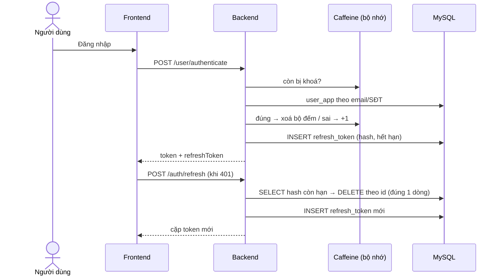

# Gỡ Redis và gửi mail (Mailpit) khỏi DownBeat

## 1. Mục tiêu và phạm vi

Sau plan này DownBeat chỉ cần **MySQL + MinIO** để chạy: backend khởi động và đăng nhập / gia hạn phiên / đăng xuất bình thường khi không có container Redis hay Mailpit. Refresh token chuyển sang bảng MySQL; bộ đếm đăng nhập sai giữ trong bộ nhớ (Caffeine); chức năng quên mật khẩu qua email (OTP) bị bỏ hẳn ở cả BE và FE.

| Có làm | Không làm (để plan khác) |
|---|---|
| Bảng `refresh_token` (MySQL) thay Redis: cấp, dùng 1 lần (rotation), thu hồi 1 phiên / mọi phiên | Đổi định dạng token, đổi thời hạn access / refresh token |
| Đếm đăng nhập sai theo tài khoản bằng Caffeine trong bộ nhớ (cùng ngưỡng 10 lần / 15 phút) | Giới hạn theo IP (vẫn là việc của nginx khi deploy) |
| Bỏ OTP, `/auth/forgot-password`, `/auth/reset-password`, gửi email, `spring-boot-starter-mail` | Làm lại quên mật khẩu bằng cách khác (nếu cần thì lập plan riêng) |
| Bỏ `ThreeLayerCacheTemplate` + Redis cache (hiện không nơi nào dùng), `spring-boot-starter-data-redis`, `commons-pool2` | Gỡ Kafka còn sót trong `docker-compose.yml` (xem §11) |
| FE: bỏ trang `/forgot-password`, link "Quên mật khẩu?" ở trang đăng nhập quản trị và hộp thoại đăng nhập cửa hàng | Màn hình mới |
| Xoá service `redis`, `mailpit` khỏi `docker-compose.local.yml` / `docker-compose.yml`, biến môi trường, tài liệu | |

## 2. Tác nhân và phân quyền

Không thêm resource / quyền. Các endpoint còn lại giữ nguyên cách bảo vệ:

| Endpoint | Ai gọi được | Ghi chú |
|---|---|---|
| `POST /user/authenticate` | Công khai | Như cũ |
| `POST /auth/refresh`, `POST /auth/logout` | Công khai (xác thực bằng refresh token trong body) | Như cũ, đổi nơi lưu sang MySQL |
| `POST /user/update-password` | Người đã đăng nhập | Như cũ, vẫn thu hồi mọi phiên |
| `POST /auth/forgot-password`, `POST /auth/reset-password` | **Bị xoá**: gỡ khỏi `WHITE_LIST_POST_API` | Không token → 401, có token → 404 |

## 3. Luồng nghiệp vụ

**Luồng chính (không đổi với người dùng):**
1. Người dùng đăng nhập → BE kiểm bộ đếm sai (bộ nhớ) → đúng mật khẩu thì xoá bộ đếm, cấp access token (JWT) + refresh token (lưu SHA-256 vào `refresh_token`).
2. Access token hết hạn → FE gọi `/auth/refresh` → BE tìm hash còn hạn, **xoá dòng đó** rồi cấp cặp mới (refresh token chỉ dùng được 1 lần).
3. Đăng xuất → BE xoá dòng của refresh token đó.

**Luồng thay thế / ngoại lệ:**
- A1. Đổi mật khẩu → xoá mọi dòng `refresh_token` của user (đăng xuất mọi thiết bị).
- A2. User bị khoá / không còn tồn tại khi refresh → xoá mọi dòng của user, trả 401.
- A3. Backend restart → refresh token **vẫn dùng được** (nằm trong MySQL); bộ đếm đăng nhập sai **mất** (nằm trong bộ nhớ). Chấp nhận được vì app chạy 1 instance.
- E1. Refresh token sai / đã dùng / hết hạn / rỗng → 401 "Phiên đăng nhập đã hết hạn, vui lòng đăng nhập lại".
- E2. Sai mật khẩu đủ 10 lần trong 15 phút (tính từ lần sai đầu tiên) → lần thứ 11 trở đi trả 429 tới khi hết 15 phút hoặc backend restart. Đăng nhập đúng thì bộ đếm về 0.
- E3. Gọi `/auth/forgot-password` hoặc `/auth/reset-password` → 401 (không token) / 404 (có token).



## 4. Cơ sở dữ liệu

Migration: `V2__refresh_token.sql` (hiện chỉ có `V1__auth_schema.sql` + seed `V1_1`).

| Bảng | Cột | Kiểu | Ràng buộc / ghi chú |
|---|---|---|---|
| `refresh_token` | `id` | `bigint` AUTO_INCREMENT | PK |
| | `user_id` | `int` NOT NULL | FK → `user_app.id` ON DELETE CASCADE |
| | `token_hash` | `char(64)` NOT NULL | SHA-256 dạng hex của refresh token. **Không lưu token gốc** |
| | `expires_at` | `timestamp` NOT NULL | = thời điểm cấp + `security.jwt.refresh-expired-in` (30 ngày) |
| | `created_at` | `timestamp` NULL DEFAULT CURRENT_TIMESTAMP | |

Unique: `refresh_token_hash_uindex (token_hash)` · Index: `refresh_token_user_index (user_id)` · Xoá: cứng (dùng xong / thu hồi là `DELETE`).

Quyết định cho worker:
- So sánh hạn bằng giờ DB (`expires_at > CURRENT_TIMESTAMP`), và ghi `expires_at` cũng theo giờ DB (`TIMESTAMPADD(SECOND, <ttl>, CURRENT_TIMESTAMP)` hoặc tương đương), để không lệch múi giờ giữa JVM và MySQL.
- Dọn rác không cần scheduler: mỗi lần `issue(userId)` xoá luôn các dòng đã hết hạn của user đó.
- Rotation an toàn khi 2 request refresh cùng lúc: `SELECT id, user_id … WHERE token_hash = ? AND expires_at > CURRENT_TIMESTAMP`, rồi `DELETE … WHERE id = ?`; chỉ coi là hợp lệ khi `DELETE` trả về **1 dòng**. Tìm thấy mà đã hết hạn thì xoá rồi trả 401.

## 5. Hợp đồng API (cố định — nguồn sự thật cho cả BE và FE)

Không có endpoint mới. Ba endpoint dưới đây **giữ nguyên request / response như hiện tại**, chỉ đổi nơi lưu. FE không cần sửa gì trong `lib/axios/auth.ts` phần login / refresh / logout.

### 5.1 `POST /api/user/authenticate` — công khai (không đổi)
Request:
```json
{ "email": "admin@downbeat.local", "plainPassword": "Admin@123" }
```
Response `result`:
```json
{ "token": "eyJhbGciOiJIUzI1NiJ9.eyJzdWIiOiIxIn0.abc", "refreshToken": "q8Zk3n0Vb1xY7cT2mR4sW9uE6aH5jL0pD3fG8kN1oQ", "userId": 1 }
```

### 5.2 `POST /api/auth/refresh` — công khai (không đổi)
Request:
```json
{ "refreshToken": "q8Zk3n0Vb1xY7cT2mR4sW9uE6aH5jL0pD3fG8kN1oQ" }
```
Response `result`: cùng dạng 5.1, `refreshToken` **khác** token vừa gửi lên.

### 5.3 `POST /api/auth/logout` — công khai (không đổi)
Request: như 5.2. Response: `{ "code": 200, "message": "…", "result": "Đăng xuất thành công" }` (giữ nguyên cấu trúc `ApiResponse.ok` hiện có). Token không hợp lệ / đã dùng vẫn trả 200 (coi như đã đăng xuất).

### 5.4 Endpoint bị xoá
| Endpoint | Không token | Có access token hợp lệ |
|---|---|---|
| `POST /api/auth/forgot-password` | 401 "Chưa đăng nhập" | 404 |
| `POST /api/auth/reset-password` | 401 "Chưa đăng nhập" | 404 |

Nếu hiện tại đường dẫn không tồn tại bị `@ExceptionHandler(Exception.class)` biến thành 500, thì thêm handler cho `NoResourceFoundException` / `NoHandlerFoundException` ở `GlobalExceptionHandler` trả **404** với message "Không tìm thấy API".

### 5.5 Lỗi nghiệp vụ

| Tình huống | HTTP | Message (tiếng Việt, FE hiện nguyên văn) |
|---|---|---|
| Sai tài khoản hoặc mật khẩu | 400 | Tài khoản hoặc mật khẩu không đúng. |
| Sai đủ 10 lần trong 15 phút, đăng nhập tiếp | 429 | Đăng nhập sai quá nhiều lần, vui lòng thử lại sau ít phút |
| Refresh token sai / đã dùng / hết hạn / rỗng | 401 | Phiên đăng nhập đã hết hạn, vui lòng đăng nhập lại |
| Endpoint đã xoá, không token | 401 | Chưa đăng nhập |
| Endpoint đã xoá, có token | 404 | Không tìm thấy API (nếu phải thêm handler) |

`ErrorCode.OTP_INVALID`, `ErrorCode.OTP_TOO_MANY_ATTEMPTS` bị xoá.

## 6. Giao diện (chuỗi cố định — test E2E chọn theo đúng các chuỗi này)

Không thêm màn hình; chỉ **bỏ** các chuỗi sau:

- Trang đăng nhập quản trị `/login`: bỏ link "Quên mật khẩu?". Hàng dưới ô mật khẩu chỉ còn checkbox "Ghi nhớ đăng nhập" (căn trái, giữ khoảng cách như cũ).
- Route `/forgot-password`: xoá. Mở trực tiếp → trang 404 có sẵn ("404", "Trang bạn đang tìm kiếm không tồn tại.").
- Hộp thoại đăng nhập cửa hàng (`components/shop/account/login-form.tsx`): bỏ nút "Quên mật khẩu?" (đang là chỗ giữ chỗ hiện toast "Tính năng lấy lại mật khẩu sẽ có ở bản sau"). Hàng đó chỉ còn checkbox "Hiện mật khẩu".
- Các chuỗi không còn xuất hiện ở đâu trong `frontend/src`: "Quên mật khẩu", "Gửi mã OTP", "Nếu email có trong hệ thống, mã OTP đã được gửi".

## 7. Việc backend (Codex)

Module `authenticate` (+ `entity`, `base`, `app`). File cần tạo/sửa, theo thứ tự:

1. **Migration** `app/src/main/resources/db/migration/V2__refresh_token.sql`: bảng ở §4, `CREATE TABLE IF NOT EXISTS`.
2. **Restart + codegen**: `sh scripts/ai/backend-restart.sh` để Flyway chạy V2, rồi build lại (có `backend/.env`) để jOOQ sinh `RefreshToken` / `RefreshTokenRecord` trong `entity/src/main/generated`. Không sửa tay file sinh.
3. **Entity** `entity/src/main/java/vn/aeoc/entity/data/mysql/auth/RefreshToken.java` (POJO: `id`, `userId`, `tokenHash`, `expiresAt`, `createdAt`).
4. **Repository** `authenticate/.../repository/auth/RefreshTokenRepository.java` (`extends AbsMysqlRepository`): `insert`, `findValidByHash`, `deleteById` (trả số dòng), `deleteByUserId`, `deleteExpiredByUserId`.
5. **`RefreshTokenService`**: bỏ `StringRedisTemplate`, dùng repository; giữ nguyên chữ ký public `issue / consume / revoke / revokeAll` và cách sinh token (32 byte ngẫu nhiên, Base64 URL không padding) + SHA-256. Quyết định rotation / hạn / dọn rác theo §4. `consume(null | "")` → 401 mà không gọi DB.
6. **`LoginAttemptService`**: bỏ Redis, dùng `Cache` Caffeine riêng (bean mới trong `config/cache/AuthCacheConfig`, ví dụ `@Bean("loginAttemptCache")`, `maximumSize(100_000)`). Giữ đúng ngữ nghĩa: khoá theo identifier đã `trim().toLowerCase(Locale.ROOT)`; cửa sổ `login-lock-duration` tính **từ lần sai đầu tiên** (lần sai sau không kéo dài), ví dụ dùng `Expiry` với `expireAfterCreate = lockDuration`, `expireAfterUpdate = currentDuration`; `count >= login-max-failures` → `LOGIN_TOO_MANY_ATTEMPTS`. Cho phép test giả lập thời gian (Caffeine `Ticker` truyền qua constructor).
7. **Xoá OTP + mail**: xoá `OtpService`, `constant/EmailContent`, `UserService.forgotPassword / resetPassword / sendEmail` và field `JavaMailSender`; xoá 2 endpoint ở `AuthController`; gỡ `/auth/forgot-password`, `/auth/reset-password` khỏi `WHITE_LIST_POST_API` (`JwtAuthenticationFilter`) và sửa javadoc ở đó; xoá field `otp`, `newPassword` trong `User` (chỉ 2 endpoint đó dùng); xoá `OTP_INVALID`, `OTP_TOO_MANY_ATTEMPTS` trong `ErrorCode`; xoá các field `otp*` trong `AuthGuardProperties` (giữ `loginMaxFailures`, `loginLockDuration`, sửa javadoc bỏ chữ Redis).
8. **Xoá Redis cache**: xoá `service/cache/ThreeLayerCacheTemplate`, `config/cache/CacheInfraConfig`, `config/cache/CacheTemplateProperties`, bean `cacheLoaderExecutor` trong `base/.../AsyncExecutor` (chỉ template dùng). Giữ `CacheKeyFactory`, `AuthCacheConfig`, `dbExecutor`.
9. **404 cho đường dẫn không tồn tại** (§5.4) nếu hiện đang ra 500.
10. **pom**: `authenticate/pom.xml` bỏ `spring-boot-starter-data-redis`, `commons-pool2`, `spring-boot-starter-mail`; `pom.xml` gốc bỏ khai báo `spring-boot-starter-mail` trong `dependencyManagement`; sửa comment trong `business/pom.xml` ("web/jOOQ/redis" → "web/jOOQ"). Giữ `caffeine`.
11. **Cấu hình**: `application.yml` bỏ `spring.data.redis`, `spring.mail`, `management.health.mail`, `security.guard.otp-*`, `app.cache.template`, sửa comment "Redis" ở `security.jwt.refresh-expired-in` và `security.guard`; `application-local.yml` bỏ `spring.mail` + sửa comment đầu file ("mysql, minio"); `application-dev.yml` bỏ `spring.data.redis`.
12. **Biến môi trường**: `backend/.env.example` bỏ mục Redis (`REDIS_*`), `MAILPIT_*`, mục Mail (`MAIL_*`); `backend/.env` bỏ đúng các dòng đó (không đụng dòng khác).
13. **Test**: xoá `support/FakeRedis.java`, `OtpServiceTest.java`; viết lại `RefreshTokenServiceTest` (mock `RefreshTokenRepository`), `LoginAttemptServiceTest` (Caffeine thật + `Ticker` giả). Phủ các TC `unit` ở §9.
14. **Kiểm tra cuối**: `grep -rniE "redis|mailsender|spring\.mail|otp" backend --include=*.java --include=*.yml --include=*.xml` (trừ `target/`, `generated/`) không còn kết quả nào ngoài comment hợp lệ; `docker stop downBeat-redis downBeat-mailpit` rồi `sh scripts/ai/backend-restart.sh` → backend lên, đăng nhập được.

Unit test bắt buộc: các TC loại `unit` ở §9. `mvn -q "-Djooq.codegen.skip=true" -pl authenticate -am test` xanh.

## 8. Việc frontend (agy)

File cần tạo/sửa:

1. Xoá `src/routes/_auth/forgot-password.tsx` và `src/components/form/block/forgot-password-form.tsx`.
2. `src/components/form/block/login-form.tsx`: bỏ `<Link to="/forgot-password">Quên mật khẩu?</Link>`, sửa comment "Remember Me & Forgot Password Row"; bỏ import `Link` nếu không còn dùng.
3. `src/components/shop/account/login-form.tsx`: bỏ nút "Quên mật khẩu?" + comment giữ chỗ; bỏ import `toast` nếu không còn dùng.
4. `src/lib/axios/auth.ts`: xoá `forgotPassword`, `resetPassword`. `src/lib/tanstack/options/auth.ts`: xoá `createForgotPasswordMutationOptions`, `createResetPasswordMutationOptions`. `src/lib/types/auth.ts`: xoá `ForgotPasswordApiRequest`, `ResetPasswordApiRequest`.
5. `src/routes/_auth.tsx`: sửa comment "(login, forgot-password)" → "(login)". `src/components/shop/ui/shop-field.tsx`: sửa ví dụ trong comment (không nhắc "Quên mật khẩu?").
6. `pnpm build` (sinh lại `routeTree.gen.ts`, không sửa tay) + `pnpm lint` xanh; `grep -rn "forgot\|Quên mật khẩu\|OTP" src` không còn kết quả.

Component shadcn dùng: không thêm component nào.

## 9. Test case

| ID | Loại | Mô tả | Tiền điều kiện | Bước | Kết quả mong đợi |
|---|---|---|---|---|---|
| TC-01 | api | Đăng nhập cấp cặp token | Seed admin | `POST /user/authenticate` admin | 200; `result.token`, `result.refreshToken` khác rỗng; `result.userId` > 0 |
| TC-02 | api | Refresh xoay vòng token | Có refreshToken R1 từ TC-01 | `POST /auth/refresh {R1}` | 200; `result.refreshToken` = R2 ≠ R1; `result.token` khác rỗng |
| TC-03 | api | Refresh token chỉ dùng 1 lần | R1 đã dùng ở TC-02 | `POST /auth/refresh {R1}` lần nữa | 401 "Phiên đăng nhập đã hết hạn, vui lòng đăng nhập lại"; R2 vẫn refresh được (200) |
| TC-04 | api | Đăng xuất thu hồi phiên | Đăng nhập lấy R | `POST /auth/logout {R}` → `POST /auth/refresh {R}` | Logout 200 `result` = "Đăng xuất thành công"; refresh 401 đúng message TC-03 |
| TC-05 | api | Refresh token rác / rỗng | — | `POST /auth/refresh` với `"khong-hop-le"`, rồi `""` | Cả hai 401 đúng message TC-03 |
| TC-06 | api | Logout token rác vẫn 200 | — | `POST /auth/logout {"khong-hop-le"}` | 200 "Đăng xuất thành công" |
| TC-07 | api | Đổi mật khẩu thu hồi mọi phiên | `noaccess` đăng nhập 2 lần → phiên A (token Ta, Ra), phiên B (Rb) | A gọi `POST /user/update-password?oldPassword=Admin@123&newPassword=Admin@1234` → refresh Rb → refresh Ra. **finally**: đăng nhập bằng `Admin@1234`, đổi lại `Admin@123` | update 200; refresh Rb 401, refresh Ra 401; sau finally đăng nhập `noaccess`/`Admin@123` được 200 |
| TC-08 | api | Khoá sau 10 lần sai | Email ngẫu nhiên `e2e-lock-<ts>@example.com` | Đăng nhập sai 10 lần, rồi lần 11 | Lần 1–10: 400 "Tài khoản hoặc mật khẩu không đúng."; lần 11: 429 "Đăng nhập sai quá nhiều lần, vui lòng thử lại sau ít phút" |
| TC-09 | api | Khoá không phân biệt hoa thường / khoảng trắng | Tiếp TC-08 | Đăng nhập với email TC-08 viết HOA, có dấu cách đầu/cuối | 429 đúng message TC-08 |
| TC-10 | api | Đăng nhập đúng xoá bộ đếm | `noaccess` | Sai 9 lần → đúng 1 lần → sai 9 lần → đúng 1 lần | Mọi lần sai 400 (không có 429); 2 lần đúng 200 |
| TC-11 | api | `/auth/forgot-password` đã xoá | — | Gọi không token; gọi với token admin | 401 "Chưa đăng nhập"; 404 |
| TC-12 | api | `/auth/reset-password` đã xoá | — | Như TC-11 | 401 "Chưa đăng nhập"; 404 |
| TC-13 | api | Healthcheck không còn phụ thuộc Redis | Container `downBeat-redis` đã dừng | `GET /api/actuator/health` | 200, `status` = "UP" |
| TC-14 | api (tay, bước review BE) | Backend chạy không cần Redis / Mailpit | `docker stop downBeat-redis downBeat-mailpit` | `sh scripts/ai/backend-restart.sh`, rồi chạy nhóm "API" | Backend lên :9200, log không có `RedisConnectionFailureException` / `MailSender`; TC-01…TC-13 pass |
| TC-15 | api (tay, bước review BE) | Refresh token sống qua restart | Đăng nhập lấy R | Restart backend → `POST /auth/refresh {R}` | 200 cặp token mới |
| TC-16 | e2e | Trang đăng nhập không còn "Quên mật khẩu?" | — | Mở `/login` | Có "Ghi nhớ đăng nhập", không có link "Quên mật khẩu?"; đăng nhập admin vẫn vào `/admin` |
| TC-17 | e2e | Route `/forgot-password` đã xoá | — | Mở `/forgot-password` | Hiện "404" và "Trang bạn đang tìm kiếm không tồn tại."; không có ô `#email` / nút "Gửi mã OTP" |
| TC-18 | e2e | Hộp thoại đăng nhập cửa hàng không còn "Quên mật khẩu?" | — | Vào `/`, bấm "Đăng nhập" mở hộp thoại | Trong dialog có checkbox "Hiện mật khẩu", không có nút "Quên mật khẩu?" |
| TC-19 | e2e | FE tự gia hạn phiên qua refresh token lưu MySQL | Lấy cặp token thật qua API | Ghi `auth-storage` với `accessToken: "expired.jwt.token"` + `refreshToken` thật → mở `/admin` | Ở lại `/admin`, thấy heading "Xin chào…"; `auth-storage` có `accessToken` mới ≠ "expired.jwt.token" |
| TC-20 | unit | `issue` lưu hash, không lưu token gốc | Mock repository | `issue(5)` | Repository nhận `userId = 5`, `tokenHash` 64 ký tự hex = SHA-256 của token trả về; token trả về ≠ hash; đã gọi xoá dòng hết hạn của user 5 |
| TC-21 | unit | `consume` hợp lệ trả userId, xoá dòng | `findValidByHash` trả dòng id 9 user 5; `deleteById(9)` = 1 | `consume(token)` | Trả 5; đã gọi `deleteById(9)` |
| TC-22 | unit | `consume` thua cuộc đua (đã bị xoá) | `findValidByHash` trả dòng; `deleteById` = 0 | `consume(token)` | `AppException` `REFRESH_TOKEN_INVALID` |
| TC-23 | unit | `consume` token không có / hết hạn | `findValidByHash` trả rỗng | `consume(token)` | `REFRESH_TOKEN_INVALID` |
| TC-24 | unit | `consume(null)` / `consume("  ")` | — | Gọi | `REFRESH_TOKEN_INVALID`, repository không được gọi |
| TC-25 | unit | `revokeAll` | — | `revokeAll(5)`; `revokeAll(null)` | Gọi `deleteByUserId(5)` đúng 1 lần; với null không gọi gì |
| TC-26 | unit | Khoá sau ngưỡng | `loginMaxFailures = 10` | `onFailure` 9 lần → `checkNotLocked`; thêm 1 lần → `checkNotLocked` | Lần đầu không ném; lần sau ném `LOGIN_TOO_MANY_ATTEMPTS` |
| TC-27 | unit | Chuẩn hoá identifier | — | `onFailure("  A@B.vn ")` 10 lần → `checkNotLocked("a@b.vn")` | Ném `LOGIN_TOO_MANY_ATTEMPTS` |
| TC-28 | unit | Cửa sổ tính từ lần sai đầu tiên | `Ticker` giả, `loginLockDuration = 15m` | Sai lần 1 ở t=0, 9 lần ở t=14m → `checkNotLocked` ở t=14m59s và t=15m01s | t=14m59s ném; t=15m01s không ném |
| TC-29 | unit | `onSuccess` xoá bộ đếm | 10 lần sai | `onSuccess` → `checkNotLocked` | Không ném |

Loại: `unit` = Codex viết JUnit · `api` / `e2e` = Claude viết trong `frontend/tests/e2e/go-redis-mail.spec.ts` (TC-14, TC-15 chạy tay ở bước review BE vì cần dừng container / restart). Claude cũng xoá test "quên mật khẩu: gửi OTP…" trong `frontend/tests/e2e/auth.spec.ts`.

## 10. Tiêu chí hoàn thành

- [ ] Mọi TC ở §9 pass, trong lúc container `downBeat-redis` và `downBeat-mailpit` **đã dừng**
- [ ] `mvn test`, `pnpm build`, `pnpm lint` xanh; `auth.spec.ts` + `shop-*.spec.ts` vẫn pass
- [ ] Claude (sau khi BE pass): xoá service `downbeat-redis`, `downbeat-mailpit` + volume `downbeat-redis-data` và comment đầu file trong `docker-compose.local.yml`; xoá service `redis`, `REDIS_*`, `MAIL_*`, `depends_on.redis`, volume `redis-data` trong `docker-compose.yml`; xoá mục Redis / Mail trong `.env.example` gốc
- [ ] Claude: sửa tài liệu còn nhắc Redis / Mailpit / OTP: `CLAUDE.md` (dòng lệnh docker compose), `backend/AGENTS.md` (dòng stack, mô tả `authenticate`, "không cần DB/Redis", mẫu `FakeRedis`), `.claude/skills/cook/SKILL.md` (preflight "mysql/redis...")
- [ ] Xoá hẳn container + volume cũ (`docker rm -f downBeat-redis downBeat-mailpit`, `docker volume rm downbeat_downbeat-redis-data`): **hỏi người dùng trước khi chạy**
- [ ] Có `docs/chuc-nang/go-redis-mail.md`

## 11. Rủi ro / câu hỏi mở

1. **Mất chức năng quên mật khẩu.** Đã chốt với người dùng: bỏ hẳn. Người quên mật khẩu phải nhờ quản trị đặt lại trong DB (chưa có màn hình quản trị user). Có cần ghi chú cách đặt lại tay vào `docs/chuc-nang/go-redis-mail.md` không?
2. **Bộ đếm đăng nhập sai nằm trong bộ nhớ**: restart backend là mở khoá, và chạy nhiều instance thì mỗi instance đếm riêng. Đồ án chạy 1 instance nên chọn Caffeine cho đơn giản. Nếu muốn bền như refresh token thì đổi sang bảng `login_attempt`. Giữ Caffeine?
3. **`docker-compose.yml` (deploy) còn là bản AEOC cũ**: tên project `aeoc`, database mặc định `bpm`, còn Kafka (biến `KAFKA_*`, service `kafka`). Plan này chỉ gỡ Redis + Mail khỏi file đó. Gỡ Kafka / đổi tên thì làm plan riêng?
4. **Backend đang chạy ở :9200 là bản build cũ** (pool `aeoc-hikari`, query còn cột `bsn_id`) và đăng nhập đang trả 500 vì không lấy được kết nối DB. Preflight của `/cook` sẽ build + restart lại; nếu restart vẫn lỗi thì xử lý trước khi giao việc.

## 12. Nhật ký thực hiện (do /cook và /doc-chuc-nang ghi — nối các phiên A/B/C)

| Thời điểm | Sự kiện |
|---|---|
| 2026-11-05 | Lập plan (draft) |
| 2026-11-05 | Người dùng duyệt → approved |
