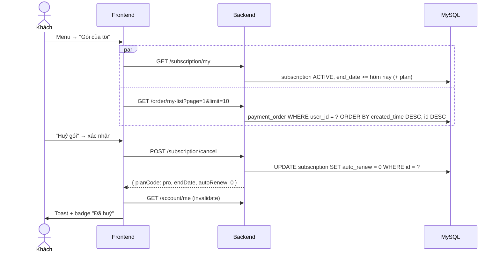

# Gói của tôi

## 1. Mục tiêu và phạm vi

Sau plan này, **khách đã đăng nhập có trang "Gói của tôi"** (`/goi-cua-toi`): xem gói đang dùng (chu kỳ, ngày bắt đầu, ngày hết hạn, số ngày còn lại), gia hạn hoặc nâng cấp ngay tại trang, **huỷ gói** (tắt tự gia hạn, vẫn dùng tới hết `end_date`), và xem **lịch sử đơn hàng** (mọi đơn đã tạo, kể cả đơn đang chờ có link "Tiếp tục thanh toán"). Đây là phần FR-07 còn thiếu sau lát `goi-thanh-toan`.

Không có migration: cột `subscription.auto_renew` đã có từ V7 (mặc định 1).

| Có làm | Không làm (để plan khác) |
|---|---|
| `GET /order/my-list` (phân trang, đơn của chính mình) | Quản trị đơn, khách, sửa giá gói (resource `PLAN` / `ORDER` / `CUSTOMER`) → lát **`quan-tri-don-hang`** |
| `GET /subscription/my` (gói đang dùng, đủ ngày để hiện thẻ) — **mới, thiết kế chưa có**, §11 câu 1 | Tự trừ tiền định kỳ: payOS là chuyển khoản từng lần, `auto_renew` chỉ là cờ |
| `POST /subscription/cancel`: `auto_renew = 0`, gói vẫn `ACTIVE` tới `end_date` | Hoàn tiền khi huỷ gói, huỷ gói có hiệu lực ngay |
| `account/me` thêm `planAutoRenew`; gia hạn cùng gói bật lại `auto_renew = 1` | Endpoint "bật lại tự gia hạn" riêng (gia hạn = trả tiền thêm một kỳ đã bật lại, §11 câu 2) |
| Trang `/goi-cua-toi`, mục menu "Gói của tôi", nhắc gia hạn ẩn khi đã huỷ gói (§11 câu 3) | Xuất hoá đơn, tải biên lai |

## 2. Tác nhân và phân quyền

| Tác nhân | Được làm | Ghi chú |
|---|---|---|
| Khách vãng lai | Vào `/goi-cua-toi` thấy lời mời đăng nhập | Không gọi API nào của lát này |
| Người đã đăng nhập (mọi role, kể cả admin) | `order/my-list`, `subscription/my`, `subscription/cancel` **trên dữ liệu của chính mình** | Không kiểm resource, chỉ cần token (giống `order/get`). Không có tham số `userId`: luôn lấy từ token |

Không tạo resource, không có migration phân quyền.

## 3. Luồng nghiệp vụ

**Luồng chính — xem gói và lịch sử:**
1. Khách gói Pro bấm menu tài khoản → "Gói của tôi" → `/goi-cua-toi`.
2. Trang gọi song song `GET /subscription/my` và `GET /order/my-list?page=1&limit=10`.
3. Thẻ "Gói hiện tại" hiện "Gói Pro", badge "Đang dùng", chu kỳ "Theo năm", "Bắt đầu 10/11/2026", "Hết hạn 10/11/2027", "Còn lại 361 ngày", các nút "Gia hạn gói Pro", "Nâng cấp lên Studio", "Huỷ gói".
4. Bảng "Lịch sử đơn hàng" liệt kê đơn mới nhất trước; bấm mã đơn → `/thanh-toan/ket-qua/{code}` (trang có sẵn).

**Luồng chính — huỷ gói:**
1. Bấm "Huỷ gói" → hộp thoại "Huỷ gói Pro?" nói rõ vẫn dùng tới hết ngày hết hạn, không hoàn tiền.
2. Bấm "Huỷ gói" trong hộp thoại → `POST /subscription/cancel` → `UPDATE subscription SET auto_renew = 0 WHERE id = ? ` (dòng ACTIVE còn hạn của khách).
3. Toast "Đã huỷ gói Pro. Bạn vẫn dùng được đến 10/11/2027."; thẻ đổi badge "Đã huỷ", nút "Huỷ gói" biến mất, hiện câu "Gói Pro vẫn dùng được đến hết ngày 10/11/2027. Sau đó tài khoản trở về gói Miễn phí."
4. Header (đọc lại `account/me`) không còn nhắc gia hạn khi còn ≤ 3 ngày.
5. Tới `end_date`, tác vụ 00:10 có sẵn chuyển `EXPIRED` như mọi gói khác (không đổi gì ở tác vụ).

**Luồng thay thế:**
- A1. Gia hạn từ trang: "Gia hạn gói Pro" → mở hộp thoại "Mua gói Pro" có sẵn (`checkout`, chu kỳ = chu kỳ hiện tại của gói). Thanh toán xong, `PaymentActivationService` cộng thêm kỳ **và đặt `auto_renew = 1`** (gia hạn sau khi đã huỷ = khách đổi ý).
- A2. Nâng cấp từ trang (chỉ gói Pro): "Nâng cấp lên Studio" → hộp thoại "Mua gói Studio" (chu kỳ hiện tại). Dòng Studio mới tạo với `auto_renew = 1` (đã đúng từ lát trước).
- A3. Khách gói Miễn phí: thẻ "Gói Miễn phí" + nút "Xem bảng giá"; lịch sử vẫn hiện (có thể có đơn huỷ / hết hạn).
- A4. Đơn đang chờ (`PENDING`): dòng có link "Tiếp tục thanh toán" (mở `checkoutUrl` payOS ở tab hiện tại).
- A5. Lịch sử > 10 đơn: nút "Trang trước" / "Trang sau".
- A6. Bấm "Huỷ gói" lần nữa (hai tab, hoặc gọi API lặp) → 200, kết quả như lần đầu (không lỗi).

**Ngoại lệ:**
- E1. Không token → 401 "Chưa đăng nhập".
- E2. `subscription/cancel` khi không có gói trả phí còn hạn (gói Miễn phí, hoặc dòng ACTIVE đã quá `end_date` nhưng 00:10 chưa chạy) → 400 `NO_ACTIVE_PLAN`.
- E3. Lỗi tải trang (mạng / 500) → mỗi khối tự hiện lỗi + "Thử lại", khối kia vẫn hiện.



## 4. Cơ sở dữ liệu

**Không có migration.** Dùng bảng có sẵn từ V7:

| Bảng | Cột dùng | Ghi chú |
|---|---|---|
| `subscription` | `auto_renew` | 1 mặc định. `subscription/cancel` đặt 0; gia hạn cùng gói (A1) đặt lại 1; dòng mới (mua lần đầu, đổi gói) luôn 1 như hiện tại |
| `payment_order` | mọi cột | Chỉ đọc. Index `(user_id, created_time)` có sẵn phục vụ `my-list` |

"Gói còn hạn" ở mọi chỗ trong lát = dòng `status = 'ACTIVE' AND end_date >= hôm nay` (đúng `SubscriptionRepository.findActiveByUserId` đang có).

## 5. Hợp đồng API (cố định — nguồn sự thật cho cả BE và FE)

Thành công: `{ "code": 200, "message": "OK", "result": … }`. Lỗi: `{ "path", "code", "errorCode", "message" }`. POJO `NON_NULL`. Ngày giờ như lát `goi-thanh-toan` (`"2026-11-10T10:15:30"`, ngày `"2026-11-10"`), giờ Asia/Ho_Chi_Minh.

### 5.1 `GET /api/order/my-list?page=1&limit=10` — cần đăng nhập

- `page` mặc định 1 (< 1 → 1); `limit` mặc định 10, tối đa 50 (> 50 → 50, < 1 → 10). Không báo lỗi tham số.
- Chỉ đơn có `user_id` = người gọi, mọi trạng thái. Sắp xếp `created_time DESC, id DESC`.
- **Không** gọi payOS đối soát (khác `order/get`): trạng thái là trạng thái đang lưu.

Response `result`:
```json
{
  "total": 3,
  "page": 1,
  "items": [
    {
      "code": "DB2611140002", "planCode": "studio", "planName": "Studio", "cycle": "MONTH", "amount": 249000,
      "status": "PENDING", "checkoutUrl": "https://pay.payos.vn/web/2b9e1d4a4c0e9b8a1f2e3d4c5b6a7f3c",
      "createdTime": "2026-11-14T09:02:11"
    },
    {
      "code": "DB2611100001", "planCode": "pro", "planName": "Pro", "cycle": "YEAR", "amount": 948000,
      "status": "PAID", "sourceLutId": 10, "sourceLutSlug": "kodak-400", "sourceLutTitle": "Kodak 400",
      "createdTime": "2026-11-10T10:14:02", "paidTime": "2026-11-10T10:15:31"
    },
    {
      "code": "DB2611090003", "planCode": "pro", "planName": "Pro", "cycle": "MONTH", "amount": 99000,
      "status": "CANCELLED", "createdTime": "2026-11-09T21:40:55"
    }
  ]
}
```
- `checkoutUrl` **chỉ có khi `status = PENDING`** (đơn khác: không có khoá, tránh mở link payOS đã chết).
- Không có `planExpiresAt` (chỉ `order/get` có). Không bao giờ có `id`, `userId`, `planId`, `payosOrderCode`, `payosPaymentLinkId`, `payosReference`, `webhookPayload`, `updatedTime` (POJO `PaymentOrder` đã `WRITE_ONLY` các khoá này).
- Có thể kèm `loadMoreAble` / `preLoadAble` như các `Page` khác; FE không dùng.
- Khách chưa có đơn: `{ "total": 0, "page": 1, "items": [] }`.

### 5.2 `GET /api/subscription/my` — cần đăng nhập

Gói trả phí còn hạn:
```json
{
  "planCode": "pro", "planName": "Pro", "cycle": "YEAR",
  "startDate": "2026-11-10", "endDate": "2027-11-10", "autoRenew": 1
}
```
Gói Miễn phí (không có dòng còn hạn) — **không** trả `null`:
```json
{ "planCode": "free", "planName": "Miễn phí" }
```
- `planName` đọc từ bảng `plan` (dòng `free` có sẵn trong V7).
- Không trả `id`, `userId`, `planId`, `orderId`, `status`, `activeUserId`, `createdTime`, `updatedTime`.
- Số ngày còn lại do FE tính từ `endDate` (`daysLeft` có sẵn), backend không trả.

### 5.3 `POST /api/subscription/cancel` — cần đăng nhập

Không có thân request (gửi `{}` hoặc rỗng đều được). Response `result` = như §5.2 với `autoRenew: 0`:
```json
{
  "planCode": "pro", "planName": "Pro", "cycle": "YEAR",
  "startDate": "2026-11-10", "endDate": "2027-11-10", "autoRenew": 0
}
```
Quy tắc:
1. Tìm dòng còn hạn của khách (`findActiveByUserId(userId, hôm nay)`). Không có → 400 `NO_ACTIVE_PLAN`.
2. `UPDATE subscription SET auto_renew = 0 WHERE id = ? AND status = 'ACTIVE'`. Đã là 0 → vẫn 200, trả trạng thái hiện tại (không lỗi, A6).
3. **Không** đổi `status`, `end_date`, `start_date`, `cycle`; không đụng `payment_order`; không gọi payOS.
4. Không ghi sự kiện gợi ý (huỷ gói không phải tín hiệu về LUT).

### 5.4 Sửa `GET /api/account/me`

Gói trả phí còn hạn: thêm `planAutoRenew` (0 / 1). Gói Miễn phí: **không có khoá này** (như `planExpiresAt`). Các khoá khác giữ nguyên.
```json
{ "id": 52, "name": "Khách E2E", "email": "e2e-1731212345@downbeat.local", "plan": "pro", "planExpiresAt": "2027-11-10", "planAutoRenew": 0 }
```

### 5.5 Sửa kích hoạt đơn (`PaymentActivationService.activate`, nhánh "cùng gói")

Gia hạn cùng gói: ngoài `end_date`, `cycle`, `order_id`, cập nhật thêm `auto_renew = 1`. Hai nhánh tạo dòng mới giữ `auto_renew = 1` như hiện tại. Không đổi gì khác của §5.5 lát `goi-thanh-toan`.

### 5.6 Lỗi nghiệp vụ

| Tình huống | HTTP | `errorCode` | Message (FE hiện nguyên văn qua toast) |
|---|---|---|---|
| `order/my-list`, `subscription/my`, `subscription/cancel` không token | 401 | (không có) | Chưa đăng nhập |
| `subscription/cancel` khi không có gói trả phí còn hạn | 400 | `NO_ACTIVE_PLAN` (**mới**) | Bạn chưa có gói trả phí nào để huỷ |

## 6. Giao diện (chuỗi cố định — test E2E chọn theo đúng các chuỗi này)

Tiền: `formatVnd` ("948.000đ"). Ngày: `formatPlanDate` ("10/11/2027"); ngày giờ của đơn: "10/11/2026 10:14" (`dd/MM/yyyy HH:mm`, tách chuỗi như `formatPlanDate`, không qua `new Date`). Số ngày còn lại: `daysLeft` có sẵn.

### 6.1 Trang `/goi-cua-toi` (mới, layout `_shop`, `document.title` = "Gói của tôi | DownBeat")

- Heading trang (`h1`): "Gói của tôi". Dòng phụ: "Quản lý gói đang dùng và xem lại các đơn đã mua."
- **Chưa đăng nhập** (chép `collection-login-prompt.tsx`): h1 "Đăng nhập để xem gói của bạn", mô tả "Gói đang dùng và lịch sử mua gói gắn với tài khoản của bạn.", nút "Đăng nhập" (mở hộp thoại đăng nhập, xong ở lại trang), "Tạo tài khoản".
- Bố cục: khối "Gói hiện tại" ở trên, khối "Lịch sử đơn hàng" ở dưới; rộng tối đa như trang bộ sưu tập; ở màn hẹp bảng cuộn ngang trong khung (trang không cuộn ngang).

**Khối "Gói hiện tại"** (`section` có `aria-labelledby` → heading `h2` "Gói hiện tại"). Đang tải: `Skeleton`. Lỗi: "Không tải được thông tin gói" + nút "Thử lại".

| Trạng thái | Nội dung | Nút |
|---|---|---|
| Miễn phí | Tên "Gói Miễn phí"; câu "Bạn đang tải được mọi LUT miễn phí. Nâng cấp để tải toàn bộ LUT Premium." | "Xem bảng giá" (→ `/pricing`) |
| Trả phí, `autoRenew = 1` | Tên "Gói Pro" + badge "Đang dùng"; danh sách mô tả: "Chu kỳ" → "Theo năm" / "Theo tháng"; "Bắt đầu" → "10/11/2026"; "Hết hạn" → "10/11/2027"; "Còn lại" → "361 ngày" (0 → "Hết hạn hôm nay") | "Gia hạn gói Pro"; chỉ gói Pro: "Nâng cấp lên Studio"; "Huỷ gói" (kiểu phụ, màu cảnh báo) |
| Trả phí, `autoRenew = 1`, còn ≤ 3 ngày | Như trên + khung nhắc `role="status"`: "Gói Pro hết hạn sau {n} ngày. Gia hạn để không gián đoạn việc tải LUT Premium." (n = 0: "Gói Pro hết hạn hôm nay. Gia hạn để không gián đoạn việc tải LUT Premium.") | Như trên |
| Trả phí, `autoRenew = 0` | Tên "Gói Pro" + badge "Đã huỷ"; cùng danh sách mô tả; câu "Gói Pro vẫn dùng được đến hết ngày 10/11/2027. Sau đó tài khoản trở về gói Miễn phí." | "Gia hạn gói Pro"; chỉ gói Pro: "Nâng cấp lên Studio". **Không** có "Huỷ gói" |

- "Gia hạn gói {tên}" → `openDialog({ type: "checkout", plan: planCode, cycle })` với `cycle` = chu kỳ hiện tại (`YEAR` → `"year"`, `MONTH` → `"month"`). "Nâng cấp lên Studio" → như trên với `plan: "studio"`. Hộp thoại "Mua gói …" có sẵn (đã có nút đổi chu kỳ), không sửa.
- "Huỷ gói" → `AlertDialog`:
  - Tiêu đề: "Huỷ gói Pro?"
  - Mô tả: "Bạn vẫn dùng gói Pro đến hết ngày 10/11/2027. Sau ngày này tài khoản trở về gói Miễn phí. Số tiền đã thanh toán không được hoàn lại."
  - Nút: "Huỷ gói" (đang gửi: "Đang huỷ…", khoá nút) / "Giữ gói".
  - Thành công: toast "Đã huỷ gói Pro. Bạn vẫn dùng được đến 10/11/2027.", đóng hộp thoại, `invalidateQueries` cho `["subscription-my"]` và `["account-me"]`. Lỗi: toast message backend nguyên văn (§5.6), hộp thoại giữ nguyên.

**Khối "Lịch sử đơn hàng"** (`section` → `h2` "Lịch sử đơn hàng"). Đang tải: 3 dòng `Skeleton`. Lỗi: "Không tải được lịch sử đơn hàng" + "Thử lại".

- Bảng (`table`, shadcn `table`), cột: "Mã đơn", "Gói", "Số tiền", "Trạng thái", "Ngày tạo", "Ngày thanh toán", cột thao tác không tiêu đề (chữ đọc màn hình "Thao tác").
  - "Mã đơn": link chữ mã (`DB2611100001`) → `/thanh-toan/ket-qua/DB2611100001`.
  - "Gói": "Pro · Theo năm" / "Studio · Theo tháng".
  - "Số tiền": "948.000đ".
  - "Trạng thái": badge — `PENDING` "Chờ thanh toán", `PAID` "Đã thanh toán", `CANCELLED` "Đã huỷ", `EXPIRED` "Hết hạn".
  - "Ngày tạo": "10/11/2026 10:14". "Ngày thanh toán": "10/11/2026 10:15" hoặc "—".
  - Thao tác: chỉ `PENDING` có link "Tiếp tục thanh toán" (`href` = `checkoutUrl`, cùng tab).
  - Đơn có `sourceLutTitle`: dưới chữ gói thêm dòng nhỏ "Từ LUT Kodak 400" (link → `/luts/kodak-400`).
- Rỗng: "Bạn chưa có đơn hàng nào." + nút "Xem bảng giá".
- Phân trang 10 đơn / trang, chỉ hiện khi `total > 10`: chữ "Trang 1 / 2", nút "Trang trước" (khoá ở trang 1), "Trang sau" (khoá ở trang cuối). Trang lưu ở search param `?trang=2` để F5 giữ trang.

### 6.2 Menu tài khoản (sửa `header-actions.tsx`)

- Thêm mục **"Gói của tôi"** (icon `CreditCard`) → `/goi-cua-toi`, đứng ngay sau dải phân cách dưới khung gói, trước "Gia hạn gói" / "Nâng cấp lên …".
- `planAutoRenew = 0`: trong khung gói đổi "Hết hạn {ngày}" thành "Dùng đến {ngày}" và thêm dòng nhỏ "Đã huỷ gia hạn"; **không** hiện "Còn {n} ngày" / "Hết hạn hôm nay" và **không** hiện mục "Gia hạn gói" kể cả khi còn ≤ 3 ngày (§11 câu 3). Mục "Nâng cấp lên Studio" giữ nguyên.
- `planAutoRenew = 1` hoặc gói Miễn phí: giữ nguyên như lát `goi-thanh-toan`.

### 6.3 Trang `/pricing` (sửa nhỏ `pricing-page.tsx`)

- Khung nhắc "Gói Pro của bạn hết hạn ngày …" chỉ hiện khi `planAutoRenew !== 0`. Nút trên thẻ gói giữ nguyên (`planAction` không đổi).

## 7. Việc backend (agy BE)

Package có sẵn `vn.aeoc.business.billing`. Thứ tự theo `backend/AGENTS.md`:

1. **Không migration.** Không chạy codegen (bảng không đổi).
2. `base/.../ErrorCode.java`: thêm `NO_ACTIVE_PLAN(400, "Bạn chưa có gói trả phí nào để huỷ")`.
3. `entity/.../billing/Subscription.java`: thêm field response `planCode`, `planName` (không thuộc bảng); `@JsonProperty(access = WRITE_ONLY)` cho `id`, `userId`, `planId`, `orderId`, `status`, `activeUserId`, `createdTime`, `updatedTime` để JSON đúng §5.2. Kiểm không chỗ nào khác đang trả `Subscription` ra JSON (hiện không có).
4. `entity/.../auth/User.java`: thêm `Integer planAutoRenew` (NON_NULL như `planExpiresAt`).
5. `billing/repository/PaymentOrderRepository`: `myList(userId, offset, limit)` (join `plan` lấy `planCode`/`planName`, left join `lut` lấy `sourceLutSlug`/`sourceLutTitle` — dùng lại `fields()` / `joined()` của `getOrderByCode`) + `countByUser(userId)`.
6. `billing/repository/SubscriptionRepository`: `disableAutoRenew(id)` = `UPDATE … SET auto_renew = 0 WHERE id = ? AND status = 'ACTIVE'`.
7. `billing/service/OrderService.myList(userId, page, limit)`: chuẩn hoá `page` / `limit` theo §5.1, xoá `checkoutUrl` khỏi đơn không `PENDING`, trả `Page<PaymentOrder>` (`new Page<>(total, page, items)`).
8. `billing/service/SubscriptionService`: `my(userId)` và `cancel(userId)` (§5.2, §5.3), dùng `Clock` Asia/Ho_Chi_Minh như `OrderService` (constructor thứ hai nhận `Clock` để test). `cancel` là `@Transactional`.
9. `billing/service/PaymentActivationService`: nhánh cùng gói đặt `auto_renew = 1` và thêm `SUBSCRIPTION.AUTO_RENEW` vào danh sách cột `updateByCondition` (§5.5).
10. `billing/controller/OrderController`: `@GetMapping("/order/my-list")` với `@RequestParam(required = false) Integer page, limit`.
11. `billing/controller/SubscriptionController` (mới, `extends BaseController`): `GET /subscription/my`, `POST /subscription/cancel`. Lấy user bằng `SecurityUtils.userId(principal)`.
12. `business/account/service/AccountService.me`: khi có gói còn hạn, set thêm `planAutoRenew = activeSub.getAutoRenew()`.

Quyết định worker không tự đổi: huỷ gói **không** đổi `status` / `end_date` (khách vẫn dùng tới hết hạn, tác vụ 00:10 lo phần còn lại); `cancel` lặp lại trả 200; gia hạn cùng gói bật lại `auto_renew`; `my-list` không gọi payOS; không thêm endpoint ngoài §5.

Unit test bắt buộc: các TC loại `unit` ở §9 (Mockito cho repository, như test `OrderService` có sẵn).

## 8. Việc frontend (agy FE)

1. `lib/types/account.ts`: `ShopUserDTO` và `AccountMeApiDTO` thêm `planAutoRenew?: 0 | 1`; thêm `SubscriptionDTO { planCode: PlanCode; planName: string; cycle?: ApiBillingCycle; startDate?: string; endDate?: string; autoRenew?: 0 | 1 }`; `OrderListItemDTO` = `Omit<OrderDTO, "planExpiresAt">`; dùng `Page<T>` chung nếu đã có trong `lib/types/common.ts` (không có thì thêm `{ total; page; items }`).
2. Chỗ map `account/me` → `ShopUserDTO` (store `shop-session` / `lib/axios/account.ts`): chép thêm `planAutoRenew`.
3. `lib/axios/billing.ts`: `getMyOrders(page, limit)`, `getMySubscription()`, `cancelSubscription()`.
4. `lib/tanstack/options/billing.ts`: `myOrdersQueryOptions(page)` (key `["order-my-list", page]`), `mySubscriptionQueryOptions` (key `["subscription-my"]`), `cancelSubscriptionMutationOptions` (tắt toast mặc định nếu có; trang tự hiện toast §6.1). Khi `orderQueryOptions` thấy `PAID` lần đầu (trang kết quả) thì invalidate thêm `["subscription-my"]` và `["order-my-list"]`.
5. `lib/utils/plan.ts`: thêm `formatOrderDateTime(iso)` → "10/11/2026 10:14"; `orderStatusLabel(status)`; `cycleLabel(cycle)` → "Theo năm" / "Theo tháng".
6. `routes/_shop/goi-cua-toi.tsx` (mới, `validateSearch` cho `trang?: number`) + `components/shop/subscription/my-plan-page.tsx`, `current-plan-card.tsx`, `cancel-plan-dialog.tsx`, `order-history-table.tsx`, `my-plan-login-prompt.tsx` (mới): §6.1.
7. `components/shop/layout/header/header-actions.tsx`: §6.2.
8. `components/shop/pricing/pricing-page.tsx`: §6.3.

Component shadcn dùng: có sẵn trong `components/ui/`: `alert-dialog`, `badge`, `table`, `skeleton`, `button`, `dropdown-menu`, `sonner`, `empty`; không cần `shadcn add`. Nút cửa hàng dùng `ShopButton` như các trang shop khác.

## 9. Test case

Chuẩn bị chung (API / E2E): khách mới đăng ký qua `account/register`; "khách có gói Pro" = khách mới tạo đơn Pro qua `order/create` (payOS thật) rồi `order/mock-pay` (profile local) — chép helper `customerWithPlan` của `goi-thanh-toan.spec.ts`. Các trường hợp cần ngày hết hạn gần (≤ 3 ngày) hoặc nhiều đơn dùng `page.route` giả response của `account/me`, `subscription/my`, `order/my-list`.

| ID | Loại | Mô tả | Tiền điều kiện | Bước | Kết quả mong đợi |
|---|---|---|---|---|---|
| TC-01 | api | `my-list` không token | — | `GET /order/my-list` không header | 401, message "Chưa đăng nhập" |
| TC-02 | api | `my-list` khách mới | Khách mới | `GET /order/my-list` | 200, `{ total: 0, page: 1, items: [] }` |
| TC-03 | api | `my-list` thứ tự + khoá | Khách có gói Pro (đơn A PAID) rồi tạo thêm đơn B Studio MONTH (PENDING) | `GET /order/my-list` | `total = 2`; `items[0].code = B`, `status = PENDING`, có `checkoutUrl` bắt đầu `https://`; `items[1].code = A`, `status = PAID`, có `paidTime`, **không** có `checkoutUrl`; mọi item có `planCode`, `planName`, `cycle`, `amount`, `createdTime`; không item nào có `id`, `userId`, `planId`, `payosOrderCode`, `webhookPayload`, `planExpiresAt` |
| TC-04 | api | `my-list` chỉ đơn của mình | Khách X có 1 đơn, khách Y có 1 đơn | Y gọi `GET /order/my-list` | `total = 1`, không có mã đơn của X |
| TC-05 | api | `my-list` phân trang + chuẩn hoá tham số | Khách có 2 đơn (TC-03) | `?page=2&limit=1`; rồi `?page=0&limit=500` | Lần 1: `page = 2`, `total = 2`, 1 item = đơn A. Lần 2: `page = 1`, 2 item (limit bị cắt về 50, không lỗi) |
| TC-06 | api | `my-list` đơn huỷ | Khách tạo đơn rồi `order/cancel/{code}` | `GET /order/my-list` | Item có `status = CANCELLED`, không có `checkoutUrl`, không có `paidTime` |
| TC-07 | api | `subscription/my` không token | — | `GET /subscription/my` | 401 "Chưa đăng nhập" |
| TC-08 | api | `subscription/my` gói Miễn phí | Khách mới | `GET /subscription/my` | 200, `result` đúng bằng `{ planCode: "free", planName: "Miễn phí" }` (không có khoá khác) |
| TC-09 | api | `subscription/my` gói Pro | Khách có gói Pro YEAR | `GET /subscription/my` | `planCode = pro`, `planName = Pro`, `cycle = YEAR`, `startDate` = hôm nay, `endDate` = hôm nay + 12 tháng (bằng `planExpiresAt` của `account/me`), `autoRenew = 1`; không có `id`, `userId`, `status`, `activeUserId` |
| TC-10 | api | `account/me` có `planAutoRenew` | Khách mới; khách có gói Pro | `GET /account/me` cả hai | Khách mới: không có khoá `planAutoRenew`. Khách Pro: `planAutoRenew = 1` |
| TC-11 | api | Huỷ gói không token | — | `POST /subscription/cancel` | 401 "Chưa đăng nhập" |
| TC-12 | api | Huỷ gói khi đang Miễn phí | Khách mới | `POST /subscription/cancel` | 400, `errorCode = NO_ACTIVE_PLAN`, message "Bạn chưa có gói trả phí nào để huỷ" |
| TC-13 | api | Huỷ gói thành công | Khách có gói Pro YEAR, ghi lại `endDate` | `POST /subscription/cancel` | 200, `autoRenew = 0`, `planCode = pro`, `endDate` không đổi. Sau đó `account/me`: `plan = pro`, `planExpiresAt` không đổi, `planAutoRenew = 0`; `subscription/my`: `autoRenew = 0` |
| TC-14 | api | Huỷ gói lặp lại | Sau TC-13 | `POST /subscription/cancel` lần 2 | 200, kết quả giống hệt lần 1 |
| TC-15 | api | Đã huỷ vẫn tải được LUT Premium | Sau TC-13 | `POST /lut/download { lutId: <LUT Premium> }` | 200, có `url` (gói vẫn hiệu lực tới `end_date`) |
| TC-16 | api | Gia hạn sau khi huỷ bật lại tự gia hạn | Sau TC-13 | Tạo đơn Pro MONTH + `mock-pay`; `GET /subscription/my` | `autoRenew = 1`, `endDate` = `endDate` cũ + 1 tháng; `account/me.planAutoRenew = 1` |
| TC-17 | api | Nâng cấp sau khi huỷ | Khách có gói Pro, đã huỷ | Tạo đơn Studio MONTH + `mock-pay`; `GET /subscription/my` | `planCode = studio`, `autoRenew = 1` |
| TC-18 | unit | `cancel` đặt cờ, giữ ngày | Mock repo: dòng ACTIVE `end_date` = hôm nay + 10, `auto_renew = 1` | `SubscriptionService.cancel(userId)` | Gọi `disableAutoRenew(id)` đúng 1 lần; không gọi `updateStatus`; kết quả `autoRenew = 0`, `endDate` giữ nguyên |
| TC-19 | unit | `cancel` không có gói | Mock `findActiveByUserId` trả null | `cancel(userId)` | Ném `AppException` `NO_ACTIVE_PLAN` |
| TC-20 | unit | `cancel` dòng ACTIVE đã quá hạn | Dòng ACTIVE `end_date` = hôm qua (00:10 chưa chạy); `Clock` cố định | `cancel(userId)` | `NO_ACTIVE_PLAN` (dùng `findActiveByUserId(userId, today)`, không dùng dòng quá hạn) |
| TC-21 | unit | `my` gói Miễn phí | Không có dòng còn hạn | `SubscriptionService.my(userId)` | `planCode = free`, `planName = Miễn phí`, `endDate` null |
| TC-22 | unit | Gia hạn cùng gói bật lại `auto_renew` | Dòng ACTIVE Pro `auto_renew = 0`, đơn mới Pro MONTH | `PaymentActivationService.activate(...)` | `updateByCondition` nhận `autoRenew = 1` và danh sách cột có `AUTO_RENEW`; `end_date` + 1 tháng |
| TC-23 | unit | `myList` chuẩn hoá tham số, ẩn `checkoutUrl` | Mock repo trả 2 đơn (PENDING, PAID cùng có `checkoutUrl`) | `OrderService.myList(userId, 0, 500)` | Repo được gọi với offset 0, limit 50; kết quả `page = 1`; đơn PAID có `checkoutUrl = null`, đơn PENDING giữ |
| TC-24 | e2e | Menu → trang "Gói của tôi" | Khách có gói Pro đăng nhập ở `/luts` | Mở menu tài khoản → "Gói của tôi" | URL `/goi-cua-toi`; h1 "Gói của tôi"; `document.title` "Gói của tôi \| DownBeat"; heading "Gói hiện tại" và "Lịch sử đơn hàng" |
| TC-25 | e2e | Chưa đăng nhập | Không đăng nhập | Mở `/goi-cua-toi` | Thấy "Đăng nhập để xem gói của bạn", nút "Đăng nhập", "Tạo tài khoản"; bấm "Đăng nhập" mở hộp thoại đăng nhập; đăng nhập xong ở lại `/goi-cua-toi` và thấy h1 "Gói của tôi" |
| TC-26 | e2e | Khách Miễn phí | Khách mới đăng nhập | Mở `/goi-cua-toi` | Thấy "Gói Miễn phí", nút "Xem bảng giá" (→ `/pricing`); không có nút "Huỷ gói"; lịch sử: "Bạn chưa có đơn hàng nào." |
| TC-27 | e2e | Thẻ gói Pro | Khách có gói Pro YEAR | Mở `/goi-cua-toi` | Khối "Gói hiện tại": "Gói Pro", badge "Đang dùng", "Theo năm", "Bắt đầu" = hôm nay dd/MM/yyyy, "Hết hạn" = ngày `planExpiresAt` dạng dd/MM/yyyy, "Còn lại" "{n} ngày" khớp `daysLeft`; có các nút "Gia hạn gói Pro", "Nâng cấp lên Studio", "Huỷ gói" |
| TC-28 | e2e | Lịch sử đơn hàng | Như TC-03 (1 PAID + 1 PENDING) | Mở `/goi-cua-toi` | Bảng có đúng 2 dòng dữ liệu; dòng 1 badge "Chờ thanh toán" + link "Tiếp tục thanh toán" có `href` bắt đầu `https://`; dòng 2 "Pro · Theo năm", "948.000đ" (hoặc giá đang cấu hình), badge "Đã thanh toán", cột "Ngày thanh toán" khác "—"; bấm mã đơn dòng 2 → URL `/thanh-toan/ket-qua/{code}` và thấy "Thanh toán thành công" |
| TC-29 | e2e | Huỷ gói — bấm "Giữ gói" | Khách có gói Pro | "Huỷ gói" → hộp thoại "Huỷ gói Pro?" → "Giữ gói" | Hộp thoại đóng; badge vẫn "Đang dùng"; nút "Huỷ gói" vẫn còn; không có request `subscription/cancel` |
| TC-30 | e2e | Huỷ gói thành công | Khách có gói Pro | "Huỷ gói" → kiểm mô tả chứa "đến hết ngày {dd/MM/yyyy}" và "không được hoàn lại" → "Huỷ gói" | Toast "Đã huỷ gói Pro. Bạn vẫn dùng được đến {dd/MM/yyyy}."; badge "Đã huỷ"; không còn nút "Huỷ gói"; thấy "Gói Pro vẫn dùng được đến hết ngày {dd/MM/yyyy}. Sau đó tài khoản trở về gói Miễn phí."; mở menu tài khoản thấy "Dùng đến {dd/MM/yyyy}" và "Đã huỷ gia hạn"; F5 vẫn "Đã huỷ" |
| TC-31 | e2e | Gia hạn từ trang | Khách có gói Pro YEAR | Bấm "Gia hạn gói Pro" | Hộp thoại "Mua gói Pro" mở, chu kỳ "Theo năm (12 tháng)"; bấm "Nâng cấp lên Studio" (sau khi đóng) mở "Mua gói Studio" |
| TC-32 | e2e | Nhắc gia hạn ẩn khi đã huỷ | `page.route` giả `account/me` + `subscription/my`: gói Pro, `endDate` = hôm nay + 2 | Lần 1 `autoRenew = 1`: mở menu, mở `/goi-cua-toi`, mở `/pricing`. Lần 2 `autoRenew = 0`: lặp lại | Lần 1: menu có "Còn 2 ngày" và mục "Gia hạn gói"; trang có "Gói Pro hết hạn sau 2 ngày. Gia hạn để không gián đoạn việc tải LUT Premium."; `/pricing` có khung nhắc. Lần 2: không có "Còn 2 ngày", không có mục "Gia hạn gói", không có hai câu nhắc; menu có "Đã huỷ gia hạn" |
| TC-33 | e2e | Phân trang lịch sử | `page.route` giả `order/my-list`: `total = 11`, trang 1 có 10 item, trang 2 có 1 item | Mở `/goi-cua-toi` → "Trang sau" → F5 → "Trang trước" | Trang 1: 10 dòng, "Trang 1 / 2", "Trang trước" bị khoá. Sau "Trang sau": 1 dòng, "Trang 2 / 2", URL có `trang=2`, "Trang sau" bị khoá. F5 vẫn trang 2. "Trang trước" về 10 dòng |
| TC-34 | e2e | Lỗi tải một khối | `page.route` cho `order/my-list` trả 500 | Mở `/goi-cua-toi` | Thấy "Không tải được lịch sử đơn hàng" + "Thử lại"; khối "Gói hiện tại" vẫn hiện bình thường |
| TC-35 | e2e | Lỗi huỷ gói hiện nguyên văn | `page.route` cho `subscription/cancel` trả 400 `NO_ACTIVE_PLAN` | Khách Pro bấm "Huỷ gói" → "Huỷ gói" | Toast "Bạn chưa có gói trả phí nào để huỷ"; hộp thoại vẫn mở |

Loại: `unit` = agy BE viết JUnit · `api` / `e2e` = Claude viết trong `frontend/tests/e2e/goi-cua-toi.spec.ts`.

Tổng: 17 `api` · 6 `unit` · 12 `e2e`.

## 10. Tiêu chí hoàn thành

- [x] Mọi TC ở §9 pass; hồi quy `goi-thanh-toan.spec.ts`, `tai-lut.spec.ts` vẫn xanh
- [x] `mvn test`, `pnpm build`, `pnpm lint` xanh
- [x] Có `docs/chuc-nang/goi-cua-toi.md`

## 11. Rủi ro / câu hỏi mở

1. **Thêm `GET /subscription/my`** (thiết kế §5.4 chỉ có `order/my-list` và `subscription/cancel`). Lý do: thẻ "Gói hiện tại" cần chu kỳ và ngày bắt đầu, `account/me` không có. Phương án khác: nhét `planCycle`, `planStartDate` vào `account/me` (gọi ở mọi trang). Đề xuất giữ endpoint riêng. Đồng ý?
2. **Không có nút "Bật lại tự gia hạn"**: khách đổi ý thì bấm "Gia hạn gói" (trả tiền thêm một kỳ, cờ bật lại). Vì payOS không tự trừ tiền, một nút bật lại không làm gì ngoài đổi cờ. Đồng ý, hay cần thêm `POST /subscription/resume`?
3. **Ý nghĩa thật của "Huỷ gói"**: hệ thống không tự thu tiền, nên `auto_renew` không chặn khoản thu nào. Plan dùng nó để **thôi nhắc gia hạn** (menu, `/pricing`, thẻ trang) và hiện "Đã huỷ" — khách đã nói không muốn tiếp tục thì không nhắc nữa. Đồng ý cách hiểu này? Tài liệu chức năng sẽ ghi rõ điểm này cho phần báo cáo.
4. Đơn `PENDING` quá 24 giờ mà tác vụ 00:10 chưa chạy vẫn hiện "Chờ thanh toán" + link payOS (link đã hết hạn phía payOS). Chấp nhận (tối đa lệch dưới 1 ngày), hay ẩn link khi `createdTime` quá 24 giờ ở FE?
5. TC-03, TC-16, TC-17 tạo đơn qua payOS thật (như `goi-thanh-toan.spec.ts`), nên cần khoá payOS trong `backend/.env` khi chạy E2E.

## 12. Nhật ký thực hiện (do /cook và /doc-chuc-nang ghi — nối các phiên A/B/C)

| Thời điểm | Sự kiện |
|---|---|
| 2026-11-14 | Lập plan (draft) |
| 2026-11-14 | Người dùng duyệt (approved); §11 giữ đề xuất mặc định |
| 2026-11-14 | /cook phiên A: status → in-progress (plan/README.md, docs/plan/README.md "đang cook"). Preflight: Orca ready; Docker `downBeat-mysql`/`downBeat-minio` chưa chạy → `up -d`; backend chưa chạy → `backend-restart.sh` 200 (Flyway up to date). File bẩn có sẵn (không phải của worker): `.env.example`, `AGENTS.md`, `CLAUDE.md`, `README.md`, `backend/.env.example`, `backend/CLAUDE.md`, `backend/app/.../application.yml`, `backend/authenticate/.../RestService.java`, `backend/business/.../billing/service/OrderService.java`, `docker-compose*.yml`, `docs/plan/README.md`, `docs/tai-lieu-thiet-ke.md`, `frontend/.env.example`, `frontend/AGENTS.md`, `frontend/playwright.config.ts`, `frontend/src/components/shop/home/{hero-section.tsx,home-data.ts}`, `frontend/vite.config.ts`, `plan/*` cũ, `scripts/ai/chup-anh-readme.mjs` |
| 2026-11-14 | Bước 2: viết `frontend/tests/e2e/goi-cua-toi.spec.ts` — 28 test (API: TC-01→17, gộp TC-13+14; giao diện: TC-24→35), `--list` OK. TC-15 dùng LUT Premium `kodak-400` (id 10, có `file_key`). |
| 2026-11-14 | Bước 3: task `plan/tasks/goi-cua-toi-be.md`, `plan/tasks/goi-cua-toi-fe.md`. Orca run `run_dbc77e6482e8`, coordinator `term_0b9e621d-c8e2-4393-8ecc-884f363d1d9a` (pane "COORD … (Claude)"; handle cũ `term_9684e52e…` đã chết sau khi Orca khởi động lại; mọi lệnh kèm `--from`, `check` kèm `--terminal`; worktree `path:C:/Users/JulytusChu/Desktop/Code/DownBeat`). agy BE: dispatch `ctx_9cd2a050a28a`, task `task_bef5f3b62858`, terminal `term_bee1bfdf-d5b6-411a-9441-5efa275079e1`. agy FE: dispatch `ctx_876cbf1f5c93`, task `task_0b88c267eef9`, terminal `term_7ef88a63-b2a6-4482-b78f-1bf3a1458b80`. Cả hai `input_accepted`, `turnStart: observed`. |
| 2026-11-14 | **phiên A xong** — phiên B: `/cook goi-cua-toi` → bước 4 (check `--run run_dbc77e6482e8 --terminal term_0b9e621d-c8e2-4393-8ecc-884f363d1d9a`). |
| 2026-11-14 | Phiên B bước 4: agy FE `worker_done` succeeded (ctx_876cbf1f5c93) — 14 file frontend, build OK, lint 0 error/2 warning, E2E 4/28 (chờ BE). agy BE vẫn implementing. |
| 2026-11-14 | Bước 6 review FE: phạm vi chỉ `frontend/src/**` (không đụng tests/e2e), chuỗi §6.1–6.3 khớp, meta mutation đủ 3 khoá (lỗi ưu tiên message backend), build xanh, lint 0 error (2 warning cũ: data-table-advanced, hero-section). **FE đạt, 0 vòng sửa.** Ghi chú nhỏ không chặn: `myOrdersQueryOptions` thiếu `keepPreviousData` (chuyển trang chớp skeleton). Còn chờ `pnpm api:types` khi BE xong. |
| 2026-11-14 | agy BE `worker_done` succeeded (ctx_9cd2a050a28a) — 11 file main + 4 test; worker báo mvn 19/19, restart 200, E2E API 16/16. |
| 2026-11-14 | Bước 5 review BE: phạm vi `backend/**` (thay đổi `4200→4500` trong OrderService + file .env/yml/RestService là bẩn có sẵn); diff khớp §5/§7; mvn business 164/164 xanh (SubscriptionServiceTest 6, PaymentActivationServiceTest 6, AccountServiceTest 2; test nằm trong `backend/**/src/test/` bị .gitignore theo cấu hình repo); restart 200, Flyway up to date. E2E API chạy song song: 6 đỏ do payOS sandbox **429 Too Many Requests** (môi trường, không phải code) → chạy `--workers=1`: **16/16 xanh**. **BE đạt, 0 vòng sửa.** `pnpm api:types`: field khớp type tay (OpenAPI vẫn liệt kê khoá WRITE_ONLY, response thật không có). |
| 2026-11-14 | Bước 7 E2E headed (`--workers=1`): **26/28**. TC-24 đỏ do `waitForLoadState` timeout ở test giao diện đầu tiên (Vite khởi động nguội) → chạy lại riêng: xanh (môi trường). TC-30 đỏ do **lỗi FE**: `shop-session-sync.tsx` chỉ bật query `account-me` khi `!user` → huỷ gói xong menu vẫn "Hết hạn …". Giao `plan/tasks/goi-cua-toi-fe-fix1.md` trên terminal FE `term_7ef88a63…`, dispatch `ctx_7115ac14209f`. Ảnh tài liệu đã chụp ở `docs/chuc-nang/img/goi-cua-toi/`. |
| 2026-11-14 | FE fix1 (`ctx_7115ac14209f`) worker_done: `shop-session-sync.tsx` bật query `account-me` khi có token, `setUser(data)` mỗi khi data mới (store `setUser` tự tắt loading). Review: diff gọn, build xanh, lint 0 error, TC-30 xanh. |
| 2026-11-14 | **Sửa spec (Claude)**: TC-24 vẫn đỏ sau fix1, do ảnh banner `/luts` từ `https://picsum.photos/seed/mountain-dusk/…` treo → `openShop` chờ `networkidle` không bao giờ đạt (probe: request pending > 12 s; lỗi môi trường mạng ngoài, không phải code). Thêm `page.route("https://picsum.photos/**", abort)` trong TC-24. |
| 2026-11-14 | Bước 7 chạy lại toàn bộ headed (`E2E_SLOWMO=400`, `--workers=1`, chụp ảnh `docs/chuc-nang/img/goi-cua-toi/`): **28/28 passed** (16 API + 12 giao diện). Lưu ý chạy E2E: dùng `--workers=1` vì payOS sandbox trả 429 khi tạo đơn song song. |
| 2026-11-14 | Bước 8: release `ctx_9cd2a050a28a`, `ctx_876cbf1f5c93`, `ctx_7115ac14209f`; reclaimable rỗng. Vòng sửa: BE 0, FE 1 (header không cập nhật sau huỷ gói). Lệch plan: không có. Ghi chú không chặn: `myOrdersQueryOptions` thiếu `keepPreviousData`; OpenAPI liệt kê khoá WRITE_ONLY của `Subscription` (response thật không có). docs/plan/README.md: tích Backend, Frontend, menu tài khoản 1.4. **phiên B xong** — tiếp: `/doc-chuc-nang goi-cua-toi`. |
| 2026-11-14 | /doc-chuc-nang: viết `docs/chuc-nang/goi-cua-toi.md` (11 ảnh), status → done; JUnit business 164/164, Playwright 28/28; commit + push + PR vào main |
