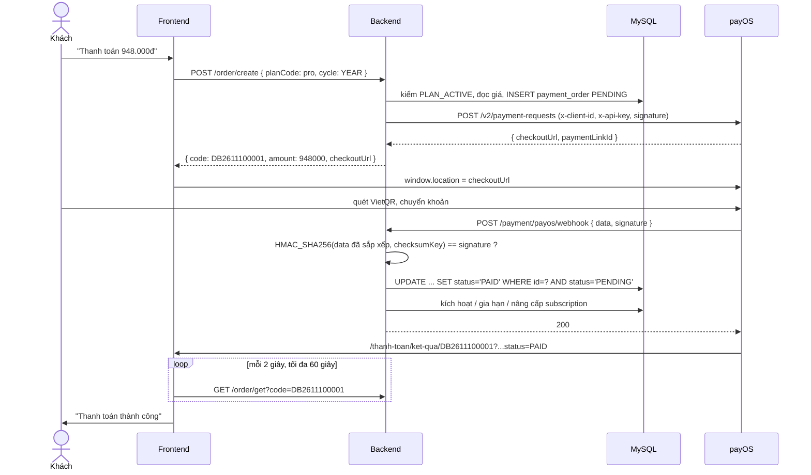

# Gói và thanh toán payOS

## 1. Mục tiêu và phạm vi

Sau plan này, **khách hàng mua được gói Pro / Studio bằng payOS thật**: bảng giá đọc từ backend, bấm mua thì backend tự tính tiền, tạo link payOS và chuyển khách sang trang quét VietQR; payOS gọi webhook (có chữ ký) về backend, backend kích hoạt, gia hạn hoặc nâng cấp gói; trang kết quả hỏi trạng thái đơn tới khi có kết quả. Menu tài khoản hiện gói và hạn thật (đọc `subscription`), nhắc gia hạn khi còn ≤ 3 ngày.

Lát gốc 1.4 của kế hoạch tổng quá to cho một lượt worker (14 endpoint, 6 màn hình), nên tách làm ba (§11 câu 1):

| Có làm (lát này) | Không làm (để plan khác) |
|---|---|
| Migration `V7`: bảng `plan` (kèm 3 gói), `payment_order` (có `source_lut_id`), `subscription` | Resource `PLAN`, `ORDER`, `CUSTOMER`; `plan/list,update`, `order/list,detail`, `customer/list,get`; `/admin/don-hang`, `/admin/khach-hang`, sửa giá gói → lát **`quan-tri-don-hang`** |
| `GET /plan/public/list`, `POST /order/create`, `GET /order/get`, `POST /order/cancel/{code}`, `POST /payment/payos/webhook`, `POST /order/mock-pay/{code}` (chỉ profile local) | `GET /order/my-list`, `POST /subscription/cancel` (tắt tự gia hạn), trang lịch sử mua gói, nút "Huỷ gói" → lát **`goi-cua-toi`** |
| `GET /account/me` trả gói và hạn thật | Tải LUT Premium thật (`POST /lut/download`) → lát `tai-lut` (nút tải vẫn dùng bản giả, nhưng bản giả đọc `user.plan` thật nên mua xong là tải được LUT ★) |
| Đối soát khi hỏi trạng thái: `order/get` gọi payOS khi đơn còn `PENDING` (để chạy local không cần tunnel) | Gửi email nhắc gia hạn, hoá đơn VAT, thu tiền chênh lệch khi nâng cấp (thay bằng quy đổi ngày còn lại, §5.5) |
| Tác vụ 00:10: subscription quá hạn và đơn `PENDING` quá 24 giờ → `EXPIRED` | Gói Studio 5 thành viên (thiết kế §12.2 câu 2) |
| `/pricing` đọc API; hộp thoại "Mua gói" gọi API thật rồi chuyển sang payOS; hộp thoại nâng cấp có nút mua (nhớ `sourceLutId`); trang `/thanh-toan/ket-qua/$code`; nhắc gia hạn ở menu tài khoản và `/pricing` | Tự trừ tiền định kỳ (payOS là chuyển khoản từng lần) |

## 2. Tác nhân và phân quyền

| Tác nhân | Được làm | Ghi chú |
|---|---|---|
| Khách vãng lai | `GET /plan/public/list` | Bấm mua gói → hộp thoại đăng ký (đã có) |
| Người đã đăng nhập (mọi role, kể cả admin) | `order/create`, `order/get`, `order/cancel`, `order/mock-pay` **trên đơn của chính mình** | Không kiểm resource; chỉ cần token. Đơn của người khác → 404 (không lộ là có tồn tại) |
| payOS | `POST /payment/payos/webhook` | Công khai (whitelist), xác thực bằng chữ ký `PAYOS_CHECKSUM_KEY` trước khi đọc / ghi gì |

Không tạo resource, không có migration phân quyền. Các endpoint quản trị `/order/list`, `/order/detail` của lát sau sẽ kiểm resource `ORDER` theo từng method nên không đụng các endpoint khách ở đây.

## 3. Luồng nghiệp vụ

**Luồng chính — mua gói Pro theo năm:**
1. Khách (đã đăng nhập, gói Miễn phí) vào `/pricing`, chọn "Theo năm", bấm "Chọn gói Pro" → hộp thoại "Mua gói Pro" hiện đơn giá 79.000đ/tháng, tổng 948.000đ.
2. Bấm "Thanh toán 948.000đ" → `POST /order/create { planCode: "pro", cycle: "YEAR" }`. Backend kiểm `PLAN_ACTIVE`, tính `amount = 79.000 × 12` từ bảng `plan`, sinh `code = DB2611100001`, `payos_order_code = 2611100001`, lưu `PENDING`, gọi payOS tạo link (ký HMAC), lưu `payos_payment_link_id`, `checkout_url`, trả `{ code, amount, checkoutUrl }`.
3. Trình duyệt chuyển sang `checkoutUrl` (`https://pay.payos.vn/web/...`). Khách quét VietQR, chuyển khoản.
4. payOS gọi `POST /api/payment/payos/webhook`. Backend xác thực chữ ký, tìm đơn theo `orderCode`, so số tiền, `UPDATE payment_order SET status = 'PAID' ... WHERE id = ? AND status = 'PENDING'` (1 dòng) → kích hoạt gói (§5.5).
5. payOS đưa khách về `returnUrl` = `/thanh-toan/ket-qua/DB2611100001?code=00&id=...&cancel=false&status=PAID&orderCode=2611100001`. Trang **bỏ qua** các tham số payOS, gọi `GET /order/get?code=DB2611100001` mỗi 2 giây tới khi hết `PENDING` (tối đa 60 giây) → "Thanh toán thành công", header đổi sang "Gói Pro".

**Luồng thay thế:**
- A1. Nâng cấp từ LUT Premium: khách Miễn phí bấm "Tải" ở LUT ★ → hộp thoại "Nâng cấp để tải LUT Premium" → "Mua gói Pro" → hộp thoại mua (theo năm) → `order/create` gửi kèm `sourceLutId`. Thanh toán xong, trang kết quả có nút "Quay lại LUT {tiêu đề}".
- A2. Gia hạn **bất cứ lúc nào**: thẻ gói đang dùng có nút "Gia hạn gói Pro"; còn ≤ 3 ngày thì menu tài khoản và `/pricing` hiện thêm nhắc. Thanh toán xong, `end_date` cộng thêm một kỳ **tính từ `end_date` cũ** (không mất ngày còn lại).
- A3. Nâng cấp Pro → Studio **bất cứ lúc nào**, có hiệu lực ngay: gói Pro chuyển `CANCELLED`, gói Studio bắt đầu hôm nay; giá trị phần Pro còn lại được **quy đổi thành ngày dùng thêm** ở gói Studio (§5.5). Số tiền đơn không đổi (luôn là giá gói mới), nên payOS không phải tính chênh lệch.
- A4. Khách bấm "Huỷ" trên trang payOS → payOS đưa về `cancelUrl` = `/thanh-toan/ket-qua/DB2611100001?...&cancel=true&status=CANCELLED`. Trang thấy `cancel=true` và đơn còn `PENDING` thì gọi `POST /order/cancel/DB2611100001` (backend huỷ luôn link payOS) → "Đơn đã huỷ".
- A5. Webhook chưa tới (chạy local không có tunnel, hoặc payOS gửi chậm): `order/get` thấy đơn `PENDING` thì hỏi payOS `GET /v2/payment-requests/{orderCode}` (tối đa một lần mỗi 5 giây cho mỗi đơn); payOS báo `PAID` và số tiền khớp → xử lý y như webhook.
- A6. Chạy local không có khoá payOS / muốn test nhanh: `POST /order/mock-pay/{code}` đi thẳng tới bước kích hoạt (chỉ profile `local`).

**Ngoại lệ:**
- E1. Hạ gói (mua Pro khi đang có Studio còn > 3 ngày) → 400 `PLAN_ACTIVE`. Còn ≤ 3 ngày thì được hạ, phần còn lại quy đổi như A3.
- E2. payOS lỗi (mạng, sai khoá, thiếu khoá) → đơn chuyển `CANCELLED`, 502 `PAYMENT_GATEWAY_ERROR`; hộp thoại giữ nguyên, toast lỗi.
- E3. Webhook sai chữ ký → 400 `INVALID_SIGNATURE`, không đọc DB, không đổi gì, ghi log WARN.
- E4. Webhook đúng chữ ký nhưng số tiền khác đơn → 200, đơn giữ `PENDING`, ghi log WARN "lệch số tiền" để đối soát.
- E5. Webhook gửi lặp, hoặc tới khi đơn đã `CANCELLED` / `EXPIRED` → 200, không đổi gì (đơn đã huỷ mà vẫn có tiền: log WARN để hoàn tiền tay, §11 câu 5).
- E6. Webhook `orderCode` không có (ví dụ webhook thử `orderCode: 123` payOS gửi khi xác nhận URL) → 200.
- E7. Không đăng nhập → 401; đơn không có hoặc của người khác → 404.



## 4. Cơ sở dữ liệu

Migration: `V7__goi_thanh_toan.sql` (V6 là mới nhất). Không có seed riêng: 3 gói nằm ngay trong V7 vì môi trường nào cũng cần.

**`plan`**

| Cột | Kiểu | Ràng buộc / ghi chú |
|---|---|---|
| id | int PK AUTO_INCREMENT | |
| code | varchar(20) NOT NULL | UNIQUE: `free`, `pro`, `studio` |
| name | varchar(50) NOT NULL | "Miễn phí", "Pro", "Studio" |
| audience | varchar(100) NOT NULL | |
| monthly_price | bigint NOT NULL | 0 / 99000 / 249000 |
| yearly_monthly_price | bigint NOT NULL | 0 / 79000 / 199000 (thu 12 lần giá này) |
| can_download_premium | tinyint NOT NULL | 0 / 1 / 1 |
| max_members | int NOT NULL | 1 / 1 / 5 |
| license | json NOT NULL | mảng chuỗi, chép từ `frontend/src/lib/mock/data/plans.ts` |
| features | json NOT NULL | như trên |
| is_highlight | tinyint NOT NULL DEFAULT 0 | chỉ `pro` = 1 |
| sort_order | int NOT NULL | 1, 2, 3 |
| active | tinyint NOT NULL DEFAULT 1 | |
| created_time, updated_time | datetime | |

**`payment_order`**

| Cột | Kiểu | Ràng buộc / ghi chú |
|---|---|---|
| id | int PK AUTO_INCREMENT | |
| code | varchar(20) NOT NULL | UNIQUE. `DB` + yyMMdd + 4 số thứ tự trong ngày, ví dụ `DB2611100001` |
| payos_order_code | bigint NOT NULL | UNIQUE. = phần số của `code` (`2611100001`), dưới giới hạn 2^53 của payOS |
| user_id | int NOT NULL FK → user_app | |
| plan_id | int NOT NULL FK → plan | |
| cycle | varchar(10) NOT NULL | `MONTH` / `YEAR` |
| amount | bigint NOT NULL | backend tính từ `plan` |
| status | varchar(20) NOT NULL | `PENDING`, `PAID`, `CANCELLED`, `EXPIRED` |
| payos_payment_link_id | varchar(100) NULL | |
| checkout_url | varchar(500) NULL | |
| payos_reference | varchar(100) NULL | `data.reference` (mã giao dịch ngân hàng) |
| webhook_payload | json NULL | cả thân webhook đã xác thực (hoặc kết quả payOS khi đối soát A5) |
| source_lut_id | int NULL FK → lut ON DELETE SET NULL | |
| paid_time | datetime NULL | |
| created_time, updated_time | datetime NOT NULL | |

Index: `(user_id, created_time)`, `(status, created_time)` (cho tác vụ 00:10).

**`subscription`**

| Cột | Kiểu | Ràng buộc / ghi chú |
|---|---|---|
| id | int PK AUTO_INCREMENT | |
| user_id | int NOT NULL FK → user_app | |
| plan_id | int NOT NULL FK → plan | |
| order_id | int NOT NULL FK → payment_order | đơn gần nhất sinh / gia hạn kỳ này |
| cycle | varchar(10) NOT NULL | chu kỳ của đơn gần nhất |
| status | varchar(20) NOT NULL | `ACTIVE`, `EXPIRED`, `CANCELLED` |
| start_date, end_date | date NOT NULL | khách dùng được tới hết ngày `end_date` |
| auto_renew | tinyint NOT NULL DEFAULT 1 | lát `goi-cua-toi` mới đổi |
| active_user_id | int GENERATED ALWAYS AS (IF(status = 'ACTIVE', user_id, NULL)) STORED | UNIQUE: mỗi khách tối đa 1 dòng ACTIVE |
| created_time, updated_time | datetime | |

Không có dòng ACTIVE với `end_date >= hôm nay` = gói Miễn phí (không lưu dòng cho `free`). Xoá: không có thao tác xoá ở lát này.

## 5. Hợp đồng API (cố định — nguồn sự thật cho cả BE và FE)

Thành công: `{ "code": 200, "message": "OK", "result": … }`. Lỗi nghiệp vụ: `{ "path", "code", "errorCode", "message" }`. POJO `NON_NULL` (khoá rỗng không ra JSON). Ngày giờ theo giờ máy chủ (Asia/Ho_Chi_Minh), định dạng như các lát trước (`"2026-11-10T10:15:30"`, ngày `"2026-11-10"`).

### 5.1 `GET /api/plan/public/list` — công khai

Gói `active = 1`, theo `sort_order`. Cache Caffeine 5 phút (lát quản trị sẽ xoá cache khi sửa giá).
```json
[
  { "code": "free", "name": "Miễn phí", "audience": "Cá nhân mới bắt đầu", "monthlyPrice": 0, "yearlyMonthlyPrice": 0, "canDownloadPremium": 0, "maxMembers": 1, "isHighlight": 0,
    "license": ["Video cá nhân trên kênh của bạn"],
    "features": ["Tải không giới hạn LUT miễn phí", "File .cube cho mọi phần mềm", "So sánh ảnh trước / sau khi áp LUT"] },
  { "code": "pro", "name": "Pro", "audience": "Nhà sáng tạo & freelancer", "monthlyPrice": 99000, "yearlyMonthlyPrice": 79000, "canDownloadPremium": 1, "maxMembers": 1, "isHighlight": 1,
    "license": ["Cá nhân & freelancer", "Dự án cho khách hàng", "Quảng cáo trên mạng xã hội"],
    "features": ["Mọi LUT miễn phí", "Toàn bộ LUT Premium", "LUT mới mỗi tuần", "Bộ sưu tập không giới hạn"] },
  { "code": "studio", "name": "Studio", "audience": "Studio, agency & đội nhóm", "monthlyPrice": 249000, "yearlyMonthlyPrice": 199000, "canDownloadPremium": 1, "maxMembers": 5, "isHighlight": 0,
    "license": ["Đội nhóm tới 5 thành viên", "Khách hàng doanh nghiệp", "Truyền hình & quảng cáo trả phí"],
    "features": ["Mọi quyền lợi của Pro", "5 tài khoản thành viên", "Xuất hoá đơn VAT", "Hỗ trợ ưu tiên"] }
]
```
Không trả `id`, `active`, `sortOrder`, thời gian.

### 5.2 `POST /api/order/create` — cần đăng nhập

Request:
```json
{ "planCode": "pro", "cycle": "YEAR", "sourceLutId": 10 }
```
Response `result`:
```json
{ "code": "DB2611100001", "amount": 948000, "checkoutUrl": "https://pay.payos.vn/web/7f3c2b9e1d4a4c0e9b8a1f2e3d4c5b6a" }
```

Quy tắc (theo thứ tự, gặp lỗi đầu tiên thì dừng):
1. `planCode` không phải `pro` / `studio` đang `active = 1` → 400 "Gói không hợp lệ". `cycle` không phải `MONTH` / `YEAR` → 400 "Chu kỳ không hợp lệ".
2. **`PLAN_ACTIVE`** (chỉ chặn hạ gói): lấy subscription ACTIVE có `end_date >= hôm nay` của khách. Gói mua có `monthly_price` **nhỏ hơn** gói đang dùng (Pro khi đang Studio) và `end_date − hôm nay > 3` ngày → "Bạn đang dùng gói Studio, cao hơn gói Pro" (`{tên gói đang dùng}`, `{tên gói mua}`). Cùng gói (gia hạn) và gói cao hơn (nâng cấp) luôn được mua.
3. `amount` = `monthly_price` (MONTH) hoặc `yearly_monthly_price × 12` (YEAR). Mọi khoá khác trong thân (`amount`, `status`…) bị bỏ qua.
4. `sourceLutId`: lưu nếu có LUT id đó (mọi trạng thái), không có thì lưu NULL, không báo lỗi.
5. Sinh `code`: `DB` + `yyMMdd` (hôm nay) + số thứ tự 4 chữ số = (số lớn nhất của ngày + 1). Trùng UNIQUE (hai đơn cùng lúc) → thử lại tối đa 3 lần. `payos_order_code = Long.parseLong(code.substring(2))`.
6. INSERT `PENDING`, rồi gọi payOS (§5.7). Lỗi / thiếu khoá → UPDATE đơn `CANCELLED`, 502 `PAYMENT_GATEWAY_ERROR`. Thành công → lưu `payos_payment_link_id`, `checkout_url`. INSERT và lời gọi payOS **không** nằm chung một transaction dài (INSERT commit trước, rồi gọi mạng).

### 5.3 `GET /api/order/get?code=DB2611100001` — cần đăng nhập, đơn của chính mình

```json
{
  "code": "DB2611100001", "planCode": "pro", "planName": "Pro", "cycle": "YEAR", "amount": 948000,
  "status": "PAID", "checkoutUrl": "https://pay.payos.vn/web/7f3c2b9e1d4a4c0e9b8a1f2e3d4c5b6a",
  "sourceLutId": 10, "sourceLutSlug": "kodak-400", "sourceLutTitle": "Kodak 400",
  "createdTime": "2026-11-10T10:14:02", "paidTime": "2026-11-10T10:15:31",
  "planExpiresAt": "2027-11-10"
}
```
- `planExpiresAt` = `end_date` của subscription ACTIVE hiện tại của khách, chỉ có khi `status = PAID`.
- Không có `sourceLut*` khi đơn không gắn LUT; không có `paidTime` khi chưa trả. Không bao giờ trả `webhookPayload`, `payosReference`, `payosOrderCode`, `userId`.
- **Đối soát (A5)**: đơn `PENDING` và có `payos_payment_link_id` → gọi payOS `GET /v2/payment-requests/{payosOrderCode}` nếu lần hỏi gần nhất của đơn này đã quá 5 giây (bộ nhớ trong, `ConcurrentHashMap<code, Instant>` hoặc Caffeine). payOS trả `status = PAID` và `amount` = `amount` của đơn → chạy đúng hàm kích hoạt của webhook (§5.5), lưu kết quả payOS vào `webhook_payload`, `payos_reference` = `transactions[0].reference`. Lỗi mạng / payOS lỗi → bỏ qua, ghi log, trả trạng thái đang có.

### 5.4 `POST /api/order/cancel/{code}` — cần đăng nhập, đơn của chính mình

`result` = đơn như §5.3 với `status: "CANCELLED"`. Chỉ khi đơn `PENDING` (UPDATE ... WHERE status = 'PENDING'; 0 dòng → `ORDER_INVALID_STATUS`). Sau khi ghi, gọi payOS `POST /v2/payment-requests/{payosOrderCode}/cancel` với `{ "cancellationReason": "Khách huỷ đơn" }`; lỗi thì chỉ ghi log.

### 5.5 `POST /api/payment/payos/webhook` — công khai, payOS gọi

Request (payOS gửi):
```json
{
  "code": "00", "desc": "success", "success": true,
  "data": {
    "orderCode": 2611100001, "amount": 948000, "description": "DownBeat", "accountNumber": "12345678",
    "reference": "FT2611100001", "transactionDateTime": "2026-11-10 10:15:30", "currency": "VND",
    "paymentLinkId": "7f3c2b9e1d4a4c0e9b8a1f2e3d4c5b6a", "code": "00", "desc": "success",
    "counterAccountBankId": "", "counterAccountBankName": "", "counterAccountName": null, "counterAccountNumber": null,
    "virtualAccountName": "", "virtualAccountNumber": ""
  },
  "signature": "c96085b6…"
}
```
Response: 200 `{ "code": 200, "message": "OK", "result": null }` cho **mọi** trường hợp trừ sai chữ ký.

Xử lý:
1. **Chữ ký** (trước mọi thứ khác): lấy mọi khoá của `data` (đọc thành `Map`/`JsonNode`, **không** qua POJO để không rơi khoá lạ payOS thêm sau), sắp xếp A→Z, giá trị `null` / `"null"` / `"undefined"` → chuỗi rỗng, mảng / object → JSON (khoá con cũng sắp xếp), ghép `key=value` bằng `&`, `HMAC_SHA256(chuỗi, PAYOS_CHECKSUM_KEY)` dạng hex chữ thường, so bằng `MessageDigest.isEqual`. Sai / thiếu `signature` / thiếu `data` → 400 `INVALID_SIGNATURE`.
2. `code != "00"` hoặc `data.code != "00"` → 200, bỏ qua.
3. Tìm đơn theo `payos_order_code = data.orderCode`. Không có → 200, log INFO (đây là webhook thử của payOS khi xác nhận URL).
4. `data.amount != amount` → 200, log WARN `Webhook lệch số tiền: đơn {code} cần {amount}, nhận {data.amount}`, không đổi gì.
5. **Kích hoạt** (một `@Transactional`, dùng chung cho webhook, `mock-pay`, đối soát):
   - `UPDATE payment_order SET status='PAID', paid_time=NOW(), payos_reference=?, webhook_payload=? WHERE id=? AND status='PENDING'` → 0 dòng thì dừng (đã xử lý / đã huỷ / hết hạn; nếu đơn `CANCELLED`/`EXPIRED` thì log WARN `Nhận tiền cho đơn {code} đã {status}, cần hoàn tiền tay`).
   - Subscription ACTIVE hiện tại của khách (khoá `SELECT ... FOR UPDATE`):
     - Không có, hoặc có nhưng `end_date < hôm nay` (chưa kịp chạy 00:10) → dòng cũ (nếu có) `EXPIRED`; tạo mới `start = hôm nay`, `end = hôm nay + kỳ`.
     - Cùng gói → `end_date = end_date + kỳ`, `cycle`, `order_id` = đơn mới.
     - Khác gói → dòng cũ `CANCELLED`; tạo mới `start = hôm nay`, `end = hôm nay + kỳ + ngày quy đổi`.
   - Kỳ: `plusMonths(1)` hoặc `plusMonths(12)` (31/01 + 1 tháng = 28/02 hoặc 29/02).
   - **Ngày quy đổi** khi đổi gói: `còn lại = end_date cũ − hôm nay` (số ngày, ≥ 0); `giá tháng` của một gói theo chu kỳ của nó = `yearly_monthly_price` nếu `YEAR`, `monthly_price` nếu `MONTH`; `ngày quy đổi = floor(còn lại × giá tháng cũ / giá tháng mới)`. Ví dụ Pro YEAR (79.000) còn 200 ngày, mua Studio MONTH (249.000) → `floor(200 × 79000 / 249000)` = 63 ngày → end = hôm nay + 1 tháng + 63 ngày. Hàm thuần `PlanCredit.creditDays(...)` để unit test.

### 5.6 `POST /api/order/mock-pay/{code}` — chỉ profile `local`, cần đăng nhập, đơn của chính mình

Controller `@Profile("local")` (profile khác: endpoint không tồn tại → 404 của Spring). Đơn không phải `PENDING` → `ORDER_INVALID_STATUS`. Còn lại chạy §5.5 bước 5 với `payos_reference = "MOCK"`, `webhook_payload = {"mock": true}`. `result` = đơn như §5.3.

### 5.7 Gọi payOS (backend → payOS)

Cấu hình (`application.yml`, đọc từ `backend/.env`; **không bao giờ** ra frontend):
```yaml
payos:
  base-url: ${PAYOS_BASE_URL:https://api-merchant.payos.vn}
  client-id: ${PAYOS_CLIENT_ID:}
  api-key: ${PAYOS_API_KEY:}
  checksum-key: ${PAYOS_CHECKSUM_KEY:}
system:
  frontend-url: ${FRONTEND_URL:http://localhost:4200}
```
Thêm 4 dòng `PAYOS_*` (để trống) + `FRONTEND_URL` vào `backend/.env.example` kèm chú thích.

Tạo link: `POST {base-url}/v2/payment-requests`, header `x-client-id`, `x-api-key`, timeout kết nối 5 s, đọc 10 s.
```json
{
  "orderCode": 2611100001, "amount": 948000, "description": "DownBeat",
  "returnUrl": "http://localhost:4200/thanh-toan/ket-qua/DB2611100001",
  "cancelUrl": "http://localhost:4200/thanh-toan/ket-qua/DB2611100001",
  "expiredAt": 1762834442,
  "items": [ { "name": "Gói Pro - 12 tháng", "quantity": 1, "price": 948000 } ],
  "signature": "HMAC_SHA256(\"amount=948000&cancelUrl=...&description=DownBeat&orderCode=2611100001&returnUrl=...\", checksumKey)"
}
```
- `description` cố định `"DownBeat"` (8 ký tự; payOS giới hạn 9 ký tự với tài khoản ngân hàng không liên kết). Đối soát dựa vào `orderCode`, không dựa vào nội dung chuyển khoản.
- `expiredAt` = giây Unix của `created_time + 24 giờ` (khớp tác vụ 00:10). `items[0].name` = "Gói {Pro|Studio} - {1|12} tháng".
- payOS trả `code = "00"` → lấy `data.checkoutUrl`, `data.paymentLinkId`. `code` khác `"00"`, HTTP ≠ 2xx, timeout, hoặc thiếu khoá → `PAYMENT_GATEWAY_ERROR` (log kèm `code`, `desc` payOS trả, **không** log khoá).
- Lấy trạng thái: `GET {base-url}/v2/payment-requests/{orderCode}` → `data.status` (`PENDING`, `PAID`, `CANCELLED`, `EXPIRED`…), `data.amount`, `data.transactions[]`.
- Huỷ link: `POST {base-url}/v2/payment-requests/{orderCode}/cancel`.
- Tự viết client nhỏ (`RestClient` của Spring 6.1) + lớp `PayosSignature`, **không** thêm SDK payOS (để unit test và báo cáo thấy rõ cách ký).

Nối webhook với payOS (người dùng làm một lần, §9.2): payOS chỉ gọi được URL công khai, nên local cần tunnel; xác nhận URL ở my.payos.vn → Kênh thanh toán → Cài đặt webhook (payOS gửi một webhook thử `orderCode: 123` → endpoint trả 200 theo bước 3).

### 5.8 `GET /api/account/me` — sửa

`plan` = `plan.code` của subscription ACTIVE có `end_date >= hôm nay`, không có thì `"free"`. `planExpiresAt` = `end_date` (`"2027-11-10"`), không có khoá này với `free`. Các khoá khác giữ nguyên lát `tai-khoan-khach`.
```json
{ "id": 52, "name": "Khách E2E", "email": "e2e-1731212345@downbeat.local", "plan": "pro", "planExpiresAt": "2027-11-10" }
```

### 5.9 Tác vụ 00:10 hằng ngày

`@Scheduled(cron = "0 10 0 * * *", zone = "Asia/Ho_Chi_Minh")`, gọi `BillingMaintenanceService.expireOverdue(LocalDateTime now)` (nhận `now` làm tham số để unit test):
- `UPDATE subscription SET status='EXPIRED' WHERE status='ACTIVE' AND end_date < DATE(now)`.
- `UPDATE payment_order SET status='EXPIRED' WHERE status='PENDING' AND created_time < now - 24 giờ`.
Ghi log INFO số dòng đổi.

### 5.10 Lỗi nghiệp vụ

| Tình huống | HTTP | `errorCode` | Message (FE hiện nguyên văn qua toast / trang) |
|---|---|---|---|
| `order/*` không token | 401 | (không có) | Chưa đăng nhập |
| `create`: gói sai / `free` / không active | 400 | `BAD_REQUEST` | Gói không hợp lệ |
| `create`: chu kỳ sai | 400 | `BAD_REQUEST` | Chu kỳ không hợp lệ |
| `create`: hạ gói khi gói cao hơn còn > 3 ngày | 400 | `PLAN_ACTIVE` (**mới**) | Bạn đang dùng gói Studio, cao hơn gói Pro |
| `create`: payOS lỗi / thiếu khoá | 502 | `PAYMENT_GATEWAY_ERROR` (**mới**) | Không kết nối được cổng thanh toán, vui lòng thử lại |
| `get`, `cancel`, `mock-pay`: mã không có hoặc của người khác | 404 | `DATA_NOT_FOUND` | Không tìm thấy đơn hàng |
| `cancel`, `mock-pay`: đơn không còn `PENDING` | 400 | `ORDER_INVALID_STATUS` (**mới**) | Đơn hàng đã được xử lý |
| `webhook`: sai / thiếu chữ ký | 400 | `INVALID_SIGNATURE` (**mới**) | Chữ ký không hợp lệ |

`ErrorCode` đã có `INVALID_ORDER_STATUS` (của dự án cũ, message khác) → **thêm mới** `ORDER_INVALID_STATUS` đúng tên thiết kế §5.7, không dùng lại cái cũ.

## 6. Giao diện (chuỗi cố định — test E2E chọn theo đúng các chuỗi này)

Tiền hiện bằng `formatVnd` có sẵn (`948000` → "948.000đ"). Ngày hiện `dd/MM/yyyy` có đệm số 0 (`Intl.DateTimeFormat("vi-VN", { day: "2-digit", month: "2-digit", year: "numeric" })` → "10/11/2027", "05/01/2027"; `toLocaleDateString("vi-VN")` không đệm nên không dùng). Chuỗi ngày `"2027-11-10"` từ API là ngày lịch: tách năm / tháng / ngày, không qua `new Date("2027-11-10")` (bị hiểu là giờ UTC).

### 6.1 Bảng giá `/pricing` (sửa)

- 3 thẻ đọc `GET /plan/public/list` (bỏ `MOCK_PLANS` ở mọi nơi dùng cho giá; giữ `PLAN_COMPARISON` vì bảng so sánh là nội dung tĩnh). Đang tải: 3 `Skeleton` (đã có). Lỗi: "Không tải được bảng giá" + nút "Thử lại".
- Nút chu kỳ giữ nguyên "Theo tháng" / "Theo năm −20%". Theo năm, thẻ Pro hiện "79.000đ/tháng" và dòng nhỏ "Thanh toán 948.000đ mỗi năm"; theo tháng "99.000đ/tháng".
- Nút trên mỗi thẻ (`gói đang dùng` = `user.plan`, `còn n ngày` tính từ `planExpiresAt`):

| Trạng thái khách | Thẻ Miễn phí | Thẻ gói đang dùng | Thẻ gói cao hơn | Thẻ gói thấp hơn |
|---|---|---|---|---|
| Chưa đăng nhập | "Bắt đầu miễn phí" | — | "Chọn gói Pro" / "Chọn gói Studio" (mở đăng ký, có sẵn) | — |
| Miễn phí | "Vào kho LUT" | — | "Chọn gói Pro" / "Chọn gói Studio" | — |
| Pro / Studio, còn > 3 ngày | "Vào kho LUT" | "Gia hạn gói Pro" | "Nâng cấp lên Studio" | "Đã có trong gói Studio" (khoá) |
| Pro / Studio, còn ≤ 3 ngày | "Vào kho LUT" | "Gia hạn gói Pro" | "Nâng cấp lên Studio" | "Chọn gói Pro" |

  Thẻ gói đang dùng có thêm badge "Gói hiện tại" ở góc trên.

- Còn ≤ 3 ngày: khung nhắc đầu trang (`role="status"`): "Gói Pro của bạn hết hạn ngày {dd/MM/yyyy}. Gia hạn để không gián đoạn việc tải LUT Premium."
- Sửa câu hỏi thường gặp "Có được đổi gói giữa chừng không?" thành: "Được. Nâng cấp có hiệu lực ngay, thời gian còn lại của gói cũ được quy đổi thành ngày dùng thêm ở gói mới. Gia hạn được bất cứ lúc nào, thời gian cộng nối tiếp."

### 6.2 Hộp thoại "Mua gói {Pro|Studio}" (sửa `checkout-panel.tsx`)

- Tiêu đề / mô tả giữ nguyên: "Mua gói Pro", "Kiểm tra lại đơn hàng trước khi thanh toán."
- Bảng giữ nguyên các dòng "Gói", "Chu kỳ" ("Theo năm (12 tháng)" / "Theo tháng"), "Đơn giá" ("79.000đ/tháng"), "Tổng thanh toán" ("948.000đ"); giá lấy từ API gói.
- Thêm nút chuyển chu kỳ ngay trong hộp thoại (`role="group"`, `aria-label="Chu kỳ thanh toán"`, hai nút "Theo tháng" / "Theo năm") để khách đi từ hộp thoại nâng cấp không phải quay về `/pricing`.
- Khung payOS giữ chữ "Thanh toán qua payOS"; câu dưới đổi thành "Bạn sẽ được chuyển sang trang payOS để quét mã VietQR. Gói được kích hoạt ngay khi chuyển khoản thành công."
- Nút "Thanh toán 948.000đ" → đang gửi "Đang tạo đơn…" (khoá nút) → thành công: `window.location.assign(checkoutUrl)` (không toast). Lỗi: toast message backend nguyên văn (§5.10), hộp thoại giữ nguyên.
- Bỏ dòng "Bản demo: thanh toán giả lập…".
- Nếu khách đang có gói: thêm dòng nhỏ dưới bảng — gia hạn: "Gia hạn thêm một kỳ, nối tiếp ngày {dd/MM/yyyy}."; đổi gói: "Gói Studio có hiệu lực ngay. Thời gian còn lại của gói Pro được quy đổi thành ngày dùng thêm."

### 6.3 Hộp thoại "Nâng cấp để tải LUT Premium" (sửa `upgrade-panel.tsx`)

- Danh sách quyền lợi + câu "Gói Pro chỉ từ 79.000đ/tháng khi trả theo năm…" đọc giá từ API.
- Nút chính đổi thành **"Mua gói Pro"** → mở hộp thoại "Mua gói Pro" (theo năm) mang theo `sourceLutId = lut.id`. Thêm link phụ "Xem bảng giá", giữ "Để sau".

### 6.4 Trang kết quả `/thanh-toan/ket-qua/$code` (mới, layout `_plain`, `document.title` = "Kết quả thanh toán | DownBeat")

Khung giữa trang, rộng tối đa 480 px, biểu tượng lớn + heading + câu mô tả + bảng tóm tắt đơn ("Mã đơn" `DB2611100001`, "Gói" "Pro", "Chu kỳ" "Theo năm", "Số tiền" "948.000đ") + các nút.

| Trạng thái | Heading | Mô tả | Nút |
|---|---|---|---|
| Chưa đăng nhập | "Đăng nhập để xem đơn hàng" | "Đơn hàng gắn với tài khoản đã mua." | "Đăng nhập" (mở hộp thoại đăng nhập; đăng nhập xong ở lại trang) |
| Đang tải lần đầu | `Skeleton` | | |
| `PENDING`, đang hỏi (≤ 60 s) | "Đang chờ xác nhận thanh toán" | "payOS đang báo kết quả về DownBeat. Trang tự cập nhật, bạn không cần tải lại." (kèm vòng quay) | |
| `PENDING`, quá 60 s | "Chưa nhận được thanh toán" | "Nếu bạn đã chuyển khoản, gói sẽ được kích hoạt ngay khi payOS xác nhận." | "Kiểm tra lại" (hỏi tiếp 60 s), "Tiếp tục thanh toán" (link `checkoutUrl`), "Huỷ đơn" |
| `PAID` | "Thanh toán thành công" | "Gói Pro đã được kích hoạt, dùng đến {dd/MM/yyyy của planExpiresAt}." | "Vào kho LUT" (→ `/luts`); có `sourceLutSlug` thì thêm nút chính "Quay lại LUT {sourceLutTitle}" (→ `/luts/{slug}`) |
| `CANCELLED` | "Đơn đã huỷ" | "Bạn chưa bị trừ tiền. Có thể chọn lại gói bất cứ lúc nào." | "Xem bảng giá" |
| `EXPIRED` | "Đơn đã hết hạn" | "Link thanh toán đã quá 24 giờ. Hãy tạo đơn mới." | "Xem bảng giá" |
| 404 | "Không tìm thấy đơn hàng" | "Mã đơn không đúng hoặc thuộc tài khoản khác." | "Xem bảng giá" |
| Lỗi khác | "Không tải được đơn hàng" | | "Thử lại" |

- Chỉ tin `GET /order/get`; không đọc `status`, `code` payOS gắn trên URL. Ngoại lệ duy nhất: có `cancel=true` và lần đọc đầu thấy `PENDING` → gọi `order/cancel` **một lần** (lỗi `ORDER_INVALID_STATUS` thì bỏ qua, đọc lại đơn).
- "Huỷ đơn" → `AlertDialog` "Huỷ đơn {code}?", mô tả "Link thanh toán sẽ không dùng được nữa.", nút "Huỷ đơn" / "Không".
- Lần đầu thấy `PAID`: `invalidateQueries(["account-me"])` để header đổi gói.

### 6.5 Menu tài khoản (sửa `header-actions.tsx`)

- Khung gói lấy tên gói từ API gói (không dùng `MOCK_PLANS`); giữ "Gói **Pro**" + "Hết hạn {dd/MM/yyyy}".
- Còn ≤ 3 ngày: dòng thêm màu cảnh báo "Còn {n} ngày" (n = 0 thì "Hết hạn hôm nay") và mục menu **"Gia hạn gói"** (→ `/pricing`).
- Gói Pro: thêm mục "Nâng cấp lên Studio" (→ `/pricing`). Gói Miễn phí giữ "Nâng cấp lên Pro".

## 7. Việc backend (agy BE)

Package mới `vn.aeoc.business.billing` (`controller`, `service`, `repository`, `payos`, `constant`). Thứ tự theo `backend/AGENTS.md`:

1. `backend/app/src/main/resources/db/migration/V7__goi_thanh_toan.sql`: 3 bảng §4 + INSERT 3 gói (license / features là JSON chép đúng §5.1). Chạy `jooq codegen` để có `Plan`, `PaymentOrder`, `Subscription`.
2. `base/.../ErrorCode.java`: thêm `PLAN_ACTIVE(400, "Bạn đang dùng gói này")`, `ORDER_INVALID_STATUS(400, "Đơn hàng đã được xử lý")`, `PAYMENT_GATEWAY_ERROR(502, "Không kết nối được cổng thanh toán, vui lòng thử lại")`, `INVALID_SIGNATURE(400, "Chữ ký không hợp lệ")`. Message "Bạn đang dùng gói Studio, cao hơn gói Pro" truyền qua `AppException(ErrorCode.PLAN_ACTIVE, message)` (kiểu đã dùng cho `LUT_FILE_INVALID`).
3. `entity`: POJO sinh ra; thêm field không thuộc bảng cho response (`planCode`, `planName`, `sourceLutSlug`, `sourceLutTitle`, `planExpiresAt` trên `PaymentOrder`; `license`/`features` của `Plan` ra JSON dạng mảng, không phải chuỗi). Các cột nội bộ (`payosOrderCode`, `payosReference`, `webhookPayload`, `userId`, `id`) không ra JSON của `order/get` (`WRITE_ONLY` hoặc response chọn khoá như lát `quan-ly-lut`).
4. `billing/payos/PayosProperties` (`@ConfigurationProperties("payos")`), `PayosSignature` (`signCreate(...)`, `signData(Map/JsonNode)`, `verify(...)`), `PayosClient` (`createLink`, `getStatus`, `cancelLink` bằng `RestClient`). Thiếu `client-id` / `api-key` / `checksum-key` → `PAYMENT_GATEWAY_ERROR` khi gọi, **không** làm app chết lúc khởi động.
5. `billing/repository`: `PlanRepository`, `PaymentOrderRepository` (sinh mã theo ngày, `markPaid` WHERE PENDING trả số dòng, `markCancelled`, `expirePending`), `SubscriptionRepository` (`findActiveForUpdate`, `expireOverdue`).
6. `billing/service`: `PlanService` (cache), `OrderService` (create / get + đối soát / cancel / mockPay), `PaymentActivationService.activate(order, reference, payload)` (§5.5 bước 5, dùng chung), `PayosWebhookService`, `BillingMaintenanceService` + `@Scheduled`. Hàm có "hôm nay" nhận `LocalDate` / `Clock` để test.
7. `billing/controller`: `PlanPublicController` (`/plan/public/list`), `OrderController` (`/order/create|get|cancel/{code}`), `OrderMockPayController` `@Profile("local")`, `PayosWebhookController` (`/payment/payos/webhook`, nhận `JsonNode`). Lấy user bằng `SecurityUtils.userId(principal)`.
8. `authenticate/.../JwtAuthenticationFilter.java`: thêm `"/payment/payos/webhook"` vào `WHITE_LIST_POST_API`.
9. `business/account/service/AccountService.me`: đọc subscription (§5.8), bỏ dòng `setPlan("free")` cứng.
10. `application.yml` + `backend/.env.example`: khối `payos`, `system.frontend-url` (§5.7).

Quyết định worker không tự đổi: webhook xác thực chữ ký trên **`data` thô** (không qua POJO); số tiền chỉ lấy từ bảng `plan`; chống trùng chỉ bằng `UPDATE ... WHERE status='PENDING'` + UNIQUE `active_user_id` (không `@Idempotent`); gia hạn cộng từ `end_date` cũ; không log khoá payOS.

Unit test bắt buộc: các TC loại `unit` ở §9 (dùng vector §9 để đối chiếu chữ ký), mock `PayosClient` khi test `OrderService`.

## 8. Việc frontend (agy FE)

1. `lib/types/account.ts` → thêm / sửa: `PlanDTO` khớp §5.1 (`isHighlight: 0 | 1`, `canDownloadPremium`, `maxMembers`; sửa chỗ đang đọc `highlight`), `BillingCycle` giữ `"month" | "year"` ở giao diện, đổi sang `"MONTH" | "YEAR"` khi gọi API; `OrderDTO`, `OrderStatus`, `CreateOrderRequest { planCode, cycle, sourceLutId? }`, `CreateOrderResult`.
2. `lib/axios/billing.ts` (mới): `getPlans`, `createOrder`, `getOrder`, `cancelOrder`.
3. `lib/tanstack/options/billing.ts` (mới): `plansQueryOptions` (chuyển từ `account.ts`, `staleTime` 5 phút), `orderQueryOptions(code)` (`refetchInterval` 2000 khi `PENDING` và chưa quá 60 s), `createOrderMutationOptions` (tắt toast thành công), `cancelOrderMutationOptions`. Xoá `checkoutMutationOptions`, `checkout`, `getPlans` khỏi `lib/mock/account.ts` (giữ `requestLutDownload` cho lát `tai-lut`).
4. `lib/utils/plan.ts` (mới): `daysLeft(planExpiresAt, today)`, `planAction(user, plan)` trả nhãn + trạng thái nút theo bảng §6.1 (dùng chung cho `/pricing`, hộp thoại, menu).
5. `lib/stores/shop-dialog.ts`: `checkout` thêm `sourceLutId?: number`.
6. `components/shop/pricing/pricing-page.tsx`, `plan-card.tsx`, `use-plan-select.ts`: §6.1.
7. `components/shop/account/checkout-panel.tsx`: §6.2. `upgrade-panel.tsx`: §6.3. `shop-dialogs.tsx`: tên gói từ API (bỏ `MOCK_PLANS`).
8. `components/shop/layout/header/header-actions.tsx`: §6.5.
9. `routes/_plain/thanh-toan/ket-qua.$code.tsx` + `components/shop/payment/payment-result-page.tsx` (mới): §6.4.
10. `lib/mock/data/plans.ts`: chỉ giữ `PLAN_COMPARISON`; xoá `MOCK_PLANS` khi hết chỗ dùng (`home/plans-section.tsx` cũng đổi sang API).

Component shadcn dùng: có sẵn trong `components/ui/`: `dialog`, `alert-dialog`, `skeleton`, `button`, `badge`, `dropdown-menu`, `sonner`; không cần `shadcn add`.

## 9. Test case

`api` / `e2e` do Claude viết ở `frontend/tests/e2e/goi-thanh-toan.spec.ts`. Mỗi test đăng ký một khách mới (`newEmail()`), nên không phụ thuộc dữ liệu cũ.

**Cách test webhook mà không cần payOS gọi vào máy:** spec đọc `PAYOS_CHECKSUM_KEY` từ `backend/.env` (phía Node, không ra trình duyệt, không commit), tự dựng thân webhook như §5.5 và ký bằng `crypto.createHmac` của Node (một bản cài đặt độc lập với Java → kiểm chéo được cách ký của backend), rồi `POST /api/payment/payos/webhook`. `order/create` gọi **payOS thật** bằng khoá trong `.env`: tạo link không mất tiền; test huỷ hoặc để đơn tự hết hạn.

**Vector chữ ký** (khoá `downbeat-test-checksum`, tính sẵn bằng Node để unit test Java đối chiếu):
- Tạo link: chuỗi `amount=99000&cancelUrl=http://localhost:4200/thanh-toan/ket-qua/DB2611100001&description=DownBeat&orderCode=2611100001&returnUrl=http://localhost:4200/thanh-toan/ket-qua/DB2611100001` → `de1cc872870f3f3c6c2f56b2fca94727348d4898e3a72cdbae787970b8c7dd08`.
- Webhook: `data` ở §5.5 nhưng `amount: 99000`, `paymentLinkId: "a1b2c3d4"` → chuỗi `accountNumber=12345678&amount=99000&code=00&counterAccountBankId=&counterAccountBankName=&counterAccountName=&counterAccountNumber=&currency=VND&desc=success&description=DownBeat&orderCode=2611100001&paymentLinkId=a1b2c3d4&reference=FT2611100001&transactionDateTime=2026-11-10 10:15:30&virtualAccountName=&virtualAccountNumber=` → `c96085b61553e71c579afc9051bfa92e743cb042aa727ae4457a3b7cb58361f6`.

| ID | Loại | Mô tả | Tiền điều kiện | Bước | Kết quả mong đợi |
|---|---|---|---|---|---|
| TC-01 | unit | Ký tạo link | | `PayosSignature.signCreate(99000, cancelUrl, "DownBeat", 2611100001, returnUrl)` với khoá vector | `de1cc872…7dd08` |
| TC-02 | unit | Ký `data` webhook: sắp xếp khoá, `null` → rỗng | | `signData(data vector)` | đúng chuỗi ghép ở trên và `c96085b6…361f6` |
| TC-03 | unit | Ký `data` có mảng / object, có khoá lạ | `data` thêm `"extra": {"b":1,"a":[2,1]}` | `signData` | phần `extra={"a":[2,1],"b":1}` (khoá con sắp xếp, mảng giữ thứ tự) |
| TC-04 | unit | `verify` từ chối khi sửa 1 trường | chữ ký vector | đổi `amount` thành 99001 rồi `verify` | `false`; chữ ký hoa / thiếu → `false` |
| TC-05 | unit | Tính tiền | 3 gói V7 | pro MONTH, pro YEAR, studio MONTH, studio YEAR | 99000, 948000, 249000, 2388000 |
| TC-06 | unit | Sinh mã đơn | ngày 10/11/2026, chưa có đơn | tạo 2 đơn | `DB2611100001`, `DB2611100002`; `payosOrderCode` 2611100001, 2611100002; trùng UNIQUE lần đầu thì lần thử sau thành công |
| TC-07 | unit | Kích hoạt lần đầu | hôm nay 10/11/2026, không có subscription | `activate` đơn pro YEAR | 1 dòng ACTIVE, start 2026-11-10, end 2027-11-10; đơn MONTH → end 2026-12-10; hôm nay 31/01/2027 + MONTH → 2027-02-28 |
| TC-08 | unit | Gia hạn cùng gói cộng từ `end_date` | Pro ACTIVE end 2026-11-12, hôm nay 2026-11-10 | `activate` đơn pro MONTH | vẫn 1 dòng, end 2026-12-12, `order_id` = đơn mới |
| TC-09 | unit | Đổi gói có quy đổi ngày | hôm nay 2026-11-10; Pro YEAR ACTIVE end 2027-05-29 (còn 200 ngày) | `activate` studio MONTH | dòng Pro `CANCELLED`; dòng Studio ACTIVE start 2026-11-10, end 2026-12-10 + 63 ngày = 2027-02-11; `PlanCredit.creditDays(0, …)` = 0 |
| TC-10 | unit | Subscription quá hạn chưa chạy 00:10 | Pro ACTIVE end 2026-11-09, hôm nay 10/11 | `activate` pro MONTH | dòng cũ `EXPIRED`, dòng mới start 2026-11-10 end 2026-12-10 |
| TC-11 | unit | `activate` gọi hai lần cùng đơn | đơn PENDING | gọi 2 lần | lần 2: `markPaid` = 0 dòng, subscription không đổi |
| TC-12 | unit | Luật `PLAN_ACTIVE` | hôm nay 10/11 | Pro end 30/11 mua pro; Pro end 30/11 mua studio; Studio end 14/11 (4 ngày) mua pro; Studio end 13/11 (3 ngày) mua pro | cho phép; cho phép; `PLAN_ACTIVE` "Bạn đang dùng gói Studio, cao hơn gói Pro"; cho phép |
| TC-13 | unit | payOS lỗi khi tạo link | `PayosClient.createLink` ném lỗi; lần khác thiếu `client-id` | `OrderService.create` | `PAYMENT_GATEWAY_ERROR`; đơn đã INSERT chuyển `CANCELLED` |
| TC-14 | unit | Đối soát khi `get` | đơn PENDING có link | payOS trả PAID đúng tiền / PAID lệch tiền / ném lỗi; gọi `get` 2 lần trong 5 s | PAID + subscription; giữ PENDING; trả PENDING không ném lỗi; `getStatus` chỉ bị gọi 1 lần |
| TC-15 | unit | Tác vụ 00:10 | now 2026-11-10 00:10; sub end 09/11 và end 10/11; đơn PENDING tạo 25 giờ và 23 giờ trước | `expireOverdue(now)` | sub end 09/11 → EXPIRED, end 10/11 giữ ACTIVE; đơn 25 giờ → EXPIRED, 23 giờ giữ PENDING |
| TC-16 | api | Bảng giá công khai | | `GET plan/public/list` không token | 200, 3 phần tử theo thứ tự `free, pro, studio`; pro `monthlyPrice` 99000, `yearlyMonthlyPrice` 79000, `isHighlight` 1, `features` là mảng 4 chuỗi; không có khoá `id`, `active` |
| TC-17 | api | Không token | | `order/create`, `order/get?code=DB2611100001`, `order/cancel/DB2611100001`, `order/mock-pay/DB2611100001` không token | cả 4: 401 |
| TC-18 | api | Tạo đơn qua payOS thật | khách mới; `.env` có khoá payOS | `order/create { planCode: "pro", cycle: "YEAR", sourceLutId: <id LUT kodak-400> }` | 200; `code` khớp `^DB\d{10}$`; `amount` 948000; `checkoutUrl` bắt đầu `https://pay.payos.vn/`; `order/get` → `status` PENDING, `planName` "Pro", `sourceLutSlug` "kodak-400" |
| TC-19 | api | Backend không nhận tiền từ trình duyệt | khách mới | `order/create { planCode: "pro", cycle: "MONTH", amount: 1000 }` | `amount` 99000 |
| TC-20 | api | Validate tạo đơn | khách mới | `planCode` "free"; `planCode` "vip"; `cycle` "WEEK" | 400 "Gói không hợp lệ" (2 lần); 400 "Chu kỳ không hợp lệ" |
| TC-21 | api | `sourceLutId` không có | khách mới | `order/create { planCode: "pro", cycle: "MONTH", sourceLutId: 999999 }` | 200; `order/get` không có khoá `sourceLutId` |
| TC-22 | api | Đơn của người khác / không có | khách A có đơn; khách B | B gọi `order/get`, `order/cancel`, `order/mock-pay` mã của A; A gọi `order/get?code=DB0000000000` | cả 4: 404 "Không tìm thấy đơn hàng" |
| TC-23 | api | Webhook hợp lệ kích hoạt gói | TC-18 tạo đơn | POST webhook ký đúng (`orderCode`, `amount` 948000) | 200; `order/get` PAID, có `paidTime`, `planExpiresAt` = hôm nay + 12 tháng; `account/me` `plan` "pro", `planExpiresAt` cùng ngày |
| TC-24 | api | Webhook gửi lặp | sau TC-23 | gửi lại đúng thân đó 2 lần | 200; `account/me.planExpiresAt` **không đổi**; đơn vẫn PAID |
| TC-25 | api | Webhook sai chữ ký | đơn PENDING mới | (a) đổi 1 ký tự `signature`; (b) ký đúng rồi sửa `amount`; (c) bỏ `signature` | cả 3: 400 `INVALID_SIGNATURE` "Chữ ký không hợp lệ"; đơn PENDING; `account/me.plan` "free" |
| TC-26 | api | Webhook lệch số tiền | đơn pro MONTH PENDING | webhook **ký đúng** với `amount` 1000 | 200; đơn PENDING; `plan` "free" |
| TC-27 | api | Webhook thử của payOS / mã không có | | webhook ký đúng `orderCode` 123 | 200 |
| TC-28 | api | Webhook báo không thành công | đơn PENDING | ký đúng, `code` "01", `success` false | 200; đơn PENDING |
| TC-29 | api | Huỷ đơn | đơn PENDING | `order/cancel/{code}`; gọi lại lần 2; rồi webhook ký đúng cho đơn đó | lần 1: 200 `status` CANCELLED; lần 2: 400 `ORDER_INVALID_STATUS` "Đơn hàng đã được xử lý"; webhook 200 nhưng đơn vẫn CANCELLED, `plan` "free" |
| TC-30 | api | `mock-pay` | đơn studio MONTH PENDING | `mock-pay/{code}` 2 lần | lần 1: 200 PAID, `account/me.plan` "studio", `planExpiresAt` = hôm nay + 1 tháng; lần 2: 400 `ORDER_INVALID_STATUS` |
| TC-31 | api | Gia hạn cùng gói bất cứ lúc nào | khách Pro MONTH vừa `mock-pay` (hạn = hôm nay + 1 tháng) | `order/create { planCode: "pro", cycle: "MONTH" }` → `mock-pay` | 200; `account/me.plan` "pro", `planExpiresAt` = hôm nay + 2 tháng |
| TC-32 | api | Nâng cấp Pro → Studio có quy đổi | khách Pro YEAR vừa `mock-pay` (hạn E = hôm nay + 12 tháng) | tạo đơn studio MONTH → `mock-pay` | 200; `account/me.plan` "studio", `planExpiresAt` = hôm nay + 1 tháng + floor((E − hôm nay) × 79000 / 249000) ngày (test tự tính) |
| TC-33 | api | Không mua được gói thấp hơn | khách Studio (TC-32) | `order/create { planCode: "pro", cycle: "YEAR" }` | 400 `PLAN_ACTIVE` "Bạn đang dùng gói Studio, cao hơn gói Pro" |
| TC-34 | api | `account/me` khách Miễn phí | khách mới | `GET account/me` | `plan` "free", không có khoá `planExpiresAt` |
| TC-35 | e2e | Bảng giá đọc API | | mở `/pricing` → bấm "Theo tháng" → bấm "Theo năm" | thẻ Pro "99.000đ/tháng" rồi "79.000đ/tháng" và "Thanh toán 948.000đ mỗi năm"; nhãn nút "Chọn gói Pro" |
| TC-36 | e2e | Mua Pro theo năm tới payOS và về trang kết quả | khách mới đăng nhập | `/pricing` → "Chọn gói Pro" → hộp thoại "Mua gói Pro", "Tổng thanh toán" "948.000đ" → "Thanh toán 948.000đ" | trình duyệt sang `pay.payos.vn`; test gửi webhook ký đúng, mở `/thanh-toan/ket-qua/{code}?code=00&status=PAID` → "Thanh toán thành công", "Gói Pro đã được kích hoạt, dùng đến {hôm nay + 12 tháng}"; menu tài khoản "Gói Pro" |
| TC-37 | e2e | Trang kết quả tự cập nhật | đơn PENDING | mở trang kết quả → thấy "Đang chờ xác nhận thanh toán" → test gửi webhook | trong ≤ 4 s đổi thành "Thanh toán thành công" không cần tải lại |
| TC-38 | e2e | Khách huỷ trên payOS | đơn PENDING | mở `/thanh-toan/ket-qua/{code}?code=00&cancel=true&status=CANCELLED` | "Đơn đã huỷ", "Bạn chưa bị trừ tiền…"; API `order/get` CANCELLED |
| TC-39 | e2e | Quá 60 giây chưa có kết quả | đơn PENDING, `page.clock` | mở trang, tua 61 s | "Chưa nhận được thanh toán"; có "Kiểm tra lại", "Tiếp tục thanh toán" (href = `checkoutUrl`), "Huỷ đơn"; "Huỷ đơn" → xác nhận "Huỷ đơn" → "Đơn đã huỷ" |
| TC-40 | e2e | Nâng cấp từ LUT Premium nhớ `sourceLutId` | khách Miễn phí ở `/luts/kodak-400` | "Tải" → "Nâng cấp để tải LUT Premium" → "Mua gói Pro" → "Thanh toán 948.000đ" (bắt request `order/create`) → test gửi webhook → mở trang kết quả | body có `sourceLutId` = id kodak-400; trang kết quả có nút "Quay lại LUT Kodak 400" dẫn tới `/luts/kodak-400` |
| TC-41 | e2e | Khách Pro / Studio xem bảng giá | khách Pro YEAR; khách Studio MONTH | mở `/pricing` | Pro: thẻ Pro có badge "Gói hiện tại" và nút "Gia hạn gói Pro", Studio: "Nâng cấp lên Studio", menu có "Nâng cấp lên Studio"; Studio: thẻ Pro "Đã có trong gói Studio" (disabled) |
| TC-42 | e2e | Nhắc gia hạn | khách Pro; `page.route` sửa `account/me` thành `planExpiresAt` = hôm nay + 2 ngày | mở `/pricing`, mở menu tài khoản | khung "Gói Pro của bạn hết hạn ngày {dd/MM/yyyy}. Gia hạn…"; nút Pro "Gia hạn gói Pro"; menu "Còn 2 ngày" và mục "Gia hạn gói" |
| TC-43 | e2e | payOS lỗi | khách mới; `page.route` cho `order/create` trả 502 `PAYMENT_GATEWAY_ERROR` | "Chọn gói Pro" → "Thanh toán 948.000đ" | toast "Không kết nối được cổng thanh toán, vui lòng thử lại"; hộp thoại vẫn mở; URL vẫn `/pricing` |
| TC-44 | e2e | Trang kết quả: không tìm thấy / chưa đăng nhập | | (a) khách B mở mã đơn của A; (b) chưa đăng nhập mở trang kết quả | (a) "Không tìm thấy đơn hàng"; (b) "Đăng nhập để xem đơn hàng" + nút "Đăng nhập" |

### 9.1 Đối chiếu

- Endpoint §5 → TC `api`: `plan/public/list` TC-16 · `order/create` TC-17–21, 31–33 · `order/get` TC-17, 18, 22 · `order/cancel` TC-17, 22, 29 · `webhook` TC-23–29 · `mock-pay` TC-17, 22, 30 · `account/me` TC-23, 34. Đối soát (§5.3) và tác vụ 00:10 (§5.9) chỉ unit (TC-14, TC-15) vì cần giả payOS / giờ hệ thống.
- Lỗi §5.10 → TC `api`: 401 TC-17 · "Gói không hợp lệ", "Chu kỳ không hợp lệ" TC-20 · `PLAN_ACTIVE` TC-33 (gia hạn / nâng cấp không bị chặn: TC-31, TC-32) · `PAYMENT_GATEWAY_ERROR` TC-13 (unit) + TC-43 (giao diện; API không giả được payOS hỏng khi backend đang chạy khoá thật) · 404 TC-22 · `ORDER_INVALID_STATUS` TC-29, 30 · `INVALID_SIGNATURE` TC-25.

### 9.2 Kiểm thử tay với tiền thật (người dùng làm khi demo, không nằm trong E2E)

1. Hạ giá tạm để chuyển ít tiền: `UPDATE plan SET monthly_price = 2000 WHERE code = 'pro';` rồi khởi động lại backend (cache 5 phút). Trả lại 99000 sau khi thử.
2. **Không cần tunnel**: mua Pro theo tháng ở `/pricing`, quét QR chuyển 2.000đ. Trang kết quả hỏi `order/get` → backend tự hỏi payOS (A5) → "Thanh toán thành công".
3. **Có webhook thật** (tuỳ chọn, giống môi trường thật): `cloudflared tunnel --url http://localhost:9500` → lấy `https://<tên>.trycloudflare.com/api/payment/payos/webhook` → my.payos.vn → Kênh thanh toán → Cài đặt → Webhook URL → Lưu (payOS gửi webhook thử, backend trả 200). Lặp bước 2, xem log backend có dòng nhận webhook trước khi trang kết quả tự đổi.

## 10. Tiêu chí hoàn thành

- [x] Mọi TC ở §9 pass (TC-18, 36, 40 cần khoá payOS trong `backend/.env`)
- [x] `mvn test`, `pnpm build`, `pnpm lint` xanh
- [x] Không có khoá payOS trong mã, log, frontend, git (`grep -r PAYOS_ frontend/src` rỗng)
- [ ] Người dùng chạy §9.2 bước 1–2 thành công một lần (ảnh trang payOS + trang kết quả cho tài liệu) — chưa làm, người dùng làm khi demo
- [x] Có `docs/chuc-nang/goi-thanh-toan.md`

## 11. Rủi ro / câu hỏi mở

**Người dùng trả lời 10/11/2026:** (1) đồng ý tách ba lát · (2) theo cách làm phổ biến của dịch vụ thuê bao: gia hạn bất cứ lúc nào (cộng nối tiếp), nâng cấp có hiệu lực ngay và quy đổi phần còn lại thành ngày dùng thêm, chỉ chặn hạ gói khi gói cao hơn còn > 3 ngày (đã sửa §3, §5.2, §5.5, §5.10, §6, §9; thay quyết định "không tính chênh lệch" ở thiết kế §12.2 câu 1) · (3) giữ đối soát qua `order/get` · (4) giữ `"DownBeat"`, chạy được với cả hai loại tài khoản · (5) chấp nhận · (6) chấp nhận dùng payOS thật trong E2E · (7) dùng `/thanh-toan/ket-qua/$code`.

1. **Tách lát 1.4 thành ba**: `goi-thanh-toan` (plan này) → `goi-cua-toi` (`order/my-list`, `subscription/cancel`, trang "Gói của tôi" có lịch sử đơn và nút "Huỷ gói") → `quan-tri-don-hang` (resource PLAN/ORDER/CUSTOMER, `/admin/don-hang`, `/admin/khach-hang`, sửa giá gói). Đồng ý thứ tự này?
2. **Gia hạn và `PLAN_ACTIVE`**: thiết kế vừa có lỗi "Bạn đang dùng gói này" vừa cho "gia hạn bằng cách mua lại gói đang dùng". Plan chọn: chỉ mua lại / đổi gói được khi còn ≤ 3 ngày (đúng lúc hiện nhắc gia hạn); mua gói thấp hơn khi gói cao hơn còn > 3 ngày cũng bị chặn. Hay muốn cho gia hạn bất cứ lúc nào (khi đó bỏ hẳn `PLAN_ACTIVE`)?
3. **Đối soát qua `order/get` (A5)** là phần thêm so với thiết kế, để chạy local trả tiền thật mà không cần tunnel, và phòng khi webhook rơi. Giữ hay bỏ?
4. **`description` = "DownBeat"** (giới hạn 9 ký tự). Nếu tài khoản ngân hàng của bạn đã liên kết qua payOS (giới hạn 25 ký tự) thì có thể dùng luôn mã đơn `DB2611100001` cho dễ đối soát sao kê. Tài khoản của bạn thuộc loại nào?
5. **Tiền vào đơn đã huỷ / hết hạn** (khách để tab payOS mở rồi trả sau khi đơn hết hạn): plan chỉ ghi log WARN để hoàn tiền tay, không tự kích hoạt. Chấp nhận được cho đồ án?
6. **E2E tạo link payOS thật** mỗi lần chạy (~10 link, không mất tiền, link tự hết hạn sau 24 giờ hoặc bị huỷ). Nếu không muốn đụng tài khoản payOS khi chạy test, có thể đặt `PAYOS_BASE_URL` trỏ vào một máy chủ giả trong lúc test; plan hiện chọn dùng payOS thật.
7. Trang kết quả dùng đường dẫn `/thanh-toan/ket-qua/$code` (mã đơn trong path) thay cho `/thanh-toan/ket-qua` của thiết kế, vì payOS tự gắn thêm query (`code`, `id`, `status`, `orderCode`) vào `returnUrl`, để mã đơn trong path thì không phụ thuộc cách payOS ghép query.

## 12. Nhật ký thực hiện (do /cook và /doc-chuc-nang ghi — nối các phiên A/B/C)

| Thời điểm | Sự kiện |
|---|---|
| 2026-11-10 | Lập plan (draft) |
| 2026-11-10 | Người dùng trả lời §11, sửa luật gia hạn / nâng cấp; duyệt (approved) |
| 2026-11-10 | /cook phiên A: status → in-progress (plan/README.md, docs/plan/README.md "đang cook"). Preflight xanh: Orca ready, `downBeat-mysql` / `downBeat-minio` healthy, backend :9500 → 200, `backend/.env` có 3 khoá payOS. File bẩn có sẵn trước khi giao: `AGENTS.md`, `CLAUDE.md`, `backend/.env.example`, `backend/CLAUDE.md`, `docs/plan/README.md`, `docs/tai-lieu-thiet-ke.md`, `plan/README.md`, `plan/_template.md`, `plan/thiet-ke-tong-quat.md`, `plan/goi-thanh-toan.md` (mới) |
| 2026-11-10 | Làm rõ §6 trước khi giao: ngày `dd/MM/yyyy` **có đệm số 0** (`toLocaleDateString("vi-VN")` ra `5/1/2027`, không khớp `dd/MM/yyyy`), tách chuỗi ngày API thay vì `new Date("yyyy-MM-dd")` |
| 2026-11-10 | Claude viết `frontend/tests/e2e/goi-thanh-toan.spec.ts`: nhóm "API" 17 test (TC-16 → TC-34; TC-23+24, TC-32+33 gộp), nhóm "giao diện" 10 test (TC-35 → TC-44); webhook tự ký bằng `crypto` của Node với `PAYOS_CHECKSUM_KEY` đọc từ `backend/.env`. Thêm `tokens` vào `openShop` (`support/shop.ts`). Sửa 2 test cũ dựa vào thanh toán giả: `tai-khoan-khach.spec.ts` TC-29 (→ "đăng ký từ bảng giá mở tiếp hộp thoại mua gói") và `shop-flows.spec.ts` "chưa đăng nhập chọn Pro → đăng ký → hộp thoại mua gói" (phần trả tiền + tải LUT ★ chuyển sang TC-36 / TC-40). `--list` biên dịch được |
| 2026-11-10 | Task spec: `plan/tasks/goi-thanh-toan-be.md`, `plan/tasks/goi-thanh-toan-fe.md` |
| 2026-11-10 | Orca run `run_bcf0cd918f84`, coordinator `term_9684e52e-0cf0-4f36-be3c-feb0b35e5d90` (mọi lệnh kèm `--from`, `check` kèm `--terminal`; worktree `path:C:/Users/JulytusChu/Desktop/Code/DownBeat`) |
| 2026-11-10 | agy BE (gemini-3.8-flash-high): dispatch `ctx_946705069d03`, task `task_c4f225d0a48e`, terminal `term_591a6d74-5436-4c29-9c8b-4e116824a722`. agy FE (gemini-3.8-flash-high): dispatch `ctx_43ea835ed05f`, task `task_c0a2e06fe53f`, terminal `term_1545a34c-6ee6-419e-96d6-01a3306e9599`. Cả hai `turnStart: observed` |
| 2026-11-10 | **phiên A xong** — phiên B theo dõi `ctx_946705069d03` (BE) và `ctx_43ea835ed05f` (FE) |
| 2026-11-10 | **phiên B** bắt đầu. agy FE `worker_done` (`ctx_43ea835ed05f`, outcome succeeded): build xanh, lint 0 error / 2 warning, chưa chạy E2E (BE chưa xong), báo không lệch plan. Bắt đầu review FE (bước 6) |
| 2026-11-10 | Review FE vòng 1: build xanh, lint 0 error (2 warning có sẵn), 4 lỗi → `plan/tasks/goi-thanh-toan-fe-fix1.md` (trang kết quả gọi `order/get` khi chưa có token nên đăng nhập xong kẹt lỗi; giá viết cứng làm dự phòng trong checkout/upgrade; sửa ngoài phạm vi `home-data.ts`; tự huỷ `cancel=true` vẫn toast). Giao trên terminal cũ: dispatch `ctx_ed8acf170664`, task `task_9bf290020753` |
| 2026-11-10 | agy FE fix1 `worker_done` (`ctx_ed8acf170664`, succeeded). Claude kiểm lại: 4 lỗi hết, build xanh, lint 0 error. FE chờ E2E khi BE xong |
| 2026-11-10 | agy BE hỏi: spec dùng `__dirname` trong ESM → `ReferenceError` ở `readEnv`. Lỗi của spec: Claude sửa thành `path.dirname(fileURLToPath(import.meta.url))`, `--list` vẫn 27 test, đã trả lời worker |
| 2026-11-10 | agy BE `worker_done` (`ctx_946705069d03`, succeeded): báo 46 unit test xanh, nhóm API E2E xanh, không lệch plan. Bắt đầu review BE (bước 5) |
| 2026-11-10 | Review BE vòng 1 đạt, không cần fix: diff chỉ `backend/**`, migration khớp §4, chữ ký trên `data` thô, kích hoạt dùng chung, chống trùng `WHERE status='PENDING'`. `mvn test` business 46/46, backend restart OK (V7 đã áp), nhóm API 17/17 xanh khi `--workers=1`. Chạy song song: `account/register` thỉnh thoảng 400 (`DataAccessException`, gọi tuần tự thì đăng ký vẫn chạy) — lỗi có sẵn từ lát `tai-khoan-khach`, ngoài phạm vi lát này. `pnpm api:types` khớp `lib/types/account.ts` |
| 2026-11-10 | E2E có giao diện lần 1 (`--headed --workers=1`, slowMo 400): 24/27 xanh. TC-36, TC-40 đỏ do **spec**: đọc `response.json()` của `order/create` sau khi FE đã chuyển trang sang payOS (FE đúng §6.2) → Claude sửa spec, thêm `captureCreate(page)` đọc body trong `page.route`. TC-44 đỏ do **FE**: `orderQueryOptions` không đặt `retry`, 404 bị thử lại ~7 s nên vẫn hiện Skeleton → `plan/tasks/goi-thanh-toan-fe-fix2.md` |
| 2026-11-10 | FE fix2 giao trên terminal cũ: dispatch `ctx_6f138e1a9a23`, task `task_74bec38de9f2` |
| 2026-11-10 | agy FE hỏi (fix2): TC-44 strict mode vì header cũng có nút "Đăng nhập". Lỗi spec: Claude giới hạn trong `#shop-main`, đã trả lời worker |
| 2026-11-10 | agy FE fix2 `worker_done` (`ctx_6f138e1a9a23`): `retry` của `orderQueryOptions` bỏ qua 4xx, thử lại 1 lần với 5xx / lỗi mạng. Claude kiểm lại: build xanh, lint 0 error |
| 2026-11-10 | **E2E có giao diện lần cuối** (`--headed --workers=1`, slowMo 400, `E2E_DOC_SHOTS=docs/chuc-nang/img/goi-thanh-toan`): **27/27 pass** (API 17, giao diện 10; 1,4 phút). Unit backend 46/46 (gồm TC-01 → TC-15). Hồi quy `tai-khoan-khach` + `shop-flows` + `shop-ui`: 78/80 lần đầu; `shop-ui` tablet `/luts` (ảnh tải chậm) chạy lại thì xanh; `shop-flows` "email đã đăng ký" là spec cũ từ lát `tai-khoan-khach` (alert có thêm nút "Đăng nhập bằng email này") → Claude đổi `toHaveText` thành `toContainText`, xanh |
| 2026-11-10 | Tổng kết: BE 0 vòng sửa; FE 2 vòng sửa (fix1: 4 lỗi review, fix2: retry 404). Spec do Claude sửa 4 chỗ (`__dirname` ESM, `captureCreate` cho TC-36/40, nút "Đăng nhập" TC-44 giới hạn `#shop-main`, `shop-flows` `toContainText`). Không lệch §5 / §6. Ngoài phạm vi, ghi lại cho lát sau: `account/register` gọi song song thỉnh thoảng 400 (`DataAccessException`). Đã release 4 dispatch, `reclaimable` rỗng |
| 2026-11-10 | **phiên B xong** |
| 2026-11-10 | /doc-chuc-nang: viết `docs/chuc-nang/goi-thanh-toan.md` (13 ảnh), plan → **done**, cập nhật `plan/README.md`, `docs/plan/README.md`, `docs/chuc-nang/README.md`. §10 còn mục kiểm tay tiền thật (§9.2) cho người dùng |
