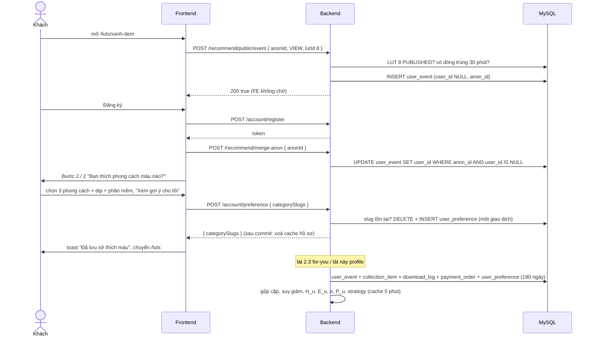

# Hồ sơ người dùng

## 1. Mục tiêu và phạm vi

Sau plan này, hệ thống **biết gu màu của từng khách**, kể cả khách chưa đăng nhập:

- Cửa hàng gửi các hành vi nhẹ về backend: mở trang chi tiết (VIEW), kéo thanh so sánh hoặc xem video đủ 3 giây (PREVIEW), tìm theo từ khoá (SEARCH), bật một phong cách trên thanh lọc (FILTER_STYLE). Khách vãng lai được nhận diện bằng `anonId` (UUID lưu ở trình duyệt); đăng nhập / đăng ký xong thì các hành vi đó được gộp vào tài khoản.
- Ngay sau khi đăng ký, khách gặp **bước 2 "Bạn thích phong cách màu nào?"** (8 ô có ảnh mẫu, 1 đến 5 phong cách, thêm dịp quay và phần mềm, có "Bỏ qua"). Sửa lại được ở menu tài khoản, mục **"Sở thích màu"**. Mục **"Xoá lịch sử gợi ý"** xoá các hành vi nhẹ (giữ lượt tải, bộ sưu tập, sở thích).
- Backend dựng **hồ sơ người dùng P_u** đúng thiết kế §7.4 / §7.5.1: đọc 5 nguồn (sự kiện, bộ sưu tập, lượt tải, đơn PAID có `source_lut_id`, sở thích khai báo), gộp theo cặp, suy giảm theo thời gian, trộn khai báo với hành vi bằng α = k / (k + n), xác định `strategy` (`PROFILE` / `PREFERENCE` / `POPULAR`). Hồ sơ cache 5 phút, xoá cache khi tải / lưu bộ sưu tập / mua / lưu sở thích.

Hồ sơ là đầu vào của lát 2.3 (`for-you`). Để kiểm được ngay ở lát này (và dùng lại cho công cụ "Thử hồ sơ" của 2.4), có thêm API chỉ đọc `POST /recommend/public/profile` trả bản tóm tắt hồ sơ của chính người gọi (§11 câu 1).

| Có làm (lát này) | Không làm (để plan khác) |
|---|---|
| Migration `V11__ho_so_nguoi_dung.sql`: `user_preference`, `user_event` | `for-you`, `dismiss`, `rec_impression`, resource `RECOMMEND`, câu giải thích, MMR, quota Premium (lát `xep-hang-goi-y` 2.3) |
| 6 API: `account/preference` GET / POST, `recommend/public/event`, `recommend/public/profile`, `recommend/merge-anon`, `recommend/clear-history` | Khối "Dành cho bạn" / "Phổ biến tuần này" ở `/luts` (2.3) |
| `UserProfileService`: 5 nguồn, gộp cặp, suy giảm, H_u, E_u (mượn trọng tâm), trộn α, strategy, thời điểm tham chiếu làm tham số, cache Caffeine 5 phút | Phần cá nhân hoá `0.2 · score(u, j)` của "Có thể bạn cũng thích" (2.3) |
| Đọc được loại `DISMISS` (trọng số −4) khi có dòng trong bảng | API ghi `DISMISS` (2.3) |
| Token **tuỳ chọn** ở đường dẫn `/x/public/**` (có token hợp lệ thì biết là ai, token hỏng thì coi như khách vãng lai) | Gắn `impressionId` khi bấm thẻ từ khối gợi ý (2.3; API đã nhận field này) |
| Tác vụ 00:30 xoá `user_event` cũ hơn 180 ngày | Quản trị xem sở thích / hồ sơ của khách, "Thử hồ sơ" (2.4, lát quản trị khách hàng) |
| Frontend: `anonId`, gửi 4 loại sự kiện không chờ, `merge-anon` sau đăng nhập / đăng ký, bước 2 sau đăng ký, mục "Sở thích màu" và "Xoá lịch sử gợi ý" | Chọn lại phong cách cho khách cũ chưa từng khai báo (không tự bật bước 2 cho họ) |

## 2. Tác nhân và phân quyền

| Tác nhân | Được làm | Ghi chú |
|---|---|---|
| Khách vãng lai | `recommend/public/event`, `recommend/public/profile` bằng `anonId` | Sự kiện ghi `user_id = NULL`, `anon_id = anonId` |
| Người đã đăng nhập (mọi role, kể cả admin vào cửa hàng) | Như trên (sự kiện ghi `user_id` lấy từ token) + `account/preference` GET / POST, `recommend/merge-anon`, `recommend/clear-history` | Chỉ thao tác trên dữ liệu của chính mình; `userId` luôn lấy từ token, không bao giờ từ body |

Không tạo resource, không có migration phân quyền, controller **không** gọi `checkPermission`.

- `/recommend/public/**` khớp mẫu công khai `^/[a-z0-9-]+/public/.*` của `JwtAuthenticationFilter`. Lát này sửa filter: ở đường dẫn công khai, **nếu có** `Authorization: Bearer <token>` hợp lệ và còn hạn thì gắn principal như đường dẫn thường; thiếu token, token sai, token hết hạn → đi tiếp **không có principal** (không trả 401). Các API công khai cũ bỏ qua principal nên không đổi hành vi.
- `/account/preference`, `/recommend/merge-anon`, `/recommend/clear-history` không khớp mẫu công khai → filter đòi token như hiện tại (401 khi thiếu).

## 3. Luồng nghiệp vụ

**Luồng chính 1 — khách vãng lai xem LUT, rồi đăng ký:**
1. Lần đầu mở cửa hàng, trình duyệt sinh `anonId` (UUID v4) và lưu `localStorage["downbeat.anonId"]`.
2. Khách mở `/luts/xanh-dem` → giao diện gửi `POST /recommend/public/event { anonId, type: "VIEW", lutId: 8 }` (không chờ). Backend kiểm LUT 8 đang `PUBLISHED`, không có dòng cùng `anon_id` + `VIEW` + LUT 8 trong 30 phút → INSERT `user_event (user_id NULL, anon_id, VIEW, 8)`, trả `true`.
3. Khách kéo thanh so sánh → `PREVIEW` LUT 8 (một lần mỗi lần mở trang). Khách quay về `/luts`, gõ "đêm" → sau 1 giây có kết quả → `SEARCH "đêm"`. Bật phong cách "Lạnh" → `FILTER_STYLE "lanh"`.
4. Khách bấm "Đăng ký" ở header, điền form → `POST /account/register` → có token → giao diện gọi `POST /recommend/merge-anon { anonId }` (không chờ). Backend `UPDATE user_event SET user_id = 57 WHERE anon_id = ? AND user_id IS NULL` → trả 4.
5. Hộp thoại chuyển sang **"Bạn thích phong cách màu nào?" — Bước 2 / 2**. Khách chọn Lạnh, Điện ảnh, Phim nhựa, dịp Ban đêm, phần mềm DaVinci Resolve → "Xem gợi ý cho tôi" → `POST /account/preference { categorySlugs: [...] }` → backend kiểm slug, thay toàn bộ lựa chọn cũ, xoá cache hồ sơ → trả danh sách đã lưu. Toast "Đã lưu sở thích màu", hộp thoại đóng, chuyển tới `/luts`.
6. Lần tính hồ sơ kế tiếp (lát 2.3 gọi trong `for-you`; lát này kiểm bằng `recommend/public/profile`): `strategy = PROFILE` (có LUT tín hiệu dương), n = 1 (LUT 8), α = 5 / 6 ≈ 0.8333.

**Luồng chính 2 — tính hồ sơ (`UserProfileService.profileOf`):**
1. Khoá cache `u:{userId}` (có token) hoặc `a:{anonId}`; còn trong cache 5 phút và chỉ mục chưa bị dựng lại → trả luôn.
2. Đọc tín hiệu 180 ngày gần nhất: `user_event` (theo `user_id`, hoặc `anon_id` + `user_id IS NULL`); với người đăng nhập thêm `collection_item` (FAVORITE), `download_log` (DOWNLOAD), `payment_order` PAID có `source_lut_id` (PURCHASE), `user_preference`.
3. Bỏ tín hiệu của LUT không còn trong chỉ mục (đã ẩn), SEARCH không khớp thẻ / từ nào, FILTER_STYLE không phải phong cách đang có. Giữ 200 cặp gần nhất.
4. Tính c = w · (1 + ln(số lần)) · 0.5^(số ngày / 30) cho từng cặp → H_u; từ sở thích → E_u; trộn P_u = α · E_u + (1 − α) · H_u; xác định `strategy`.

**Luồng thay thế:**
- A1. **"Bỏ qua"** ở bước 2: không gọi API, hộp thoại đóng (hoặc chuyển sang việc đang dở, A2). Sửa sau ở menu tài khoản → "Sở thích màu" (A4).
- A2. **Đăng ký vì bấm tải / lưu bộ sưu tập** (`then = download | collection`): bước 2 vẫn hiện, có dòng nhắc việc đang dở; nút chính là "Lưu và tải LUT" / "Lưu và tiếp tục". Lưu hoặc "Bỏ qua" xong → tải LUT như cũ (hộp thoại "Đã tải xong") / mở "Lưu vào bộ sưu tập" như cũ.
- A3. **Đăng ký để mua gói** (`plan`): **không** hiện bước 2, chuyển thẳng sang thanh toán như hiện nay (§11 câu 2). **Đăng nhập** (không phải đăng ký): không hiện bước 2, chỉ gọi `merge-anon`.
- A4. Menu tài khoản → "Sở thích màu": cùng nội dung bước 2, điền sẵn lựa chọn đã lưu (`GET /account/preference`), nút "Lưu sở thích".
- A5. Menu tài khoản → "Xoá lịch sử gợi ý" → hộp thoại xác nhận → `POST /recommend/clear-history { anonId }`: xoá `user_event` của khách (và dòng ẩn danh chưa gộp của `anonId` hiện tại). Lượt tải, bộ sưu tập, đơn hàng, sở thích giữ nguyên nên hồ sơ vẫn còn các tín hiệu đó.
- A6. Khách đã đăng nhập gửi sự kiện: ghi `user_id` từ token, `anon_id` = anonId trong body (nếu hợp lệ). Đăng xuất rồi xem tiếp trên cùng máy: sự kiện mới ghi theo `anon_id`, hồ sơ ẩn danh **không** chứa sự kiện lúc đã đăng nhập.
- A7. Thêm / bỏ LUT trong bộ sưu tập, xoá bộ, tải LUT, đơn có `source_lut_id` chuyển PAID, lưu sở thích, `merge-anon`, `clear-history` → xoá cache hồ sơ của khách ngay sau commit. VIEW / PREVIEW / SEARCH / FILTER_STYLE **không** xoá cache (§7.4.5): hồ sơ phản ánh chúng chậm tối đa 5 phút.
- A8. Chỉ mục sản phẩm vừa dựng lại (xuất bản / ẩn / sửa LUT): bản hồ sơ trong cache đang trỏ chỉ mục cũ → tính lại ở lần đọc kế tiếp.
- A9. 00:30 hằng ngày: `DELETE FROM user_event WHERE created_time < now − 180 ngày`.

**Ngoại lệ:**
- E1. `event` có `type` ngoài 4 loại, thiếu / sai `lutId` (không có, chưa xuất bản, đã ẩn), không có token và `anonId` không phải UUID, từ khoá rỗng sau chuẩn hoá, phong cách không có, hoặc trùng trong 30 phút → **vẫn 200**, `result = false`, không ghi gì. Giao diện không phải xử lý lỗi.
- E2. `account/preference` POST có slug không tồn tại / đã ẩn, quá 12 mục sau khi bỏ trùng, hoặc thiếu `categorySlugs` → 400 `PREFERENCE_INVALID` "Lựa chọn không hợp lệ", không ghi gì (lựa chọn cũ giữ nguyên).
- E3. Gọi `account/preference`, `merge-anon`, `clear-history` không token → 401 (filter có sẵn).
- E4. `merge-anon` với `anonId` thiếu / sai định dạng → 200, `result = 0`, không UPDATE.
- E5. Gửi sự kiện lỗi mạng / 5xx → giao diện bỏ qua, không toast, trang không đổi.
- E6. Không đọc / ghi được `localStorage` (chế độ riêng tư, bị chặn) → sinh `anonId` tạm trong bộ nhớ cho phiên đó; mọi thứ vẫn chạy.



## 4. Cơ sở dữ liệu

Migration: `V11__ho_so_nguoi_dung.sql` (mới nhất hiện tại là `V10__chi_muc_tuong_dong.sql`; thiết kế §4.8 gộp các bảng này vào "V11 goi-y-lut", thực tế tách theo lát). Cột `payment_order.source_lut_id` **đã có** từ V7, không thêm. Không có seed.

**`user_preference`** — sở thích khai báo

| Cột | Kiểu | Ràng buộc / ghi chú |
|---|---|---|
| id | INT AUTO_INCREMENT | PK. Thêm so với thiết kế §4.7 (PK gốc là `(user_id, category_id)`) vì `AbsMysqlRepository` bắt buộc cột `id`, giống `lut_color_feature` |
| user_id | INT NOT NULL | FK → `user_app(id)` ON DELETE CASCADE |
| category_id | INT NOT NULL | FK → `lut_category(id)` ON DELETE CASCADE |
| created_time | DATETIME NOT NULL DEFAULT CURRENT_TIMESTAMP | |

Unique `uk_user_preference (user_id, category_id)`. Xoá: **cứng**; mỗi lần lưu DELETE hết dòng của khách rồi INSERT lại (một giao dịch).

**`user_event`** — hành vi chưa có bảng riêng

| Cột | Kiểu | Ràng buộc / ghi chú |
|---|---|---|
| id | BIGINT AUTO_INCREMENT | PK |
| user_id | INT NULL | FK → `user_app(id)` ON DELETE CASCADE. NULL với khách vãng lai |
| anon_id | CHAR(36) NULL | UUID chữ thường. Service bảo đảm có ít nhất một trong `user_id`, `anon_id` (MySQL cấm CHECK trên cột có FK CASCADE nên không đặt CHECK) |
| event_type | VARCHAR(20) NOT NULL | `VIEW`, `PREVIEW`, `SEARCH`, `FILTER_STYLE`, `DISMISS` (DISMISS do lát 2.3 ghi) |
| lut_id | INT NULL | FK → `lut(id)` ON DELETE CASCADE. NULL với `SEARCH`, `FILTER_STYLE` |
| value | VARCHAR(100) NULL **COLLATE utf8mb4_0900_as_cs** | Từ khoá đã chuẩn hoá hoặc slug phong cách. Collation phân biệt dấu để "hoàng hôn" và "hoang hon" là hai từ khoá khác nhau khi so trùng và khi gộp |
| impression_id | BIGINT NULL | Không FK (bảng `rec_impression` thuộc lát 2.3) |
| created_time | DATETIME NOT NULL DEFAULT CURRENT_TIMESTAMP | Service ghi tường minh `LocalDateTime.now(clock)` |

Index: `idx_user_event_user (user_id, created_time)`, `idx_user_event_anon (anon_id, created_time)`, `idx_user_event_lut (lut_id, event_type)`, `idx_user_event_created (created_time)` (cho tác vụ 00:30). Xoá: cứng (`clear-history`, tác vụ 00:30, CASCADE khi xoá người dùng / LUT).

```sql
SET NAMES utf8mb4;

CREATE TABLE IF NOT EXISTS user_preference (
  id INT NOT NULL AUTO_INCREMENT PRIMARY KEY,
  user_id INT NOT NULL,
  category_id INT NOT NULL,
  created_time DATETIME NOT NULL DEFAULT CURRENT_TIMESTAMP,
  CONSTRAINT uk_user_preference UNIQUE (user_id, category_id),
  CONSTRAINT fk_user_preference_user FOREIGN KEY (user_id) REFERENCES user_app(id) ON DELETE CASCADE,
  CONSTRAINT fk_user_preference_category FOREIGN KEY (category_id) REFERENCES lut_category(id) ON DELETE CASCADE
) ENGINE=InnoDB DEFAULT CHARSET=utf8mb4 COLLATE=utf8mb4_0900_ai_ci;

CREATE TABLE IF NOT EXISTS user_event (
  id BIGINT NOT NULL AUTO_INCREMENT PRIMARY KEY,
  user_id INT NULL,
  anon_id CHAR(36) NULL,
  event_type VARCHAR(20) NOT NULL,
  lut_id INT NULL,
  value VARCHAR(100) COLLATE utf8mb4_0900_as_cs NULL,
  impression_id BIGINT NULL,
  created_time DATETIME NOT NULL DEFAULT CURRENT_TIMESTAMP,
  KEY idx_user_event_user (user_id, created_time),
  KEY idx_user_event_anon (anon_id, created_time),
  KEY idx_user_event_lut (lut_id, event_type),
  KEY idx_user_event_created (created_time),
  CONSTRAINT fk_user_event_user FOREIGN KEY (user_id) REFERENCES user_app(id) ON DELETE CASCADE,
  CONSTRAINT fk_user_event_lut FOREIGN KEY (lut_id) REFERENCES lut(id) ON DELETE CASCADE
) ENGINE=InnoDB DEFAULT CHARSET=utf8mb4 COLLATE=utf8mb4_0900_ai_ci;
```

## 5. Hợp đồng API (cố định — nguồn sự thật cho cả BE và FE)

Thành công: `{ "code": 200, "message": "OK", "result": … }`. Lỗi nghiệp vụ: `{ "path", "code", "errorCode", "message" }`. POJO `NON_NULL`. `anonId` hợp lệ = chuỗi khớp `^[0-9a-fA-F]{8}-[0-9a-fA-F]{4}-[0-9a-fA-F]{4}-[0-9a-fA-F]{4}-[0-9a-fA-F]{12}$`, backend lưu và so ở dạng chữ thường. Mọi thời điểm theo `Clock` của app (Asia/Ho_Chi_Minh).

### 5.1 `GET /api/account/preference` — sở thích đã lưu (cần token)

Response `result` (POJO `UserPreference`, chỉ có khoá `categorySlugs`), slug của danh mục **đang hiện**, sắp theo `lut_category.sort_order`, rồi `id`:
```json
{ "categorySlugs": ["phim-nhua", "am-ap", "lanh", "ban-dem", "davinci-resolve"] }
```
Chưa lưu gì → `{ "categorySlugs": [] }`.

### 5.2 `POST /api/account/preference` — lưu sở thích, thay toàn bộ (cần token)

Request (body POJO `UserPreference`, chỉ đọc `categorySlugs`):
```json
{ "categorySlugs": ["lanh", "dien-anh", "phim-nhua", "ban-dem", "davinci-resolve", "lanh"] }
```
Quy tắc (theo thứ tự, gặp lỗi đầu tiên thì dừng, chưa ghi gì):
1. `categorySlugs` null → 400 `PREFERENCE_INVALID`.
2. Mỗi phần tử trim + chữ thường; bỏ phần tử rỗng; bỏ trùng (giữ lần đầu).
3. Còn hơn `recommend.preference-max` (mặc định 12) mục → 400 `PREFERENCE_INVALID`.
4. Mọi slug phải là danh mục `status = 1` (tra một câu `IN (…)`); thiếu bất kỳ slug nào → 400 `PREFERENCE_INVALID`.
5. Một giao dịch: DELETE mọi dòng `user_preference` của khách, INSERT các dòng mới (`created_time` do server đặt). Danh sách rỗng → chỉ DELETE (xoá hết sở thích).
6. Sau commit: xoá cache hồ sơ của khách (sự kiện `UserSignalChangedEvent`, §7).

Mọi nhóm danh mục đều nhận (phong cách, tông màu, dịp, phần mềm). Backend **không** kiểm "1 đến 5 phong cách" (giao diện kiểm, `backend/AGENTS.md`).

Response `result`: như 5.1 sau khi lưu.
```json
{ "categorySlugs": ["dien-anh", "phim-nhua", "lanh", "ban-dem", "davinci-resolve"] }
```

### 5.3 `POST /api/recommend/public/event` — ghi một hành vi (công khai, token tuỳ chọn)

Request (body POJO `UserEvent`; JSON dùng khoá `type` cho cột `event_type`):
```json
{ "anonId": "3f2b8c1e-9d4a-4f6b-8a2e-1c7d5e9f0a3b", "type": "VIEW", "lutId": 8, "value": null, "impressionId": null }
```
Quy tắc (gặp điều kiện bỏ qua đầu tiên thì trả `false`, không ghi):
1. Danh tính: có principal (token hợp lệ) → `userId` = id trong token, `anonId` = anonId body nếu hợp lệ, không thì null. Không có principal → `userId` null, `anonId` phải hợp lệ, không thì bỏ qua.
2. `type` phải đúng một trong `VIEW`, `PREVIEW`, `SEARCH`, `FILTER_STYLE` (phân biệt hoa thường: `"view"` bị bỏ qua; `DISMISS` gửi qua đây cũng bị bỏ qua).
3. `VIEW`, `PREVIEW`: `lutId` phải là LUT `PUBLISHED`; `value` bị bỏ (lưu null).
4. `SEARCH`: `value` chuẩn hoá = NFC → chữ thường (`Locale.ROOT`) → trim → gộp mọi chuỗi khoảng trắng thành một dấu cách → cắt còn 100 ký tự (rồi trim lại). Rỗng → bỏ qua. `lutId` bị bỏ (null).
5. `FILTER_STYLE`: `value` trim + chữ thường; phải là `style` của ít nhất một LUT `PUBLISHED` (8 giá trị của kho mẫu). `lutId` bị bỏ.
6. `impressionId` lưu nguyên nếu > 0, không thì null. Không kiểm tồn tại.
7. Chống ghi lặp: đã có dòng cùng danh tính (có `userId` → so `user_id`; ẩn danh → so `anon_id` và `user_id IS NULL`), cùng `event_type`, cùng `lut_id` (VIEW / PREVIEW) hoặc cùng `value` (SEARCH / FILTER_STYLE), `created_time >= now − recommend.event-dedup-minutes` (30) → bỏ qua.
8. INSERT (`id` null, `created_time = now`).

Response: luôn 200 khi body là JSON hợp lệ. `result` = `true` nếu đã ghi, `false` nếu bỏ qua:
```json
{ "code": 200, "message": "OK", "result": true }
```
Không xoá cache hồ sơ (§3 A7).

### 5.4 `POST /api/recommend/public/profile` — tóm tắt hồ sơ của chính người gọi (công khai, token tuỳ chọn; thêm so với thiết kế, §11 câu 1)

Request (POJO `UserEvent`, chỉ đọc `anonId`):
```json
{ "anonId": "3f2b8c1e-9d4a-4f6b-8a2e-1c7d5e9f0a3b" }
```
Có token → hồ sơ của tài khoản (bỏ qua `anonId`). Không token → hồ sơ ẩn danh của `anonId`. Không token và `anonId` không hợp lệ → hồ sơ rỗng `POPULAR`. Đọc qua **cùng cache** mà `for-you` của lát 2.3 sẽ dùng (nên VIEW vừa gửi có thể chưa hiện trong 5 phút, §3 A7).

Response `result` (POJO `RecommendProfile`, không phải bảng):
```json
{
  "strategy": "PROFILE",
  "alpha": 0.8333,
  "positiveLutCount": 1,
  "preference": ["dien-anh", "phim-nhua", "lanh", "ban-dem", "davinci-resolve"],
  "topStyles": [
    { "key": "lanh", "weight": 0.4444 },
    { "key": "dien-anh", "weight": 0.2778 },
    { "key": "phim-nhua", "weight": 0.2778 }
  ],
  "topCategories": [
    { "key": "lanh", "weight": 0.4921 },
    { "key": "ban-dem", "weight": 0.4507 },
    { "key": "phim-nhua", "weight": 0.4386 }
  ],
  "topTags": [
    { "key": "đêm", "weight": 0.2391 },
    { "key": "lạnh", "weight": 0.2307 },
    { "key": "xanh", "weight": 0.1903 },
    { "key": "phim", "weight": 0.1215 },
    { "key": "tối", "weight": 0.1102 }
  ],
  "signals": [
    { "type": "PREVIEW", "lutId": 8, "slug": "xanh-dem", "count": 1, "days": 0.01, "weight": 2.0 },
    { "type": "VIEW", "lutId": 8, "slug": "xanh-dem", "count": 1, "days": 0.01, "weight": 1.0 },
    { "type": "SEARCH", "value": "đêm", "count": 1, "days": 0.0, "weight": 0.5 },
    { "type": "FILTER_STYLE", "value": "lanh", "count": 1, "days": 0.0, "weight": 0.5 }
  ]
}
```
(Giá trị `weight` của `topX` minh hoạ; E2E chỉ kiểm các giá trị tính được chắc chắn ở §9.)

| Khoá | Ý nghĩa |
|---|---|
| strategy | `PROFILE` / `PREFERENCE` / `POPULAR` theo §7 mục 6 |
| alpha | α làm tròn 4 chữ số |
| positiveLutCount | n = số LUT khác nhau có ít nhất một cặp c > 0 |
| preference | Slug đã lưu (như 5.1); khách vãng lai `[]` |
| topStyles / topCategories / topTags | Khối phong cách / danh mục / thẻ của **P_u**: chỉ phần tử > 0, sắp `weight` giảm dần rồi `key` tăng dần, lấy 3 / 3 / 5 phần tử đầu, `weight` làm tròn 4 chữ số. Khối rỗng → `[]` |
| signals | Các cặp **đã dùng** để dựng H_u (sau khi bỏ cặp không hợp lệ và giới hạn 200), sắp `|weight|` giảm dần, rồi lần gần nhất mới hơn trước. `type` thêm `FAVORITE`, `DOWNLOAD`, `PURCHASE`, `DISMISS`. Cặp theo LUT có `lutId`, `slug`; SEARCH / FILTER_STYLE có `value`. `days` làm tròn 2 chữ số, `weight` = c làm tròn 4 chữ số. Không có `userId`, `anonId` |

Hồ sơ rỗng: `{ "strategy": "POPULAR", "alpha": 0.0, "positiveLutCount": 0, "preference": [], "topStyles": [], "topCategories": [], "topTags": [], "signals": [] }`.

### 5.5 `POST /api/recommend/merge-anon` — gộp sự kiện ẩn danh vào tài khoản (cần token)

Request `{ "anonId": "3f2b8c1e-9d4a-4f6b-8a2e-1c7d5e9f0a3b" }` (POJO `UserEvent`, chỉ đọc `anonId`).

`anonId` hợp lệ → `UPDATE user_event SET user_id = :userId WHERE anon_id = :anonId AND user_id IS NULL`; sau commit xoá cache `u:{userId}` và `a:{anonId}`. `anonId` thiếu / sai → không UPDATE. Response `result` = số dòng đã gộp:
```json
{ "code": 200, "message": "OK", "result": 4 }
```
Gọi lại lần hai → `0`.

### 5.6 `POST /api/recommend/clear-history` — xoá lịch sử gợi ý (cần token)

Request `{ "anonId": "3f2b8c1e-9d4a-4f6b-8a2e-1c7d5e9f0a3b" }` (`anonId` không bắt buộc). Một giao dịch: `DELETE FROM user_event WHERE user_id = :userId`; `anonId` hợp lệ thì thêm `DELETE FROM user_event WHERE anon_id = :anonId AND user_id IS NULL`. **Không** đụng `download_log`, `collection_item`, `payment_order`, `user_preference`. Sau commit xoá cache `u:{userId}`, `a:{anonId}`. Response `result` = tổng số dòng đã xoá:
```json
{ "code": 200, "message": "OK", "result": 7 }
```

### 5.7 Tác động lên API có sẵn (hợp đồng không đổi, thêm việc xoá cache hồ sơ)

| API có sẵn | Phát `UserSignalChangedEvent(userId)` khi |
|---|---|
| `POST /lut/download` | Ghi `download_log` thành công |
| `POST /collection/update` | Tạo bộ **kèm** `lutId` thành công (tạo bộ trống, đổi tên: không phát) |
| `POST /collection/item/add`, `/collection/item/remove` | Mọi lần trả 200 (kể cả thêm lặp / bỏ không có, cho đơn giản) |
| `POST /collection/delete/{id}` | Xoá thành công |
| Kích hoạt đơn (`PaymentActivationService.activate`: webhook payOS, đối soát, `mock-pay`) | Đơn chuyển PAID **và** có `source_lut_id` |

### 5.8 Lỗi nghiệp vụ

| Tình huống | HTTP | errorCode | message (nguyên văn) |
|---|---|---|---|
| Không token / token sai ở `account/preference`, `merge-anon`, `clear-history` | 401 | `LOGIN` / `UNAUTHORIZED` / `TOKEN_EXPIRED` (filter có sẵn) | (message có sẵn của filter) |
| Sở thích: thiếu `categorySlugs`, slug không có / đã ẩn, quá 12 mục | 400 | `PREFERENCE_INVALID` | Lựa chọn không hợp lệ |

`event`, `profile` không có lỗi nghiệp vụ (bỏ qua thì `false` / hồ sơ rỗng). `PREFERENCE_INVALID` đã có trong thiết kế §5.7.

## 6. Giao diện (chuỗi cố định — test E2E chọn theo đúng các chuỗi này)

Dấu ngoặc trong chuỗi là ngoặc kép cong `“ ”` (U+201C, U+201D). `{LUT}` là tiêu đề LUT, `{n}` là số.

### 6.1 Ghi sự kiện (không có giao diện)

| Sự kiện | Gửi khi | Body |
|---|---|---|
| VIEW | Trang chi tiết `/luts/$slug` hiển thị xong LUT (mỗi lần LUT đổi) | `{ anonId, type: "VIEW", lutId }` |
| PREVIEW | Lần đầu trong một lần xem trang: nhấn / kéo thanh "Vị trí so sánh trước / sau" (chuột, chạm hoặc phím mũi tên), hoặc video xem trước phát tới giây thứ 3 (`currentTime >= 3`). Tối đa **1 lần** mỗi lần mở trang | `{ anonId, type: "PREVIEW", lutId }` |
| SEARCH | Ở `LutBrowser` (`/luts`, trang danh mục): chuỗi tìm `[q, ...kw].join(" ")` (đã trim) khác rỗng **và** trang đầu kết quả có `total > 0`; chờ 1 giây sau lần đổi cuối (đổi tiếp trong 1 giây thì huỷ lần cũ). Cả khi mở trang bằng URL có sẵn `q` (ví dụ từ ô tìm ở header) | `{ anonId, type: "SEARCH", value }` |
| FILTER_STYLE | Người dùng **bật** một phong cách trong menu "Phong cách" của thanh lọc (mỗi phong cách mới bật một sự kiện; bỏ chọn, "Bỏ chọn tất cả", mở URL có sẵn `style` thì không gửi) | `{ anonId, type: "FILTER_STYLE", value: "<slug>" }` |

- Gửi qua `axiosInstance` (token tự gắn khi đã đăng nhập), **không chờ**, lỗi bỏ qua: không toast, không đổi giao diện, không thử lại. Không gửi `impressionId` ở lát này.
- `anonId`: đọc `localStorage["downbeat.anonId"]`; không có hoặc không đúng định dạng UUID thì sinh mới (`crypto.randomUUID()`, không có thì tự sinh UUID v4) và lưu. Mọi lần đọc / ghi bọc `try/catch`; lỗi thì dùng một mã tạm giữ trong bộ nhớ suốt phiên. Đăng xuất **không** đổi `anonId`.
- Sau khi đăng nhập hoặc đăng ký thành công (cả hộp thoại cửa hàng): gọi `POST /recommend/merge-anon { anonId }`, không chờ, lỗi bỏ qua.

### 6.2 Bước 2 sau đăng ký — hộp thoại `preference`, chế độ `onboarding`

Mở ngay sau khi **đăng ký** thành công từ hộp thoại đăng ký, trừ khi đăng ký để mua gói (§3 A3). Dùng khung `ShopDialogs` chung (nút "Đóng" góc trên), rộng hơn các hộp thoại khác (`sm:max-w-[600px]`), **không** có `LutMiniCard` ở đầu.

| Phần | Nội dung |
|---|---|
| Nhãn bước | Chữ nhỏ phía trên tiêu đề: "Bước 2 / 2" |
| Tiêu đề | "Bạn thích phong cách màu nào?" |
| Mô tả | "Chọn 1 đến 5 phong cách, chúng tôi gợi ý LUT hợp gu." |
| Nhắc việc đang dở (chỉ khi có) | Tải: "Xong bước này, “{LUT}” sẽ được tải ngay." · Bộ sưu tập: "Xong bước này, bạn chọn bộ sưu tập để lưu “{LUT}”." |
| Nhóm 1 | `fieldset` có `legend` "Phong cách màu" (ẩn bằng `sr-only`, tiêu đề đã nói rõ). 8 ô theo thứ tự `LUT_STYLES`: "Điện ảnh", "Cổ điển", "Phim nhựa", "Đen trắng", "Teal & Orange", "Ấm áp", "Lạnh", "Du lịch". Mỗi ô là `label` bọc checkbox thật (ẩn) + ảnh mẫu tỉ lệ 4:3 + tên; tên đọc của checkbox = tên phong cách. Chọn → viền `--sh-pink` + dấu tích góc ảnh. Lưới 2 cột (< 640 px), 4 cột (sm trở lên) |
| Ảnh mẫu | Ảnh "sau" (`afterUrl`, không có thì `coverUrl`) của LUT nhiều lượt tải nhất thuộc phong cách đó: `POST /lut/public/list { styles: [slug], sort: "popular", page: 1, limit: 1 }` cho từng phong cách (8 query, `staleTime` 10 phút), `img alt=""`. Đang tải: `Skeleton` trong khung ảnh; lỗi / không có LUT: nền chuyển màu nhạt, vẫn chọn được |
| Bộ đếm | Dưới lưới, `aria-live="polite"`: "Đã chọn {n} / 5 phong cách". Đang có 5 mà bấm ô thứ 6 → ô đó **không** được chọn, dòng đổi thành "Tối đa 5 phong cách" (màu cảnh báo) cho tới khi bỏ bớt một ô |
| Nhóm 2 | `fieldset`, `legend` "Bạn hay quay gì?", chữ phụ "Không bắt buộc". Checkbox dạng chip: "Đám cưới" (`dam-cuoi`), "Chân dung" (`chan-dung`), "Ban đêm" (`ban-dem`). Không có "Du lịch" vì đã là ô phong cách (§11 câu 3) |
| Nhóm 3 | `fieldset`, `legend` "Bạn dựng phim bằng phần mềm nào?", chữ phụ "Không bắt buộc". Chip: "Premiere Pro", "DaVinci Resolve", "Final Cut Pro", "CapCut" (`premiere-pro`, `davinci-resolve`, `final-cut-pro`, `capcut`) |
| Chân (dính đáy hộp thoại khi cuộn) | Nút phụ "Bỏ qua" · nút chính: không có việc dở → "Xem gợi ý cho tôi"; việc dở là tải → "Lưu và tải LUT"; việc dở là bộ sưu tập → "Lưu và tiếp tục". Nút chính `disabled` khi chưa chọn phong cách nào; đang gửi: spinner trên nút, cả hai nút `disabled` |

Hành vi:
- Nút chính → `POST /account/preference { categorySlugs }` với thứ tự: phong cách đã chọn (theo thứ tự ô), rồi dịp, rồi phần mềm. Thành công: toast "Đã lưu sở thích màu" (ở `meta` mutation), rồi:
  - không có việc dở → đóng hộp thoại, chuyển tới `/luts` (đang ở `/luts` thì ở yên);
  - việc dở là tải → đóng, gọi `download(lut)` như luồng cũ (LUT Premium + gói Miễn phí vẫn mở hộp thoại nâng cấp);
  - việc dở là bộ sưu tập → mở `{ type: "collection", lut }`.
  Lỗi: toast message server (ví dụ "Lựa chọn không hợp lệ"), hộp thoại giữ nguyên lựa chọn.
- "Bỏ qua" → không gọi API, không toast; làm tiếp việc dở như trên (không có việc dở thì chỉ đóng, **không** chuyển trang).
- Nút "Đóng", Esc, bấm ra ngoài → đóng hẳn, **không** làm việc dở.

### 6.3 "Sở thích màu" — hộp thoại `preference`, chế độ `edit`

- Mở từ menu tài khoản ở header: mục "Sở thích màu" (icon `Palette`), đặt ngay dưới "Bộ sưu tập của tôi".
- Cùng bố cục 6.2 nhưng: không có nhãn "Bước 2 / 2", không có dòng nhắc; tiêu đề "Sở thích màu"; mô tả "Chọn 1 đến 5 phong cách, chúng tôi gợi ý LUT hợp gu."
- Mở là gọi `GET /account/preference` và tích sẵn các ô / chip có slug trong danh sách. Đang tải: `Skeleton` thay cho 3 nhóm, nút chính `disabled`. Lỗi: "Không tải được sở thích màu" + nút "Thử lại".
- Chân: "Huỷ" (đóng) · "Lưu sở thích" (`disabled` khi chưa chọn phong cách nào). Thành công: toast "Đã lưu sở thích màu", đóng hộp thoại. Slug đã lưu mà hộp thoại không có ô / chip (ví dụ `ruc-ro` lưu qua API) sẽ mất khi lưu lại (§11 câu 7).

### 6.4 "Xoá lịch sử gợi ý" — AlertDialog

- Mục menu tài khoản "Xoá lịch sử gợi ý" (icon `History`), ngay dưới "Sở thích màu", trên "Đăng xuất".
- Tiêu đề "Xoá lịch sử gợi ý?"
- Mô tả "DownBeat sẽ quên các LUT bạn đã xem, xem trước, từ khoá đã tìm và phong cách đã lọc. Lượt tải, bộ sưu tập và sở thích màu vẫn được giữ."
- Nút "Xoá lịch sử" (màu nguy hiểm, spinner khi gửi) · "Huỷ". Gửi `POST /recommend/clear-history { anonId }`. Toast thành công "Đã xoá lịch sử gợi ý"; lỗi mạng (không có message server) "Không xoá được, vui lòng thử lại". Xong thì đóng hộp thoại.

### 6.5 Điện thoại (≤ 640 px)

Không tràn ngang ở hộp thoại 6.2 / 6.3. Lưới phong cách 2 cột; hộp thoại cuộn trong khung; chân (hai nút) luôn thấy được (dính đáy). Chip nhóm 2, 3 xuống dòng tự nhiên.

## 7. Việc backend (agy BE)

Thứ tự theo `backend/AGENTS.md`. Package: `vn.aeoc.business.recommend` (sự kiện, hồ sơ), `vn.aeoc.business.account` (sở thích), event record dùng chung ở `vn.aeoc.business.account.event` (để `download`, `collection`, `billing` phát sự kiện mà không phụ thuộc `recommend`; `recommend` chỉ phụ thuộc một chiều vào các package kia).

1. **Migration** `app/src/main/resources/db/migration/V11__ho_so_nguoi_dung.sql` đúng §4 → `sh scripts/ai/backend-restart.sh` → `mvn -q -DskipTests package` để sinh `USER_PREFERENCE`, `USER_EVENT`.
2. **`base/.../ErrorCode.java`**: `PREFERENCE_INVALID(400, "Lựa chọn không hợp lệ")`.
3. **Entity**
   - `entity/.../data/mysql/account/UserPreference.java`: `id, userId, categoryId, createdTime` + field không thuộc bảng `List<String> categorySlugs`. `@JsonInclude(NON_NULL)`; response chỉ đặt `categorySlugs`.
   - `entity/.../data/mysql/recommend/UserEvent.java`: `Long id, Integer userId, String anonId, String eventType` (`@JsonProperty("type")`), `Integer lutId, String value, Long impressionId, LocalDateTime createdTime`.
   - `entity/.../data/mysql/recommend/UserSignal.java` (không thuộc bảng; vừa là dòng gộp đọc từ DB vừa là phần tử `signals` của 5.4): `String type, Integer lutId, String slug, String value, Integer count, LocalDateTime lastTime` (`@JsonIgnore`), `Double days, Double weight`.
   - `entity/.../data/mysql/recommend/RecommendProfile.java` (không thuộc bảng, response 5.4) và `ProfileTerm.java` (`key`, `weight`).
4. **Cấu hình** — `RecommendProperties` + `application.yml` thêm (tên khoá theo Phụ lục B):
   ```yaml
   recommend:
     event:                  # trọng số sự kiện (Phụ lục B)
       view: 1
       preview: 2
       search: 0.5
       filter-style: 0.5
       favorite: 4
       download: 5
       purchase: 6
       dismiss: -4
     half-life-days: 30      # ≤ 0 nghĩa là không suy giảm (dùng cho thí nghiệm ∞ ở lát 3.1)
     history-days: 180
     history-max-pairs: 200
     cold-start-k: 5
     event-dedup-minutes: 30
     profile-cache-minutes: 5
     preference-max: 12
     event-cleanup-cron: "0 30 0 * * *"
   ```
5. **`LutVectorIndex`** (thêm truy xuất, không đổi cách dựng): `tagDictionary()` (tập thẻ đã chuẩn hoá có trong chỉ mục), `categoryDictionary()` (slug danh mục có trong chỉ mục, đã bỏ nhóm phần mềm), `styleSet()` (các `style` khác rỗng của LUT trong chỉ mục), `slug(id)`. `LutRepository.listPublishedForIndex()` thêm cột `slug`.
6. **Phía `lut`**: `LutService.isPublished(id)` (đã có); thêm `existsPublishedStyle(String style)`; ở service đang quản `lut_category` thêm `activeIdsBySlugs(Collection<String>)` → `Map<slug, id>` của danh mục `status = 1` (một câu `IN`).
7. **Sở thích (`business.account`)**
   - `account/repository/UserPreferenceRepository extends AbsMysqlRepository<UserPreferenceRecord, UserPreference, Integer>`: `slugsByUser(userId)` (JOIN `lut_category` `status = 1`, sắp `sort_order, id`), `deleteByUser(userId)`, `insertAll(userId, categoryIds, now)`.
   - `account/service/PreferenceService extends BaseService<…>`: `get(userId)`, `save(userId, body, now)` theo đúng thứ tự §5.2, `@Transactional`; phát `UserSignalChangedEvent(userId, "lưu sở thích")`. `slugs(userId)` cho `UserProfileService`.
   - `AccountController`: `GET /account/preference`, `POST /account/preference`.
8. **Sự kiện (`business.recommend`)**
   - `recommend/repository/UserEventRepository extends AbsMysqlRepository<UserEventRecord, UserEvent, Long>`: `existsRecent(userId, anonId, type, lutId, value, since)`, `mergeAnon(userId, anonId)`, `deleteByUser(userId)`, `deleteAnon(anonId)` (`user_id IS NULL`), `deleteOlderThan(cutoff)`, `signalsByUser(userId, since)`, `signalsByAnon(anonId, since)` — hai hàm cuối: `SELECT event_type, lut_id, value, COUNT(*), MAX(created_time) … WHERE created_time >= :since GROUP BY event_type, lut_id, value` → `UserSignal`.
   - `recommend/service/EventService extends BaseService<UserEventRepository, UserEvent, Long>`: `record(userId, body, now)` → `boolean` (§5.3), `mergeAnon(userId, anonId)` → `int`, `clearHistory(userId, anonId)` → `int` (`@Transactional`), `cleanup(now)` (`@Scheduled(cron = "${recommend.event-cleanup-cron:0 30 0 * * *}", zone = "Asia/Ho_Chi_Minh")`, cutoff = now − `history-days`, log số dòng đã xoá). `mergeAnon` / `clearHistory` phát `UserSignalChangedEvent` (kèm `anonId`) sau khi ghi.
   - Các nguồn khác (thêm hàm, mỗi hàm một câu GROUP BY, trả `UserSignal` có `type` đặt sẵn):
     - `CollectionRepository.favoriteSignals(userId, since)` + `CollectionService.favoriteSignals`: `collection_item JOIN collection` của khách, `ci.created_time >= since`, nhóm theo `lut_id`; `count` = số bộ đang chứa LUT, `lastTime` = MAX(`ci.created_time`); `type = FAVORITE`.
     - `DownloadLogRepository.downloadSignals(userId, since)` + `LutDownloadService.downloadSignals`: nhóm theo `lut_id`, `count` = số lượt tải; `type = DOWNLOAD`.
     - `PaymentOrderRepository.purchaseSignals(userId, since)` + `OrderService.purchaseSignals`: `status = 'PAID' AND source_lut_id IS NOT NULL AND paid_time >= since`, nhóm theo `source_lut_id`, `lastTime` = MAX(`paid_time`); `type = PURCHASE`.
9. **Xoá cache theo sự kiện**
   - `account/event/UserSignalChangedEvent`: `record UserSignalChangedEvent(Integer userId, String anonId, String reason)`.
   - Phát đúng các chỗ ở §5.7 (`LutDownloadService.download`, `CollectionService.upsert` khi có `lutId` / `addItem` / `removeItem` / `delete`, `PaymentActivationService.activate` khi đơn chuyển PAID và có `sourceLutId`), cộng `PreferenceService.save`, `EventService.mergeAnon` / `clearHistory`. Nhận thêm `ApplicationEventPublisher` ở constructor; sửa các test hiện có cho constructor mới.
   - `recommend/service/UserProfileCacheListener`: `@TransactionalEventListener(phase = AFTER_COMMIT, fallbackExecution = true)` → `UserProfileService.evict(userId, anonId)`.
10. **Hồ sơ (`recommend/profile`, lớp thuần Java, không phụ thuộc Spring để lát 3.1 gọi lại)**
    - `UserProfile` (bất biến): `strategy`, `alpha`, `positiveLutCount`, `declared` (E_u), `behavior` (H_u), `mixed` (P_u) — mỗi cái gồm 5 khối rời rạc `Map<String, Double>` (`tag, category, style, text, creator`; khoá của creator là `String.valueOf(creatorId)`) + `double[] color` (null khi không có), `signals` (`List<UserSignal>` đã có `weight`, `days`), `preferenceSlugs`, và tham chiếu `LutVectorIndex` đã dùng. Lát 2.3 lấy danh sách LUT đã tải / đã DISMISS từ `signals`.
    - `ProfileBuilder.build(LutVectorIndex ix, List<UserSignal> raw, List<String> preferenceSlugs, LocalDateTime now, RecommendProperties p)` theo đúng các bước:
      1. `ix == null` → hồ sơ rỗng `POPULAR`, α = 0.
      2. Lọc: bỏ `lastTime < now − history-days` (phòng thủ, repository đã lọc); VIEW / PREVIEW / FAVORITE / DOWNLOAD / PURCHASE / DISMISS cần `ix.contains(lutId)`; SEARCH dựng hai vector (dưới) và bỏ nếu cả hai rỗng; FILTER_STYLE cần `ix.styleSet().contains(value)`.
      3. Sắp `lastTime` giảm dần, giữ `history-max-pairs` cặp đầu.
      4. `days = max(0, giây(now − lastTime) / 86400)`; `c = w(type) · (1 + ln(count)) · 0.5^(days / half-life-days)` (`half-life-days ≤ 0` → bỏ hệ số suy giảm).
      5. Vector góp của từng cặp:
         - Cặp theo LUT: `tag`, `category`, `text` = vector của LUT trong chỉ mục; `style` = `{style: 1}`; `creator` = `{creatorId: 1}`; màu = `colorZ(lutId)`.
         - SEARCH (`value` đã chuẩn hoá): `kw = TagNormalizer.normalize(value, synonymMap)`; một thẻ t của `tagDictionary()` **khớp** khi dãy âm tiết của t nằm liền trong dãy âm tiết của kw, hoặc ngược lại (âm tiết như `TextTokenizer.extractTokens`). Khối `tag` = multi-hot các thẻ khớp, chuẩn L2. Khối `text` = `TextTokenizer.tokenize(kw, "", stopwords)` (âm tiết đơn + cặp), chỉ giữ term có `textIdf > 0`, trọng số `(1 + ln(số lần)) · idf`, chuẩn L2. Không góp khối khác.
         - FILTER_STYLE: chỉ khối `style` = `{value: 1}`.
      6. H_u, khối rời rạc b: `H^b = Σ c_e · x_e^b / Σ |c_e|`, **cả tử và mẫu chỉ tính các cặp có góp vào khối b** (SEARCH chỉ vào mẫu của `tag` / `text` khi vector khối đó khác rỗng; FILTER_STYLE chỉ vào mẫu của `style`; cặp theo LUT vào mẫu cả 5 khối). Khối không có cặp nào → rỗng. Khối màu: `H^màu = Σ_{cặp theo LUT, c > 0} c · z / Σ c`, không có → null (DISMISS không trừ khối màu, §7.4.3).
      7. n = số `lutId` khác nhau có ít nhất một cặp c > 0. Có hành vi = có ít nhất một cặp c > 0 (kể cả SEARCH / FILTER_STYLE).
      8. E_u từ `preferenceSlugs`: `styles` = slug ∈ `ix.styleSet()`; `cats` = slug ∈ `ix.categoryDictionary()` (tự loại nhóm phần mềm); `style` = mỗi phong cách 1 / |styles|; `category` = multi-hot `cats` × `categoryIdf`, chuẩn L2; LUT thành viên = LUT có `categoryVector` chứa ít nhất một slug của `cats`; `tag` / `text` = trung bình cộng vector của LUT thành viên (không chuẩn hoá lại); màu = trung bình `colorZ` của LUT thành viên (không có thành viên → null); `creator` rỗng. Có khai báo = khối `style` hoặc `category` khác rỗng.
      9. Strategy và α:

         | Điều kiện | strategy | α |
         |---|---|---|
         | n ≥ 1, có khai báo | `PROFILE` | k / (k + n), k = `cold-start-k` |
         | n ≥ 1, không khai báo | `PROFILE` | 0 |
         | n = 0, có khai báo | `PREFERENCE` | 1 (SEARCH / FILTER_STYLE chưa được tính tới khi có LUT tín hiệu dương, §11 câu 5) |
         | n = 0, không khai báo, có hành vi (chỉ SEARCH / FILTER_STYLE) | `PROFILE` | 0 |
         | Còn lại (không gì, hoặc chỉ DISMISS) | `POPULAR` | 0 |

      10. P_u: khối rời rạc `P^b[k] = α · E^b[k] + (1 − α) · H^b[k]` (thiếu khoá thì coi 0). Màu: cả hai khác null → `α · E + (1 − α) · H`; một bên null → lấy nguyên bên còn lại; cả hai null → null (không trộn với vector 0 vì khối màu đo bằng khoảng cách).
    - `recommend/service/UserProfileService` (`@Service`): `profileOf(Integer userId, String anonId)` — `userId > 0` → khoá `u:{userId}`, đọc `EventService.signalsByUser` + `favoriteSignals` + `downloadSignals` + `purchaseSignals` + `PreferenceService.slugs`; không thì `anonId` hợp lệ → khoá `a:{anonId}`, chỉ `signalsByAnon`; không có gì → hồ sơ rỗng (không cache). Cache Caffeine `expireAfterWrite(profile-cache-minutes)`, `maximumSize(10_000)`; giá trị cache trỏ chỉ mục khác `LutIndexService.current()` → tính lại. `evict(userId, anonId)`. `summary(UserProfile)` → `RecommendProfile` §5.4. Thời điểm `now` = `LocalDateTime.now(clock)` (dùng `Clock` bean có sẵn).
11. **Controller** `recommend/controller/RecommendController extends BaseController`: `POST /recommend/public/event` (principal có thể null → `SecurityUtils.userId` trả 0 coi như không đăng nhập), `POST /recommend/public/profile`, `POST /recommend/merge-anon`, `POST /recommend/clear-history`.
12. **Token tuỳ chọn** `authenticate/.../JwtAuthenticationFilter`: nhánh đường dẫn công khai (`/public/…` hoặc `PUBLIC_FILE_PATH`) — có Bearer token thì thử `isTokenExpired` + `extractPrincipal`; thành công thì bọc `PrincipalRequestWrapper`; mọi lỗi / hết hạn / null → `filterChain.doFilter` với request gốc, **không** ghi lỗi. Các whitelist khác (`WHITE_LIST_API`, swagger…) giữ nguyên.
13. **Unit test**: mọi TC loại `unit` ở §9 (JUnit 5 + AssertJ + Mockito, không dựng Spring). Dữ liệu kho 3 LUT dùng `RecommendFixtures.create3Luts()` có sẵn; `ProfileBuilder` test trực tiếp với `LutVectorIndex.build(...)`.

Quyết định đã chốt, worker không tự đổi: `event` luôn 200 + `true/false`; chống lặp theo `lut_id` (VIEW / PREVIEW) hoặc `value` (SEARCH / FILTER_STYLE); mẫu số H theo từng khối; DISMISS không trừ khối màu; α và strategy theo bảng mục 10.9; trộn màu khi một bên null lấy bên còn lại; `half-life-days ≤ 0` = không suy giảm; ẩn danh chỉ đọc `anon_id` + `user_id IS NULL`; xoá cache qua sự kiện sau commit (không gọi thẳng bean `recommend` từ package khác); token hỏng ở đường dẫn công khai không bao giờ trả 401; không thêm resource; không `@Async`.

Nghiệm thu riêng (thêm vào "Nghiệm thu chuẩn"): `SHOW CREATE TABLE user_event` có `COLLATE utf8mb4_0900_as_cs` ở cột `value`; dán vào `worker_done` response `recommend/public/profile` của một anonId sau 3 VIEW (xanh-dem, da-lat-suong, bang-gia) và của một tài khoản sau `account/preference ["phim-nhua","am-ap"]`.

## 8. Việc frontend (agy FE)

1. `lib/types/recommend.ts` (mới): `RecommendEventType = "VIEW" | "PREVIEW" | "SEARCH" | "FILTER_STYLE"`; `RecommendEventRequest { anonId: string; type: RecommendEventType; lutId?: number; value?: string }`; `PreferenceDTO { categorySlugs: string[] }`; hằng `PREFERENCE_MAX_STYLES = 5`, `PREFERENCE_SHOOT_OPTIONS` (`dam-cuoi` "Đám cưới", `chan-dung` "Chân dung", `ban-dem` "Ban đêm"), `PREFERENCE_SOFTWARE_OPTIONS` (`premiere-pro` "Premiere Pro", `davinci-resolve` "DaVinci Resolve", `final-cut-pro` "Final Cut Pro", `capcut` "CapCut"). Phong cách dùng `LUT_STYLES` / `LUT_STYLE_LABEL` có sẵn. (FE không dùng API `profile`, không cần type.)
2. `lib/recommend/anon-id.ts` (mới): `getAnonId()` theo §6.1.
3. `lib/axios/recommend.ts` (mới): `sendRecommendEvent(req)`, `mergeAnon(anonId)`, `clearRecommendHistory(anonId)` (trả `res.data.result`, không try/catch). `lib/axios/account.ts`: `getPreference()`, `savePreference(slugs)`.
4. `lib/recommend/track.ts` (mới): `trackEvent(type, { lutId?, value? })` = `void sendRecommendEvent({ anonId: getAnonId(), ... }).catch(() => undefined)` — chỗ duy nhất nuốt lỗi (ghi comment lý do: thiết kế §9.3 "gửi không chờ, lỗi bỏ qua").
5. `lib/tanstack/options/account.ts`: `preferenceQueryOptions` (`["account-preference"]`, `staleTime: 0`, `retry: false` để lỗi hiện ngay kèm "Thử lại"), `savePreferenceMutationOptions` (`meta.successMessage` "Đã lưu sở thích màu", `invalidatesQuery: [["account-preference"]]`); trong `mutationFn` của `loginMutationOptions` và `registerMutationOptions`, sau `setUser`: `void mergeAnon(getAnonId()).catch(() => undefined)`. `lib/tanstack/options/recommend.ts` (mới): `clearHistoryMutationOptions` (`successMessage` "Đã xoá lịch sử gợi ý", `errorMessage` "Không xoá được, vui lòng thử lại").
6. `lib/stores/shop-dialog.ts`: thêm `| { type: "preference"; mode: "onboarding" | "edit"; next?: { then: "download" | "collection"; lut: LutDTO } }` (đặt `lut` trong `next` để `ShopDialogs` không vẽ `LutMiniCard`).
7. `components/shop/account/shop-dialogs.tsx`: `headingOf` cho `preference` (§6.2 / 6.3; nhãn "Bước 2 / 2" chỉ ở `onboarding`); `afterAuth`: hộp thoại `register` không có `plan` → mở `{ type: "preference", mode: "onboarding", next }` với `next` = `{ then: "collection", lut }` khi `then === "collection"`, `{ then: "download", lut }` khi có `lut` còn lại, không có thì `undefined`; `login` và `register` có `plan` giữ nguyên hành vi. Hàm `continueAfterPreference(next, saved)` làm đúng §6.2. `DialogContent` rộng `sm:max-w-[600px]` khi `type === "preference"`.
8. `components/shop/account/preference-panel.tsx` (mới): nội dung §6.2 / 6.3 (prop `mode`, `next`, `onDone`), gồm `StyleTile` và hook `usePreferenceStyleImages()` (`useQueries` 8 query `getLuts`, §6.2 "Ảnh mẫu").
9. `components/shop/account/clear-history-dialog.tsx` (mới): AlertDialog §6.4. `components/shop/layout/header/header-actions.tsx`: hai mục menu §6.3, §6.4 (mục "Sở thích màu" gọi `open({ type: "preference", mode: "edit" })`).
10. Ghi sự kiện (app chạy trong `StrictMode`, effect chạy 2 lần ở dev: mỗi chỗ giữ `useRef` id LUT / chuỗi đã gửi để không gửi lặp): `components/shop/luts/detail/lut-detail.tsx` (VIEW trong `useEffect` theo `lut.id`), `lut-compare.tsx` (PREVIEW lần đầu `pointerdown` / phím mũi tên, ref theo `lut.id`), `lut-video-preview.tsx` (PREVIEW ở `onTimeUpdate` khi `currentTime >= 3`, một lần), `components/shop/luts/lut-browser.tsx` (SEARCH debounce 1 giây theo chuỗi tìm + `total` trang đầu; FILTER_STYLE trong `updateFilter` cho từng style mới thêm so với `toolbarValue.styles`).
11. `pnpm api:types` sau khi backend lên để `api.gen.ts` có `/account/preference`, `/recommend/*`; đối chiếu với type tay.

Component shadcn dùng: có sẵn trong `components/ui/`: `dialog`, `alert-dialog`, `checkbox`, `dropdown-menu`, `skeleton`, `button`, `sonner`, `label`; của cửa hàng: `ShopButton`, `ShopCheckbox`. Không cần `shadcn add`.

Việc của Claude ở `frontend/tests/e2e/` (không giao worker):
- Viết `ho-so-nguoi-dung.spec.ts` theo §9; helper `skipPreferenceStep(page)` ở `support/shop.ts`.
- Sửa các test đăng ký qua giao diện rồi làm tiếp việc dở (giờ có thêm bước 2): `bo-suu-tap.spec.ts` (TC-23, TC-24, TC-38), `shop-flows.spec.ts` (các test đăng ký để tải, quanh dòng 237–270), `tai-khoan-khach.spec.ts` (đăng ký thường quanh dòng 283–298, đăng ký để tải quanh dòng 397–404): thêm bước bấm "Bỏ qua". Các test đăng ký để mua gói không đổi.

## 9. Test case

`unit` = agy BE viết JUnit · `api` / `e2e` = Claude viết ở `frontend/tests/e2e/ho-so-nguoi-dung.spec.ts`.

Dữ liệu E2E: mỗi test tự dùng `anonId` mới (`crypto.randomUUID()`) và tự đăng ký khách mới (`newEmail()`), nên không phụ thuộc thứ tự và không bị luật chống lặp 30 phút chặn giữa các lần chạy. LUT mẫu: `xanh-dem`, `da-lat-suong`, `bang-gia` (phong cách `lanh`), `noir`, `mua-thu-ha-noi` (miễn phí), `kodak-400` (★), `pastel-hong` (xem trước bằng video); không xuất bản: `thu-nghiem-nhap` (DRAFT), `hoang-hon-cu` (HIDDEN). Id lấy qua `lut/public/get` (riêng hai LUT không xuất bản lấy bằng API quản trị như `bo-suu-tap.spec.ts`).

### 9.1 Kho 3 LUT tính tay (TC-02 → TC-07)

Dùng `RecommendFixtures.create3Luts()` của lát 2.1 (A id 1 "Hoàng Hôn Ấm", B id 2 "Hoàng Hôn Biển", C id 3 "Đêm Lạnh"; bảng đầy đủ ở `plan/chi-muc-tuong-dong.md` §9.1), cấu hình mặc định. Kết quả dưới đây tính bằng script độc lập theo đúng §7 mục 10, sai số cho phép 0.0001.

| Đại lượng | Giá trị |
|---|---|
| z (màu) | z_A = (1.1112, 0.9806, 0.4629, 0.8521, 0.9806, 0, 0.8890, 0.3922, 0.8276, 0) · z_B = (0.2020, 0.3922, 0.9258, 0.5514, 0.3922, 1.2247, 0.5080, 0.9806, 0.5793, 0) · z_C = (−1.3132, −1.3728, −1.3887, −1.4035, −1.3728, −1.2247, −1.3970, −1.3728, −1.4069, 0) |
| Vector văn bản | A: "hoàng", "hôn", "hoàng hôn" = 0.4560; "ấm", "tông", "cam" = 0.3541 · C: "đêm", "lạnh" = 0.6088; "xanh", "ban" = 0.3596 |
| **H1**: DOWNLOAD A (1 lần, 0 ngày, c = 5) + VIEW C (1 lần, 30 ngày, c = 0.5) | tag: grain 0.6190, ấm 0.4708, hoàng hôn 0.4708, lạnh = xanh = đêm 0.0525 · category: du-lich 0.7236, am-ap 0.5503, lanh = ban-dem 0.0643 · style: am-ap 0.9091, lanh 0.0909 · creator: {"1": 1.0} · text: "hoàng hôn" 0.4145, "đêm" 0.0553 · màu = (0.8908, 0.7666, 0.2946, 0.6471, 0.7666, −0.1113, 0.6812, 0.2318, 0.6245, 0) · n = 2 |
| **H2** = H1 + DISMISS B (0 ngày, c = −4) | tag: grain 0.3584, ấm = hoàng hôn 0.0545, lạnh 0.0304, biển −0.2867 · category: du-lich 0.4189, am-ap −0.1024, lanh 0.0372 · style: am-ap 0.1053, lanh 0.0526 · creator: "1" 0.5789, "2" −0.4211 · màu **giống H1** · n = 2 |
| **H3** = H1 + SEARCH "hoàng hôn" + FILTER_STYLE "lanh" + FILTER_STYLE "du-lich" + SEARCH "neon" (đều 0 ngày, c = 0.5) | tag: grain 0.5674, hoàng hôn 0.5149, ấm 0.4315, lạnh 0.0481 · style: am-ap 0.8333, lanh 0.1667 · category, creator, màu **giống H1** · text: "hoàng hôn" 0.4281 · cặp dùng: 4 (FILTER_STYLE "du-lich" bị bỏ vì kho 3 không có LUT phong cách đó; SEARCH "neon" bị bỏ vì không khớp thẻ / từ nào) |
| Vector SEARCH | "hoàng hôn" → tag {hoàng hôn: 1}, text {hoàng, hôn, hoàng hôn: 0.5774} · "hoàng" → tag {hoàng hôn: 1}, text {hoàng: 1} · "grain ấm" → tag {grain: 0.7071, ấm: 0.7071}, text {ấm: 1} · "neon" → cả hai rỗng |
| **E**: sở thích ["am-ap", "du-lich", "premiere-pro"] | style {am-ap: 1} · category {du-lich: 0.7960, am-ap: 0.6053} (premiere-pro bị loại) · LUT thành viên A, B · tag {hoàng hôn 0.5179, ấm 0.5179, grain 0.3405, biển 0.3405} · text "hoàng hôn" 0.4445 · màu = (0.6566, 0.6864, 0.6944, 0.7018, 0.6864, 0.6124, 0.6985, 0.6864, 0.7035, 0) · creator rỗng |
| **P** = trộn E với H1, α = 5 / 7 = 0.7143 | style: am-ap 0.9740, lanh 0.0260 · category: du-lich 0.7753, am-ap 0.5896, lanh = ban-dem 0.0184 · tag: ấm = hoàng hôn 0.5044, grain 0.4200, biển 0.2432, lạnh 0.0150 · creator {"1": 0.2857} · màu = (0.7235, 0.7093, 0.5801, 0.6861, 0.7093, 0.4056, 0.6936, 0.5565, 0.6809, 0) |

### 9.2 Bảng test case

| ID | Loại | Mô tả | Tiền điều kiện | Bước | Kết quả mong đợi |
|---|---|---|---|---|---|
| TC-01 | unit | UT-07: hệ số suy giảm | Cấu hình mặc định | Tính c cho: VIEW 1 lần 0 ngày; VIEW 1 lần 30 ngày; VIEW 1 lần 90 ngày; VIEW 3 lần 0 ngày; DOWNLOAD 2 lần 60 ngày; VIEW 1 lần 90 ngày với `half-life-days = 0`; VIEW có `lastTime` sau `now` 2 giờ | 1.0; **0.5** (một nửa sau 30 ngày); 0.125; 2.0986; 2.1164; 1.0; 1.0 (số ngày âm coi là 0) |
| TC-02 | unit | Hồ sơ hành vi H1 | Kho §9.1 | `ProfileBuilder.build` với tín hiệu H1, không sở thích | `behavior` đúng bảng H1; `strategy` PROFILE, α = 0, `positiveLutCount` 2, `mixed` = `behavior` |
| TC-03 | unit | DISMISS kéo hồ sơ ra xa, không đụng khối màu | Kho §9.1 | Tín hiệu H2 | Đúng bảng H2 (có giá trị âm ở biển, am-ap, creator "2"); màu giống TC-02; n = 2 (B chỉ có DISMISS, không tính) |
| TC-04 | unit | SEARCH / FILTER_STYLE vào đúng khối, mẫu số theo khối | Kho §9.1 | Tín hiệu H3 | Đúng bảng H3; `signals` có đúng 4 cặp (không có "neon", "du-lich"); category, creator, màu giống TC-02 |
| TC-05 | unit | Khớp từ khoá với thẻ | Kho §9.1, đồng nghĩa mặc định | Dựng vector SEARCH cho "hoàng hôn", "hoàng", "grain ấm", "neon"; thêm kho phụ có thẻ "đen trắng" với từ khoá "b&w" | Đúng dòng "Vector SEARCH" §9.1; "b&w" → tag {đen trắng: 1} |
| TC-06 | unit | UT-08: chỉ có khai báo | Kho §9.1 | Sở thích ["am-ap", "du-lich", "premiere-pro"], không tín hiệu | `declared` đúng bảng E; `strategy` PREFERENCE, **α = 1**, n = 0, `mixed` = `declared` |
| TC-07 | unit | UT-09: trộn khai báo và hành vi | (a) Kho §9.1; (b) kho 30 LUT ngẫu nhiên của `RecommendFixtures` (TC-09 lát 2.1) | (a) Sở thích như TC-06 + tín hiệu H1; (b) sở thích 1 phong cách + VIEW 5 LUT khác nhau; (c) như (b) nhưng VIEW cùng 1 LUT 5 lần | (a) α = 0.7143, `mixed` đúng bảng P, PROFILE; (b) **α = 0.5**, n = 5; (c) n = 1, α = 0.8333 |
| TC-08 | unit | Bảng strategy | Kho §9.1 | (a) không gì; (b) chỉ DISMISS A; (c) chỉ SEARCH "grain", không sở thích; (d) sở thích ["lanh"] + SEARCH "grain"; (e) sở thích ["capcut", "premiere-pro"]; (f) sở thích ["lanh"] + VIEW A | (a) POPULAR α 0; (b) POPULAR α 0; (c) PROFILE α 0, khối tag = {grain: 1}; (d) PREFERENCE α 1; (e) POPULAR (khai báo rỗng sau khi bỏ phần mềm); (f) PROFILE α = 5 / 6 = 0.8333 |
| TC-09 | unit | Giới hạn và lọc | Kho §9.1 | (a) VIEW A `lastTime` = now − 181 ngày; (b) 201 cặp VIEW / PREVIEW thời điểm khác nhau trên kho 30 LUT; (c) VIEW LUT id 99 (không có trong chỉ mục); (d) `ix = null` | (a) bị bỏ, POPULAR; (b) còn đúng 200 cặp, cặp cũ nhất bị bỏ; (c) bị bỏ, không tính vào n; (d) hồ sơ rỗng POPULAR, không lỗi |
| TC-10 | unit | `EventService.record` | Mock repository, `LutService`; `now` cố định | Lần lượt: `type` "BUY", "view", "DISMISS"; VIEW không `lutId`; VIEW LUT `isPublished` = false; ẩn danh `anonId` "abc"; SEARCH "  Hoàng   HÔN  "; SEARCH 150 ký tự; SEARCH "   "; FILTER_STYLE "khong-co" (`existsPublishedStyle` false); VIEW hợp lệ khi `existsRecent` = true; VIEW hợp lệ có token (userId 5) + anonId chữ hoa; body có `id` 99, `createdTime` 2000-01-01 | `false` và không insert cho các trường hợp bỏ qua; SEARCH lưu `value` "hoàng hôn" / đúng 100 ký tự; dòng có token lưu `userId` 5, `anonId` chữ thường; `existsRecent` được gọi với `since` = now − 30 phút và đúng khoá (lut_id cho VIEW, value cho SEARCH); POJO insert có `id` null, `createdTime` = now |
| TC-11 | unit | merge / clear / cleanup | Mock repository, publisher | `mergeAnon(5, "abc")`; `mergeAnon(5, uuid)` (repo trả 3); `clearHistory(5, null)`; `clearHistory(5, uuid)` (repo trả 2 và 1); `cleanup(now)` | 0, không UPDATE, không phát sự kiện; 3 và phát 1 `UserSignalChangedEvent(5, uuid, …)`; chỉ `deleteByUser`; 3 (cộng hai lần xoá); `deleteOlderThan(now − 180 ngày)` |
| TC-12 | unit | `PreferenceService.save` | Mock repository, `activeIdsBySlugs`, publisher | (a) `categorySlugs` null; (b) có slug không trong map; (c) 13 slug khác nhau hợp lệ; (d) [" Am-Ap ", "am-ap", "lanh", ""]; (e) [] | (a)(b)(c) `PREFERENCE_INVALID` "Lựa chọn không hợp lệ", không `deleteByUser`, không phát sự kiện; (d) `insertAll` với 2 id (am-ap, lanh), phát 1 sự kiện; (e) `deleteByUser`, không insert, phát 1 sự kiện |
| TC-13 | unit | Cache hồ sơ | `UserProfileService` với mock nguồn, `LutIndexService.current()` trả ix1 | `profileOf(5, null)` 2 lần; `evict(5, null)` rồi gọi lại; đổi `current()` sang ix2 rồi gọi lại; `profileOf(0, uuid)` và `profileOf(5, null)` | Nguồn được đọc 1 lần cho 2 lần gọi đầu; đọc lại sau `evict`; đọc lại khi chỉ mục đổi; khoá ẩn danh và tài khoản tách biệt (ẩn danh chỉ gọi `signalsByAnon`, không gọi 3 nguồn còn lại và `PreferenceService`) |
| TC-14 | unit | Phát sự kiện từ các package khác | Mock publisher trong `LutDownloadServiceTest`, `CollectionServiceTest`, test của `PaymentActivationService` | `download` thành công; `addItem`; `removeItem`; `delete`; `upsert` tạo kèm `lutId`; `upsert` tạo không `lutId`; `upsert` đổi tên; `activate` đơn có `sourceLutId`; `activate` đơn không có | Số sự kiện lần lượt: 1, 1, 1, 1, 1, 0, 0, 1, 0; sự kiện có đúng `userId` |
| TC-15 | unit | Token tuỳ chọn ở đường dẫn công khai | `JwtAuthenticationFilter` với `JwtService` mock, `MockHttpServletRequest` | (a) `/recommend/public/event` + token hợp lệ; (b) cùng đường dẫn + token hết hạn; (c) + token sai chữ ký; (d) không token; (e) `/recommend/merge-anon` không token | (a) chain nhận request có `getUserPrincipal()` khác null; (b)(c)(d) chain được gọi, principal null, không ghi response lỗi; (e) 401 như cũ, chain không được gọi |
| TC-16 | api | Không token | | `GET` / `POST /account/preference`, `POST /recommend/merge-anon`, `POST /recommend/clear-history` không header; `event` (anonId mới) và `profile` không header | 4 lần 401; `event` 200 `true`; `profile` 200 |
| TC-17 | api | Lưu và đọc sở thích | Khách mới | `GET`; `POST ["capcut", "am-ap", "phim-nhua", "dam-cuoi", "am-ap"]`; `GET`; `POST []`; `GET` | `[]`; 200 `["phim-nhua", "am-ap", "dam-cuoi", "capcut"]` (theo `sort_order`, bỏ trùng); `GET` như vậy; 200 `[]`; `[]` |
| TC-18 | api | `PREFERENCE_INVALID` | Khách đã lưu `["lanh"]` | `POST ["phim-nhua", "khong-ton-tai"]`; `POST` 13 slug khác nhau hợp lệ; `POST {}`; `GET`; `POST` 12 slug khác nhau hợp lệ; `GET` | 3 lần 400, `errorCode` `PREFERENCE_INVALID`, message "Lựa chọn không hợp lệ"; `GET` vẫn `["lanh"]` (lỗi không xoá lựa chọn cũ); 200, 12 phần tử; `GET` 12 phần tử |
| TC-19 | api | API-07: chống ghi lặp | anonId mới | `event` VIEW `xanh-dem` 5 lần liền; PREVIEW `xanh-dem`; `profile { anonId }` | `result` lần lượt `true, false, false, false, false`; PREVIEW `true`; `signals` có đúng 1 cặp VIEW `xanh-dem` (`count` 1, `weight` 1.0) và 1 cặp PREVIEW (`weight` 2.0) |
| TC-20 | api | Sự kiện bị bỏ qua vẫn 200 | anonId mới | `type` "DISMISS", "BUY", "view"; VIEW không `lutId`; VIEW `lutId` 999999; VIEW id `hoang-hon-cu`; VIEW id `thu-nghiem-nhap`; VIEW không token, không anonId; VIEW anonId "abc"; FILTER_STYLE "premiere-pro", "khong-co"; SEARCH "   "; rồi `profile { anonId }` | Mọi lần 200, `result` `false`; `profile`: `strategy` POPULAR, `signals` `[]` |
| TC-21 | api | Chuẩn hoá từ khoá | anonId mới | SEARCH "  Hoàng   HÔN  "; SEARCH "hoàng hôn"; SEARCH "hoang hon"; SEARCH chuỗi 150 ký tự "a"; FILTER_STYLE "lanh" 2 lần; `profile` | `true, false, true, true`; FILTER_STYLE `true, false`; `signals` SEARCH có `value` "hoàng hôn", "hoang hon" và một chuỗi đúng 100 ký tự; có FILTER_STYLE `value` "lanh" |
| TC-22 | api | API-02 (phần hồ sơ): khách vãng lai xem 3 LUT lạnh | Hai anonId mới X, Y | X: VIEW `xanh-dem`, `da-lat-suong`, `bang-gia` → `profile { X }`; `profile { Y }` (không sự kiện) | X: `strategy` PROFILE, `alpha` 0, `positiveLutCount` 3, `topStyles[0]` = `{ key: "lanh", weight: 1 }`, `topTags[0].key` "lạnh", `preference` `[]`, 3 cặp VIEW. Y: POPULAR, `positiveLutCount` 0, `signals` `[]`, `topStyles` `[]` |
| TC-23 | api | API-03 (phần hồ sơ) + cache 5 phút | Khách mới | `POST preference ["phim-nhua", "am-ap"]` → `profile` (token); VIEW `kodak-400` (token) → `profile`; `POST preference ["phim-nhua", "am-ap"]` lần nữa → `profile` | Lần 1: PREFERENCE, `alpha` 1, `topStyles` gồm đúng 2 khoá {phim-nhua, am-ap} cùng `weight` 0.5, `preference` `["phim-nhua", "am-ap"]`, `signals` `[]`. Lần 2: **vẫn** PREFERENCE, `signals` `[]` (VIEW không xoá cache). Lần 3: PROFILE, `alpha` 0.8333, `positiveLutCount` 1, có cặp VIEW `kodak-400` |
| TC-24 | api | Sự kiện khi có token / token hỏng | Khách mới; anonId X, Y | VIEW `noir` (token + X) → `profile { X }` không token; `profile` có token. VIEW `noir` với header `Authorization: Bearer abc` + Y → `profile { Y }` | `event` 200 `true`; hồ sơ ẩn danh X: `signals` `[]`; hồ sơ tài khoản có VIEW `noir`. Token hỏng: 200 `true` (không 401); hồ sơ ẩn danh Y có VIEW `noir` |
| TC-25 | api | API-08: gộp phiên | anonId Z mới; khách mới (đăng ký sau khi có sự kiện) | Z: VIEW `xanh-dem`, PREVIEW `xanh-dem`, SEARCH "neon" → đăng ký → `merge-anon { Z }` → `profile` (token) → `profile { Z }` → `merge-anon { Z }` lần 2 → `merge-anon { anonId: "abc" }` | `merge-anon` 3; hồ sơ tài khoản có 3 cặp (VIEW, PREVIEW `xanh-dem`, SEARCH "neon"), PROFILE; hồ sơ ẩn danh Z: POPULAR, `signals` `[]`; lần 2: 0; "abc": 0 |
| TC-26 | api | API-09 + bộ sưu tập + tải | Khách mới, sở thích `["lanh"]` | VIEW `mua-thu-ha-noi`; `collection/update { name: "Ấm", lutId: <noir> }`; `lut/download { lutId: <mua-thu-ha-noi> }` → `profile`; `clear-history {}` → `profile`, `GET preference`; `clear-history {}` lần 2; `collection/item/remove { A, noir }` → `profile` | `profile` 1: có DOWNLOAD `mua-thu-ha-noi` `weight` 5.0, FAVORITE `noir` 4.0, VIEW `mua-thu-ha-noi` 1.0; `clear-history` ≥ 1; `profile` 2: không còn VIEW, **còn** DOWNLOAD và FAVORITE (`download_log`, `collection_item` nguyên vẹn), PROFILE; `GET preference` vẫn `["lanh"]`; lần 2: 0; sau `item/remove`: không còn FAVORITE (cache đã xoá ngay) |
| TC-27 | api | Tín hiệu mua gói | Khách mới (gói Miễn phí) | `order/create { planCode: "pro", cycle: "MONTH", sourceLutId: <kodak-400> }` → `order/mock-pay/{code}` → `profile`; khách mới khác: `order/create` không `sourceLutId` → `mock-pay` → `profile` | Khách 1: có PURCHASE `kodak-400` `weight` 6.0, PROFILE, `positiveLutCount` 1. Khách 2: không có PURCHASE, POPULAR. (`order/create` cần mạng tới payOS; 502 `PAYMENT_GATEWAY_ERROR` thì `test.skip` kèm lý do, như `goi-thanh-toan.spec.ts`) |
| TC-28 | api | `clear-history` kèm anonId xoá cả dòng ẩn danh chưa gộp | Khách mới; anonId W | W: VIEW `noir` (không token); khách: VIEW `xanh-dem` (token); `clear-history { anonId: W }` → `profile { W }` không token | `clear-history` = 2; hồ sơ ẩn danh W: `signals` `[]` |
| TC-29 | e2e | VIEW, PREVIEW ở trang chi tiết | Chưa đăng nhập | Mở `/luts/noir`; kéo thanh "Vị trí so sánh trước / sau" 2 lần; tải lại trang | Có đúng 1 request `event` `type` VIEW `lutId` = id Noir, `anonId` khớp UUID và bằng `localStorage["downbeat.anonId"]`; đúng 1 request PREVIEW dù kéo 2 lần; sau tải lại: VIEW mới cùng `anonId` |
| TC-30 | e2e | PREVIEW bằng video | Chưa đăng nhập | Mở `/luts/pastel-hong`, chờ tối đa 10 giây | Request PREVIEW `lutId` Pastel Hồng chỉ xuất hiện khi `video.currentTime >= 3`; chỉ 1 lần |
| TC-31 | e2e | SEARCH chờ 1 giây, chỉ khi có kết quả | Chưa đăng nhập | Mở `/luts?q=ho%C3%A0ng%20h%C3%B4n`; mở `/luts?q=zzzkhongcoketqua`; mở `/luts`, gõ "đêm" vào ô "Thêm từ khoá" + Enter, trong vòng 300 ms gõ tiếp "lạnh" + Enter | Một request SEARCH `value` "hoàng hôn", gửi sau ≥ 1 giây kể từ khi trang có kết quả; không có SEARCH cho chuỗi không kết quả trong 2,5 giây; lần đổi nhanh chỉ gửi **một** SEARCH `value` "đêm lạnh" (không có "đêm" riêng) |
| TC-32 | e2e | FILTER_STYLE | `/luts` | Menu "Phong cách" → tích "Lạnh" → bỏ tích "Lạnh" → tích "Ấm áp" | Đúng 2 request: `value` "lanh" rồi "am-ap"; bỏ tích không gửi |
| TC-33 | e2e | Lỗi gửi sự kiện không ảnh hưởng trang | Chặn `**/recommend/public/event` trả 500 | Mở `/luts/noir`, kéo thanh so sánh, mở `/luts?q=noir` | Trang hiện bình thường ("Noir", "Tải miễn phí"); không có toast nào |
| TC-34 | e2e | `localStorage` bị chặn | `addInitScript`: truy cập `window.localStorage` / `sessionStorage` ném `SecurityError` (cách trình duyệt chặn storage thật; ghi đè `Storage.prototype` làm sập TanStack Router — lỗi thư viện, xem §12) | Mở `/luts/noir` | Trang hiện bình thường; request VIEW có `anonId` đúng định dạng UUID |
| TC-35 | e2e | UI-02 (phần sở thích): đăng ký rồi chọn phong cách | Chưa đăng nhập; đã xem `/luts/xanh-dem` | Header "Đăng ký" → điền form → "Tạo tài khoản"; ở bước 2: tích "Phim nhựa", "Ấm áp", "Lạnh", "Điện ảnh", "Cổ điển", rồi "Đen trắng"; tích "Ban đêm", "DaVinci Resolve"; "Xem gợi ý cho tôi" | Có request `merge-anon` cùng `anonId`, response ≥ 1. Hộp thoại "Bạn thích phong cách màu nào?" có "Bước 2 / 2", 8 checkbox trong nhóm "Phong cách màu", mỗi ô có ảnh tải được (`naturalWidth > 0`), nút "Xem gợi ý cho tôi" disabled lúc đầu; sau 3 ô: "Đã chọn 3 / 5 phong cách"; ô thứ 6 "Đen trắng" không được tích, hiện "Tối đa 5 phong cách"; gửi body `categorySlugs` = `["dien-anh", "co-dien", "phim-nhua", "am-ap", "lanh", "ban-dem", "davinci-resolve"]` (thứ tự ô); toast "Đã lưu sở thích màu"; URL `/luts`; `GET preference` trả 7 slug |
| TC-36 | e2e | UI-03: Bỏ qua rồi sửa ở menu | Chưa đăng nhập | Đăng ký → "Bỏ qua"; mở menu tài khoản → "Sở thích màu"; tích "Phim nhựa" → "Lưu sở thích"; mở lại "Sở thích màu" | Không có request `POST /account/preference` khi bỏ qua; hộp thoại đóng, URL không đổi. Hộp thoại "Sở thích màu" không có "Bước 2 / 2", không ô nào tích, "Lưu sở thích" disabled; lưu xong toast "Đã lưu sở thích màu"; mở lại: "Phim nhựa" đã tích |
| TC-37 | e2e | Đăng ký để tải: bước 2 rồi tải | Chưa đăng nhập, `/luts/noir` | "Tải miễn phí" → đăng ký → ở bước 2 tích "Đen trắng" → "Lưu và tải LUT" | Bước 2 có "Xong bước này, “Noir” sẽ được tải ngay."; toast "Đã lưu sở thích màu"; có sự kiện download "Noir-LUT-DownBeat.zip"; hộp thoại "Đã tải xong" |
| TC-38 | e2e | Đăng ký để lưu bộ sưu tập: bước 2 rồi hộp thoại lưu | Chưa đăng nhập, `/luts` | Rê thẻ "Xanh Điện Ảnh" → "Thêm Xanh Điện Ảnh vào bộ sưu tập" → đăng ký → bước 2 → "Bỏ qua" | Bước 2 có nút "Lưu và tiếp tục" và dòng "Xong bước này, bạn chọn bộ sưu tập để lưu “Xanh Điện Ảnh”."; sau "Bỏ qua": hộp thoại "Lưu vào bộ sưu tập" có thẻ "Xanh Điện Ảnh" |
| TC-39 | e2e | Không hiện bước 2 khi mua gói / đăng nhập | Chưa đăng nhập; khách có sẵn (API) | (a) `/pricing` → mua Pro → đăng ký; (b) header "Đăng nhập" → đăng nhập khách có sẵn | (a) hộp thoại "Mua gói Pro" ngay sau đăng ký, không có "Bạn thích phong cách màu nào?"; (b) không có bước 2; có request `merge-anon` |
| TC-40 | e2e | Gộp phiên khi đăng nhập | Khách có sẵn (API), chưa đăng nhập ở trình duyệt | Mở `/luts/xanh-dem` (VIEW ẩn danh) → header "Đăng nhập" → đăng nhập | Response `merge-anon` ≥ 1; `profile` (token, API) có cặp VIEW `xanh-dem` |
| TC-41 | e2e | Xoá lịch sử gợi ý | Khách đăng nhập có VIEW `noir` (API, token) | Menu tài khoản → "Xoá lịch sử gợi ý" → "Huỷ"; lại → "Xoá lịch sử" | AlertDialog "Xoá lịch sử gợi ý?" có mô tả §6.4; "Huỷ" không gửi request; "Xoá lịch sử" → toast "Đã xoá lịch sử gợi ý"; `profile` (API) không còn VIEW |
| TC-42 | e2e | Lỗi tải sở thích trong "Sở thích màu" | Khách đăng nhập; chặn `GET **/account/preference` trả 500 | Mở "Sở thích màu"; bỏ chặn rồi bấm "Thử lại" | "Không tải được sở thích màu" + "Thử lại"; sau thử lại hiện 8 ô phong cách |
| TC-43 | e2e | Điện thoại | Viewport 390×844 | Đăng ký → bước 2; rồi "Bỏ qua" và mở "Sở thích màu" | `findHorizontalOverflow` rỗng ở cả hai hộp thoại; lưới phong cách 2 cột (hai ô đầu cùng hàng, ô thứ 3 xuống hàng); nút "Xem gợi ý cho tôi" / "Lưu sở thích" thấy được mà không cần cuộn tới cuối |

### 9.3 Đối chiếu

- Endpoint §5 → TC `api`: `GET preference` TC-16, 17, 18 · `POST preference` TC-16, 17, 18, 23 · `event` TC-19, 20, 21, 24 · `profile` TC-19 → 28 · `merge-anon` TC-16, 25 · `clear-history` TC-16, 26, 28 · §5.7 (xoá cache từ API có sẵn) TC-26 (`collection`, `lut/download`), TC-27 (kích hoạt đơn).
- Lỗi §5.8 → TC `api`: 401 TC-16 · `PREFERENCE_INVALID` TC-18.
- Luồng §3: chính 1 TC-29, 35 · chính 2 TC-02 → 09, 22, 23 · A1 TC-36 · A2 TC-37, 38 · A3 TC-39 · A4 TC-36, 42 · A5 TC-26, 28, 41 · A6 TC-24 · A7 TC-13, 14, 23, 26, 27 · A8 TC-13 · A9 TC-11 · E1 TC-10, 20 · E2 TC-12, 18 · E3 TC-16 · E4 TC-11, 25 · E5 TC-33 · E6 TC-34.
- Thiết kế §11: UT-07 TC-01 · UT-08 TC-06 · UT-09 TC-07 · API-03 TC-23 (phần hồ sơ; câu giải thích ở 2.3) · API-04 TC-18 · API-07 TC-19 · API-08 TC-25 · API-09 TC-26 · UI-02, UI-03 (phần sở thích) TC-35, 36.

## 10. Tiêu chí hoàn thành

- [x] Mọi TC ở §9 pass; `bo-suu-tap.spec.ts`, `shop-flows.spec.ts`, `tai-khoan-khach.spec.ts`, `tai-lut.spec.ts`, `chi-muc-tuong-dong.spec.ts` vẫn pass sau khi thêm bước "Bỏ qua"
- [x] `mvn test`, `pnpm build`, `pnpm lint` xanh
- [x] `SHOW CREATE TABLE user_event` có `COLLATE utf8mb4_0900_as_cs` ở cột `value` (agy BE nghiệm thu, phiên B review BE sạch)
- [x] Có `docs/chuc-nang/ho-so-nguoi-dung.md`

## 11. Rủi ro / câu hỏi mở

Các mục dưới đây plan đã chọn sẵn một phương án (đã viết vào §5 → §9). Nói "duyệt" là giữ cả; muốn đổi mục nào thì ghi số mục.

1. **Thêm API `POST /recommend/public/profile`** (không có trong thiết kế §5.5). Không có nó thì lát này không kiểm được hồ sơ bằng E2E (chưa có `for-you`), các truy vấn đọc `collection_item` / `download_log` / `payment_order` chỉ được kiểm bằng mock tới lát 2.3; API-07 / 08 / 09 cũng cần một chỗ để thấy `user_event`. Bản tóm tắt này dùng lại được cho công cụ "Thử hồ sơ" (2.4). Đổi lại: ai có `anonId` của một trình duyệt thì xem được lịch sử ẩn danh của trình duyệt đó (mã chỉ nằm trong `localStorage` của chính trình duyệt).
2. **Thứ tự bước 2**: hiện **trước** khi làm tiếp việc dở (tải / lưu bộ sưu tập), đúng sơ đồ §6.2 của thiết kế, có nút "Bỏ qua" và nhãn nút theo việc dở; **bỏ qua hẳn** bước 2 khi đăng ký để mua gói (đang trả tiền thì không chen ngang). Phương án khác: làm việc dở trước rồi mới hỏi phong cách. Các spec cũ đăng ký qua giao diện cần thêm một bước bấm "Bỏ qua" (§8).
3. **"Bạn hay quay gì?" chỉ còn 3 lựa chọn** (Đám cưới, Chân dung, Ban đêm): thiết kế liệt kê cả "Du lịch", nhưng "Du lịch" đã là một ô phong cách cùng slug `du-lich`; để hai chỗ thì hai ô cùng một giá trị, và 5 phong cách + 4 dịp + 4 phần mềm = 13 vượt giới hạn 12 của API. Bỏ đi thì tối đa đúng 12.
4. **Token tuỳ chọn ở đường dẫn `/public/`**: token hết hạn (khách để tab lâu) thì sự kiện ghi như khách vãng lai theo `anonId`, tới lần đăng nhập sau mới được `merge-anon` gộp lại. Chọn cách này để API công khai không bao giờ trả 401 (thiết kế: "luôn trả 200"). Sửa nằm ở `authenticate`, áp cho mọi API công khai nhưng các API cũ không đọc principal nên không đổi hành vi.
5. **Hai chỗ diễn giải công thức §7.4.3 / §7.5**: (a) mẫu số `Σ|c|` tính **theo từng khối**, chỉ gồm các cặp có góp vào khối đó, để một lần tìm kiếm không làm loãng khối phong cách / màu; (b) n chỉ đếm LUT (đúng thiết kế), nên khách có khai báo mà mới chỉ tìm / lọc (chưa xem LUT nào) vẫn ở `PREFERENCE` với α = 1. Với ví dụ tính tay §7.7 của thiết kế (chỉ có sự kiện theo LUT) kết quả không đổi.
6. **Ảnh mẫu 8 ô phong cách** lấy bằng 8 lần gọi `lut/public/list` có sẵn (sort `popular`, limit 1) thay vì thêm API mới. Mỗi lần mở hộp thoại tốn 8 request nhỏ, có cache 10 phút.
7. **Hộp thoại "Sở thích màu" chỉ có các ô / chip của §6.2**: slug khác lưu qua API (ví dụ `ruc-ro`, `du-lich` trong nhóm dịp) sẽ mất khi khách lưu lại từ giao diện. Chấp nhận vì giao diện là đường duy nhất người dùng thật dùng.
8. **Chống ghi lặp không khoá**: hai request giống hệt nhau cùng lúc (cùng mili giây) có thể cùng được ghi. Không có ràng buộc unique nào biểu diễn được "trong 30 phút"; ảnh hưởng chỉ là đếm thêm 1 lần, và log(số lần) làm nó gần như không đổi hồ sơ.
9. **`user_preference` có thêm cột `id`** (lệch thiết kế §4.7, cùng lý do với `lut_color_feature`, `lut_similarity`); khoá `(user_id, category_id)` thành UNIQUE.
10. **`clear-history` xoá cả dòng ẩn danh chưa gộp của `anonId` hiện tại** (thiết kế chỉ nói "xoá user_event của chính khách"), để đăng xuất xong trên cùng máy không còn sót lịch sử vừa xoá.

## 12. Nhật ký thực hiện (do /cook và /doc-chuc-nang ghi — nối các phiên A/B/C)

| Thời điểm | Sự kiện |
|---|---|
| 2026-11-10 | Lập plan (draft) |
| 2026-11-10 | Người dùng duyệt (approved), giữ cả 10 phương án mặc định §11 |
| 2026-11-10 | Cook phiên A: status in-progress (plan/README.md, docs/plan/README.md "đang cook"). Preflight xanh (Orca ready, MySQL/MinIO healthy, BE :9500 200). File bẩn có sẵn trước khi giao: các file ` M` ở gốc / backend (application.yml, RestService.java, OrderService.java, .env.example…), docs, plan/*.md, frontend (.env.example, AGENTS.md, playwright.config.ts, vite.config.ts), scripts/ai/chup-anh-readme.mjs; `??` plan/ho-so-nguoi-dung.md — không phải của worker |
| 2026-11-10 | E2E: `frontend/tests/e2e/ho-so-nguoi-dung.spec.ts` (29 test: API TC-16 → TC-28, giao diện TC-29 → TC-43; `--list` OK). Thêm `PREFERENCE_TITLE` + `skipPreferenceStep` ở `support/shop.ts`; thêm bước "Bỏ qua" ở spec cũ: `bo-suu-tap` TC-23, TC-38; `shop-flows` (đăng ký để tải); `tai-khoan-khach` TC-20, TC-25; `tai-lut` TC-24 (cũng đăng ký để tải, plan §8 bỏ sót). Lệch TC-21 so với §9.2: §5.4 nói `signals` chỉ gồm cặp đã dùng nên chuỗi "a"×100 (không khớp thẻ / từ) và "hoang hon" không chắc có trong `signals`; spec kiểm chuẩn hoá / cắt 100 ký tự bằng chống ghi lặp (gửi lại chuỗi đã chuẩn hoá → `false`, "a"×99 → `true`). TC-31 gõ hai từ khoá bằng một lệnh `pressSequentially` để slowMo không làm lệch debounce. TC-30 tự skip nếu Chromium không phát được H.264. Task FE ghi rõ: ảnh mẫu dùng GET `lut/public/list` (`getLuts`), §6.2 ghi POST là nhầm |
| 2026-11-10 | Task spec: `plan/tasks/ho-so-nguoi-dung-be.md`, `plan/tasks/ho-so-nguoi-dung-fe.md`. Orca run `run_a6ac277cf8f3`, coordinator `term_9684e52e-0cf0-4f36-be3c-feb0b35e5d90` (mọi lệnh kèm `--from`, `check` kèm `--terminal`; worktree `path:C:/Users/JulytusChu/Desktop/Code/DownBeat`) |
| 2026-11-10 | agy BE: dispatch `ctx_d2feed13a2c1`, terminal `term_e1888765-7f86-44b4-901c-485f42e3a110` · agy FE: dispatch `ctx_280bcec517f2`, terminal `term_430c1eee-cd83-4ac1-bbc6-4ec2f1d93af0` (model gemini-3.8-flash-high, cả hai đã nhận đề và đang đọc file) |
| 2026-11-10 | **phiên A xong** — phiên B: `/cook ho-so-nguoi-dung` → bước 4 (check run `run_a6ac277cf8f3`) |
| 2026-11-11 | Phiên B: agy FE `worker_done` succeeded (10 mục, build xanh, lint 0 error, chưa chạy E2E vì BE chưa lên); agy BE `worker_done` succeeded (V11, 15 unit TC-01 → TC-15, báo 14 test API pass). Ack `delivery_225aadfbaf87`. Lúc vào phiên B backend :9500 không chạy (curl 000) |
| 2026-11-11 | Review BE vòng 0: diff đúng phạm vi `backend/**`, khớp §4/§5/§7; `mvn test` business xanh; restart OK (Docker phải bật lại); nhóm API 13/13 pass (`-g "API"` cũng khớp TC-36 vì tiêu đề có chữ API — test giao diện, bỏ qua ở bước này). BE sạch, không cần fix |
| 2026-11-11 | Review FE vòng 0: diff đúng phạm vi `frontend/**`, không đụng tests/e2e; build xanh, lint 0 error (1 warning có sẵn); `api:types` khớp. Ghi nhận lệch nhỏ: onboarding không việc dở dùng `navigate({ to: "/luts" })` nên mất bộ lọc khi đang ở `/luts` (§6.2 "ở yên") |
| 2026-11-11 | E2E có giao diện lần 1: 27/28 pass (TC-30 nằm trong 28, đã chạy), TC-34 đỏ: trang trắng vì `@tanstack/react-router` gọi `sessionStorage.getItem` lúc nạp module (`createScrollRestorationCache`) không bọc try/catch; thư viện chỉ chịu được kiểu chặn thật (truy cập `window.sessionStorage` ném lỗi). **Sửa spec + plan §9 TC-34**: giả lập getter `window.localStorage` / `sessionStorage` ném `SecurityError` thay cho ghi đè `Storage.prototype`. Chạy lại TC-34: pass. Code worker không sai |
| 2026-11-11 | Giao FE fix1 (`plan/tasks/ho-so-nguoi-dung-fe-fix1.md`, §6.2 "đang ở /luts thì ở yên") trên terminal cũ: dispatch `ctx_2297e537df39`. BE sạch, dispatch `ctx_d2feed13a2c1` đã settle |
| 2026-11-11 | agy FE fix1 `worker_done` succeeded (`useLocation` → đang ở `/luts` chỉ `close()`); Claude kiểm lại diff, build xanh, lint 0 error. Ack `delivery_03c8487f1eca` |
| 2026-11-11 | E2E có giao diện (slowMo 400, chụp ảnh): **28/28 pass** (API 13, giao diện 15; TC-30 video chạy được, không skip). Ảnh tài liệu: 8 file ở `docs/chuc-nang/img/ho-so-nguoi-dung/`. Hồi quy spec cũ có bước "Bỏ qua" (`bo-suu-tap`, `shop-flows`, `tai-khoan-khach`, `tai-lut`): 99/99 pass |
| 2026-11-11 | Release 3 dispatch (`ctx_d2feed13a2c1`, `ctx_280bcec517f2`, `ctx_2297e537df39`), reclaimable rỗng. Vòng sửa: BE 0, FE 1 (§6.2 ở yên tại `/luts`). Lệch plan: TC-34 đổi cách giả lập chặn storage (lỗi TanStack Router, không phải lỗi app); spec TC-21 kiểm chuẩn hoá qua chống ghi lặp (ghi từ phiên A). **phiên B xong** — tiếp: `/doc-chuc-nang ho-so-nguoi-dung` |
| 2026-11-11 | Phiên C: viết `docs/chuc-nang/ho-so-nguoi-dung.md` (8 ảnh, JUnit business 92 + authenticate 37, Playwright 28/28), plan → **done**, cập nhật `plan/README.md`, `docs/plan/README.md`, `docs/chuc-nang/README.md`; commit + push + PR vào `main` |
