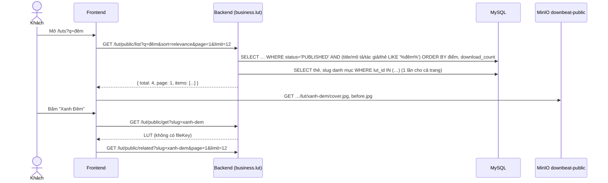

# Kho LUT: API công khai và dữ liệu mẫu thật

## 1. Mục tiêu và phạm vi

Sau plan này, mọi trang cửa hàng (`/`, `/luts`, `/luts/<slug>`, `/luts/danh-muc/<slug>`, ô tìm kiếm ở header) đọc LUT và danh mục từ **backend thật** thay cho `frontend/src/lib/mock/luts.ts`. 36 LUT mẫu được nạp vào MySQL với **file .cube thật** (bucket riêng tư) và **ảnh trước / sau / bìa thật** sinh từ chính file .cube đó (bucket công khai), nên các lát sau (tải LUT, đặc trưng màu cho gợi ý) có dữ liệu đúng để dùng.

| Có làm | Không làm (để plan khác) |
|---|---|
| Bảng `creator`, `lut`, `lut_category`, `lut_category_map`, `lut_tag` (migration `V3`); 16 danh mục nằm trong migration | Màn hình quản trị LUT / danh mục / tác giả, upload, xuất bản / ẩn (lát `quan-ly-lut`) |
| 6 endpoint công khai: danh sách + lọc + tìm, chi tiết, LUT liên quan, gợi ý tìm kiếm, danh sách danh mục, chi tiết danh mục | `GET /plan/public/list` và bảng giá (lát `goi-thanh-toan`) |
| Công cụ `tools/seed/kho-lut/`: sinh file .cube 33³ từ dữ liệu giả, ảnh trước / sau / bìa, đẩy lên MinIO, sinh file seed SQL | Tải LUT (`POST /lut/download`, presigned URL): lát `tai-lut`. Lát này chỉ đặt sẵn file .cube trong bucket riêng tư |
| Mở đường dẫn `/<x>/public/**` trong JWT filter; tạo 2 bucket `downbeat-public` (công khai) và `downbeat-lut` (riêng tư) | Đăng nhập tuỳ chọn trên endpoint công khai (cần cho gợi ý, lát `goi-y-lut`) |
| FE: `lib/axios/luts.ts`, đổi import, ảnh bìa / trước / sau thật, xoá dữ liệu giả của kho LUT, trạng thái lỗi tải trang chi tiết / danh mục | Tài khoản, đăng ký, thanh toán, tải file: vẫn dùng `lib/mock/account.ts` |
| | Tìm kiếm không dấu ("da lat" ra "Đà Lạt"), FULLTEXT: xem §11 |

## 2. Tác nhân và phân quyền

Hệ thống đã có phân quyền theo role trong module `authenticate` (`role` + `permission` + `resource`, kiểm bằng `BaseController.checkPermission`). Lát này **không dùng và không đổi** phần đó: mọi endpoint đều công khai, chỉ đọc dữ liệu đã xuất bản. Các trang quản trị ở lát `quan-ly-lut` mới thêm resource `LUT`, `LUT_CATEGORY`, `CREATOR` qua migration và gọi `checkPermission` như khuôn CRUD.

| Tác nhân | Được làm | Ghi chú |
|---|---|---|
| Khách vãng lai, thành viên, quản trị | Xem danh sách, lọc, tìm, chi tiết, LUT liên quan, gợi ý, danh mục | Không cần token. Gửi kèm token (kể cả token hết hạn hoặc rác) vẫn được trả 200, vì filter bỏ qua đường dẫn công khai trước khi đọc token |
| Ai cũng vậy | **Không** thấy LUT `DRAFT` / `HIDDEN`, danh mục `status = 0`, `fileKey` | |

## 3. Luồng nghiệp vụ

**Luồng chính:**
1. Khách mở `/luts` → FE gọi `GET /lut/public/list` (trang 1, 12 LUT, `sort=relevance`) và `GET /lut-category/public/list` → hiện 12 thẻ, ảnh lấy từ bucket `downbeat-public`.
2. Khách tìm / thêm từ khoá / chọn phong cách / đổi sắp xếp → FE ghi lên URL (như hiện tại) → gọi lại `list` với `q`, `keywords`, `styles`, `sort`.
3. Khách cuộn xuống → FE gọi trang tiếp theo tới khi hết `total`.
4. Khách bấm một thẻ → `GET /lut/public/get?slug=` → trang chi tiết (thanh so sánh ảnh trước / sau hoặc video) → `GET /lut/public/related?slug=` cho "LUT liên quan".
5. Khách gõ ô tìm kiếm ở header → `GET /lut/public/suggest?q=` → tối đa 4 LUT khớp.
6. Khách bấm một danh mục → `GET /lut-category/public/get?slug=` (tiêu đề, mô tả) + `GET /lut/public/list?category=<slug>`.

**Luồng thay thế:**
- A1. Không có LUT khớp → "Không tìm thấy LUT phù hợp" + nút "Xoá bộ lọc" (như hiện tại).
- A2. LUT có `previewType = VIDEO` → trang chi tiết hiện video thay thanh so sánh; thẻ ở lưới phát video khi rê chuột (như hiện tại).
- A3. `sort=relevance` mà không có từ khoá → xếp như `popular` (nhiều lượt tải trước).

**Ngoại lệ:**
- E1. Slug LUT không có, hoặc LUT đang `DRAFT` / `HIDDEN` → 404 → trang "Không tìm thấy LUT".
- E2. Slug danh mục không có hoặc danh mục `status = 0` → 404 → trang "Không tìm thấy danh mục".
- E3. Backend lỗi / mất mạng: lưới → "Không tải được danh sách LUT" + "Thử lại" (đã có); trang chi tiết / danh mục → "Không tải được LUT" / "Không tải được danh mục" + "Thử lại" (mới).
- E4. Trình duyệt còn token quản trị hết hạn → các trang cửa hàng vẫn tải bình thường, không bị đẩy về `/login`.

**Nạp dữ liệu mẫu (máy dev, làm một lần):** chạy `python tools/seed/kho-lut/build.py` → sinh .cube + ảnh, đẩy lên MinIO, ghi `V3_1__seed_kho_lut.sql` → restart backend → Flyway chạy `V3` (bảng + 16 danh mục) rồi `V3_1` (tác giả, LUT, thẻ, map).



## 4. Cơ sở dữ liệu

Migration: `backend/app/src/main/resources/db/migration/V3__kho_lut.sql` (đã có V1, V2). Dữ liệu mẫu (chỉ profile local): `backend/app/src/main/resources/db/seed/V3_1__seed_kho_lut.sql`, **do công cụ sinh ra** (§7 bước 1), không viết tay.

Quy ước: `ENGINE=InnoDB DEFAULT CHARSET=utf8mb4 COLLATE=utf8mb4_0900_ai_ci` như V1. Riêng 4 cột chữ tiếng Việt dùng để tìm kiếm (`lut.title`, `lut.description`, `lut_tag.tag`, `creator.name`) khai báo `COLLATE utf8mb4_0900_as_ci`: **phân biệt dấu, không phân biệt hoa thường** ("ấm" ≠ "am" ≠ "âm", "Đêm" = "đêm"), giống cách lọc của dữ liệu giả hiện tại. Nhờ vậy `PRIMARY KEY (lut_id, tag)` cũng không coi "cam" và "cấm" là trùng.

| Bảng | Cột | Kiểu | Ràng buộc / ghi chú |
|---|---|---|---|
| `creator` | id | int AI | PK |
| | name | varchar(100) `as_ci` | NOT NULL |
| | slug | varchar(120) | NOT NULL, UNIQUE |
| | bio | varchar(500) | NULL |
| | avatar_url | varchar(500) | NULL |
| | status | tinyint | NOT NULL DEFAULT 1 (1 hiện, 0 ẩn). Lát này chưa lọc theo cột này |
| | created_time, updated_time | datetime | DEFAULT CURRENT_TIMESTAMP; updated_time `ON UPDATE CURRENT_TIMESTAMP` |
| `lut` | id | int AI | PK |
| | slug | varchar(150) | NOT NULL, UNIQUE |
| | title | varchar(150) `as_ci` | NOT NULL |
| | description | varchar(1000) `as_ci` | NULL |
| | creator_id | int | NOT NULL, FK → creator(id) (không cascade) |
| | style | varchar(30) | NOT NULL, một trong `dien-anh, co-dien, phim-nhua, den-trang, teal-orange, am-ap, lanh, du-lich` |
| | is_premium | tinyint | NOT NULL DEFAULT 0 |
| | status | varchar(20) | NOT NULL DEFAULT `DRAFT`: `DRAFT` / `PUBLISHED` / `HIDDEN` |
| | cover_url | varchar(500) | NULL. Ảnh bìa (ảnh sau khi áp LUT, đã in chữ) |
| | preview_type | varchar(20) | NOT NULL DEFAULT `BEFORE_AFTER`: `BEFORE_AFTER` / `VIDEO` |
| | before_url, after_url | varchar(500) | NULL. Có khi `BEFORE_AFTER` |
| | preview_video_url | varchar(500) | NULL. Có khi `VIDEO` |
| | file_key | varchar(300) | NULL. Key trong bucket `downbeat-lut`, ví dụ `lut/kodak-400.cube`. **Không bao giờ trả ra API** |
| | file_size_kb | int | NULL |
| | lut_size | smallint | NULL (17 / 33 / 65) |
| | download_count | int | NOT NULL DEFAULT 0 |
| | published_time | datetime | NULL (NULL khi chưa xuất bản lần nào) |
| | created_by | int | NULL, FK → user_app(id) ON DELETE SET NULL |
| | created_time, updated_time | datetime | như `creator` |
| `lut_category` | id | int AI | PK |
| | slug | varchar(80) | NOT NULL, UNIQUE |
| | name | varchar(80) | NOT NULL |
| | group_code | varchar(20) | NOT NULL: `phong-cach` / `tong-mau` / `dip` / `phan-mem` |
| | description | varchar(300) | NULL |
| | is_popular | tinyint | NOT NULL DEFAULT 0 |
| | sort_order | int | NOT NULL DEFAULT 0 |
| | status | tinyint | NOT NULL DEFAULT 1 |
| `lut_category_map` | lut_id | int | FK → lut(id) ON DELETE CASCADE |
| | category_id | int | FK → lut_category(id) ON DELETE CASCADE |
| `lut_tag` | lut_id | int | FK → lut(id) ON DELETE CASCADE |
| | tag | varchar(50) `as_ci` | NOT NULL |

Khoá / index: `lut_category_map` PK `(lut_id, category_id)` + KEY `(category_id)`. `lut_tag` PK `(lut_id, tag)` + KEY `(tag)`. `lut`: KEY `(status, published_time)`, `(status, download_count)`, `(creator_id)`, `(style)`. **Không tạo FULLTEXT** (lý do ở §7, quyết định D2).

Xoá: lát này không có xoá. Về sau LUT xoá mềm bằng `status = HIDDEN`; danh mục / tác giả bằng `status = 0`.

**16 danh mục trong `V3`** (mọi môi trường, `INSERT … SELECT … WHERE NOT EXISTS (slug)`, không ghi cứng `id`). `name`, `description` chép nguyên văn `CATEGORY_DEFS` trong `frontend/src/lib/mock/data/luts.ts`:

| sort_order | slug | name | group_code | is_popular |
|---|---|---|---|---|
| 1 | dien-anh | Điện ảnh | phong-cach | 1 |
| 2 | co-dien | Cổ điển | phong-cach | 0 |
| 3 | phim-nhua | Phim nhựa | phong-cach | 1 |
| 4 | den-trang | Đen trắng | phong-cach | 0 |
| 5 | am-ap | Ấm áp | tong-mau | 0 |
| 6 | lanh | Lạnh | tong-mau | 0 |
| 7 | teal-orange | Teal & Orange | tong-mau | 1 |
| 8 | ruc-ro | Rực rỡ | tong-mau | 0 |
| 9 | du-lich | Du lịch | dip | 1 |
| 10 | dam-cuoi | Đám cưới | dip | 1 |
| 11 | chan-dung | Chân dung | dip | 0 |
| 12 | ban-dem | Ban đêm | dip | 0 |
| 13 | premiere-pro | Premiere Pro | phan-mem | 0 |
| 14 | davinci-resolve | DaVinci Resolve | phan-mem | 1 |
| 15 | final-cut-pro | Final Cut Pro | phan-mem | 0 |
| 16 | capcut | CapCut | phan-mem | 0 |

**Dữ liệu mẫu `V3_1`** (chỉ local, ghi `id` cứng như `V1_1`):

- 7 tác giả theo thứ tự xuất hiện trong dữ liệu giả: 1 Minh Color, 2 DownBeat Studio, 3 Analog Lab, 4 Mono Works, 5 Wander Grade, 6 Wedding Tone, 7 Studio Kem (`slug` = slugify tên).
- LUT id 1–36: đúng 36 LUT của `SEEDS` (cùng `id`, `title`, `slug`, tác giả, `style`, `tags`, `premium`, `downloads`), `status = PUBLISHED`, `published_time = createdAt 09:00:00`, `created_by = 1`, `lut_size = 33`. LUT id 2, 14, 23, 27 là `VIDEO`, còn lại `BEFORE_AFTER`. Danh mục của mỗi LUT tính theo đúng các hàm `match` của `CATEGORY_DEFS` (mọi LUT đều thuộc 4 danh mục phần mềm).
- `description` theo **một mẫu cố định** (không còn chữ "dựng phim" của mẫu cũ, vì chữ đó làm từ khoá "phim" khớp mọi LUT):
  `{title} là LUT phong cách {2 thẻ đầu, nối bằng ", "} do {tên tác giả} chỉnh màu. Kéo thả file .cube vào Premiere Pro, DaVinci Resolve, Final Cut Pro hoặc CapCut để áp ngay, rồi chỉnh cường độ cho hợp với cảnh quay của bạn.`
- 3 bản ghi "bẫy" để kiểm quy tắc chỉ hiện dữ liệu đã xuất bản:

| id | title / slug | Trạng thái | Đặc điểm (cố ý để lộ nếu lọc sai) |
|---|---|---|---|
| 37 | Thử Nghiệm Nháp / `thu-nghiem-nhap` | `DRAFT`, `published_time` NULL | tác giả Analog Lab, style `phim-nhua`, thẻ `phim`, `nháp`, `grain`, 0 lượt tải |
| 38 | Hoàng Hôn Cũ / `hoang-hon-cu` | `HIDDEN`, `published_time` 2026-11-04 09:00 | tác giả Minh Color, style `am-ap`, thẻ `hoàng hôn`, `ấm`, `cũ`, **99999 lượt tải** |
| — | danh mục Tết / `tet` | `status = 0`, group `dip`, sort_order 17 | LUT 9 (Hoàng Hôn Sài Gòn) có map vào `tet` |

Hai LUT bẫy cũng có đủ ảnh và file .cube (công cụ sinh như LUT thường).

## 5. Hợp đồng API (cố định — nguồn sự thật cho cả BE và FE)

Mọi endpoint là **GET, công khai, không cần token**, dưới `/api`. Response bọc `{ "code": 200, "message": "OK", "result": … }` như `ApiResponse`. Lỗi trả body `ApiErrorResponse` `{ path, code, errorCode, message }`.

Tham số mảng truyền bằng cách **lặp lại tên**: `keywords=phim&keywords=grain`, `styles=lanh&styles=den-trang` (Spring gom thành `List<String>`). FE dùng `paramsSerializer: { indexes: null }` của axios để không sinh `keywords[]=`.

### Đối tượng LUT (dùng chung cho 5.1 → 5.4)

`@JsonInclude(NON_NULL)`: trường null **không xuất hiện** trong JSON (LUT video không có `beforeUrl` / `afterUrl`; LUT ảnh không có `previewVideoUrl`). Chỉ có đúng các trường dưới đây; không có `fileKey`, `status`, `createdBy`, `createdTime`, `updatedTime`.

```json
{
  "id": 10,
  "slug": "kodak-400",
  "title": "Kodak 400",
  "description": "Kodak 400 là LUT phong cách phim, grain do Analog Lab chỉnh màu. Kéo thả file .cube vào Premiere Pro, DaVinci Resolve, Final Cut Pro hoặc CapCut để áp ngay, rồi chỉnh cường độ cho hợp với cảnh quay của bạn.",
  "creatorId": 3,
  "creatorName": "Analog Lab",
  "style": "phim-nhua",
  "isPremium": 1,
  "previewType": "BEFORE_AFTER",
  "coverUrl": "http://localhost:9020/downbeat-public/lut/kodak-400/cover.jpg",
  "beforeUrl": "http://localhost:9020/downbeat-public/lut/kodak-400/before.jpg",
  "afterUrl": "http://localhost:9020/downbeat-public/lut/kodak-400/after.jpg",
  "fileSizeKb": 948,
  "lutSize": 33,
  "downloadCount": 14980,
  "publishedTime": "2026-05-02T09:00:00",
  "categories": ["phim-nhua", "premiere-pro", "davinci-resolve", "final-cut-pro", "capcut"],
  "tags": ["grain", "phim"]
}
```

- `isPremium`: số `0` / `1`. `publishedTime`: `LocalDateTime`, chuỗi ISO không múi giờ.
- `categories`: slug các danh mục **đang hiện** (`status = 1`) của LUT, xếp theo `sort_order`. `tags`: xếp theo `tag` tăng dần.
- LUT video (ví dụ `chuan-dien-anh`): `"previewType": "VIDEO"`, `"previewVideoUrl": "http://localhost:9020/downbeat-public/lut/chuan-dien-anh/preview.mp4"`, không có `beforeUrl`, `afterUrl`.
- `fileSizeKb` = `ceil(số byte file .cube / 1024)`; con số 948 ở trên là ví dụ, giá trị thật lấy từ file công cụ sinh ra.

### 5.1 `GET /api/lut/public/list` — danh sách, lọc, tìm

| Tham số | Kiểu | Mặc định | Ý nghĩa |
|---|---|---|---|
| `q` | string | — | ô tìm kiếm |
| `keywords` | string, lặp lại | — | từ khoá thêm ở thanh lọc |
| `styles` | string, lặp lại | — | lọc phong cách (`style IN …`); giá trị lạ thì đơn giản là không khớp |
| `category` | string | — | slug danh mục đang hiện; slug không có / đang ẩn → kết quả rỗng (không báo lỗi) |
| `sort` | `relevance` \| `newest` \| `popular` | `relevance` | giá trị khác → coi như `relevance` |
| `page` | int | 1 | < 1 → 1 |
| `limit` | int | 12 | ≤ 0 → 12; > 48 → 48 |

Quy tắc (BE): chỉ `status = 'PUBLISHED'`. `q` và từng phần tử `keywords` là một **từ khoá**; các từ khoá nối nhau bằng **AND**; mỗi từ khoá khớp khi `title`, `description`, tên tác giả hoặc **một** thẻ chứa nó (LIKE `%từ khoá%`). Điểm liên quan = tổng theo từ khoá của `4·[khớp title] + 3·[khớp thẻ] + 2·[khớp tác giả] + 1·[khớp mô tả]`. Thứ tự:

| sort | ORDER BY |
|---|---|
| `relevance` có từ khoá | điểm DESC, `download_count` DESC, `id` ASC |
| `relevance` không từ khoá, `popular` | `download_count` DESC, `id` ASC |
| `newest` | `published_time` DESC, `id` DESC |

Ví dụ: `GET /api/lut/public/list?q=analog&keywords=phim&page=1&limit=12`

```json
{ "total": 3, "page": 1, "items": [ { "id": 10, "slug": "kodak-400", "title": "Kodak 400", "…": "…" }, { "id": 19, "slug": "fuji-classic", "…": "…" }, { "id": 32, "slug": "super-8", "…": "…" } ] }
```

### 5.2 `GET /api/lut/public/get?slug=kodak-400` — chi tiết

`result` = một đối tượng LUT như mẫu ở trên. Slug không có, hoặc LUT không `PUBLISHED` → 404.

### 5.3 `GET /api/lut/public/related?slug=kodak-400&page=1&limit=12` — LUT liên quan

`result` = `{ total, page, items }` như 5.1 (cùng quy tắc `page`, `limit`). Ứng viên: LUT `PUBLISHED` khác chính nó. Điểm = `10·[cùng style] + số danh mục đang hiện mà hai LUT cùng thuộc`. Thứ tự: điểm DESC, `download_count` DESC, `id` ASC. Slug gốc không có / không `PUBLISHED` → 404.

```json
{ "total": 35, "page": 1, "items": [ { "id": 19, "title": "Fuji Classic", "…": "…" }, { "id": 27, "title": "Pastel Hồng", "…": "…" } ] }
```

### 5.4 `GET /api/lut/public/suggest?q=kodak&limit=4` — gợi ý ở ô tìm kiếm

`result` = **mảng** LUT (không bọc trang). `limit` mặc định 4, ≤ 0 → 4, > 10 → 10. `q` có chữ → cùng quy tắc khớp và thứ tự `relevance` của 5.1 với một từ khoá. `q` rỗng / thiếu → `popular`.

```json
[ { "id": 10, "slug": "kodak-400", "title": "Kodak 400", "…": "…" } ]
```

### 5.5 `GET /api/lut-category/public/list` — danh mục

`result` = mảng danh mục `status = 1`, xếp `sort_order` ASC, `id` ASC. Cache Caffeine 10 phút (lát `quan-ly-lut` sẽ xoá cache khi sửa danh mục).

```json
[
  { "id": 1, "slug": "dien-anh", "name": "Điện ảnh", "groupCode": "phong-cach", "description": "Tông màu như phim chiếu rạp: tương phản sâu, vùng tối dày, da người vẫn tự nhiên.", "isPopular": 1, "sortOrder": 1 },
  { "id": 16, "slug": "capcut", "name": "CapCut", "groupCode": "phan-mem", "description": "Nhập LUT vào mục Điều chỉnh của CapCut bản máy tính.", "isPopular": 0, "sortOrder": 16 }
]
```

(`id` do DB sinh, chỉ là ví dụ; FE không dựa vào `id`.)

### 5.6 `GET /api/lut-category/public/get?slug=dam-cuoi` — chi tiết danh mục

```json
{ "id": 10, "slug": "dam-cuoi", "name": "Đám cưới", "groupCode": "dip", "description": "Da sáng, màu mềm và lãng mạn cho phóng sự cưới.", "isPopular": 1, "sortOrder": 10 }
```

Slug không có hoặc `status = 0` → 404.

### 5.7 Lỗi nghiệp vụ

| Tình huống | HTTP | errorCode | Message (FE không hiện nguyên văn; dùng để rẽ nhánh 404) |
|---|---|---|---|
| `get` / `related`: slug không có, LUT `DRAFT` / `HIDDEN` | 404 | `DATA_NOT_FOUND` | Không tìm thấy LUT |
| `lut-category/public/get`: slug không có hoặc danh mục ẩn | 404 | `DATA_NOT_FOUND` | Không tìm thấy danh mục |
| `get` / `related` / `lut-category/public/get` thiếu `slug` | 400 | (có sẵn, `MissingServletRequestParameterException`) | (có sẵn) |
| Đường dẫn không công khai, không token (ví dụ `GET /api/lut/download`) | 401 | `LOGIN` | Chưa đăng nhập |

## 6. Giao diện (chuỗi cố định — test E2E chọn theo đúng các chuỗi này)

Bố cục, nhãn, nút của `/`, `/luts`, `/luts/<slug>`, `/luts/danh-muc/<slug>`, ô tìm kiếm header **giữ nguyên** như hiện tại. Chỉ đổi các điểm sau:

- **Ảnh**: mọi ảnh LUT lấy từ URL của API, không còn `picsum.photos/seed/…` và không còn CSS `filter` giả lập màu. Chữ trên bìa đã in sẵn trong `coverUrl`, nên bỏ lớp chữ CSS (`LutCoverText`, `coverText`, `coverTextStyle`).
- **Thẻ ở lưới** (`LutCard`), LUT `BEFORE_AFTER`: lớp dưới = `beforeUrl`, lớp trên có `data-graded` = `coverUrl`. Lúc chưa rê chuột lớp trên **phủ hết thẻ** (vị trí 100%, ẩn vạch chia), để chữ trên bìa không bị cắt; rê chuột thì đường chia chạy theo chuột như cũ, rời chuột thì về 100%. LUT `VIDEO`: chỉ hiện `coverUrl`, rê chuột thì phát `previewVideoUrl` (như cũ).
- **Thanh so sánh trang chi tiết** (`LutCompare`): lớp dưới ("Ảnh gốc") = `beforeUrl`, lớp trên (`data-graded`, "Sau khi áp LUT") = `afterUrl`, không có chữ. Vị trí ban đầu 55%, phím ← → như cũ.
- **Video trang chi tiết**: `poster` = `coverUrl`.
- **Ảnh nhỏ** (thẻ LUT trong hộp thoại, gợi ý ở header, cụm ảnh trang chủ): ``.
- **Trang chi tiết, khối thông tin**: "Định dạng" hiện `.cube (3D LUT, 33×33×33)` (số lấy từ `lutSize`, ký tự `×`; không có `lutSize` thì giữ `.cube (3D LUT)`). "Ngày đăng" lấy từ `publishedTime`. "Dung lượng", "Lượt tải" như cũ, số lấy từ API.
- **Lỗi tải trang chi tiết / danh mục** (lỗi khác 404, ví dụ 500, mất mạng) — `errorComponent` của route, cùng khung với `ShopNotFound`:
  - Chi tiết LUT: tiêu đề "Không tải được LUT", mô tả "Kiểm tra kết nối rồi thử lại.", nút "Thử lại" (gọi lại loader).
  - Danh mục: tiêu đề "Không tải được danh mục", mô tả và nút như trên.
- 404 giữ nguyên: "Không tìm thấy LUT" / "Không tìm thấy danh mục", nút "Về kho LUT".

## 7. Việc backend (Codex)

Module `business`, package `vn.aeoc.business.lut` (`controller/`, `service/`, `repository/`, `constant/`). Entity ở `vn.aeoc.entity.data.mysql.lut`.

**Quyết định đã chốt (worker không tự đổi):**

- D1. Danh sách dùng **GET + query param** (khớp khuôn `list(@RequestParam …, @ParameterObject Pageable)` của `backend/AGENTS.md`, không cần lớp request riêng). Đây là chỗ lệch `thiet-ke-tong-quat.md` §5.1 (`POST`); Claude sẽ sửa tài liệu thiết kế.
- D2. Tìm bằng **LIKE** trên cột `as_ci`, không dùng FULLTEXT ngram: kho ≤ 1000 LUT nên quét toàn bảng vẫn nhanh, kết quả đoán trước được, đúng hành vi đang có ở giao diện. Từ khoá được chuẩn hoá ở service: `Normalizer.normalize(NFC)`, `strip()`, bỏ rỗng, bỏ trùng, tối đa 10 từ khoá, mỗi từ khoá cắt còn 100 ký tự, **escape `\`, `%`, `_`** trước khi bọc `%…%`.
- D3. `categories` và `tags` của cả trang lấy bằng **2 truy vấn** `WHERE lut_id IN (…)` rồi ghép ở service, không truy vấn theo từng LUT. Trang rỗng thì không gọi.
- D4. `fileKey` trên POJO `Lut` đánh dấu `@JsonProperty(access = WRITE_ONLY)` (giống `plainPassword` của `User`): lát quản trị vẫn nhận được trong body, nhưng không bao giờ ghi ra JSON. Truy vấn công khai cũng không chọn cột này.
- D5. Bucket: `minio.bucket` đổi mặc định thành `downbeat-public` (công khai), thêm `minio.private-bucket: ${MINIO_PRIVATE_BUCKET:downbeat-lut}` (riêng tư). `FileStorageService.ensureBucket` tạo cả hai nếu chưa có: bucket công khai gắn policy đọc công khai như cũ, bucket riêng tư **không** gắn policy.
- D6. Mở đường dẫn công khai trong `JwtAuthenticationFilter.isWhiteListed`: ngoài `/public/…` đang có, cho qua đường dẫn mà **đoạn thứ hai là `public`**: regex `^/[a-z0-9-]+/public/.*`. Không mở gì khác.

File cần tạo / sửa, theo thứ tự:

1. **Công cụ dữ liệu mẫu** `tools/seed/kho-lut/` (Python 3.12 + Pillow + numpy + minio):
   - `requirements.txt`, `README.md` (cách chạy), `.gitignore` (`out/`, `.cache/`).
   - `luts.json`: chép từ `frontend/src/lib/mock/data/luts.ts`. **Đọc bằng `git show HEAD:frontend/src/lib/mock/data/luts.ts`**, vì agy sẽ xoá file này trong cùng đợt. Mỗi LUT ghi sẵn: `id, title, slug, creatorId, style, tags, premium, downloads, publishedAt, status, previewType, videoSource, picsumSeed, filter, coverText, coverTextStyle, categories` (danh mục đã tính theo `match`), cộng 2 LUT bẫy và map `tet` ở §4. Kèm danh sách 7 tác giả.
   - `build.py`, chạy từ gốc repo `python tools/seed/kho-lut/build.py`, idempotent:
     1. Ảnh gốc: tải `https://picsum.photos/seed/<picsumSeed>/1280/720` vào `.cache/` (đã có thì dùng lại).
     2. File .cube: `TITLE "<title>"`, `LUT_3D_SIZE 33`, rồi 33³ dòng `%.6f %.6f %.6f`, R đổi nhanh nhất rồi G rồi B. Màu ra = chuỗi CSS `filter` của LUT áp lên màu vào, theo đúng định nghĩa của W3C Filter Effects Level 1 (ma trận `grayscale`, `sepia`, `saturate`, `hue-rotate`; `brightness` nhân, `contrast` `(c - 0.5)·s + 0.5`), áp lần lượt theo thứ tự trong chuỗi, trên giá trị sRGB 0..1, kẹp [0, 1] sau mỗi bước. Filter rỗng phải ra LUT đồng nhất (identity).
     3. `after.jpg` = áp file .cube vừa sinh (nội suy tam tuyến) lên ảnh gốc, 1280×720. `before.jpg` = ảnh gốc 1280×720. `cover.jpg` = `after` thu về 960×540 rồi in `coverText` (nếu có) ở giữa, cùng khung hình với `before` để thanh chia trên thẻ khớp cảnh. Font tải về `.cache/fonts/` (OFL, từ github.com/google/fonts): Space Grotesk 700 cho `bold`, `caption`, `condensed`, `spaced`, `outline`; Playfair Display Italic 500 cho `serif`. Màu / cỡ theo `COVER_TEXT_CLASS` ở `lut-card.tsx` (cỡ chữ = px trong class / 320 × chiều rộng ảnh; `bold` vàng `#f5c542`; `outline` hồng `#f23d75` viền trắng; còn lại trắng; có bóng đổ). JPEG chất lượng 85.
     4. LUT `VIDEO`: tải video CC0 của MDN (`https://interactive-examples.mdn.mozilla.net/media/cc0-videos/friday.mp4` cho LUT 2, 23; `flower.mp4` cho LUT 14, 27) làm `preview.mp4`; không sinh `before` / `after`.
     5. Đẩy lên MinIO (`http://localhost:<MINIO_PORT>`, khoá đọc từ biến môi trường, không có thì đọc `backend/.env`; không sửa `.env`): `downbeat-public/lut/<slug>/{cover,before,after}.jpg`, `downbeat-public/lut/<slug>/preview.mp4`, `downbeat-lut/lut/<slug>.cube`. Tạo bucket nếu thiếu (public kèm policy đọc công khai, private không). Đặt `Content-Type` (`image/jpeg`, `video/mp4`, `text/plain`) và `Cache-Control: public, max-age=31536000`. Object đã có cùng kích thước thì bỏ qua.
     6. Ghi `backend/app/src/main/resources/db/seed/V3_1__seed_kho_lut.sql`: tác giả, 38 LUT (URL `http://localhost:9020/downbeat-public/…`, `file_key`, `file_size_kb` thật), `lut_tag`, `lut_category_map` (lấy `category_id` bằng `SELECT id FROM lut_category WHERE slug = …`), danh mục `tet`. Dùng `INSERT IGNORE` như `V1_1`. Chạy lại công cụ phải ra **đúng file cũ** (không có thời gian hiện tại hay số ngẫu nhiên trong file).
   - Cờ `--self-test`: kiểm LUT đồng nhất (filter rỗng → màu ra = màu vào, sai số ≤ 1e-6) và kích thước file .cube, in `OK`.
2. `V3__kho_lut.sql`: 5 bảng + 16 danh mục như §4.
3. `application.yml` (D5); `FileStorageService.ensureBucket` (D5); `JwtAuthenticationFilter` (D6).
4. Chạy `build.py`, `sh scripts/ai/backend-restart.sh` (Flyway V3, V3_1) → `mvn -q -DskipTests package` (sinh jOOQ).
5. Entity `vn.aeoc.entity.data.mysql.lut`: `Creator`, `Lut` (thêm `creatorName`, `List<String> categories`, `List<String> tags`; `fileKey` WRITE_ONLY; `@JsonInclude(NON_NULL)`; cột datetime là `LocalDateTime`, tinyint là `Integer`), `LutCategory`, `LutTag`.
6. `constant/LutStatus` (`DRAFT`, `PUBLISHED`, `HIDDEN`), `constant/LutPreviewType` (`BEFORE_AFTER`, `VIDEO`), `constant/LutSort` (parse chuỗi, lạ → `RELEVANCE`).
7. Repository: `LutRepository` (`searchPublished(terms, styles, category, sort, pageable)` + `countPublished(…)` dùng chung một `Condition`; `getPublishedBySlug`; `relatedPublished(base, pageable)` + count), `LutTagRepository.getByLutIds`, `LutCategoryRepository` (`getActive()`, `getActiveBySlug`, `getActiveSlugsByLutIds`). Điểm liên quan viết bằng `DSL.when(cond, 4).otherwise(0)`…, chỉ thêm vào ORDER BY khi `relevance` có từ khoá.
8. Service: `LutService` (`list`, `get`, `related`, `suggest`; chuẩn hoá từ khoá D2, kẹp `page` / `limit`, ghép thẻ / danh mục D3); `LutCategoryService` (`listPublic` qua cache, `getPublic`). Cache: bean Caffeine `lutCategoryCache` (`expireAfterWrite` 10 phút) trong `vn.aeoc.business.lut.config.LutCacheConfig`.
9. Controller: `LutPublicController` (`/lut/public/list|get|related|suggest`), `LutCategoryPublicController` (`/lut-category/public/list|get`). Không gọi `checkPermission`.

Unit test bắt buộc: các TC loại `unit` ở §9 (TC-40 → TC-50) + bộ tối thiểu "Thêm 1 CRUD" phần áp dụng được (không tìm thấy → 404 và không gọi tiếp).

Nghiệm thu: theo "Nghiệm thu chuẩn" của `backend/AGENTS.md`, cộng `python tools/seed/kho-lut/build.py --self-test` in `OK`, và chạy `build.py` lần hai thì `git status` không thấy `V3_1__seed_kho_lut.sql` đổi.

## 8. Việc frontend (agy)

Backend chạy song song: viết type và hàm axios theo §5, đừng chờ.

1. `src/lib/types/lut.ts`:
   - Thêm `LutApiDTO` (đúng JSON đối tượng LUT ở §5) và `LutCategoryApiDTO` (đúng JSON §5.5).
   - `LutDTO` (kiểu component dùng) giữ tên trường hiện tại để component ít phải sửa: `id: number` (đổi từ string), `slug`, `title`, `creator` (← `creatorName`), `description`, `style`, `categories`, `tags`, `premium: boolean` (← `isPremium === 1`), `downloads` (← `downloadCount`), `fileSizeKb`, `lutSize?`, `coverUrl`, `previewType` (`"before-after"` ← `BEFORE_AFTER`, `"video"` ← `VIDEO`), `beforeUrl?`, `afterUrl?`, `previewVideoUrl?`, `createdAt` (← `publishedTime`). **Bỏ** `previewFilter`, `coverText`, `coverTextStyle` và kiểu `LutCoverTextStyle`.
   - `LutCategoryDTO` giữ nguyên (`group` ← `groupCode`, `popular` ← `isPopular === 1`).
2. `src/lib/axios/luts.ts`: `getLuts(req)`, `getLut(slug)`, `getRelatedLuts(slug, paging)`, `getLutSuggestions(q, limit = 4)`, `getLutCategories()`, `getLutCategory(slug)`, **cùng chữ ký** với `lib/mock/luts.ts`. Dùng `axiosInstance.get(…, { params, paramsSerializer: { indexes: null } })`; bỏ tham số rỗng (`q` rỗng, mảng rỗng). Đổi `paging` → `page`, `limit`. Map bằng `toLutDTO`, `toLutCategoryDTO` trong cùng file. Thêm `isNotFoundError(err)` = `isAxiosError(err) && err.response?.status === 404`.
3. `src/lib/tanstack/options/luts.ts`: đổi import từ `@/lib/mock/luts` sang `@/lib/axios/luts`.
4. `src/routes/_shop/luts/$slug.tsx`, `src/routes/_shop/luts/danh-muc/$category.tsx`: `NotFoundError` → `isNotFoundError`; thêm `errorComponent` theo §6 (nút "Thử lại" gọi `router.invalidate()`).
5. `src/components/shop/luts/before-after.tsx`: props `beforeSrc`, `afterSrc` thay cho `src` + `grade`; lớp trên giữ `data-graded`; ẩn vạch chia khi vị trí ≥ 100.
6. `src/components/shop/luts/lut-card.tsx`: bỏ `COVER_TEXT_CLASS`, `COVER_TEXT_CLASS_SM`, `LutCoverText`; `LutCover({ coverUrl, title, size, className })` chỉ còn ảnh; `LutCard` theo §6 (`useSplitPosition(100)` cho mọi thẻ).
7. `src/components/shop/luts/detail/lut-compare.tsx`, `lut-video-preview.tsx`, `lut-detail.tsx` ("Định dạng" theo §6), `src/components/shop/account/lut-mini-card.tsx`, `src/components/shop/layout/header/header-search.tsx`, `src/components/shop/home/collage-section.tsx`: theo §6.
8. Dọn dữ liệu giả của kho LUT: xoá `src/lib/mock/luts.ts` và `src/lib/mock/data/luts.ts`; chuyển `delay` sang `src/lib/mock/account.ts` (vẫn là dữ liệu giả); chuyển `picsum` sang `src/lib/mock/data/images.ts` cho `luts-hero.tsx` (ảnh trang trí tĩnh). Sửa lỗi kiểu do `id` thành `number` (ví dụ `lib/mock/account.ts`).
9. `pnpm build`, `pnpm lint`; nếu backend đã chạy thì `pnpm api:types` để đối chiếu `LutApiDTO`, `LutCategoryApiDTO`.

Component shadcn dùng: không thêm component mới; dùng lại `ShopButton`, `ShopNotFound`, `EmptyState` của `lut-grid.tsx`, `Tooltip` có sẵn trong `components/ui/`. Không cần `shadcn add`.

## 9. Test case

Dữ liệu dùng trong TC là dữ liệu mẫu `V3_1` (§4). Nhóm "API" gọi backend **không kèm token**, trừ khi ghi khác.

| ID | Loại | Mô tả | Tiền điều kiện | Bước | Kết quả mong đợi |
|---|---|---|---|---|---|
| TC-01 | api | Danh sách mặc định | Seed V3_1 | `GET /lut/public/list` | 200; `total` 36, `page` 1, 12 item; `title` 3 item đầu: "Xanh Điện Ảnh", "Vlog Tươi", "Chuẩn Điện Ảnh"; không item nào có slug `thu-nghiem-nhap` / `hoang-hon-cu`; chuỗi JSON không chứa `fileKey`, `status`, `createdBy` |
| TC-02 | api | Mới nhất, bỏ LUT ẩn | — | `?sort=newest` | 3 item đầu: "Mưa Phố", "Băng Giá", "Mùa Thu Hà Nội" ("Hoàng Hôn Cũ" ngày 04/11 không có mặt) |
| TC-03 | api | Phổ biến, bỏ LUT ẩn 99999 lượt | — | `?sort=popular` | 3 item đầu: "Xanh Điện Ảnh", "Vlog Tươi", "Chuẩn Điện Ảnh" |
| TC-04 | api | Tìm theo tác giả + từ khoá (AND) | — | `?q=analog`; rồi `?q=analog&keywords=phim` | `total` 6; rồi `total` 3, thứ tự "Kodak 400", "Fuji Classic", "Super 8" (LUT nháp của Analog Lab có thẻ "phim" bị loại) |
| TC-05 | api | Xếp theo độ liên quan | — | `?q=đêm`; rồi `?q=đêm&sort=popular` | `total` 4, thứ tự "Xanh Đêm", "Phố Đêm", "Neo Tokyo", "Ánh Trăng"; với popular: "Neo Tokyo", "Xanh Đêm", "Phố Đêm", "Ánh Trăng" |
| TC-06 | api | Phân biệt dấu, không phân biệt hoa thường | — | `?q=am`; `?q=ấm`; `?q=ẤM`; `q` = "ấm" dạng NFD (`"ấm"`) | `total` lần lượt 1 ("Cam Cháy"), 7, 7, 7 |
| TC-07 | api | Lọc phong cách | — | `?styles=den-trang&sort=popular`; `?styles=den-trang&styles=lanh` | 3 item "Noir", "Chì Than", "Bạc Xám"; rồi `total` 9 |
| TC-08 | api | Lọc danh mục | — | `?category=dam-cuoi`; `?category=khong-co`; `?category=tet` | `total` 3 (đúng tập "Ngày Cưới", "Lụa Trắng", "Hồi Ức"); `total` 0, `items` `[]`; `total` 0 |
| TC-09 | api | Phân trang và giới hạn | — | `?page=3&limit=12`; `?page=4&limit=12`; `?limit=100`; `?page=0` | 12 item, `page` 3; `items` `[]`; 36 item (kẹp 48 ≥ 36); `page` 1 |
| TC-10 | api | Ký tự đặc biệt không thành ký tự đại diện | — | `?q=%25` (`%`); `?q=_` | Cả hai `total` 0 |
| TC-11 | api | Chi tiết LUT ảnh trước / sau | — | `GET /lut/public/get?slug=kodak-400` | 200; `title` "Kodak 400", `creatorName` "Analog Lab", `style` "phim-nhua", `isPremium` 1, `previewType` "BEFORE_AFTER", `lutSize` 33, `downloadCount` 14980, `publishedTime` "2026-05-02T09:00:00"; `coverUrl` / `beforeUrl` / `afterUrl` kết thúc bằng `/downbeat-public/lut/kodak-400/cover.jpg`, `/before.jpg`, `/after.jpg`; `categories` = `["phim-nhua","premiere-pro","davinci-resolve","final-cut-pro","capcut"]`; `tags` = `["grain","phim"]`; không có khoá `fileKey`, `previewVideoUrl` |
| TC-12 | api | Chi tiết LUT video | — | `get?slug=chuan-dien-anh` | `previewType` "VIDEO"; `previewVideoUrl` kết thúc `/lut/chuan-dien-anh/preview.mp4`; không có khoá `beforeUrl`, `afterUrl` |
| TC-13 | api | Danh mục ẩn không lộ trong LUT | Map LUT 9 → `tet` | `get?slug=hoang-hon-sai-gon` | `categories` không chứa "tet" |
| TC-14 | api | LUT không tìm thấy | — | `get` với slug `khong-co-lut-nay`, `thu-nghiem-nhap`, `hoang-hon-cu`; `get` không có `slug` | Ba lần đầu 404, `errorCode` "DATA_NOT_FOUND", `message` "Không tìm thấy LUT"; lần cuối 400 |
| TC-15 | api | LUT liên quan | — | `GET /lut/public/related?slug=kodak-400&page=1&limit=12` | `total` 35, 12 item; 5 item đầu "Fuji Classic", "Pastel Hồng", "Chân Dung Mềm", "Lụa Trắng", "Super 8"; không có "Kodak 400", "Thử Nghiệm Nháp" |
| TC-16 | api | LUT liên quan: trang cuối, gốc không hợp lệ | — | `related?slug=kodak-400&page=3&limit=12`; `related?slug=thu-nghiem-nhap` | 11 item; 404 "Không tìm thấy LUT" |
| TC-17 | api | Gợi ý tìm kiếm | — | `suggest`; `suggest?q=kodak`; `?q=zzz`; `?q=nháp`; `?limit=2`; `?limit=50` | `result` là mảng: 4 item "Xanh Điện Ảnh", "Vlog Tươi", "Chuẩn Điện Ảnh", "Kodak 400"; 1 item "Kodak 400"; `[]`; `[]`; 2 item; 10 item |
| TC-18 | api | Danh sách danh mục | Migration V3 + seed `tet` | `GET /lut-category/public/list` | 16 item; item đầu `slug` "dien-anh", `groupCode` "phong-cach"; item cuối "capcut"; không có "tet"; đúng 6 item `isPopular` 1 |
| TC-19 | api | Chi tiết danh mục | — | `lut-category/public/get?slug=dam-cuoi`; `?slug=tet`; `?slug=khong-co` | `name` "Đám cưới", `groupCode` "dip", `description` "Da sáng, màu mềm và lãng mạn cho phóng sự cưới."; hai lần sau 404 `message` "Không tìm thấy danh mục" |
| TC-20 | api | Endpoint công khai bỏ qua token | — | Gọi `list`, `get?slug=kodak-400`, `related?slug=kodak-400`, `suggest`, `lut-category/public/list`, `lut-category/public/get?slug=dam-cuoi` kèm `Authorization: Bearer abc.def.ghi` | Cả 6 đều 200 |
| TC-21 | api | Không mở quá rộng | — | Không token: `GET /api/lut/download`, `GET /api/lut/publicx/list`, `GET /api/user/info` | Cả ba 401 `message` "Chưa đăng nhập" |
| TC-22 | api | Ảnh / video công khai đọc được | Đã chạy `build.py` | GET `coverUrl`, `beforeUrl`, `afterUrl` của `kodak-400`; GET `previewVideoUrl` của `chuan-dien-anh` | Ba ảnh 200 `content-type` "image/jpeg"; video 200 "video/mp4" |
| TC-23 | api | File .cube không đọc công khai được | Đã chạy `build.py` | GET `http://localhost:9020/downbeat-lut/lut/kodak-400.cube` không ký | 403 |
| TC-24 | api (tay, bước review BE) | File .cube hợp lệ | Đã chạy `build.py` | `build.py --self-test`; mở `out/` (hoặc tải bằng MinIO console) file `kodak-400.cube` | In `OK`; có `LUT_3D_SIZE 33`, đúng 35937 dòng 3 số, mọi số trong [0, 1]; `file_size_kb` trong DB = `ceil(byte / 1024)` |
| TC-25 | api (tay, bước review BE) | Công cụ chạy lại không đổi gì | Đã chạy 1 lần | Chạy `build.py` lần 2 | Log báo bỏ qua object đã có; `git status` không có `V3_1__seed_kho_lut.sql` đổi |
| TC-26 | e2e | `/luts` lấy dữ liệu từ API | Backend + MinIO có ảnh | Mở `/luts`, chờ response `/api/lut/public/list` | Response 200; 12 thẻ; tiêu đề thẻ đầu "Xanh Điện Ảnh"; `src` ảnh của thẻ đầu chứa `/downbeat-public/lut/xanh-dien-anh/`; không ảnh nào trong lưới có `picsum.photos/seed/` |
| TC-27 | e2e | Thẻ trước / sau dùng ảnh thật | — | Thẻ "Xanh Điện Ảnh": đọc `src` 2 ảnh và `style.clipPath` của `img[data-graded]`; rê chuột tới 20% chiều rộng; rời chuột | Lớp `data-graded` `src` kết thúc `/cover.jpg`, lớp dưới `/before.jpg`; lúc nghỉ clip-path có cạnh phải 0% (phủ hết); khi rê chuột clip-path đổi; rời chuột về đúng giá trị lúc nghỉ |
| TC-28 | e2e | Lọc, tìm, sắp xếp trên dữ liệu thật | — | Ô "Tìm kiếm" gõ "analog" Enter; "Thêm từ khoá" "phim"; bỏ 2 bộ lọc; "Phong cách" chọn "Đen trắng"; "Sắp xếp" chọn "Phổ biến nhất" | URL có `q=analog`, 6 thẻ; 3 thẻ; 12 thẻ; 3 thẻ; URL có `sort=popular`, thẻ đầu "Noir" |
| TC-29 | e2e | Liên quan và phân biệt dấu trên giao diện | — | Mở `/luts?q=đêm`; mở `/luts?q=am` | Tiêu đề 4 thẻ đúng thứ tự "Xanh Đêm", "Phố Đêm", "Neo Tokyo", "Ánh Trăng"; 1 thẻ "Cam Cháy" |
| TC-30 | e2e | Cuộn hết kho | — | Bấm "Xem thêm", rồi cuộn tới cuối | 24 thẻ, nút "Xem thêm" ẩn; cuộn → 36 thẻ, không còn trạng thái đang tải |
| TC-31 | e2e | Trang chi tiết LUT ảnh trước / sau | — | Bấm thẻ "Kodak 400" | URL `/luts/kodak-400`; tiêu đề tab "Kodak 400 – LUT Premium \| DownBeat"; h1 "Kodak 400"; nút "Tải LUT Premium"; slider "Vị trí so sánh trước / sau" `aria-valuenow` 55; ảnh dưới `src` kết thúc `/kodak-400/before.jpg`, `img[data-graded]` kết thúc `/kodak-400/after.jpg`; "Định dạng" = ".cube (3D LUT, 33×33×33)"; "Dung lượng" = `(fileSizeKb/1024).toFixed(1)` dấu phẩy + " MB" theo `fileSizeKb` của API; "Ngày đăng" "2/5/2026"; "LUT liên quan" có 12 thẻ, thẻ đầu "Fuji Classic" |
| TC-32 | e2e | LUT xem trước bằng video | — | Thẻ "Chuẩn Điện Ảnh": rê chuột, rời chuột; bấm vào thẻ | Có "Có video xem trước"; rê chuột có 1 `video` `src` kết thúc `/chuan-dien-anh/preview.mp4`, rời chuột còn 0; trang chi tiết có video "Chuẩn Điện Ảnh: video xem trước sau khi áp LUT" với `poster` kết thúc `/chuan-dien-anh/cover.jpg`, không có slider |
| TC-33 | e2e | 404 với LUT nháp / ẩn, danh mục ẩn | — | Mở `/luts/thu-nghiem-nhap`, `/luts/hoang-hon-cu`, `/luts/danh-muc/tet` | Hai trang đầu heading "Không tìm thấy LUT"; trang cuối "Không tìm thấy danh mục"; có link "Về kho LUT" |
| TC-34 | e2e | Trang danh mục | — | Ở `/luts` bấm link "Đám cưới" | URL `/luts/danh-muc/dam-cuoi`; h1 "LUT Đám cưới"; thấy "Da sáng, màu mềm và lãng mạn cho phóng sự cưới."; lưới "Danh sách LUT Đám cưới" có 3 thẻ |
| TC-35 | e2e | Gợi ý tìm kiếm ở header | — | Bấm ô "Tìm kiếm"; gõ "kodak"; bấm link "Kodak 400"; quay lại, gõ "nháp" | Vùng "Gợi ý tìm kiếm" có 4 link, link đầu chứa "Xanh Điện Ảnh"; có link "Kodak 400"; URL `/luts/kodak-400`; "Không có kết quả cho “nháp”" |
| TC-36 | e2e | Lỗi tải danh sách rồi thử lại | — | Chặn `**/api/lut/public/list**` trả 500, mở `/luts`; bỏ chặn, bấm "Thử lại" | "Không tải được danh sách LUT" + nút "Thử lại"; sau khi bấm có 12 thẻ |
| TC-37 | e2e | Lỗi tải trang chi tiết rồi thử lại | — | Chặn `**/api/lut/public/get**` trả 500, mở `/luts/kodak-400`; bỏ chặn, bấm "Thử lại" | Heading "Không tải được LUT", "Kiểm tra kết nối rồi thử lại.", nút "Thử lại"; sau khi bấm h1 "Kodak 400" |
| TC-38 | e2e | Trang chủ dùng API | — | Mở `/`, cuộn tới cụm ảnh LUT phổ biến | 12 link, có "Xanh Điện Ảnh" và "Vlog Tươi"; `src` ảnh trong cụm chứa `/downbeat-public/lut/` |
| TC-39 | e2e | Token quản trị hỏng không chặn cửa hàng | — | Ghi `auth-storage` với `accessToken` "expired.jwt.token", `refreshToken` "rac"; mở `/luts` | 12 thẻ; URL vẫn `/luts` (không bị chuyển về `/login`) |
| TC-40 | unit | Chuẩn hoá từ khoá | — | `normalizeTerms(" analog ", ["", "  phim", "phim", "ấm"])` | `["analog", "phim", "ấm"]` (NFC, bỏ rỗng, bỏ trùng); 12 từ khoá đầu vào → còn 10; từ khoá 150 ký tự → 100 ký tự |
| TC-41 | unit | Escape LIKE | — | `toLikePattern("100%_a\\b")` | `"%100\\%\\_a\\\\b%"` |
| TC-42 | unit | Kẹp phân trang, đọc sort | — | `limit` null / 0 / 100 / 20; `page` 0 / -1 / 3; sort null / "abc" / "newest" | 12 / 12 / 48 / 20; 1 / 1 / 3; RELEVANCE / RELEVANCE / NEWEST |
| TC-43 | unit | Chi tiết không tìm thấy | `getPublishedBySlug` trả null | `lutService.get("x")` | `AppException` `DATA_NOT_FOUND`, message "Không tìm thấy LUT"; không gọi repository thẻ / danh mục |
| TC-44 | unit | Liên quan: gốc không tìm thấy | `getPublishedBySlug` trả null | `related("x", pageable)` | 404 "Không tìm thấy LUT"; không gọi `relatedPublished` |
| TC-45 | unit | Ghép thẻ, danh mục theo lô | Repository trả 3 LUT id 1, 2, 3; thẻ / danh mục cho id 1, 3 | `list(…)` | `getByLutIds` và `getActiveSlugsByLutIds` mỗi hàm gọi đúng 1 lần với `[1,2,3]`; LUT 2 có `tags` `[]`, `categories` `[]`; trang rỗng thì hai hàm không được gọi |
| TC-46 | unit | Gợi ý: kẹp limit, q rỗng | — | `suggest(null, null)`, `suggest("  ", 50)`, `suggest("kodak", 2)` | limit 4 / 10 / 2; hai lần đầu đi nhánh `popular` (không có từ khoá) |
| TC-47 | unit | Danh mục không tìm thấy | `getActiveBySlug` trả null | `getPublic("tet")` | 404 `DATA_NOT_FOUND`, message "Không tìm thấy danh mục" |
| TC-48 | unit | Cache danh mục | Caffeine thật | Gọi `listPublic()` 2 lần | `getActive()` của repository gọi đúng 1 lần, hai kết quả bằng nhau |
| TC-49 | unit | `fileKey` không ra JSON | `Lut` có `fileKey` "lut/a.cube", `beforeUrl` null | `ObjectMapper.writeValueAsString` | Chuỗi không chứa `fileKey`, `beforeUrl`; đọc ngược JSON `{"fileKey":"k"}` vào `Lut` thì `getFileKey()` = "k" |
| TC-50 | unit | Danh sách trắng của JWT filter | `MockHttpServletRequest`, context path `/api` | Gọi filter với các đường dẫn, không token | `/lut/public/list`, `/lut-category/public/get`, `/public/x`: chuỗi filter được gọi tiếp; `/lut/download`, `/lut/publicx/list`, `/a/b/public/c`: trả 401, không gọi tiếp |

Loại: `unit` = Codex viết JUnit · `api` / `e2e` = Claude viết trong `frontend/tests/e2e/kho-lut.spec.ts`.

Test cũ chạy trên dữ liệu giả (`shop-flows.spec.ts`, `shop-ui.spec.ts`, `trang-chu.spec.ts`, `support/shop.ts`) từ lát này cần backend + MinIO. Claude sửa ở phiên A những chỗ phụ thuộc thứ tự của dữ liệu giả (ví dụ `cards(page).nth(3)` = "Vũ Điệu Bóng Tối", `nth(1)` = "Chuẩn Điện Ảnh") sang chọn thẻ theo tên, và sửa chú thích "dữ liệu giả, không cần backend".

## 10. Tiêu chí hoàn thành

- [x] Mọi TC ở §9 pass (TC-24, TC-25 kiểm tay ở bước review BE)
- [x] `mvn test`, `pnpm build`, `pnpm lint` xanh; `build.py --self-test` in `OK`
- [ ] `shop-flows.spec.ts`, `shop-ui.spec.ts`, `trang-chu.spec.ts` (đã sửa) xanh trên dữ liệu thật — shop-flows xanh, shop-ui xanh khi chạy ít worker; trang-chu 4 test đỏ do sửa đổi riêng của người dùng, ngoài phạm vi (xem §12)
- [x] `grep -r "lib/mock/luts\|mock/data/luts\|previewFilter\|coverText" frontend/src` không còn kết quả
- [x] Có `docs/chuc-nang/kho-lut.md`

## 11. Rủi ro / câu hỏi mở

1. **Chữ trên ảnh bìa và thẻ lúc nghỉ.** Theo thiết kế, `cover_url` là ảnh đã in chữ, nên chữ không còn là lớp CSS. Để chữ không bị đường chia cắt ngang, thẻ ở lưới lúc nghỉ hiện trọn ảnh bìa (100%), chỉ chia đôi khi rê chuột. Trước đây LUT thường nghỉ ở 72% (thấy ngay hai nửa). Đồng ý đổi như vậy không?
2. **Tìm không dấu.** Plan giữ hành vi hiện tại: phân biệt dấu ("am" chỉ ra "Cam Cháy", không ra 7 LUT có thẻ "ấm"). Người Việt hay gõ không dấu ("da lat"); nếu cần thì làm lát nhỏ riêng: từ khoá không dấu thì so với bản đã bỏ dấu của tiêu đề / thẻ. Có cần trong đồ án không?
3. **Lệch tài liệu thiết kế** (D1, D2 ở §7): danh sách đổi `POST` → `GET`; tìm kiếm dùng LIKE trên cột phân biệt dấu thay FULLTEXT ngram. Khi duyệt plan, Claude sửa `thiet-ke-tong-quat.md` §4.1, §5.1, §8 và `docs/tai-lieu-thiet-ke.md` cho khớp.
4. **Nguồn ảnh mẫu.** Ảnh gốc lấy từ picsum (ảnh Unsplash, giấy phép Unsplash), video là mẫu CC0 của MDN. Ảnh sau / bìa sinh từ chính file .cube nên đúng màu LUT, nhưng **video mẫu không áp LUT** (chỉ để demo kiểu xem trước video). Dùng vậy cho báo cáo được không, hay cần video thật?
5. **"Liên quan" khi không có từ khoá** xếp như "Phổ biến nhất". Trước đây là thứ tự cố định của dữ liệu giả. Giữ như vậy?
6. **Deploy server**: `docker-compose.yml` vẫn đặt mặc định `MINIO_BUCKET=crm`. Worker không được sửa file compose, nên khi deploy cần đặt `MINIO_BUCKET=downbeat-public` (người dùng hoặc Claude sửa sau). Local không bị ảnh hưởng.
7. **Công cụ seed cần mạng** (tải ảnh picsum, video MDN, font) ở lần chạy đầu; các lần sau dùng `.cache/`.

## 12. Nhật ký thực hiện (do /cook và /doc-chuc-nang ghi — nối các phiên A/B/C)

| Thời điểm | Sự kiện |
|---|---|
| 2026-11-05 | Phiên A bắt đầu: status → `in-progress`. Preflight xanh (Orca ready, MySQL/MinIO healthy, backend :9500 200). File bẩn có sẵn của người dùng (không phải của worker): `frontend/src/components/shop/home/{features-carousel,hero-section}.tsx`, `home-data.ts`, `components/shop/shop-theme.css`, `plan/README.md`, `frontend/public/home.mp4` (mới), `plan/kho-lut.md` (mới) |
| 2026-11-05 | E2E: viết `frontend/tests/e2e/kho-lut.spec.ts` — nhóm "API" 23 test (TC-01 → TC-23), nhóm "giao diện" 14 test (TC-26 → TC-39); TC-24, TC-25 kiểm tay ở review BE. Sửa test cũ theo §9: thêm `cardByTitle` vào `support/shop.ts`; `shop-flows.spec.ts` bỏ `nth(1)`/`nth(3)` (Chuẩn Điện Ảnh chọn theo tên; "Vũ Điệu Bóng Tối" không còn trong 12 thẻ đầu khi xếp `popular` nên đổi sang "Sử Thi", cũng Premium + ảnh trước / sau); sửa chú thích "dữ liệu giả, không cần backend" ở `shop.ts`, `shop-flows`, `shop-ui`, `trang-chu`. `--list` 61 test, eslint sạch |
| 2026-11-05 | Task spec: `plan/tasks/kho-lut-be.md`, `plan/tasks/kho-lut-fe.md`. Orca run `run_cf326e54dd5a`, coordinator `term_e365d44f-aff4-44ba-816a-c3266f4b9ce6` (mọi lệnh kèm `--from`, `check` kèm `--terminal`; worktree `path:C:/Users/JulytusChu/Desktop/Code/DownBeat`) |
| 2026-11-05 | Codex (BE): dispatch `ctx_d16ffc1e98f5`, task `task_5f3cc13b9fde`, terminal `term_64910acf-3127-42cc-bf0c-5d28795cd638` (gpt-6-luna medium) — đang làm. agy (FE): dispatch `ctx_a33d3f78597c`, task `task_3f170780c521`, terminal `term_070a18ea-68c2-4d58-9ef6-395e0c261901` (gemini-3.8-flash-high) — đang làm. Cả hai đã nhận đề (turn đã bắt đầu) |
| 2026-11-05 | **phiên A xong** |
| 2026-11-06 | Phiên B bắt đầu. Hộp thư: agy (FE) `worker_done succeeded` — build xanh, lint 0 error/2 warning, chưa chạy E2E (backend chưa sẵn sàng). Codex (BE) `worker_done failed` — V3_1 lỗi quote URL, Flyway history 3.1 `success=0` → backend :9500 chết (`FlywayValidateException`); chưa có repository/service/controller, seed thiếu map danh mục + 2 LUT bẫy. Kèm 1 `question` rỗng ("Restart") từ Codex — bỏ qua. Đã ack `delivery_990f116737b5` |
| 2026-11-06 | Giao Codex **fix1** (`plan/tasks/kho-lut-be-fix1.md`: repair Flyway, sửa seed, làm bước 4/7/8/9 task gốc) trên terminal cũ: dispatch `ctx_7053138bf9db`, task `task_8100bd588ea7` — đã nhận đề. Bắt đầu review FE |
| 2026-11-06 | Review FE (vòng 0): chỉ sửa `frontend/src/**`, không đụng `tests/e2e`; diff khớp §6/§8 (axios `paramsSerializer indexes:null`, `isNotFoundError`, `errorComponent` "Thử lại", BeforeAfter `beforeSrc/afterSrc` + ẩn vạch ở 100%, "Định dạng" `33×33×33`, xoá mock LUT). `pnpm build` ✓, lint 0 error (2 warning có sẵn ở file khác). Còn chờ: `pnpm api:types` đối chiếu khi BE xong |
| 2026-11-06 | Codex fix1 `worker_done succeeded` (dispatch `ctx_7053138bf9db`): repair Flyway (xoá dòng 3.1 lỗi, bảng seed rỗng), seed 38 LUT (36 PUBLISHED + 2 bẫy), repo/service/controller/cache; mvn business 11/11, authenticate 17/17; API 25/25. **Lệch plan**: `application-local.yml` `connectionTimeZone=UTC` → `LOCAL` (JVM +7, cột DATETIME; giữ `publishedTime` 09:00) — chấp nhận, chỉ profile local |
| 2026-11-06 | Review BE vòng 1: mvn business xanh, API 25/25 nhưng `suggest` thiếu `categories`/`tags` (§5.4) — spec TC-17 trước không kiểm field nên lọt. **Claude sửa spec**: TC-17 thêm assert `categories`/`tags` (lỗi của spec, không đổi plan) → đỏ đúng. Thêm: danh mục thiếu `id ASC` (§5.5); mã `business/lut` viết dồn một dòng. Giao **fix2** (`plan/tasks/kho-lut-be-fix2.md`) trên terminal cũ |
| 2026-11-06 | Codex fix2 `worker_done` (dispatch `ctx_5132566baf14`): `suggest` ghép categories/tags, danh mục `sort_order, id`, định dạng lại mã. Claude kiểm lại: mvn business xanh, API 25/25 (gồm TC-17 mới). BE sạch. FE: `pnpm api:types` khớp `LutApiDTO`/`LutCategoryApiDTO` (đã xoá file sinh `api.gen.ts`). Sang bước 7 |
| 2026-11-06 | Bước 7: E2E có giao diện `kho-lut.spec.ts` **37/37 passed** (1.1 phút, slowMo 400); 11 ảnh tài liệu ở `docs/chuc-nang/img/kho-lut/` (01-kho-lut … 11-trang-chu). TC-24, TC-25 (kiểm tay): Codex dán `LUT_3D_SIZE 33`, 35937 dòng, `file_size_kb` 948 khớp DB; chạy `build.py` lần hai bỏ qua object đã có, V3_1 không đổi |
| 2026-11-06 | Hồi quy spec cũ (`shop-flows`, `shop-ui`, `trang-chu`): (1) `shop-flows` "khung chờ" đỏ ổn định — API thật < `pendingMs` 150ms nên skeleton không hiện; **Claude sửa spec** (làm chậm `/lut/public/get` 800ms) → xanh. (2) `shop-ui` "cuộn tới cuối" / axe đỏ chập chờn khi chạy nhiều worker song song (lưới chưa hiện sau 5s, kẹt 24/36), `--workers=2 --repeat-each=3` 24/24 xanh → do tải máy, không phải lỗi chức năng. (3) `trang-chu` TC-02/15/21/24 đỏ do **sửa đổi riêng của người dùng** chưa commit (`home-data.ts` comment ô "Phim nhựa", `features-carousel.tsx` viết lại) — ngoài phạm vi kho-lut, không giao worker |
| 2026-11-06 | Bước 8: release 4 dispatch (`ctx_a33d3f78597c`, `ctx_d16ffc1e98f5`, `ctx_7053138bf9db`, `ctx_5132566baf14`); reclaimable rỗng. Vòng sửa: BE 2 (fix1 làm tiếp phần dở sau `failed`, fix2 suggest/thứ tự/định dạng), FE 0. Lệch plan: `application-local.yml` `connectionTimeZone=LOCAL`; seed 38 LUT (36 PUBLISHED + 2 bẫy) đúng §7. Spec Claude sửa: TC-17 (thêm kiểm categories/tags), `shop-flows` khung chờ. Lưu ý: `docs/chuc-nang/img/trang-chu/*.png` (9 ảnh) đang bị xoá trong worktree, không rõ nguồn — chưa khôi phục |
| 2026-11-06 | **phiên B xong** |
| 2026-11-06 | Phiên C: viết `docs/chuc-nang/kho-lut.md` (11 ảnh), 50/50 TC pass (JUnit 28, Playwright kho-lut 37/37), plan → `done`, mở PR từ `feature/kho-lut` vào `main` |
