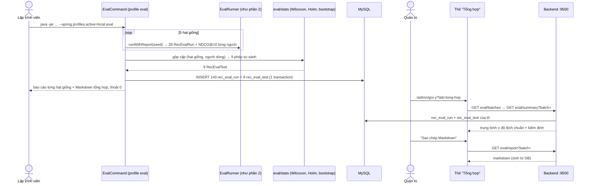

# Kiểm định gợi ý (đánh giá phần 3)

## 1. Mục tiêu và phạm vi

Phần 1 (`danh-gia-goi-y`) và phần 2 (`tinh-chinh-goi-y`) đã cho mỗi hạt giống 28 dòng `rec_eval_run`: 12 thuật toán ở kịch bản chính và 16 dòng người mới. Nhưng mới chạy **một** hạt giống (42), nên các chênh lệch nhỏ chưa kết luận được. Ví dụ M-mau −1,1% hay M-giam +5,4% so với M có thể chỉ do ngẫu nhiên (tài liệu `tinh-chinh-goi-y` §9).

Sau plan này:

- Lập trình viên chạy **một lệnh** (profile `eval`, mặc định 5 hạt giống `42, 7, 123, 2026, 4242`) và nhận được:
  - 140 dòng `rec_eval_run` như phần 2, mỗi hạt giống 28 dòng;
  - **9 dòng kiểm định** `rec_eval_test`: M so với B2, B3 và 7 biến thể. Mỗi dòng dùng Wilcoxon có dấu theo cặp trên NDCG@10 của từng người, gộp mọi cặp (hạt giống, người dùng); p đã hiệu chỉnh Holm; khoảng tin cậy 95% bằng bootstrap 1000 lần; thay đổi tương đối (thiết kế §8.7);
  - **bảng Markdown cho báo cáo**: Bảng 8.1 → 8.5 (trung bình ± độ lệch chuẩn qua 5 hạt giống), Bảng 8.2 kiểm định, và bảng tham số tinh chỉnh theo hạt giống (để bàn về quá khớp).
- Quản trị mở thẻ mới **"Tổng hợp"** ở `/admin/goi-y` để chọn một lô và xem 5 bảng trên. Nút "Sao chép Markdown" / "Tải .md" lấy đúng bảng mà backend sinh, dán thẳng vào báo cáo.

| Có làm (lát này) | Không làm (để plan khác) |
|---|---|
| Migration `V16__kiem_dinh_goi_y.sql`: bảng `rec_eval_test` | Kiểm định kịch bản người mới và chỉ số LUT mới (Bảng 8.4, 8.5 chỉ có trung bình ± độ lệch chuẩn, §11 câu 4) |
| `EvalRunner` giữ NDCG@10 từng người ở kịch bản chính; số liệu cũ không đổi | Ghi trọng số đã tinh chỉnh vào `recommend.*` của cửa hàng (§11 câu 9) |
| Gói `eval/stats`: phân phối chuẩn, Wilcoxon, Holm, bootstrap, trung bình ± độ lệch chuẩn, sinh Markdown | Kết luận H1 → H5 tự động; viết chương thực nghiệm (phiên C và giai đoạn 6) |
| `eval.seeds` mặc định 5 hạt giống; khoá mới `eval.bootstrap`, `eval.alpha` | Biểu đồ (NDCG theo K, Coverage–NDCG, cột ablation) (§11 câu 10) |
| 3 API: `eval/batches`, `eval/summary`, `eval/report` | D2 / D3 (kế hoạch tổng 3.2), nút chạy đánh giá trên giao diện, xoá lô |
| Thẻ "Tổng hợp": chọn lô, đổi K, 5 bảng, sao chép / tải Markdown | Đổi bộ mô phỏng D1 hoặc thuật toán; đổi thẻ "Đánh giá" |

## 2. Tác nhân và phân quyền

| Tác nhân | Quyền (resource `RECOMMEND`, uri `/recommend/`) | Ghi chú |
|---|---|---|
| Quản trị (`admin@downbeat.local`) | VIEW | Xem thẻ "Tổng hợp", sao chép / tải Markdown |
| Role được cấp VIEW `RECOMMEND` | VIEW | Như trên |
| Khách hàng, `noaccess@downbeat.local` | Không | 403 `FORBIDDEN` "Bạn không có quyền thực hiện thao tác này! Path: /recommend/, Action: VIEW"; không token → 401 |
| Lập trình viên (máy local) | — | Chạy `EvalCommand` bằng dòng lệnh |

Không thêm resource. Ba endpoint mới gọi `checkPermission(principal, "/recommend/", "VIEW")` ở dòng đầu, như `eval/list`.

## 3. Luồng nghiệp vụ

**Luồng chính 1 — chạy đánh giá chính thức (dòng lệnh):**
1. `java -jar backend/app/target/aeoc-backend.jar --spring.profiles.active=local,eval` (mặc định 5 hạt giống).
2. `EvalCommand` kiểm tham số (§5.5) và sinh `batchCode`.
3. Với mỗi hạt giống, `EvalRunner.runWithReport` chạy y hệt phần 2 (sinh D1 → tinh chỉnh → 12 thuật toán → người mới) và **giữ thêm** NDCG@10 từng người ở kịch bản chính cho các thuật toán CBF và B2. In báo cáo từng hạt giống như phần 2.
4. Sau hạt giống cuối, `PairedTests` gộp cặp (hạt giống, người dùng) của mọi hạt giống, rồi tính cho 9 phép so sánh: Wilcoxon → Holm → bootstrap → kết luận.
5. Ghi 140 dòng `rec_eval_run` và 9 dòng `rec_eval_test` trong **một transaction**.
6. In "== Tổng hợp lô … ==" và bảng Markdown (đúng nội dung `eval/report`), thoát mã 0.

**Luồng chính 2 — xem tổng hợp:**
1. Quản trị mở `/admin/goi-y` → thẻ "Tổng hợp". Giao diện gọi `eval/batches?page=1&limit=50`, rồi tự chọn lô mới nhất có kiểm định.
2. Gọi `eval/summary?batch=<lô>`. Hiện 5 card: "So sánh với baseline", "Kiểm định thống kê", "Bỏ bớt thành phần", "Người mới", "LUT mới".
3. Đổi "Số gợi ý" sang K = 5 / 20: giá trị và tiêu đề cột đổi ngay, không gọi lại API. Riêng card "Kiểm định thống kê" luôn là NDCG@10.

**Luồng chính 3 — lấy bảng cho báo cáo:**
1. Bấm "Sao chép Markdown" → gọi `eval/report?batch=` → chép `markdown` vào clipboard → toast "Đã sao chép bảng Markdown".
2. Hoặc bấm "Tải .md" → tải file `ket-qua-danh-gia-<lô>.md`.

**Luồng thay thế:**
- A1. Chạy nhanh một hạt giống `--eval.seeds=42`: vẫn có 9 dòng kiểm định (cặp chỉ của một hạt giống). Bảng không có độ lệch chuẩn.
- A2. Chọn lô cũ của phần 1 / phần 2 trong ô "Lô đánh giá": tổng hợp vẫn hiện. Lô không có kiểm định thì card "Kiểm định thống kê" hiện "Lô này chưa có kiểm định thống kê."; lô thiếu biến thể / người mới / LUT mới thì card tương ứng hiện câu trống ở §6.4.
- A3. `--eval.algorithms` không có `cbf-full`, hoặc `--eval.scenarios=cold-user`: không có kiểm định, không lỗi. Markdown bỏ phần Bảng 8.2.
- A4. Mở link `?tab=tong-hop&batch=<lô>&k=20` thì lô và K hiện đúng ngay.

**Ngoại lệ:**
- E1. Không quyền → 403 / 401 (§2).
- E2. `summary` / `report` với lô không có (hoặc thiếu `batch`) → 404 "Không tìm thấy lô đánh giá". Giao diện hiện "Không tìm thấy lô đánh giá" + nút "Xem lô mới nhất".
- E3. Tham số dòng lệnh sai → "Tham số đánh giá không hợp lệ: {khoá}", không ghi DB, mã 2.
- E4. Chưa có lô nào → "Chưa có lô đánh giá nào".
- E5. Lỗi mạng / 5xx → "Không tải được dữ liệu" + "Thử lại".
- E6. Trình duyệt chặn clipboard → toast lỗi "Không sao chép được bảng Markdown".



## 4. Cơ sở dữ liệu

Migration: `V16__kiem_dinh_goi_y.sql`. Migration mới nhất hiện tại là `V15__tinh_chinh_goi_y.sql`.

```sql
SET NAMES utf8mb4;

CREATE TABLE IF NOT EXISTS `rec_eval_test` (
  `id`            INT          NOT NULL AUTO_INCREMENT,
  `batch_code`    VARCHAR(20)  NOT NULL COMMENT 'Lô rec_eval_run được kiểm định',
  `scenario`      VARCHAR(30)  NOT NULL COMMENT 'standard (lát này chỉ kiểm định kịch bản chính)',
  `metric`        VARCHAR(20)  NOT NULL COMMENT 'ndcg',
  `k`             INT          NOT NULL COMMENT '10 (hoặc K lớn nhất nếu k-values không có 10)',
  `algorithm_a`   VARCHAR(30)  NOT NULL COMMENT 'cbf-full (M)',
  `algorithm_b`   VARCHAR(30)  NOT NULL COMMENT 'Thuật toán so sánh',
  `seed_count`    INT          NOT NULL,
  `pair_count`    INT          NOT NULL COMMENT 'Số cặp (hạt giống, người dùng)',
  `nonzero_count` INT          NOT NULL COMMENT 'Số cặp có chênh lệch khác 0 (Wilcoxon chỉ xếp hạng các cặp này)',
  `mean_a`        DOUBLE       NOT NULL,
  `mean_b`        DOUBLE       NOT NULL,
  `mean_diff`     DOUBLE       NOT NULL,
  `ci_low`        DOUBLE       NOT NULL,
  `ci_high`       DOUBLE       NOT NULL,
  `rel_change`    DOUBLE       NULL     COMMENT '(mean_a - mean_b) / mean_b × 100; NULL khi mean_b = 0',
  `w_plus`        DOUBLE       NOT NULL,
  `z`             DOUBLE       NOT NULL,
  `p_value`       DOUBLE       NOT NULL COMMENT 'Hai phía, chưa hiệu chỉnh',
  `p_holm`        DOUBLE       NOT NULL,
  `conclusion`    VARCHAR(10)  NOT NULL COMMENT 'better / worse / no-diff',
  `params`        JSON         NOT NULL COMMENT 'Phương pháp, alpha, số lần bootstrap, hạt giống bootstrap',
  `created_time`  DATETIME     NOT NULL,
  PRIMARY KEY (`id`),
  UNIQUE KEY `uk_rec_eval_test` (`batch_code`, `scenario`, `metric`, `k`, `algorithm_a`, `algorithm_b`)
) ENGINE=InnoDB DEFAULT CHARSET=utf8mb4 COLLATE=utf8mb4_unicode_ci;
```

- `rec_eval_run` **không đổi**.
- Không xoá: không có API xoá.
- Unique nằm trên khoá tự nhiên của một phép so sánh, để không ghi trùng khi lệnh bị gọi lại cùng `batchCode`.
- NDCG từng người **không** ghi DB, vì sinh lại được từ `seed`. Bảng Markdown cũng không ghi DB mà sinh từ hai bảng mỗi lần gọi (§11 câu 7).

## 5. Hợp đồng API (cố định — nguồn sự thật cho cả BE và FE)

Giữ quy ước phần 1, 2: thành công `{ "code": 200, "message": "OK", "result": … }`; lỗi `{ "path", "code", "errorCode", "message" }`; POJO `NON_NULL`; thời điểm `yyyy-MM-dd'T'HH:mm:ss` giờ VN. `eval/list`, `eval/get` **không đổi**.

### 5.1 `GET /api/recommend/eval/batches?page=&limit=` — quyền VIEW

- `page` mặc định 1 (≤ 0 → 1); `limit` mặc định 20 (≤ 0 → 20, > 100 → 100). Thứ tự `batchCode` giảm dần. `total` = số lô khác nhau.
- `seeds`: các giá trị `params.seed` khác nhau, theo thứ tự `id` tăng. `scenarios`: các giá trị `scenario` khác nhau, theo thứ tự `id` tăng. `lutCount`, `simUserCount`, `dataset` lấy từ dòng có `id` nhỏ nhất. `createdTime` = `created_time` nhỏ nhất của lô. `hasTests` = lô có ít nhất một dòng `rec_eval_test`.

Response `result`:
```json
{
  "total": 9, "page": 1,
  "items": [
    { "batchCode": "20261113-090000", "dataset": "D1-sim", "seeds": [42, 7, 123, 2026, 4242], "runCount": 140,
      "scenarios": ["standard", "cold-user-0", "cold-user-1", "cold-user-3", "cold-user-5"],
      "lutCount": 300, "simUserCount": 500, "hasTests": true, "createdTime": "2026-11-13T09:04:12" },
    { "batchCode": "20261112-034424", "dataset": "D1-sim", "seeds": [42], "runCount": 5,
      "scenarios": ["standard"], "lutCount": 300, "simUserCount": 500, "hasTests": false, "createdTime": "2026-11-12T03:45:01" }
  ]
}
```

### 5.2 `GET /api/recommend/eval/summary?batch=` — quyền VIEW

`batch` được trim. Thiếu, rỗng hoặc không có dòng `rec_eval_run` nào → 404 (§5.4).

Response `result` (rút gọn):
```json
{
  "batchCode": "20261113-090000", "dataset": "D1-sim",
  "seeds": [42, 7, 123, 2026, 4242], "lutCount": 300, "simUserCount": 500, "kValues": [5, 10, 20], "newLutDays": 14,
  "scenarios": [
    {
      "scenario": "standard", "userCounts": [343, 351, 339, 348, 344],
      "rows": [
        { "algorithm": "popular", "seedCount": 5,
          "metrics": {
            "5":  { "precision": { "mean": 0.1102, "std": 0.0041 }, "…": {} },
            "10": { "precision": { "mean": 0.0874, "std": 0.0022 }, "recall": { "mean": 0.6390, "std": 0.0105 },
                    "ndcg": { "mean": 0.3561, "std": 0.0074 }, "hitRate": { "mean": 0.7212, "std": 0.0098 },
                    "ild": { "mean": 1.0203, "std": 0.0061 }, "styles": { "mean": 6.1840, "std": 0.0912 },
                    "coverage": { "mean": 0.1007, "std": 0.0015 }, "novelty": { "mean": 3.1022, "std": 0.0420 },
                    "newLutHit": { "mean": 0.0335, "std": 0.0060 }, "newLutRecall": { "mean": 0.0301, "std": 0.0122 } },
            "20": { "…": {} }
          } },
        { "algorithm": "cbf-full", "seedCount": 5, "metrics": { "10": { "ndcg": { "mean": 0.0640, "std": 0.0031 }, "…": {} } } }
      ]
    },
    { "scenario": "cold-user-0", "userCounts": [355, 349, 362, 351, 357], "rows": [ { "algorithm": "popular", "…": {} } ] }
  ],
  "tests": [
    {
      "scenario": "standard", "metric": "ndcg", "k": 10, "algorithmA": "cbf-full", "algorithmB": "popular",
      "seedCount": 5, "pairCount": 1725, "nonZeroCount": 1503,
      "meanA": 0.0641, "meanB": 0.3563, "meanDiff": -0.2922, "ciLow": -0.3051, "ciHigh": -0.2790, "relChange": -82.0,
      "wPlus": 81233.5, "z": -27.9031, "pValue": 1.84e-171, "pHolm": 1.66e-170, "conclusion": "worse",
      "params": { "method": "wilcoxon-signed-rank", "zeroMethod": "wilcox", "tieCorrection": true, "continuityCorrection": false,
                  "holmFamilySize": 9, "alpha": 0.05, "bootstrap": 1000, "bootstrapSeed": 42, "ciLevel": 0.95 }
    }
  ]
}
```
Các con số chỉ minh hoạ kiểu dữ liệu.

Quy tắc:
- **`scenarios`**: `standard` trước, rồi `cold-user-{n}` theo n tăng, rồi mã khác theo bảng chữ cái.
- **`rows`**: theo thứ tự `EvalProperties.ALGORITHM_ORDER`; mã lạ xếp sau, theo bảng chữ cái.
- **`userCounts`**: `userCount` của từng hạt giống trong kịch bản đó, theo thứ tự `seeds`, lấy từ dòng có `id` nhỏ nhất của (hạt giống, kịch bản).
- **`seedCount`**: số dòng của (kịch bản, thuật toán).
- **`metrics`**: chỉ có các K mà mọi dòng của (kịch bản, thuật toán) đều có, và trong mỗi K chỉ có trường mà mọi dòng đều có. Thứ tự K tăng, trường theo `CANONICAL_METRIC_ORDER`.
  - `mean` = trung bình các giá trị đã lưu (đã làm tròn 4 chữ số), mỗi hạt giống có trọng số như nhau, làm tròn 4 chữ số.
  - `std` = độ lệch chuẩn mẫu (chia n − 1), làm tròn 4 chữ số. **Không có khoá `std`** khi `seedCount` = 1.
- **`newLutDays`**: lấy từ `params.newLutDays` của dòng `standard` đầu tiên; không có thì không có khoá.
- **`tests`**: các dòng `rec_eval_test` của lô theo `id` tăng (thứ tự §5.5); không có thì `[]`.
- **Test item** có đúng các khoá như ví dụ, theo đúng thứ tự đó; không có `id`, `batchCode`, `createdTime`.
  - `meanA`, `meanB`, `meanDiff`, `ciLow`, `ciHigh`, `z` làm tròn 4 chữ số; `relChange` 1 chữ số; `wPlus` giữ nguyên (bội số của 0.5).
  - `pValue`, `pHolm` **không làm tròn**.
  - `relChange` không có khoá khi `meanB` = 0.

### 5.3 `GET /api/recommend/eval/report?batch=` — quyền VIEW

Response `result`:
```json
{ "batchCode": "20261113-090000", "fileName": "ket-qua-danh-gia-20261113-090000.md",
  "markdown": "# Kết quả đánh giá gợi ý · lô 20261113-090000\n\nD1-sim · 300 LUT · 500 người mô phỏng · 5 hạt giống (42, 7, 123, 2026, 4242) · K = 10\n…" }
```

`markdown` do `EvalReportWriter` sinh từ đúng dữ liệu của `summary` cộng `params.tuning` của các dòng (§7 mục 6). Cùng dữ liệu thì luôn cho cùng chuỗi: không chứa giờ chạy hay `elapsedMs`. Xuống dòng `\n`, kết thúc bằng đúng một `\n`.

**Bố cục** (theo thứ tự; phần nào không có dữ liệu thì bỏ cả tiêu đề lẫn bảng, trừ đầu trang và Bảng 8.1):

```
# Kết quả đánh giá gợi ý · lô {batchCode}

{dataset} · {lutCount} LUT · {simUserCount} người mô phỏng · {n} hạt giống ({seeds, cách nhau ", "}) · K = {K}

{n ≥ 2: "Số liệu là trung bình trên các hạt giống, độ lệch chuẩn trong ngoặc." | n = 1: "Lô chỉ có 1 hạt giống nên không có độ lệch chuẩn."}

## Bảng 8.1. So sánh với baseline (K = {K})

| Thuật toán | P@{K} | R@{K} | NDCG@{K} | HitRate@{K} | ILD@{K} | Phong cách / {K} | Coverage@{K} | Novelty@{K} |
|---|---|---|---|---|---|---|---|---|
| B1 Ngẫu nhiên | … |            ← random, popular, popular-dd, cbf-tag, cbf-full có trong standard; nhãn đầy đủ

Người được tính mỗi hạt giống: {userCounts standard, cách nhau ", "}.

## Bảng 8.2. Kiểm định (NDCG@{k của test})

Wilcoxon có dấu theo cặp trên {pairCount} cặp (hạt giống, người dùng), hiệu chỉnh Holm cho {holmFamilySize} phép so sánh, mức ý nghĩa {alpha}; khoảng tin cậy 95% bằng bootstrap {bootstrap} lần.

| So sánh | Chênh lệch trung bình | Khoảng tin cậy 95% | Thay đổi tương đối | p (Wilcoxon, đã hiệu chỉnh Holm) | Kết luận |
|---|---|---|---|---|---|
| M với B2 | -0,2922 | [-0,3051; -0,2790] | -82,0% | < 0,001 | M kém hơn |     ← mỗi test một dòng, theo thứ tự tests

## Bảng 8.3. Bỏ bớt thành phần (K = {K})

| Biến thể | NDCG@{K} | Thay đổi so với M | ILD@{K} | p (Holm) |
|---|---|---|---|---|
| M | … | — | … | — |
| M-mau | … | -1,1% | … | 0,412 |                ← m-mau … m-mac-dinh có trong standard

## Bảng 8.4. Người mới (NDCG@{K} theo số sự kiện n)

| Thuật toán | n = 0 | n = 1 | n = 3 | n = 5 |      ← các kịch bản cold-user-{n} có trong lô
|---|---|---|---|---|
| B2 | … |                                          ← popular, cbf-tag, cbf-full, m-kb (nhãn ngắn)

Người có khai báo được tính mỗi hạt giống: {userCounts của cold-user nhỏ nhất}.

## Bảng 8.5. LUT mới (K = {K})

| Thuật toán | Tỉ lệ danh sách có LUT mới | Recall@{K} trên LUT mới |
|---|---|---|
| B1 Ngẫu nhiên | … |                                ← 5 baseline như Bảng 8.1, chỉ khi có newLutHit

## Tinh chỉnh theo hạt giống

| Hạt giống | Thẻ | Màu | Danh mục | Phong cách | Văn bản | Tác giả | λ | Chu kỳ bán rã | k | NDCG@10 kiểm định (mặc định → cuối) | NDCG@10 phần kiểm: M | NDCG@10 phần kiểm: M-mac-dinh |
|---|---|---|---|---|---|---|---|---|---|---|---|---|
| 42 | 0,05 | 0,20 | 0,25 | 0,35 | 0,00 | 0,15 | 0,7 | 30 | 5 | 0,0632 → 0,0815 | 0,0631 | 0,0608 |   ← mỗi dòng cbf-full standard có params.tuning
```

Quy tắc định dạng của Markdown:
- **Dấu thập phân là dấu phẩy**, không có dấu phân cách hàng nghìn. Số âm dùng `-`. Chênh lệch và hai đầu khoảng tin cậy có dấu `+` khi dương; bằng 0 thì in `0,0000` không dấu.
- **Ô "trung bình (độ lệch chuẩn)"**: `0,0640 (0,0031)`; không có `std` thì chỉ in trung bình. Thiếu dữ liệu in `—`.
- **Số chữ số**: chỉ số 4 chữ số; "Phong cách" và "Novelty" 2 chữ số (kể cả độ lệch chuẩn). Thay đổi % 1 chữ số kèm dấu. Trọng số 2 chữ số, λ 1 chữ số, `alpha` 2 chữ số. Chu kỳ bán rã và k in số nguyên; chu kỳ bán rã 0 in `∞`.
- **p**: nhỏ hơn 0,001 in `< 0,001`, còn lại 3 chữ số (`0,042`, `1,000`).
- **"Thay đổi so với M"** (Bảng 8.3) = (trung bình biến thể − trung bình M) / trung bình M × 100, tính trên các `mean` của summary; M = 0 thì `—`. **"Thay đổi tương đối"** (Bảng 8.2) = `relChange`.
- **K** = 10 nếu `kValues` có 10, không thì K lớn nhất.
- **Nhãn đầy đủ** (Bảng 8.1, 8.5) là 12 nhãn của thẻ "Đánh giá" (`B1 Ngẫu nhiên` … `M-mac-dinh Tham số mặc định`). **Nhãn ngắn** (Bảng 8.2 → 8.4): `B1`, `B2`, `B2-dd`, `B3`, `M`, `M-mau`, `M-the`, `M-giam`, `M-mmr`, `M-kb`, `M-tron`, `M-mac-dinh`.
- **Kết luận**: `better` → "M tốt hơn", `worse` → "M kém hơn", `no-diff` → "Không khác biệt có ý nghĩa".

### 5.4 Lỗi nghiệp vụ

| Tình huống | HTTP | errorCode | Message (FE hiện nguyên văn) |
|---|---|---|---|
| Không token | 401 | có sẵn | (có sẵn của filter) |
| Không có VIEW `RECOMMEND` | 403 | `FORBIDDEN` | Bạn không có quyền thực hiện thao tác này! Path: /recommend/, Action: VIEW |
| `summary` / `report`: thiếu `batch`, rỗng hoặc không có lô | 404 | `DATA_NOT_FOUND` | Không tìm thấy lô đánh giá |
| `eval/get` id không có (giữ nguyên) | 404 | `DATA_NOT_FOUND` | Không tìm thấy lần chạy đánh giá |

`eval/batches` không có lỗi riêng: không có lô nào thì trả `total` 0, `items` [].

### 5.5 Dòng lệnh `EvalCommand`

Khoá `eval.*` (mặc định trong `application-eval.yml`). **Đậm** là khoá mới hoặc khoá đổi mặc định; các khoá khác giữ như phần 2:

| Khoá | Mặc định | Hợp lệ |
|---|---|---|
| **`eval.seeds`** | **`42,7,123,2026,4242`** | danh sách ≥ 1 số nguyên |
| **`eval.bootstrap`** | 1000 | 100 → 10000 |
| **`eval.alpha`** | 0.05 | 0.001 → 0.2 |

**Kiểm định** chạy khi kịch bản `standard` có chạy và `algorithms` có `cbf-full`. Danh sách so sánh, theo đúng thứ tự (cũng là thứ tự `id` ghi DB), gồm các mã có trong `algorithms`:

`popular`, `cbf-tag`, `m-mau`, `m-the`, `m-giam`, `m-mmr`, `m-kb`, `m-tron`, `m-mac-dinh`

Danh sách này rỗng thì không có dòng kiểm định, không lỗi. Họ Holm là chính danh sách đã chạy (`holmFamilySize` = số phần tử).

**Kết quả lệnh:**
- Tham số sai → in "Tham số đánh giá không hợp lệ: {khoá}" ra stdout và stderr, không ghi DB, mã 2 (khoá mới: `eval.bootstrap`, `eval.alpha`).
- Thành công:
  - in báo cáo từng hạt giống đúng như phần 2;
  - sau khi ghi DB, in thêm một dòng `== Tổng hợp lô {batchCode} · {n} hạt giống · {tổng giây, 1 chữ số} giây ==`, một dòng trống, rồi **đúng chuỗi** `EvalReportWriter` sinh cho lô (giống `eval/report`);
  - mã 0.

## 6. Giao diện (chuỗi cố định — test E2E chọn theo đúng các chuỗi này)

Thêm thẻ thứ năm **"Tổng hợp"** vào `/admin/goi-y`, đặt ngay sau "Đánh giá". Bốn thẻ cũ không đổi.

### 6.1 Tham số URL

- `tab` thêm giá trị `tong-hop`.
- Thêm `batch`: chuỗi tuỳ ý, không có thì giao diện tự chọn lô (§6.2).
- `k` dùng chung với thẻ "Đánh giá" (5 / 10 / 20, mặc định 10).
- Đổi lô thì đặt `batch`, đổi K thì đặt `k`, luôn `navigate({ replace: true })`. Chuyển thẻ giữ nguyên các tham số khác.

### 6.2 Thanh công cụ

- **`Select` "Lô đánh giá"** (aria-label "Lô đánh giá"), rộng `w-full sm:w-[380px]`. Dữ liệu từ `eval/batches?page=1&limit=50`.
  - Mỗi mục: `{batchCode} · {seeds.length} hạt giống`, thêm ` · có kiểm định` khi `hasTests`.
  - Không có `batch` trên URL thì chọn lô đầu tiên có `hasTests`, không có thì lô đầu tiên. URL **không** tự thêm `batch`.
  - `batch` trên URL không nằm trong 50 lô thì ô vẫn hiện đúng mã lô.
- **`Select` "Số gợi ý"** (aria-label "Số gợi ý", `w-full sm:w-[110px]`): "K = 5", "K = 10", "K = 20".
- **Nút "Sao chép Markdown"** (variant `outline`, icon `Copy`) và **nút "Tải .md"** (variant `outline`, icon `Download`), đặt bên phải. Khi đang lấy `report` thì nút bị khoá.
- Dòng chữ phụ dưới thanh công cụ (`text-sm text-muted-foreground`):
  - Gốc: `{dataset} · {lutCount} LUT · {simUserCount} người mô phỏng · hạt giống {seeds, cách nhau ", "}`
  - Nối thêm ` · trung bình ± độ lệch chuẩn qua {n} hạt giống` khi n ≥ 2, hoặc ` · 1 hạt giống, chưa có độ lệch chuẩn` khi n = 1.
- Ở 390 px: các `Select` và nút xuống dòng, rộng `w-full`; trang không tràn ngang.

### 6.3 Năm card (theo thứ tự; mỗi bảng nằm trong khung cuộn ngang)

Quy tắc chung cho ô số:
- Ô "trung bình ± độ lệch chuẩn" = `formatMetricValue(mean, d)`, thêm ` ± formatMetricValue(std, d)` khi có `std` (ví dụ "0,0640 ± 0,0031"). d = 4, riêng "Phong cách" và "Novelty" d = 2. Thiếu dữ liệu → "—".
- Nhãn thuật toán dùng `EVAL_ALGORITHM_LABELS` (12 nhãn đầy đủ của thẻ "Đánh giá").

1. **"So sánh với baseline"**
   - Mô tả: "Kịch bản chính, K = {K}. Người được tính mỗi hạt giống: {userCounts standard, cách nhau ", "}."
   - Cột: "Thuật toán", rồi 8 tiêu đề đầu của `EVAL_METRICS` theo K ("P@{K}" … "Novelty@{K}"), giữ tooltip có sẵn.
   - Dòng: `random`, `popular`, `popular-dd`, `cbf-tag`, `cbf-full`, chỉ những mã có trong `standard`.
2. **"Kiểm định thống kê"**
   - Mô tả: "NDCG@{k}, Wilcoxon có dấu theo cặp trên {pairCount} cặp (hạt giống, người dùng), hiệu chỉnh Holm cho {holmFamilySize} phép so sánh, mức ý nghĩa {alpha 2 chữ số}. Khoảng tin cậy 95% bằng bootstrap {bootstrap} lần." Lấy số từ `tests[0]`; `pairCount`, `holmFamilySize`, `bootstrap` in số nguyên thô, không dấu phân cách hàng nghìn (như Markdown).
   - Cột: "So sánh", "Chênh lệch trung bình", "Khoảng tin cậy 95%", "Thay đổi tương đối", "p (Holm)", "Kết luận".
     - Tooltip "p (Holm)": "Giá trị p của kiểm định Wilcoxon sau hiệu chỉnh Holm; nhỏ hơn mức ý nghĩa thì chênh lệch có ý nghĩa thống kê".
   - Mỗi test một dòng, theo thứ tự `tests`:
     - "So sánh" = `M với {nhãn đầy đủ của algorithmB}`, ví dụ "M với B2 Phổ biến";
     - "Chênh lệch trung bình" = `formatSignedDiff(meanDiff, 4)`;
     - "Khoảng tin cậy 95%" = `[{formatSignedDiff(ciLow, 4)}; {formatSignedDiff(ciHigh, 4)}]`;
     - "Thay đổi tương đối" = `relChange` dạng "+5,4%" / "-82,0%" / "0,0%"; không có thì "—";
     - "p (Holm)" = "< 0,001" khi `pHolm` < 0.001, còn lại `formatMetricValue(pHolm, 3)`;
     - "Kết luận" là `Badge`: `better` → "M tốt hơn" (variant `default`), `worse` → "M kém hơn" (`destructive`), `no-diff` → "Không khác biệt có ý nghĩa" (`secondary`).
   - Card không đổi theo K.
   - `tests` rỗng → trong card chỉ có dòng "Lô này chưa có kiểm định thống kê."
3. **"Bỏ bớt thành phần"**
   - Mô tả: "Kịch bản chính, K = {K}. Thay đổi tính trên NDCG trung bình so với M; p lấy từ kiểm định NDCG@10."
   - Cột: "Biến thể", "NDCG@{K}", "Thay đổi so với M", "ILD@{K}", "p (Holm)".
   - Dòng đầu là `cbf-full` (nhãn "M CBF đủ đặc trưng"), tiếp theo `m-mau` … `m-mac-dinh` có trong `standard`.
     - "Thay đổi so với M" = `formatSignedPercentChange(mean M, mean biến thể)` trên NDCG@{K}; dòng M là "—".
     - "p (Holm)" lấy từ test có `algorithmB` = mã biến thể, định dạng như card 2; dòng M hoặc không có test là "—".
   - Không có `m-*` nào → "Lô này không có biến thể bỏ bớt."
4. **"Người mới"**
   - Mô tả: "NDCG@{K} khi người dùng chỉ có sở thích khai báo và n sự kiện đầu tiên. Người có khai báo được tính mỗi hạt giống: {userCounts của kịch bản cold-user có n nhỏ nhất}."
   - Cột: "Thuật toán", rồi "n = {n}" cho mỗi kịch bản `cold-user-{n}` theo n tăng.
   - Dòng: `popular`, `cbf-tag`, `cbf-full`, `m-kb` (nhãn đầy đủ), chỉ những mã có ở ít nhất một kịch bản.
   - Không có kịch bản người mới → "Lô này không có kịch bản người mới."
5. **"LUT mới"**
   - Mô tả: "Kịch bản chính, K = {K}. LUT mới là LUT xuất bản trong {newLutDays} ngày trước t0." Không có `newLutDays` thì bỏ câu thứ hai.
   - Cột: "Thuật toán", "Tỉ lệ danh sách có LUT mới", "Recall@{K} trên LUT mới".
   - Dòng: như card 1. Ô thiếu trường → "—".

### 6.4 Trạng thái

- **Đang tải**: skeleton cho thanh công cụ và 5 card.
- **`eval/batches` trả 0 lô**: `Empty` với tiêu đề "Chưa có lô đánh giá nào", mô tả "Chạy trình đánh giá offline (profile eval) để có bảng tổng hợp và kiểm định thống kê.", không có thanh công cụ.
- **`summary` trả 404**: `Empty` với tiêu đề "Không tìm thấy lô đánh giá", mô tả "Lô {batch} không có trong dữ liệu đánh giá." và nút "Xem lô mới nhất" (bỏ `batch` khỏi URL). Thanh công cụ vẫn hiện.
- **Lỗi mạng / 5xx** (`batches` hoặc `summary`): dùng `TabLoadError` có sẵn ("Không tải được dữ liệu" + "Thử lại").
- **Toast**:
  - sao chép thành công "Đã sao chép bảng Markdown";
  - clipboard bị chặn hoặc `report` lỗi "Không sao chép được bảng Markdown";
  - tải lỗi "Không tải được bảng Markdown";
  - tải thành công không có toast.

## 7. Việc backend (agy BE)

Package `vn.aeoc.business.recommend.eval` (thêm gói con `stats`) và `vn.aeoc.business.recommend` (service, controller).

**Không sửa:** `ProfileBuilder`, `Recommender`, `ScoreCalculator`, `LutVectorIndex`, `CubeParser`, `ColorFeatureExtractor`, `CatalogGenerator`, `UserSimulator`, `CubeWriter`, `TimeSplitter`, `EvalVariants`, các lớp trong `eval/algo` và `eval/tune`. `EvalMetrics` chỉ được thêm hàm. `EvalRunner` chỉ được **thêm** việc giữ NDCG từng người: mọi giá trị `metrics` / `params` / `userCount` đang có phải giữ nguyên (TC-09, TC-20). Cần thêm hàm public ở lớp cấm sửa thì `ask` trước. **Không thêm dependency Maven**: tự cài phân phối chuẩn (§11 câu 3).

1. **Migration** `app/src/main/resources/db/migration/V16__kiem_dinh_goi_y.sql` đúng §4. Restart, rồi build để jOOQ sinh `REC_EVAL_TEST`.
2. **Entity** (`entity/.../data/mysql/recommend/`):
   - `RecEvalTest`: map bảng; `params` parse JSON như `RecEvalRun`, thứ tự khoá theo §5.2. Field `id`, `batchCode`, `createdTime` có `@JsonIgnore`, để JSON đúng §5.2.
   - DTO `RecEvalBatch`, `RecEvalSummary` (lớp con `ScenarioSummary`, `AlgorithmSummary`, `MetricStat { Double mean; Double std; }`), `RecEvalReport` đúng §5.1 → §5.3.
3. **`eval/stats`** (lớp thuần, không Spring, dùng chung cho dòng lệnh và service):
   - **`NormalDist.twoSidedP(z)`** = erfc(|z| / √2). Tự cài erfc với sai số tương đối ≤ 1e-6 trên toàn miền, ví dụ xấp xỉ Chebyshev `erfcc` của Numerical Recipes, sai số tương đối < 1.2e-7. Kết quả kẹp trong [0, 1], không NaN; dưới ngưỡng double thì trả 0.
   - **`WilcoxonSignedRank.test(double[] a, double[] b)`** → `{nonZeroCount, wPlus, z, pValue}`:
     - d = a − b; bỏ |d| < 1e-12; n = số còn lại;
     - xếp hạng |d| tăng dần; nhóm có |Δ| < 1e-12 so với **phần tử đầu nhóm** nhận hạng trung bình;
     - W+ = tổng hạng của d > 0; μ = n(n + 1) / 4; σ² = n(n + 1)(2n + 1) / 24 − Σ(t³ − t) / 48 trên các nhóm hạng bằng nhau;
     - z = (W+ − μ) / σ, không hiệu chỉnh liên tục; p = `twoSidedP(z)`;
     - n = 0 hoặc σ² ≤ 0 → z = 0, p = 1;
     - hai mảng khác độ dài → `IllegalArgumentException`.
     - Cách tính này khớp scipy `wilcoxon(zero_method="wilcox", correction=False, method="approx")`.
   - **`HolmCorrection.adjust(double[] p)`**:
     - sắp p tăng dần (bằng nhau thì giữ thứ tự gốc);
     - p_holm(i) = max_{j ≤ i} min(1, (m − j + 1) · p_(j)), với j đếm từ 1;
     - trả mảng theo **thứ tự gốc**.
   - **`BootstrapCi.ci(double[] d, int B, long seed)`** → `[low, high]`:
     - `rng = new SplittableRandom(seed)`;
     - với b = 0 … B − 1: lấy n chỉ số bằng `rng.nextInt(n)`, theo đúng thứ tự, rồi tính trung bình d tại các chỉ số đó;
     - sắp các trung bình tăng dần; `lo = (int) Math.floor(0.025 * B)`; low = means[lo], high = means[B − 1 − lo];
     - tách hàm `percentile(double[] sortedMeans)` để test;
     - n = 0 → [0, 0].
   - **`SeedStats`**: `mean(List<Double>)`, `sampleStd(List<Double>)` (n − 1; n = 1 → `null`).
   - **`PairedTests.build(List<SeedPerUser> seeds, EvalProperties p, String batchCode, LocalDateTime createdTime)`** → `List<RecEvalTest>` theo thứ tự §5.5:
     - mỗi `SeedPerUser` gồm `seed`, `int[] userIds`, `Map<String, double[]> ndcgByAlgorithm`, `k`;
     - nối mảng các hạt giống theo thứ tự `eval.seeds` để được cặp (hạt giống, người dùng). Trong một hạt giống, `userIds` phải giống hệt nhau giữa các thuật toán, khác thì `IllegalStateException`;
     - `meanA`, `meanB` là trung bình trên mọi cặp của giá trị **chưa làm tròn**; `meanDiff` = meanA − meanB (làm tròn sau khi trừ);
     - `relChange` = (meanA − meanB) / meanB × 100, bỏ khi meanB = 0;
     - CI = `BootstrapCi.ci(d, eval.bootstrap, 42)`. Mỗi phép so sánh tạo RNG mới cùng hạt giống 42, nên mọi phép so sánh lấy mẫu lại cùng một tập cặp;
     - `pHolm` qua `HolmCorrection` trên các `pValue` của danh sách;
     - `conclusion`: `pHolm < alpha` và z > 0 → `better`; `pHolm < alpha` và z < 0 → `worse`; còn lại `no-diff`;
     - làm tròn theo §5.2; `params` đúng 9 khoá §5.2.
   - **`EvalSummaryBuilder.build(List<RecEvalRun> runs, List<RecEvalTest> tests)`** → `RecEvalSummary` đúng mọi quy tắc §5.2. `runs` sắp theo `id`; với lô chưa ghi DB (dòng lệnh) thì theo thứ tự sinh.
   - **`EvalReportWriter.render(List<RecEvalRun> runs, List<RecEvalTest> tests)`** → chuỗi Markdown đúng §5.3. Dùng `EvalSummaryBuilder`; bảng "Tinh chỉnh theo hạt giống" đọc `params` của dòng `cbf-full` / `m-mac-dinh` kịch bản `standard` từng hạt giống. Định dạng số bằng `String.format(Locale.US, …)` rồi đổi `.` thành `,`.
4. **`EvalRunner`**: `EvalSeedResult` thêm `SeedPerUser perUser`. Ở kịch bản `standard`, với mỗi thuật toán **khác `random`**, lưu NDCG@kTest của từng người theo thứ tự ca. Lấy ngay giá trị `EvalMetrics.ndcg(sub, relMap, k)` đang tính trong vòng lặp khi k = kTest. kTest = 10 nếu `kValues` có 10, không thì K lớn nhất. Không đổi gì khác.
5. **`EvalProperties`**: `seeds` mặc định 5 giá trị §5.5; thêm `bootstrap`, `alpha`; `validate()` trả `eval.bootstrap`, `eval.alpha` đúng §5.5. `application-eval.yml` cập nhật mặc định.
6. **`EvalCommand`**:
   - giữ phần in từng hạt giống;
   - sau vòng hạt giống, gọi `PairedTests.build` (chỉ khi điều kiện §5.5 đúng), rồi `recEvalRunService.saveBatch(runs, tests)`;
   - sau khi ghi, in dòng "== Tổng hợp lô …" và `EvalReportWriter.render(runs, tests)` (§5.5); mã thoát giữ như cũ.
7. **Repository**:
   - `RecEvalTestRepository extends AbsMysqlRepository<RecEvalTestRecord, RecEvalTest, Integer>`: `insertAll`, `listByBatch(batch)` (theo `id`), `batchesWithTests(Collection<String>)`.
   - `RecEvalRunRepository` thêm:
     - `listByBatch(batch)`: mọi dòng, theo `id`;
     - `batchCodes(pageable)`: `SELECT batch_code … GROUP BY batch_code ORDER BY batch_code DESC LIMIT/OFFSET`;
     - `countBatches()`;
     - `listByBatches(Collection<String>)`: các cột cần cho §5.1.
8. **`RecEvalRunService`** (giữ hàm cũ):
   - thêm `RecEvalTestRepository` vào constructor;
   - `batches(page, limit)` đúng §5.1;
   - `summary(batch)`, `report(batch)`: trim; rỗng hoặc không có dòng → `AppException(ErrorCode.DATA_NOT_FOUND, "Không tìm thấy lô đánh giá")`; rồi dùng `EvalSummaryBuilder` / `EvalReportWriter`; `fileName` = `ket-qua-danh-gia-{batchCode}.md`;
   - `@Transactional saveBatch(List<RecEvalRun>, List<RecEvalTest>)` ghi run trước, test sau. Giữ `saveBatch(List<RecEvalRun>)` cũ.
9. **`RecommendAdminController`**: `GET /recommend/eval/batches`, `/recommend/eval/summary`, `/recommend/eval/report`, dòng đầu là `checkPermission(principal, URI, "VIEW")`.
10. **Hiệu năng**: mỗi hạt giống ≤ 10 phút như phần 2; bước thống kê (9 phép so sánh × bootstrap 1000) ≤ 5 giây. Không đa luồng. Lệnh mặc định 5 hạt giống ước tính 18 đến 36 phút: chạy nền với timeout ≥ 60 phút, không chạy foreground.
11. **Tự kiểm trước `worker_done`**:
    - `mvn -q "-Djooq.codegen.skip=true" -pl business -am test` xanh, rồi restart (V16 đã áp);
    - chạy các lệnh sau **đúng thứ tự** (từ gốc repo, sau `mvn -q -DskipTests package` trong `backend/`) để Claude có dữ liệu E2E. Báo `batchCode`, mã thoát và thời gian từng lô:
      1. **S1**: `java -jar backend/app/target/aeoc-backend.jar --spring.profiles.active=local,eval --eval.seeds=42,7 --eval.luts=80 --eval.users=120 --eval.tune-trials=30`
      2. **S2**: lặp lại đúng lệnh S1
      3. **O** (chính thức, chạy cuối để là lô mới nhất): `java -jar backend/app/target/aeoc-backend.jar --spring.profiles.active=local,eval`
    - curl 3 endpoint mới với O, dán response rút gọn.

Unit test bắt buộc: các TC loại `unit` ở §9, cộng bộ tối thiểu của `backend/AGENTS.md`. Test cũ (`EvalUnitTest`, `EvalPart2UnitTest`, `RecEvalRunServiceTest`) phải xanh, **không đổi kỳ vọng**. Nếu một test cũ dựa vào `eval.seeds` mặc định là `[42]` thì ghi rõ `setSeeds(List.of(42L))` trong test đó.

## 8. Việc frontend (agy FE)

1. `lib/types/recommend.ts`: `EvalBatchDTO`, `EvalBatchListParams`, `EvalMetricStatDTO { mean: number; std?: number }`, `EvalAlgorithmSummaryDTO`, `EvalScenarioSummaryDTO`, `EvalTestDTO` (`relChange?: number`), `EvalSummaryDTO` (`newLutDays?: number`), `EvalReportDTO`, đúng §5.1 → §5.3.
2. `lib/axios/recommend-admin.ts`: `listEvalBatches(params)`, `getEvalSummary(batch)`, `getEvalReport(batch)`.
3. `lib/tanstack/options/recommend-admin.ts`: `createEvalBatchesQueryOptions(params)` (key `[…, "eval", "batches", page, limit]`), `createEvalSummaryQueryOptions(batch)` (key `[…, "eval", "summary", batch]`, `enabled: !!batch`, không retry khi 404), `createEvalReportQueryOptions(batch)` (dùng với `queryClient.fetchQuery` khi bấm nút).
4. `components/admin/recommend/labels.ts`:
   - `EVAL_BASELINE_ALGORITHMS` (5 mã), `EVAL_ABLATION_ALGORITHMS` (`cbf-full` + 7 `m-*`), `EVAL_COLD_ALGORITHMS` (`popular`, `cbf-tag`, `cbf-full`, `m-kb`);
   - `EVAL_CONCLUSION_LABELS`;
   - `formatPValue(p)` ("< 0,001" / 3 chữ số), `formatMeanStd(stat, digits)` (§6.3), `formatSignedPercent(value)` (1 chữ số, như `formatSignedPercentChange`).
5. `components/admin/recommend/summary-tab.tsx`: thanh công cụ §6.2, chọn lô mặc định, sao chép / tải Markdown (Blob `text/markdown;charset=utf-8`, tên lấy từ `fileName`), các trạng thái §6.4.
6. `components/admin/recommend/summary-cards.tsx`: 5 card §6.3. Tách mỗi card một component cũng được.
7. `routes/admin/goi-y.tsx`: thêm `tong-hop` vào enum `tab`, thêm `batch: z.string().optional().catch(undefined)`, thêm `TabsTrigger` "Tổng hợp" sau "Đánh giá" và `TabsContent` truyền `batch`, `k`, `onBatchChange`, `onKChange`. Không đổi bốn thẻ cũ.
8. `lib/api.gen.ts`: chạy `pnpm api:types` khi backend :9500 đã có ba endpoint mới. Nếu chưa có thì ghi trong `worker_done` để Claude chạy lại ở bước review.

Component shadcn dùng: có sẵn `select`, `card`, `table`, `badge`, `button`, `tooltip`, `skeleton`, `empty`, `sonner`; không cần `shadcn add`.

## 9. Test case

### 9.1 Dữ liệu tính tay

**(a) Wilcoxon — TC-02.** Số tham chiếu tính bằng Python (`math.erfc`), cùng công thức §7 mục 3.

| Ca | a | b | nonZeroCount | wPlus | z | pValue |
|---|---|---|---|---|---|---|
| (a) | [0.50, 0.80, 0.20, 0.60, 0.30, 0.00, 0.40, 1.00] | [0.50, 0.65, 0.25, 0.40, 0.10, 0.10, 0.40, 0.70] | 6 | 18.0 | 1.5767649936829102 | 0.11484960926328619 |
| (b) | [0.0, 0.1, 0.0, 0.2, 0.0, 0.0, 0.3, 0.0, 0.1, 0.0] | [0.3, 0.4, 0.2, 0.2, 0.5, 0.1, 0.6, 0.4, 0.0, 0.0] | 8 | 1.5 | −2.324750847131945 | 0.020085286672471173 |
| (c) | [0.1, 0.2] | [0.1, 0.2] | 0 | 0 | 0 | 1 |

Giải thích:
- (a): d = [0, 0.15, −0.05, 0.20, 0.20, −0.10, 0, 0.30]. Hạng của |d| là 0.05 → 1, 0.10 → 2, 0.15 → 3, hai số 0.20 → 4.5, 0.30 → 6. W+ = 3 + 4.5 + 4.5 + 6 = 18; μ = 10.5; σ² = 22.75 − 6/48 = 22.625.
- (b): có hai nhóm hạng bằng nhau, |d| = 0.1 (t = 2) và |d| = 0.3 (t = 3). σ² = 51 − 30/48 = 50.375.

**(b) Holm — TC-03.**
- p = [0.01, 0.04, 0.03, 0.005] → [0.03, 0.06, 0.06, 0.02]. Với α = 0.05, có ý nghĩa ở vị trí 1 và 4.
- p = [0.2, 0.0004, 0.6, 0.012, 0.03] → [0.4, 0.002, 0.6, 0.048, 0.09].
- p = [0.03] → [0.03].

**(c) Gộp cặp — TC-06.**

| Hạt giống | userIds | `cbf-full` | `popular` | `m-mau` |
|---|---|---|---|---|
| 1 | [1, 2, 3] | [0.5, 0.0, 0.2] | [0.1, 0.0, 0.4] | [0.5, 0.0, 0.2] |
| 2 | [1, 2] | [0.3, 0.0] | [0.3, 0.1] | [0.3, 0.0] |

`algorithms` chỉ có `popular`, `cbf-full`, `m-mau`, nên có 2 phép so sánh theo thứ tự `popular`, `m-mau`, và `holmFamilySize` = 2.

| | `popular` | `m-mau` |
|---|---|---|
| pairCount / nonZeroCount | 5 / 3 | 5 / 0 |
| meanA / meanB / meanDiff | 0.2 / 0.18 / 0.02 | 0.2 / 0.2 / 0 |
| relChange | 11.1 | 0.0 |
| wPlus / z / pValue | 3 / 0 / 1 | 0 / 0 / 1 |
| ciLow / ciHigh | (tuỳ RNG, ciLow ≤ 0.02 ≤ ciHigh) | 0 / 0 |
| pHolm / conclusion | 1 / `no-diff` | 1 / `no-diff` |

- `popular`: d = [0.4, 0, −0.2, 0, −0.1]; hạng 0.1 → 1, 0.2 → 2, 0.4 → 3; W+ = 3 = μ.
- Đổi `userIds` của `m-mau` ở hạt giống 2 thành [2, 1] → `IllegalStateException`.

**(d) Markdown — TC-07.** Lô `20261113-000000`, `dataset` D1-sim, `lutCount` 300, `simUserCount` 500, `kValues` [10], `newLutDays` 14. Bốn dòng `standard` theo thứ tự id: (42, `popular`), (42, `cbf-full`), (7, `popular`), (7, `cbf-full`), `userCount` 343, không có `tuning`. `metrics["10"]`:

| | precision | recall | ndcg | hitRate | ild | styles | coverage | novelty | newLutHit | newLutRecall |
|---|---|---|---|---|---|---|---|---|---|---|
| 42 `popular` | 0.0880 | 0.6400 | 0.3600 | 0.7200 | 1.0200 | 6.2000 | 0.1000 | 3.1000 | 0.0300 | 0.0300 |
| 7 `popular` | 0.0860 | 0.6200 | 0.3500 | 0.7000 | 1.0000 | 6.0000 | 0.1200 | 3.0200 | 0.0500 | 0.0100 |
| 42 `cbf-full` | 0.1000 | 0.1000 | 0.0600 | 0.1000 | 0.1000 | 0.1000 | 0.1000 | 0.1000 | 0.1000 | 0.1000 |
| 7 `cbf-full` | 0.1000 | 0.1000 | 0.0700 | 0.1000 | 0.1000 | 0.1000 | 0.1000 | 0.1000 | 0.1000 | 0.1000 |

Một test có `algorithmB` `popular`, `pairCount` 686, `meanDiff` −0.2896, `ciLow` −0.3010, `ciHigh` −0.2785, `relChange` −81.6, `pHolm` 1e-50, `conclusion` `worse`, `params` có `holmFamilySize` 1, `alpha` 0.05, `bootstrap` 1000.

Chuỗi phải **có đúng** các dòng sau (từng dòng nguyên văn), theo thứ tự:
```
# Kết quả đánh giá gợi ý · lô 20261113-000000
D1-sim · 300 LUT · 500 người mô phỏng · 2 hạt giống (42, 7) · K = 10
Số liệu là trung bình trên các hạt giống, độ lệch chuẩn trong ngoặc.
## Bảng 8.1. So sánh với baseline (K = 10)
| B2 Phổ biến | 0,0870 (0,0014) | 0,6300 (0,0141) | 0,3550 (0,0071) | 0,7100 (0,0141) | 1,0100 (0,0141) | 6,10 (0,14) | 0,1100 (0,0141) | 3,06 (0,06) |
| M CBF đủ đặc trưng | 0,1000 (0,0000) | 0,1000 (0,0000) | 0,0650 (0,0071) | 0,1000 (0,0000) | 0,1000 (0,0000) | 0,10 (0,00) | 0,1000 (0,0000) | 0,10 (0,00) |
Người được tính mỗi hạt giống: 343, 343.
## Bảng 8.2. Kiểm định (NDCG@10)
Wilcoxon có dấu theo cặp trên 686 cặp (hạt giống, người dùng), hiệu chỉnh Holm cho 1 phép so sánh, mức ý nghĩa 0,05; khoảng tin cậy 95% bằng bootstrap 1000 lần.
| M với B2 | -0,2896 | [-0,3010; -0,2785] | -81,6% | < 0,001 | M kém hơn |
## Bảng 8.5. LUT mới (K = 10)
| B2 Phổ biến | 0,0400 (0,0141) | 0,0200 (0,0141) |
| M CBF đủ đặc trưng | 0,1000 (0,0000) | 0,1000 (0,0000) |
```

Chuỗi **không có** "## Bảng 8.3", "## Bảng 8.4", "## Tinh chỉnh theo hạt giống", và kết thúc bằng đúng một `\n`. Bỏ dòng (7, *) và tests thì có "Lô chỉ có 1 hạt giống nên không có độ lệch chuẩn.", ô Bảng 8.1 của B2 là "0,0880", không có "## Bảng 8.2".

### 9.2 Bảng test case

Tiền điều kiện chung cho `api` / `e2e`:
- backend :9500 đã có V16;
- agy BE đã chạy S1, S2, O theo §7 mục 11. Spec tìm các lô qua `eval/batches?limit=100`:
  - **O** = lô mới nhất có `seeds` [42, 7, 123, 2026, 4242] và `lutCount` 300;
  - **S2**, **S1** = hai lô mới nhất có `seeds` [42, 7] và `lutCount` 80 (S2 mới hơn);
- vẫn còn ít nhất một lô của phần 1, gọi là **P1**: `scenarios` ["standard"], `runCount` 5, `hasTests` false;
- nếu còn lô **L2** của phần 2 (`20261112-104314`) thì TC-20 dùng lô đó, không thì dùng lô mới nhất có `seeds` [42], `lutCount` 300 và `runCount` 28.

| ID | Loại | Mô tả | Tiền điều kiện | Bước | Kết quả mong đợi |
|---|---|---|---|---|---|
| TC-01 | unit | `NormalDist.twoSidedP` | | z = 0; 1.959964; 1.5767649936829102; −2.324750847131945; 10; 40 | 1; 0.0500000 (± 1e-6); 0.11484960926328619 (± 1e-7); 0.020085286672471173 (± 1e-7); 1.523970604832119e-23 (sai số tương đối ≤ 1e-5); z = 40 → giá trị trong [0, 1e-300], không NaN |
| TC-02 | unit | `WilcoxonSignedRank` | §9.1 (a) | Ca (a), (b), (c); hai mảng độ dài 3 và 2 | Khớp bảng §9.1 (a): `nonZeroCount`, `wPlus` đúng tuyệt đối, z và p ± 1e-9; (c) z 0, p 1; độ dài khác → `IllegalArgumentException` |
| TC-03 | unit | `HolmCorrection` | §9.1 (b) | 3 bộ p | Khớp §9.1 (b) ± 1e-12, đúng thứ tự gốc |
| TC-04 | unit | `BootstrapCi` | | (1) d = [0.2 × 50], B 1000; (2) `percentile` với means = 1/1000 … 1000/1000; (3) như (2) với B = 100 (means = 1/100 … 100/100); (4) d ngẫu nhiên 200 phần tử, seed 42, gọi hai lần; seed 7; (5) d rỗng | (1) [0.2, 0.2]; (2) [0.026, 0.975]; (3) [0.03, 0.98]; (4) hai lần giống hệt, low ≤ trung bình d ≤ high; seed 7 khác seed 42; (5) [0, 0] |
| TC-05 | unit | `SeedStats` | | [0.10, 0.12, 0.14]; [0.5]; [0.0880, 0.0860] | mean 0.12, std 0.02 (± 1e-12); mean 0.5, std `null`; std 0.0014142… |
| TC-06 | unit | `PairedTests.build` | §9.1 (c) | Dựng như bảng; đổi `userIds` | Đúng bảng §9.1 (c): thứ tự, `holmFamilySize` 2, các số, `conclusion`, `params` 9 khoá đúng thứ tự (`bootstrapSeed` 42, `bootstrap` = `eval.bootstrap`); `userIds` lệch → `IllegalStateException` |
| TC-07 | unit | `EvalReportWriter` | §9.1 (d) | render; render bản 1 hạt giống không tests | Đúng §9.1 (d): có đủ các dòng nguyên văn theo thứ tự, không có 3 tiêu đề bị bỏ, kết thúc một `\n`; bản 1 hạt giống đúng như mô tả |
| TC-08 | unit | `EvalSummaryBuilder` | Runs giả: lô có `standard`, `cold-user-5`, `cold-user-0`, `zzz` xen kẽ; thuật toán `m-kb`, `cbf-full`, `popular`, `xyz`; một dòng thiếu `newLutHit`; một (kịch bản, thuật toán) chỉ một hạt giống | build | `scenarios` theo thứ tự `standard`, `cold-user-0`, `cold-user-5`, `zzz`; `rows` theo `popular`, `cbf-full`, `m-kb`, `xyz`; trường thiếu ở một hạt giống bị bỏ; dòng một hạt giống không có `std`; `userCounts` theo thứ tự `seeds`; mean / std đúng 4 chữ số |
| TC-09 | unit | `EvalRunner` + `PairedTests` cỡ nhỏ | luts 80, users 60, tune-trials 30, `seeds` [7, 42] | (1) Chạy hai hạt giống, build tests; (2) chạy lại; (3) chạy riêng seeds [7] | (1) 56 dòng + 9 tests đúng thứ tự §5.5; `pairCount` = tổng `userCount` `standard` của 2 hạt giống; `seedCount` 2; `pHolm` ≥ `pValue`; `ciLow` ≤ `meanDiff` ≤ `ciHigh` (± 1e-4); `meanA` lệch ≤ 1e-3 so với Σ(userCount · ndcg@10 của cbf-full) / Σ userCount; (2) giống hệt (trừ `elapsedMs`, `createdTime`); (3) 28 dòng của hạt giống 7 giống hệt 28 dòng hạt giống 7 ở (1), nghĩa là hạt giống độc lập và việc giữ NDCG từng người không đổi số liệu |
| TC-10 | unit | `EvalProperties.validate` | | `bootstrap` 99 / 10001; `alpha` 0 / 0.3; mặc định | Lỗi `eval.bootstrap` ×2, `eval.alpha` ×2; mặc định hợp lệ, `seeds` = [42, 7, 123, 2026, 4242], `bootstrap` 1000, `alpha` 0.05 |
| TC-11 | unit | Service | Mock repository | `batches` (2 lô, một lô có test); `summary(" 2026… ")`; `summary(null)`, `summary("  ")`, `summary("khong-co")`; `report("khong-co")`; `saveBatch(runs, tests)` | `batches`: `seeds` / `scenarios` khác nhau theo `id`, `runCount`, `hasTests` đúng; trim; 4 trường hợp → `AppException` `DATA_NOT_FOUND` "Không tìm thấy lô đánh giá"; `fileName` đúng; `saveBatch` gọi `insertAll` của run rồi của test |
| TC-12 | unit | Hồi quy | | `mvn test` module `business` | `EvalUnitTest`, `EvalPart2UnitTest`, `RecEvalRunServiceTest` xanh, kỳ vọng không đổi |
| TC-13 | cli | Lô nhỏ S1, S2 | Backend đã build | Claude xem log hai lần chạy của agy BE | Mã 0; mỗi hạt giống in báo cáo như phần 2; có dòng "== Tổng hợp lô {S} · 2 hạt giống · … giây ==" rồi "# Kết quả đánh giá gợi ý · lô {S}"; DB có 56 dòng `rec_eval_run` + 9 dòng `rec_eval_test` mỗi lô |
| TC-14 | cli | Lô chính thức O | | Claude xem log của agy BE | Mã 0; 140 dòng + 9 dòng kiểm định cùng `batch_code`; mỗi hạt giống ≤ 10 phút (số giây ở dòng đầu báo cáo từng hạt giống); ghi tổng thời gian vào §12 |
| TC-15 | cli | Tham số sai | | `--eval.bootstrap=50`; `--eval.alpha=0` | Mã 2; in "Tham số đánh giá không hợp lệ: eval.bootstrap" / "…: eval.alpha"; số dòng hai bảng không đổi |
| TC-16 | api | Phân quyền | O | `eval/batches`, `eval/summary?batch=O`, `eval/report?batch=O` với khách mới, `noaccess`, không token | Khách mới, `noaccess`: 403 `FORBIDDEN` "… Path: /recommend/, Action: VIEW"; không token: 401 |
| TC-17 | api | `eval/batches` | O, S1, S2, P1 | (1) `limit=100`; (2) `limit=1`; (3) `limit=0`; (4) `page=9999` | (1) `batchCode` giảm dần, không trùng, `total` = số lô; O: `seeds` [42, 7, 123, 2026, 4242], `runCount` 140, `scenarios` 5 mã đúng thứ tự §5.1, `lutCount` 300, `hasTests` true; S1, S2: `seeds` [42, 7], `runCount` 56, `lutCount` 80, `hasTests` true; P1: `seeds` [42], `runCount` 5, `scenarios` ["standard"], `hasTests` false; (2) 1 item, `total` như (1); (3) tối đa 20 item; (4) `items` [] |
| TC-18 | api | `summary` của O | O | `eval/summary?batch=O`; `eval/list?batch=O&limit=100` (2 trang) | `seeds` như TC-17, `kValues` [5, 10, 20], `newLutDays` 14; `scenarios` 5 mục đúng thứ tự; `standard` có 12 `rows` theo `ALGORITHM_ORDER`, mỗi `cold-user-*` có 4; mọi `userCounts` dài 5 và khớp `userCount` của `list`; mọi `seedCount` 5; mỗi row đủ 3 K × 10 trường; **mọi** `mean`, `std` khớp trung bình và độ lệch chuẩn mẫu tính lại từ `list` (± 1e-4) |
| TC-19 | api | Kiểm định của O | O | Đọc `tests` của TC-18 | 9 item theo thứ tự `popular`, `cbf-tag`, `m-mau`, `m-the`, `m-giam`, `m-mmr`, `m-kb`, `m-tron`, `m-mac-dinh`; mọi item `standard` / `ndcg` / 10 / `cbf-full` / `seedCount` 5; `pairCount` = tổng `userCounts` `standard`; `nonZeroCount` ≤ `pairCount`; `ciLow` ≤ `meanDiff` ≤ `ciHigh`; `meanDiff` = `meanA` − `meanB` (± 1e-4); `relChange` = (meanA − meanB) / meanB × 100 (± 0.1); `pHolm` khớp Holm tính lại từ 9 `pValue` (sai số tương đối 1e-9); `conclusion` khớp quy tắc §7 mục 3; `meanA` lệch ≤ 1e-3 so với trung bình có trọng số `userCount` của ndcg@10 `cbf-full`; `params` đúng 9 khoá (`holmFamilySize` 9, `alpha` 0.05, `bootstrap` 1000). Hướng kết luận **không** kiểm, báo cáo đúng số đo |
| TC-20 | api | Hạt giống độc lập + số liệu cũ không đổi | O, L2 | Ghép 28 dòng `seed` 42 của O với 28 dòng của L2 theo (`scenario`, `algorithm`) | 28 cặp; `metrics`, `userCount` giống hệt; `params` giống hệt sau khi bỏ `elapsedMs` ở mọi cấp |
| TC-21 | api | Chạy lại ra đúng kết quả (NFR-08) | S1, S2 | `list`, `summary`, `report` của S1 và S2 | 56 cặp dòng giống hệt (trừ `elapsedMs`); `summary` giống hệt sau khi bỏ `batchCode`; 9 test giống hệt mọi trường; `markdown` của S2 = `markdown` của S1 sau khi thay mã lô |
| TC-22 | api | `report` | O, P1 | `report?batch=O`; `report?batch=P1` | O: `fileName` "ket-qua-danh-gia-{O}.md"; dòng đầu "# Kết quả đánh giá gợi ý · lô {O}"; có đủ 6 tiêu đề theo thứ tự "## Bảng 8.1. So sánh với baseline (K = 10)", "## Bảng 8.2. Kiểm định (NDCG@10)", "## Bảng 8.3. Bỏ bớt thành phần (K = 10)", "## Bảng 8.4. Người mới (NDCG@10 theo số sự kiện n)", "## Bảng 8.5. LUT mới (K = 10)", "## Tinh chỉnh theo hạt giống"; Bảng 8.2 có 9 dòng dữ liệu; bảng tinh chỉnh có 5 dòng; ô NDCG@10 dòng "M CBF đủ đặc trưng" = mean + " (" + std + ")" của summary, dấu phẩy thập phân. P1: có "Lô chỉ có 1 hạt giống nên không có độ lệch chuẩn." và "## Bảng 8.1", không có 5 tiêu đề còn lại |
| TC-23 | api | Lỗi và trim | O | `summary?batch=khong-co`; `summary` không `batch`; `summary?batch=%20%20`; `report?batch=khong-co`; `summary?batch=%20{O}%20` | Bốn ca đầu: 404 `DATA_NOT_FOUND` "Không tìm thấy lô đánh giá"; ca cuối bằng đúng `summary?batch=O` |
| TC-24 | e2e | Mở thẻ "Tổng hợp" | admin, O | `/admin/goi-y` → bấm "Tổng hợp" | URL `tab=tong-hop`, không có `batch`; đúng 1 request `eval/batches` có `page=1&limit=50` và 1 request `eval/summary?batch=O`; "Lô đánh giá" hiện "{O} · 5 hạt giống · có kiểm định"; dòng phụ "D1-sim · 300 LUT · 500 người mô phỏng · hạt giống 42, 7, 123, 2026, 4242 · trung bình ± độ lệch chuẩn qua 5 hạt giống"; có 5 card theo thứ tự §6.3; card "So sánh với baseline" có 5 dòng nhãn B1 → M, cột "NDCG@10" dòng "M CBF đủ đặc trưng" = `formatMeanStd` của summary (ví dụ "0,0640 ± 0,0031") |
| TC-25 | e2e | Card "Kiểm định thống kê" | Như TC-24 | Đọc card | Mô tả đúng §6.3 với số của `tests[0]`; 9 dòng "M với B2 Phổ biến", "M với B3 CBF chỉ thẻ", "M với M-mau Bỏ khối màu" … "M với M-mac-dinh Tham số mặc định"; mỗi dòng: chênh lệch, khoảng tin cậy "[…; …]", thay đổi, p, nhãn badge khớp `tests` theo §6.3; rê chuột "p (Holm)" thấy tooltip |
| TC-26 | e2e | Ba card còn lại và đổi K | Như TC-24 | Đọc "Bỏ bớt thành phần", "Người mới", "LUT mới"; rồi "Số gợi ý" → "K = 5" | K = 10: "Bỏ bớt thành phần" 8 dòng, dòng M "—" ở "Thay đổi so với M" và "p (Holm)", dòng "M-mau Bỏ khối màu" có p khớp test `m-mau`; "Người mới" có cột "n = 0", "n = 1", "n = 3", "n = 5" và 4 dòng; "LUT mới" có mô tả "… 14 ngày trước t0." và 5 dòng. Sau K = 5: URL `k=5`; tiêu đề "NDCG@5", "Recall@5 trên LUT mới"; giá trị khớp `metrics["5"]`; **không** có request `summary` mới; card "Kiểm định thống kê" không đổi |
| TC-27 | e2e | Đổi lô | O, S1, P1 | Chọn "{S1} · 2 hạt giống · có kiểm định"; rồi chọn mục của P1 | S1: URL `batch=S1`, request `summary?batch=S1`, dòng phụ có "hạt giống 42, 7", ô có "±". P1: dòng phụ kết thúc "· 1 hạt giống, chưa có độ lệch chuẩn"; ô Bảng baseline không có "±"; thấy "Lô này chưa có kiểm định thống kê.", "Lô này không có biến thể bỏ bớt.", "Lô này không có kịch bản người mới."; card "LUT mới" toàn "—" |
| TC-28 | e2e | Sao chép và tải Markdown | O; cấp quyền `clipboard-read`, `clipboard-write` | Bấm "Sao chép Markdown"; bấm "Tải .md" | Toast "Đã sao chép bảng Markdown"; nội dung clipboard bằng đúng `markdown` của `report?batch=O`; sự kiện tải có `suggestedFilename` "ket-qua-danh-gia-{O}.md", nội dung bằng đúng `markdown` |
| TC-29 | e2e | URL sai, rỗng, lỗi | admin | (a) `?tab=tong-hop&batch=khong-co` → bấm "Xem lô mới nhất"; (b) chặn `**/recommend/eval/batches*` trả `{ total 0, page 1, items [] }`; (c) chặn `**/recommend/eval/summary*` trả 500 → bấm "Thử lại" (bỏ chặn trước khi bấm); (d) chặn `**/recommend/eval/report*` trả 500 → "Sao chép Markdown" | (a) "Không tìm thấy lô đánh giá" + "Lô khong-co không có trong dữ liệu đánh giá."; sau khi bấm thì URL không còn `batch`, thấy card của O; (b) "Chưa có lô đánh giá nào", không có ô "Lô đánh giá"; (c) "Không tải được dữ liệu", sau "Thử lại" thấy 5 card; (d) toast "Không sao chép được bảng Markdown" |
| TC-30 | e2e | Điện thoại | Viewport 390×844, admin | `?tab=tong-hop` | `findHorizontalOverflow` rỗng; các bảng cuộn ngang trong khung; ô "Lô đánh giá", "Số gợi ý" và hai nút hiện đủ, không tràn |

Loại: `unit` = agy BE (JUnit) · `cli` = Claude xem log / chạy tay ở bước review BE · `api` / `e2e` = Claude viết trong `frontend/tests/e2e/kiem-dinh-goi-y.spec.ts`.

### 9.3 Đối chiếu

- Endpoint §5 → TC `api`: `eval/batches` TC-16, 17 · `eval/summary` TC-16, 18, 19, 21, 23 · `eval/report` TC-16, 21, 22, 23.
- Lỗi §5.4 → TC `api`: 401 / 403 TC-16 · 404 "Không tìm thấy lô đánh giá" TC-23. Lỗi dòng lệnh §5.5 → TC-10 (unit), TC-15 (cli).
- Luồng §3: chính 1 TC-01 → 09, 13, 14 · chính 2 TC-24 → 26 · chính 3 TC-28 · A1 TC-09 (3), TC-27 (P1) · A2 TC-27 · A3 TC-06 (danh sách so sánh rút gọn), TC-07 (bản không tests) · A4 TC-26 (URL `k`), TC-27 · E1 TC-16 · E2 TC-23, 29 (a) · E3 TC-10, 15 · E4 TC-29 (b) · E5 TC-29 (c) · E6 TC-29 (d).
- Thiết kế: §8.7 Wilcoxon TC-02, 06, 19 · Holm TC-03, 19 · bootstrap TC-04, 19 · chênh lệch tương đối TC-06, 19 · §8.2.1 trung bình ± độ lệch chuẩn 5 hạt giống TC-05, 08, 18 · §8.8 bảng TC-07, 22 · NFR-08 TC-09, 21 · "giữ NDCG từng người không đổi số liệu" TC-09 (3), TC-20.
- Tổng: 12 `unit` (TC-01 → 12), 3 `cli` (TC-13 → 15), 8 `api` (TC-16 → 23), 7 `e2e` (TC-24 → 30).

## 10. Tiêu chí hoàn thành

- [x] Mọi TC ở §9 pass. Hồi quy `danh-gia-goi-y.spec.ts`, `tinh-chinh-goi-y.spec.ts`, `quan-tri-goi-y.spec.ts` vẫn pass.
  - Lô mới nhất có `m-mac-dinh` nay là O (5 hạt giống), không còn là lô một hạt giống. Vì vậy ở phiên A Claude sửa `tinh-chinh-goi-y.spec.ts`: L1, L2 chọn qua `eval/batches` là hai lô mới nhất có `seeds` [42], `lutCount` 300, `runCount` 28.
  - Kiểm lại `latestStd()` của `danh-gia-goi-y.spec.ts`: 5 dòng đầu của lô mới nhất vẫn là `random` → `cbf-full` của hạt giống 42.
- [x] `mvn test`, `pnpm build`, `pnpm lint` xanh
- [x] Các lớp ở danh sách "Không sửa" §7 có diff rỗng; diff của `EvalRunner` chỉ thêm phần giữ NDCG từng người
- [x] Mỗi hạt giống ≤ 10 phút; tổng thời gian lô O ghi ở §12
- [x] `docs/chuc-nang/kiem-dinh-goi-y.md` có nguyên văn Markdown của lô O (lấy từ `eval/report`) và nhận xét đúng số đo cho từng giả thuyết H1 → H5 (§8.1), kể cả giả thuyết bị bác bỏ

## 11. Rủi ro / câu hỏi mở

Mỗi mục dưới đây plan đã chọn sẵn một phương án và đã viết vào §4 → §9. Nói "duyệt" là giữ tất cả; muốn đổi mục nào thì ghi số mục.

1. **5 hạt giống `42, 7, 123, 2026, 4242`, đặt làm mặc định của `eval.seeds`.**
   - Bộ hạt giống chọn trước khi chạy và không đổi sau khi thấy kết quả, để tránh chọn hạt giống đẹp. Giữ 42 để nối được với phần 1, 2 (TC-20).
   - Hệ quả: lệnh mặc định mất 18 đến 36 phút. Muốn chạy nhanh thì thêm `--eval.seeds=42`.
   - Phương án khác: giữ mặc định 42, còn lô chính thức chạy bằng `--eval.seeds=42,7,123,2026,4242`.
2. **Kiểm định trên toàn bộ cặp (hạt giống, người dùng) gộp từ 5 hạt giống** (khoảng 1700 cặp), không kiểm từng hạt giống rồi gộp p.
   - Người của các hạt giống được sinh độc lập, nên mỗi cặp là một quan sát. Bootstrap lấy mẫu lại trên cùng tập cặp.
   - Hệ quả: `meanA` / `meanB` của Bảng 8.2 là trung bình trên các cặp (hạt giống nhiều người hơn nặng hơn). Trung bình ở Bảng 8.1 là trung bình của 5 trung bình (mỗi hạt giống nặng như nhau). Hai số NDCG của M có thể lệch nhau vài phần vạn.
3. **Wilcoxon tự cài, không thêm thư viện.**
   - Bỏ cặp có chênh lệch 0, dùng hạng trung bình khi bằng nhau, hiệu chỉnh phương sai cho hạng bằng nhau, xấp xỉ chuẩn không hiệu chỉnh liên tục (giống scipy `zero_method="wilcox", correction=False, method="approx"`). Với hơn 1000 cặp, xấp xỉ chuẩn là đủ.
   - Backend chưa có `commons-math3`. Toàn bộ phần thống kê chỉ khoảng 4 lớp nhỏ, có số tham chiếu ở §9.1 để test.
4. **Họ Holm gồm 9 phép so sánh**: M với B2, B3 và 7 biến thể, đúng thiết kế §8.7.
   - Không kiểm M với B1 / B2-dd.
   - Không kiểm kịch bản người mới (H4) và LUT mới (H5): Bảng 8.4, 8.5 chỉ có trung bình ± độ lệch chuẩn. Ở phần 2, chênh lệch của hai bảng này rất lớn (B2 0,47 so với M 0,24 ở người mới).
   - Muốn thêm thì nói, ví dụ "M với B2 ở n = 0 và n = 5".
5. **Hướng kết luận theo dấu của z** (W+ so với kỳ vọng), không theo dấu của chênh lệch trung bình. Wilcoxon kiểm vị trí của phân phối chênh lệch, nên hai dấu này có thể ngược nhau khi dữ liệu lệch mạnh (rất hiếm). Nếu xảy ra, tài liệu ghi rõ.
6. **Bootstrap**:
   - 1000 lần, khoảng phân vị (percentile) 2,5% và 97,5%;
   - hạt giống bootstrap cố định 42, ghi trong `params.bootstrapSeed`;
   - mỗi phép so sánh lấy mẫu lại cùng một tập chỉ số cặp, nên các khoảng tin cậy so sánh được với nhau.
7. **Bảng Markdown sinh từ DB mỗi lần gọi**, không lưu file và không ghi thẳng vào `docs/`.
   - Lệnh in cùng chuỗi đó ra stdout. Nhưng stdout tiếng Việt bị vỡ dấu khi chuyển hướng trên Windows (phần 2), nên nguồn chính để lấy bảng là `eval/report` / nút "Tải .md".
   - Claude chép vào `docs/chuc-nang/kiem-dinh-goi-y.md` ở phiên C.
   - Định dạng dấu phẩy thập phân cho báo cáo tiếng Việt. Báo cáo từng hạt giống vẫn dùng dấu chấm như phần 2.
8. **Thẻ mới "Tổng hợp"**, không nhồi vào thẻ "Đánh giá": "Đánh giá" là từng lần chạy, "Tổng hợp" là kết quả cuối cho báo cáo và buổi bảo vệ.
   - Phương án gọn hơn: bỏ hẳn phần giao diện, chỉ làm BE + Markdown. Khi đó lát chỉ cần agy BE; mất TC-24 → 30, còn 3 API.
9. **Không ghi trọng số đã tinh chỉnh vào `recommend.*` của cửa hàng** ở lát này.
   - Bảng "Tinh chỉnh theo hạt giống" cho thấy trọng số chọn ở 5 hạt giống có ổn định không, cùng mức tăng trên tập kiểm định so với phần kiểm (dấu hiệu quá khớp).
   - Sau khi xem bảng, bạn quyết định có làm một bản sửa nhỏ `application.yml` hay không. Lưu ý: ở phần 2, M đã tinh chỉnh chỉ hơn M-mac-dinh 3,8% trên phần kiểm.
10. **Không vẽ biểu đồ.** Thiết kế §8.8 gợi ý 4 biểu đồ cho báo cáo: NDCG theo K, đường cold-start, phân tán Coverage–NDCG, cột ablation. Có thể vẽ từ bảng Markdown khi viết báo cáo (giai đoạn 6), hoặc làm một lát nhỏ thêm biểu đồ vào thẻ "Tổng hợp".
11. **Không tự kết luận H1 → H5 trong code.** Phiên C viết bảng giả thuyết (chấp nhận / bác bỏ, kèm phân tích) trong `docs/chuc-nang/kiem-dinh-goi-y.md` từ đúng số đo.
    - Theo số đo một hạt giống của phần 2, nhiều khả năng H1 bị bác bỏ (M thua B2). Kết quả vẫn được báo cáo đúng như đo (§8.1), không đổi D1 (phần 2 §11 câu 11).
12. **Thời gian và dữ liệu E2E**: lô O mất 18 đến 36 phút và chỉ chạy một lần. Tính tái lập được kiểm trên lô nhỏ S1 / S2 (80 LUT, 120 người, vài chục giây mỗi lô) và bằng TC-20 (hạt giống 42 của O trùng lô phần 2).

## 12. Nhật ký thực hiện (do /cook và /doc-chuc-nang ghi — nối các phiên A/B/C)

| Thời điểm | Sự kiện |
|---|---|
| 2026-11-12 | Lập plan (draft) |
| 2026-11-12 | Người dùng duyệt (approved), giữ cả 12 phương án mặc định §11 |
| 2026-11-12 | /cook phiên A: status in-progress. Preflight xanh (Orca ready, MySQL/MinIO up, BE :9500 200). File bẩn có sẵn trước cook: .env.example, AGENTS.md, CLAUDE.md, README.md, backend/.env.example, backend/CLAUDE.md, backend/app/.../application.yml, backend/authenticate/.../RestService.java, backend/business/.../billing/service/OrderService.java, docker-compose*.yml, docs/plan/README.md, docs/tai-lieu-thiet-ke.md, frontend/.env.example, frontend/AGENTS.md, frontend/playwright.config.ts, frontend/vite.config.ts, frontend/src/components/shop/home/{hero-section.tsx,home-data.ts}, plan/*.md (nhiều), plan/tasks/kho-lut-*.md, scripts/ai/chup-anh-readme.mjs |
| 2026-11-12 | Bước 2: viết `frontend/tests/e2e/kiem-dinh-goi-y.spec.ts` (15 test: API TC-16 → 23, UI TC-24 → 30; `--list` + tsc + eslint sạch). Ghi chú spec: TC-17 thêm kiểm `page=0 → 1`, `limit=500 → 100`; TC-19 dung sai `relChange` = max(0.1, sai số lan truyền từ meanA/meanB đã làm tròn 4 chữ số) vì ± 0.1 quá chặt khi meanB ~0,06; TC-23 thêm `report` không `batch` → 404. Làm rõ plan §6.3: `pairCount`, `holmFamilySize`, `bootstrap` in số nguyên thô (không dấu phân cách hàng nghìn). |
| 2026-11-12 | Sửa spec hồi quy theo §10: `tinh-chinh-goi-y.spec.ts` — L1/L2 chọn qua `eval/batches` (seeds [42], lutCount 300, runCount 28); TC-22 (lô mới nhất cold-user-3), TC-23, TC-26 (UI) dùng 28 dòng hạt giống 42 của lô mới nhất (`headSeed42`) thay vì L2. `danh-gia-goi-y.spec.ts` — `latestStd()` chỉ lấy dòng hạt giống 42 (trang 1 của lô O có cả hạt giống 7). `quan-tri-goi-y.spec.ts` TC-19 — danh sách thẻ thêm "Tổng hợp" sau "Đánh giá". |
| 2026-11-12 | Bước 3: task `plan/tasks/kiem-dinh-goi-y-be.md` (BE tự chạy S1, S2, TC-15, rồi O chạy nền cuối cùng), `plan/tasks/kiem-dinh-goi-y-fe.md`. Orca run `run_ed62bf028dc0`, coordinator `term_9684e52e-0cf0-4f36-be3c-feb0b35e5d90` (mọi lệnh kèm `--from`, `check` kèm `--terminal`; worktree `path:C:/Users/JulytusChu/Desktop/Code/DownBeat`). agy BE: dispatch `ctx_0da4e3d545af`, task `task_9722ce1ba621`, terminal `term_bb0610aa-a28a-4f1e-b598-6bcd1804e09c`. agy FE: dispatch `ctx_00c5f77d86e2`, task `task_b783a741be2b`, terminal `term_c1424621-0c7f-4e0a-9bef-ca3c06f205d0`. Cả hai đã nhận đề và đang chạy. |
| 2026-11-12 | **phiên A xong** — phiên B: `/cook kiem-dinh-goi-y` → bước 4 (check `--run run_ed62bf028dc0 --terminal term_9684e52e-0cf0-4f36-be3c-feb0b35e5d90`). Lưu ý: lô O mất 18 → 36 phút nên agy BE sẽ lâu. |
| 2026-11-12 | phiên B: agy FE `worker_done` succeeded (ctx_00c5f77d86e2) — thẻ "Tổng hợp", 7 file FE; build/lint xanh theo worker, chưa api:types (BE chưa xong). Bắt đầu review FE (bước 6). |
| 2026-11-12 | Review FE: diff chỉ 7 file `frontend/src` (không đụng tests/e2e), build xanh, lint 0 lỗi (2 cảnh báo có sẵn). Lệch nhỏ ghi lại để gộp vào fix nếu có: summary-cards.tsx:249 biến thể có NDCG trung bình 0 in "—" thay vì "-100,0%" (§5.3 chỉ M = 0 mới "—"). Chờ BE xong để chạy api:types + E2E. |
| 2026-11-12 | agy BE `worker_done` succeeded (ctx_0da4e3d545af): V16, gói stats, 3 API, unit 11 TC; S1 20261112-124011, S2 20261112-124059, lô O **20261112-124758** (863,3 s, 5 hạt giống 163–179 s). Bắt đầu review BE (bước 5). |
| 2026-11-12 | Review BE sạch, vòng sửa 0: diff chỉ backend/**; mvn business 150/150 (EvalPart3UnitTest 11 TC); backend-restart "sẵn sàng" (V16 đã áp); E2E nhóm API 8/8 pass. |
| 2026-11-12 | api:types: `lib/types/api.gen.ts` +236 dòng, schema RecEvalBatch / RecEvalSummary / RecEvalTest / RecEvalReport khớp `lib/types/recommend.ts`. |
| 2026-11-12 | Bước 7 lần 1 (--headed, slowMo 400, chụp ảnh): 14/15 pass. TC-28 đỏ do **spec sai**: Chrome trên Windows đổi `\n` → `\r\n` khi ghi clipboard; sửa spec chuẩn hoá CRLF cho clipboard (file tải vẫn so tuyệt đối) → TC-28 pass. Hồi quy `tinh-chinh-goi-y` + `danh-gia-goi-y` + `quan-tri-goi-y`: 45/45 pass. |
| 2026-11-12 | FE fix1 (`plan/tasks/kiem-dinh-goi-y-fe-fix1.md`, lệch §6.3 card 3 khi NDCG biến thể = 0): dispatch `ctx_979098ed4500`, task `task_34841875963e`, terminal FE cũ. |
| 2026-11-12 | FE fix1 `worker_done` succeeded (ctx_979098ed4500): summary-cards.tsx:249 chỉ in "—" khi dòng M hoặc thiếu dữ liệu; build xanh, lint 0 lỗi. |
| 2026-11-12 | Bước 7 lần cuối (--headed, slowMo 400): **15/15 pass** (API 8/8 TC-16 → 23, giao diện 7/7 TC-24 → 30). Ảnh tài liệu `docs/chuc-nang/img/kiem-dinh-goi-y/` 01 → 09 (tong-hop, kiem-dinh, bo-bot-thanh-phan, nguoi-moi-lut-moi, lo-mot-hat-giong, da-sao-chep, khong-tim-thay-lo, chua-co-lo, dien-thoai). Hồi quy 3 spec cũ 45/45. Unit BE 150/150 (TC-01 → 11). |
| 2026-11-12 | Bước 8: release ctx_0da4e3d545af, ctx_00c5f77d86e2, ctx_979098ed4500; `worker-list --terminal-state reclaimable` rỗng. Vòng sửa: BE 0, FE 1. Lệch plan: không lệch hợp đồng §5/§6; spec TC-28 chuẩn hoá CRLF của clipboard (Windows). Lưu ý cho phiên C: `frontend/tests/` và `backend/**/src/test/` nằm trong `.gitignore` (spec và unit test không vào commit, như các lát trước). **phiên B xong** — tiếp: `/doc-chuc-nang kiem-dinh-goi-y`. |
| 2026-11-12 | /doc-chuc-nang: viết `docs/chuc-nang/kiem-dinh-goi-y.md` (có nguyên văn Markdown lô O `20261112-124758` và bảng H1 → H5: H1 bác bỏ, H2 chấp nhận, H3 chỉ đạt vế Coverage, H4 bác bỏ, H5 chấp nhận); chạy lại TC-15 bằng tay (mã 2, đúng khoá). JUnit business 150/150, Playwright 15/15 (8 API + 7 giao diện), hồi quy 45/45. Tạo nhánh `feature/kiem-dinh-goi-y` từ `origin/main` (nhánh `feature/tinh-chinh-goi-y` đã merge ở PR #12). **status: done** |
