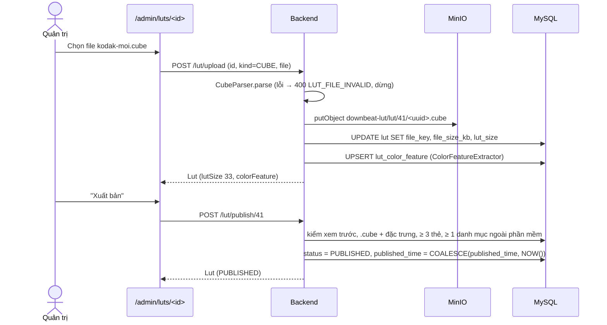

# Quản lý LUT

## 1. Mục tiêu và phạm vi

Sau plan này, quản trị **đưa một LUT mới lên kho mà không cần sửa dữ liệu mẫu**: tạo nháp (tiêu đề, tác giả, phong cách), điền mô tả / thẻ / danh mục / cờ Premium, tải file .cube (backend đọc và đo đặc trưng màu ngay bằng code của lát `dac-trung-mau`), tải ảnh bìa và ảnh trước / sau hoặc video xem trước, rồi **xuất bản** khi đủ điều kiện. LUT đã xuất bản hiện ngay ở cửa hàng; "Ẩn" làm LUT biến khỏi cửa hàng; LUT nháp hoặc đã ẩn chưa có lượt tải thì xoá được.

| Có làm | Không làm (để plan khác) |
|---|---|
| 8 endpoint `lut/*` quản trị (resource `LUT` đã tạo ở `V6` của `dac-trung-mau`) | CRUD danh mục, tác giả, trang `/admin/danh-muc`, `/admin/tac-gia` (đề xuất lát mới `danh-muc-tac-gia`, §11 câu 1) |
| Upload 5 loại file: .cube (bucket riêng tư, đo đặc trưng màu), ảnh bìa / trước / sau (jpg, png, webp ≤ 10 MB), video (mp4, webm ≤ 50 MB) | Tự sinh ảnh "sau" bằng cách áp .cube lên ảnh gốc (§11 câu 3) |
| Xuất bản có kiểm điều kiện (`PREVIEW_MISSING`, `LUT_FILE_MISSING`, `LUT_FEATURE_MISSING`), ẩn, xoá | Cập nhật chỉ mục gợi ý / `lut_similarity` khi xuất bản, ẩn (lát `chi-muc-tuong-dong` 2.1 móc vào `publish`, `hide`) |
| Trang `/admin/luts` (bảng, lọc, thêm nháp) và `/admin/luts/<id>` (sửa, upload, đặc trưng màu, điều kiện xuất bản) | Xoá file cũ trên MinIO khi thay file / xoá LUT (§11 câu 4) |
| Sinh slug từ tiêu đề bỏ dấu, trùng thì `-2`, `-3` | Đổi slug sau khi tạo; tải file .cube từ trang quản trị |

## 2. Tác nhân và phân quyền

| Tác nhân | Quyền (resource `LUT`, uri `/lut/`) | Ghi chú |
|---|---|---|
| Quản trị (role toàn quyền) | Mọi quyền | |
| Chức vụ được cấp `LUT` | VIEW: xem danh sách, chi tiết, tác giả · ADD: tạo nháp · UPDATE: sửa, upload, xuất bản, ẩn · DELETE: xoá | Cấp ở `/admin/phan-quyen` |
| `noaccess@downbeat.local`, khách hàng | Không | 403; sidebar không có mục; mở thẳng URL thấy "Truy cập bị từ chối" |

Không tạo resource mới. Trang `/admin/dac-trung-mau` (lát trước) dùng cùng mã `LUT`.

## 3. Luồng nghiệp vụ

**Luồng chính — đưa LUT mới lên kho:**
1. `/admin/luts` → "Thêm LUT" → nhập "Tiêu đề", chọn "Tác giả", "Phong cách" → "Tạo mới". Backend tạo LUT `DRAFT`, sinh slug, trả LUT; trang chuyển sang `/admin/luts/<id>`, toast "Đã tạo LUT nháp".
2. Ở trang chi tiết: điền "Mô tả", bật "LUT Premium" nếu cần, thêm thẻ (gõ rồi Enter), tick danh mục, chọn "Kiểu xem trước" → "Lưu thay đổi".
3. Khối "File LUT (.cube)" → chọn file → backend đọc file, lưu vào bucket riêng tư, ghi `file_key`, `file_size_kb`, `lut_size`, đo và lưu `lut_color_feature` → thẻ "Đặc trưng màu" hiện ngay.
4. Khối "Ảnh và video xem trước" → tải "Ảnh bìa", "Ảnh trước", "Ảnh sau" (hoặc "Video xem trước"). Mỗi lần chọn file là tải lên và lưu ngay, không cần bấm "Lưu thay đổi".
5. Khối "Điều kiện xuất bản" đủ 5 dấu "Đạt" → nút "Xuất bản" bật → backend kiểm lại, chuyển `PUBLISHED`, đặt `published_time` (lần đầu) → LUT có ở `/luts`, `/luts/<slug>`, xếp đầu "Mới nhất".

**Luồng phụ:**
- A1. Ẩn: menu ⋮ ở danh sách hoặc nút "Ẩn" ở chi tiết → hộp xác nhận → `HIDDEN`, cửa hàng trả 404 cho LUT đó. Xuất bản lại giữ `published_time` cũ.
- A2. Xoá: chỉ LUT `DRAFT` hoặc `HIDDEN` có `download_count = 0`; xoá cứng (thẻ, danh mục, đặc trưng màu xoá theo).
- A3. Thay file .cube / ảnh: tải file mới đè lên; với .cube thì đặc trưng màu tính lại.
- A4. Sửa LUT đang `PUBLISHED`: được, nhưng kết quả sau khi sửa vẫn phải đủ điều kiện xuất bản; không đủ thì báo lỗi và không ghi gì.
- A5. Đổi "Kiểu xem trước" không xoá file của kiểu kia (thiết kế §6.6).

**Ngoại lệ:**
- E1. File .cube hỏng → 400 `LUT_FILE_INVALID` kèm lý do (§5.3 của plan `dac-trung-mau`), không lưu file, giữ file và đặc trưng cũ.
- E2. Sai đuôi / sai nội dung / quá dung lượng → 415 / 413, không lưu.
- E3. Xuất bản thiếu điều kiện → 400 theo thứ tự `PREVIEW_MISSING` → `LUT_FILE_MISSING` → `LUT_FEATURE_MISSING`.
- E4. Tác giả / danh mục không tồn tại → 400.
- E5. Id không tồn tại → 404 "Không tìm thấy LUT"; trang chi tiết hiện "Không tìm thấy LUT".



## 4. Cơ sở dữ liệu

**Không có migration.** Dùng bảng `lut`, `lut_tag`, `lut_category_map`, `lut_category`, `creator` (V3), `lut_color_feature` và resource `LUT` (V6, lát `dac-trung-mau`).

| Cột `lut` | Ai ghi | Quy tắc |
|---|---|---|
| `title`, `description`, `creator_id`, `style`, `is_premium`, `preview_type` | Client qua `update` | Trim; `description` rỗng → NULL |
| `slug` | Server khi tạo | Sinh từ `title` (§5.2), không đổi khi sửa |
| `status` | Server | Tạo: `DRAFT`; đổi chỉ qua `publish` / `hide` |
| `cover_url`, `before_url`, `after_url`, `preview_video_url` | Server qua `upload` | URL công khai `{file-url}/downbeat-public/<key>` |
| `file_key`, `file_size_kb`, `lut_size` | Server qua `upload` kind `CUBE` | `file_size_kb` = làm tròn lên (byte / 1024) |
| `download_count` | Server | Tạo: 0 (lát `tai-lut` tăng) |
| `published_time` | Server qua `publish` | Chỉ đặt khi đang NULL |
| `created_by` | Server khi tạo | Id người đăng nhập |

- `lut_tag`, `lut_category_map`: mỗi lần `update` **thay toàn bộ** (xoá rồi chèn lại) trong cùng transaction.
- Khoá object MinIO (có UUID để không đụng `Cache-Control: immutable` của bucket công khai):
  - `.cube` (bucket riêng tư `downbeat-lut`): `lut/<id>/<uuid>.cube`
  - Ảnh / video (bucket công khai `downbeat-public`): `lut/<id>/<cover|before|after|video>-<uuid>.<đuôi>`
- Xoá: cứng, chỉ `DRAFT` hoặc `HIDDEN` có `download_count = 0`. `lut_tag`, `lut_category_map`, `lut_color_feature` xoá theo (CASCADE có sẵn).

## 5. Hợp đồng API (cố định — nguồn sự thật cho cả BE và FE)

Mọi response thành công bọc `{ "code": 200, "message": "OK", "result": … }`. Lỗi nghiệp vụ trả `{ "path", "code", "errorCode", "message" }`. Mọi endpoint thuộc resource `LUT` (controller `URI = "/lut/"`, `checkPermission` đầu tiên). POJO `Lut` có `NON_NULL`; `fileKey` không bao giờ ra JSON (đã `WRITE_ONLY`).

**Đối tượng LUT chi tiết** (trả bởi `get`, `update`, `upload`, `publish`, `hide`):
```json
{
  "id": 41, "slug": "kodak-moi", "title": "Kodak Mới",
  "description": "Màu phim Kodak ấm, grain nhẹ.",
  "creatorId": 3, "creatorName": "Analog Lab",
  "style": "phim-nhua", "isPremium": 1, "status": "DRAFT",
  "previewType": "BEFORE_AFTER",
  "coverUrl": "http://localhost:9020/downbeat-public/lut/41/cover-3f9a1c2e.jpg",
  "beforeUrl": "http://localhost:9020/downbeat-public/lut/41/before-7d20b4aa.jpg",
  "afterUrl": "http://localhost:9020/downbeat-public/lut/41/after-0c55e913.jpg",
  "fileSizeKb": 948, "lutSize": 33,
  "downloadCount": 0,
  "createdTime": "2026-11-11T08:00:00", "updatedTime": "2026-11-11T08:12:30",
  "tags": ["grain", "kodak", "phim"],
  "categories": ["phim-nhua", "chan-dung"],
  "colorFeature": { "lutId": 41, "brightness": 0.032, "contrast": 1.002, "saturation": 0.943, "warmth": 3.15, "tint": -1.09, "shadowA": -2.38, "shadowB": 2.78, "highlightA": 1.36, "highlightB": 2.48, "isMono": 0, "computedTime": "2026-11-11T08:10:02" }
}
```
- Chưa có file .cube: không có `fileSizeKb`, `lutSize`, `colorFeature`. Chưa xuất bản lần nào: không có `publishedTime`.
- `tags` xếp A→Z; `categories` là slug, xếp theo `sort_order` của danh mục. Không có thì mảng rỗng `[]`.

### 5.1 `GET /api/lut/list` — VIEW

Tham số: `keyword` (khớp `title` hoặc `slug`), `status`, `style`, `page` (mặc định 1), `limit` (mặc định 10, tối đa 100). Mọi trạng thái. Thứ tự `updated_time` DESC, `id` DESC. Dùng lại điều kiện `adminList` của lát `dac-trung-mau` (thêm tham số thứ tự).

```json
{
  "total": 39, "page": 1,
  "items": [
    { "id": 41, "slug": "kodak-moi", "title": "Kodak Mới", "creatorName": "Analog Lab", "style": "phim-nhua", "isPremium": 1, "status": "DRAFT", "downloadCount": 0, "updatedTime": "2026-11-11T08:12:30", "coverUrl": "http://localhost:9020/downbeat-public/lut/41/cover-3f9a1c2e.jpg" },
    { "id": 10, "slug": "kodak-400", "title": "Kodak 400", "creatorName": "Analog Lab", "style": "phim-nhua", "isPremium": 1, "status": "PUBLISHED", "downloadCount": 15120, "publishedTime": "2026-10-04T09:00:00", "updatedTime": "2026-11-10T08:00:00", "coverUrl": "http://localhost:9020/downbeat-public/lut/kodak-400/cover.jpg" }
  ]
}
```
Item danh sách chỉ có các khoá: `id`, `slug`, `title`, `creatorName`, `style`, `isPremium`, `status`, `downloadCount`, `publishedTime`, `updatedTime`, `coverUrl`.

### 5.2 `GET /api/lut/get?id=41` — VIEW

`result` = LUT chi tiết. Không có → 404 "Không tìm thấy LUT".

### 5.3 `POST /api/lut/update` — ADD (không có `id`) / UPDATE (có `id`)

Request (tạo):
```json
{ "title": "Kodak Mới", "creatorId": 3, "style": "phim-nhua" }
```
Request (sửa; các khoá không gửi được ghi thành giá trị rỗng / mặc định, vì form luôn gửi đủ):
```json
{
  "id": 41, "title": "Kodak Mới", "description": "Màu phim Kodak ấm, grain nhẹ.",
  "creatorId": 3, "style": "phim-nhua", "isPremium": 1, "previewType": "BEFORE_AFTER",
  "tags": ["Grain ", "kodak", "phim", "grain"],
  "categories": ["phim-nhua", "chan-dung"]
}
```
Response `result` = LUT chi tiết (ví dụ trên trả `tags: ["grain", "kodak", "phim"]`).

Quy tắc:
1. Tạo: chỉ dùng `title`, `description`, `creatorId`, `style`, `isPremium` (mặc định 0), `previewType` (mặc định `BEFORE_AFTER`), `tags`, `categories`. Server đặt `status = DRAFT`, `slug` sinh mới, `download_count = 0`, `created_by`, bỏ mọi khoá khác client gửi (`slug`, `status`, `coverUrl`, `downloadCount`, `publishedTime`…).
2. Sửa: id không có → 404. Chỉ ghi `title`, `description`, `creator_id`, `style`, `is_premium`, `preview_type`, thay toàn bộ thẻ và danh mục. **Không** đổi `slug`, `status`, file, `download_count`, `published_time`.
3. `creatorId` không có trong bảng `creator` → 400 "Tác giả không tồn tại".
4. Mỗi slug trong `categories` phải có trong `lut_category` (kể cả danh mục đang ẩn) → không thì 400 "Danh mục không tồn tại: {slug}" (slug đầu tiên sai). Trùng thì bỏ trùng.
5. Thẻ: trim, gộp khoảng trắng liên tiếp thành một, chữ thường (`Locale.ROOT`), giữ dấu, bỏ thẻ rỗng, bỏ trùng.
6. LUT đang `PUBLISHED`: áp thay đổi **trong bộ nhớ** rồi kiểm điều kiện xuất bản (§5.6) trước khi ghi; không đạt → lỗi tương ứng, không ghi gì.
7. Slug: tiêu đề → bỏ dấu (`Đ/đ` → `D/d`, còn lại `StringUtils.stripAccents`) → chữ thường → mọi ký tự ngoài `[a-z0-9]` thành `-` → gộp `-` liên tiếp → bỏ `-` đầu / cuối → cắt 140 ký tự → rỗng thì `lut`. Đã có slug đó (mọi trạng thái) thì thử `-2`, `-3`… đến khi chưa có.

Backend không kiểm độ dài / bắt buộc (frontend làm, §6).

### 5.4 `POST /api/lut/delete/{id}` — DELETE

`result` = id đã xoá (`41`). Không có → 404. `PUBLISHED` → 400 "LUT đang xuất bản, hãy ẩn trước khi xoá". `download_count > 0` → 400 "LUT đã có lượt tải, chỉ ẩn được, không xoá được".

### 5.5 `POST /api/lut/upload` — UPDATE (multipart/form-data)

Phần: `id` (số), `kind` (`CUBE` | `COVER` | `BEFORE` | `AFTER` | `VIDEO`), `file`. `result` = LUT chi tiết sau khi lưu.

| kind | Đuôi nhận (không phân biệt hoa thường) | Tối đa | Kiểm nội dung | Lưu vào |
|---|---|---|---|---|
| `CUBE` | `.cube` | 10 MB | `CubeParser.parse` (lỗi → `LUT_FILE_INVALID`) | bucket riêng tư; `file_key`, `file_size_kb`, `lut_size`; gọi `LutColorFeatureService.computeAndSave` |
| `COVER`, `BEFORE`, `AFTER` | `.jpg`, `.jpeg`, `.png`, `.webp` | 10 MB | magic bytes như `FileStorageService.verifySignature` | bucket công khai; `cover_url` / `before_url` / `after_url` |
| `VIDEO` | `.mp4`, `.webm` | 50 MB | mp4: byte 4–7 là `ftyp`; webm: bắt đầu `1A 45 DF A3` | bucket công khai; `preview_video_url` |

Thứ tự kiểm (gặp lỗi đầu tiên thì dừng, chưa ghi gì): LUT tồn tại → `kind` hợp lệ → file không rỗng → đuôi → dung lượng → nội dung → ghi MinIO → ghi DB. Với `CUBE`, ghi MinIO rồi `UPDATE lut` + upsert đặc trưng trong một transaction. LUT `PUBLISHED` vẫn upload được (file mới thay file cũ).

Content-type do server quyết định (`image/jpeg`, `image/png`, `image/webp`, `video/mp4`, `video/webm`, `.cube` = `text/plain; charset=utf-8`); không tin client. Không nhận `svg`, `html`, `gif`.

`application.yml`: `spring.servlet.multipart.max-file-size` = `50MB`, `max-request-size` = `52MB` (giới hạn theo kind kiểm ở service). File > 50 MB bị Spring chặn → 413 "File vượt quá dung lượng cho phép" (handler có sẵn).

### 5.6 `POST /api/lut/publish/{id}` — UPDATE

`result` = LUT chi tiết. Đang `PUBLISHED` → trả nguyên, không kiểm, không đổi gì. Còn lại kiểm theo thứ tự:
1. `PREVIEW_MISSING`: thiếu `cover_url`; hoặc `preview_type = BEFORE_AFTER` mà thiếu `before_url` / `after_url`; hoặc `VIDEO` mà thiếu `preview_video_url`.
2. `LUT_FILE_MISSING`: thiếu `file_key` hoặc chưa có dòng `lut_color_feature`.
3. `LUT_FEATURE_MISSING`: ít hơn 3 thẻ, hoặc không có danh mục nào thuộc nhóm khác `phan-mem` (thiết kế §7.2.7).

Đạt: `status = PUBLISHED`, `published_time = COALESCE(published_time, NOW())`.

### 5.7 `POST /api/lut/hide/{id}` — UPDATE

`PUBLISHED` → `HIDDEN`. Đang `HIDDEN` → trả nguyên. `DRAFT` → 400 "Chỉ ẩn được LUT đang xuất bản". `result` = LUT chi tiết.

### 5.8 `GET /api/lut/creators` — VIEW

Mọi tác giả (kể cả `status = 0`), xếp `name` A→Z. Dùng cho ô chọn "Tác giả".
```json
[ { "id": 3, "name": "Analog Lab", "slug": "analog-lab", "status": 1 }, { "id": 2, "name": "DownBeat Studio", "slug": "downbeat-studio", "status": 1 } ]
```

### 5.9 Lỗi nghiệp vụ

| Tình huống | HTTP | `errorCode` | Message (FE hiện nguyên văn qua toast) |
|---|---|---|---|
| `get`, `update` (có id), `delete`, `upload`, `publish`, `hide`: id không có | 404 | `DATA_NOT_FOUND` | Không tìm thấy LUT |
| `update`: tác giả không có | 400 | `BAD_REQUEST` | Tác giả không tồn tại |
| `update`: danh mục không có | 400 | `BAD_REQUEST` | Danh mục không tồn tại: {slug} |
| `delete`: LUT đang xuất bản | 400 | `BAD_REQUEST` | LUT đang xuất bản, hãy ẩn trước khi xoá |
| `delete`: LUT đã có lượt tải | 400 | `BAD_REQUEST` | LUT đã có lượt tải, chỉ ẩn được, không xoá được |
| `hide`: LUT nháp | 400 | `BAD_REQUEST` | Chỉ ẩn được LUT đang xuất bản |
| `upload`: `kind` sai | 400 | `BAD_REQUEST` | Loại file không hợp lệ |
| `upload`: file rỗng | 400 | `FILE_EMPTY` | File rỗng |
| `upload`: sai đuôi .cube | 415 | `FILE_TYPE_NOT_ALLOWED` | Chỉ nhận file .cube |
| `upload`: sai đuôi ảnh | 415 | `FILE_TYPE_NOT_ALLOWED` | Chỉ nhận ảnh .jpg, .jpeg, .png, .webp |
| `upload`: sai đuôi video | 415 | `FILE_TYPE_NOT_ALLOWED` | Chỉ nhận video .mp4, .webm |
| `upload`: nội dung không khớp đuôi | 415 | `FILE_TYPE_NOT_ALLOWED` | Nội dung file không khớp định dạng .{đuôi} |
| `upload`: .cube / ảnh > 10 MB | 413 | `FILE_TOO_LARGE` | File vượt quá dung lượng cho phép (10MB) |
| `upload`: video > 50 MB | 413 | `FILE_TOO_LARGE` | File vượt quá dung lượng cho phép |
| `upload`: .cube đọc lỗi | 400 | `LUT_FILE_INVALID` | Theo bảng §5.3 plan `dac-trung-mau` (ví dụ "File .cube không hợp lệ: thiếu LUT_3D_SIZE") |
| `publish` / `update` LUT đang xuất bản: thiếu ảnh / video | 400 | `PREVIEW_MISSING` (**mới**) | LUT chưa có đủ ảnh / video xem trước |
| `publish` / `update` LUT đang xuất bản: thiếu .cube / đặc trưng | 400 | `LUT_FILE_MISSING` (**mới**) | LUT chưa có file .cube đã đo đặc trưng màu |
| `publish` / `update` LUT đang xuất bản: < 3 thẻ hoặc không có danh mục ngoài phần mềm | 400 | `LUT_FEATURE_MISSING` (**mới**) | LUT cần ít nhất 3 thẻ và 1 danh mục |
| Không token | 401 | (không có) | Chưa đăng nhập |
| Thiếu quyền | 403 | `FORBIDDEN` | Bạn không có quyền thực hiện thao tác này! Path: /lut/, Action: {VIEW/ADD/UPDATE/DELETE} |

## 6. Giao diện (chuỗi cố định — test E2E chọn theo đúng các chuỗi này)

Sidebar nhóm "Chức năng chính": mục **"LUT"** (code `LUT`, icon `Film`, url `/admin/luts`) đứng **trước** "Đặc trưng màu".

Nhãn dùng chung: trạng thái `DRAFT` "Nháp" (badge `outline`), `PUBLISHED` "Đã xuất bản" (`default`), `HIDDEN` "Đã ẩn" (`secondary`) — dùng lại `LUT_STATUS_LABEL` của lát `dac-trung-mau`; phong cách theo `LUT_STYLE_LABEL`.

### 6.1 Danh sách `/admin/luts`

- `DataTableAdvanced`: tiêu đề **"LUT"**, mô tả "Thêm LUT mới, tải file .cube và ảnh xem trước, xuất bản hoặc ẩn khỏi cửa hàng."
- Bộ lọc: "Tìm kiếm" (placeholder "Tìm theo tên hoặc slug LUT"), "Trạng thái" (Tất cả, Nháp, Đã xuất bản, Đã ẩn), "Phong cách" (Tất cả + 8 nhãn).
- Cột: "LUT" (ảnh bìa 40×40 + tiêu đề đậm là link tới trang chi tiết + slug nhỏ), "Tác giả", "Phong cách", "Gói" (badge "Premium" khi `isPremium = 1`, ngược lại chữ "Miễn phí"), "Trạng thái", "Lượt tải" (định dạng `vi-VN`, ví dụ "15.120"), "Cập nhật" (`dd/MM/yyyy HH:mm`).
- Menu ⋮ (`aria-label="Thao tác {title}"`): "Chỉnh sửa" (→ chi tiết) · "Xuất bản" (Nháp / Đã ẩn, quyền UPDATE) · "Ẩn" (Đã xuất bản, quyền UPDATE) · "Xem ở cửa hàng" (Đã xuất bản; mở `/luts/{slug}` tab mới) · phân cách · "Xóa" (chữ đỏ; chỉ Nháp hoặc Đã ẩn có lượt tải 0, quyền DELETE). Không có cột chọn / xoá nhiều.
- "Xuất bản" từ danh sách gọi thẳng API; thiếu điều kiện thì toast message backend.
- "Ẩn" → `AlertDialog` "Ẩn LUT {title}?", mô tả "LUT biến khỏi cửa hàng ngay. Bạn có thể xuất bản lại sau.", nút "Ẩn" / "Hủy".
- "Xóa" → `DeleteConfirmDialog` có sẵn (itemType "LUT").
- Nút **"Thêm LUT"** (quyền ADD) → `FormDialog` tiêu đề "Thêm LUT", mô tả "Tạo bản nháp, sau đó điền thông tin và tải file ở trang chi tiết.", nút "Tạo mới" / "Hủy":

| Label | Kiểu | Bắt buộc | Validate (message) |
|---|---|---|---|
| Tiêu đề | text, tự focus | có | trống → "Vui lòng nhập tiêu đề"; > 150 → "Tiêu đề tối đa 150 ký tự" |
| Tác giả | select (từ `/lut/creators`; tác giả `status = 0` ghi thêm " (đang ẩn)") | có | "Vui lòng chọn tác giả" |
| Phong cách | select 8 nhãn | có | "Vui lòng chọn phong cách" |

  Tạo xong: đóng dialog, chuyển tới `/admin/luts/{id}`.

### 6.2 Chi tiết `/admin/luts/<id>`

Bố cục `container mx-auto p-6`: hàng đầu, rồi hai cột (≥ `lg`: trái 3/5 là form, phải 2/5 là file và điều kiện; nhỏ hơn thì xếp dọc).

- **Hàng đầu**: link "← Danh sách LUT" (về `/admin/luts`); heading = tiêu đề LUT; badge trạng thái; dòng slug `/luts/{slug}`; bên phải: "Xem ở cửa hàng" (chỉ Đã xuất bản), "Xuất bản" (Nháp / Đã ẩn, quyền UPDATE; **khoá** khi "Điều kiện xuất bản" còn mục "Chưa đạt"; đang gửi "Đang xuất bản…"), "Ẩn" (Đã xuất bản, quyền UPDATE, hỏi xác nhận như §6.1).
- Id không có (404): khung "Không tìm thấy LUT" + link "Về danh sách LUT". Lỗi khác: "Không tải được LUT" + "Thử lại". Đang tải: `Skeleton`.

**Cột trái — `Card` "Thông tin"** (form `useAppForm` + zod, nút cuối "Lưu thay đổi", đang lưu "Đang lưu…"; người chỉ có VIEW thấy mọi ô bị khoá, không có nút):

| Label | Kiểu | Bắt buộc | Validate (message) |
|---|---|---|---|
| Tiêu đề | text | có | trống → "Vui lòng nhập tiêu đề"; > 150 → "Tiêu đề tối đa 150 ký tự" |
| Mô tả | textarea 4 dòng, đếm "{n}/1000" | không | > 1000 → "Mô tả tối đa 1000 ký tự" |
| Tác giả | select | có | "Vui lòng chọn tác giả" |
| Phong cách | select | có | "Vui lòng chọn phong cách" |
| LUT Premium | switch, mô tả "Chỉ gói Pro, Studio tải được" | | |
| Thẻ | ô nhập (placeholder "Gõ thẻ rồi nhấn Enter") + danh sách chip; Enter hoặc dấu phẩy thêm chip; chip có nút xoá `aria-label="Xoá thẻ {thẻ}"`; ghi chú "Cần ít nhất 3 thẻ để xuất bản" | không (nháp) | thẻ > 50 ký tự → "Mỗi thẻ tối đa 50 ký tự" (không thêm chip); > 20 thẻ → "Tối đa 20 thẻ"; thẻ trùng (sau khi chuẩn hoá như §5.3) không thêm, không báo lỗi |
| Danh mục | 4 nhóm checkbox theo `groupCode`: "Phong cách", "Tông màu", "Dịp", "Phần mềm" (từ `/lut-category/public/list`); mỗi checkbox `aria-label` = tên danh mục; ghi chú "Cần ít nhất 1 danh mục ngoài nhóm Phần mềm để xuất bản" | không (nháp) | |
| Kiểu xem trước | radio "Ảnh trước / sau" (`BEFORE_AFTER`) / "Video" (`VIDEO`) | có | |

Toast: lưu "Đã lưu LUT"; lỗi → message backend.

**Cột phải:**

1. `Card` **"File LUT (.cube)"**: có file → "LUT {lutSize}³ · {fileSizeKb} KB"; chưa có → "Chưa có file .cube". Nút "Tải file .cube" / "Thay file .cube" (quyền UPDATE; đang tải "Đang tải lên…"). Input file ẩn `accept=".cube"`, `aria-label="Chọn file .cube"`. Kiểm trước khi gửi: đuôi khác `.cube` → dòng lỗi dưới nút "Chỉ nhận file .cube"; > 10 MB → "File tối đa 10 MB" (không gọi API).
2. Thẻ **"Đặc trưng màu"** (`LutColorFeatureCard` của lát `dac-trung-mau`); chưa có thì khung trống "Chưa có đặc trưng màu" + "Tải file .cube để đo đặc trưng màu."
3. `Card` **"Ảnh và video xem trước"**: ô "Ảnh bìa" luôn có; theo **giá trị đang chọn** của "Kiểu xem trước": "Ảnh trước" + "Ảnh sau", hoặc "Video xem trước". Mỗi ô: ảnh (tỉ lệ 16:9, `alt` = tên ô) / `<video controls muted>` hoặc khung xám "Chưa có", nút "Tải lên" / "Thay" (đang tải "Đang tải lên…"), input ẩn `aria-label="Chọn file {tên ô}"`, `accept` theo §5.5. Kiểm trước: sai đuôi → "Chỉ nhận ảnh .jpg, .jpeg, .png, .webp" / "Chỉ nhận video .mp4, .webm"; quá cỡ → "File tối đa 10 MB" / "File tối đa 50 MB". Ghi chú dưới tiêu đề: "Chọn file là tải lên ngay, không cần bấm Lưu thay đổi."
4. `Card` **"Điều kiện xuất bản"** (theo dữ liệu **đã lưu** của LUT, không theo form chưa lưu): 5 dòng, mỗi dòng biểu tượng ✓ / ✗ + chữ + nhãn ẩn cho trình đọc màn hình "Đạt" / "Chưa đạt":
   - "Có ảnh bìa"
   - "Có ảnh trước và ảnh sau" (`BEFORE_AFTER`) hoặc "Có video xem trước" (`VIDEO`, theo `previewType` đã lưu)
   - "Có file .cube đã đo đặc trưng màu"
   - "Có ít nhất 3 thẻ"
   - "Có ít nhất 1 danh mục ngoài nhóm Phần mềm"

Toast upload: "Đã tải lên file .cube" / "Đã tải lên Ảnh bìa" / "Đã tải lên Ảnh trước" / "Đã tải lên Ảnh sau" / "Đã tải lên Video xem trước". Xuất bản "Đã xuất bản LUT"; ẩn "Đã ẩn LUT"; xoá "Đã xoá LUT"; tạo "Đã tạo LUT nháp". Lỗi API (kể cả `LUT_FILE_INVALID`) → toast message backend.

## 7. Việc backend (Codex)

Package `vn.aeoc.business.lut`. Plan `dac-trung-mau` phải xong trước (dùng `LutColorFeatureService`, `CubeParser`, `LutRepository.adminList`, resource `LUT`).

1. `base/.../constant/ErrorCode.java`: thêm `PREVIEW_MISSING(400, "LUT chưa có đủ ảnh / video xem trước")`, `LUT_FILE_MISSING(400, "LUT chưa có file .cube đã đo đặc trưng màu")`, `LUT_FEATURE_MISSING(400, "LUT cần ít nhất 3 thẻ và 1 danh mục")`.
2. `app/src/main/resources/application.yml`: `spring.servlet.multipart.max-file-size: 50MB`, `max-request-size: 52MB` (bỏ tham chiếu `${upload.max-size}` ở dòng này; `upload.max-size` vẫn là 10MB cho ảnh / .cube).
3. `authenticate/.../service/FileStorageService.java`:
   - `String putPublic(String key, InputStream in, long size, String contentType)` → trả URL công khai (header `Cache-Control` immutable như hiện có).
   - `void putPrivate(String key, byte[] data, String contentType)` (bucket riêng tư, không policy).
   - Hàm kiểm dùng chung: `String requireExtension(MultipartFile, Set<String> allowed, String message)`, `void requireMaxSize(MultipartFile, DataSize max)`, `void verifySignature(...)` thêm `mp4`, `webm`. Message theo §5.9.
   - Hàm `upload(MultipartFile)` cũ (khoá theo ngày, whitelist có pdf / office) không còn ai gọi sau khi gỡ `FileController`: xoá nếu không còn tham chiếu.
4. `entity/.../data/mysql/lut/Creator.java`: đã có; kiểm có đủ `id`, `name`, `slug`, `status`.
5. `business/.../lut/constant/LutUploadKind.java`: enum `CUBE`, `COVER`, `BEFORE`, `AFTER`, `VIDEO` (đuôi, cỡ tối đa, cột đích, tên hiển thị trong log).
6. `business/.../lut/service/LutSlugGenerator.java`: lớp thuần `static String toSlug(String title)` và `static String nextFree(String base, Predicate<String> exists)` theo §5.3 mục 7.
7. `business/.../lut/repository/LutRepository.java`: `adminList(..., List<SortField<?>> order)` (dùng lại điều kiện của `dac-trung-mau`), `getAdminById(id)` (đủ cột chi tiết + `creator_name`), `existsBySlug`, `updateInfo(Lut)` (`updateByCondition` 6 cột §5.3 mục 2), `updateFile(...)`, `updateStatus(id, status, publishedTime)`, `replaceTags(id, tags)`, `replaceCategories(id, categoryIds)`, `getTags(id)`, `getCategorySlugs(id)` (xếp `sort_order`), `countNonSoftwareCategories(id)` hoặc trả kèm `groupCode` để service đếm, `getCategoryIdsBySlugs(slugs)`, `listCreators()`, `existsCreator(id)`.
8. `business/.../lut/service/LutAdminService.java` `extends BaseService<LutRepository, Lut, Integer>` (inject `LutColorFeatureService`, `FileStorageService`):
   - `list`, `get` (gắn `tags`, `categories`, `colorFeature`), `upsert(User login, Lut req)`, `delete`, `upload(id, kind, file)`, `publish(id)`, `hide(id)`, `creators()`.
   - Kiểm điều kiện xuất bản đặt ở **một** hàm `checkPublishable(Lut state, List<String> tags, List<LutCategory> categories, boolean hasFeature)` dùng cho cả `publish` và `update` LUT đang xuất bản (§5.3 mục 6).
   - `@Transactional` cho `upsert`, `delete`, `publish`, `hide`, phần ghi DB của `upload`.
   - `upload` kind `CUBE`: đọc hết byte → `CubeParser.parse` (lỗi thì dừng trước MinIO) → `putPrivate` → `updateFile` → `LutColorFeatureService.computeAndSave(id, bytes)` (hoặc nhận `CubeLut` đã parse để không parse hai lần).
9. `business/.../lut/controller/LutAdminController.java` `extends BaseController`, `URI = "/lut/"`: 8 endpoint §5 (`upload` nhận `@RequestParam Integer id, @RequestParam String kind, @RequestParam MultipartFile file`).
10. Nếu đọc lại `LutCategoryService` thấy cache `lutCategoryCache` đang cache cả danh sách: không cần xoá cache ở lát này (không sửa danh mục).

Quyết định đã chốt, worker không tự đổi: slug không đổi khi sửa tiêu đề; xoá cứng chỉ cho Nháp / Đã ẩn có lượt tải 0; `published_time` chỉ đặt lần đầu; thứ tự kiểm xuất bản `PREVIEW_MISSING` → `LUT_FILE_MISSING` → `LUT_FEATURE_MISSING`; danh mục nhóm `phan-mem` không tính cho điều kiện xuất bản; không xoá object cũ trên MinIO; khoá object có UUID.

Unit test bắt buộc (JUnit 5 + AssertJ + Mockito, `new` service với mock, `new QueryExecutor(Runnable::run)`): TC-01 → TC-08 ở §9.
- `business/src/test/java/vn/aeoc/business/lut/service/LutSlugGeneratorTest.java` (TC-01)
- `business/src/test/java/vn/aeoc/business/lut/service/LutAdminServiceTest.java` (TC-02 → TC-08)

Nghiệm thu: `mvn -q "-Djooq.codegen.skip=true" -pl business -am test` xanh; restart; curl mỗi endpoint §5 (tạo nháp → upload .cube + 3 ảnh → sửa đủ thẻ / danh mục → publish → `lut/public/get?slug=` 200 → hide → `lut/public/get` 404 → delete), mỗi dòng lỗi §5.9; dán response vào `worker_done`.

## 8. Việc frontend (agy)

Hai trang mới, dùng lại khối của lát `dac-trung-mau` (`LutColorFeatureCard`, `LUT_STATUS_LABEL`) và `LUT_STYLE_LABEL`.

1. `lib/types/lut-admin.ts`: `LutAdminItemDTO` (§5.1), `LutAdminDetailDTO` (§5 đối tượng chi tiết, `colorFeature?: LutColorFeatureDTO`), `LutAdminListApiRequest` (`keyword?`, `status?`, `style?`, `paging?`), `LutUpsertApiRequest`, `LutUploadKind`, `CreatorOptionDTO`, `LUT_UPLOAD_RULES` (đuôi, cỡ tối đa, `accept`, tên ô, message §6 theo kind).
2. `lib/axios/lut-admin.ts`: `getLutAdminList`, `getLutAdmin(id)`, `upsertLut`, `deleteLut(id)`, `uploadLutFile(id, kind, file)` (`FormData`, không tự đặt `Content-Type`), `publishLut(id)`, `hideLut(id)`, `getLutCreators()`. Danh mục dùng hàm có sẵn đọc `/lut-category/public/list`.
3. `lib/tanstack/options/lut-admin.ts`: `LUT_ADMIN_QUERY_KEY = ["lut-admin"]`; list (`keepPreviousData`), detail (`[...KEY, "detail", id]`), creators (`staleTime: 60_000`); mutation tạo / sửa / xoá / upload / xuất bản / ẩn với `meta` toast §6; `invalidatesQuery: [LUT_ADMIN_QUERY_KEY, LUT_FEATURES_QUERY_KEY]` (trang "Đặc trưng màu" thấy LUT mới). Upload và xuất bản / ẩn còn `setQueryData` chi tiết từ `result` để trang cập nhật ngay.
4. `lib/lut-admin/publish-checklist.ts`: hàm thuần `publishChecklist(detail, categories)` → 5 mục §6.2 (`{ label, ok }`), dùng cho khối "Điều kiện xuất bản" và khoá nút "Xuất bản". Nhóm `phan-mem` không tính.
5. `lib/lut-admin/tag-utils.ts`: `normalizeTag` giống §5.3 mục 5 (để chặn trùng ở client).
6. `components/admin/lut/columns.tsx`, `components/admin/lut/lut-create-dialog.tsx` (§6.1), `components/admin/lut/lut-hide-dialog.tsx`.
7. `components/admin/lut/lut-info-form.tsx` (`useAppForm` + zod §6.2), `components/admin/lut/tag-input.tsx`, `components/admin/lut/category-checkboxes.tsx`, `components/admin/lut/file-slot.tsx` (một ô upload dùng cho cả 5 kind), `components/admin/lut/publish-checklist-card.tsx`.
8. `routes/admin/luts/index.tsx` (danh sách, chép khung `chuc-vu.tsx`) và `routes/admin/luts/$id.tsx` (chi tiết; `id` không phải số dương → coi như 404). Cả hai bọc `AdminPermissionGuard code="LUT"`.
9. `components/admin/sidebar/admin-sidebar.tsx`: thêm `{ code: "LUT", title: "LUT", url: "/admin/luts", icon: Film }` **trước** mục "Đặc trưng màu".

Không sửa: khu cửa hàng (LUT mới tự hiện qua API công khai có sẵn), `tests/e2e/**`.

Component shadcn dùng: có sẵn trong `components/ui/`: `card`, `badge`, `button`, `input`, `textarea`, `select`, `switch`, `checkbox`, `radio-group`, `label`, `field`, `alert`, `alert-dialog`, `form-dialog`, `dropdown-menu`, `skeleton`, `separator`, `tooltip`. Cần `shadcn add`: không.

## 9. Test case

Dữ liệu E2E: tiêu đề `E2E LUT <uid>`; file .cube sinh trong test (identity N = 17, chuỗi văn bản); ảnh PNG 1×1 sinh trong test (buffer); video là buffer bắt đầu `00 00 00 18 66 74 79 70 6D 70 34 32` (chỉ cần qua kiểm magic). **Dọn dẹp**: mọi LUT test tạo ra được ẩn rồi xoá trong `afterAll` (lượt tải 0 nên xoá được), để không làm sai số liệu của các spec khác.

| ID | Loại | Mô tả | Tiền điều kiện | Bước | Kết quả mong đợi |
|---|---|---|---|---|---|
| TC-01 | unit | Sinh slug | — | `toSlug`: "Đà Lạt Mộng Mơ", "  Neo -- Tokyo!! ", "!!!", "Ánh Trăng 2026"; `nextFree("da-lat", exists = {"da-lat", "da-lat-2"})` | "da-lat-mong-mo", "neo-tokyo", "lut", "anh-trang-2026"; "da-lat-3" |
| TC-02 | unit | Tạo: field server ghi đè, thẻ chuẩn hoá | Mock tác giả 3 có, danh mục `phim-nhua` có | `upsert(login 1, { title " Kodak Mới ", creatorId 3, style "phim-nhua", status "PUBLISHED", slug "x", downloadCount 9, tags [" Grain ", "grain", "Hoàng   Hôn", ""], categories ["phim-nhua", "phim-nhua"] })` | `insert` nhận `title` "Kodak Mới", `status` "DRAFT", `slug` "kodak-moi", `downloadCount` 0, `createdBy` 1; `replaceTags` nhận ["grain", "hoàng hôn"]; `replaceCategories` nhận 1 id |
| TC-03 | unit | Sửa: chỉ ghi cột cho phép, tham chiếu sai | LUT 41 `DRAFT` slug "kodak-moi" | (a) `upsert({ id 41, title "Tên Khác", slug "y", status "PUBLISHED" })`; (b) `creatorId 999`; (c) `categories ["khong-co"]`; (d) id 999 | (a) `updateInfo` được gọi, không có hàm nào ghi `slug` / `status`; (b) `BAD_REQUEST` "Tác giả không tồn tại"; (c) "Danh mục không tồn tại: khong-co"; (d) `DATA_NOT_FOUND`; (b)→(d) không ghi gì |
| TC-04 | unit | Thứ tự điều kiện xuất bản | LUT `DRAFT` | (a) thiếu ảnh bìa; (b) đủ ảnh, `VIDEO` mà thiếu video; (c) đủ xem trước, chưa có đặc trưng; (d) đủ file, 2 thẻ; (e) 3 thẻ, chỉ danh mục `premiere-pro`; (f) đủ hết; (g) LUT đang `PUBLISHED` thiếu ảnh bìa | (a), (b) `PREVIEW_MISSING`; (c) `LUT_FILE_MISSING`; (d), (e) `LUT_FEATURE_MISSING`; (f) `updateStatus(PUBLISHED, now)`; (g) trả nguyên, không gọi `updateStatus` |
| TC-05 | unit | `published_time` giữ lần đầu, ẩn | LUT `HIDDEN` có `publishedTime` T | `publish`; `hide` LUT `DRAFT`; `hide` LUT `HIDDEN` | `updateStatus` với T (không phải now); `BAD_REQUEST` "Chỉ ẩn được LUT đang xuất bản"; trả nguyên |
| TC-06 | unit | Sửa LUT đang xuất bản phải giữ đủ điều kiện | LUT `PUBLISHED` đủ điều kiện, 3 thẻ | `upsert` với 2 thẻ; `upsert` đổi `previewType` sang `VIDEO` khi chưa có video | `LUT_FEATURE_MISSING`; `PREVIEW_MISSING`; cả hai không gọi `updateInfo` / `replaceTags` |
| TC-07 | unit | Xoá | — | LUT `DRAFT` lượt tải 0; `PUBLISHED`; `HIDDEN` lượt tải 5; id 999 | gọi `delete(41)`; "LUT đang xuất bản, hãy ẩn trước khi xoá"; "LUT đã có lượt tải, chỉ ẩn được, không xoá được"; `DATA_NOT_FOUND` |
| TC-08 | unit | Upload: kiểm trước, lỗi thì không ghi | LUT 41 có | (a) `CUBE` file "x.txt"; (b) `CUBE` .cube thiếu dòng; (c) `COVER` "a.png" nội dung "<html>"; (d) `COVER` "a.svg"; (e) `COVER` png 11 MB; (f) `VIDEO` "v.mp4" đúng magic; (g) `CUBE` identity 17 hợp lệ; (h) kind "LOGO" | (a) 415 "Chỉ nhận file .cube"; (b) `LUT_FILE_INVALID`; (c) 415 "Nội dung file không khớp định dạng .png"; (d) "Chỉ nhận ảnh .jpg, .jpeg, .png, .webp"; (e) 413 "…(10MB)"; (a)–(e) không gọi `put*`, không ghi DB; (f) `putPublic` content-type `video/mp4`, ghi `preview_video_url`; (g) `putPrivate` khoá dạng `lut/41/<uuid>.cube`, `updateFile` `lut_size` 17, gọi `computeAndSave`; (h) "Loại file không hợp lệ" |
| TC-09 | api | Tạo nháp, slug, field server | Token admin | `POST /lut/update { title "E2E LUT <uid>", creatorId <id Analog Lab>, style "phim-nhua", status "PUBLISHED", slug "hack", downloadCount 99 }`; tạo lần 2 cùng tiêu đề | 200; `status` "DRAFT", `slug` "e2e-lut-<uid>", `downloadCount` 0, `tags` [], `categories` [], không có `fileKey`, `lutSize`, `colorFeature`, `publishedTime`; lần 2 `slug` "e2e-lut-<uid>-2" |
| TC-10 | api | Sửa thông tin, thẻ, danh mục | LUT TC-09 | `update { id, title "E2E LUT <uid> sửa", description "Mô tả", creatorId, style "lanh", isPremium 1, previewType "BEFORE_AFTER", tags [" Grain ", "grain", "Hoàng   Hôn", "phim"], categories ["lanh", "du-lich", "lanh"] }`; `GET /lut/get?id=` | `title` mới, `slug` **không đổi**, `style` "lanh", `isPremium` 1, `tags` ["grain", "hoàng hôn", "phim"], `categories` ["lanh", "du-lich"]; `get` trả giống |
| TC-11 | api | Tham chiếu sai, id sai | — | `update` với `creatorId 999999`; với `categories ["khong-co"]`; `update { id 999999, … }`; `GET /lut/get?id=999999` | 400 "Tác giả không tồn tại"; 400 "Danh mục không tồn tại: khong-co"; 404 "Không tìm thấy LUT"; 404 "Không tìm thấy LUT" |
| TC-12 | api | Upload .cube hợp lệ đo đặc trưng | LUT TC-09 | `POST /lut/upload` id, kind `CUBE`, file "e2e.cube" identity N = 17 | 200; `lutSize` 17, `fileSizeKb` > 0; `colorFeature` identity (brightness 0, contrast 1, saturation 1 ±0,01); `GET /lut/feature/list?keyword=<slug>` có `colorFeature` |
| TC-13 | api | Upload .cube hỏng / sai đuôi | LUT TC-12 | (a) .cube thiếu `LUT_3D_SIZE`; (b) .cube `LUT_3D_SIZE 25`; (c) file "e2e.txt" kind `CUBE`; (d) file rỗng; sau đó `get` | (a) 400 `LUT_FILE_INVALID` "File .cube không hợp lệ: thiếu LUT_3D_SIZE"; (b) "File .cube không hợp lệ: kích thước 25 không được hỗ trợ (chỉ nhận 17, 33, 65)"; (c) 415 "Chỉ nhận file .cube"; (d) 400 "File rỗng"; `get` vẫn `lutSize` 17, đặc trưng cũ |
| TC-14 | api | Upload ảnh, video | LUT TC-09 | `COVER`, `BEFORE`, `AFTER` PNG 1×1; `GET` `coverUrl` (không token); `VIDEO` "v.mp4" magic mp4 | 200, `coverUrl` / `beforeUrl` / `afterUrl` khác nhau, chứa `/lut/<id>/cover-`, `/before-`, `/after-`; GET ảnh 200 `content-type` `image/png`; `previewVideoUrl` chứa `/lut/<id>/video-` |
| TC-15 | api | Upload ảnh, video sai | LUT TC-09 | (a) `COVER` "a.svg"; (b) `COVER` "a.png" nội dung "<html></html>"; (c) `COVER` PNG 10,5 MB; (d) `VIDEO` "v.mov"; (e) kind "LOGO"; (f) id 999999 | (a) 415 "Chỉ nhận ảnh .jpg, .jpeg, .png, .webp"; (b) 415 "Nội dung file không khớp định dạng .png"; (c) 413 "File vượt quá dung lượng cho phép (10MB)"; (d) 415 "Chỉ nhận video .mp4, .webm"; (e) 400 "Loại file không hợp lệ"; (f) 404 |
| TC-16 | api | Xuất bản: lần lượt từng điều kiện | LUT mới tạo (nháp) | (1) publish; (2) upload 3 ảnh → publish; (3) upload .cube → publish; (4) `update` 3 thẻ + chỉ `["premiere-pro"]` → publish; (5) `update` thêm `"lanh"` → publish | (1) 400 `PREVIEW_MISSING` "LUT chưa có đủ ảnh / video xem trước"; (2) 400 `LUT_FILE_MISSING` "LUT chưa có file .cube đã đo đặc trưng màu"; (3), (4) 400 `LUT_FEATURE_MISSING` "LUT cần ít nhất 3 thẻ và 1 danh mục"; (5) 200 `status` "PUBLISHED", có `publishedTime` |
| TC-17 | api | Xuất bản hiện ở cửa hàng | TC-16 (5) | `GET /lut/public/get?slug=<slug>`; `GET /lut/public/list?sort=newest&limit=1`; publish lần nữa | 200, không có `fileKey`; item đầu là LUT này; lần nữa 200, `publishedTime` không đổi |
| TC-18 | api | Kiểu video | LUT đủ điều kiện ở dạng ảnh, chưa xuất bản | `update previewType "VIDEO"` → publish; upload `VIDEO` → publish | 400 `PREVIEW_MISSING`; 200 `PUBLISHED` |
| TC-19 | api | Sửa LUT đang xuất bản | LUT TC-17 (3 thẻ) | `update` còn 2 thẻ; `get` | 400 `LUT_FEATURE_MISSING`; `get` vẫn 3 thẻ, tiêu đề cũ |
| TC-20 | api | Ẩn và xuất bản lại | LUT TC-17, `publishedTime` T | `hide`; `GET /lut/public/get?slug=`; `hide` lần nữa; `publish`; `hide` một LUT nháp | `HIDDEN`; 404; 200 vẫn `HIDDEN`; `PUBLISHED`, `publishedTime` = T; 400 "Chỉ ẩn được LUT đang xuất bản" |
| TC-21 | api | Xoá | LUT nháp; LUT đang xuất bản; `hoang-hon-cu` (HIDDEN, 99999 lượt tải) | `delete` từng cái; `delete/999999`; `get` LUT nháp vừa xoá; `lut/feature/list?keyword=<slug>` | 200 `result` = id; 400 "LUT đang xuất bản, hãy ẩn trước khi xoá"; 400 "LUT đã có lượt tải, chỉ ẩn được, không xoá được"; 404; 404; total 0 |
| TC-22 | api | Danh sách, lọc, tác giả | Có LUT TC-09 | `GET /lut/list?keyword=E2E LUT <uid>`; `?status=HIDDEN`; `?style=lanh&limit=100`; `?limit=5&page=2`; `GET /lut/creators` | Item chỉ gồm các khoá trong 11 khoá §5.1 (khoá rỗng được bỏ), không có `description`, `tags`, `colorFeature`; mọi item `HIDDEN`; mọi item `lanh`; 5 item; 7 tác giả mẫu, xếp A→Z ("Analog Lab" đầu) |
| TC-23 | api | Quyền | Token `noaccess`, khách hàng, không token | `GET /lut/list`, `GET /lut/get?id=1`, `POST /lut/update {title}`, `POST /lut/upload`, `POST /lut/publish/1`, `POST /lut/hide/1`, `POST /lut/delete/1`, `GET /lut/creators` | `noaccess`, khách hàng: 403 `FORBIDDEN` (`update` không id → Action ADD; `upload`, `publish`, `hide` → UPDATE; `delete` → DELETE); không token: 401 "Chưa đăng nhập" |
| TC-24 | e2e | Thêm LUT nháp | Đăng nhập admin | Sidebar "LUT" → "Thêm LUT" → "Tạo mới" khi trống → điền "E2E LUT <uid>", tác giả "Analog Lab", phong cách "Phim nhựa" → "Tạo mới" | Thấy "Vui lòng nhập tiêu đề", "Vui lòng chọn tác giả", "Vui lòng chọn phong cách"; toast "Đã tạo LUT nháp"; URL `/admin/luts/<số>`; heading "E2E LUT <uid>", badge "Nháp"; khối "Điều kiện xuất bản" 5 dòng "Chưa đạt"; nút "Xuất bản" bị khoá |
| TC-25 | e2e | Điền thông tin | Sau TC-24 | Mô tả "Mô tả E2E"; bật "LUT Premium"; gõ thẻ "Grain" Enter, "grain" Enter, "phim" Enter, "kodak," ; gõ thẻ 51 ký tự Enter; tick "Phim nhựa", "Chân dung" → "Lưu thay đổi" | Có 3 chip "grain", "phim", "kodak"; thấy "Mỗi thẻ tối đa 50 ký tự"; toast "Đã lưu LUT"; dòng "Có ít nhất 3 thẻ", "Có ít nhất 1 danh mục ngoài nhóm Phần mềm" thành "Đạt" |
| TC-26 | e2e | Upload file và đặc trưng màu | Sau TC-25 | Input "Chọn file .cube" ← file "sai.txt"; ← .cube identity 17; "Chọn file Ảnh bìa", "Chọn file Ảnh trước", "Chọn file Ảnh sau" ← PNG | Dòng lỗi "Chỉ nhận file .cube" (không có request upload); toast "Đã tải lên file .cube", khối "File LUT (.cube)" "LUT 17³ · {n} KB", thẻ "Đặc trưng màu" có meter "Nhiệt độ" valuetext "0,0"; 3 toast tải ảnh; ảnh "Ảnh bìa" hiện; 5 dòng "Đạt"; nút "Xuất bản" bật |
| TC-27 | e2e | .cube hỏng báo lỗi từ backend | Sau TC-26 | Input "Chọn file .cube" ← .cube `LUT_3D_SIZE 25` | Toast "File .cube không hợp lệ: kích thước 25 không được hỗ trợ (chỉ nhận 17, 33, 65)"; khối vẫn "LUT 17³" |
| TC-28 | e2e | Xuất bản, xem ở cửa hàng, ẩn | Sau TC-26 | "Xuất bản"; "Xem ở cửa hàng" (tab mới); về trang chi tiết → "Ẩn" → xác nhận "Ẩn"; mở `/luts/<slug>` | Toast "Đã xuất bản LUT", badge "Đã xuất bản"; tab mới có heading "E2E LUT <uid>"; toast "Đã ẩn LUT", badge "Đã ẩn"; cửa hàng hiện "Không tìm thấy LUT" |
| TC-29 | e2e | Kiểu xem trước video | LUT nháp mới (tạo qua API) | Chọn "Video" | Ô "Video xem trước" hiện, ô "Ảnh trước", "Ảnh sau" ẩn; dòng điều kiện vẫn ghi "Có ảnh trước và ảnh sau" (chưa lưu); "Lưu thay đổi" → dòng đổi thành "Có video xem trước" |
| TC-30 | e2e | Danh sách: lọc, menu theo trạng thái, xoá | LUT ẩn từ TC-28; LUT nháp tạo qua API | Lọc "Trạng thái" = "Đã ẩn" + tìm "E2E LUT <uid>"; mở ⋮; lọc "Đã xuất bản" + tìm "Kodak 400", mở ⋮; tìm LUT nháp → ⋮ "Xóa" → xác nhận | Hàng ẩn có "Xuất bản", "Xóa", không có "Ẩn"; "Kodak 400" có "Ẩn", "Xem ở cửa hàng", không có "Xóa"; toast "Đã xoá LUT", hàng biến mất |
| TC-31 | e2e | LUT không tồn tại | Đăng nhập admin | Mở `/admin/luts/999999`; `/admin/luts/abc` | Cả hai thấy "Không tìm thấy LUT" và link "Về danh sách LUT" |
| TC-32 | e2e | Không có quyền | Đăng nhập `noaccess@downbeat.local` | Mở `/admin`; `/admin/luts`; `/admin/luts/1` | Sidebar không có link "LUT"; hai trang đều "Truy cập bị từ chối" |

Loại: `unit` = Codex viết JUnit · `api` / `e2e` = Claude viết trong `frontend/tests/e2e/quan-ly-lut.spec.ts`.

Tổng: 8 `unit` · 15 `api` (TC-09 → TC-23) · 9 `e2e` (TC-24 → TC-32). Spec chạy `--workers=1` (các TC nối tiếp trên cùng LUT). Mọi endpoint §5.1 → §5.8 có TC `api`; mọi dòng lỗi §5.9 có TC `api` (dòng "video > 50 MB" phủ bằng handler có sẵn, TC-15 chỉ kiểm 10 MB để test không phải tạo file 50 MB).

## 10. Tiêu chí hoàn thành

- [x] Mọi TC ở §9 pass (TC-01 → TC-08 bằng JUnit, còn lại bằng `quan-ly-lut.spec.ts`)
- [ ] Spec `dac-trung-mau`, `kho-lut`, `shop-flows` vẫn xanh sau khi chạy `quan-ly-lut.spec.ts` (đã dọn LUT test) — chưa chạy lại ở phiên B/C, spec dọn LUT test trong `afterAll`
- [x] `mvn test` (business), `pnpm build`, `pnpm lint` xanh
- [x] Claude cập nhật `frontend/AGENTS.md` (mục "Chưa có mẫu": tải file lên → trỏ tới `components/admin/lut/file-slot.tsx`), `backend/AGENTS.md` (mẫu upload: `FileStorageService.putPublic` / `putPrivate`, bỏ dòng `FileController` ở "Code cũ"), `docs/tai-lieu-thiet-ke.md` §5.6 (8 endpoint), §5.7 (`LUT_FILE_MISSING`), §4.8
- [x] Có `docs/chuc-nang/quan-ly-lut.md`

## 11. Rủi ro / câu hỏi mở

1. **Tách lát.** Mục 1.3 của kế hoạch tổng gồm LUT + danh mục + tác giả (~15 endpoint, 4 màn hình), quá to cho một lượt worker. Plan này chỉ làm LUT; đề xuất lát mới **`danh-muc-tac-gia`** (1.3b): CRUD `lut-category`, `creator`, trang `/admin/danh-muc`, `/admin/tac-gia`, xoá cache `lutCategoryCache` khi sửa. Trong lúc chờ, ô "Tác giả" đọc `GET /lut/creators` (quyền `LUT`), ô "Danh mục" đọc API công khai. Đồng ý tách và thêm 1.3b vào `docs/plan/README.md`?
2. **Xoá LUT đã ẩn.** Thiết kế chỉ nói "Ẩn". Plan cho xoá cứng LUT Nháp hoặc Đã ẩn **có lượt tải 0** (để dọn LUT tạo nhầm và dữ liệu E2E). Khi có lát `tai-lut`, `bo-suu-tap`, các bảng đó tham chiếu `lut`; lúc đó LUT đã có lượt tải vẫn không xoá được, còn bộ sưu tập thì xoá theo (CASCADE). Đồng ý?
3. **Ảnh "sau" do người dùng tự tải lên** (có thể không khớp file .cube). Công cụ seed sinh ảnh sau bằng cách áp .cube lên ảnh gốc; làm việc đó trong backend (Java) là một lát riêng nếu cần. Đề xuất để sau.
4. **File cũ trên MinIO không bị xoá** khi thay file hoặc xoá LUT (đơn giản, tránh mất file khi transaction lỗi). Dung lượng thừa nhỏ ở quy mô đồ án; có thể thêm tác vụ dọn sau.
5. **Lệch thiết kế**: thêm mã `LUT_FILE_MISSING` (thiết kế gộp "có file .cube đã trích đặc trưng màu" vào điều kiện xuất bản nhưng không đặt mã riêng); thêm `GET /lut/creators`; xoá được LUT Đã ẩn. Claude sửa `docs/tai-lieu-thiet-ke.md` khi duyệt.
6. **Phụ thuộc**: plan này dùng code của `dac-trung-mau` (`CubeParser`, `LutColorFeatureService.computeAndSave`, `LutRepository.adminList`, `LutColorFeatureCard`, resource `LUT`). Chỉ `/cook quan-ly-lut` sau khi `dac-trung-mau` đã `done`.
7. **Video 50 MB qua nginx**: nếu chạy sau nginx, `client_max_body_size` phải ≥ 52 MB (cấu hình triển khai, không thuộc code lát này).

## 12. Nhật ký thực hiện (do /cook và /doc-chuc-nang ghi — nối các phiên A/B/C)

| Thời điểm | Sự kiện |
|---|---|
| 2026-11-10 | Phiên A. File bẩn có sẵn trước khi giao: `docs/plan/README.md`, `plan/README.md`, `plan/thiet-ke-tong-quat.md` (sửa tay khi lập plan), `plan/quan-ly-lut.md` (untracked). Preflight xanh: Orca ready, `downBeat-mysql` / `downBeat-minio` healthy, backend :9500 200 |
| 2026-11-10 | Người dùng hỏi seed MinIO (máy mới có 36 LUT trong DB nhưng MinIO trống cho tới khi chạy tay `tools/seed/kho-lut/build.py`) → chọn **làm lát riêng sau** (`seed-minio`, ghi ở `docs/plan/README.md` dưới 1.3). Lát này giữ nguyên phạm vi |
| 2026-11-10 | Spec `frontend/tests/e2e/quan-ly-lut.spec.ts`: 24 test (API TC-09 → TC-23, Giao diện TC-24 → TC-32), `--list` OK. Khác plan: mỗi test tự tạo LUT qua API thay vì nối tiếp "Sau TC-24" (worker restart sau test đỏ làm mất biến module); afterAll ẩn + xoá mọi LUT tiêu đề "E2E LUT " |
| 2026-11-10 | Orca run `run_2a04a28b6e36`, coordinator `term_9684e52e-0cf0-4f36-be3c-feb0b35e5d90` (mọi lệnh kèm `--from`, `check` kèm `--terminal`; worktree `path:C:/Users/JulytusChu/Desktop/Code/DownBeat`) |
| 2026-11-10 | Codex (BE, gpt-6-luna medium): dispatch `ctx_5a443b27d64f`, task `task_60c020c686ba`, terminal `term_632eb23a-17c7-4f80-bd46-3f33a88afcab`. agy (FE, gemini-3.8-flash-high): dispatch `ctx_ade2732f5850`, task `task_7b557103c70b`, terminal `term_7808a7cc-3a2b-428c-afad-eda2b9a47b26`. Cả hai `turnStart: observed` |
| 2026-11-10 | **phiên A xong** |
| 2026-11-10 | Người dùng đổi worker backend **Codex → agy** (từ nay mọi lát). `worker-stop` dispatch `ctx_5a443b27d64f` (Codex, chưa sửa file nào trong `backend/`). agy (BE, gemini-3.8-flash-high): dispatch `ctx_3dfe54ac87eb`, task `task_3958785262fe`, terminal `term_fe1d93f8-d862-4222-bc4c-10ef85d58f09`, `turnStart: observed`. Đã sửa CLAUDE.md, AGENTS.md, backend/AGENTS.md, backend/CLAUDE.md, skill cook / plan-feature, orca.md, plan/_template.md. Phiên B theo dõi hai dispatch `ctx_3dfe54ac87eb` (BE) và `ctx_ade2732f5850` (FE) |
| 2026-11-10 | Phiên B. agy FE `worker_done` (outcome succeeded): báo build/lint 0 error, TC-31/32 pass. Backend :9500 đang tắt (000) khi vào phiên B; agy BE `ctx_3dfe54ac87eb` còn implementing |
| 2026-11-10 | Review FE vòng 1: build/lint 0 error, chuỗi §6 khớp. 3 lỗi → `plan/tasks/quan-ly-lut-fe-fix1.md` (form reset mất thay đổi khi upload + chưa dùng useAppForm; hide ghi đè onSuccess mất setQueryData; toast upload đọc kind từ closure). Giao fix1 trên terminal FE cũ: dispatch `ctx_520044575cac`, task `task_92bb4f72cc6a`, turnStart observed. Theo dõi: BE `ctx_3dfe54ac87eb`, FE `ctx_520044575cac` |
| 2026-11-10 | agy BE `worker_done` (succeeded): báo unit TC-01→08 + E2E API TC-09→23 pass, không lệch plan |
| 2026-11-10 | Review BE vòng 1: chỉ sửa `backend/**`; `mvn -pl business -am test` xanh; restart OK (Flyway up to date); E2E `-g API` **15/15 pass**. Không giao sửa. Ghi chú nhỏ không chặn: `upsert` sửa với id không có + danh mục sai trả 400 danh mục trước 404 (validate danh mục chạy trước `require`) |
| 2026-11-10 | FE fix1 `worker_done` (succeeded): form sang useAppForm, chỉ reset khi id đổi / sau khi lưu; hide giữ setQueryData; upload mutation theo từng FileSlot. Review lại: build/lint 0 error. Worker tự báo UI 8/9 |
| 2026-11-10 | Bước 7: lần chạy đầu 23/24, TC-30 đỏ do **spec sai** (cứng "15.120" lượt tải của Kodak 400 lấy từ ví dụ §5.1; DB thật 14.980) → Claude sửa spec lấy `downloadCount` thật qua `lut/list` rồi so định dạng vi-VN. Sau đó toàn bộ headed + slowMo: 23/24 (TC-28 đỏ 1 lần, không giữ được error-context) rồi **24/24 pass** (15 API + 9 giao diện); TC-28 chạy riêng 3/3 xanh → ghi nhận flaky nhẹ, chưa rõ nguyên nhân. Ảnh tài liệu: 12 file ở `docs/chuc-nang/img/quan-ly-lut/` |
| 2026-11-10 | Đóng phiên B. Vòng sửa: BE 0, FE 1 (fix1). Lệch plan: không có lệch hợp đồng; ghi chú nhỏ BE (404 vs 400 khi sửa id không có + danh mục sai). Đã release `ctx_3dfe54ac87eb`, `ctx_5a443b27d64f`, `ctx_520044575cac`, `ctx_ade2732f5850`; reclaimable = 0. **phiên B xong** |
| 2026-11-10 | Phiên C: viết `docs/chuc-nang/quan-ly-lut.md` (12 ảnh), cập nhật `backend/AGENTS.md`, `frontend/AGENTS.md`, `docs/tai-lieu-thiet-ke.md` (§4.8, §5.6, §5.7). Số liệu: JUnit 8 (TC-01 → TC-08) + Playwright 24/24 = 32/32 pass. Chưa chạy lại spec `dac-trung-mau`, `kho-lut`, `shop-flows`. plan -> **done** |
