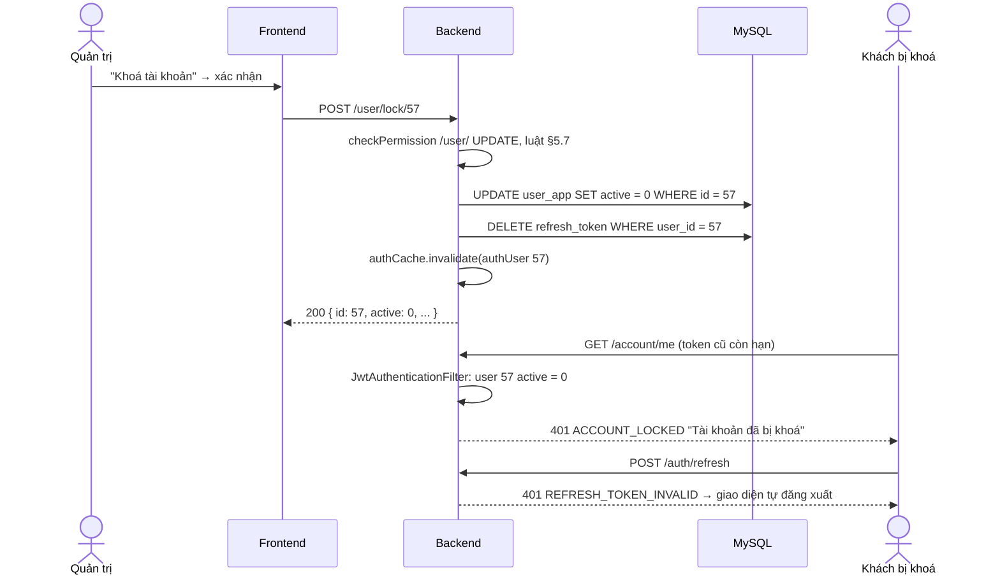

# Quản lý tài khoản

## 1. Mục tiêu và phạm vi

Sau plan này, quản trị viên có quyền `USER` mở **`/admin/tai-khoan`** để:

- Xem mọi tài khoản (khách hàng và nhân viên) kèm chức vụ, gói đang dùng, ngày đăng ký, trạng thái; tìm theo tên / email / số điện thoại, lọc theo chức vụ, gói, trạng thái.
- Mở trang chi tiết một tài khoản: thông tin, gói hiện tại, 4 số tổng hợp, sở thích màu, 10 đơn và 10 lượt tải gần nhất.
- **Khoá** tài khoản (đăng xuất khỏi mọi thiết bị ngay, không đăng nhập lại được) và **mở khoá**.
- **Đổi chức vụ** (ví dụ cấp chức vụ nhân viên cho một khách, hoặc trả về "Khách hàng").

| Có làm (lát này) | Không làm (để plan khác) |
|---|---|
| Migration `V18__quan_ly_tai_khoan.sql`: resource `USER` (`/user/`, VIEW + UPDATE, module `SYSTEM`). Không có bảng / cột mới | Tạo tài khoản thay khách, sửa họ tên / email / số điện thoại của khách, đặt lại mật khẩu thay khách |
| 6 API: `user/list`, `user/get`, `user/lock/{id}`, `user/unlock/{id}`, `user/change-role`, `user/role-options` | Xoá tài khoản (có đơn, lượt tải, khoá ngoại; chỉ khoá) |
| Khoá có hiệu lực ngay: filter JWT chặn token của tài khoản bị khoá (401 `ACCOUNT_LOCKED`), thu hồi mọi refresh token | Cấp / huỷ gói thay khách, hoàn tiền |
| Frontend: `/admin/tai-khoan` (bảng + bộ lọc + hộp thoại khoá / đổi chức vụ) và `/admin/tai-khoan/$id` (chi tiết) | Danh sách toàn bộ đơn hàng, sửa giá gói (lát `quan-tri-don-hang`, resource `ORDER` / `PLAN`) |
| Chặn tự khoá / tự đổi chức vụ; chỉ tài khoản toàn quyền mới đụng tới tài khoản / chức vụ toàn quyền | Nhật ký ai khoá ai (audit log), lý do khoá |

## 2. Tác nhân và phân quyền

| Tác nhân | Quyền (resource `USER`, uri `/user/`) | Ghi chú |
|---|---|---|
| Quản trị (role `Quản trị`, `is_operator = 1`, `admin@downbeat.local`) | VIEW, UPDATE | Operator có mọi quyền, migration không cấp permission |
| Role được cấp VIEW `USER` | `list`, `get`, `role-options` | Không thấy nút "Đổi chức vụ", "Khoá tài khoản", "Mở khoá" |
| Role được cấp VIEW + UPDATE `USER` (không phải operator) | thêm `lock`, `unlock`, `change-role` | **Không** được khoá / mở khoá / đổi chức vụ tài khoản có chức vụ toàn quyền, **không** được cấp chức vụ toàn quyền (§5.7) |
| Khách hàng, `noaccess@downbeat.local` | Không | API 403; mục "Tài khoản" không hiện ở thanh bên; vào thẳng URL thấy `AdminAccessDenied` |

Mọi người (kể cả operator) **không** được khoá hay đổi chức vụ **chính mình** (tránh tự khoá mất quyền quản trị cuối cùng).

API không có `/public/` nên filter đòi token (401 khi thiếu). Controller gọi `checkPermission(principal, "/user/", ...)` ở **dòng đầu** handler, trước mọi validate (403 thắng 400 / 404). Các endpoint cũ `/user/info`, `/user/update-password`, `/user/authenticate` giữ nguyên, không kiểm resource.

## 3. Luồng nghiệp vụ

**Luồng chính 1 — tìm tài khoản:**
1. Quản trị mở "Tài khoản" ở thanh bên → `/admin/tai-khoan`. Giao diện gọi `GET /user/role-options` (đổ ô lọc "Chức vụ") và `GET /user/list?page=1&limit=10`.
2. Gõ vào ô tìm kiếm (debounce có sẵn của `TableSearchFilter`) hoặc chọn bộ lọc → gọi lại `list` từ trang 1.
3. Bấm một dòng (hoặc "Xem chi tiết" trong menu thao tác) → `/admin/tai-khoan/{id}`.

**Luồng chính 2 — xem chi tiết:**
1. Trang chi tiết gọi `GET /user/get?id={id}`.
2. Hiện thông tin, gói hiện tại, 4 số tổng hợp, sở thích màu, bảng 10 đơn gần nhất, bảng 10 lượt tải gần nhất.

**Luồng chính 3 — khoá tài khoản:**
1. Ở dòng (hoặc trang chi tiết) bấm "Khoá tài khoản" → hộp thoại xác nhận → "Khoá tài khoản".
2. Backend: kiểm quyền, kiểm luật §5.7, đặt `user_app.active = 0`, xoá cache `authUser`, thu hồi mọi refresh token của người đó.
3. Ngay sau đó mọi request có token của người bị khoá (trừ đường `/public/`) bị filter trả 401 `ACCOUNT_LOCKED`; giao diện của họ thử refresh → refresh bị từ chối → tự đăng xuất. Đăng nhập lại → 403 "Tài khoản bị khóa" (có sẵn).
4. Toast "Đã khoá tài khoản {name}", badge trạng thái thành "Đã khoá".

**Luồng chính 4 — mở khoá:** bấm "Mở khoá" (không cần xác nhận) → `active = 1`, xoá cache → toast "Đã mở khoá tài khoản {name}". Người đó đăng nhập lại bình thường (refresh token cũ đã bị thu hồi lúc khoá, không dùng lại được).

**Luồng chính 5 — đổi chức vụ:**
1. Bấm "Đổi chức vụ" → hộp thoại có ô chọn "Chức vụ" (mặc định chức vụ hiện tại) → chọn chức vụ khác → "Lưu".
2. Backend đặt `user_app.role_id`, xoá cache `authUser` (quyền mới có hiệu lực ở request kế tiếp, vì `checkPermission` đọc role từ cache user). **Không** thu hồi phiên.
3. Toast "Đã đổi chức vụ của {name} thành {roleName}".

**Luồng thay thế:**
- A1. Role chỉ có VIEW `USER` → bảng không có cột "Thao tác"; trang chi tiết không có nút thao tác.
- A2. Dòng của chính người đang đăng nhập → badge "Bạn" cạnh tên, menu thao tác chỉ có "Xem chi tiết".
- A3. Người không phải operator → ô "Chức vụ" trong hộp thoại không có chức vụ toàn quyền; dòng của tài khoản toàn quyền chỉ có "Xem chi tiết".
- A4. Khoá tài khoản đã khoá / mở khoá tài khoản đang mở / đổi sang đúng chức vụ đang có → 200, không đổi gì (idempotent).
- A5. Không có kết quả → bảng hiện "Không tìm thấy tài khoản nào phù hợp."

**Ngoại lệ:**
- E1. Không có VIEW `USER` → 403; thanh bên không có mục, URL thẳng → `AdminAccessDenied`.
- E2. `id` không tồn tại → 404 "Không tìm thấy tài khoản"; trang chi tiết hiện khung 404 (§6.3).
- E3. Vi phạm luật §5.7 → 400 (message §5.8), toast nguyên văn.
- E4. Lỗi mạng / 5xx ở danh sách → `AdminListError` (nút "Thử lại").



## 4. Cơ sở dữ liệu

Migration: `V18__quan_ly_tai_khoan.sql` (mới nhất hiện tại là `V17__dashboard_admin.sql`). **Không** tạo bảng, không thêm cột. Module `SYSTEM` "Hệ thống" đã có ở V4:

```sql
SET NAMES utf8mb4;

INSERT INTO `resource` (`name`, `description`, `code`, `uri`, `actions`, `active`, `module_id`)
SELECT 'Quản lý tài khoản', 'Xem tài khoản, gói, đơn, lượt tải; khoá / mở khoá; đổi chức vụ', 'USER', '/user/',
       '["VIEW", "UPDATE"]', 1, (SELECT `id` FROM `module` WHERE `code` = 'SYSTEM')
FROM DUAL WHERE NOT EXISTS (SELECT 1 FROM `resource` WHERE `code` = 'USER');
```

Không cấp permission cho role nào. Bảng đọc / ghi:

| Bảng | Cột | Dùng cho |
|---|---|---|
| `user_app` | `id`, `name`, `email`, `phone`, `avatar`, `role_id`, `active`, `regis_date` | Danh sách, chi tiết; **ghi** `active` (khoá / mở khoá), `role_id` (đổi chức vụ) |
| `role` | `id`, `name`, `is_operator`, `is_default` | Tên chức vụ, luật toàn quyền, `role-options` |
| `subscription` + `plan` | `status = 'ACTIVE' AND end_date >= hôm nay` (như `SubscriptionRepository.findActiveByUserId`), `cycle`, `start_date`, `end_date`, `auto_renew`, `plan.code`, `plan.name` | Gói hiện tại; không có dòng còn hạn → gói `free` (tên đọc từ bảng `plan`) |
| `payment_order` + `plan` + `lut` | như `order/my-list` | Đơn gần đây, số đơn đã thanh toán, tổng đã chi |
| `download_log` + `lut` | `lut_id`, `plan_code`, `created_time` | Lượt tải gần đây, tổng lượt tải |
| `collection` | `user_id` | Số bộ sưu tập |
| `user_preference` + `lut_category` | `category_id` → `lut_category.name` | Sở thích màu đã khai báo |
| `refresh_token` | `user_id` | **Xoá** khi khoá (dùng `RefreshTokenService.revokeAll` có sẵn) |

"Trạng thái": `active = 1` → `ACTIVE` ("Đang hoạt động"), khác 1 → `LOCKED` ("Đã khoá").

## 5. Hợp đồng API (cố định — nguồn sự thật cho cả BE và FE)

Thành công: `{ "code": 200, "message": "OK", "result": … }`. Lỗi: `{ "path", "code", "errorCode", "message" }`. POJO `NON_NULL`. Ngày `"2026-11-10"`, ngày giờ `"2026-11-10T10:15:30"`, giờ Asia/Ho_Chi_Minh. Tiền là số nguyên VND. **Không bao giờ** trả `password`, `plainPassword`, `token`, `facebookId`, `gplusId`.

### 5.1 `GET /api/user/list?keyword=&roleId=&planCode=&status=&page=1&limit=10` — quyền VIEW

| Tham số | Ý nghĩa | Thiếu / sai |
|---|---|---|
| `keyword` | Trim; khớp một phần (không phân biệt hoa thường) `name`, `email` hoặc `phone` | rỗng → bỏ lọc |
| `roleId` | Đúng chức vụ | thiếu / ≤ 0 → bỏ lọc |
| `planCode` | `free` / `pro` / `studio` theo gói hiện tại (`free` = không có subscription còn hạn) | thiếu / giá trị khác → bỏ lọc |
| `status` | `ACTIVE` / `LOCKED` (không phân biệt hoa thường) | thiếu / giá trị khác → bỏ lọc |
| `page`, `limit` | như `order/my-list`: `page` < 1 → 1; `limit` mặc định 10, tối đa 100 (> 100 → 100, < 1 → 10) | không báo lỗi |

Sắp `regis_date DESC, id DESC`. Response `result`:
```json
{
  "total": 41,
  "page": 1,
  "items": [
    {
      "id": 57, "name": "Trần Thu Hà", "email": "thuha@gmail.com", "phone": "0912345678",
      "roleId": 3, "roleName": "Khách hàng", "isOperator": 0,
      "status": "ACTIVE", "regisDate": "2026-11-20T08:12:45",
      "planCode": "pro", "planName": "Pro", "planExpiresAt": "2027-11-20"
    },
    {
      "id": 41, "name": "Khách Miễn Phí", "email": "free@downbeat.local",
      "roleId": 3, "roleName": "Khách hàng", "isOperator": 0,
      "status": "LOCKED", "regisDate": "2026-11-10T09:00:00",
      "planCode": "free", "planName": "Miễn phí"
    },
    {
      "id": 1, "name": "Administrator", "email": "admin@downbeat.local", "phone": "0900000000",
      "roleId": 1, "roleName": "Quản trị", "isOperator": 1,
      "status": "ACTIVE", "regisDate": "2026-11-01T00:00:00",
      "planCode": "free", "planName": "Miễn phí"
    }
  ]
}
```
- `phone`, `avatar` không có khoá khi null. `planExpiresAt` chỉ có với gói trả phí.
- Không có `active` (dùng `status`). Gọi chung là **`UserAdminItem`**, cũng là `result` của §5.3, §5.4, §5.5.

### 5.2 `GET /api/user/get?id=57` — quyền VIEW

```json
{
  "id": 57, "name": "Trần Thu Hà", "email": "thuha@gmail.com", "phone": "0912345678",
  "roleId": 3, "roleName": "Khách hàng", "isOperator": 0,
  "status": "ACTIVE", "regisDate": "2026-11-20T08:12:45",
  "planCode": "pro", "planName": "Pro", "planExpiresAt": "2027-11-20",
  "subscription": {
    "planCode": "pro", "planName": "Pro", "cycle": "YEAR",
    "startDate": "2026-11-20", "endDate": "2027-11-20", "autoRenew": 1
  },
  "stats": { "paidOrders": 2, "totalPaid": 1047000, "downloads": 14, "collections": 2 },
  "preferences": ["Ấm áp", "Phim nhựa"],
  "recentOrders": [
    {
      "code": "DB2611200004", "planCode": "pro", "planName": "Pro", "cycle": "YEAR", "amount": 948000,
      "status": "PAID", "sourceLutId": 10, "sourceLutSlug": "kodak-400", "sourceLutTitle": "Kodak 400",
      "createdTime": "2026-11-20T08:20:02", "paidTime": "2026-11-20T08:21:31"
    }
  ],
  "recentDownloads": [
    {
      "lutId": 17, "lutSlug": "mua-thu-ha-noi", "lutTitle": "Mùa Thu Hà Nội",
      "coverUrl": "http://localhost:9020/downbeat-public/lut/mua-thu-ha-noi/cover.jpg",
      "planCode": "pro", "createdTime": "2026-11-21T19:03:10"
    }
  ]
}
```
- Gồm mọi khoá của `UserAdminItem` + 5 khối dưới.
- `subscription`: gói Miễn phí → `{ "planCode": "free", "planName": "Miễn phí" }` (không `null`, giống `subscription/my`).
- `stats.paidOrders`, `stats.totalPaid`: `COUNT`, `SUM(amount)` đơn `PAID` (mọi thời gian; không có → 0). `downloads`: số dòng `download_log`. `collections`: số dòng `collection`.
- `preferences`: tên `lut_category` theo `user_preference`, sắp theo tên; không có → `[]`.
- `recentOrders`: tối đa 10 đơn, `created_time DESC, id DESC`, **cùng shape item của `order/my-list`** (dùng lại mapper; `checkoutUrl` vẫn chỉ có khi `PENDING`). Không có → `[]`.
- `recentDownloads`: tối đa 10 dòng `download_log` mới nhất (`created_time DESC, id DESC`), gồm cả LUT đã ẩn. Không có → `[]`.
- `id` không tồn tại / ≤ 0 / thiếu → 404 (§5.8).

### 5.3 `POST /api/user/lock/{id}` — quyền UPDATE

Không có thân. Kiểm theo thứ tự: quyền → tồn tại (404) → chính mình → luật toàn quyền (§5.7). Rồi `active = 0` (đã 0 vẫn chạy tiếp, trả 200), `refreshTokenService.revokeAll(id)`, `userService.evictAuthUser(id)`. `@Transactional`. Response `result` = `UserAdminItem` với `"status": "LOCKED"`.

### 5.4 `POST /api/user/unlock/{id}` — quyền UPDATE

Như §5.3 (cùng thứ tự kiểm, kể cả chặn chính mình — chính mình không thể đang bị khoá mà vẫn gọi được, giữ cho đối xứng), đặt `active = 1`, xoá cache, **không** đụng refresh token. Response `UserAdminItem` với `"status": "ACTIVE"`.

### 5.5 `POST /api/user/change-role` — quyền UPDATE

Request:
```json
{ "id": 57, "roleId": 4 }
```
Kiểm theo thứ tự: quyền → `id` tồn tại (404) → `roleId` thiếu / ≤ 0 (400 "Vui lòng chọn chức vụ") → chức vụ tồn tại (400 "Chức vụ không tồn tại") → chính mình → luật toàn quyền (§5.7). Rồi `role_id = roleId`, xoá cache. Không thu hồi phiên. Response `UserAdminItem` với `roleId`, `roleName`, `isOperator` mới.

### 5.6 `GET /api/user/role-options` — quyền VIEW

Mọi chức vụ, sắp `id` tăng dần (không cần quyền `ROLE`, để người chỉ có `USER` vẫn lọc / đổi được):
```json
[
  { "id": 1, "name": "Quản trị", "isOperator": 1, "isDefault": 0 },
  { "id": 2, "name": "Không quyền", "isOperator": 0, "isDefault": 0 },
  { "id": 3, "name": "Khách hàng", "isOperator": 0, "isDefault": 1 }
]
```

### 5.7 Luật toàn quyền (lock / unlock / change-role)

Gọi `caller` = người đang đăng nhập, `target` = tài khoản bị thao tác, "toàn quyền" = role `is_operator = 1`.

1. `caller.id == target.id` → 400 (message theo thao tác, §5.8).
2. `caller` không toàn quyền và `target` đang toàn quyền → 400 "Chỉ tài khoản toàn quyền mới được thao tác trên tài khoản toàn quyền".
3. (chỉ `change-role`) `caller` không toàn quyền và chức vụ mới toàn quyền → 400 "Chỉ tài khoản toàn quyền mới được cấp chức vụ toàn quyền".

API key (`x-api-key`) được coi là operator và không có `id` trùng ai → bỏ qua luật 1.

### 5.8 Lỗi nghiệp vụ

| Tình huống | HTTP | `errorCode` | Message (nguyên văn, FE hiện qua toast) |
|---|---|---|---|
| Không token / token sai | 401 | `LOGIN` / `UNAUTHORIZED` / `TOKEN_EXPIRED` (có sẵn) | (có sẵn) |
| Role không có VIEW `USER` (list / get / role-options) | 403 | `FORBIDDEN` | Bạn không có quyền thực hiện thao tác này! Path: /user/, Action: VIEW |
| Role không có UPDATE `USER` (lock / unlock / change-role) | 403 | `FORBIDDEN` | Bạn không có quyền thực hiện thao tác này! Path: /user/, Action: UPDATE |
| `get` / `lock` / `unlock` / `change-role` với `id` không tồn tại / ≤ 0 / thiếu | 404 | `DATA_NOT_FOUND` | Không tìm thấy tài khoản |
| `change-role` thiếu `roleId` / ≤ 0 | 400 | `BAD_REQUEST` | Vui lòng chọn chức vụ |
| `change-role` với `roleId` không tồn tại | 400 | `BAD_REQUEST` | Chức vụ không tồn tại |
| `lock` / `unlock` chính mình | 400 | `BAD_REQUEST` | Không thể khoá tài khoản của chính bạn |
| `change-role` chính mình | 400 | `BAD_REQUEST` | Không thể đổi chức vụ của chính bạn |
| Luật §5.7 số 2 | 400 | `BAD_REQUEST` | Chỉ tài khoản toàn quyền mới được thao tác trên tài khoản toàn quyền |
| Luật §5.7 số 3 | 400 | `BAD_REQUEST` | Chỉ tài khoản toàn quyền mới được cấp chức vụ toàn quyền |
| Mọi API không phải `/public/` và không nằm trong whitelist, gọi bằng token của tài khoản bị khoá | 401 | `ACCOUNT_LOCKED` (**mới**) | Tài khoản đã bị khoá |
| Đăng nhập (`/user/authenticate`) tài khoản bị khoá | 403 | `LOCK_ACCOUNT` (có sẵn) | Tài khoản bị khóa |

`ACCOUNT_LOCKED` là 401 (không phải 403) để interceptor của giao diện thử refresh → refresh bị từ chối → tự đăng xuất (luồng có sẵn ở `lib/axios/instance.ts`).

## 6. Giao diện (chuỗi cố định — test E2E chọn theo đúng các chuỗi này)

Định dạng: ngày `dd/MM/yyyy`, ngày giờ `dd/MM/yyyy HH:mm` (`formatOrderDateTime` có sẵn ở `lib/utils/plan.ts`), tiền `formatVnd`, nhãn trạng thái đơn `orderStatusLabel`, chu kỳ `cycleLabel` (đều có sẵn).

### 6.1 Thanh bên

- Nhóm "Hệ thống" (`navSystem`), **mục đầu tiên**, trước "Chức vụ": `{ code: "USER", title: "Tài khoản", url: "/admin/tai-khoan", icon: Users }` (lucide). Chỉ hiện khi có VIEW `USER` (cơ chế có sẵn).
- Trang chi tiết `/admin/tai-khoan/$id` cũng làm mục "Tài khoản" sáng (khớp tiền tố như `/admin/luts/$id`; nếu `AdminMain` đang so `pathname === url` thì đổi sang `pathname === url || pathname.startsWith(url + "/")`).

### 6.2 Trang danh sách `/admin/tai-khoan`

- Bọc `AdminPermissionGuard code="USER"`. `DataTableAdvanced`: tiêu đề **"Tài khoản"**, mô tả "Xem khách hàng và nhân viên, gói đang dùng, khoá tài khoản hoặc đổi chức vụ." Không có nút "Thêm", không có xoá hàng loạt.
- Bộ lọc (`TableSearchFilter`):

| key | label | Kiểu | Lựa chọn |
|---|---|---|---|
| `keyword` | Tìm kiếm | text, placeholder "Tìm theo tên, email hoặc số điện thoại" | |
| `roleId` | Chức vụ | select | "Tất cả" + tên từ `role-options` |
| `planCode` | Gói | select | "Tất cả", "Miễn phí" (`free`), "Pro" (`pro`), "Studio" (`studio`) |
| `status` | Trạng thái | select | "Tất cả", "Đang hoạt động" (`ACTIVE`), "Đã khoá" (`LOCKED`) |

- Cột:

| Tiêu đề | Nội dung |
|---|---|
| "Tài khoản" | `Avatar` (ảnh hoặc chữ cái đầu) + tên in đậm (dòng của chính mình thêm `Badge` variant `secondary` "Bạn"), dòng dưới email màu muted |
| "Số điện thoại" | `phone` hoặc "—" |
| "Chức vụ" | `roleName`; `isOperator = 1` thêm `Badge` variant `outline` "Toàn quyền" |
| "Gói" | `Badge` `planName` (free variant `secondary`, gói trả phí variant `default`); gói trả phí có dòng nhỏ "Hết hạn {dd/MM/yyyy}" |
| "Ngày đăng ký" | `regisDate` dạng `dd/MM/yyyy` |
| "Trạng thái" | `Badge` "Đang hoạt động" (variant `outline`, chữ xanh `text-emerald-600 dark:text-emerald-400`) hoặc "Đã khoá" (variant `destructive`) |
| (không tiêu đề) | Nút icon `MoreHorizontal`, `aria-label="Thao tác với {name}"` → `DropdownMenu`: "Xem chi tiết"; nếu có UPDATE và được phép theo §5.7 (không phải chính mình; tài khoản toàn quyền chỉ khi mình toàn quyền): "Đổi chức vụ", rồi "Khoá tài khoản" (chữ `text-destructive`, khi `ACTIVE`) hoặc "Mở khoá" (khi `LOCKED`) |

- Bấm vào dòng (`onRowClick`) → `/admin/tai-khoan/{id}`; bấm nút thao tác không làm mở chi tiết (`stopPropagation`).
- Không có dòng: "Không tìm thấy tài khoản nào phù hợp."
- Đổi bộ lọc → về trang 1. Trang / kích thước trang như các bảng khác.

### 6.3 Trang chi tiết `/admin/tai-khoan/$id`

- Bọc `AdminPermissionGuard code="USER"`. Đầu trang: nút `ghost` có icon `ArrowLeft` "Quay lại danh sách" (→ `/admin/tai-khoan`); h1 `{name}`; cạnh h1 badge trạng thái như cột "Trạng thái"; bên phải các nút (cùng điều kiện hiện như menu §6.2): "Đổi chức vụ" (`outline`), "Khoá tài khoản" (`destructive`) hoặc "Mở khoá" (`outline`).
- Đang tải: `Skeleton`. 404: khung giữa trang tiêu đề "Không tìm thấy tài khoản", dòng "Tài khoản này không tồn tại hoặc đã bị xoá.", nút "Quay lại danh sách". Lỗi khác: `AdminLoadError` có sẵn.
- Bố cục từ `lg` lưới 3 cột; dưới `lg` một cột theo thứ tự dưới. Mỗi card là `section` có `aria-label` bằng tiêu đề card.
  1. Hàng 4 ô số (`Card`, `aria-label` bằng tiêu đề): "Đơn đã thanh toán" (`stats.paidOrders`), "Tổng đã chi" (`formatVnd(stats.totalPaid)`), "Lượt tải" (`stats.downloads`), "Bộ sưu tập" (`stats.collections`).
  2. Card **"Thông tin"** (1 cột): danh sách `dl` "Email", "Số điện thoại" ("—" khi null), "Chức vụ" (kèm badge "Toàn quyền" nếu có), "Ngày đăng ký" (`dd/MM/yyyy HH:mm`).
  3. Card **"Gói hiện tại"** (1 cột): gói trả phí → dòng lớn "Gói {planName}", rồi "Chu kỳ: {cycleLabel}", "Bắt đầu: {dd/MM/yyyy}", "Hết hạn: {dd/MM/yyyy}", "Tự gia hạn: Bật" hoặc "Tự gia hạn: Đã huỷ" (`autoRenew = 0`). Miễn phí → "Gói Miễn phí" và dòng muted "Chưa có gói trả phí còn hạn."
  4. Card **"Sở thích màu"** (1 cột): mỗi phần tử `preferences` một `Badge` `secondary`; rỗng → "Chưa khai báo."
  5. Card **"Đơn hàng gần đây"** (2 cột): bảng `aria-label="Đơn hàng gần đây"`, cột "Mã đơn", "Gói", "Chu kỳ", "Số tiền", "Trạng thái" (`orderStatusLabel`), "Ngày tạo" (`dd/MM/yyyy HH:mm`). Rỗng → "Chưa có đơn hàng." Có đúng 10 đơn → dòng muted dưới bảng "Hiện 10 đơn mới nhất."
  6. Card **"Lượt tải gần đây"** (1 cột hoặc 3 cột tuỳ bố cục, worker chọn): danh sách mỗi dòng ảnh bìa nhỏ + `lutTitle` (có VIEW `LUT` → link tới `/admin/luts/{lutId}`, không thì chữ thường) + dòng muted "{dd/MM/yyyy HH:mm} · Gói {planCode lúc tải: free → Miễn phí, pro → Pro, studio → Studio}". Rỗng → "Chưa tải LUT nào."

### 6.4 Hộp thoại "Khoá tài khoản?"

- `AlertDialog`, tiêu đề **"Khoá tài khoản?"**, mô tả "{name} ({email}) sẽ bị đăng xuất khỏi mọi thiết bị và không đăng nhập được cho tới khi được mở khoá. Gói và đơn hàng vẫn giữ nguyên."
- Nút "Huỷ" và "Khoá tài khoản" (`destructive`, đang gửi → disabled + spinner).
- Thành công: đóng, toast success **"Đã khoá tài khoản {name}"**, invalidate danh sách và chi tiết. Lỗi: toast error message nguyên văn, giữ hộp thoại.
- "Mở khoá" không có hộp thoại: gọi ngay, toast success **"Đã mở khoá tài khoản {name}"**.

### 6.5 Hộp thoại "Đổi chức vụ"

- `Dialog`, tiêu đề **"Đổi chức vụ"**, mô tả "Tài khoản: {name} ({email})".
- `Select` label **"Chức vụ"**, giá trị ban đầu = chức vụ hiện tại; lựa chọn = `role-options` (chức vụ toàn quyền hiển thị "{name} (toàn quyền)", và **bị loại** khi người đang dùng không toàn quyền).
- Chọn chức vụ toàn quyền → dòng cảnh báo dưới ô: "Chức vụ toàn quyền có mọi quyền quản trị, kể cả khoá tài khoản khác."
- Nút "Huỷ", "Lưu" (disabled khi chưa đổi so với chức vụ hiện tại hoặc đang gửi).
- Thành công: đóng, toast success **"Đã đổi chức vụ của {name} thành {roleName}"**, invalidate danh sách và chi tiết. Lỗi: toast nguyên văn, giữ hộp thoại.

### 6.6 Người bị khoá

- Không cần màn hình mới. Khi API trả 401 `ACCOUNT_LOCKED`, interceptor có sẵn thử refresh → thất bại → `endSession()` (cửa hàng về trạng thái chưa đăng nhập; ở `/admin` chuyển `/login`).
- Hộp thoại đăng nhập cửa hàng và trang `/login` hiện message API nguyên văn khi đăng nhập bị 403 `LOCK_ACCOUNT` ("Tài khoản bị khóa"). Kiểm lại hai form này; nếu đang hiện chuỗi chung thì sửa để hiện message API.

## 7. Việc backend (agy BE)

Thứ tự theo `backend/AGENTS.md`:

1. `app/src/main/resources/db/migration/V18__quan_ly_tai_khoan.sql`: đúng khối SQL ở §4.
2. `base/.../constant/ErrorCode.java`: thêm `ACCOUNT_LOCKED(401, "Tài khoản đã bị khoá")`. Không đổi `LOCK_ACCOUNT`.
3. `authenticate/.../service/auth/UserService.java`: đổi `evictAuthUser` thành `public`.
4. `authenticate/.../config/security/filter/JwtAuthenticationFilter.java`: ở nhánh có token hợp lệ (sau `extractPrincipal` khác null, **chỉ** nhánh không public / không whitelist / không API key), lấy `userId` từ principal, gọi `userService.getUserById(userId)` (đã cache Caffeine); `active != 1` → `HttpResponseUtils.writeError(response, request, ErrorCode.ACCOUNT_LOCKED)` và `return`. User không tồn tại (id null) → giữ hành vi hiện tại (đi tiếp). Cẩn thận vòng phụ thuộc bean (filter đã dùng `JWTService`; nếu có vòng thì dùng `@Lazy` / `ObjectProvider<UserService>`).
5. `business/account/repository/UserAdminRepository.java` (mới, jOOQ): `findPage(keyword, roleId, planCode, status, offset, limit)` + `count(...)` (lọc `planCode` bằng `LEFT JOIN` subscription còn hạn: `free` ↔ không có dòng), `findItem(id)`, `setActive(id, int)`, `setRole(id, roleId)`, `stats(id)`, `preferences(id)`, `recentDownloads(id, 10)`. Đơn gần đây dùng lại truy vấn / mapper của `order/my-list` (`OrderRepository` / `OrderService` có sẵn, thêm tham số `userId`, `limit`) — không viết mapper thứ hai.
6. `business/account/service/UserAdminService.java` (mới): `list`, `get`, `lock`, `unlock`, `changeRole`, `roleOptions`; luật §5.7 theo đúng thứ tự §5.3 / §5.5; lock gọi `refreshTokenService.revokeAll(id)` + `userService.evictAuthUser(id)`; unlock / change-role chỉ evict. Ghi `@Transactional`.
7. POJO trả về (trong `entity` hoặc `business/account`, theo chỗ các POJO response khác đang nằm): `UserAdminItem`, `UserAdminDetail` (extends hoặc chứa item), `UserAdminStats`, `UserDownloadItem`, `RoleOption`, `ChangeRoleRequest`. `@JsonInclude(NON_NULL)`.
8. `business/account/controller/UserAdminController.java` (mới, `extends BaseController`, `URI = "/user/"`): 6 handler §5, `checkPermission` ở dòng đầu (VIEW cho `list`, `get`, `role-options`; UPDATE cho 3 cái còn lại). `caller` = `User` mà `checkPermission` trả về.

Quyết định worker không tự đổi: không xoá tài khoản; không thêm endpoint ngoài §5; khoá thì thu hồi refresh token, đổi chức vụ thì không; thao tác lặp lại trả 200; 401 (không phải 403) cho token của tài khoản bị khoá; message đúng nguyên văn §5.8.

Unit test bắt buộc (JUnit + Mockito, như test `OrderService` có sẵn): các TC loại `unit` ở §9.

## 8. Việc frontend (agy)

1. `lib/types/user-admin.ts` (mới): `UserAdminItem`, `UserAdminDetail`, `UserAdminStats`, `UserDownloadItem`, `RoleOption`, `UserAdminListParams` đúng §5. `recentOrders` dùng lại kiểu item của `order/my-list`.
2. `lib/axios/user-admin.ts` (mới): `getUserList(params)`, `getUserDetail(id)`, `lockUser(id)`, `unlockUser(id)`, `changeUserRole(id, roleId)`, `getRoleOptions()`.
3. `lib/tanstack/options/user-admin.ts` (mới): key `["user-admin-list", params]`, `["user-admin-get", id]`, `["user-admin-role-options"]`; 3 mutation options invalidate `["user-admin-list"]` và `["user-admin-get"]`. Toast do trang tự hiện (§6.4, §6.5).
4. `components/admin/sidebar/admin-sidebar.tsx`: thêm mục §6.1; `admin-main.tsx`: active theo tiền tố nếu cần.
5. `components/admin/user/columns.tsx`, `user-actions-menu.tsx`, `lock-user-dialog.tsx`, `change-role-dialog.tsx`, `user-status-badge.tsx`, `user-plan-badge.tsx` (mới). Hàm thuần `canManageUser(me, target)` (luật §5.7 phía giao diện) đặt ở `lib/utils/user-admin.ts`.
6. `routes/admin/tai-khoan/index.tsx` (mới): §6.2. `routes/admin/tai-khoan/$id.tsx` (mới): §6.3 + `components/admin/user/user-detail/*` (các card).
7. Hộp thoại đăng nhập cửa hàng + `/login`: §6.6 (chỉ sửa nếu đang không hiện message API).

Component shadcn dùng: có sẵn trong `components/ui/`: `alert-dialog`, `avatar`, `badge`, `button`, `card`, `dialog`, `dropdown-menu`, `select`, `skeleton`, `table`, `sonner`, `label`, `separator`; cần `shadcn add`: không có.

## 9. Test case

Chuẩn bị chung (API / E2E): khách mới tạo bằng `account/register` (email ngẫu nhiên) để khoá / đổi chức vụ không ảnh hưởng spec khác; "khách có gói Pro" dùng helper `customerWithPlan` của `goi-thanh-toan.spec.ts` (`order/create` + `order/mock-pay`). "Nhân viên" = role mới tạo qua `role/update` + cấp quyền qua API phân quyền có sẵn (như `phan-quyen.spec.ts`), gán cho một khách mới bằng `user/change-role` của admin; dọn role sau test. Không bao giờ khoá `admin@downbeat.local`.

| ID | Loại | Mô tả | Tiền điều kiện | Bước | Kết quả mong đợi |
|---|---|---|---|---|---|
| TC-01 | api | `list` không token | — | `GET /user/list` không header | 401 |
| TC-02 | api | `list` không quyền | đăng nhập `noaccess` | `GET /user/list` | 403, message "Bạn không có quyền thực hiện thao tác này! Path: /user/, Action: VIEW" |
| TC-03 | api | `list` của admin, phân trang, sắp xếp | admin; vừa tạo 2 khách A rồi B | `GET /user/list?page=1&limit=2` | 200; `items.length = 2`; `items[0].email` = B, `items[1].email` = A; `total ≥ 2`; không item nào có khoá `password` / `active` |
| TC-04 | api | `list` lọc keyword theo email, tên, số điện thoại | khách A có tên duy nhất | `keyword` = phần email A viết HOA; rồi = phần tên A; rồi `keyword=0900000000` | lần 1, 2: đúng 1 item là A; lần 3: có item `admin@downbeat.local` |
| TC-05 | api | `list` lọc `status`, `roleId`, `planCode` | khách A đã khoá; khách P có gói Pro | `status=LOCKED&keyword=<A>`; `status=ACTIVE&keyword=<A>`; `planCode=pro&keyword=<P>`; `planCode=free&keyword=<P>`; `roleId=<id Quản trị>` | 1 item / 0 item / 1 item `planName "Pro"`, có `planExpiresAt` / 0 item / mọi item `isOperator = 1` |
| TC-06 | api | `list` tham số sai không báo lỗi | admin | `status=abc&planCode=xyz&page=0&limit=500` | 200, `page = 1`, `items.length ≤ 100` |
| TC-07 | api | `get` khách có gói Pro | khách P (gói Pro, 1 đơn PAID, đã tải 1 LUT) | `GET /user/get?id=<P>` | 200; `subscription.planCode "pro"`, có `endDate`; `stats.paidOrders = 1`, `stats.totalPaid` = `amount` đơn, `stats.downloads = 1`; `recentOrders[0].status "PAID"`; `recentDownloads[0].lutSlug` đúng LUT đã tải |
| TC-08 | api | `get` khách mới (rỗng) | khách mới | `GET /user/get?id=<id>` | `subscription` = `{ planCode "free", planName "Miễn phí" }`; `stats` 4 số 0; `preferences`, `recentOrders`, `recentDownloads` = `[]` |
| TC-09 | api | `get` không tồn tại | admin | `GET /user/get?id=99999999` | 404, message "Không tìm thấy tài khoản" |
| TC-10 | api | `role-options` | admin | `GET /user/role-options` | 200; có `{ name "Quản trị", isOperator 1 }` và `{ name "Khách hàng", isDefault 1 }`; sắp `id` tăng |
| TC-11 | api | `role-options` không quyền | `noaccess` | `GET /user/role-options` | 403 (Action: VIEW) |
| TC-12 | api | Khoá: chặn ngay token cũ, thu hồi refresh, chặn đăng nhập | khách K đăng nhập, giữ `accessToken`, `refreshToken` | admin `POST /user/lock/<K>`; K gọi `GET /account/me` bằng token cũ; K gọi `/auth/refresh`; K đăng nhập lại | lock 200 `status "LOCKED"`; `/account/me` 401 `errorCode "ACCOUNT_LOCKED"`, message "Tài khoản đã bị khoá"; refresh 401; đăng nhập 403 message "Tài khoản bị khóa" |
| TC-13 | api | Mở khoá | K đang khoá (TC-12) | admin `POST /user/unlock/<K>`; K đăng nhập lại; gọi `/account/me` | unlock 200 `status "ACTIVE"`; đăng nhập 200; `/account/me` 200 |
| TC-14 | api | Khoá lặp lại idempotent | K đang khoá | admin `POST /user/lock/<K>` lần 2 | 200 `status "LOCKED"` |
| TC-15 | api | Khoá / đổi chức vụ chính mình | admin | `POST /user/lock/1`; `POST /user/change-role {id: 1, roleId: <Khách hàng>}` | 400 "Không thể khoá tài khoản của chính bạn"; 400 "Không thể đổi chức vụ của chính bạn" |
| TC-16 | api | Không có UPDATE | nhân viên N1 chỉ có VIEW `USER` | N1 `POST /user/lock/<K>`; N1 `POST /user/change-role` | cả hai 403, message "... Path: /user/, Action: UPDATE"; N1 `GET /user/list` 200 |
| TC-17 | api | Nhân viên không đụng được tài khoản toàn quyền | nhân viên N2 có VIEW + UPDATE `USER` | N2 `POST /user/lock/1`; N2 `POST /user/change-role {id: 1, roleId: <Khách hàng>}` | cả hai 400 "Chỉ tài khoản toàn quyền mới được thao tác trên tài khoản toàn quyền"; admin vẫn `ACTIVE`, vẫn "Quản trị" |
| TC-18 | api | Nhân viên không cấp được chức vụ toàn quyền | N2; khách K | N2 `POST /user/change-role {id: <K>, roleId: <Quản trị>}` | 400 "Chỉ tài khoản toàn quyền mới được cấp chức vụ toàn quyền"; K vẫn "Khách hàng" |
| TC-19 | api | Nhân viên khoá được khách thường | N2; khách K2 | N2 `POST /user/lock/<K2>` | 200 `status "LOCKED"` |
| TC-20 | api | Đổi chức vụ có hiệu lực ở request kế tiếp | khách K3 đăng nhập (giữ token); role R có VIEW `USER` | K3 `GET /user/list` → admin `change-role {id: <K3>, roleId: <R>}` → K3 `GET /user/list` (cùng token) → admin đổi lại "Khách hàng" → K3 `GET /user/list` | 403 → 200 → 403; `change-role` trả `roleName` = tên R |
| TC-21 | api | `change-role` validate | admin; khách K | `{id: <K>}` (thiếu roleId); `{id: <K>, roleId: 99999}`; `{id: 99999999, roleId: <Khách hàng>}` | 400 "Vui lòng chọn chức vụ"; 400 "Chức vụ không tồn tại"; 404 "Không tìm thấy tài khoản" |
| TC-22 | api | `lock` / `unlock` id không tồn tại | admin | `POST /user/lock/99999999`; `POST /user/unlock/99999999` | 404 "Không tìm thấy tài khoản" |
| TC-23 | api | Không quyền thắng validate | `noaccess` | `POST /user/lock/99999999`; `POST /user/change-role {}` | 403 (Action: UPDATE), không phải 404 / 400 |
| TC-24 | e2e | Thanh bên và quyền vào trang | — | admin đăng nhập; rồi `noaccess` đăng nhập, mở thẳng `/admin/tai-khoan` | admin: thanh bên có "Tài khoản", bấm → h1 / tiêu đề "Tài khoản"; `noaccess`: không có mục "Tài khoản", trang hiện màn không có quyền |
| TC-25 | e2e | Tìm và lọc trên bảng | admin; khách A tên duy nhất | gõ email A vào "Tìm theo tên, email hoặc số điện thoại"; chọn "Trạng thái" → "Đã khoá" | bước 1: bảng đúng 1 dòng chứa tên A, cột "Gói" "Miễn phí", "Trạng thái" "Đang hoạt động"; bước 2: "Không tìm thấy tài khoản nào phù hợp." |
| TC-26 | e2e | Dòng của chính mình | admin | tìm `admin@downbeat.local`, mở nút "Thao tác với Administrator" | dòng có badge "Bạn" và "Toàn quyền"; menu chỉ có "Xem chi tiết" |
| TC-27 | e2e | Khoá rồi mở khoá trên bảng | admin; khách A | menu "Thao tác với {A}" → "Khoá tài khoản" → hộp thoại "Khoá tài khoản?" → "Khoá tài khoản"; rồi menu → "Mở khoá" | toast "Đã khoá tài khoản {A}", badge "Đã khoá"; sau đó toast "Đã mở khoá tài khoản {A}", badge "Đang hoạt động" |
| TC-28 | e2e | Khách bị khoá tự bị đăng xuất | khách K đăng nhập ở cửa hàng (context trình duyệt riêng) | admin khoá K qua API; K tải lại trang `/goi-cua-toi` | K không còn trạng thái đăng nhập (header hiện nút đăng nhập, trang hiện lời mời đăng nhập); K đăng nhập lại → thông báo "Tài khoản bị khóa" |
| TC-29 | e2e | Đổi chức vụ | admin; khách A; role R tạo sẵn | menu → "Đổi chức vụ" → hộp thoại "Đổi chức vụ", chọn R ở "Chức vụ" → "Lưu" | "Lưu" disabled trước khi chọn; toast "Đã đổi chức vụ của {A} thành {R}"; cột "Chức vụ" = R |
| TC-30 | e2e | Trang chi tiết khách có gói | admin; khách P (Pro, 1 đơn PAID, 1 lượt tải) | bấm dòng P | URL `/admin/tai-khoan/{id}`; h1 tên P; ô "Đơn đã thanh toán" = "1"; card "Gói hiện tại" có "Gói Pro" và "Tự gia hạn: Bật"; bảng "Đơn hàng gần đây" 1 dòng trạng thái "Đã thanh toán"; card "Lượt tải gần đây" có tên LUT đã tải |
| TC-31 | e2e | Trang chi tiết khách mới và 404 | admin; khách mới | mở chi tiết khách mới; mở `/admin/tai-khoan/99999999`; bấm "Quay lại danh sách" | khách mới: "Gói Miễn phí", "Chưa khai báo.", "Chưa có đơn hàng.", "Chưa tải LUT nào."; 404: "Không tìm thấy tài khoản"; về `/admin/tai-khoan` |
| TC-32 | e2e | Nhân viên chỉ xem | nhân viên N1 (VIEW `USER`) | N1 mở `/admin/tai-khoan`, mở chi tiết một khách | bảng không có nút "Thao tác với ..." có mục "Khoá tài khoản" (menu chỉ "Xem chi tiết" hoặc không có menu); chi tiết không có nút "Khoá tài khoản", "Đổi chức vụ" |
| TC-33 | unit | Luật §5.7 và thứ tự kiểm | Mockito | `lock` chính mình; nhân viên khoá operator; nhân viên `changeRole` sang role operator; operator `changeRole` khách → nhân viên | 3 ca đầu `AppException` 400 đúng message §5.8; ca 4 gọi `setRole` + `evictAuthUser`, không gọi `revokeAll` |
| TC-34 | unit | `lock` thu hồi phiên, `unlock` không | Mockito | `lock(57)`, `unlock(57)` | `lock`: `setActive(57, 0)`, `revokeAll(57)`, `evictAuthUser(57)` đúng 1 lần; `unlock`: `setActive(57, 1)`, `evictAuthUser(57)`, **không** `revokeAll` |
| TC-35 | unit | 404 trước luật | Mockito, repository trả rỗng | `lock(99)`, `changeRole(99, 3)` | `AppException` 404 "Không tìm thấy tài khoản"; không gọi `setActive` / `setRole` |
| TC-36 | unit | `changeRole` validate | Mockito | `roleId` null; `roleId` không tồn tại | 400 "Vui lòng chọn chức vụ"; 400 "Chức vụ không tồn tại" |
| TC-37 | unit | Chuẩn hoá tham số `list` | — | `page=0, limit=500, status="abc", planCode="xyz", keyword="  Hà  "` | gọi repository với offset 0, limit 100, `status` null, `planCode` null, keyword "Hà" |
| TC-38 | unit | Filter chặn tài khoản bị khoá | Mockito `UserService.getUserById` trả user `active = 0` | request `GET /account/me` có JWT hợp lệ | response 401, `errorCode "ACCOUNT_LOCKED"`, không gọi `filterChain.doFilter`; user `active = 1` → gọi `doFilter` |

Loại: `unit` = agy BE viết JUnit · `api` / `e2e` = Claude viết trong `frontend/tests/e2e/quan-ly-tai-khoan.spec.ts`.

## 10. Tiêu chí hoàn thành

- [x] Mọi TC ở §9 pass
- [x] Các spec cũ vẫn xanh (đặc biệt `auth`, `phan-quyen`, `tai-khoan-khach`, `goi-cua-toi`: filter mới đọc user mỗi request)
- [x] `mvn test`, `pnpm build`, `pnpm lint` xanh
- [x] Có `docs/chuc-nang/quan-ly-tai-khoan.md`

## 11. Rủi ro / câu hỏi mở

**Người dùng đã chốt (27/11/2026):** (1) đồng ý gộp phần khách hàng của 1.8 vào lát này (resource `USER`, `/admin/tai-khoan`); (2) làm bước filter JWT chặn tài khoản bị khoá như §7 mục 4; (3) mục "Tài khoản" ở nhóm "Hệ thống", resource thuộc module `SYSTEM`; (4) không xoá, không sửa thông tin khách; (5) giữ nguyên message "Tài khoản bị khóa" của đăng nhập. Các câu hỏi dưới giữ lại làm vết.

1. **Lát mới, chưa có trong kế hoạch tổng.** Thiết kế §5.6 / §9.4 có `customer/list`, `customer/get`, trang `/admin/khach-hang` (resource `CUSTOMER`, thuộc lát 1.8 `quan-tri-don-hang`), **không** có khoá / mở khoá / đổi chức vụ. Plan này thay phần "khách hàng" của 1.8 bằng trang `/admin/tai-khoan` (resource `USER`, gồm cả nhân viên); 1.8 còn lại đơn hàng + sửa giá gói. Bạn đồng ý cách gộp này không, hay muốn giữ tên `CUSTOMER` / `/admin/khach-hang` cho khớp thiết kế?
2. **Filter đọc user mỗi request** (từ cache Caffeine, chỉ xuống DB khi cache trống) để khoá có hiệu lực ngay. Không làm thì người bị khoá vẫn dùng được cửa hàng tới khi access token hết hạn (cấu hình hiện tại `expired-in: 1800000000` ms, khoảng 20 ngày). Đồng ý thêm bước này?
3. Mục "Tài khoản" đặt ở nhóm "Chức năng chính" (resource thuộc module `SALES` "Kinh doanh"). Muốn đặt ở nhóm "Hệ thống" cạnh "Chức vụ", "Phân quyền" thì đổi module sang `SYSTEM`.
4. Không có xoá tài khoản và không sửa thông tin khách (họ tên, email). Cần thêm thì làm lát sau.
5. Message "Tài khoản bị khóa" (có sẵn, dấu kiểu cũ "khóa") khác chính tả "khoá" dùng ở lát này. Giữ nguyên để không phá spec cũ, hay sửa luôn thành "Tài khoản đã bị khoá"?

## 12. Nhật ký thực hiện (do /cook và /doc-chuc-nang ghi — nối các phiên A/B/C)

| Thời điểm | Sự kiện |
|---|---|
| 27/11/2026 23:05 | Phiên A bắt đầu. Preflight: Docker (downBeat-mysql/minio) phải `up -d`; backend :9500 phải restart; Orca không chạy (`runtimeReachable=false`). File bẩn có sẵn trước khi cook: như `git status` đầu phiên (.env.example, AGENTS.md, CLAUDE.md, README.md, backend/.env.example, backend/CLAUDE.md, application.yml, RestService.java, docker-compose*.yml, docs/plan/README.md, docs/tai-lieu-thiet-ke.md, frontend/.env.example, frontend/AGENTS.md, playwright.config.ts, hero-section.tsx, home-data.ts, vite.config.ts, plan/*.md cũ, scripts/ai/chup-anh-readme.mjs, file .docx báo cáo). |
| 27/11/2026 23:10 | **Người dùng bảo Claude tự cook, không dùng worker (codex / agy)**: bỏ Orca, Claude tự viết cả backend lẫn frontend. Không có run / dispatch id. |
| 27/11/2026 23:30 | Backend xong: V18 (resource USER), `ErrorCode.ACCOUNT_LOCKED`, `UserService.evictAuthUser` public, `JwtAuthenticationFilter` chặn tài khoản bị khoá (lấy `UserService` qua `ObjectProvider`, tránh vòng bean), `HttpResponseUtils.writeError(ErrorCode)` thêm khoá `errorCode`, `business/account` (UserAdminController / Service / Repository), POJO ở `entity/.../account`. Unit test TC-33..37 (`UserAdminServiceTest`), TC-38 (`JwtAuthenticationFilterTest`) xanh. |
| 27/11/2026 23:35 | Lệch plan: (1) sửa lỗi có sẵn `RefreshTokenRepository.deleteExpiredByUserId` (DELETE theo user_id giữ gap lock → hai lần `account/register` đồng thời deadlock → 400 "Dữ liệu không hợp lệ"); giờ đọc id trước rồi xoá theo khoá chính. (2) `role-options` trả thẳng POJO `Role` (đúng 4 khoá §5.6), không tạo `RoleOption`. (3) Spec TC-03 lọc theo tên chung của test (`keyword`) vì các test chạy song song cũng tạo tài khoản. |
| 27/11/2026 23:40 | E2E `quan-ly-tai-khoan.spec.ts` nhóm API: 19/19 pass (chạy 3 lần). Tiếp: frontend. |
| 27/11/2026 23:45 | Frontend xong (Claude tự viết): `lib/types|axios|tanstack/options/user-admin.ts`, `lib/utils/user-admin.ts` (`canManageUser`), `components/admin/user/*` (columns, menu ⋮, 2 hộp thoại, badge, hook `useUserActions` dùng chung cho danh sách và chi tiết), `components/admin/user/user-detail/user-detail-cards.tsx`, `routes/admin/tai-khoan/index.tsx` + `$id.tsx`, mục "Tài khoản" ở nhóm Hệ thống, `AdminMain` sáng theo tiền tố. Thêm prop `emptyMessage` cho `DataTableAdvanced`. Toast đặt ở `meta.successMessage` dạng hàm (đúng `frontend/AGENTS.md`, thay cho "trang tự hiện" ở §8.3). Card chi tiết dùng `Card role="region" aria-label` (shadcn `Card` không có `asChild`). Màn 404 chỉ có một nút "Quay lại danh sách" (trong khung). §6.6 không cần sửa: hai form đăng nhập đã hiện message API. `pnpm build` xanh, `pnpm lint` 0 error. |
| 27/11/2026 23:50 | Lệch plan (backend): lỗi 401 của filter vẫn **không** có `errorCode` như cũ (spec `tai-khoan-khach` TC-11 khoá điều này); chỉ `ACCOUNT_LOCKED` có `errorCode` (`HttpResponseUtils.writeErrorWithCode`). Spec sửa: TC-30 "Chu kỳ: Theo tháng" (nhãn có sẵn của `cycleLabel`). |
| 27/11/2026 23:55 | E2E có giao diện (`--headed`, slowMo 400, `--workers=1`): **28/28 pass** (19 API + 9 giao diện), ảnh ở `docs/chuc-nang/img/quan-ly-tai-khoan/` (01..08). Unit: `UserAdminServiceTest` 5/5 (TC-33..37), `JwtAuthenticationFilterTest` 3/3 (có TC-38). Hồi quy `auth`, `phan-quyen`, `tai-khoan-khach`, `goi-cua-toi` chạy `--workers=1`: 51/52 + `auth`/`phan-quyen` xanh; đỏ duy nhất `tai-khoan-khach` TC-12 do dữ liệu local: `admin@downbeat.local` có subscription Pro ACTIVE (tạo 14/11, hết hạn 14/12/2026), có từ trước phiên này. Chạy song song thì `goi-cua-toi` thỉnh thoảng đỏ vì payOS 502 / `mock-pay` 400 (có sẵn, không liên quan). Không có worker nên 0 vòng sửa. **phiên B xong** |
| 27/11/2026 | Phiên C: viết `docs/chuc-nang/quan-ly-tai-khoan.md` (8 ảnh), plan → **done**, commit + push + mở PR vào `main`. Ghi chú §10: spec cũ xanh trừ `tai-khoan-khach` TC-12 đỏ do dữ liệu local (admin có sẵn gói Pro), không do lát này. |
