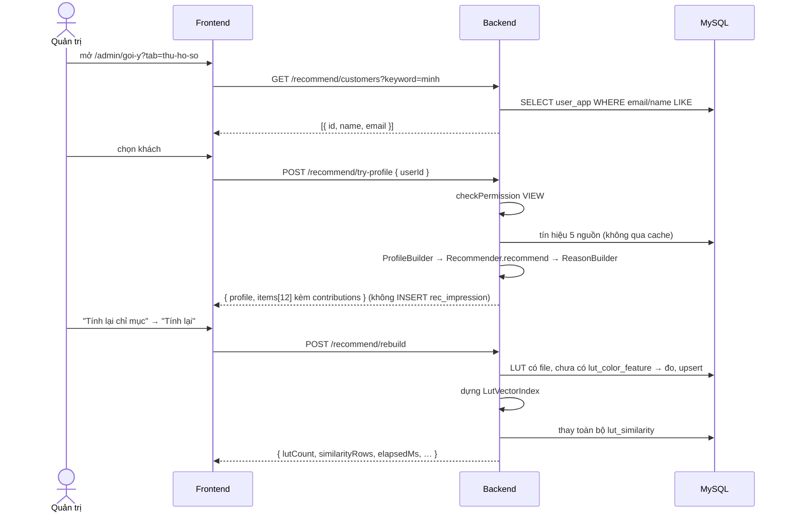

# Quản trị gợi ý

## 1. Mục tiêu và phạm vi

Sau plan này, quản trị viên mở **`/admin/goi-y`** và có 4 thẻ:

- **"Cấu hình"**: xem (chỉ đọc) trọng số 6 khối, trọng số 8 loại sự kiện, các tham số `recommend.*` đang chạy và trạng thái chỉ mục (số LUT, số cặp tương tự, dựng lúc nào, vì sao).
- **"Đánh giá"**: chỗ dành cho bảng các lần chạy đánh giá offline; lát này chỉ có trạng thái rỗng (bảng `rec_eval_run` và `GET /recommend/eval/list` thuộc lát 3.1).
- **"Trực tuyến"**: CTR, tỉ lệ tải từ gợi ý, tỉ lệ bỏ qua trong một khoảng ngày, tách theo vị trí trong danh sách và theo biến thể / loại khối, tính từ `rec_impression` + `user_event.impression_id` (thiết kế §8.4.5).
- **"Thử hồ sơ"**: chọn một khách hàng (hoặc nhập mã ẩn danh), xem hồ sơ của họ (chiến lược, α, phong cách / danh mục / thẻ nổi bật, màu, các tín hiệu) và đúng 12 gợi ý "Dành cho bạn" họ đang thấy, kèm điểm và đóng góp từng khối. Công cụ này dùng khi bảo vệ đồ án để giải thích thuật toán.

Đầu trang có nút **"Tính lại chỉ mục"** (đo đặc trưng màu còn thiếu, dựng lại chỉ mục vector và `lut_similarity`).

| Có làm (lát này) | Không làm (để plan khác) |
|---|---|
| Migration `V13__quan_tri_goi_y.sql`: module `RECOMMENDER`, resource `RECOMMEND` (`/recommend/`, VIEW + UPDATE). Không có bảng mới | Bảng `rec_eval_run`, `GET /recommend/eval/list`, so sánh hai lần chạy (lát 3.1 `danh-gia-goi-y`) |
| 5 API quản trị: `recommend/config`, `recommend/rebuild`, `recommend/stats`, `recommend/customers`, `recommend/try-profile` | Sửa cấu hình từ giao diện (cấu hình nằm ở `application.yml`, §11 câu 1) |
| `LutIndexService` giữ trạng thái lần dựng gần nhất, có bản `rebuildOrThrow` cho API | A/B theo `user_id` chẵn / lẻ, nhiều `variant` cùng chạy (lát 3.x) |
| `RecommendService`: tách phần xếp hạng dùng chung cho `for-you` và `try-profile`, gọi thẳng `Recommender.recommend` (dọn điểm lệch của lát 2.3) | Biểu đồ theo ngày, xuất CSV số liệu |
| `StatsCalculator` (lớp thuần) tính CTR / tỉ lệ tải / tỉ lệ bỏ qua | Dọn dòng `rec_impression` cũ |
| Frontend: trang `/admin/goi-y` (4 thẻ), mục "Gợi ý" ở thanh bên, nút "Tính lại chỉ mục" theo quyền UPDATE | Quản lý khách hàng (`/admin/khach-hang`, lát `quan-tri-don-hang`) |

## 2. Tác nhân và phân quyền

| Tác nhân | Quyền (resource `RECOMMEND`, uri `/recommend/`) | Ghi chú |
|---|---|---|
| Quản trị (role operator, `admin@downbeat.local`) | VIEW, UPDATE | Role `is_operator = 1` có mọi quyền, migration không cần cấp |
| Role được cấp VIEW | `config`, `stats`, `customers`, `try-profile` | Không thấy nút "Tính lại chỉ mục" |
| Role được cấp UPDATE | `rebuild` | |
| Khách hàng, `noaccess@downbeat.local` | Không | API 403 `FORBIDDEN` "Bạn không có quyền thực hiện thao tác này! Path: /recommend/, Action: VIEW" (API-11); menu không có "Gợi ý"; mở `/admin/goi-y` thấy "Truy cập bị từ chối" |

Mọi API của lát này không có `/public/` nên filter đòi token (401 khi thiếu). Controller gọi `checkPermission(principal, "/recommend/", action)` ở **dòng đầu** mỗi handler.

## 3. Luồng nghiệp vụ

**Luồng chính 1 — xem cấu hình (UI-06):**
1. Quản trị mở `/admin/goi-y` → thẻ "Cấu hình" (mặc định). Giao diện gọi `GET /recommend/config`.
2. Backend đọc `RecommendProperties` (trọng số gốc + sau chuẩn hoá, trọng số sự kiện, tham số) và trạng thái chỉ mục từ `LutIndexService.status()`.
3. Giao diện hiện 4 thẻ con: "Chỉ mục", "Trọng số khối", "Trọng số sự kiện", "Tham số".

**Luồng chính 2 — tính lại chỉ mục:**
1. Bấm "Tính lại chỉ mục" → hộp thoại xác nhận → "Tính lại".
2. `POST /recommend/rebuild`: (a) tìm LUT có file .cube mà chưa có dòng `lut_color_feature`, đo đặc trưng cho các LUT đó (`LutColorFeatureService.recompute(ids)`); (b) `LutIndexService.rebuildOrThrow("quản trị")` dựng chỉ mục + ghi lại `lut_similarity`; (c) trả bản tóm tắt.
3. Toast "Đã tính lại chỉ mục (36 LUT, 412 ms)"; thẻ "Chỉ mục" cập nhật "Dựng lúc", "Lý do: quản trị". LUT không đo được đặc trưng màu thì hiện khung cảnh báo liệt kê tên.

**Luồng chính 3 — số liệu trực tuyến:**
1. Thẻ "Trực tuyến", mặc định 30 ngày gần nhất (tính cả hôm nay). Giao diện gọi `GET /recommend/stats?from=&to=`.
2. Backend lấy các `rec_impression` (`placement = FOR_YOU`) có ngày tạo trong khoảng, các `user_event` VIEW / DISMISS gắn `impression_id` của chúng, và các `download_log` của người đã bấm trong 30 phút sau lần bấm; `StatsCalculator` tính chỉ số (§5.3).
3. Giao diện hiện 4 ô số, "CTR theo vị trí" (thanh ngang) và bảng "Theo biến thể".

**Luồng chính 4 — thử hồ sơ:**
1. Thẻ "Thử hồ sơ", loại khách "Tài khoản": gõ email / tên vào ô tìm → `GET /recommend/customers?keyword=` → chọn một khách.
2. `POST /recommend/try-profile { userId }`: tính hồ sơ **mới** (không đọc, không ghi cache), xếp hạng **đúng như `for-you`** của khách đó (cùng loại LUT đã tải / bỏ qua, cùng giới hạn Premium theo gói), **không** ghi `rec_impression`.
3. Giao diện hiện thẻ "Hồ sơ" và bảng "12 gợi ý" với cột đóng góp từng khối.

**Luồng thay thế:**
- A1. Loại khách "Mã ẩn danh": nhập `anonId` → "Xem hồ sơ" → `try-profile { anonId }` (hồ sơ khách vãng lai).
- A2. Khách chưa có tín hiệu → chiến lược `POPULAR`: bảng gợi ý là danh sách "Phổ biến tuần này", các cột điểm / đóng góp hiện "—".
- A3. Đổi khoảng ngày bằng ô ngày hoặc nút nhanh "7 ngày", "30 ngày", "90 ngày" → gọi lại `stats`.
- A4. Khoảng ngày không có lượt hiển thị → "Chưa có lượt hiển thị gợi ý nào trong khoảng này."
- A5. Role chỉ có VIEW → không có nút "Tính lại chỉ mục"; mọi thẻ khác dùng bình thường.
- A6. Tài khoản đổi URL `?tab=` → mở đúng thẻ (chia sẻ link được).

**Ngoại lệ:**
- E1. Không có quyền VIEW (khách hàng, noaccess) → 403 (API-11); giao diện "Truy cập bị từ chối". Có VIEW mà thiếu UPDATE gọi `rebuild` → 403 "… Action: UPDATE".
- E2. `stats`: `from` / `to` sai định dạng → 400 "Ngày không hợp lệ"; `from > to` → 400 "Ngày bắt đầu phải trước hoặc bằng ngày kết thúc"; khoảng quá 366 ngày → 400 "Khoảng thời gian tối đa 366 ngày". Giao diện chặn trước hai lỗi sau (không gọi API).
- E3. `try-profile`: thiếu cả `userId` và `anonId` → 400 "Chọn một khách hàng hoặc nhập mã ẩn danh"; `anonId` sai định dạng → 400 "Mã ẩn danh không hợp lệ"; `userId` không có → 404 "Không tìm thấy khách hàng".
- E4. `rebuild` lỗi khi dựng chỉ mục → 500 `INTERNAL_ERROR` "Không dựng được chỉ mục gợi ý"; chỉ mục cũ vẫn phục vụ; toast message server.
- E5. API của một thẻ lỗi mạng / 5xx → thẻ đó hiện "Không tải được dữ liệu" + nút "Thử lại"; các thẻ khác không ảnh hưởng.



## 4. Cơ sở dữ liệu

Migration: `V13__quan_tri_goi_y.sql` (mới nhất hiện tại là `V12__xep_hang_goi_y.sql`). **Không** tạo bảng, không thêm cột. Chỉ thêm module + resource, theo khuôn `V6__dac_trung_mau.sql`:

```sql
SET NAMES utf8mb4;

INSERT INTO `module` (`name`, `code`, `description`, `active`)
SELECT 'Hệ gợi ý', 'RECOMMENDER', 'Cấu hình, số liệu và công cụ thử hồ sơ của bộ gợi ý', 1 FROM DUAL
WHERE NOT EXISTS (SELECT 1 FROM `module` WHERE `code` = 'RECOMMENDER');

INSERT INTO `resource` (`name`, `description`, `code`, `uri`, `actions`, `active`, `module_id`)
SELECT 'Quản trị gợi ý', 'Cấu hình, tính lại chỉ mục, số liệu trực tuyến, thử hồ sơ', 'RECOMMEND', '/recommend/',
       '["VIEW", "UPDATE"]', 1, (SELECT `id` FROM `module` WHERE `code` = 'RECOMMENDER')
FROM DUAL WHERE NOT EXISTS (SELECT 1 FROM `resource` WHERE `code` = 'RECOMMEND');
```

Không cấp permission cho role nào (admin là operator). Truy vấn thống kê dùng index có sẵn: `idx_rec_impression_created`, `idx_user_event_*`, index `download_log (user_id, …)` của lát `tai-lut`.

## 5. Hợp đồng API (cố định — nguồn sự thật cho cả BE và FE)

Thành công: `{ "code": 200, "message": "OK", "result": … }`. Lỗi nghiệp vụ: `{ "path", "code", "errorCode", "message" }`. POJO `NON_NULL`. Thời điểm theo `Clock` của app (Asia/Ho_Chi_Minh), định dạng `yyyy-MM-dd'T'HH:mm:ss`; ngày `yyyy-MM-dd`. Mọi tỉ lệ là số thập phân trong [0, 1] (riêng `dismissRate` có thể > 1), làm tròn 4 chữ số; giao diện tự đổi sang phần trăm.

### 5.1 `GET /api/recommend/config` — quyền VIEW

Không tham số. Response `result` (POJO `RecommendConfig`, không thuộc bảng):
```json
{
  "variant": "cbf-full",
  "weights": { "tag": 0.30, "color": 0.25, "category": 0.15, "style": 0.15, "text": 0.10, "creator": 0.05 },
  "normalizedWeights": { "tag": 0.30, "color": 0.25, "category": 0.15, "style": 0.15, "text": 0.10, "creator": 0.05 },
  "eventWeights": { "VIEW": 1.0, "PREVIEW": 2.0, "SEARCH": 0.5, "FILTER_STYLE": 0.5, "FAVORITE": 4.0, "DOWNLOAD": 5.0, "PURCHASE": 6.0, "DISMISS": -4.0 },
  "params": {
    "similarity-top": 50, "half-life-days": 30.0, "history-days": 180, "history-max-pairs": 200,
    "cold-start-k": 5.0, "mmr-lambda": 0.7, "candidate-top": 100, "premium-max-ratio": 0.34,
    "related-personal-ratio": 0.2, "popular-days": 30, "for-you-limit": 12, "for-you-max-limit": 24,
    "event-dedup-minutes": 30, "profile-cache-minutes": 5, "preference-max": 12,
    "stats-download-window-minutes": 30, "stats-max-days": 366,
    "rebuild-cron": "0 0 3 * * *", "event-cleanup-cron": "0 30 0 * * *"
  },
  "index": {
    "lutCount": 36, "similarityRows": 1800, "builtTime": "2026-11-12T09:00:04",
    "elapsedMs": 412, "reason": "khởi động"
  }
}
```
Quy tắc:
- `weights` là giá trị gốc trong `application.yml`; `normalizedWeights` = `RecommendProperties.normalizedWeights()` (chia cho tổng), làm tròn 4 chữ số. Khoá luôn đủ 6, theo đúng thứ tự trên.
- `eventWeights` đủ 8 khoá theo đúng thứ tự trên (`LinkedHashMap`).
- `params` là `LinkedHashMap` đúng 19 khoá và thứ tự trên, giá trị số (int / double như kiểu trong `RecommendProperties`) hoặc chuỗi (cron).
- `index`: trạng thái lần dựng **thành công** gần nhất (`LutIndexService.status()`); chưa dựng lần nào → không có khoá `index`. Lần dựng gần nhất bị lỗi → thêm `"lastError": "…"`, `"lastErrorTime": "…"` vào `index` (nếu chưa từng dựng thành công thì `index` chỉ có hai khoá này).

### 5.2 `POST /api/recommend/rebuild` — quyền UPDATE

Không body. Đồng bộ (chờ dựng xong mới trả). Response `result` (POJO `RebuildResult`):
```json
{
  "featureMissing": 1,
  "featureComputed": 0,
  "featureFailed": [ { "id": 41, "title": "Thử Nghiệm Nháp", "error": "Không đọc được file .cube" } ],
  "lutCount": 36,
  "similarityRows": 1800,
  "elapsedMs": 523,
  "builtTime": "2026-11-12T10:15:03",
  "reason": "quản trị"
}
```
Quy tắc (theo thứ tự):
1. `missingIds` = id các LUT (mọi trạng thái) có `file_key` khác rỗng và **không** có dòng `lut_color_feature` (`LutRepository.idsMissingFeature()`, một câu `LEFT JOIN … WHERE f.id IS NULL`). `featureMissing` = số phần tử.
2. `missingIds` khác rỗng → `LutColorFeatureService.recompute(missingIds)`; `featureComputed` = số LUT trả về không có `featureError`; `featureFailed` = các LUT có `featureError` (`id`, `title`, `error`). Rỗng → bỏ qua bước này, `featureComputed = 0`, `featureFailed = []`.
3. `LutIndexService.rebuildOrThrow("quản trị")` → `IndexStatus`; lỗi → 500 `INTERNAL_ERROR` "Không dựng được chỉ mục gợi ý" (chỉ mục cũ giữ nguyên, `status().lastError` được ghi).
4. Handler **không** `@Transactional` (mỗi bước tự commit). Bước 2 có thể tự phát `LutCatalogChangedEvent` làm chỉ mục dựng thêm một lần; chấp nhận (kho 36 LUT, < 1 giây).

### 5.3 `GET /api/recommend/stats?from=&to=` — quyền VIEW

Tham số chuỗi `from`, `to` dạng `yyyy-MM-dd`, đều tuỳ chọn. Thiếu `to` → hôm nay; thiếu `from` → `to − 29 ngày`. Khoảng tính cả hai đầu: `created_time >= from 00:00:00` và `< to + 1 ngày 00:00:00`.

Response `result` (POJO `RecommendStats`):
```json
{
  "from": "2026-10-14",
  "to": "2026-11-12",
  "summary": {
    "impressions": 120, "clicked": 18, "ctr": 0.15,
    "downloaded": 4, "downloadRate": 0.0333,
    "dismissals": 6, "dismissRate": 0.05
  },
  "byVariant": [
    { "variant": "cbf-full", "strategy": "PROFILE", "impressions": 70, "clicked": 14, "ctr": 0.2, "downloaded": 4, "downloadRate": 0.0571, "dismissals": 5, "dismissRate": 0.0714 },
    { "variant": "cbf-full", "strategy": "POPULAR", "impressions": 50, "clicked": 4, "ctr": 0.08, "downloaded": 0, "downloadRate": 0.0, "dismissals": 1, "dismissRate": 0.02 }
  ],
  "byPosition": [
    { "position": 1, "impressions": 120, "clicks": 7, "ctr": 0.0583 },
    { "position": 2, "impressions": 120, "clicks": 3, "ctr": 0.025 }
  ]
}
```
Định nghĩa (lớp thuần `StatsCalculator`, thiết kế §8.4.5):

| Đại lượng | Cách tính |
|---|---|
| Tập impression I | `rec_impression` có `placement = 'FOR_YOU'` và `created_time` trong khoảng. `impressions` = \|I\| |
| Lần bấm | `user_event` có `event_type = 'VIEW'`, `impression_id ∈ I` **và** `lut_id` có trong `lut_ids` của impression đó (không cần nằm trong khoảng ngày). Đếm theo cặp (impression, lut) khác nhau |
| `clicked` / `ctr` | Số impression có ≥ 1 lần bấm; `ctr = clicked / impressions` |
| `downloaded` / `downloadRate` | Số impression có ≥ 1 lần bấm (của người có `user_id`) mà `download_log` cùng `user_id`, cùng `lut_id`, `created_time ∈ [thời điểm bấm, thời điểm bấm + stats-download-window-minutes]` (30); `downloadRate = downloaded / impressions` |
| `dismissals` / `dismissRate` | Số dòng `user_event` `DISMISS` có `impression_id ∈ I`; `dismissRate = dismissals / impressions` |
| `byVariant` | Gom theo (`variant`, `strategy`) của impression; sắp `variant` tăng dần, rồi `strategy` theo thứ tự PROFILE, PREFERENCE, POPULAR. Chỉ có nhóm có ít nhất 1 impression |
| `byPosition` | Vị trí k = chỉ số trong `lut_ids` + 1. `impressions` của k = số impression có `lut_ids` dài ≥ k; `clicks` = số lần bấm (cặp khác nhau) rơi vào vị trí k; `ctr = clicks / impressions`. k chạy từ 1 tới độ dài lớn nhất (≤ 24); vị trí có `impressions = 0` không trả |
| Mẫu số 0 | Tỉ lệ = 0 |

`I` rỗng → `summary` toàn 0, `byVariant = []`, `byPosition = []`.

### 5.4 `GET /api/recommend/customers?keyword=&limit=` — quyền VIEW

Tìm khách để chọn ở "Thử hồ sơ". `keyword` cắt khoảng trắng; rỗng / thiếu → 10 tài khoản mới tạo nhất; có giá trị → `email LIKE %kw%` **hoặc** `name LIKE %kw%` (collation không phân biệt hoa thường / dấu như cột hiện có), sắp `created_time` giảm dần rồi `id` giảm dần. `limit` null / ≤ 0 → 10, > 20 → 20. Gồm mọi tài khoản `user_app` (kể cả quản trị, vì quản trị cũng có thể dùng cửa hàng).

Response `result` (mảng, không phân trang):
```json
[
  { "id": 57, "name": "Minh Anh", "email": "minhanh@example.com" },
  { "id": 12, "name": "Quản trị", "email": "admin@downbeat.local" }
]
```

### 5.5 `POST /api/recommend/try-profile` — quyền VIEW

Request (POJO `TryProfileRequest`):
```json
{ "userId": 57, "anonId": null, "limit": 12 }
```
Quy tắc:
1. `userId > 0` → khách là tài khoản đó (bỏ qua `anonId`); không có trong `user_app` → 404 `DATA_NOT_FOUND` "Không tìm thấy khách hàng".
2. Không có `userId` hợp lệ: `anonId` rỗng / thiếu → 400 `BAD_REQUEST` "Chọn một khách hàng hoặc nhập mã ẩn danh"; `anonId` không phải UUID (`EventService.isValidUuid`) → 400 `BAD_REQUEST` "Mã ẩn danh không hợp lệ"; hợp lệ → hồ sơ ẩn danh (chữ thường).
3. `limit` chuẩn hoá như `for-you` (mặc định 12, tối đa 24).
4. Hồ sơ: `UserProfileService.computeFresh(userId, anonId)` (tính trực tiếp, **không** đọc / ghi cache).
5. Xếp hạng: cùng hàm dùng chung với `for-you` (§7 mục 6): loại LUT đã tải / bỏ qua, `premiumLimited` theo subscription ACTIVE của `userId` (ẩn danh luôn bị giới hạn), `Recommender.recommend`, `ReasonBuilder`. **Không** INSERT `rec_impression`, không ghi `user_event`, không xoá cache.
6. Mỗi item là LUT như `for-you` (`id, slug, title, creatorName, style, isPremium, coverUrl, …, score, reason`) thêm `contributions` = 6 khoá `tag, color, category, style, text, creator` (giá trị `w_b · sim_b`, làm tròn 4 chữ số); strategy `POPULAR` → không có `score` và `contributions`.

Response `result` (POJO `TryProfileResult`):
```json
{
  "customer": { "id": 57, "name": "Minh Anh", "email": "minhanh@example.com" },
  "strategy": "PROFILE",
  "premiumLimited": true,
  "premiumQuota": 4,
  "profile": {
    "strategy": "PROFILE", "alpha": 0.0, "positiveLutCount": 1, "preference": [],
    "topStyles": [ { "key": "am-ap", "weight": 1.0 } ],
    "topCategories": [ { "key": "am-ap", "weight": 0.7071 } ],
    "topTags": [ { "key": "lá vàng", "weight": 0.6124 } ],
    "signals": [ { "type": "DOWNLOAD", "lutId": 17, "slug": "mua-thu-ha-noi", "count": 1, "days": 0.0, "weight": 5.0, "lastTime": "2026-11-12T09:30:00" } ]
  },
  "color": [
    { "key": "brightness", "value": 0.42 }, { "key": "contrast", "value": -0.1 }, { "key": "saturation", "value": 0.8 },
    { "key": "warmth", "value": 1.35 }, { "key": "tint", "value": 0.2 }, { "key": "shadowA", "value": 0.0 },
    { "key": "shadowB", "value": 0.9 }, { "key": "highlightA", "value": 0.1 }, { "key": "highlightB", "value": 1.1 },
    { "key": "isMono", "value": -0.3 }
  ],
  "categoryNames": { "am-ap": "Ấm áp" },
  "items": [
    {
      "id": 9, "slug": "hoang-hon-sai-gon", "title": "Hoàng Hôn Sài Gòn", "creatorName": "Minh Color",
      "style": "am-ap", "isPremium": 0, "coverUrl": "http://localhost:9020/downbeat-public/lut/hoang-hon-sai-gon/cover.jpg",
      "score": 0.7172, "reason": "Cùng phong cách Ấm áp với Mùa Thu Hà Nội bạn đã tải",
      "contributions": { "tag": 0.1821, "color": 0.2310, "category": 0.0941, "style": 0.15, "text": 0.0412, "creator": 0.0188 }
    }
  ]
}
```
- `customer`: chỉ khi khách là tài khoản; ẩn danh → không có `customer`, có `"anonId": "<uuid chữ thường>"`.
- `profile` = `UserProfileService.summary(profile)` (như `recommend/public/profile` lát 2.2); `topStyles` / `topCategories` / `topTags` là `ProfileTerm { key, weight }` đúng hợp đồng lát 2.2 (khác `color` dùng `{ key, value }`). *(Sửa 2026-11-11: bản trước ghi nhầm `value`.)*
- `color`: 10 phần tử theo đúng thứ tự trên = `profile.mixed().color()` (z-score), làm tròn 4; hồ sơ không có màu (null / rỗng) → `color = []`.
- `premiumQuota`: `floor(limit × premium-max-ratio)` khi `premiumLimited`, không thì không có khoá.
- `categoryNames`: tên (`lut_category.name`) của mọi slug xuất hiện trong `profile.preference`, `topStyles`, `topCategories` **và `style` của mọi phần tử `items`** (để cột LUT §6.6 hiện tên phong cách); slug không có tên thì không có trong map. *(Bổ sung 2026-11-11 trong /cook phiên B, người dùng duyệt.)*
- `items` rỗng (chỉ mục chưa dựng / hết ứng viên) → `[]`.

### 5.6 Lỗi nghiệp vụ

| Tình huống | HTTP | errorCode | message (nguyên văn) |
|---|---|---|---|
| Mọi API không token / token sai | 401 | `LOGIN` / `UNAUTHORIZED` / `TOKEN_EXPIRED` (filter có sẵn) | (message có sẵn) |
| `config`, `stats`, `customers`, `try-profile` khi role không có VIEW | 403 | `FORBIDDEN` | Bạn không có quyền thực hiện thao tác này! Path: /recommend/, Action: VIEW |
| `rebuild` khi role không có UPDATE | 403 | `FORBIDDEN` | Bạn không có quyền thực hiện thao tác này! Path: /recommend/, Action: UPDATE |
| `stats`: `from` hoặc `to` không đúng `yyyy-MM-dd` (kể cả ngày không tồn tại như `2026-02-30`) | 400 | `BAD_REQUEST` | Ngày không hợp lệ |
| `stats`: `from` sau `to` | 400 | `BAD_REQUEST` | Ngày bắt đầu phải trước hoặc bằng ngày kết thúc |
| `stats`: số ngày (`to − from + 1`) > `stats-max-days` (366) | 400 | `BAD_REQUEST` | Khoảng thời gian tối đa 366 ngày |
| `try-profile`: thiếu cả `userId` và `anonId` (hoặc body rỗng) | 400 | `BAD_REQUEST` | Chọn một khách hàng hoặc nhập mã ẩn danh |
| `try-profile`: `anonId` sai định dạng | 400 | `BAD_REQUEST` | Mã ẩn danh không hợp lệ |
| `try-profile`: `userId` không có | 404 | `DATA_NOT_FOUND` | Không tìm thấy khách hàng |
| `rebuild`: dựng chỉ mục lỗi | 500 | `INTERNAL_ERROR` | Không dựng được chỉ mục gợi ý |

Không thêm `ErrorCode` mới (dùng `BAD_REQUEST`, `DATA_NOT_FOUND`, `INTERNAL_ERROR` kèm message riêng). Kiểm quyền trước kiểm dữ liệu (403 thắng 400).

## 6. Giao diện (chuỗi cố định — test E2E chọn theo đúng các chuỗi này)

Số hiển thị theo `vi-VN`: số thập phân dùng dấu phẩy (`0,30`), tỉ lệ dùng `Intl.NumberFormat("vi-VN", { style: "percent", minimumFractionDigits: 1, maximumFractionDigits: 1 })` (ví dụ `15,0%`), thời điểm `dd/MM/yyyy HH:mm:ss`.

### 6.1 Khung trang

- Route `/admin/goi-y` (`routes/admin/goi-y.tsx`), bọc `AdminPermissionGuard code="RECOMMEND"`. Thanh bên nhóm "Chức năng chính", mục **"Gợi ý"** (icon `Sparkles`), sau "Đặc trưng màu", chỉ hiện khi có VIEW `RECOMMEND`.
- Search param `tab` ∈ `cau-hinh` (mặc định), `danh-gia`, `truc-tuyen`, `thu-ho-so`; giá trị khác → `cau-hinh`. Đổi thẻ thì cập nhật URL (`replace`).
- Đầu trang: `h1` "Gợi ý", dòng phụ "Cấu hình thuật toán, hiệu quả trên cửa hàng và công cụ thử hồ sơ khách hàng." Bên phải (chỉ khi có UPDATE): nút **"Tính lại chỉ mục"** (icon `RefreshCw`).
- `Tabs` 4 thẻ theo thứ tự: "Cấu hình", "Đánh giá", "Trực tuyến", "Thử hồ sơ". Dưới `sm` thanh thẻ cuộn ngang được, trang không tràn ngang.
- Mỗi thẻ tự gọi API của nó khi được mở lần đầu (không gọi API của thẻ chưa mở). Lỗi: khung `AdminLoadError` "Không tải được dữ liệu" + nút "Thử lại".

### 6.2 Nút "Tính lại chỉ mục"

- Bấm → `AlertDialog` tiêu đề "Tính lại chỉ mục gợi ý?", mô tả "Hệ thống đo lại đặc trưng màu còn thiếu, dựng lại chỉ mục vector và bảng LUT tương tự. Việc này mất vài giây; khối gợi ý ở cửa hàng vẫn chạy bình thường trong lúc tính.", nút "Tính lại" và "Huỷ".
- Đang chạy: nút trong hộp thoại "Đang tính…" (disabled, có spinner), không đóng được bằng phím Esc / bấm ra ngoài.
- Thành công: đóng hộp thoại, toast "Đã tính lại chỉ mục ({lutCount} LUT, {elapsedMs} ms)"; làm mới query `config`. `featureFailed` khác rỗng → `Alert` (destructive) dưới đầu trang: tiêu đề "Không đo được đặc trưng màu của {n} LUT", nội dung liệt kê "{title}: {error}" mỗi dòng; có nút đóng "Đóng".
- Lỗi: đóng hộp thoại, toast message server (ví dụ "Không dựng được chỉ mục gợi ý").

### 6.3 Thẻ "Cấu hình"

Dòng ghi chú trên cùng (chữ nhỏ, màu muted): "Chỉ xem. Giá trị lấy từ application.yml (khoá recommend.*); muốn đổi thì sửa file và khởi động lại backend."

Bốn `Card` (lưới 2 cột từ `lg`, 1 cột dưới `lg`; card "Tham số" chiếm cả hai cột từ `lg` để ở màn 1280 px bảng hiện đủ 3 cột, không cuộn ngang — *bổ sung 2026-11-11, người dùng duyệt*):

1. **"Chỉ mục"** — danh sách nhãn / giá trị: "Số LUT trong chỉ mục" `{lutCount}`, "Số cặp tương tự" `{similarityRows}`, "Dựng lúc" `{builtTime}`, "Lý do" `{reason}`, "Thời gian dựng" `{elapsedMs} ms`. Không có `index` → "Chỉ mục chưa được dựng". Có `lastError` → dòng đỏ "Lần dựng gần nhất lỗi lúc {lastErrorTime}: {lastError}".
2. **"Trọng số khối"** — bảng cột "Khối", "Cấu hình", "Sau chuẩn hoá"; 6 dòng theo thứ tự: Thẻ (`tag`), Màu (`color`), Danh mục (`category`), Phong cách (`style`), Văn bản (`text`), Tác giả (`creator`). Số 2 chữ số thập phân (`0,30`). Cột "Sau chuẩn hoá" có thanh ngang tỉ lệ (`aria-hidden`).
3. **"Trọng số sự kiện"** — bảng cột "Sự kiện", "Trọng số"; 8 dòng: "Xem (VIEW)", "Xem trước (PREVIEW)", "Tìm kiếm (SEARCH)", "Lọc phong cách (FILTER_STYLE)", "Lưu bộ sưu tập (FAVORITE)", "Tải (DOWNLOAD)", "Mua gói (PURCHASE)", "Không quan tâm (DISMISS)". Số dạng `vi-VN` tối đa 2 chữ số thập phân (`1`, `0,5`, `-4`).
4. **"Tham số"** — bảng cột "Tham số", "Khoá", "Giá trị"; đủ 19 dòng theo thứ tự §5.1 với nhãn:

| Khoá | Nhãn "Tham số" |
|---|---|
| similarity-top | Số LUT tương tự lưu cho mỗi LUT |
| half-life-days | Chu kỳ bán rã (ngày) |
| history-days | Số ngày lịch sử tối đa |
| history-max-pairs | Số cặp (LUT, loại) tối đa |
| cold-start-k | Hằng số k của α = k / (k + n) |
| mmr-lambda | λ của MMR (phù hợp ↔ đa dạng) |
| candidate-top | Số ứng viên đưa vào MMR |
| premium-max-ratio | Tỉ lệ LUT Premium tối đa (gói Miễn phí) |
| related-personal-ratio | Phần cá nhân hoá trong "Có thể bạn cũng thích" |
| popular-days | Số ngày tính "phổ biến" |
| for-you-limit | Số LUT mặc định của "Dành cho bạn" |
| for-you-max-limit | Số LUT tối đa của "Dành cho bạn" |
| event-dedup-minutes | Chống ghi lặp sự kiện (phút) |
| profile-cache-minutes | Thời gian cache hồ sơ (phút) |
| preference-max | Số sở thích khai báo tối đa |
| stats-download-window-minutes | Cửa sổ tính "tải từ gợi ý" (phút) |
| stats-max-days | Khoảng thống kê tối đa (ngày) |
| rebuild-cron | Lịch dựng lại chỉ mục |
| event-cleanup-cron | Lịch xoá sự kiện cũ |

Cột "Khoá" dạng `code`. Giá trị số dạng `vi-VN` (`0,7`, `0,34`), chuỗi cron giữ nguyên. Thẻ cũng có dòng "Biến thể đang chạy: {variant}" ở cuối card "Tham số".

### 6.4 Thẻ "Đánh giá"

Không gọi API. `Empty` (icon `FlaskConical`): tiêu đề "Chưa có lần chạy đánh giá nào", mô tả "Kết quả đánh giá offline (Precision, Recall, NDCG, độ đa dạng) sẽ hiện ở đây khi trình đánh giá chạy lần đầu."

### 6.5 Thẻ "Trực tuyến"

- Thanh lọc: hai ô `input type="date"` label "Từ ngày", "Đến ngày"; ba nút nhanh "7 ngày", "30 ngày", "90 ngày" (nút đang chọn ở trạng thái active; sửa tay ô ngày thì bỏ active). Mặc định "30 ngày" (`from = hôm nay − 29`, `to = hôm nay`, theo giờ trình duyệt).
- Validate trước khi gọi: thiếu một ô → không gọi, dưới ô hiện "Chọn ngày"; `from > to` → "Ngày bắt đầu phải trước hoặc bằng ngày kết thúc"; quá 366 ngày → "Khoảng thời gian tối đa 366 ngày".
- 4 ô số (lưới 4 cột từ `lg`, 2 cột dưới), mỗi ô một `Card` có `aria-label` bằng tiêu đề:
  - "Lượt hiển thị": `{impressions}`; dòng phụ "Mỗi lần khối gợi ý ở /luts trả danh sách".
  - "CTR": `{ctr}%`; dòng phụ "{clicked} lượt hiển thị có bấm".
  - "Tỉ lệ tải": `{downloadRate}%`; dòng phụ "{downloaded} lượt có tải trong 30 phút sau khi bấm".
  - "Tỉ lệ bỏ qua": `{dismissRate}%`; dòng phụ "{dismissals} lần Không quan tâm".
- **"CTR theo vị trí"** (`Card`): danh sách `ul aria-label="CTR theo vị trí"`, mỗi `li`: "Vị trí {position}", thanh ngang dài theo `ctr` (so với `ctr` lớn nhất), chữ "{ctr}% ({clicks}/{impressions})". Không dùng thư viện biểu đồ.
- **"Theo biến thể"** (`Card`): bảng cột "Biến thể", "Loại khối", "Lượt hiển thị", "CTR", "Tỉ lệ tải", "Tỉ lệ bỏ qua". "Loại khối": `PROFILE` → "Dành cho bạn (hành vi)", `PREFERENCE` → "Dành cho bạn (sở thích)", `POPULAR` → "Phổ biến tuần này".
- `impressions = 0`: thay hai card dưới bằng `Empty` "Chưa có lượt hiển thị gợi ý nào trong khoảng này." (4 ô số vẫn hiện 0 và `0,0%`).
- Đang tải: 4 ô `Skeleton` + 2 khung `Skeleton`.

### 6.6 Thẻ "Thử hồ sơ"

- `RadioGroup` label "Loại khách": "Tài khoản" (mặc định), "Mã ẩn danh".
- **"Tài khoản"**: combobox (`Popover` + `Command`) label "Khách hàng", nút kích hoạt hiện "Chọn khách hàng" (hoặc "{name} · {email}" khi đã chọn); ô tìm placeholder "Tìm theo email hoặc tên…", gọi `customers` sau 300 ms ngừng gõ; mỗi lựa chọn "{name} · {email}"; không có kết quả "Không tìm thấy khách hàng"; đang tìm "Đang tìm…". Chọn → gọi `try-profile { userId }` ngay.
- **"Mã ẩn danh"**: `Input` label "Mã ẩn danh (anonId)", placeholder "VD: 3f2b8c1e-9d4a-4f6b-8a2e-1c7d5e9f0a3b", nút "Xem hồ sơ" (disabled khi rỗng). Lỗi 400 / 404 từ server → chữ đỏ dưới ô (nguyên văn message), không toast.
- Chưa chọn ai: `Empty` "Chọn một khách hàng để xem hồ sơ và 12 gợi ý của họ."
- Đang tải: `Skeleton`. Lỗi 5xx / mạng: `AdminLoadError` + "Thử lại".
- Kết quả gồm hai `Card`:
  1. **"Hồ sơ"** (`section aria-label="Hồ sơ"`):
     - Dòng đầu: tên khách (hoặc "Khách vãng lai" + mã ẩn danh dạng `code`) và `Badge` chiến lược: `PROFILE` "Theo hành vi", `PREFERENCE` "Theo sở thích khai báo", `POPULAR` "Chưa có tín hiệu (phổ biến)".
     - Nhãn / giá trị: "α (tỉ trọng khai báo)" `{alpha}` (4 chữ số thập phân), "Số LUT có tín hiệu dương" `{positiveLutCount}`, "Sở thích khai báo" (chip tên từ `categoryNames`, không có → "Không có"), "Giới hạn LUT Premium" "Tối đa {premiumQuota} LUT" hoặc "Không giới hạn (gói trả phí)".
     - Ba nhóm chip: "Phong cách nổi bật" (`topStyles`, tên từ `categoryNames`), "Danh mục nổi bật" (`topCategories`), "Thẻ nổi bật" (`topTags`, giữ nguyên chữ thẻ); mỗi chip "{tên} {weight}" (weight 2 chữ số thập phân, ví dụ "Ấm áp 1,00"); rỗng → "—".
     - "Màu nổi bật": 10 thanh dùng `FeatureBar` / nhãn của `lib/lut-feature/feature-rows.ts` (thêm "Đen trắng" cho `isMono`), thang z-score [−3, 3]; `color = []` → "Chưa có dữ liệu màu".
     - "Tín hiệu" (`Collapsible`, mặc định đóng, nút "Tín hiệu ({n})"): bảng cột "Loại", "LUT / giá trị", "Số lần", "Số ngày", "Trọng số", "Lần cuối" (LUT hiện `slug`, SEARCH / FILTER_STYLE hiện `value`).
  2. **"12 gợi ý"** (tiêu đề theo số item thật: "{n} gợi ý"), bảng `aria-label="Gợi ý thử"` cột: "#", "LUT", "Điểm", "Thẻ", "Màu", "Danh mục", "Phong cách", "Văn bản", "Tác giả", "Câu giải thích".
     - "LUT": ảnh bìa nhỏ 16:9 (rộng 64 px), tiêu đề (link mở `/luts/{slug}` ở tab mới), dưới là tên phong cách; LUT Premium có `Badge` "Premium".
     - "Điểm" và 6 cột đóng góp: số 4 chữ số thập phân; `POPULAR` hiện "—". Ô đóng góp lớn nhất của mỗi dòng in đậm.
     - Bảng nằm trong khung cuộn ngang (`overflow-x-auto`), trang không tràn ngang trên điện thoại.
     - Dưới bảng: "Tính trực tiếp từ dữ liệu hiện tại; không dùng cache hồ sơ và không ghi lượt hiển thị."
     - `items = []` → "Không có LUT nào để gợi ý."

## 7. Việc backend (agy BE)

Thứ tự theo `backend/AGENTS.md`. Package `vn.aeoc.business.recommend` (`controller/`, `service/`, `repository/`, `stats/` mới cho lớp thuần). Hướng phụ thuộc giữ một chiều: `recommend` → `lut`, `download`, `billing`; `lut` không import `recommend`.

1. **Migration** `app/src/main/resources/db/migration/V13__quan_tri_goi_y.sql` đúng §4 → `sh scripts/ai/backend-restart.sh` (không có bảng mới nên không cần sinh lại jOOQ).
2. **Entity** (không thuộc bảng, `@JsonInclude(NON_NULL)`, package `entity/.../data/mysql/recommend/`): `RecommendConfig`, `IndexStatus` (`lutCount, similarityRows, builtTime, elapsedMs, reason, lastError, lastErrorTime`), `RebuildResult` (+ `FeatureFailure { id, title, error }`), `RecommendStats` (+ `StatsRow` cho `summary` / `byVariant`, `PositionStat`), `CustomerOption { id, name, email }`, `TryProfileRequest { userId, anonId, limit }`, `TryProfileResult`, `ColorTerm { key, value }`. `Lut.java` thêm `Map<String, Double> contributions` (không thuộc bảng, như `score`).
3. **Cấu hình**: `RecommendProperties` + `application.yml` thêm `stats-download-window-minutes: 30`, `stats-max-days: 366`.
4. **`LutIndexService`**: thêm `IndexStatus status()` (bản sao, `null` khi chưa từng dựng và chưa từng lỗi); `rebuildOrThrow(String reason)` → `IndexStatus` (dựng, `replaceAll`, set chỉ mục, ghi status thành công; lỗi thì ghi `lastError` = message, `lastErrorTime` = now rồi ném lại); `rebuild(reason)` hiện có gọi `rebuildOrThrow` và bắt lỗi như cũ (listener / cron / khởi động không đổi hành vi). Thêm `Clock` như các service khác.
5. **Phía `lut`**: `LutRepository.idsMissingFeature()` → `List<Integer>` (LUT có `file_key` khác rỗng, không có dòng `lut_color_feature`, sắp id tăng). `LutColorFeatureService.recompute(ids)` giữ nguyên.
6. **`RecommendService`** — tách xếp hạng dùng chung:
   - `private Ranking rank(Integer userId, String anonId, UserProfile profile, int limit)` (record `Ranking(String strategy, List<Lut> items, boolean premiumLimited, Map<Integer, RankedItem> ranked)`): chỉ mục, `premiumLimited` (subscription ACTIVE), `recentDownloads` chỉ khi `POPULAR`, gọi **`Recommender.recommend(profile, ix.items(), recentDownloads, limit, premiumLimited, props)`** (thay đoạn lặp lại hiện nay), `listPublishedByIds`, `ReasonBuilder`, `score`.
   - `forYou` = chuẩn hoá limit / danh tính → `profileOf` (cache) → `rank` → INSERT `rec_impression` như cũ. **Hành vi và response `for-you` không đổi** (spec `xep-hang-goi-y` phải xanh nguyên vẹn).
   - `tryProfile(TryProfileRequest)` → `TryProfileResult` theo §5.5 (validate theo đúng thứ tự §5.6; `customer` qua repository §7 mục 9; hồ sơ qua `computeFresh`; gắn `contributions` từ `RankedItem` làm tròn 4; `color` từ `profile.mixed().color()`; `categoryNames` từ `LutCategoryService.listPublic()`).
7. **`UserProfileService.computeFresh(Integer userId, String anonId)`**: như `profileOf` nhưng không đọc / ghi cache (dùng lại `computeUser` / `computeAnon`).
8. **`stats/StatsCalculator`** (thuần, static, không Spring): `compute(List<ImpressionRow> impressions, List<EventRow> events, List<DownloadRow> downloads, int windowMinutes)` → `RecommendStats` (không có `from` / `to`, service gắn sau). Record đầu vào: `ImpressionRow(long id, String variant, String strategy, List<Integer> lutIds)`, `EventRow(long impressionId, String type, Integer userId, int lutId, LocalDateTime time)`, `DownloadRow(int userId, int lutId, LocalDateTime time)`. Đúng các định nghĩa §5.3, làm tròn 4 chữ số ở bước cuối.
9. **Repository**:
   - `RecImpressionRepository.listForStats(LocalDateTime from, LocalDateTime toExclusive)` → `ImpressionRow` (`placement = 'FOR_YOU'`; đọc `lut_ids` JSON như `RecImpression.setLutIds(Object)`).
   - `UserEventRepository.listByImpressionIds(Collection<Long> ids)` → `EventRow` (`event_type IN ('VIEW','DISMISS')`, chia lô 1000 id).
   - `DownloadLogRepository.listForStats(Collection<Integer> userIds, LocalDateTime from, LocalDateTime to)` → `DownloadRow` (`user_id IN (…)`, `created_time` trong `[thời điểm bấm sớm nhất, thời điểm bấm muộn nhất + window]`).
   - `recommend/repository/RecommendCustomerRepository` (jOOQ trên `USER_APP`): `search(String keyword, int limit)` → `CustomerOption`; `findById(Integer id)`.
10. **`recommend/service/RecommendStatsService`**: `stats(String from, String to)` → parse / validate §5.6 (`LocalDate.parse`, bắt `DateTimeParseException`; đọc strict, `2026-02-30` là lỗi), gọi 3 repository, `StatsCalculator.compute`, gắn `from` / `to` (đã chuẩn hoá).
11. **`recommend/service/RecommendAdminService`**: `config()` theo §5.1; `rebuild()` theo §5.2; `customers(keyword, limit)` theo §5.4.
12. **Controller** `recommend/controller/RecommendAdminController` (`URI = "/recommend/"`): `GET /recommend/config` (VIEW), `POST /recommend/rebuild` (UPDATE), `GET /recommend/stats` (VIEW, `@RequestParam(required = false) String from, to`), `GET /recommend/customers` (VIEW), `POST /recommend/try-profile` (VIEW, `@RequestBody(required = false)`). `checkPermission` ở dòng đầu từng handler, trước mọi validate.
13. **Unit test**: mọi TC loại `unit` ở §9 (JUnit 5 + AssertJ + Mockito, không dựng Spring). Sửa test có sẵn của `RecommendService` theo chữ ký mới nếu cần, không giảm số assertion.

Quyết định đã chốt, worker không tự đổi: chỉ resource `RECOMMEND` với VIEW + UPDATE, không cấp permission trong migration; cấu hình chỉ đọc; `rebuild` đồng bộ, không `@Async`, không `@Transactional` ở handler; `try-profile` không đụng cache, không ghi `rec_impression`; `for-you` giữ nguyên hợp đồng và hành vi; định nghĩa chỉ số đúng §5.3 (bấm đếm theo cặp khác nhau, tải trong 30 phút sau bấm cùng LUT, DISMISS chia cho số impression); khoảng ngày tính cả hai đầu; không thêm `ErrorCode`.

Nghiệm thu riêng (thêm vào "Nghiệm thu chuẩn"): dán vào `worker_done` (a) response `config`; (b) response `rebuild`; (c) `stats` 30 ngày trên DB local; (d) `try-profile` của `admin@downbeat.local` và của một `anonId` vừa xem 3 LUT lạnh; (e) xác nhận `rec_impression` không tăng sau (d) (`SELECT COUNT(*)` trước / sau).

## 8. Việc frontend (agy FE)

1. `lib/types/recommend.ts`: thêm `RecommendConfigDTO`, `IndexStatusDTO`, `RebuildResultDTO`, `RecommendStatsDTO` (`StatsRowDTO`, `PositionStatDTO`), `CustomerOptionDTO`, `TryProfileResultDTO` (item = `ForYouLutDTO & { contributions?: Record<BlockKey, number> }`), `BlockKey = "tag" | "color" | "category" | "style" | "text" | "creator"`.
2. `lib/axios/recommend-admin.ts` (mới): `getRecommendConfig()`, `rebuildRecommendIndex()`, `getRecommendStats({ from, to })`, `searchRecommendCustomers(keyword)`, `tryProfile({ userId } | { anonId })`.
3. `lib/tanstack/options/recommend-admin.ts` (mới): query `["recommend-admin", "config"]`, `["recommend-admin", "stats", from, to]`, `["recommend-admin", "customers", keyword]` (`staleTime` 30 giây), mutation `rebuildIndexMutationOptions` (`meta.successMessage` theo §6.2 không cố định được nên toast trong `onSuccess` của component, `meta.errorMessage` dùng message server, `invalidatesQuery: [["recommend-admin", "config"]]`), mutation `tryProfileMutationOptions` (không toast, lỗi hiện tại chỗ theo §6.6). Theo đúng quy ước `meta` của `frontend/AGENTS.md`.
4. `routes/admin/goi-y.tsx` (mới): `validateSearch` cho `tab`, `AdminPermissionGuard code="RECOMMEND"`, đầu trang + nút "Tính lại chỉ mục" (`useCanView().can("RECOMMEND", "UPDATE")`), `Tabs`.
5. `components/admin/recommend/` (mới): `rebuild-index-dialog.tsx`, `config-tab.tsx`, `eval-tab.tsx`, `online-tab.tsx` (+ `stat-tile.tsx`, `position-bars.tsx`), `try-profile-tab.tsx` (+ `customer-combobox.tsx`, `profile-card.tsx`, `try-items-table.tsx`), `labels.ts` (nhãn khối, sự kiện, tham số, loại khối, chiến lược đúng §6). Định dạng số / phần trăm / thời điểm theo §6 (một helper chung trong `labels.ts` hoặc `lib/format`).
6. `components/admin/sidebar/admin-sidebar.tsx`: thêm `{ code: "RECOMMEND", title: "Gợi ý", url: "/admin/goi-y", icon: Sparkles }` sau "Đặc trưng màu".
7. `lib/lut-feature/feature-rows.ts`: dùng lại nhãn; nếu cần nhãn "Đen trắng" cho `isMono` thì thêm export, không đổi nhãn đang có.
8. `pnpm api:types` sau khi backend lên để `api.gen.ts` có 5 endpoint mới; đối chiếu type tay.

Component shadcn dùng: có sẵn trong `components/ui/`: `tabs`, `card`, `table`, `badge`, `button`, `input`, `label`, `radio-group`, `popover`, `command`, `alert`, `alert-dialog`, `collapsible`, `skeleton`, `sonner`; của quản trị: `AdminPermissionGuard`, `AdminLoadError`, `FeatureBar`. Cần `shadcn add`: `empty` (nếu chưa có `components/ui/empty.tsx`; không có thì `shadcn add empty`).

Việc của Claude ở `frontend/tests/e2e/` (không giao worker): viết `quan-tri-goi-y.spec.ts` theo §9; chạy hồi quy `xep-hang-goi-y` (vì `RecommendService` được tách hàm), `dac-trung-mau`, `phan-quyen` (thêm resource mới vào danh sách).

## 9. Test case

`unit` = agy BE viết JUnit · `api` / `e2e` = Claude viết ở `frontend/tests/e2e/quan-tri-goi-y.spec.ts`.

Dữ liệu E2E: mỗi test tự đăng ký khách mới (`newEmail()`), tự dùng `anonId` mới. DB local có `rec_impression` / `user_event` của các spec khác, nên test `stats` so **chênh lệch** trước / sau trong cùng một ngày và chạy `test.describe.configure({ mode: "serial" })`; các số liệu do spec khác tạo song song có thể làm chênh lệch lớn hơn, nên chỉ kiểm `≥` với số đếm và kiểm đúng công thức với tỉ lệ. Test đổi quyền role "Không quyền" phải trả quyền lại trong `finally`.

### 9.1 Dữ liệu cho `StatsCalculator` (TC-03)

Window 30 phút. Impression:

| id | variant | strategy | lut_ids |
|---|---|---|---|
| 1 | cbf-full | PROFILE | [10, 11, 12] |
| 2 | cbf-full | PROFILE | [11, 13] |
| 3 | cbf-full | POPULAR | [20, 21, 22, 23] |
| 4 | cbf-full | POPULAR | [20, 22] |

Sự kiện (thời điểm tính từ T = 2026-11-12 10:00):

| impression | type | user | lut | lúc | Ghi chú |
|---|---|---|---|---|---|
| 1 | VIEW | 5 | 11 | T | bấm vị trí 2 |
| 1 | VIEW | 5 | 11 | T + 2 phút | trùng cặp, không đếm thêm |
| 1 | VIEW | 5 | 99 | T | LUT không có trong danh sách, bỏ |
| 2 | VIEW | null | 13 | T | khách vãng lai, vị trí 2 |
| 3 | VIEW | 7 | 20 | T | vị trí 1 |
| 3 | VIEW | 7 | 23 | T + 1 phút | vị trí 4 |
| 3 | DISMISS | 7 | 21 | T | |
| 4 | DISMISS | 8 | 20 | T | |

Lượt tải: (user 5, lut 11, T + 10 phút) ✓ · (user 7, lut 20, T + 31 phút) ✗ quá cửa sổ · (user 7, lut 23, T − 1 phút) ✗ trước lần bấm · (user 9, lut 11, T + 5 phút) ✗ khác người.

Kết quả: `summary` impressions 4, clicked 3 (1, 2, 3), ctr 0.75, downloaded 1 (impression 1), downloadRate 0.25, dismissals 2, dismissRate 0.5. `byVariant`: PROFILE {2, clicked 2, ctr 1.0, downloaded 1, downloadRate 0.5, dismissals 0, dismissRate 0.0} rồi POPULAR {2, clicked 1, ctr 0.5, downloaded 0, 0.0, dismissals 2, dismissRate 1.0}. `byPosition`: 1 {4, 1, 0.25}, 2 {4, 2, 0.5}, 3 {2, 0, 0.0}, 4 {1, 1, 1.0}.

### 9.2 Bảng test case

| ID | Loại | Mô tả | Tiền điều kiện | Bước | Kết quả mong đợi |
|---|---|---|---|---|---|
| TC-01 | unit | `RecommendAdminService.config` | `RecommendProperties` mặc định; mock `LutIndexService.status()` trả status (36, 1800, …) rồi trả `null`; một lần có `lastError` | `config()` | `weights` / `normalizedWeights` đủ 6 khoá đúng thứ tự, tổng `normalizedWeights` = 1 ± 1e-4; đổi `weights.tag` = 0.6 → `normalizedWeights.tag` = round4(0.6 / 1.3); `eventWeights` 8 khoá đúng thứ tự, DISMISS −4.0; `params` đúng 19 khoá theo thứ tự §5.1, `mmr-lambda` 0.7, `rebuild-cron` "0 0 3 * * *"; status null → không có `index`; có lỗi → `index.lastError` |
| TC-02 | unit | `RecommendAdminService.rebuild` | Mock `LutRepository.idsMissingFeature`, `LutColorFeatureService`, `LutIndexService` | (a) missing [] ; (b) missing [3, 4], recompute trả id 3 thành công, id 4 `featureError` "Không đọc được file .cube"; (c) `rebuildOrThrow` ném `RuntimeException` | (a) không gọi `recompute`, `featureMissing` 0, `featureComputed` 0, `featureFailed` []; `rebuildOrThrow("quản trị")` gọi đúng 1 lần, kết quả lấy từ status trả về; (b) `recompute([3, 4])` 1 lần, `featureMissing` 2, `featureComputed` 1, `featureFailed` = [{4, title, "Không đọc được file .cube"}]; (c) `AppException` `INTERNAL_ERROR` "Không dựng được chỉ mục gợi ý" |
| TC-03 | unit | `StatsCalculator` | Dữ liệu §9.1 | `compute(…, 30)` | Đúng mọi số ở "Kết quả" §9.1; thứ tự `byVariant` PROFILE trước POPULAR; `byPosition` 4 phần tử 1 → 4 |
| TC-04 | unit | `StatsCalculator` biên | (a) không impression; (b) 1 impression không sự kiện; (c) thêm nhóm PREFERENCE và variant "b-test" | `compute` | (a) summary toàn 0, `byVariant` [], `byPosition` []; (b) impressions 1, mọi tỉ lệ 0.0, `byPosition` đủ vị trí theo độ dài với clicks 0; (c) `byVariant` sắp `variant` tăng dần nên các dòng "b-test" đứng **trước** "cbf-full"; trong cùng variant theo thứ tự PROFILE, PREFERENCE, POPULAR |
| TC-05 | unit | `RecommendStatsService` validate + khoảng ngày | Mock 3 repository, `now` = 2026-11-12 | (a) from, to null; (b) "2026-11-01", "2026-11-12"; (c) "2026-13-01"; (d) "2026-02-30"; (e) from "2026-11-12" to "2026-11-01"; (f) "2025-11-11" → "2026-11-12" (367 ngày); (g) "2025-11-12" → "2026-11-12" (366 ngày) | (a) `listForStats(2026-10-14T00:00, 2026-11-13T00:00)`, `from` "2026-10-14", `to` "2026-11-12"; (b) `listForStats(2026-11-01T00:00, 2026-11-13T00:00)`; (c)(d) 400 "Ngày không hợp lệ", không gọi repository; (e) "Ngày bắt đầu phải trước hoặc bằng ngày kết thúc"; (f) "Khoảng thời gian tối đa 366 ngày"; (g) hợp lệ; impression rỗng → không gọi `listByImpressionIds` / download |
| TC-06 | unit | `RecommendService.tryProfile` | Mock như TC-10 của lát 2.3 (kho 30 LUT), `UserProfileService.computeFresh` trả hồ sơ PROFILE, `RecommendCustomerRepository.findById(57)` | (a) `{ userId: 57 }`; (b) `{ userId: 57 }` khi khách có subscription ACTIVE; (c) `{ anonId: "3F2B…" }` chữ hoa hợp lệ; (d) hồ sơ POPULAR; (e) `{}` / null; (f) `{ anonId: "abc" }`; (g) `{ userId: 999 }` không có; (h) `{ userId: 57, anonId: "abc" }` | (a) `computeFresh(57, null)` 1 lần, **không** gọi `profileOf`, **không** `insertReturning`; `items` cùng thứ tự với `forYou(57, …)` trên cùng mock; mỗi item có `contributions` 6 khoá, `score` = tổng `contributions` ± 1e-3; `premiumLimited` true, `premiumQuota` 4, `customer` id 57; (b) `premiumLimited` false, không có `premiumQuota`; (c) `computeFresh(null, "3f2b…")`, `anonId` chữ thường, không có `customer`; (d) item không có `score` / `contributions`, `reason` ∈ {"Đang được tải nhiều", "Mới thêm vào kho"}; (e) 400 "Chọn một khách hàng hoặc nhập mã ẩn danh"; (f) 400 "Mã ẩn danh không hợp lệ"; (g) 404 "Không tìm thấy khách hàng"; (h) như (a) (bỏ qua anonId) |
| TC-07 | unit | `forYou` không đổi sau khi tách hàm | Bộ test TC-10 của `RecommendServiceTest` lát 2.3 | Chạy lại nguyên vẹn | Pass, không sửa kết quả mong đợi; `Recommender.recommend` được gọi (verify) |
| TC-08 | unit | `LutIndexService.status` / `rebuildOrThrow` | Mock `LutService`, `SimilarityService`, repository; `Clock` cố định | (a) chưa dựng; (b) `rebuildOrThrow("quản trị")` thành công; (c) lần sau `replaceAll` ném lỗi qua `rebuildOrThrow`; (d) như (c) qua `rebuild("định kỳ 03:00")` | (a) `status()` null; (b) status `lutCount` = số LUT, `similarityRows` = số dòng, `reason` "quản trị", `builtTime` = now; (c) ném lỗi, `current()` vẫn là chỉ mục cũ, status giữ số liệu (b) + `lastError` + `lastErrorTime`; (d) không ném, status có `lastError` |
| TC-09 | unit | `RecommendAdminService.customers` | Mock repository | keyword null, "  ", " Minh ", limit null / 0 / 5 / 50 | `search(null hoặc "", 10)` với hai trường hợp đầu; `search("Minh", …)` (đã trim); limit 10, 10, 5, 20 |
| TC-10 | api | API-11: phân quyền | Khách mới (token), `noaccess`, không token | 5 API: `config`, `stats`, `customers`, `try-profile {}`, `rebuild` | Khách mới và noaccess: 4 API đầu 403 `FORBIDDEN` message "… Path: /recommend/, Action: VIEW"; `rebuild` 403 "… Action: UPDATE" (kể cả `try-profile {}` vẫn 403, không 400); không token: 401 cả 5 |
| TC-11 | api | `config` | admin | `GET config` | 200; `weights` = {tag 0.3, color 0.25, category 0.15, style 0.15, text 0.1, creator 0.05}; `normalizedWeights` cùng giá trị (tổng 1); `eventWeights` 8 khoá đúng thứ tự, DISMISS −4; `params` đúng 19 khoá đúng thứ tự §5.1, `mmr-lambda` 0.7, `premium-max-ratio` 0.34, `stats-max-days` 366; `variant` "cbf-full"; `index.lutCount` = `total` của `lut/public/list` (không lọc); `index.similarityRows` > 0; `index.builtTime` dạng ISO |
| TC-12 | api | `rebuild` | admin | `config` (ghi `builtTime` cũ) → `rebuild` → `config` | `rebuild` 200: `featureMissing` ≥ 0, `featureComputed` + số `featureFailed` = `featureMissing`, `lutCount` = `total` `lut/public/list`, `similarityRows` > 0, `elapsedMs` ≥ 0, `reason` "quản trị"; `config` sau: `index.reason` "quản trị", `index.builtTime` ≥ `builtTime` cũ; `for-you` và `related(noir)` vẫn 200 có item |
| TC-13 | api | `stats` validate | admin | `from=2026-13-01`; `from=2026-02-30&to=2026-03-01`; `from=2026-11-12&to=2026-11-01`; `from=2025-01-01&to=2026-11-12`; không tham số | 400 `BAD_REQUEST` "Ngày không hợp lệ" ×2; "Ngày bắt đầu phải trước hoặc bằng ngày kết thúc"; "Khoảng thời gian tối đa 366 ngày"; không tham số: 200, `to` = hôm nay (giờ VN), `from` = hôm nay − 29 |
| TC-14 | api | `stats` đếm đúng | admin; hôm nay = D | `stats(D, D)` (S0). anonId X: `for-you {X}` (L1, imp1) → VIEW `L1[1]` kèm imp1 → VIEW `L1[1]` kèm imp1 lần nữa. Khách mới C: `for-you` (L2, imp2) → `dismiss {L2[0], imp2}` → j = LUT miễn phí đầu tiên trong `L2[1..]`: VIEW j kèm imp2 → `lut/download { lutId: j }`. `stats(D, D)` (S1) | S1 − S0: `impressions` ≥ 2, `clicked` ≥ 2, `downloaded` ≥ 1, `dismissals` ≥ 1; `byPosition` vị trí 2 `clicks` tăng ≥ 1, vị trí của j tăng ≥ 1. Khi `impressions` tăng đúng 2 (không có spec khác chen vào): `clicked` tăng đúng 2 (VIEW trùng của X không đếm thêm), vị trí 2 tăng đúng 1 + (1 nếu j ở vị trí 2). S1: `ctr` = round4(clicked / impressions), tương tự `downloadRate`, `dismissRate`; có dòng `byVariant` (cbf-full, POPULAR); `byPosition` sắp `position` tăng dần, mỗi `ctr` = round4(clicks / impressions) |
| TC-15 | api | `try-profile` khớp `for-you` và không ghi impression | Khách mới C: `lut/download { mua-thu-ha-noi }` | `stats(D, D)` (S0); admin `try-profile { userId: C.id }`; `stats(D, D)` (S1); C `for-you` (token) | `try-profile`: `strategy` PROFILE, `customer.email` = email C, `premiumLimited` true, `premiumQuota` 4, 12 item không có `mua-thu-ha-noi`, ≤ 4 Premium; mọi item có `contributions` 6 khoá và \|`score` − Σ`contributions`\| ≤ 0.0006; `profile.signals` có DOWNLOAD `mua-thu-ha-noi`; `color` 10 phần tử đúng thứ tự khoá §5.5; `categoryNames` có tên cho mọi slug trong `topStyles`; S1.`impressions` = S0.`impressions` khi chạy `--workers=1` (lần chạy song song chỉ kiểm phần còn lại); danh sách id của `for-you` C **trùng thứ tự** với `try-profile` |
| TC-16 | api | `try-profile` ẩn danh và lỗi | anonId X: VIEW `xanh-dem`, `da-lat-suong`, `bang-gia`; anonId Y mới | `try-profile {anonId: X viết hoa}`; `{anonId: Y}`; `{}`; `{anonId: "abc"}`; `{userId: 999999}`; `{userId: 999999, anonId: X}` | X: 200, `anonId` = X chữ thường, không có `customer`, `profile.topStyles[0].key` "lanh", `categoryNames.lanh` "Lạnh", item đầu có `style` "lanh"; Y: `strategy` POPULAR, item không có `score` / `contributions`, 12 item; `{}`: 400 "Chọn một khách hàng hoặc nhập mã ẩn danh"; "abc": 400 "Mã ẩn danh không hợp lệ"; 999999: 404 `DATA_NOT_FOUND` "Không tìm thấy khách hàng" (cả khi kèm anonId) |
| TC-17 | api | `customers` | Khách mới C tên "Thử Hồ Sơ {rand}" | `customers?keyword=<email C>`; `keyword=<một phần tên, chữ thường không dấu>`; không keyword; `limit=50` | Lần 1: đúng 1 phần tử {id, name, email} của C; lần 2: có C; không keyword: ≤ 10 phần tử, C đứng đầu (mới tạo nhất, chạy serial); `limit=50`: ≤ 20 phần tử |
| TC-18 | api | Role chỉ có VIEW | Admin cấp VIEW `RECOMMEND` cho role của `noaccess` (`permission/update`); `finally` thu hồi | noaccess gọi `config`, `stats`, `try-profile {anonId: Y}`, `rebuild` | 3 API đầu 200; `rebuild` 403 "… Action: UPDATE"; sau `finally`: `config` lại 403 |
| TC-19 | e2e | UI-06: thẻ "Cấu hình" | admin đăng nhập | Thanh bên → "Gợi ý" | URL `/admin/goi-y`; `h1` "Gợi ý"; thẻ "Cấu hình" được chọn; card "Trọng số khối" dòng "Thẻ" có "0,30" ở cả hai cột; card "Trọng số sự kiện" dòng "Không quan tâm (DISMISS)" có "-4"; card "Tham số" dòng `mmr-lambda` có "0,7", đủ 19 dòng; "Số LUT trong chỉ mục" = `index.lutCount` của API; "Biến thể đang chạy: cbf-full" |
| TC-20 | e2e | "Tính lại chỉ mục" | admin, thẻ "Cấu hình" | "Tính lại chỉ mục" → kiểm hộp thoại → "Huỷ"; mở lại → "Tính lại" | Hộp thoại tiêu đề "Tính lại chỉ mục gợi ý?" và mô tả đúng §6.2; "Huỷ" không gửi request `rebuild`; "Tính lại": đúng 1 request `POST /recommend/rebuild`, toast khớp `/^Đã tính lại chỉ mục \(\d+ LUT, \d+ ms\)$/`; "Lý do" thành "quản trị" mà không tải lại trang |
| TC-21 | e2e | Thẻ "Đánh giá" | admin | Bấm thẻ "Đánh giá" | URL có `tab=danh-gia`; thấy "Chưa có lần chạy đánh giá nào"; không có request `/recommend/eval` |
| TC-22 | e2e | Thẻ "Trực tuyến" | admin; trước đó tạo 1 impression có bấm (API như TC-14) | `/admin/goi-y?tab=truc-tuyen`; bấm "7 ngày"; sửa "Từ ngày" sau "Đến ngày" | Request đầu `stats?from=<hôm nay − 29>&to=<hôm nay>`; 4 ô "Lượt hiển thị", "CTR", "Tỉ lệ tải", "Tỉ lệ bỏ qua" hiện đúng giá trị của response (đổi sang `vi-VN`, ví dụ "15,0%"); `ul[aria-label="CTR theo vị trí"]` có `li` "Vị trí 1"; bảng "Theo biến thể" có dòng "cbf-full" + "Phổ biến tuần này"; "7 ngày" → request `from=<hôm nay − 6>`; ngày sai → "Ngày bắt đầu phải trước hoặc bằng ngày kết thúc", không có request mới |
| TC-23 | e2e | Thẻ "Trực tuyến" rỗng và lỗi | admin | (a) chặn `**/recommend/stats*` trả `{ summary 0…, byVariant [], byPosition [] }`; (b) trả 500 rồi bỏ chặn → "Thử lại" | (a) "Chưa có lượt hiển thị gợi ý nào trong khoảng này.", ô "CTR" hiện "0,0%"; (b) "Không tải được dữ liệu", bấm "Thử lại" thì hiện 4 ô số |
| TC-24 | e2e | "Thử hồ sơ" theo tài khoản | Khách mới C (tên "Thử Hồ Sơ {rand}") đã tải `mua-thu-ha-noi` (API) | Thẻ "Thử hồ sơ" → combobox "Chọn khách hàng" → gõ email C → chọn "{name} · {email}" | Đúng 1 request `try-profile` body `{ userId: C.id }`; badge "Theo hành vi"; "Giới hạn LUT Premium" "Tối đa 4 LUT"; nhóm "Phong cách nổi bật" có chip "Ấm áp"; bảng "Gợi ý thử" có 12 dòng, cột "#" 1 → 12, không có "Mùa Thu Hà Nội", mọi ô "Câu giải thích" khác rỗng, ô "Điểm" dạng `/^-?\d,\d{4}$/`; "Tín hiệu (1)" mở ra có dòng "DOWNLOAD" + "mua-thu-ha-noi" |
| TC-25 | e2e | "Thử hồ sơ" mã ẩn danh | anonId X mới (chưa có tín hiệu) | Chọn "Mã ẩn danh" → nhập "abc" → "Xem hồ sơ"; nhập X → "Xem hồ sơ" | "abc": chữ đỏ "Mã ẩn danh không hợp lệ", không toast; X: "Khách vãng lai", badge "Chưa có tín hiệu (phổ biến)", cột "Điểm" và "Thẻ" mọi dòng "—", "Màu nổi bật" hiện "Chưa có dữ liệu màu" |
| TC-26 | e2e | Không quyền | `noaccess` đăng nhập | `/admin` → kiểm thanh bên; mở `/admin/goi-y` | Không có link "Gợi ý"; "Truy cập bị từ chối" |
| TC-27 | e2e | Role chỉ VIEW không thấy nút | Như TC-18 (cấp VIEW cho role noaccess, `finally` thu hồi) | noaccess mở `/admin/goi-y` | Thấy `h1` "Gợi ý" và thẻ "Cấu hình"; không có nút "Tính lại chỉ mục" |
| TC-28 | e2e | Điện thoại | Viewport 390×844, admin | `/admin/goi-y?tab=thu-ho-so`, chọn khách như TC-24; rồi `?tab=truc-tuyen` | `findHorizontalOverflow` rỗng ở cả hai thẻ; bảng "Gợi ý thử" cuộn ngang trong khung (`scrollWidth > clientWidth` của khung); 4 ô số xếp 2 cột |

### 9.3 Đối chiếu

- Endpoint §5 → TC `api`: `config` TC-11 · `rebuild` TC-12, 18 · `stats` TC-13, 14 · `customers` TC-17 · `try-profile` TC-15, 16 · quyền cả 5 TC-10, 18.
- Lỗi §5.6 → TC `api`: 401 / 403 VIEW / 403 UPDATE TC-10, 18 · 3 lỗi `stats` TC-13 · 3 lỗi `try-profile` TC-16 · 500 `rebuild` TC-02 (unit; không giả lập được lỗi dựng trên môi trường thật).
- Luồng §3: chính 1 TC-01, 11, 19 · chính 2 TC-02, 08, 12, 20 · chính 3 TC-03, 05, 14, 22 · chính 4 TC-06, 15, 24 · A1 TC-16, 25 · A2 TC-16, 25 · A3 TC-22 · A4 TC-04, 23 · A5 TC-18, 27 · A6 TC-21, 22 · E1 TC-10, 26 · E2 TC-05, 13, 22 · E3 TC-06, 16, 25 · E4 TC-02, 08 · E5 TC-23.
- Thiết kế: API-11 TC-10 · UI-06 TC-19, 21 (phần "bảng các lần đánh giá" chỉ có trạng thái rỗng, §11 câu 2).
- Tổng: 9 `unit` (TC-01 → 09), 9 `api` (TC-10 → 18), 10 `e2e` (TC-19 → 28).

## 10. Tiêu chí hoàn thành

- [x] Mọi TC ở §9 pass; hồi quy `xep-hang-goi-y`, `dac-trung-mau`, `phan-quyen` vẫn pass
- [x] `mvn test`, `pnpm build`, `pnpm lint` xanh
- [x] Response `for-you` không đổi (spec `xep-hang-goi-y` xanh không sửa)
- [x] Có `docs/chuc-nang/quan-tri-goi-y.md`

## 11. Rủi ro / câu hỏi mở

Các mục dưới đây plan đã chọn sẵn một phương án (đã viết vào §5 → §9). Nói "duyệt" là giữ cả; muốn đổi mục nào thì ghi số mục.

1. **Cấu hình chỉ đọc** (thiết kế §9.4 ghi "chỉ đọc"): trọng số nằm ở `application.yml` để trình đánh giá 3.1 chạy nhiều cấu hình mà không sửa mã; sửa từ giao diện sẽ cần bảng lưu cấu hình và cách xoá cache, ngoài phạm vi.
2. **Thẻ "Đánh giá" chỉ có trạng thái rỗng**: bảng `rec_eval_run` và `GET /recommend/eval/list` thuộc lát 3.1 (`danh-gia-goi-y`), nên UI-06 lát này chỉ phủ phần "thấy cấu hình"; phần "bảng các lần đánh giá" nghiệm thu ở 3.1.
3. **"Thử hồ sơ" là thẻ thứ tư** thay vì một hộp thoại riêng: thiết kế nói "ba thẻ" + "công cụ Thử hồ sơ"; đặt thành thẻ để có URL riêng (`?tab=thu-ho-so`) và đủ chỗ cho bảng 10 cột.
4. **"Thử hồ sơ" nhận cả mã ẩn danh** (thiết kế chỉ nói "chọn một khách hàng"): để demo được cold-start của khách vãng lai. Mã ẩn danh chỉ nằm ở `localStorage` của trình duyệt khách nên quản trị chỉ dùng khi tự thử.
5. **"Thử hồ sơ" tính hồ sơ mới, không qua cache 5 phút**: quản trị thấy đúng dữ liệu lúc bấm, có thể khác `for-you` khách đang thấy nếu bản cache của khách chưa hết hạn. Không ghi `rec_impression` để số liệu trực tuyến không lẫn lượt thử.
6. **Định nghĩa số liệu trực tuyến** (thiết kế §8.4.5 chỉ cho công thức): (a) "tỉ lệ tải" đếm số **lượt hiển thị** có ít nhất một lượt tải cùng LUT, cùng người, trong 30 phút sau lần bấm (để tỉ lệ ≤ 1), không đếm số lượt tải; (b) khách vãng lai không tải được nên chỉ góp vào CTR; (c) lần bấm được tính cho impression dù xảy ra sau ngày cuối của khoảng; (d) "Xoá lịch sử gợi ý" xoá `user_event` nên làm mất cả lần bấm và DISMISS đã ghi; (e) chỉ tính `placement = FOR_YOU` (lát 2.3 chỉ ghi giá trị này).
7. **Không có biểu đồ theo ngày, không chia A/B**: `variant` hiện chỉ có `cbf-full`; bảng "Theo biến thể" tách thêm theo loại khối (`strategy`) để so "Dành cho bạn" với "Phổ biến tuần này". Chia người dùng chẵn / lẻ để so hai thuật toán thuộc lát 3.x.
8. **`customers` tìm trong mọi tài khoản** (cả quản trị) và nằm dưới `/recommend/`: chưa có API khách hàng (lát `quan-tri-don-hang`), nên tạo một API tìm gọn riêng cho công cụ này, dùng chung quyền `RECOMMEND` VIEW. Khi có `customer/list` có thể chuyển sang dùng nó.
9. **`rebuild` chạy đồng bộ** (AGENTS cấm xử lý bất đồng bộ): kho 36 LUT mất < 1 giây; kho 300 LUT của lát 3.1 vẫn vài giây. Bước đo đặc trưng màu thiếu có thể làm chỉ mục dựng hai lần trong một lần bấm (§5.2 mục 4), chấp nhận.
10. **Dọn điểm lệch lát 2.3**: `RecommendService.forYou` chuyển sang gọi `Recommender.recommend` khi tách hàm dùng chung; hợp đồng và hành vi `for-you` phải giữ nguyên (TC-07, hồi quy `xep-hang-goi-y`).
11. **TC-14 / TC-15 phụ thuộc DB dùng chung**: số liệu của spec khác chạy song song làm chênh lệch lớn hơn, nên test kiểm `≥` và kiểm công thức; chạy `--workers=1` thì kiểm được đúng bằng.

## 12. Nhật ký thực hiện (do /cook và /doc-chuc-nang ghi — nối các phiên A/B/C)

| Thời điểm | Sự kiện |
|---|---|
| 2026-11-11 | Lập plan (draft) |
| 2026-11-11 | Người dùng duyệt (approved), giữ cả 11 phương án mặc định §11 |
| 2026-11-11 | /cook phiên A: status → in-progress (plan/README.md, docs/plan/README.md "đang cook"). Preflight xanh (Orca ready, downBeat-mysql/minio healthy, BE :9500 200). File bẩn có sẵn trước khi giao việc (không phải của worker): `.env.example`, `AGENTS.md`, `CLAUDE.md`, `README.md`, `backend/.env.example`, `backend/CLAUDE.md`, `backend/app/src/main/resources/application.yml`, `backend/authenticate/.../RestService.java`, `backend/business/.../billing/service/OrderService.java`, `docker-compose*.yml`, `docs/plan/README.md`, `docs/tai-lieu-thiet-ke.md`, `frontend/.env.example`, `frontend/AGENTS.md`, `frontend/playwright.config.ts`, `frontend/vite.config.ts`, `frontend/src/components/shop/home/{hero-section.tsx,home-data.ts}`, `plan/README.md`, `plan/_template.md`, `plan/{go-redis-mail,goi-thanh-toan,kho-lut,tai-lut,thiet-ke-tong-quat,trang-chu}.md`, `plan/tasks/kho-lut-{be-fix1,fe}.md`, `scripts/ai/chup-anh-readme.mjs`; untracked `plan/quan-tri-goi-y.md`. Branch `feature/bo-suu-tap` |
| 2026-11-11 | Spec `frontend/tests/e2e/quan-tri-goi-y.spec.ts`: 19 test (API TC-10 → TC-18, UI TC-19 → TC-28), `--list` OK. Lệch plan: mode `"default"` thay `"serial"` (vẫn chạy tuần tự trong file nhưng một test đỏ không làm bỏ qua các test sau); TC-12 bấm rebuild thêm lần nữa nếu lần đầu có `featureComputed > 0` (§5.2 mục 4 dựng hai lần); TC-15 / TC-17 chỉ kiểm "đúng bằng" / "đứng đầu" khi `--workers=1`. Task FE chỉnh §6: `AdminLoadError` là màn hình lỗi toàn trang nên thẻ dùng component lỗi gọn mới, giữ chữ "Không tải được dữ liệu" + "Thử lại" |
| 2026-11-11 | Task spec: `plan/tasks/quan-tri-goi-y-be.md`, `plan/tasks/quan-tri-goi-y-fe.md`. Orca run `run_cc8cbfde47fa`, coordinator `term_9684e52e-0cf0-4f36-be3c-feb0b35e5d90` (mọi lệnh kèm `--from`, `check` kèm `--terminal`; worktree `path:C:/Users/JulytusChu/Desktop/Code/DownBeat`) |
| 2026-11-11 | agy BE: dispatch `ctx_169c88073154`, terminal `term_0f37288a-a285-4a30-a44c-c2152c7b8b44` · agy FE: dispatch `ctx_50de1de81a97`, terminal `term_dae03898-e553-4c5d-9d3e-8efff1799fda` (model gemini-3.8-flash-high, cả hai đã nhận đề, đang đọc file). **phiên A xong** — phiên B: `/cook quan-tri-goi-y` → bước 4 (check run `run_cc8cbfde47fa`) |
| 2026-11-11 | **Phiên B** bắt đầu. agy FE `worker_done` succeeded (10:33): 4 thẻ + dialog tính lại chỉ mục, thêm shadcn `empty`, build OK, lint 0 lỗi / 2 cảnh báo |
| 2026-11-11 | Review FE (bước 6, đọc tĩnh): chỉ `frontend/src/**` + `components/ui/empty.tsx` (shadcn add), không đụng tests/e2e. Build OK, lint 0 lỗi (2 cảnh báo có sẵn ở data-table-advanced / hero-section). Điểm nhỏ ghi lại, chờ E2E rồi gom fix: (a) online-tab lấy ngày theo `Asia/Ho_Chi_Minh` thay vì giờ trình duyệt (§6.5); (b) lỗi ngày hiện dưới cả thanh lọc chứ không dưới từng ô; (c) thẻ Thử hồ sơ chế độ Tài khoản: lỗi 4xx không hiện đâu (anonError chỉ render ở nhánh ẩn danh) và kết quả cũ vẫn giữ; (d) card hồ sơ thiếu tiêu đề "Hồ sơ"; `IS_MONO_LABEL` export nhưng không dùng |
| 2026-11-11 | Worker BE kẹt ở lệnh `curl -I` từ 17:42 (backend đã tắt, log không lỗi). Claude restart backend 18:42 (200, V13 đã áp) và nhắn worker đi tiếp. Nhóm API trên backend hiện tại: 7 passed / 3 failed (TC-11, TC-12 `builtTime` có nano giây; TC-14 tải bị bỏ sót vì `download_log` ghi sớm hơn `user_event` 1 giây do làm tròn) → viết `plan/tasks/quan-tri-goi-y-be-fix1.md` (dung sai 1 giây khi so bấm/tải: chi tiết cài đặt, không đổi §5.3) |
| 2026-11-11 | Người dùng cho phép, Claude kết thúc PowerShell PID 4744 (`curl -I` = Invoke-WebRequest treo chờ nhập) → worker BE chạy tiếp, đang tự điều tra TC-14. Gửi fix1 qua `orchestration send` (dispatch đầu chưa settle nên không worker-start), dặn không `java -jar` foreground, curl dùng `curl.exe -m 10` |
| 2026-11-11 | agy BE `worker_done` succeeded (ctx_169c88073154): fix1 áp (builtTime cắt giây, dung sai bấm/tải), tự báo unit 114+33, API 10/10, hồi quy xep-hang-goi-y 11+1 skip, dac-trung-mau 17, phan-quyen 10; (e) rec_impression 627 → 627. Claude kiểm lại: unit business 114/0, API 10/10. Lệch fix1: sửa thêm `LutDownloadService` (setCreatedTime giờ cứng VN, ngoài phạm vi), dung sai viết số 2 s / 5 s → `plan/tasks/quan-tri-goi-y-be-fix2.md`, dispatch `ctx_046df29dcc8a` (terminal BE cũ) |
| 2026-11-11 | FE fix1 `plan/tasks/quan-tri-goi-y-fe-fix1.md` (4 điểm (a)–(d) ở dòng review FE), dispatch `ctx_716227297fbb` (terminal FE cũ) |
| 2026-11-11 | Hai worker agy hết quota Gemini giữa fix (BE fix2 mới hoàn lại LutDownloadService; FE fix1 chưa sửa file). Người dùng đổi tài khoản agy → Claude gõ 'tiếp tục' vào hai terminal cũ (dispatch ctx_046df29dcc8a / ctx_716227297fbb vẫn mở). Claude không sửa code (lệnh tự sửa trước đó không chạy) |
| 2026-11-11 | Người dùng: phải reset terminal để agy dùng tài khoản mới. `worker-stop` ctx_716227297fbb (stopped) và ctx_046df29dcc8a (stop_outcome_unknown, terminal BE cũ còn tác vụ nền `java -jar`, giờ user_owned). Worker mới: BE fix2 dispatch `ctx_5efebc048fa9` terminal `term_f916a7f6-0b9e-4dee-9bb5-14985be68921` · FE fix1 dispatch `ctx_01d84a2203cc` terminal `term_9c47e48d-e8f1-4dd3-88df-eacf37d843aa`; cả hai đã nhận đề, hết lỗi quota |
| 2026-11-11 | agy FE fix1 `worker_done` succeeded (ctx_01d84a2203cc): 4 file, build OK, lint 0 lỗi; E2E của worker đỏ 19/19 vì lúc đó :9500 tắt (dừng terminal BE cũ tắt luôn `java -jar` trong đó). Claude review diff: đủ 4 mục (ngày giờ địa phương, lỗi dưới từng ô + aria, inputError cả hai chế độ + xoá result, CardTitle "Hồ sơ" + IS_MONO_LABEL) |
| 2026-11-11 | agy BE fix2 `worker_done` succeeded (ctx_5efebc048fa9): CLOCK_SKEW_SECONDS = 2 dùng chung, test TC-03 dung sai, tự báo unit 115, API 10, tai-lut 21. Claude kiểm lại: LutDownloadService không còn diff, unit business 115/0, API 10/10, FE build OK, lint 0 lỗi, `pnpm api:types` khớp type tay. Bước 5 + 6 sạch (BE 2 vòng sửa, FE 1 vòng) |
| 2026-11-11 | Bước 7 lần 1 (headed, slowMo 400, chụp ảnh): 17/19 xanh. TC-24 đỏ do **spec sai**: kiểm "Mùa Thu Hà Nội" (LUT đã tải) không có trong cả bảng, nhưng tên đó nằm hợp lệ trong "Câu giải thích" ("Tông màu giống Mùa Thu Hà Nội bạn đã tải") → Claude sửa spec: chỉ kiểm không có link tiêu đề LUT đó. TC-28 đỏ do layout: `ScrollArea` ở `admin-layout.tsx` (Radix, con của viewport `display: table`) làm trang giãn 1103 px ở viewport 390 → `plan/tasks/quan-tri-goi-y-fe-fix2.md`, dispatch FE terminal `term_9c47e48d-e8f1-4dd3-88df-eacf37d843aa` |
| 2026-11-11 | Phát hiện plan tự mâu thuẫn: §6.6 bắt cột LUT hiện **tên** phong cách, nhưng §5.5 chỉ đưa `categoryNames` cho slug trong preference/topStyles/topCategories → khách ẩn danh / POPULAR hiện slug thô. Người dùng chọn mở rộng: sửa §5.5 (`categoryNames` gồm cả `style` của mọi item), thêm kiểm tra vào spec TC-15 + TC-16 (ca POPULAR), đã xác nhận đỏ trên backend hiện tại. `plan/tasks/quan-tri-goi-y-be-fix3.md` giao terminal BE `term_f916a7f6-…`; báo FE (ctx_7e97fb260b85) là FE không cần đổi |
| 2026-11-11 | agy FE fix2 `worker_done` succeeded (ctx_7e97fb260b85): admin-layout ScrollArea thêm `[&_[data-slot=scroll-area-viewport]>div]:!block`; tự báo TC-28 pass, dac-trung-mau 17, phan-quyen 10 |
| 2026-11-11 | agy BE fix3 `worker_done` succeeded (ctx_4b7d53ea821e): `categoryNames` gồm `style` của mọi item; Claude kiểm unit business 115/0. Bước 7 lần 2 (headed, slowMo 400, chụp ảnh): **19/19 passed** (API TC-10 → TC-18: 10 test gồm cả TC-21 khớp "API" trong tiêu đề; UI TC-19 → TC-28), 8 ảnh ở `docs/chuc-nang/img/quan-tri-goi-y/`. Hồi quy xep-hang-goi-y + dac-trung-mau + phan-quyen: 49 passed / 0 failed |
| 2026-11-11 | Bước 8: release ctx_50de1de81a97, ctx_169c88073154, ctx_01d84a2203cc, ctx_7e97fb260b85, ctx_5efebc048fa9, ctx_4b7d53ea821e, ctx_716227297fbb (ctx_046df29dcc8a đã ngừng, `dispatch_inactive`); reclaimable rỗng. Vòng sửa: **BE 3** (fix1 builtTime cắt giây + dung sai bấm/tải; fix2 hoàn lại LutDownloadService + hằng số CLOCK_SKEW_SECONDS; fix3 categoryNames theo §5.5 bổ sung), **FE 2** (fix1 4 điểm §6.5/§6.6; fix2 ScrollArea layout quản trị trên điện thoại, sửa chung mọi trang /admin). Lệch / đổi plan: §5.5 `categoryNames` mở rộng (người dùng duyệt); dung sai 2 s khi so lượt tải với lượt bấm (DATETIME đến giây, hai đường ghi làm tròn khác nhau; không đổi định nghĩa §5.3); spec TC-24 sửa (kiểm link LUT thay vì cả bảng), spec TC-15/TC-16 thêm kiểm `categoryNames[item.style]`. Sự cố: worker BE treo vì `curl -I` trong PowerShell (Invoke-WebRequest chờ nhập; Claude kill PID 4744 khi người dùng cho phép); hai worker agy hết quota Gemini, người dùng đổi tài khoản, Claude `worker-stop` rồi mở worker mới. **phiên B xong** |
| 2026-11-11 | **Mở lại phiên B** (từ /doc-chuc-nang): ảnh 06 lộ chip "Ấm áp NaN" ở thẻ "Thử hồ sơ". Nguyên nhân: **plan sai**, §5.5 ghi `topStyles/topCategories/topTags` dạng `{ key, value }` trong khi `summary` là `ProfileTerm { key, weight }` của lát 2.2 (spec ho-so-nguoi-dung kiểm `weight`); FE làm theo plan nên đọc `value` = undefined. Không đổi backend (sẽ phá hợp đồng 2.2). Sửa §5.5, §6.6 (`weight`); người dùng duyệt thêm §6.3: card "Tham số" chiếm 2 cột từ `lg` (ảnh 01: bảng tràn 263 px ở 1280, mất cột "Giá trị"). Spec: type `weight`, TC-15 kiểm khoá `{key, weight}`, TC-19 kiểm bảng Tham số không tràn ở 1280, TC-24 kiểm chip `/\d,\d{2}/` + không "NaN"; xác nhận TC-15 xanh, TC-19 + TC-24 đỏ trên code hiện tại. `plan/tasks/quan-tri-goi-y-fe-fix3.md`: terminal FE cũ không còn agent (`agent_unconfigured`, không tạo task) → worker mới dispatch `ctx_af1ecdd9caa3`, terminal `term_aad7a3be-9158-4ded-ab5c-9fe9bb6f7985` |
| 2026-11-11 | agy FE fix3 `worker_done` succeeded (ctx_af1ecdd9caa3): `TopTermDTO.weight`, card "Tham số" `lg:col-span-2`; tự báo 19/19. Spec sửa thêm: bỏ `toBeInViewport()` ở TC-19 (spec sai — kiểm cả chiều dọc, dòng mmr-lambda dưới mép 720 px), đã báo worker. Claude kiểm: diff 2 file đúng phạm vi, build OK, lint 0 lỗi; E2E headed (slowMo 400, chụp ảnh) **19/19 passed**, ảnh 06 chip "Ấm áp 1,00". Ảnh 06 lộ lỗi khác: ở 1280 px thẻ "Thử hồ sơ" làm vùng cuộn rộng 1409 px (nút "Tính lại chỉ mục", badge chiến lược bị cắt) — TC-28 chỉ kiểm điện thoại. Spec TC-24 thêm `findHorizontalOverflow` ở desktop (đỏ: "vùng cuộn rộng 1409px > 1280px"). `plan/tasks/quan-tri-goi-y-fe-fix4.md`, dispatch `ctx_fabfe7afa5cf` (terminal `term_aad7a3be-…`) |
| 2026-11-11 | agy FE fix4 `worker_done` succeeded (ctx_fabfe7afa5cf): `min-w-0` cho `SidebarInset` (`admin-layout.tsx`, dùng chung /admin) và các tổ tiên flex ở `goi-y.tsx`, `try-profile-tab.tsx`, `profile-card.tsx`, `try-items-table.tsx`; đã xoá file nháp (`dump.py`, `debug.config.ts`). Claude kiểm: build OK, lint 0 lỗi; E2E headed (slowMo 400, chụp lại 8 ảnh) **19/19 passed**; ảnh 06 trang gọn trong 1280 px, chip "Ấm áp 1,00"; hồi quy dac-trung-mau + phan-quyen + quan-ly-lut + xep-hang-goi-y + ho-so-nguoi-dung **101 passed / 0 failed**. Release ctx_af1ecdd9caa3, ctx_fabfe7afa5cf; reclaimable rỗng. Tổng vòng sửa: **BE 3**, **FE 4** (fix3 `weight` + card Tham số; fix4 tràn ngang desktop). Lệch / đổi plan thêm: §5.5 `topStyles/topCategories/topTags` là `{ key, weight }` (plan cũ ghi nhầm `value`, theo hợp đồng lát 2.2); §6.3 card "Tham số" chiếm 2 cột từ `lg` (người dùng duyệt); spec TC-15 / TC-19 / TC-24 thêm kiểm tra tương ứng (+ không tràn ngang ở desktop). **phiên B xong** (lần 2) |
| 2026-11-11 | **/doc-chuc-nang**: viết `docs/chuc-nang/quan-tri-goi-y.md` (8 ảnh), 28/28 TC pass (JUnit 9 + Playwright 19), BE 3 / FE 4 vòng sửa; plan → **done**. Dọn DB local theo yêu cầu người dùng: xoá 20 LUT "Tải Thử" (`da-lat-tai-thu*`, `bang-dem-tai-thu*`, HIDDEN) và dữ liệu liên quan; giữ 36 LUT xuất bản, `thu-nghiem-nhap` (DRAFT), `hoang-hon-cu` (HIDDEN) |
