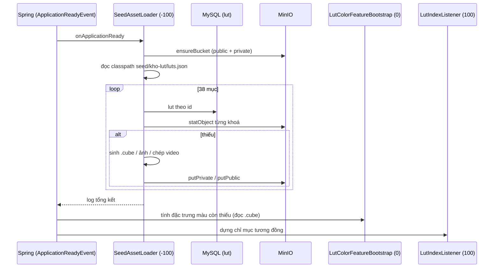

# Nạp sẵn file mẫu lên MinIO

## 1. Mục tiêu và phạm vi

Máy mới chỉ cần `docker compose up` và chạy backend profile `local`. Flyway nạp 38 LUT mẫu (`V3_1__seed_kho_lut.sql`), sau đó backend tự sinh rồi đẩy lên MinIO mọi file mà 38 dòng đó trỏ tới: ảnh bìa, ảnh trước / sau, video xem trước và file `.cube`. Nhờ vậy cửa hàng hiện ảnh ngay, tải LUT được, và đặc trưng màu cùng chỉ mục gợi ý dựng được ngay trong lần khởi động đầu, không cần Python hay mạng.

Hiện tại: DB có 38 LUT nhưng MinIO trống cho tới khi chạy tay `tools/seed/kho-lut/build.py`. Script này cần Python 3.12, numpy, Pillow, minio và mạng để tải ảnh từ picsum.photos và video từ MDN. Khi MinIO trống: ảnh hỏng, `lut/download` báo `LUT_FILE_UNAVAILABLE`, `LutColorFeatureBootstrap` log "lỗi 38 LUT", chỉ mục gợi ý thiếu khối màu.

| Có làm | Không làm (để plan khác) |
|---|---|
| Đưa nguồn dữ liệu mẫu vào repo: `luts.json` và 38 ảnh gốc + 2 video (≈ 5,5 MB) ở `backend/business/src/main/resources/seed/kho-lut/` | Nạp dữ liệu mẫu cho môi trường deploy (`docker-compose.yml`, profile `dev` không chạy `db/seed`), xem §11 câu 2 |
| Sinh `.cube` 33³ từ chuỗi `filter` bằng Java (chép đúng phép biến đổi của `build.py`) | Đổi URL tuyệt đối `http://localhost:9020/...` trong `V3_1__seed_kho_lut.sql`, xem §11 câu 3 |
| Sinh `before.jpg`, `after.jpg`, `cover.jpg` bằng Java | Giao diện, API mới |
| `SeedAssetLoader` chạy lúc khởi động, **chỉ đẩy object còn thiếu**, trước `LutColorFeatureBootstrap` | Xoá các thư mục rác trong `tools/seed/kho-lut/out/` (bị gitignore, không ảnh hưởng) |
| `build.py` đọc `luts.json` và ảnh gốc từ chỗ mới (một nguồn sự thật), README của tool ghi rõ không còn bắt buộc chạy | LUT do quản trị tự thêm ở `/admin/luts` (file đã nằm trên MinIO của máy đó) |

## 2. Tác nhân và phân quyền

| Tác nhân | Quyền | Ghi chú |
|---|---|---|
| Hệ thống (backend lúc khởi động) | — | Không có endpoint, không có resource. Bật bằng `seed.minio.enabled` |
| Lập trình viên / người chấm trên máy mới | — | Chỉ chạy `docker compose up` và `sh scripts/ai/backend-restart.sh` |

## 3. Luồng nghiệp vụ

**Luồng chính (máy mới, MinIO trống):**

1. Backend khởi động với profile `local`. Flyway chạy `db/migration` + `db/seed`, bảng `lut` có 38 dòng mẫu (id 1 → 38).
2. `ApplicationReadyEvent`: `SeedAssetLoader` (`@Order(-100)`) chạy trước mọi listener khác.
   1. Gọi `FileStorageService.ensureBucket()` để có hai bucket `downbeat-public` (đọc công khai) và `downbeat-lut` (riêng tư). Hàm này hiện chạy sau cùng vì không có `@Order`.
   2. Đọc `seed/kho-lut/luts.json` trên classpath (38 mục).
   3. Với mỗi mục, lấy dòng `lut` theo `id`. Không có dòng thì bỏ qua (ví dụ quản trị đã xoá LUT nháp id 37).
   4. Lập danh sách object cần có từ **chính dòng DB** (§7 mục 6), kiểm từng object bằng `statObject`.
   5. Object còn thiếu thì sinh bằng Java rồi đẩy lên: `.cube` vào `downbeat-lut`, ảnh và video vào `downbeat-public`.
   6. Log một dòng tổng kết (§5.2).
3. `LutColorFeatureBootstrap` (`@Order(0)`) thấy 38 LUT chưa có đặc trưng màu, đọc `.cube` vừa đẩy lên và tính đủ 38.
4. `LutIndexListener` (`@Order(100)`) dựng chỉ mục tương đồng có khối màu.
5. Người dùng mở `/luts`: 38 LUT có ảnh, LUT video phát được, "Tải LUT" ra file `.zip`.

**Luồng thay thế / ngoại lệ:**

- A1. MinIO đã có đủ object (máy đã chạy `build.py` hoặc đã khởi động một lần): chỉ chạy khoảng 150 lần `statObject` rồi log "đã nạp 0 object". Không ghi đè object có sẵn, kể cả khi khác kích thước.
- A2. Chỉ thiếu một số object (ví dụ ai đó xoá tay `lut/xanh-dien-anh/cover.jpg`): chỉ sinh và đẩy đúng object đó.
- A3. Quản trị đã thay ảnh bìa của một LUT mẫu bằng ảnh upload (`cover_url` thành `.../2026/11/14/<uuid>.jpg`): URL không khớp mẫu khoá seed, nên bỏ qua trường đó. Các trường khác của LUT vẫn được kiểm bình thường.
- A4. `seed.minio.enabled = false` (mặc định ở `application.yml`, nên profile `dev` / deploy và `mvn test` không chạy): không gọi MinIO, không log.
- E1. MinIO chưa chạy hoặc sai khoá: log `WARN` "Nạp dữ liệu mẫu MinIO thất bại: <lỗi>", app vẫn khởi động (giống `ensureBucket` hiện có).
- E2. Lỗi ở một LUT (ví dụ thiếu ảnh gốc trong resource): log `WARN` theo slug, đếm vào "lỗi", chạy tiếp các LUT khác.



## 4. Cơ sở dữ liệu

Không có migration. Không sửa `V3_1__seed_kho_lut.sql`.

Cấu hình mới:

| File | Khoá | Giá trị |
|---|---|---|
| `backend/app/src/main/resources/application.yml` | `seed.minio.enabled` | `false` (kèm chú thích: chỉ bật ở local, nơi `db/seed` chạy) |
| `backend/app/src/main/resources/application-local.yml` | `seed.minio.enabled` | `${SEED_MINIO_ENABLED:true}` |

Resource mới (commit vào repo), thư mục `backend/business/src/main/resources/seed/kho-lut/`:

| Đường dẫn | Nguồn | Ghi chú |
|---|---|---|
| `luts.json` | **chuyển** (`git mv`) từ `tools/seed/kho-lut/luts.json` | Một nguồn duy nhất cho cả Java và `build.py` |
| `photos/<picsumSeed>.jpg` (38 file) | chép từ `tools/seed/kho-lut/.cache/*.jpg` | Ảnh gốc 1280 × 720 tải từ picsum.photos (giấy phép Unsplash) |
| `videos/flower.mp4`, `videos/friday.mp4` | chép từ `tools/seed/kho-lut/.cache/*.mp4` | Video CC0 của MDN |
| `README.md` | mới | 3 dòng: nguồn ảnh, nguồn video, giấy phép |

## 5. Hợp đồng API (cố định — nguồn sự thật cho cả BE và FE)

Không có endpoint mới, không đổi endpoint cũ. Phần dưới đây cố định khoá object và dòng log, vì kiểm tay và E2E dựa vào chúng.

### 5.1 Khoá object (giữ đúng như `build.py` đã đẩy)

| Loại | Bucket | Khoá | Content-Type | Khi nào cần |
|---|---|---|---|---|
| File LUT | `minio.private-bucket` (`downbeat-lut`) | `lut/{slug}.cube` | `text/plain` | `file_key` khớp `^lut/[a-z0-9-]+\.cube$` |
| Ảnh bìa | `minio.bucket` (`downbeat-public`) | `lut/{slug}/cover.jpg` | `image/jpeg` | `cover_url` có đuôi `/{bucket}/lut/{x}/cover.jpg` |
| Ảnh trước | như trên | `lut/{slug}/before.jpg` | `image/jpeg` | `before_url` có đuôi `/{bucket}/lut/{x}/before.jpg` |
| Ảnh sau | như trên | `lut/{slug}/after.jpg` | `image/jpeg` | `after_url` có đuôi `/{bucket}/lut/{x}/after.jpg` |
| Video | như trên | `lut/{slug}/preview.mp4` | `video/mp4` | `preview_video_url` có đuôi `/{bucket}/lut/{x}/preview.mp4` |

Khoá lấy từ phần URL sau `/{bucket}/` (ví dụ `http://localhost:9020/downbeat-public/lut/xanh-dien-anh/cover.jpg` → `lut/xanh-dien-anh/cover.jpg`), **không** dựng lại từ slug trong `luts.json`. Ảnh và video dùng `FileStorageService.putPublic` (đã kèm `Cache-Control: public, max-age=31536000, immutable`), `.cube` dùng `putPrivate`.

### 5.2 Dòng log (nguyên văn, `INFO`, logger `SeedAssetLoader`)

```
Nạp dữ liệu mẫu MinIO: 38 LUT, đã có 150 object, đã nạp 0 object, bỏ qua 0 LUT, lỗi 0 LUT
```

- "đã có": số object đã tồn tại. "đã nạp": số object vừa đẩy lên. "bỏ qua": số mục `luts.json` không còn dòng `lut` theo id. "lỗi": số LUT gặp lỗi ở E2.
- Với seed hiện tại: 34 LUT BEFORE_AFTER × 4 object + 4 LUT VIDEO × 3 object (bìa, video, `.cube`) = **148 object**. Ví dụ ở trên chỉ minh hoạ định dạng; số thật trên máy đủ dữ liệu là 148.
- Lỗi toàn cục (E1): `WARN` "Nạp dữ liệu mẫu MinIO thất bại: {message}". Lỗi một LUT (E2): `WARN` "Không nạp được file mẫu cho LUT slug='{slug}': {message}".

### 5.3 Sinh nội dung (phải khớp `build.py`)

**`.cube`:**

```
TITLE "{title, dấu " đổi thành '}"
LUT_3D_SIZE 33
<35937 dòng "%.6f %.6f %.6f" (Locale.ROOT), mỗi dòng kết thúc "\n">
```

- UTF-8, không BOM, có `\n` cuối file.
- Thứ tự: dòng thứ i (đếm từ 0) ứng với `b = i / 1089`, `g = (i / 33) % 33`, `r = i % 33`. Màu vào là `(r/32, g/32, b/32)`; ghi ra `transform((r, g, b), filter)` theo thứ tự R G B.
- `transform` duyệt các phép trong chuỗi `filter` **theo đúng thứ tự xuất hiện**. Mỗi phép nhân ma trận 3 × 3 rồi cắt về [0, 1] (riêng `brightness`, `contrast` là phép tuyến tính rồi cắt). Ma trận chép nguyên văn từ hàm `transform` trong `tools/seed/kho-lut/build.py`:
  - `grayscale(a)` → `(1 − a)·I + a·M`, với M có cả 3 hàng bằng `[.2126, .7152, .0722]`.
  - `sepia(a)` → `(1 − a)·I + a·M`, với M = `[[.393, .769, .189], [.349, .686, .168], [.272, .534, .131]]`.
  - `saturate(v)` → ma trận saturate chuẩn CSS dùng hệ số `.213 / .715 / .072`.
  - `hue-rotate(θ)` → ma trận hue-rotate chuẩn CSS. Đơn vị `deg`, hoặc `turn` (× 360).
  - `brightness(v)` → `x · v`.
  - `contrast(v)` → `(x − 0.5) · v + 0.5`.
- `filter` rỗng (LUT id 38 "Hoàng Hôn Cũ") thì ra LUT đồng nhất.

**Ảnh** (JPEG chất lượng 0.85, `ImageIO` + `ImageWriteParam`):

- `before.jpg`: `photos/{picsumSeed}.jpg` co về đúng 1280 × 720 (bilinear).
- `after.jpg`: áp lưới 33³ ở trên lên `before`, nội suy ba chiều (trilinear) như `apply_cube`, làm tròn về 0–255.
- `cover.jpg`: `after` co về 960 × 540. Nếu `coverText` khác rỗng thì vẽ dải đen mờ 40 % ở `y = 430 → 540` và chữ `coverText` viết hoa tại `(40, 500)`.
  - Font `Font.SANS_SERIF`, đậm, 36 px.
  - Màu chữ `(245, 197, 66)` khi `coverTextStyle = "bold"`, các kiểu khác dùng màu trắng.
  - Bật khử răng cưa.
  - Không yêu cầu giống từng điểm ảnh với bản Python, nhưng chữ tiếng Việt phải hiện đúng dấu.
- `preview.mp4`: chép nguyên byte `videos/{videoSource}.mp4`.

### 5.4 Lỗi nghiệp vụ

Không có lỗi trả về client. Lỗi chỉ ghi log như §5.2 và không chặn khởi động.

## 6. Giao diện (chuỗi cố định — test E2E chọn theo đúng các chuỗi này)

Không đổi giao diện. E2E chỉ kiểm rằng trang có sẵn hiện đủ ảnh và video: `/luts`, trang chi tiết "Xanh Điện Ảnh" (BEFORE_AFTER), "Chuẩn Điện Ảnh" (VIDEO).

## 7. Việc backend (agy BE)

Module `business`, package `vn.aeoc.business.lut.seed`. Thêm `existsPublic` ở `authenticate`. Làm theo thứ tự:

1. **Dữ liệu nguồn**
   - `git mv tools/seed/kho-lut/luts.json backend/business/src/main/resources/seed/kho-lut/luts.json`.
   - Chép 38 file `.jpg` vào `photos/` và 2 file `.mp4` vào `videos/` (nguồn ở bảng §4). File trong `.cache` đặt tên theo `picsumSeed` / `videoSource`, đúng tên cần dùng.
   - Viết `README.md` ngắn ghi nguồn và giấy phép.
   - Kiểm: mỗi `picsumSeed` trong `luts.json` có đúng một ảnh. Thiếu thì dừng và hỏi Claude, **không** tự tải từ mạng.
2. **`tools/seed/kho-lut/build.py`**
   - Đọc `luts.json` từ `ROOT/backend/business/src/main/resources/seed/kho-lut/luts.json`.
   - Ảnh gốc ưu tiên lấy từ `.../seed/kho-lut/photos/{picsumSeed}.jpg`, video từ `.../videos/{videoSource}.mp4`. Chỉ khi thiếu mới tải về `.cache` như cũ.
   - Không đổi gì khác (khoá object, SQL sinh ra).
   - `python tools/seed/kho-lut/build.py --self-test` phải in `OK`.
   - `tools/seed/kho-lut/README.md` thêm đoạn: "Backend profile `local` tự nạp file mẫu lên MinIO khi khởi động (`seed.minio.enabled`). Chỉ cần chạy script này khi đổi `luts.json` và cần sinh lại `V3_1__seed_kho_lut.sql`."
3. **`FileStorageService`** (`authenticate`)
   - Thêm `boolean existsPublic(String key)`, chép khuôn `existsPrivate` nhưng dùng bucket công khai: `NoSuchKey` thì trả `false`, lỗi khác thì ném `AppException(ErrorCode.UPLOAD_FILE_FAILED)`.
   - Thêm `String publicBucket()` trả tên bucket công khai, để loader cắt khoá từ URL.
   - Không đổi chữ ký các hàm khác.
4. **`SeedManifest`**: POJO đọc `luts.json` bằng Jackson (`ObjectMapper` bean có sẵn).
   - Chỉ giữ field cần: `id` (chuỗi trong JSON → `Integer`), `slug`, `title`, `filter`, `picsumSeed`, `videoSource`, `coverText`, `coverTextStyle`.
   - Bỏ qua field lạ.
5. **`CubeFilter`**: thuần Java, không phụ thuộc Spring.
   - `static List<Op> parse(String filter)`: regex giống `build.py`, giữ thứ tự, `null` hoặc rỗng thì ra danh sách rỗng.
   - `static double[] apply(double r, double g, double b, List<Op> ops)`.
   - `static double[][][][] grid(String filter)`: lưới 33 × 33 × 33 × 3, chỉ số `[b][g][r][c]`.
   - `static byte[] writeCube(String title, String filter)`: định dạng §5.3.
   - **Không** dùng lại `recommend.eval.sim.CubeWriter` (khác tham số đầu vào).
6. **`SeedImageRenderer`**: thuần Java, `java.awt` + `ImageIO`, headless.
   - `byte[] before(InputStream photo)`.
   - `byte[] after(InputStream photo, double[][][][] grid)`.
   - `byte[] cover(InputStream photo, double[][][][] grid, String text, String style)`.
   - Mỗi LUT chỉ đọc ảnh gốc và tính `after` **một lần**, dùng lại kết quả cho `cover`.
7. **`SeedAssetLoader`** (`@Component`)
   - `@Value("${seed.minio.enabled:false}")`. `@EventListener(ApplicationReadyEvent.class)` + `@Order(-100)`, chạy đồng bộ (không `@Async`, không thread riêng; xem quy tắc ở `backend/AGENTS.md`).
   - Thứ tự xử lý:
     1. `enabled = false` thì `return`.
     2. Gọi `fileStorageService.ensureBucket()`.
     3. Đọc manifest.
     4. Mỗi mục: `lutRepository.getById(id)`, `null` thì tăng "bỏ qua".
     5. Lập danh sách khoá cần có theo bảng §5.1 từ 5 cột của dòng DB.
     6. `exists*`: có thì tăng "đã có", thiếu thì sinh và `put*` rồi tăng "đã nạp".
     7. Log §5.2.
   - Chỉ sinh `grid` và `after` khi LUT đó thật sự thiếu ít nhất một object cần chúng (`.cube`, `after`, `cover`), để lần khởi động thường không tốn CPU.
   - Bọc try/catch theo LUT (E2) và toàn hàm (E1).
   - Lấy file `.cube` để đẩy lên thì dùng `CubeFilter.writeCube(title trong manifest, filter)`. Không đọc `title` từ DB, vì quản trị có thể đã đổi tên.
8. **Cấu hình**: thêm khoá `seed.minio.enabled` theo bảng §4.
9. **Unit test** (JUnit 5 + Mockito, `business/src/test/java/vn/aeoc/business/lut/seed/`): các TC loại `unit` ở §9.
   - Test của `CubeFilter` / `SeedImageRenderer` đọc `luts.json` và ảnh thật trên classpath.
   - Test của loader mock `FileStorageService` và `LutRepository`.

Quyết định đã chốt, worker không tự đổi:

- Chỉ đẩy object **thiếu**, không ghi đè.
- Khoá lấy từ URL / `file_key` trong DB, không dựng từ slug.
- Mặc định tắt, chỉ bật ở `application-local.yml`.
- Không thêm endpoint "nạp lại". Muốn nạp lại thì xoá object rồi restart.
- Không đụng `V3_1__seed_kho_lut.sql`.

Nghiệm thu BE: `mvn -q "-Djooq.codegen.skip=true" -pl business -am test` xanh; `sh scripts/ai/backend-restart.sh` in dòng log §5.2 với "lỗi 0 LUT"; `build.py --self-test` in `OK`.

## 8. Việc frontend (agy)

Không có. `/cook` chỉ giao agy BE.

Component shadcn dùng: không.

## 9. Test case

Loại: `unit` = agy BE viết JUnit · `api` / `e2e` = Claude viết trong `frontend/tests/e2e/seed-minio.spec.ts` · `tay` = Claude kiểm tay ở bước review BE (cần xoá object MinIO và restart backend, Playwright không làm được), ghi bằng chứng vào §12.

Giá trị tham chiếu lấy từ file Python đã sinh `tools/seed/kho-lut/out/<slug>/<slug>.cube` (14/11/2026):

| LUT | Dòng file (đếm từ 1) | Màu vào (r, g, b) | Màu ra |
|---|---|---|---|
| `xanh-dien-anh` (`saturate(1.5) hue-rotate(-12deg) contrast(1.15)`) | 1000 | (7/32, 30/32, 0) | `0.113924 1.000000 0.000000` |
| `xanh-dien-anh` | 9399 | (24/32, 20/32, 8/32) | `0.989223 0.599479 0.056178` |
| `xanh-dien-anh` | 17971 | (16/32, 16/32, 16/32) | `0.500000 0.500000 0.500000` |
| `pho-dem` (`saturate(1.4) hue-rotate(15deg) contrast(1.2) brightness(0.9)`) | 9399 | (24/32, 20/32, 8/32) | `0.621099 0.633668 0.000000` |
| Kích thước file | `xanh-dien-anh.cube` = **970341 byte** · `chuan-dien-anh.cube` = **970344 byte** |

| ID | Loại | Mô tả | Tiền điều kiện | Bước | Kết quả mong đợi |
|---|---|---|---|---|---|
| TC-01 | unit | `.cube` đồng nhất đúng định dạng | | `CubeFilter.writeCube("DownBeat identity LUT", "")` | Dòng 1 `TITLE "DownBeat identity LUT"`, dòng 2 `LUT_3D_SIZE 33`, đúng 35937 dòng số. Dòng số thứ i = `(r/32, g/32, b/32)` với b = i / 1089, g = (i / 33) % 33, r = i % 33 (sai số ≤ 1e-6). File kết thúc bằng `\n` |
| TC-02 | unit | Phân tích chuỗi filter | | `parse("saturate(1.5) hue-rotate(-12deg) contrast(1.15)")`, `parse("hue-rotate(0.5turn)")`, `parse(null)` | Lần 1 ra 3 phép đúng thứ tự, tham số 1.5 / −12 / 1.15. Lần 2 ra 1 phép hue-rotate 180°. Lần 3 ra danh sách rỗng |
| TC-03 | unit | Từng phép biến đổi, tính tay | | `apply` với một phép mỗi lần | `grayscale(1)` (1, 0, 0) → (0.2126, 0.2126, 0.2126) · `brightness(0.5)` (0.8, 0.4, 0.2) → (0.4, 0.2, 0.1) · `contrast(2)` (0.6, 0.5, 0.1) → (0.7, 0.5, 0.0) (cắt −0.3 về 0) · `sepia(1)` (1, 1, 1) → (1.0, 1.0, 0.937) (cắt 1.351, 1.203) · `saturate(0)` (1, 0, 0) → (0.213, 0.213, 0.213). Sai số 1e-9 |
| TC-04 | unit | Khớp giá trị bản Python | `luts.json` trên classpath | `writeCube` cho `xanh-dien-anh`, `pho-dem` theo manifest | 4 dòng ở bảng tham chiếu khớp từng số (sai số ≤ 1e-6) |
| TC-05 | unit | Khớp kích thước bản Python | | `writeCube` cho `xanh-dien-anh`, `chuan-dien-anh` | Đúng 970341 và 970344 byte (tiêu đề UTF-8 có dấu) |
| TC-06 | unit | `.cube` sinh ra đọc được bằng `CubeParser` và đo được đặc trưng màu | | `CubeParser.parse(writeCube(...xanh-dien-anh...))`, rồi `ColorFeatureExtractor` | Không ném lỗi, kích thước 33, `isMono = 0`. Lặp lại cho `noir` (có `grayscale`) ra `isMono = 1` |
| TC-07 | unit | Ảnh sinh ra đúng kích thước | ảnh `photos/teal-sky.jpg` | `before`, `after` (lưới `xanh-dien-anh`), `cover` (chữ "XANH ĐIỆN ẢNH", `bold`) | 3 mảng byte bắt đầu bằng `FF D8 FF`. `ImageIO.read` ra 1280 × 720, 1280 × 720, 960 × 540 |
| TC-08 | unit | Lưới đồng nhất không đổi ảnh | | `after(photo, grid(""))` so với `before(photo)` | Mọi điểm ảnh lệch ≤ 3 trên mỗi kênh (chỉ lệch do nén JPEG) |
| TC-09 | unit | Loader: đủ object thì không đẩy gì | `enabled = true`. Mock `getById` trả 38 dòng như seed, `exists*` luôn `true` | `onApplicationReady` | Không gọi `putPublic` / `putPrivate`. Log có "38 LUT, đã có 148 object, đã nạp 0 object, bỏ qua 0 LUT, lỗi 0 LUT" |
| TC-10 | unit | Loader: chỉ đẩy object thiếu, đúng khoá và content-type | Như TC-09 nhưng thiếu `lut/xanh-dien-anh/cover.jpg` (public) và `lut/xanh-dien-anh.cube` (private) | `onApplicationReady` | Đúng 1 lần `putPublic("lut/xanh-dien-anh/cover.jpg", …, "image/jpeg")` và 1 lần `putPrivate("lut/xanh-dien-anh.cube", bytes, "text/plain")` với bytes dài 970341. Log "đã nạp 2 object" |
| TC-11 | unit | Loader: LUT video đẩy video đúng nguồn | Thiếu `lut/chuan-dien-anh/preview.mp4`. Dòng DB `preview_type = VIDEO`, `before_url = after_url = NULL` | `onApplicationReady` | `putPublic("lut/chuan-dien-anh/preview.mp4", …, "video/mp4")`, kích thước = kích thước `videos/friday.mp4` (515198 byte). Không kiểm `before` / `after` của LUT này |
| TC-12 | unit | Loader: khoá lấy từ URL, bỏ trường đã thay bằng ảnh upload | Dòng id 1 có `cover_url = http://localhost:9020/downbeat-public/2026/11/14/abc.jpg`, các trường khác như seed, mọi object đều thiếu | `onApplicationReady` | Có `putPublic` cho `before.jpg`, `after.jpg` và `putPrivate` cho `.cube` của `xanh-dien-anh`. **Không** có `putPublic` nào cho `cover.jpg` của id 1 |
| TC-13 | unit | Loader: LUT bị xoá khỏi DB thì bỏ qua | `getById(37)` trả `null` | `onApplicationReady` | Không gọi `exists*` với khoá `thu-nghiem-nhap`. Log "bỏ qua 1 LUT" |
| TC-14 | unit | Loader: tắt thì không làm gì | `enabled = false` | `onApplicationReady` | Không gọi `ensureBucket`, `exists*`, `put*`, `getById` |
| TC-15 | unit | Loader: MinIO lỗi không làm hỏng khởi động | `ensureBucket` hoặc `existsPublic` ném `RuntimeException("Connection refused")` | `onApplicationReady` | Không ném lỗi ra ngoài, log `WARN` chứa "Nạp dữ liệu mẫu MinIO thất bại" |
| TC-16 | api | Mọi LUT công khai có ảnh hoặc video đọc được | Backend local đã khởi động | Lấy toàn bộ `GET /api/lut/public/list` (duyệt hết các trang). Với mỗi LUT, `GET` `coverUrl`; BEFORE_AFTER thì `GET` thêm `beforeUrl`, `afterUrl`; VIDEO thì `GET` `previewVideoUrl` | Mọi URL trả 200. Content-Type `image/jpeg` cho ảnh, `video/mp4` cho video. Có ít nhất 36 LUT |
| TC-17 | api | Tải LUT miễn phí ra file `.cube` hợp lệ | Đăng nhập một khách hàng gói Miễn phí | `POST /api/lut/download` LUT "Xanh Điện Ảnh" (miễn phí), tải `url` trả về | HTTP 200, file `Xanh-Dien-Anh-LUT-DownBeat.zip` chứa một file `.cube` trong thư mục `Assets/` (cấu trúc của `tai-lut`). Nội dung có dòng `LUT_3D_SIZE 33` |
| TC-18 | api | Đủ đặc trưng màu cho LUT mẫu | Đăng nhập `admin@downbeat.local` | `GET /api/lut/feature/list` | Mọi LUT id 1 → 38 có bản ghi đặc trưng màu (không LUT nào báo thiếu) |
| TC-19 | e2e | Kho LUT hiện đủ ảnh | | Mở `/luts`, chờ lưới thẻ | Mọi `` trong lưới thẻ có `naturalWidth > 0` (không ảnh hỏng) |
| TC-20 | e2e | Trang chi tiết: ảnh trước / sau và video phát được | | Mở chi tiết "Xanh Điện Ảnh", rồi "Chuẩn Điện Ảnh" | "Xanh Điện Ảnh": ảnh trước và sau có `naturalWidth > 0`. "Chuẩn Điện Ảnh": `<video>` đạt `readyState ≥ 2` trong 10 giây |
| TC-21 | tay | Khôi phục object bị xoá (giả lập máy mới) | Backend đang chạy, MinIO đủ | 1. Ghi lại kích thước `lut/xanh-dien-anh.cube`. 2. Xoá 4 object của `xanh-dien-anh` (cover, before, after, `.cube`) và `lut/chuan-dien-anh/preview.mp4` bằng Python `minio` (đã cài sẵn). 3. `DELETE FROM lut_color_feature WHERE lut_id IN (1, 2)`. 4. `sh scripts/ai/backend-restart.sh` | Log "38 LUT, đã có 143 object, đã nạp 5 object, bỏ qua 0 LUT, lỗi 0 LUT". 5 object có lại, `.cube` dài 970341 byte. `lut_color_feature` có lại dòng cho id 1, 2. Mở `/luts/xanh-dien-anh` thấy ảnh, TC-16 vẫn xanh |
| TC-22 | tay | Lần khởi động sau không đẩy gì | Ngay sau TC-21 | Restart backend lần nữa | Log "đã nạp 0 object" |
| TC-23 | tay | `build.py` vẫn chạy với nguồn mới | | `python tools/seed/kho-lut/build.py --self-test`. `git status` cho thấy `luts.json` được đổi tên (rename), không bị nhân bản | In `OK`. `tools/seed/kho-lut/luts.json` không còn |

Tổng: 15 `unit`, 3 `api`, 2 `e2e`, 3 `tay`.

## 10. Tiêu chí hoàn thành

- [x] Mọi TC ở §9 pass (TC-21 → TC-23 kiểm tay ở bước review BE, bằng chứng ghi §12)
- [x] `mvn test` xanh; không có thay đổi frontend nên không cần `pnpm build` / `pnpm lint` (vẫn chạy E2E)
- [x] Có `docs/chuc-nang/seed-minio.md`; README gốc mục cài đặt bỏ bước chạy `build.py` nếu có

## 11. Rủi ro / câu hỏi mở

1. **Dung lượng repo tăng khoảng 5,5 MB** (38 ảnh JPEG + 2 video MP4), và file jar cũng tăng chừng đó.
   - Phương án thay thế 1: commit thẳng file đã sinh (≈ 55 MB, chủ yếu do `.cube` dạng chữ).
   - Phương án thay thế 2: bắt máy mới chạy `build.py` như hiện nay.
   - Đề xuất: giữ 5,5 MB như plan. Bạn đồng ý không?
2. **Môi trường deploy** (`docker-compose.yml`, profile `dev`) không chạy `db/seed`, nên bản chạy thử cho người dùng ở 3.2 sẽ có kho rỗng.
   - Plan này chỉ làm cho local.
   - Khi tới 3.2 cần một lát riêng (hoặc thêm `classpath:db/seed` cho deploy và bật `seed.minio.enabled`). Lúc đó phải xử lý luôn câu 3.
3. **URL tuyệt đối trong seed**: `V3_1` ghi cứng `http://localhost:9020/downbeat-public/...`.
   - Ở local, chỉ hỏng khi đổi `MINIO_PORT` khác 9020.
   - Plan không sửa, vì đổi file migration đã chạy sẽ làm lệch checksum Flyway.
   - Nếu cần, lát deploy (câu 2) có thể thêm bước chuẩn hoá URL lúc khởi động.
4. **Ảnh bìa sinh bằng Java khác bản Python từng điểm ảnh** (font, cách vẽ chữ).
   - Chỉ ảnh hưởng máy mới hoặc object bị xoá. Máy đang có object từ Python giữ nguyên, vì loader không ghi đè.
   - Ảnh chụp tài liệu cũ ở `docs/chuc-nang/img/` có thể khác nhẹ so với máy mới.
5. **Chép ảnh từ `.cache` cục bộ**: `.cache` bị gitignore và chỉ có trên máy này. Worker chạy trên cùng máy nên chép được; máy khác thì không cần, vì ảnh đã nằm trong repo.

## 12. Nhật ký thực hiện (do /cook và /doc-chuc-nang ghi — nối các phiên A/B/C)

| Thời điểm | Sự kiện |
|---|---|
| 2026-11-14 | /plan-feature: tạo plan `draft` |
| 2026-11-14 | Người dùng duyệt (chấp nhận §11 câu 1: thêm ~5,5 MB ảnh / video nguồn vào repo) → `approved` |
| 2026-11-14 | /cook phiên A: `status: in-progress` (plan/README.md, docs/plan/README.md 0.5 "đang cook"). Preflight xanh (Orca ready, MySQL + MinIO healthy, BE :9500 = 200). File bẩn có sẵn trước khi giao việc (của người dùng, không phải của worker): `.env.example`, `AGENTS.md`, `CLAUDE.md`, `README.md`, `backend/.env.example`, `backend/CLAUDE.md`, `backend/app/src/main/resources/application.yml`, `backend/authenticate/.../RestService.java`, `docker-compose*.yml`, `docs/plan/README.md`, `docs/tai-lieu-thiet-ke.md`, `frontend/.env.example`, `frontend/AGENTS.md`, `frontend/playwright.config.ts`, `frontend/src/components/shop/home/{hero-section.tsx,home-data.ts}`, `frontend/vite.config.ts`, nhiều file `plan/*.md`, `scripts/ai/chup-anh-readme.mjs`. |
| 2026-11-14 | Bước 2: `frontend/tests/e2e/seed-minio.spec.ts` (TC-16 → TC-20; nhóm "API" = TC-16/17/18). Chạy thử trên MinIO hiện có (file do `build.py` đẩy): 5/5 xanh, tức là mốc so sánh; nghiệm thu thật của loader là TC-21 (xoá object rồi restart). Nhóm "Giao diện" đặt timeout 90 s vì Vite biên dịch nguội làm `goto` quá 30 s ở lần chạy đầu. |
| 2026-11-14 | Bước 3: task `plan/tasks/seed-minio-be.md` (plan §8 không có việc FE → chỉ một worker). Orca run `run_e3b4ec51450b`, coordinator `term_0b9e621d-c8e2-4393-8ecc-884f363d1d9a` (mọi lệnh kèm `--from`, `check` kèm `--terminal`; worktree `path:C:/Users/JulytusChu/Desktop/Code/DownBeat`). agy BE: dispatch `ctx_8a3196937a5b`, task `task_2fd58f1fe79b`, terminal `term_bdf006d3-d850-4883-b0a0-56528d30ae5d`; `input_accepted`, `turnStart: observed`. |
| 2026-11-14 | **phiên A xong.** Phiên B: chờ `worker_done` của `ctx_8a3196937a5b` → bước 5 (review BE + kiểm tay TC-21 → TC-23) → bỏ bước 6 (không có FE) → bước 7 (E2E có giao diện). |
| 2026-11-14 18:50 | Phiên B: `worker_done` ctx_8a3196937a5b outcome=succeeded (báo 16 test xanh, log 'đã có 148, đã nạp 0, lỗi 0 LUT', self-test OK, API 3/3). Ack delivery_20c2eceb9aac. |
| 2026-11-14 19:00 | Bước 5 review BE: diff chỉ `backend/**` + `tools/seed/**` (`.env.example`, `backend/CLAUDE.md`, `RestService.java`, dòng `frontend-url` trong `application.yml` là file bẩn có sẵn của người dùng). `mvn -pl business -am test`: 180 test, 0 fail (seed: CubeFilterTest, SeedImageRendererTest, SeedAssetLoaderTest khớp số tham chiếu §9). **TC-21** xoá 5 object + `lut_color_feature` id 1,2 → restart: log "38 LUT, đã có 143 object, đã nạp 5 object, bỏ qua 0 LUT, lỗi 0 LUT", "Đặc trưng màu: đã tính 2 LUT, lỗi 0 LUT"; `.cube` 970341 byte, `preview.mp4` 515198 byte, feature id 1,2 có lại. **TC-22** restart lần nữa: "đã có 148, đã nạp 0". **TC-23** `build.py --self-test` OK, git thấy rename `R tools/seed/kho-lut/luts.json -> backend/.../luts.json`. E2E `-g API` 3/3. Ghi nhận nhỏ (không chặn, không giao fix): khi thiếu cả `before` lẫn `after/cover`, loader đọc ảnh gốc 2 lần (§7.6 nói một lần) — chỉ tốn CPU ở máy mới. Bước 6 bỏ (không có FE). |
| 2026-11-14 19:05 | Bước 7: E2E có giao diện (slowMo 400) **5/5 pass** (TC-16 → TC-20), ảnh tài liệu `docs/chuc-nang/img/seed-minio/{01-kho-lut-du-anh,02-chi-tiet-truoc-sau,03-chi-tiet-video}.png`. Tổng TC §9: 23/23 (15 unit do worker + 3 api + 2 e2e + 3 tay). |
| 2026-11-14 19:06 | Bước 8: `worker-release ctx_8a3196937a5b` ok, reclaimable rỗng. Vòng sửa: BE 0, FE không có. Lệch plan: chỉ ghi nhận nhỏ đọc ảnh gốc 2 lần (xem dòng review). docs/plan/README.md 0.5: tích Backend + 3 việc con. **phiên B xong.** Tiếp: `/doc-chuc-nang seed-minio`. |
| 2026-11-14 | /doc-chuc-nang: viết `docs/chuc-nang/seed-minio.md` (3 ảnh), `status: done`, commit + push + PR. |
