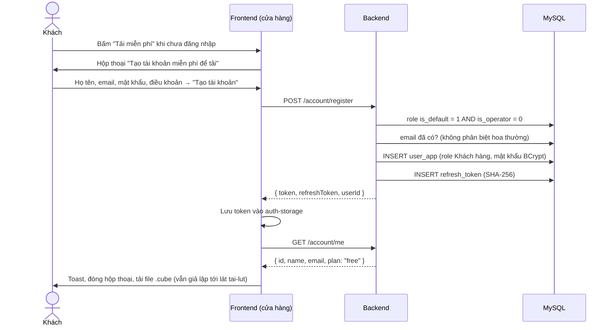

# Tài khoản khách hàng

## 1. Mục tiêu và phạm vi

Sau plan này, khách tự **đăng ký bằng email** ở cửa hàng và được đăng nhập ngay; đăng nhập, xem menu tài khoản (tên, email, gói), đăng xuất đều chạy trên **backend thật** thay cho `frontend/src/lib/mock/account.ts`. Tài khoản mới mang role **Khách hàng** (không có quyền quản trị nào), nên gọi API quản trị bị 403. Đây là nền cho các lát cần biết "ai đang dùng": tải LUT (1.5), bộ sưu tập (1.6), mua gói (1.4), hồ sơ gợi ý (2.2).

| Có làm | Không làm (để plan khác) |
|---|---|
| Migration `V5`: thêm role `Khách hàng` (`is_default = 1`, `is_operator = 0`), mọi role khác `is_default = 0` | Bước 2 "Chọn phong cách" sau đăng ký, `account/preference` (lát `ho-so-nguoi-dung` 2.2) |
| `POST /account/register` (công khai) trả token như đăng nhập; `GET /account/me` trả `plan = free` | Gói thật, hạn gói, `subscription`, thanh toán payOS (lát `goi-thanh-toan` 1.4). `account/me` lúc đó mới đọc subscription |
| Seed local `free@downbeat.local` (role Khách hàng) thay tài khoản giả cùng tên | Tải LUT thật `POST /lut/download` (lát `tai-lut` 1.5): nút tải vẫn tạo file .cube giả như hiện nay |
| Gỡ `POST /file/upload` (không ai dùng; khi ai cũng tự đăng ký được thì endpoint này cho mọi khách đẩy file lên bucket công khai) | Quên mật khẩu, đăng nhập Google / Facebook, xác minh email (đã gỡ mail ở `go-redis-mail`) |
| Frontend: hộp thoại đăng nhập / đăng ký, menu tài khoản, đăng xuất dùng API thật; phiên dùng chung token với trang quản trị | Trang quản trị khách hàng `/admin/khach-hang` (lát 1.4) |
| Phiên hết hạn ở cửa hàng: về trạng thái khách, **không** chuyển sang `/login` của quản trị | Giới hạn tần suất đăng ký (§11 câu 5) |

## 2. Tác nhân và phân quyền

| Tác nhân | Quyền | Ghi chú |
|---|---|---|
| Khách vãng lai | Gọi `POST /account/register`, `POST /user/authenticate` | Không cần token |
| Thành viên (role `Khách hàng`) | `GET /account/me`, `/auth/refresh`, `/auth/logout`, `/user/info`, `/permission/resource` (trả `[]`), `/user/update-password` | Mọi endpoint có `checkPermission` → 403 |
| Quản trị (role toàn quyền) | Như cũ; `GET /account/me` cũng gọi được (trả `plan = free`) | Đăng nhập ở cửa hàng hay ở `/login` đều là cùng một phiên |

Role `Khách hàng` không có dòng `permission` nào. Không thêm `resource` mới.

## 3. Luồng nghiệp vụ

**Luồng chính — đăng ký:**
1. Khách mở hộp thoại đăng ký từ một trong bốn chỗ: nút "Đăng ký" ở header, nút "Bắt đầu miễn phí" (trang chủ / bảng giá), nút tải LUT khi chưa đăng nhập, nút chọn gói trả phí khi chưa đăng nhập.
2. Nhập "Họ tên", "Email", "Mật khẩu", tick điều khoản, bấm "Tạo tài khoản". Frontend kiểm định dạng trước.
3. Frontend gọi `POST /account/register`. Backend chuẩn hoá (trim, email chữ thường), kiểm quy tắc, tạo `user_app` role `Khách hàng`, trả `{ token, refreshToken, userId }`.
4. Frontend lưu token vào `auth-storage` (store `useAuthStore`, dùng chung với trang quản trị, nhớ đăng nhập), gọi `GET /account/me`, đặt người dùng vào phiên cửa hàng.
5. Toast "Đã tạo tài khoản, chào mừng {tên}", đóng hộp thoại. Mở từ nút tải → tải tiếp LUT đó; mở từ nút chọn gói → mở hộp thoại mua gói.

**Luồng chính — đăng nhập:** giống bước 2–5 nhưng gọi `POST /user/authenticate` `{ email, plainPassword }`, toast "Xin chào, {tên}".

**Luồng chính — mở lại trang:** có token trong storage → header hiện khung chờ hình tròn (không hiện nút "Đăng nhập") → `GET /account/me` → menu tài khoản.

**Luồng chính — đăng xuất:** menu tài khoản → "Đăng xuất" → gọi `POST /auth/logout` (không chờ) → xoá token và phiên → toast "Đã đăng xuất", header về trạng thái khách, **ở nguyên trang hiện tại**.

**Ngoại lệ:**
- E1. Email đã có (kể cả khác hoa thường) → 400 "Email đã được đăng ký". Hộp thoại giữ nguyên, dưới thông báo có nút "Đăng nhập bằng email này" chuyển sang hộp thoại đăng nhập đã điền sẵn email.
- E2. Sai email / mật khẩu → 400 "Tài khoản hoặc mật khẩu không đúng."; sai 10 lần trong 15 phút → 429 (có sẵn).
- E3. Tài khoản bị khoá → 403 "Tài khoản bị khóa" (đăng nhập và `account/me`).
- E4. Phiên hết hạn và refresh thất bại: ở trang cửa hàng → xoá token, header về trạng thái khách, không chuyển trang; ở `/admin/**` → về `/login` như hiện nay.
- E5. Khách hàng gọi API quản trị → 403; mở `/admin` → sidebar không có mục nào, mở thẳng `/admin/chuc-vu` → "Truy cập bị từ chối" (giống tài khoản không quyền hiện nay).
- E6. Không có role mặc định hợp lệ (bị quản trị bỏ cờ mặc định, hoặc role mặc định là role toàn quyền) → 403 "Hệ thống không mở đăng ký". Chặn trường hợp đặt nhầm role toàn quyền làm mặc định khiến ai đăng ký cũng thành quản trị.



## 4. Cơ sở dữ liệu

Không thêm bảng, không đổi cột. Bảng `user_app`, `role` đã có từ `V1` (`user_app.email` UNIQUE, collation `utf8mb4_0900_ai_ci` nên không phân biệt hoa thường).

Migration `backend/app/src/main/resources/db/migration/V5__vai_tro_khach_hang.sql` (chạy mọi môi trường, chạy lại không đổi gì):

```sql
SET NAMES utf8mb4;

INSERT INTO `role` (`name`, `is_default`, `is_operator`)
SELECT 'Khách hàng', 1, 0 FROM DUAL
WHERE NOT EXISTS (SELECT 1 FROM `role` WHERE `name` = 'Khách hàng');

-- Chỉ một role mặc định: role được gán khi khách tự đăng ký
UPDATE `role` SET `is_default` = 0 WHERE `name` <> 'Khách hàng';
UPDATE `role` SET `is_default` = 1, `is_operator` = 0 WHERE `name` = 'Khách hàng';
```

Seed chỉ cho local `backend/app/src/main/resources/db/seed/V5_1__seed_khach_hang.sql` (chạy sau `V5`):

| Cột `user_app` | Giá trị |
|---|---|
| `name` | Khách Miễn Phí |
| `email` | free@downbeat.local |
| `password` | `$2a$10$m4Xd2KRfgDRy66eoscq7BuukZym.dvadrm3p8LX4IUxSOJudLsAiu` (= `Admin@123`, cùng hash với `V1_1`) |
| `has_password`, `active`, `first_time` | 1, 1, 0 |
| `role_id` | `(SELECT id FROM role WHERE name = 'Khách hàng')` |

Viết bằng `INSERT … SELECT … WHERE NOT EXISTS (SELECT 1 FROM user_app WHERE email = 'free@downbeat.local')`, không ghi cứng `id`.

Xoá: không có chức năng xoá tài khoản.

## 5. Hợp đồng API (cố định — nguồn sự thật cho cả BE và FE)

Mọi response thành công bọc `{ "code": 200, "message": "OK", "result": … }`. Lỗi nghiệp vụ (do `GlobalExceptionHandler`) trả `{ "path", "code", "errorCode", "message" }`, không bọc `ApiResponse`. Lỗi ở JWT filter (chưa đăng nhập, token hỏng) trả `{ "path", "code", "message" }`, **không có `errorCode`**.

### 5.1 `POST /api/account/register` — công khai (không cần token, token gửi kèm bị bỏ qua)

Body dùng thẳng POJO `User` như `/user/authenticate`, nên mật khẩu là **`plainPassword`** (tài liệu thiết kế ghi `password`, xem §11 câu 3).

Request:
```json
{ "name": "Nguyễn Minh Anh", "email": "MinhAnh@Gmail.com ", "plainPassword": "matkhau123" }
```

Response `result` (cùng shape `POST /user/authenticate`):
```json
{
  "token": "eyJhbGciOiJIUzI1NiJ9.eyJzdWIiOiIxNSIsImV4cCI6MTc5NDMwMDAwMH0.Qm9n…",
  "refreshToken": "9fJ2kQx7Lw0VtR3mZpA8sYcN1uHbE6dG4oKiWqXyTzM",
  "userId": 15
}
```

Quy tắc phía server (theo đúng thứ tự, gặp lỗi đầu tiên thì dừng, chưa ghi gì):
1. `name` trim; rỗng → lỗi "Vui lòng nhập họ tên".
2. `email` trim + chữ thường (`Locale.ROOT`); rỗng hoặc không có `@` → lỗi "Email không hợp lệ".
3. `plainPassword` qua `PasswordPolicy.validate` (8 ký tự đến 72 byte) → `WEAK_PASSWORD`.
4. Role mặc định = role có `is_default = 1 AND is_operator = 0`; không có → `REGISTRATION_DISABLED`.
5. Email đã có → `EMAIL_EXISTS`. Hai request đăng ký cùng email đồng thời: request sau vấp UNIQUE ở DB → cũng trả `EMAIL_EXISTS` (không để lọt lỗi chung "Yêu cầu không hợp lệ").
6. Tạo `user_app` từ **đối tượng mới** (không dùng lại object client gửi): `name`, `email` đã chuẩn hoá, `password = BCrypt.hashpw(plainPassword, gensalt())`, `has_password = 1`, `role_id` = role bước 4, `active = 1`, `first_time = 1`. Mọi field khác client gửi (`roleId`, `isOperator`, `active`, `phone`, `avatar`, `hasPassword`…) bị bỏ qua.
7. Trả `issueTokens(user)` như đăng nhập.

### 5.2 `GET /api/account/me` — cần đăng nhập (mọi role)

Response `result`:
```json
{ "id": 15, "name": "Nguyễn Minh Anh", "email": "minhanh@gmail.com", "plan": "free" }
```

- Chỉ có 4 khoá trên (cùng `planExpiresAt` khi khác null). Không có `roleId`, `roleName`, `isOperator`, `active`, `regisDate`, `password`.
- `plan` luôn là `"free"` ở lát này; `planExpiresAt` **không có trong JSON** khi null (POJO `User` dùng `NON_NULL`). Lát `goi-thanh-toan` sẽ trả `"plan": "pro"` / `"studio"` kèm `planExpiresAt`. Frontend đọc `planExpiresAt ?? null`.
- Người dùng trong token không còn tồn tại → 401 "Chưa đăng nhập"; `active ≠ 1` → 403 "Tài khoản bị khóa".

### 5.3 Endpoint có sẵn, frontend cửa hàng dùng lại (không đổi)

| Endpoint | Body | `result` |
|---|---|---|
| `POST /api/user/authenticate` | `{ "email": "free@downbeat.local", "plainPassword": "Admin@123" }` | `{ token, refreshToken, userId }` như 5.1 |
| `POST /api/auth/refresh` | `{ "refreshToken": "…" }` | `{ token, refreshToken, userId }` (refresh token cũ hết dùng được) |
| `POST /api/auth/logout` | `{ "refreshToken": "…" }` | `"Đăng xuất thành công"` |

### 5.4 Endpoint bị gỡ

`POST /api/file/upload` (`authenticate/controller/FileController`): gỡ hẳn → mọi request trả 404 "Không tìm thấy API". Lát `quan-ly-lut` có endpoint upload riêng, kiểm quyền `LUT`.

### 5.5 Lỗi nghiệp vụ

| Tình huống | HTTP | `errorCode` | Message (FE hiện nguyên văn) |
|---|---|---|---|
| Đăng ký: họ tên trống / chỉ khoảng trắng | 400 | `BAD_REQUEST` | Vui lòng nhập họ tên |
| Đăng ký: email trống hoặc không có `@` | 400 | `BAD_REQUEST` | Email không hợp lệ |
| Đăng ký: mật khẩu thiếu, < 8 ký tự hoặc > 72 byte | 400 | `WEAK_PASSWORD` | Mật khẩu phải có từ 8 đến 72 ký tự |
| Đăng ký: không có role mặc định hợp lệ | 403 | `REGISTRATION_DISABLED` | Hệ thống không mở đăng ký |
| Đăng ký: email đã có (kể cả khác hoa thường, kể cả email quản trị) | 400 | `EMAIL_EXISTS` (**mới**, thêm vào `ErrorCode`) | Email đã được đăng ký |
| Đăng nhập sai email / mật khẩu (có sẵn) | 400 | `INVALID_AUTHENTICATION_INFO` | Tài khoản hoặc mật khẩu không đúng. |
| `account/me` không có token | 401 | (không có) | Chưa đăng nhập |
| `account/me` token hỏng | 401 | (không có) | Token không hợp lệ hoặc sai chữ ký |
| `account/me`: người dùng không còn | 401 | `LOGIN` | Chưa đăng nhập |
| `account/me` / đăng nhập: tài khoản bị khoá | 403 | `LOCK_ACCOUNT` | Tài khoản bị khóa |
| Khách hàng gọi API quản trị (có sẵn) | 403 | `FORBIDDEN` | Bạn không có quyền thực hiện thao tác này! Path: /role/, Action: VIEW (phần Path / Action theo endpoint) |
| Refresh bằng token đã thu hồi (có sẵn) | 401 | `REFRESH_TOKEN_INVALID` | Phiên đăng nhập đã hết hạn, vui lòng đăng nhập lại |

## 6. Giao diện (chuỗi cố định — test E2E chọn theo đúng các chuỗi này)

Không thêm route. Thay đổi nằm ở header, hộp thoại và phiên của khu cửa hàng (`/`, `/luts/**`, `/pricing`). Phần lớn chuỗi **đã có** trong code; dòng ghi (mới) là chuỗi cần thêm.

**Header — chưa đăng nhập:** nút "Đăng ký" (chính), "Đăng nhập", link "Bảng giá".

**Header — đang hỏi `/account/me` lần đầu** (mới): khung chờ tròn cỡ ảnh đại diện, `role="status"`, `aria-label="Đang tải tài khoản"`. Trong lúc này **không** hiện "Đăng ký" / "Đăng nhập". Hỏi xong mà lỗi (mạng, 5xx) thì hiện nút như khi chưa đăng nhập.

**Header — đã đăng nhập:** link "Nâng cấp" (gói Miễn phí) thay "Bảng giá"; nút menu có tên đọc "Tài khoản {tên}" (chữ cái đầu trong vòng tròn + tên). Menu thả xuống:
- Dòng tên, dòng email
- Ô gói: "Gói **Miễn phí**" (tên gói lấy theo `plan`; có `planExpiresAt` thì thêm dòng "Hết hạn {dd/mm/yyyy}")
- Mục "Nâng cấp lên Pro" (chỉ gói Miễn phí) → `/pricing`
- Mục "Đăng xuất"

**Hộp thoại đăng ký** (tiêu đề theo nơi mở, đã có):

| Mở từ | Tiêu đề | Mô tả |
|---|---|---|
| Header / "Bắt đầu miễn phí" | Tạo tài khoản DownBeat | Tải LUT miễn phí và lưu bộ sưu tập của bạn. |
| Nút tải LUT | Tạo tài khoản miễn phí để tải (kèm thẻ LUT nhỏ) | Miễn phí cho video cá nhân. Nâng cấp bất cứ lúc nào để dùng cho khách hàng. |
| Chọn gói Pro / Studio | Tạo tài khoản để mua gói {Pro / Studio} | Chỉ mất vài giây, sau đó bạn chuyển thẳng sang bước thanh toán. |

| Label | Kiểu | Bắt buộc | Validate client (message) |
|---|---|---|---|
| Họ tên | text, `autocomplete=name`, tự focus | có | trống → "Vui lòng nhập họ tên"; > 100 ký tự → "Họ tên tối đa 100 ký tự" |
| Email | email | có | trống → "Vui lòng nhập email"; sai dạng → "Email không hợp lệ" |
| Mật khẩu (placeholder "Tối thiểu 8 ký tự, có chữ và số") | password | có | < 8 → "Mật khẩu tối thiểu 8 ký tự"; > 72 ký tự → "Mật khẩu tối đa 72 ký tự" (mới); không có chữ → "Mật khẩu cần có chữ cái"; không có số → "Mật khẩu cần có chữ số" |
| Hiện mật khẩu | checkbox | | |
| Tôi đồng ý với Điều khoản sử dụng và Chính sách bảo mật | checkbox | có | chưa tick → "Bạn cần đồng ý điều khoản để tiếp tục" |

Nút "Tạo tài khoản" (đang gửi: "Đang tạo tài khoản…", khoá nút). Dưới cùng: "Đã có tài khoản? **Đăng nhập**".
Lỗi từ server hiện trong khung `role="alert"` ngay trên nút, **đúng message backend** (§5.5). Riêng `EMAIL_EXISTS`: trong khung lỗi có thêm nút "Đăng nhập bằng email này" (mới) → chuyển sang hộp thoại "Đăng nhập", ô Email điền sẵn email vừa nhập, focus vào ô Mật khẩu; giữ nguyên LUT / gói đang chờ (nếu có).

**Hộp thoại đăng nhập:** tiêu đề "Đăng nhập", mô tả "Chào mừng bạn quay lại DownBeat." (mở từ nút tải: "Đăng nhập để tải LUT này."). Field "Email" (trống → "Vui lòng nhập email", sai dạng → "Email không hợp lệ"), "Mật khẩu" (trống → "Vui lòng nhập mật khẩu"), checkbox "Hiện mật khẩu". Nút "Đăng nhập" (đang gửi: "Đang đăng nhập…"). Dưới: "Chưa có tài khoản? **Đăng ký**". Lỗi server trong `role="alert"` đúng message backend. Gợi ý chỉ hiện ở môi trường dev (sửa): "Tài khoản thử: **free@downbeat.local**, mật khẩu **Admin@123**".

**Toast:** đăng nhập "Xin chào, {tên}"; đăng ký "Đã tạo tài khoản, chào mừng {tên}"; đăng xuất "Đã đăng xuất". Lỗi đăng nhập / đăng ký không bật toast (đã hiện trong hộp thoại).

**Hộp thoại mua gói (giả lập, xem §11 câu 1):** giữ nguyên giao diện; dòng chú thích dưới nút đổi thành "Bản demo: thanh toán giả lập, chưa nối payOS, không trừ tiền thật. Gói chỉ giữ đến khi tải lại trang." Toast thành công giữ "Đã nâng cấp lên gói {Pro / Studio}".

## 7. Việc backend (Codex)

Module chính `business` (package mới `vn.aeoc.business.account`), sửa nhỏ ở `authenticate`, `base`, `entity`. Không có bảng mới nên **không cần sinh lại jOOQ**.

1. `app/src/main/resources/db/migration/V5__vai_tro_khach_hang.sql`: đúng nội dung §4.
2. `app/src/main/resources/db/seed/V5_1__seed_khach_hang.sql`: tài khoản `free@downbeat.local` theo bảng §4.
3. `base/.../constant/ErrorCode.java`: thêm `EMAIL_EXISTS(400, "Email đã được đăng ký")`. Không sửa / xoá mã cũ (`DUPLICATED_EMAIL` để nguyên).
4. `entity/.../data/mysql/auth/User.java`: thêm `private String plan;` và `private Timestamp planExpiresAt;` (không phải cột DB, cùng loại với `roleName`; comment "Gói khách hàng, chỉ trả ở /account/me").
5. `authenticate/.../repository/auth/RoleRepository.java`: `Role getDefaultCustomerRole()` → `getOne(ROLE.IS_DEFAULT.eq(1).and(ROLE.IS_OPERATOR.eq(0)))` (không có → `null`).
6. `authenticate/.../service/auth/RoleService.java`: `getDefaultCustomerRole()` gọi repository.
7. `authenticate/.../service/auth/UserService.java`: thêm `@Transactional TokenResponse register(User request)` làm đúng 7 bước §5.1 (inject thêm `RoleService`). Lỗi dùng `new AppException(ErrorCode.BAD_REQUEST, "<message §5.5>")`, `ErrorCode.WEAK_PASSWORD` (qua `PasswordPolicy`), `ErrorCode.REGISTRATION_DISABLED`, `ErrorCode.EMAIL_EXISTS`. Bước 5: kiểm `repository.getUserByEmail(email)` trước, rồi bọc `insert(...)` bắt `org.jooq.exception.DataAccessException` có nguyên nhân vi phạm UNIQUE (`IntegrityConstraintViolationException` / `DuplicateKeyException`) → `EMAIL_EXISTS`. Insert bằng `insert(...)` kế thừa từ `BaseService`.
8. `authenticate/.../config/security/filter/JwtAuthenticationFilter.java`: thêm `"/account/register"` vào `WHITE_LIST_POST_API`; xoá `"/user/create"` khỏi `WHITE_LIST_API` (không có endpoint nào, để sau này không vô tình công khai).
9. Xoá file `authenticate/.../controller/FileController.java` (giữ `FileStorageService`, lát `quan-ly-lut` dùng).
10. `business/.../account/service/AccountService.java` (không có repository → `@Service` thường, không kế thừa `BaseService`):
    - `TokenResponse register(User request)` → `userService.register(request)`.
    - `User me(Integer userId)`: `userService.getUserById(userId)`; `id == null` → `AppException(ErrorCode.LOGIN)`; `active ≠ 1` → `AppException(ErrorCode.LOCK_ACCOUNT)`; trả **`new User()`** chỉ set `id`, `name`, `email`, `plan = "free"` (comment: lát `goi-thanh-toan` đọc subscription ACTIVE để điền `plan`, `planExpiresAt`).
11. `business/.../account/controller/AccountController.java` `extends BaseController`, không có hằng `URI` / `checkPermission` (endpoint khách hàng):
    - `@PostMapping("/account/register")` body `@RequestBody User` → `Mapper.map(accountService.register(request), ApiResponse::okEntity)`.
    - `@GetMapping("/account/me")` lấy `SecurityUtils.userId(principal)` → `accountService.me(...)`.

Quyết định đã chốt, worker không tự đổi: role mặc định tra theo cờ (`is_default = 1 AND is_operator = 0`), không theo tên; email lưu chữ thường; register **có** kiểm họ tên / email / mật khẩu ở backend dù `backend/AGENTS.md` để validate định dạng cho frontend, vì đây là endpoint công khai ai cũng gọi thẳng được (§11 câu 4).

Unit test bắt buộc (JUnit 5 + AssertJ + Mockito, `new` service với mock, không dựng Spring): TC-14 → TC-19 ở §9.
- `authenticate/src/test/java/vn/aeoc/authenticate/service/auth/UserServiceRegisterTest.java` (TC-14 → TC-18)
- `business/src/test/java/vn/aeoc/business/account/service/AccountServiceTest.java` (TC-19)

Nghiệm thu: `mvn -q "-Djooq.codegen.skip=true" -pl authenticate,business -am test` xanh; `sh scripts/ai/backend-restart.sh` in dòng Flyway áp `5` và `5.1`; curl đủ 5.1, 5.2, 5.4 và mỗi dòng lỗi §5.5 của đăng ký, dán response vào `worker_done`.

## 8. Việc frontend (agy)

Nguyên tắc: **một phiên đăng nhập cho cả trình duyệt**. Token nằm ở `useAuthStore` (`auth-storage`, như trang quản trị, `remember: true`); `useShopSession` chỉ còn giữ `user` của cửa hàng trong bộ nhớ (lấy từ `/account/me`), **không lưu localStorage nữa**. Các component đang đọc `useShopSession((s) => s.user)` giữ nguyên cách đọc.

1. `lib/types/account.ts`: `ShopUserDTO.id` đổi `string` → `number`; thêm `AccountMeApiDTO` = `{ id: number; name: string; email: string; plan: PlanCode; planExpiresAt?: string | null }` (§5.2). Giữ `ShopLoginRequest`, `ShopRegisterRequest` (form vẫn dùng `password`; hàm axios đổi sang `plainPassword`).
2. `lib/axios/account.ts` (mới), mỗi hàm một endpoint, trả `res.data.result`, không try/catch:
   - `register({ name, email, password })` → `POST /account/register` body `{ name, email, plainPassword: password }` → `LoginResponseDTO`.
   - `loginShop({ email, password })` → `POST /user/authenticate` body `{ email, plainPassword: password }` → `LoginResponseDTO`.
   - `getAccountMe()` → `GET /account/me` → `ShopUserDTO` (`planExpiresAt: dto.planExpiresAt ?? null`).
3. `lib/axios/instance.ts` — `endSession()`: xoá token (`useAuthStore.clear()`) và phiên cửa hàng (`useShopSession.getState().logout()`); **chỉ** chuyển `/login` khi `window.location.pathname` bắt đầu bằng `/admin`. Trang cửa hàng ở nguyên chỗ (E4).
4. `lib/stores/shop-session.ts`: bỏ `persist`; state `{ user, loading, setUser, setLoading, logout }`. Khi module nạp, xoá khoá cũ `downbeat-shop-session` trong localStorage (bọc try/catch). Giữ `canDownloadPremium`.
5. `lib/stores/shop-dialog.ts`: dialog `login` thêm `email?: string` (điền sẵn).
6. `lib/mock/account.ts`: xoá `login`, `register`, `logout`, `SEED_USERS`, `readDb`, `writeDb`, `DB_KEY`. Còn lại `getPlans`, `requestLutDownload`, `ApiError`, `delay` và `checkout` đổi chữ ký thành `checkout(user: ShopUserDTO, req)` trả `{ ...user, plan, planExpiresAt }` (không đọc / ghi localStorage). Cập nhật comment đầu file: phần còn giả là gói, thanh toán, tải file.
7. `lib/tanstack/options/account.ts`:
   - `loginMutationOptions` / `registerMutationOptions`: `mutationFn` = gọi API → `useAuthStore.getState().set({ accessToken: token, refreshToken, userId, remember: true })` → `getAccountMe()` → `useShopSession.setUser(user)` → trả `user`. Giữ `meta` (toast thành công, `silentError: true`).
   - `accountMeQueryOptions`: key `["account-me"]`, `queryFn` = có token thì `getAccountMe()`, không thì `null`; `retry: false`, `staleTime: 0`.
   - `logoutMutationOptions`: lấy `refreshToken` → `void logoutRemote(refreshToken)` (có sẵn ở `lib/axios/auth.ts`, không chờ) → `useAuthStore.clear()` → `useShopSession.logout()` → `queryClient.removeQueries({ queryKey: ["account-me"] })`. `meta.successMessage` "Đã đăng xuất".
   - `checkoutMutationOptions`: `mutationFn: ({ user, ...req }) => checkout(user, req)`.
8. `components/shop/account/shop-session-sync.tsx` (mới), gắn vào `components/shop/layout/shop-shell.tsx` (có ở trang chủ, `/luts/**`, `/pricing`): theo dõi `accessToken`; có token mà chưa có `user` → `setLoading(true)`, chạy `accountMeQueryOptions`, xong thì `setUser` / lỗi thì để `user = null`, rồi `setLoading(false)`; token về `null` (đăng xuất ở `/admin`, hết phiên) → `logout()`. Lỗi 401 / 403 đã đi qua interceptor (refresh rồi `endSession`).
9. `components/shop/layout/header/header-actions.tsx`: `loading` → khung chờ §6 (dùng `components/ui/skeleton.tsx`); đăng xuất dùng `logoutMutationOptions` mới.
10. `components/shop/account/login-form.tsx`: lỗi hiện `ErrorResponseWarper(mutation.error)` (`lib/types/common.ts`) thay `mutation.error.message` (axios trả "Request failed with status code 400"); prop `defaultEmail?: string` điền sẵn ô Email và khi có thì focus ô "Mật khẩu"; sửa dòng gợi ý dev theo §6.
11. `components/shop/account/register-form.tsx`: lỗi như mục 10; thêm rule "Mật khẩu tối đa 72 ký tự"; khi `errorCode === "EMAIL_EXISTS"` hiện nút "Đăng nhập bằng email này" gọi prop mới `onSwitchToLogin(email)`.
12. `components/shop/account/shop-dialogs.tsx`: truyền `email` từ dialog vào `LoginForm`; `onSwitchToLogin(email?)` mở `{ type: "login", lut, plan, email }`.
13. `components/shop/account/checkout-panel.tsx`: `mutation.mutate({ user, plan, cycle })`; sửa chú thích theo §6.
14. Rà `hooks/use-lut-download.ts`, `lut-grid.tsx`, `lut-detail.tsx`, `use-plan-select.ts`, `story-cta.tsx`: chỉ sửa nếu `pnpm build` báo lỗi kiểu (`id` thành số). Luồng "chưa đăng nhập bấm tải → hộp thoại đăng ký" giữ nguyên.

Không sửa: `routes/_auth/login.tsx`, trang `/admin/**`, `tests/e2e/**`.

Component shadcn dùng: có sẵn trong `components/ui/`: `dialog`, `dropdown-menu`, `skeleton`, `sonner`. Cần `shadcn add`: không.

## 9. Test case

Email dùng trong TC sinh mới mỗi lần chạy: `e2e-<uid>@downbeat.local`. "Token khách" là token lấy từ `POST /account/register` của TC đó.

| ID | Loại | Mô tả | Tiền điều kiện | Bước | Kết quả mong đợi |
|---|---|---|---|---|---|
| TC-01 | api | Migration role Khách hàng | Đã áp `V5` | Admin `GET /role/list?limit=200` | Có role `name` "Khách hàng", `isDefault` 1, `isOperator` 0; **đúng 1** role có `isDefault` 1; role "Không quyền" `isDefault` 0 |
| TC-02 | api | Đăng ký thành công | — | `POST /account/register` `{ name: "Khách E2E", email, plainPassword: "matkhau123" }` không token | 200; `result.token` có 3 phần ngăn bởi `.`; `refreshToken` khác rỗng; `userId` > 0 |
| TC-03 | api | `account/me` của tài khoản mới | TC-02 | `GET /account/me` bằng token khách | 200; `result` đúng `{ id: userId, name: "Khách E2E", email, plan: "free" }`; tập khoá đúng `id, name, email, plan` (không có `planExpiresAt`, `roleId`, `password`, `plainPassword`) |
| TC-04 | api | Chuẩn hoá họ tên và email | — | Đăng ký `name` "  Khách Chuẩn Hoá  ", `email` "  E2E-<uid>@DownBeat.Local  "; rồi `POST /user/authenticate` với email chữ thường; rồi với email chữ hoa | 200; `account/me` `name` "Khách Chuẩn Hoá", `email` "e2e-<uid>@downbeat.local"; cả hai lần đăng nhập 200 |
| TC-05 | api | Email đã đăng ký | TC-02 | Đăng ký lại cùng email; cùng email viết hoa; email `admin@downbeat.local` | Cả ba 400, `errorCode` "EMAIL_EXISTS", `message` "Email đã được đăng ký" |
| TC-06 | api | Kiểm dữ liệu đăng ký, không tạo tài khoản khi lỗi | — | Đăng ký với email mới E: (a) `name` "   "; (b) `email` "khong-phai-email"; (c) không có `email`; (d) `plainPassword` "1234567"; (e) `plainPassword` 73 ký tự "a"; (f) không có `plainPassword`; (g) đăng ký hợp lệ với E | (a) 400 "Vui lòng nhập họ tên"; (b), (c) 400 "Email không hợp lệ"; (d), (e), (f) 400 `errorCode` "WEAK_PASSWORD" "Mật khẩu phải có từ 8 đến 72 ký tự"; (g) 200 (chứng tỏ (a)→(f) không tạo E) |
| TC-07 | api | Bỏ qua field do server quản | — | Đăng ký kèm `roleId: 1, isOperator: 1, active: 0, hasPassword: 0, phone: "0911111111"`; `GET /user/info`; `GET /role/list` bằng token khách | 200; `user/info` có `roleName` "Khách hàng", `isOperator` 0, `active` 1, không có khoá `phone`; `role/list` 403 |
| TC-08 | api | Khách hàng bị chặn ở API quản trị | Token khách | `GET role/list`, `resource/list`, `module/list`, `permission/role?roleId=1`; `POST role/update {name:"x"}`; `GET permission/resource` | 5 request đầu 403 `errorCode` "FORBIDDEN"; `role/list` có `message` "Bạn không có quyền thực hiện thao tác này! Path: /role/, Action: VIEW"; `permission/resource` 200, `result` `[]` |
| TC-09 | api | `/file/upload` đã gỡ | Token khách; token admin | `POST /file/upload` multipart `file` = ảnh PNG 1×1, lần lượt bằng hai token | Cả hai 404, `message` "Không tìm thấy API" |
| TC-10 | api | Đăng ký công khai bỏ qua token hỏng | — | Đăng ký email mới kèm header `Authorization: Bearer abc.def.ghi` | 200 |
| TC-11 | api | `account/me` không đăng nhập | — | Không token; token "abc.def.ghi" | 401 `message` "Chưa đăng nhập"; 401 `message` "Token không hợp lệ hoặc sai chữ ký" |
| TC-12 | api | Tài khoản seed và quản trị | Seed `V5_1` | Đăng nhập `free@downbeat.local` / `Admin@123` rồi `account/me`; đăng nhập admin rồi `account/me` | `{ name: "Khách Miễn Phí", email: "free@downbeat.local", plan: "free" }`; admin `name` "Administrator", `plan` "free" |
| TC-13 | api | Đăng nhập sai, làm mới, đăng xuất | TC-02 | `user/authenticate` email TC-02 + "saimatkhau1"; `auth/refresh` bằng `refreshToken` của TC-02 → R2; `auth/logout` với R2; `auth/refresh` với R2 | 400 "Tài khoản hoặc mật khẩu không đúng."; 200 có token mới; 200 `result` "Đăng xuất thành công"; 401 "Phiên đăng nhập đã hết hạn, vui lòng đăng nhập lại" |
| TC-30 | api | Không mở đăng ký khi không có role mặc định hợp lệ (chạy tuần tự, cuối nhóm API, luôn trả lại cờ trong `finally`) | Token admin | (a) `role/update` role "Khách hàng" với `isDefault` 0 → đăng ký email mới; (b) `role/update` role "Quản trị" (toàn quyền) với `isDefault` 1 → đăng ký email mới; (c) trả "Khách hàng" `isDefault` 1 → đăng ký email mới | (a), (b) 403 `errorCode` "REGISTRATION_DISABLED" `message` "Hệ thống không mở đăng ký"; (c) 200, `user/info` `roleName` "Khách hàng"; cuối test `role/list` chỉ "Khách hàng" có `isDefault` 1 |
| TC-14 | unit | `register` thành công | Mock role mặc định id 3, không có email trùng | `register({ name: " An ", email: " An@X.com ", plainPassword: "matkhau123", roleId: 1, active: 0, phone: "09" })` | `insert` nhận User có `name` "An", `email` "an@x.com", `roleId` 3, `active` 1, `hasPassword` 1, `firstTime` 1, `phone` null; `BCrypt.checkpw("matkhau123", password)` đúng; trả kết quả `issueTokens` |
| TC-15 | unit | Kiểm theo thứ tự, lỗi thì không ghi | — | (a) `name` "  "; (b) email "abc"; (c) mật khẩu "1234567" | (a) `BAD_REQUEST` "Vui lòng nhập họ tên"; (b) "Email không hợp lệ"; (c) `WEAK_PASSWORD`; cả ba: không gọi `insert`, không tra role, không tra email |
| TC-16 | unit | Email trùng | `getUserByEmail("an@x.com")` trả User id 7 | `register` với email "AN@x.com" | `EMAIL_EXISTS`; tra email bằng "an@x.com"; không gọi `insert` |
| TC-17 | unit | Không có role mặc định hợp lệ | `getDefaultCustomerRole()` trả `null` | `register` hợp lệ | `REGISTRATION_DISABLED` (403); không gọi `insert` |
| TC-18 | unit | Đăng ký đồng thời cùng email | `insert` ném `DataAccessException` bọc lỗi duplicate key | `register` hợp lệ | `EMAIL_EXISTS` (không phải lỗi chung) |
| TC-19 | unit | `AccountService.me` | `getUserById` trả User đủ field (`roleId`, `active` 1…) | `me(15)`; rồi user `id` null; rồi `active` 0 | Kết quả chỉ có `id`, `name`, `email`, `plan` "free" (các field khác null); `LOGIN` (401); `LOCK_ACCOUNT` (403) |
| TC-20 | e2e | Đăng ký từ header | Chưa đăng nhập | Mở `/luts`; bấm "Đăng ký"; bấm "Tạo tài khoản" khi trống; nhập mật khẩu 73 ký tự "a1…"; điền đúng "Khách E2E", email mới, "matkhau123", tick điều khoản, "Tạo tài khoản" | Hộp thoại "Tạo tài khoản DownBeat"; thấy "Vui lòng nhập họ tên", "Vui lòng nhập email", "Mật khẩu tối thiểu 8 ký tự", "Bạn cần đồng ý điều khoản để tiếp tục"; rồi "Mật khẩu tối đa 72 ký tự"; toast "Đã tạo tài khoản, chào mừng Khách E2E"; hộp thoại đóng; nút "Tài khoản Khách E2E" hiện, nút "Đăng ký" không còn; localStorage `auth-storage` có `accessToken`; không có khoá `downbeat-shop-session` |
| TC-21 | e2e | Giữ phiên sau khi tải lại, không nháy nút khách | Sau TC-20 (cùng trang) | Chặn `**/api/account/me` trễ 1,5 giây; tải lại trang | Trong lúc chờ: thấy status "Đang tải tài khoản", số nút "Đăng nhập" = 0; sau đó nút "Tài khoản Khách E2E" |
| TC-22 | e2e | Email đã đăng ký → đăng nhập bằng email đó | Seed `free@downbeat.local` | `/luts` → "Đăng ký" → điền "Ai Đó", `free@downbeat.local`, "matkhau123", tick → "Tạo tài khoản"; bấm "Đăng nhập bằng email này"; gõ "Admin@123" Enter | Alert "Email đã được đăng ký", hộp thoại vẫn "Tạo tài khoản DownBeat"; hộp thoại "Đăng nhập", ô Email = "free@downbeat.local", ô Mật khẩu đang focus; toast "Xin chào, Khách Miễn Phí", nút "Tài khoản Khách Miễn Phí" |
| TC-23 | e2e | Đăng nhập sai rồi đúng | Chưa đăng nhập | "Đăng nhập" → `free@downbeat.local` + "saimatkhau1" → "Đăng nhập"; sửa thành "Admin@123" → "Đăng nhập" | Alert "Tài khoản hoặc mật khẩu không đúng.", hộp thoại còn mở; rồi toast "Xin chào, Khách Miễn Phí", hộp thoại đóng |
| TC-24 | e2e | Menu tài khoản và đăng xuất | Đăng nhập sẵn `free@downbeat.local` (nạp token) | Mở `/luts`; bấm "Tài khoản Khách Miễn Phí"; đọc `refreshToken` trong `auth-storage`; bấm "Đăng xuất"; tải lại; gọi `auth/refresh` bằng refresh token đã đọc | Header có link "Nâng cấp"; menu có "Khách Miễn Phí", "free@downbeat.local", "Gói Miễn phí", mục "Nâng cấp lên Pro", không có chữ "Hết hạn"; toast "Đã đăng xuất", nút "Đăng nhập" hiện, URL vẫn `/luts`; sau tải lại vẫn là khách; `auth/refresh` 401 |
| TC-25 | e2e | Bấm tải khi chưa đăng nhập → đăng ký → tải tiếp | Chưa đăng nhập | Mở `/luts/noir`; bấm "Tải miễn phí"; đăng ký email mới | Hộp thoại "Tạo tài khoản miễn phí để tải" có thẻ "Noir"; sau "Tạo tài khoản": có download tên `noir.cube`, hộp thoại đóng, nút "Tài khoản …" hiện |
| TC-26 | e2e | Gói Miễn phí bấm tải LUT Premium | Đăng nhập sẵn `free@downbeat.local` | Mở `/luts/kodak-400`; bấm "Tải LUT Premium" | Hộp thoại "Nâng cấp để tải LUT Premium"; không có download |
| TC-27 | e2e | Khách hàng mở trang quản trị | Token khách (đăng ký qua API) nạp vào trình duyệt | Mở `/admin`; mở `/admin/chuc-vu` | Thấy "Chọn chức năng ở thanh bên để bắt đầu.", không có chữ "Hệ thống", không có link "Phân quyền"; heading "Truy cập bị từ chối" |
| TC-28 | e2e | Phiên hỏng ở cửa hàng không đá sang `/login` | `auth-storage` = `{ accessToken: "abc.def.ghi", refreshToken: "khong-hop-le", userId: 1, remember: true }` | Mở `/luts` | Nút "Đăng nhập" hiện; URL vẫn `/luts`; `auth-storage` không còn `accessToken` (null hoặc mất khoá) |
| TC-29 | e2e | Mua gói giả lập trong phiên (§11 câu 1) | Chưa đăng nhập | `/pricing` → "Chọn gói Pro" → đăng ký email mới → bấm nút "Thanh toán …"; mở menu tài khoản; tải lại trang; mở menu | Hộp thoại "Tạo tài khoản để mua gói Pro" → "Mua gói Pro" có "Thanh toán qua payOS" và chú thích "Gói chỉ giữ đến khi tải lại trang."; toast "Đã nâng cấp lên gói Pro"; menu "Gói Pro"; sau tải lại menu "Gói Miễn phí" |

Loại: `unit` = Codex viết JUnit · `api` / `e2e` = Claude viết trong `frontend/tests/e2e/tai-khoan-khach.spec.ts`.

Tổng: 14 `api` (TC-01 → TC-13, TC-30) · 6 `unit` · 10 `e2e`. TC-30 đổi cờ mặc định dùng chung, nên spec chạy `--workers=1` hoặc đặt TC-30 trong `test.describe.serial` riêng. Mọi endpoint §5.1, §5.2, §5.4 và mọi dòng lỗi §5.5 có TC `api` (dòng "người dùng không còn" và "bị khoá" chỉ phủ bằng TC-19 vì không có API khoá / xoá tài khoản).

**Spec cũ Claude sửa ở phiên A** (dữ liệu giả tài khoản bị gỡ):
- `support/shop.ts`: `openShop(..., { user })` nạp token thật của `free@downbeat.local` vào `auth-storage` thay cho `downbeat-shop-session`; bỏ `MOCK_USERS.pro`.
- `shop-flows.spec.ts`, `shop-ui.spec.ts`, `trang-chu.spec.ts`: test dùng `pro@downbeat.local` / `user: "pro"` đổi sang đăng ký + mua gói giả lập trong phiên, hoặc bỏ nếu trùng TC-29; email đăng ký đổi sang email sinh mới.
- `phan-quyen.spec.ts` TC-03: trả cờ mặc định về role "Khách hàng" (tìm theo tên) thay vì role seed id 2, nếu không đăng ký sau đó sẽ gán nhầm role "Không quyền".

## 10. Tiêu chí hoàn thành

- [x] Mọi TC ở §9 pass (TC-14 → TC-19 bằng JUnit, còn lại bằng `tai-khoan-khach.spec.ts`)
- [x] `shop-flows`, `shop-ui`, `trang-chu`, `phan-quyen` vẫn xanh sau khi Claude sửa spec cũ
- [x] `mvn test` (authenticate, business), `pnpm build`, `pnpm lint` xanh
- [x] `frontend/src` không còn import `login` / `register` / `logout` từ `lib/mock/account`; không còn khoá `downbeat-mock-users`, `downbeat-shop-session`
- [x] Claude cập nhật `CLAUDE.md`, `backend/AGENTS.md` (tài khoản local thêm `free@downbeat.local`; bỏ dòng `FileController` ở "Code cũ"), `plan/thiet-ke-tong-quat.md` §5.2 và `docs/tai-lieu-thiet-ke.md` §5.3 (`plainPassword`)
- [x] Có `docs/chuc-nang/tai-khoan-khach.md`

## 11. Rủi ro / câu hỏi mở

1. **Mua gói trong lúc chờ lát `goi-thanh-toan`.** Tài khoản giờ là thật nên `plan` luôn "free"; hộp thoại mua gói vẫn là giả lập. Plan chọn: **giữ thanh toán giả lập nhưng chỉ đổi gói trong phiên đang mở** (tải lại trang thì về Miễn phí), để vẫn demo được luồng LUT Premium và giữ được các test cũ. Cách khác: tạm khoá nút thanh toán ("sắp ra mắt") cho tới lát 1.4. Chọn cách nào?
2. **Gỡ `POST /file/upload`.** Endpoint chỉ cần đăng nhập, không kiểm quyền, frontend không dùng. Khi ai cũng tự đăng ký được thì bất kỳ ai cũng đẩy được ảnh lên bucket công khai. Plan gỡ hẳn; lát `quan-ly-lut` làm upload riêng có kiểm quyền `LUT`. Đồng ý?
3. **Lệch tài liệu thiết kế:** body đăng ký dùng `plainPassword` thay `password` để dùng chung POJO `User` với `/user/authenticate` (`password` trong POJO là hash, bị `@JsonIgnore`). Khi duyệt, Claude sửa `thiet-ke-tong-quat.md` §5.2 và `tai-lieu-thiet-ke.md` §5.3.
4. **Backend kiểm họ tên / email / mật khẩu ở `register`**, ngược quy tắc "validate định dạng chỉ ở frontend" của `backend/AGENTS.md`, vì đây là endpoint công khai gọi thẳng được (không có frontend chắn). Chỉ kiểm tối thiểu (trống, có `@`, độ dài mật khẩu), không regex email đầy đủ. Đồng ý?
5. **Không giới hạn tần suất đăng ký** (một máy tạo hàng loạt tài khoản). Với đồ án chạy local thì chấp nhận; nếu cần, làm sau bằng `LoginAttemptService` theo IP.
6. **Phiên dùng chung với trang quản trị:** đăng nhập ở cửa hàng cũng là đăng nhập `/admin` và ngược lại; đăng xuất một nơi là đăng xuất cả hai. Quản trị mở cửa hàng sẽ thấy menu tài khoản "Administrator", gói Miễn phí. Chấp nhận, hay cần tách hai phiên?
7. **Không xác minh email** (mail đã gỡ): ai cũng đăng ký được bằng email của người khác. Chấp nhận trong phạm vi đồ án, ghi vào hạn chế của báo cáo.
8. **Dữ liệu E2E tích dần:** mỗi lần chạy tạo vài tài khoản `e2e-*@downbeat.local`, không có API xoá. Dọn tay bằng `DELETE FROM user_app WHERE email LIKE 'e2e-%@downbeat.local'` (refresh token xoá theo CASCADE) khi cần.
9. Tài khoản giả `pro@downbeat.local` mất cho tới lát `goi-thanh-toan` (cần bảng `subscription` mới có gói Pro thật).

## 12. Nhật ký thực hiện (do /cook và /doc-chuc-nang ghi — nối các phiên A/B/C)

| Thời điểm | Sự kiện |
|---|---|
| 2026-11-10 | Phiên A bắt đầu: status → in-progress (plan/README.md, docs/plan/README.md "đang cook"). File bẩn có sẵn trước khi giao: `docs/tai-lieu-thiet-ke.md`, `plan/README.md`, `plan/thiet-ke-tong-quat.md` (M), `docs/plan/`, `plan/tai-khoan-khach.md` (??) |
| 2026-11-10 | Preflight: Docker mysql/minio healthy; Orca mở bằng `orca open`; backend restart OK (Flyway "up to date", chưa có V5) |
| 2026-11-10 | **Người dùng quyết định: Codex hết quota → backend giao cho agy** (gemini-3.8-flash-high), không dùng Codex ở lát này. Khi review BE vẫn dùng checklist `backend/CLAUDE.md` / `backend/AGENTS.md` |
| 2026-11-10 | Spec E2E: `frontend/tests/e2e/tai-khoan-khach.spec.ts` (24 test: 14 API + 10 Cửa hàng, `describe.configure({ mode: "default" })` để chạy tuần tự vì TC-30 đổi cờ role mặc định). `--list` OK; chạy thử TC-01/09 đỏ (chưa có chức năng), TC-11 xanh. Lệch plan trong spec: TC-23 dùng tài khoản đăng ký mới thay `free@` (tránh dồn lượt sai mật khẩu → khoá 10 lần/15 phút); TC-21 đăng ký qua API + nạp token thay vì nối tiếp TC-20 |
| 2026-11-10 | Spec cũ đã sửa: `support/fixtures.ts` (+`ACCOUNTS.free`), `support/shop.ts` (`openShop({ user: "free" })` nạp token thật vào `auth-storage`; `MOCK_USERS`/`MOCK_PASSWORD` → `SHOP_USERS`, `newEmail()`), `shop-flows.spec.ts` (email sinh mới; test đăng nhập sai/đúng dùng tài khoản mới + LUT Noir; bỏ test đăng xuất `pro` vì trùng TC-24; mua gói Pro đi tới Kodak 400 qua gợi ý tìm kiếm, không `goto` vì gói chỉ giữ trong phiên), `phan-quyen.spec.ts` TC-03 (trả cờ mặc định về role "Khách hàng" theo tên) |
| 2026-11-10 | Task spec: `plan/tasks/tai-khoan-khach-be.md`, `plan/tasks/tai-khoan-khach-fe.md`. Orca run `run_c60753a9f5c3`, coordinator `term_9684e52e-0cf0-4f36-be3c-feb0b35e5d90` (terminal "COORD tai-khoan-khach (Claude)"; mọi lệnh kèm `--from`, `check` kèm `--terminal`; worktree `path:C:/Users/JulytusChu/Desktop/Code/DownBeat`) |
| 2026-11-10 | agy (BE): dispatch `ctx_dd428b91c5c1`, task `task_20870e94436e`, terminal `term_6c4d8df1-902f-4055-98d6-1e7e608dee98`. agy (FE): dispatch `ctx_419d61947e54`, task `task_76315dbdde3b`, terminal `term_48dd49dd-c7a9-4bfa-a594-6f6e7fd1b293`. Cả hai gemini-3.8-flash-high, đã nhận đề (đang chạy) |
| 2026-11-10 | **phiên A xong** |
| 2026-11-10 | Phiên B bắt đầu. worker_done FE (`ctx_419d61947e54`, succeeded): 14 file frontend, build xanh, lint 0 error. worker_done BE (`ctx_dd428b91c5c1`, succeeded): V5 + seed V5_1, AccountController/Service, UserService.register, gỡ FileController, 7 unit test; báo E2E API 14/14 |
| 2026-11-10 | Review BE vòng 0 sạch: diff đúng §4/§5/§7, mvn authenticate+business 7/7 (UserServiceRegisterTest 5, AccountServiceTest 2), restart OK (Flyway up to date, V5/V5.1 đã áp), E2E -g API 14/14 |
| 2026-11-10 | Review FE vòng 0 sạch: diff chỉ frontend/src (12 sửa + 2 mới), đúng §6/§8; pnpm build xanh, lint 0 error (2 warning có sẵn); api:types khớp AccountMeApiDTO. Báo cáo agy thiếu dòng "Skill: …" (không chặn) |
| 2026-11-10 | E2E có giao diện lần 1: 17/24 xanh, 7 đỏ. Phân loại: (a) **spec sai** — ở `/luts` header nằm trong `<main>` ngoài cùng nên không có landmark `banner` → TC-20/22/23/24/28; Claude sửa spec: `shopHeader(page) = page.locator("header").first()` thay `getByRole("banner")`. (b) **lỗi FE** — TC-25/29: sau đăng ký, header kẹt "Đang tải tài khoản" (`ShopSessionSync` bật loading khi token có trước user, set user xong không tắt) |
| 2026-11-10 | Người dùng yêu cầu ảnh tài liệu chụp toàn trang. Mọi ảnh cũ đều 1280×720 vì cửa hàng cuộn trong khung con / dialog khoá cuộn body. Claude sửa `support/fixtures.ts` `docShot`: đo chiều cao khung cuộn lớn nhất, nới viewport tạm (tối đa 12000px), chụp, trả viewport |
| 2026-11-10 | Giao FE fix1 (`plan/tasks/tai-khoan-khach-fe-fix1.md`) trên terminal FE cũ: dispatch `ctx_9872b40edd2c`, task `task_82b3af20cad8` (lần gọi đầu lỗi trước khi tạo task, đã kiểm task-list rồi gọi lại 1 lần, OK) |
| 2026-11-10 | FE fix1 xong (`ctx_9872b40edd2c`, succeeded): `setUser` tắt `loading`, effect tắt loading khi có user, header chỉ hiện khung chờ khi loading và chưa có user. Review: diff đúng, build xanh, lint 0 error |
| 2026-11-10 | E2E có giao diện lần 2: **24/24 xanh** (14 API + 10 Cửa hàng, 54.8s). Ảnh tài liệu toàn trang: `docs/chuc-nang/img/tai-khoan-khach/01…08` (1280×2306–2988) |
| 2026-11-10 | Đóng phiên B: release `ctx_dd428b91c5c1`, `ctx_9872b40edd2c` (released), `ctx_419d61947e54` (retained vì terminal đã dùng lại cho fix1); reclaimable = 0. Vòng sửa: BE 0, FE 1. Lệch plan: backend do agy làm thay Codex (người dùng quyết); spec dùng `header` thay landmark `banner`; TC-23/TC-21 như ghi ở phiên A; không đổi §5/§6 |
| 2026-11-10 | **phiên B xong** |
| 2026-11-10 | /doc-chuc-nang: viết `docs/chuc-nang/tai-khoan-khach.md` (8 ảnh); JUnit 7/7 (UserServiceRegisterTest 5, AccountServiceTest 2), Playwright 24/24; plan → done |
