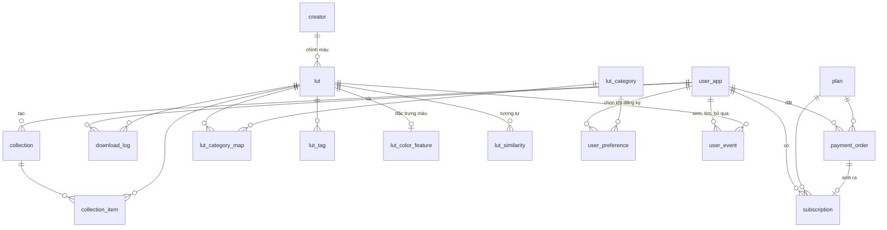

# Thiết kế tổng quát: cửa hàng LUT DownBeat

Tài liệu khung cho toàn bộ phần ecom: các bảng, quan hệ, nhóm API và thứ tự làm. Đây **không** phải plan để `/cook` trực tiếp. Mỗi lát ở §9 sẽ được lập plan riêng bằng `/plan-feature <slug>`, chép đúng phần bảng / API liên quan từ đây vào §4 / §5 của plan đó (hợp đồng chi tiết như body JSON, message lỗi, test case nằm ở plan lát).

Giao diện cửa hàng đã dựng xong với **dữ liệu giả** (`frontend/src/lib/mock/**`). Mỗi hàm giả có cùng chữ ký với hàm gọi API sau này; bảng ở §8 ghi hàm nào sẽ đổi sang endpoint nào.

## 1. Phạm vi

| Có trong thiết kế | Chưa làm (để sau) |
|---|---|
| Kho LUT: danh sách, lọc, tìm, danh mục, chi tiết, LUT liên quan, gợi ý tìm kiếm | Âm nhạc, hiệu ứng âm thanh, video stock (mục "Sắp ra mắt" ở sidebar) |
| Tài khoản khách: đăng ký bằng email, đăng nhập (quên mật khẩu bằng OTP đã gỡ ở lát `go-redis-mail`) | Đăng nhập Google / Facebook, quên mật khẩu |
| Gợi ý LUT theo nội dung (Content-Based Filtering): hồ sơ người dùng, chọn phong cách khi đăng ký (cold-start), khối "Dành cho bạn", LUT liên quan, bộ đánh giá offline (§11) | Lọc cộng tác (collaborative filtering), gợi ý lai |
| | Plugin (sản phẩm thứ hai trong tên đề tài): mô hình dữ liệu dự kiến ở `docs/tai-lieu-thiet-ke.md` chương 10, chưa có lát |
| Gói Miễn phí / Pro / Studio, mua gói qua **payOS** (VietQR), gia hạn, hết hạn | Tự trừ tiền định kỳ (payOS là chuyển khoản từng lần, §6.3) |
| Tải LUT có kiểm quyền: LUT ★ (Premium) cần gói trả phí còn hạn. **Không giới hạn số lượt tải** ở mọi gói | |
| Xem trước LUT bằng **ảnh trước / sau hoặc video**, quản trị chọn cho từng LUT | |
| Trang quản trị `/admin`: quản lý LUT, danh mục, tác giả, khách, đơn, dashboard | Thành viên nhóm của gói Studio (5 tài khoản) |
| Bộ sưu tập (lưu LUT yêu thích) | Giới thiệu bạn bè, blog |

## 2. Tác nhân

| Tác nhân | Là ai trong hệ thống | Làm được |
|---|---|---|
| Khách vãng lai | chưa đăng nhập | Xem kho, xem chi tiết, xem trước trước / sau, xem bảng giá |
| Thành viên Miễn phí | `user_app` có role **Khách hàng**, không có gói trả phí còn hạn | + tải LUT thường, lưu bộ sưu tập |
| Thành viên trả phí | như trên + `subscription` ACTIVE gói `pro` / `studio` | + tải LUT ★ |
| Quản trị | `user_app` có role quản trị (`is_operator` hoặc có permission) | Trang `/admin`: CRUD dữ liệu, xem đơn, dashboard |

Khách hàng và quản trị **dùng chung bảng `user_app`** và cùng luồng JWT (`/user/authenticate`, `/auth/refresh`). Phân biệt bằng role:

- Thêm role `Khách hàng` (`is_default = 1`, không có permission nào). Đăng ký mới tự gán role này.
- Role `Không quyền` của seed hiện tại đổi `is_default = 0`.
- Endpoint cho khách chỉ cần đăng nhập. Endpoint quản trị vẫn `checkPermission(...)` như cũ, nên khách gọi vào sẽ bị 403.

## 3. Kiến trúc

```
Frontend (React)                       Backend (Spring Boot, module business)        Lưu trữ
/luts, /luts/$slug,                    business.lut       (kho LUT, danh mục, tác giả) MySQL: bảng §4
/luts/danh-muc/$category, /pricing ──► business.account   (đăng ký, hồ sơ khách)      MinIO:
hộp thoại đăng nhập / đăng ký /        business.billing   (gói, đơn, subscription, payOS) - downbeat-public: ảnh bìa, ảnh trước/sau, video xem trước
nâng cấp / thanh toán                  business.download  (kiểm quyền + link tải)       - downbeat-lut (private): file .cube
/admin/** (quản trị)              ──►  business.collection, business.dashboard        Caffeine (bộ nhớ): cache danh mục, gói,
khối "Dành cho bạn"                    business.recommend (đặc trưng, hồ sơ, gợi ý)       chỉ mục vector LUT, hồ sơ người dùng
```

Hạ tầng chỉ còn MySQL + MinIO (Redis và Mailpit đã gỡ ở lát `go-redis-mail`), nên cache nằm trong bộ nhớ của backend (Caffeine) và hệ thống không gửi email.

- Thanh toán qua **payOS**: backend tạo link thanh toán, khách quét VietQR trên trang của payOS, payOS gọi webhook về backend để xác nhận. Khoá payOS (`PAYOS_CLIENT_ID`, `PAYOS_API_KEY`, `PAYOS_CHECKSUM_KEY`) chỉ nằm ở `backend/.env`, không bao giờ ở frontend.
- File `.cube` nằm trong bucket **private**. API tải trả **URL ký sẵn** (presigned, hết hạn sau 5 phút), nên không ai lấy được file nếu không qua kiểm quyền.
- Ảnh bìa, ảnh trước / sau và video xem trước nằm trong bucket public, URL lưu thẳng vào bảng.
- Theo `backend/AGENTS.md`: không DTO (body = entity POJO, cột JOIN thêm vào POJO), validate định dạng ở frontend, backend chỉ giữ quy tắc cần tra DB.

## 4. Cơ sở dữ liệu

Migration bắt đầu từ `V3__...` (đã có `V1__auth_schema.sql`, `V2__refresh_token.sql`). Tiền tệ là VND, lưu `bigint` (không có số lẻ). Thời gian dùng `datetime`. Trạng thái lưu bằng `varchar` + hằng số trong code (dễ đọc khi tra DB).



### 4.1 Kho LUT

**`creator`**: tác giả / nhà chỉnh màu.

| Cột | Kiểu | Ràng buộc / ghi chú |
|---|---|---|
| id | int PK AI | |
| name | varchar(100) | NOT NULL |
| slug | varchar(120) | UNIQUE |
| bio | varchar(500) | |
| avatar_url | varchar(500) | |
| status | tinyint | 1 = hiện, 0 = ẩn (xoá mềm) |
| created_time, updated_time | datetime | |

**`lut`**

| Cột | Kiểu | Ràng buộc / ghi chú |
|---|---|---|
| id | int PK AI | |
| slug | varchar(150) | UNIQUE. Sinh từ title (bỏ dấu), trùng thì thêm `-2`, `-3`… |
| title | varchar(150) | NOT NULL |
| description | varchar(1000) | |
| creator_id | int FK → creator | NOT NULL |
| style | varchar(30) | một trong `dien-anh, co-dien, phim-nhua, den-trang, teal-orange, am-ap, lanh, du-lich` (khớp `LUT_STYLES` ở FE) |
| is_premium | tinyint | 1 = LUT ★, cần gói trả phí |
| status | varchar(20) | `DRAFT` / `PUBLISHED` / `HIDDEN`. Kho chỉ hiện `PUBLISHED` |
| cover_url | varchar(500) | ảnh bìa (đã có chữ) |
| preview_type | varchar(20) | NOT NULL, DEFAULT `BEFORE_AFTER`. `BEFORE_AFTER` hoặc `VIDEO`, quản trị chọn khi thêm / sửa LUT (§5.4) |
| before_url, after_url | varchar(500) | ảnh trước / sau. **Bắt buộc khi** `preview_type = BEFORE_AFTER` |
| preview_video_url | varchar(500) | video đã áp LUT (mp4 / webm). **Bắt buộc khi** `preview_type = VIDEO` |
| file_key | varchar(300) | key file .cube trong bucket private. **Không trả về** ở API công khai |
| file_size_kb | int | |
| lut_size | smallint | 17 / 33 / 65 (kích thước lưới 3D) |
| download_count | int | DEFAULT 0, tăng khi tải (§6.2) |
| published_time | datetime | để sắp xếp "Mới nhất" |
| created_by | int FK → user_app | |
| created_time, updated_time | datetime | |

Index: `(status, published_time)`, `(status, download_count)`, `(creator_id)`, `(style)`. Tìm kiếm: `FULLTEXT(title, description) WITH PARSER ngram` cho tiếng Việt, kết hợp `LIKE` trên `creator.name` và `lut_tag.tag`.

**`lut_category`**: danh mục (trang `/luts/danh-muc/<slug>`).

| Cột | Kiểu | Ràng buộc / ghi chú |
|---|---|---|
| id | int PK AI | |
| slug | varchar(80) | UNIQUE |
| name | varchar(80) | NOT NULL |
| group_code | varchar(20) | `phong-cach` / `tong-mau` / `dip` / `phan-mem` |
| description | varchar(300) | mô tả đầu trang danh mục |
| is_popular | tinyint | hiện ở "Danh mục phổ biến" |
| sort_order | int | |
| status | tinyint | 1 / 0 |

**`lut_category_map`**: `lut_id` FK, `category_id` FK, PK `(lut_id, category_id)`. Xoá LUT thì xoá dòng map (CASCADE).

**`lut_tag`**: `lut_id` FK, `tag` varchar(50). PK `(lut_id, tag)`, index `(tag)`. Thẻ là từ khoá tự do (ví dụ "grain", "hoàng hôn") để tìm kiếm, không có trang riêng.

### 4.2 Gói và thanh toán

**`plan`**: seed bằng migration, quản trị chỉ sửa giá / mô tả.

| Cột | Kiểu | Ràng buộc / ghi chú |
|---|---|---|
| id | int PK AI | |
| code | varchar(20) | UNIQUE: `free`, `pro`, `studio` |
| name | varchar(50) | |
| audience | varchar(100) | "Nhà sáng tạo & freelancer"… |
| monthly_price | bigint | giá khi trả theo tháng |
| yearly_monthly_price | bigint | giá / tháng khi trả theo năm (thu 12 × giá này) |
| can_download_premium | tinyint | free = 0, pro / studio = 1 |
| max_members | int | 1 / 1 / 5 |
| license | json | mảng chuỗi "Giấy phép cho" |
| features | json | mảng chuỗi "Quyền lợi" |
| is_highlight | tinyint | nhãn "Phổ biến" |
| sort_order | int | |
| active | tinyint | |

**`payment_order`**: đơn mua gói.

| Cột | Kiểu | Ràng buộc / ghi chú |
|---|---|---|
| id | int PK AI | |
| code | varchar(20) | UNIQUE, server sinh: `DB` + yyMMdd + 4 số (ví dụ `DB2611050001`), hiện cho khách / quản trị |
| payos_order_code | bigint | UNIQUE. Mã đơn gửi sang payOS (payOS dùng mã số). Chốt cách sinh khi có tài liệu payOS |
| user_id | int FK → user_app | |
| plan_id | int FK → plan | |
| cycle | varchar(10) | `MONTH` / `YEAR` |
| amount | bigint | **server tính** từ `plan` (YEAR = 12 × yearly_monthly_price), không lấy từ client |
| status | varchar(20) | `PENDING` → `PAID` / `CANCELLED` / `EXPIRED` (link thanh toán hết hạn) |
| payos_payment_link_id | varchar(100) | id link thanh toán payOS trả về |
| checkout_url | varchar(500) | trang thanh toán payOS, FE chuyển khách sang đây |
| payos_reference | varchar(100) | mã giao dịch ngân hàng trong webhook (đối soát) |
| source_lut_id | int FK → lut, NULL | LUT Premium khiến khách mở hộp thoại nâng cấp (nếu có). Là tín hiệu "mua" cho hồ sơ gợi ý (§11.3) |
| webhook_payload | json | bản webhook đã xác thực gần nhất (đối soát, gỡ lỗi) |
| paid_time | datetime | |
| created_time | datetime | |

Index: `(user_id, created_time)`, `(status, paid_time)` (dashboard doanh thu).

**`subscription`**: quyền dùng gói trả phí.

| Cột | Kiểu | Ràng buộc / ghi chú |
|---|---|---|
| id | int PK AI | |
| user_id | int FK → user_app | |
| plan_id | int FK → plan | |
| order_id | int FK → payment_order | đơn đã sinh ra kỳ này |
| cycle | varchar(10) | |
| status | varchar(20) | `ACTIVE` / `EXPIRED` / `CANCELLED` |
| start_date, end_date | date | end = start + 1 tháng / 12 tháng |
| auto_renew | tinyint | 1 mặc định; "Huỷ gói" đặt 0, vẫn dùng tới end_date |
| created_time, updated_time | datetime | |
| active_user_id | int | **cột sinh**: `IF(status = 'ACTIVE', user_id, NULL)`, UNIQUE. Mỗi khách có tối đa 1 gói ACTIVE |

Không có dòng `subscription` ACTIVE = gói Miễn phí (không lưu dòng cho gói free).

### 4.3 Tải và bộ sưu tập

**`download_log`**: `id`, `user_id` FK, `lut_id` FK, `plan_code` varchar(20) (gói lúc tải, để thống kê), `ip` varchar(45), `created_time`. Index `(user_id, created_time)`, `(lut_id, created_time)`.

**`collection`**: `id`, `user_id` FK, `name` varchar(100), `created_time`, `updated_time`. Unique `(user_id, name)`.

**`collection_item`**: `collection_id` FK (CASCADE), `lut_id` FK (CASCADE), `created_time`. PK `(collection_id, lut_id)`.

### 4.4 Gợi ý (§11)

**`lut_color_feature`**: đặc trưng màu tính từ file .cube khi upload (§11.2). Một dòng một LUT.

| Cột | Kiểu | Ghi chú |
|---|---|---|
| lut_id | int PK, FK → lut (CASCADE) | |
| brightness | float | trung bình (L sau - L trước) / 100 |
| contrast | float | độ lệch chuẩn L sau / độ lệch chuẩn L trước |
| saturation | float | trung bình C sau / trung bình C trước (điểm có C trước > 10) |
| warmth | float | trung bình (b sau - b trước): dương là ấm, âm là lạnh |
| tint | float | trung bình (a sau - a trước): dương là ngả hồng, âm là ngả xanh lá |
| shadow_a, shadow_b | float | dịch a, b ở vùng tối (L trước < 30) |
| highlight_a, highlight_b | float | dịch a, b ở vùng sáng (L trước > 70) |
| is_mono | tinyint | 1 nếu trung bình C sau < 5 (đen trắng) |
| computed_time | datetime | |

**`user_preference`**: sở thích khai báo ở bước "Chọn phong cách" sau đăng ký (cold-start). `user_id` FK (CASCADE), `category_id` FK → lut_category (CASCADE), `created_time`. PK `(user_id, category_id)`. Lưu lại toàn bộ mỗi lần khách lưu (xoá cũ, chèn mới).

**`user_event`**: hành vi chưa có bảng riêng (xem, xem trước, tìm, lọc, bỏ qua). Tải, yêu thích, mua đọc thẳng từ `download_log`, `collection_item`, `payment_order` để không ghi trùng.

| Cột | Kiểu | Ghi chú |
|---|---|---|
| id | bigint PK AI | |
| user_id | int FK → user_app, NULL | NULL khi khách chưa đăng nhập |
| anon_id | char(36), NULL | UUID trình duyệt (localStorage) của khách vãng lai. Phải có `user_id` hoặc `anon_id` |
| event_type | varchar(20) | `VIEW`, `PREVIEW`, `SEARCH`, `FILTER_STYLE`, `DISMISS` |
| lut_id | int FK → lut (CASCADE), NULL | NULL với `SEARCH`, `FILTER_STYLE` |
| value | varchar(100) | từ khoá đã chuẩn hoá (`SEARCH`) hoặc slug phong cách (`FILTER_STYLE`) |
| impression_id | bigint, NULL | khách bấm từ một danh sách gợi ý nào (đo CTR, §11.8) |
| created_time | datetime | |

Index `(user_id, created_time)`, `(anon_id, created_time)`, `(lut_id, event_type)`. Giữ 180 ngày, job hằng ngày xoá dòng cũ hơn.

**`lut_similarity`**: top 50 LUT giống nhất của mỗi LUT (§11.4), tính lại khi xuất bản / sửa / ẩn LUT. `lut_id`, `similar_lut_id` (cùng FK CASCADE), `score` float. PK `(lut_id, similar_lut_id)`, index `(lut_id, score)`.

**`rec_impression`**: mỗi lần trả một danh sách gợi ý. `id` bigint, `user_id` NULL, `anon_id` NULL, `placement` (`FOR_YOU` / `RELATED`), `variant` varchar(20) (tên thuật toán, để so sánh trực tuyến), `lut_ids` json, `created_time`.

**`rec_eval_run`**: kết quả mỗi lần chạy đánh giá offline (§11.8). `id`, `dataset` varchar(30), `algorithm` varchar(30), `params` json, `metrics` json, `user_count` int, `created_time`.

### 4.5 Phân quyền (bảng có sẵn)

Mỗi nhóm trang quản trị là một `resource` (uri khớp hằng `URI` trong controller), cấp cho role quản trị qua migration: `LUT` (`/lut/`), `LUT_CATEGORY` (`/lut-category/`), `CREATOR` (`/creator/`), `PLAN` (`/plan/`), `ORDER` (`/order/`), `CUSTOMER` (`/customer/`), `DASHBOARD` (`/dashboard/`), `RECOMMEND` (`/recommend/`).

## 5. API

Mọi endpoint dưới `/api`, response bọc `{ code, message, result }` như `ApiResponse` hiện có. Danh sách trả `{ total, page, items }` (khớp `PagedResult` ở FE). Endpoint công khai phải mở trong cấu hình security.

### 5.1 Công khai (không cần đăng nhập)

| Method · đường dẫn | Dùng ở | Ghi chú |
|---|---|---|
| `POST /lut/public/list` | lưới `/luts`, trang danh mục | body `{ q, keywords[], styles[], category, sort: relevance\|newest\|popular, page, limit }`. Chỉ LUT `PUBLISHED`. Item có `creatorName`, `categories[]` (slug), không có `fileKey` |
| `GET /lut/public/get?slug=` | trang chi tiết | 404 `DATA_NOT_FOUND` nếu không có / chưa xuất bản |
| `GET /lut/public/related?slug=&page=&limit=` | "Có thể bạn cũng thích" | lát 1: cùng style trước, rồi cùng danh mục, rồi phổ biến. Lát `goi-y-lut` giữ nguyên hợp đồng, đổi cách tính sang độ tương đồng nội dung (§11.4) |
| `GET /lut/public/suggest?q=&limit=4` | bảng gợi ý ở ô tìm kiếm header | q rỗng = LUT nổi bật (nhiều lượt tải) |
| `GET /lut-category/public/list` | khối danh mục, footer | cache Caffeine |
| `GET /lut-category/public/get?slug=` | đầu trang danh mục | 404 nếu không có |
| `GET /plan/public/list` | trang bảng giá, hộp thoại nâng cấp | cache Caffeine |

### 5.2 Tài khoản khách

| Method · đường dẫn | Ghi chú |
|---|---|
| `POST /account/register` | body `{ name, email, plainPassword }` (POJO `User`, như `/user/authenticate`). Tạo `user_app` role Khách hàng, trả **token như `/user/authenticate`** (đăng ký xong là đăng nhập luôn). Lỗi: email trùng |
| `POST /user/authenticate`, `/auth/refresh`, `/auth/logout` | **có sẵn**, dùng chung với quản trị (`forgot-password`, `reset-password` đã gỡ) |
| `GET /account/preference`, `POST /account/preference` | sở thích cold-start (§11.5). POST body `{ categorySlugs[] }`, thay toàn bộ; slug phải có thật và thuộc nhóm `phong-cach`, `tong-mau`, `dip`, `phan-mem`, tối đa 12 |
| `GET /account/me` | `{ id, name, email, plan: free\|pro\|studio, planExpiresAt }`. `plan` lấy từ subscription ACTIVE, không có thì `free` |

### 5.3 Tải LUT, mua gói, bộ sưu tập (cần đăng nhập)

| Method · đường dẫn | Ghi chú |
|---|---|
| `POST /lut/download` | body `{ lutId }` → `{ fileName, url }` (URL ký sẵn 5 phút). Kiểm quyền ở §6.2, ghi `download_log`, tăng `download_count` |
| `POST /order/create` | body `{ planCode, cycle, sourceLutId? }` → `{ code, amount, checkoutUrl }`. `sourceLutId` có khi khách mở hộp thoại nâng cấp từ một LUT Premium. Backend tạo đơn `PENDING` rồi gọi payOS tạo link thanh toán (`returnUrl` = `/thanh-toan/ket-qua`, `cancelUrl` = `/thanh-toan/ket-qua?huy=1`) |
| `GET /order/get?code=` | trạng thái đơn của chính khách. Trang `/thanh-toan/ket-qua` gọi endpoint này, **không tin tham số payOS gắn trên URL** |
| `POST /order/cancel/{code}` | khách bấm huỷ trên trang payOS → đơn `CANCELLED` (chỉ khi còn `PENDING`) |
| `POST /payment/payos/webhook` | **công khai** (mở trong security), payOS gọi khi thanh toán xong. Xác thực chữ ký bằng `PAYOS_CHECKSUM_KEY`, sai thì 400 và không đổi gì. Đúng thì xử lý như §6.3 bước 3 |
| `POST /order/mock-pay/{code}` | **chỉ profile local**, dùng khi chưa có khoá payOS: đi thẳng tới bước 3 của §6.3 |
| `GET /order/my-list` | lịch sử mua gói của khách |
| `POST /subscription/cancel` | tắt tự gia hạn, gói vẫn dùng tới `end_date` |
| `GET /collection/my-list`, `POST /collection/update`, `POST /collection/delete/{id}`, `POST /collection/item/add`, `POST /collection/item/remove` | bộ sưu tập |

### 5.4 Quản trị (`checkPermission`)

Theo khuôn `/<x>/list | get | update | delete/{id}` của `backend/AGENTS.md`:

- `lut`: CRUD + `POST /lut/upload` (multipart: file .cube vào bucket private; ảnh và video vào bucket public; trả key / URL) + `POST /lut/publish/{id}`, `POST /lut/hide/{id}`. Upload phải thêm `mp4`, `webm` vào whitelist (tối đa 50 MB / video); vẫn không cho svg / html.
- Form thêm / sửa LUT có trường **"Kiểu xem trước"** (radio): "Ảnh trước / sau" hoặc "Video". Chọn "Ảnh trước / sau" thì hiện 2 ô tải ảnh "Ảnh trước" + "Ảnh sau"; chọn "Video" thì hiện ô tải "Video xem trước" (mp4 / webm). Đổi kiểu không xoá file đã tải của kiểu kia, nhưng chỉ kiểu đang chọn được dùng. FE kiểm kiểu đã chọn có đủ file. Backend kiểm lại khi **xuất bản** (`/lut/publish`): thiếu file của kiểu đang chọn thì báo `PREVIEW_MISSING`.
- `lut-category`, `creator`: CRUD.
- `plan`: `list`, `update` (không thêm / xoá gói).
- `order`: `list` (lọc trạng thái, khoảng ngày), `get`.
- `customer`: `list` (khách + gói hiện tại), `get` (đơn, lượt tải gần đây).
- `dashboard`: `GET /dashboard/summary?from=&to=` → doanh thu theo ngày / tháng, số đơn PAID, khách mới, gói đang ACTIVE theo loại, top 10 LUT tải nhiều, tỉ lệ LUT ★ / thường trong lượt tải.
- `recommend`: `GET /recommend/config` (trọng số, tham số đang dùng, chỉ đọc), `POST /recommend/rebuild` (tính lại đặc trưng màu còn thiếu, chỉ mục vector và `lut_similarity`), `GET /recommend/eval/list` (các lần chạy `rec_eval_run`), `GET /recommend/stats?from=&to=` (CTR theo vị trí và biến thể).

### 5.5 Gợi ý (§11)

| Method · đường dẫn | Đăng nhập | Ghi chú |
|---|---|---|
| `POST /recommend/public/for-you` | tuỳ chọn | body `{ anonId, limit }` (mặc định 12, tối đa 24) → `{ impressionId, strategy, items[] }`. Mỗi item là LUT như ở `/lut/public/list` kèm `reason` (câu giải thích ngắn). `strategy` = `PROFILE` / `PREFERENCE` / `POPULAR` cho biết đang ở mức cold-start nào. Có token thì dùng hồ sơ khách, không thì dùng `anonId` |
| `POST /recommend/public/event` | tuỳ chọn | body `{ anonId, type, lutId?, value?, impressionId? }`, `type` thuộc `VIEW`, `PREVIEW`, `SEARCH`, `FILTER_STYLE`. Luôn trả 200; FE gửi không chờ kết quả. Cùng (người, LUT, type) trong 30 phút chỉ ghi 1 dòng |
| `POST /recommend/dismiss` | có | body `{ lutId }`: "Không quan tâm", ghi `DISMISS`, LUT không xuất hiện lại trong "Dành cho bạn" |
| `POST /recommend/merge-anon` | có | body `{ anonId }`: gắn sự kiện ẩn danh vào tài khoản sau khi đăng nhập / đăng ký |
| `POST /recommend/clear-history` | có | xoá `user_event` của khách (quyền riêng tư); tải / yêu thích / đơn giữ nguyên |

### 5.6 Lỗi nghiệp vụ chung

| Tình huống | HTTP | `errorCode` | Message (FE hiện nguyên văn) |
|---|---|---|---|
| Email đăng ký đã có | 400 | `EMAIL_EXISTS` | Email đã được đăng ký |
| Sai email / mật khẩu | 400 | (có sẵn) | Tài khoản hoặc mật khẩu không đúng. |
| Tải khi chưa đăng nhập | 401 | `UNAUTHORIZED` | Vui lòng đăng nhập để tải LUT |
| Tải LUT ★ khi không có gói trả phí | 403 | `PLAN_REQUIRED` | LUT Premium cần gói Pro hoặc Studio |
| LUT / danh mục không có hoặc chưa xuất bản | 404 | `DATA_NOT_FOUND` | Không tìm thấy LUT / Không tìm thấy danh mục |
| Hạ gói khi gói cao hơn còn hạn trên 3 ngày | 400 | `PLAN_ACTIVE` | Bạn đang dùng gói Studio, cao hơn gói Pro |
| Huỷ / thanh toán đơn không còn PENDING | 400 | `ORDER_INVALID_STATUS` | Đơn hàng đã được xử lý |
| Không tạo được link payOS (lỗi mạng, sai khoá) | 502 | `PAYMENT_GATEWAY_ERROR` | Không kết nối được cổng thanh toán, vui lòng thử lại |
| Webhook sai chữ ký | 400 | `INVALID_SIGNATURE` | (không hiện cho khách; ghi log) |
| Xuất bản LUT thiếu file xem trước | 400 | `PREVIEW_MISSING` | LUT chưa có đủ ảnh / video xem trước |
| Upload file .cube đọc không được (không phải LUT 3D, sai số dòng) | 400 | `LUT_FILE_INVALID` | File .cube không hợp lệ |
| Xuất bản LUT có ít hơn 3 thẻ hoặc chưa có danh mục | 400 | `LUT_FEATURE_MISSING` | LUT cần ít nhất 3 thẻ và 1 danh mục |
| Lưu sở thích có slug không tồn tại hoặc quá 12 mục | 400 | `PREFERENCE_INVALID` | Lựa chọn không hợp lệ |

FE đã rẽ nhánh theo `errorCode` (ví dụ `PLAN_REQUIRED` → mở hộp thoại nâng cấp), nên `errorCode` phải đúng như bảng.

## 6. Quy tắc nghiệp vụ

### 6.1 Danh sách và tìm kiếm
- Chỉ `status = PUBLISHED`. Sắp xếp: `relevance` (điểm FULLTEXT, rồi `download_count`), `newest` (`published_time` giảm dần), `popular` (`download_count` giảm dần).
- `q` và từng `keywords[]` là điều kiện AND, mỗi điều kiện khớp title / mô tả / tên tác giả / thẻ.

### 6.2 Tải LUT
1. Chưa đăng nhập → 401.
2. LUT không `PUBLISHED` → 404.
3. `is_premium = 1` và khách không có subscription `ACTIVE` với `end_date >= hôm nay` của gói `can_download_premium = 1` → 403 `PLAN_REQUIRED`.
4. Ghi `download_log`, `download_count = download_count + 1` (một câu UPDATE, không đọc rồi ghi), sinh presigned URL 5 phút.
5. **Không giới hạn số lượt tải** ở mọi gói (đã chốt). `download_log` chỉ để thống kê, không dùng để chặn.

### 6.3 Mua gói qua payOS
1. `order/create`: kiểm `PLAN_ACTIVE`, tính `amount` từ bảng `plan` (không lấy từ client), sinh `code` + `payos_order_code`, lưu `PENDING`, gọi payOS tạo link, lưu `payos_payment_link_id` + `checkout_url`, trả `checkoutUrl`. Gọi payOS lỗi thì đơn chuyển `CANCELLED`, trả `PAYMENT_GATEWAY_ERROR`.
2. FE chuyển khách sang `checkoutUrl`. Thanh toán xong hoặc huỷ, payOS đưa khách về `/thanh-toan/ket-qua`; trang này hỏi `GET /order/get?code=` mỗi 2 giây (tối đa khoảng 1 phút) tới khi đơn hết `PENDING`, rồi hiện "Thanh toán thành công" hoặc "Đơn đã huỷ".
3. **Webhook** (hoặc `mock-pay` ở local), trong một `@Transactional`:
   - Xác thực chữ ký. Tìm đơn theo `payos_order_code`; không thấy thì bỏ qua (trả 200 để payOS không gửi lại).
   - Đơn đã `PAID` thì **không làm gì** (payOS có thể gửi lại webhook). Chống trùng bằng `UPDATE ... SET status = 'PAID' WHERE id = ? AND status = 'PENDING'`: cập nhật 0 dòng nghĩa là đã xử lý rồi. Không dùng `Idempotency-Key` (theo quy tắc dự án).
   - Số tiền trong webhook khác `amount` của đơn thì không kích hoạt, ghi log để đối soát.
   - Kích hoạt gói: khách đang có subscription ACTIVE **cùng gói** thì cộng thêm kỳ vào `end_date`; **khác gói** (nâng cấp) thì đóng gói cũ (`CANCELLED`) và tạo gói mới bắt đầu hôm nay.
4. Job 00:10 mỗi ngày: subscription `ACTIVE` có `end_date < hôm nay` → `EXPIRED`; đơn `PENDING` quá 24 giờ → `EXPIRED`.
5. payOS là chuyển khoản từng lần nên **không tự trừ tiền định kỳ**. Hệ thống không gửi email (đã gỡ Mailpit); khi gói còn 3 ngày, menu tài khoản và trang `/pricing` hiện nhắc gia hạn. Khách gia hạn bằng cách mua lại gói đang dùng.

Chi tiết payOS (tên trường, cách ký, giới hạn độ dài mô tả, môi trường thử) chốt theo tài liệu người dùng cung cấp, ghi vào plan lát `goi-thanh-toan`.

### 6.4 Slug
Sinh từ title: bỏ dấu, `đ → d`, chữ thường, ký tự khác chữ / số → `-` (giống `slugify` ở `frontend/src/lib/mock/data/luts.ts`). Đổi title không đổi slug, để link cũ không hỏng.

## 7. Giao diện đã có (dữ liệu giả)

| Route | Nội dung |
|---|---|
| `/` | chuyển sang `/luts` |
| Xem trước | LUT `before-after`: thanh kéo so sánh. LUT `video`: trang chi tiết có video tự phát không tiếng; thẻ ở lưới có biểu tượng ▶ và phát video khi rê chuột (dữ liệu giả có 4 LUT video) |
| `/luts` | hero, thanh lọc (từ khoá, phong cách, sắp xếp; lưu trên URL), lưới LUT ("Xem thêm" rồi tự tải khi cuộn), danh mục phổ biến / tất cả danh mục, câu hỏi thường gặp, footer |
| `/luts/$slug` | chi tiết: thanh so sánh trước / sau kéo được, nút tải (LUT ★ hiện ghi chú cần gói), thông tin file, danh mục, LUT liên quan; khung chờ khi tải; 404 trong khung cửa hàng |
| `/luts/danh-muc/$category` | trang danh mục: tiêu đề, mô tả, thanh lọc + lưới chỉ LUT thuộc danh mục |
| `/pricing` | layout không sidebar: 3 gói, chọn chu kỳ tháng / năm, bảng so sánh, câu hỏi về thanh toán |
| Hộp thoại | đăng ký (kèm thẻ LUT khi bấm tải), đăng nhập, nâng cấp (LUT ★ + gói Miễn phí), xác nhận mua gói (ghi "Thanh toán qua payOS", hiện đang giả lập) |
| Header | ô tìm kiếm có bảng gợi ý (từ khoá phổ biến + 4 LUT khớp), menu tài khoản (gói, hạn, nâng cấp, đăng xuất) |
| `/admin` | trang quản trị (đổi tên từ `/crm`), chỗ đặt dashboard sau này |

Tài khoản thử (chỉ dữ liệu giả, mật khẩu `Admin@123`): `free@downbeat.local` (Miễn phí), `pro@downbeat.local` (Pro).

## 8. Đổi dữ liệu giả sang API

Khi lát backend xong, agy tạo `frontend/src/lib/axios/<x>.ts` cùng chữ ký rồi đổi import trong `lib/tanstack/options/*` và hook. Component không phải sửa.

| Hàm giả (`src/lib/mock/…`) | Endpoint |
|---|---|
| `luts.getLuts(req)` | `POST /lut/public/list` |
| `luts.getLut(slug)` | `GET /lut/public/get` |
| `luts.getRelatedLuts(slug, paging)` | `GET /lut/public/related` |
| `luts.getLutSuggestions(q)` | `GET /lut/public/suggest` |
| `luts.getLutCategories()` / `getLutCategory(slug)` | `GET /lut-category/public/list` / `get` |
| `account.getPlans()` | `GET /plan/public/list` |
| `account.register(req)` | `POST /account/register` |
| `account.login(req)` | `POST /user/authenticate` + `GET /account/me` |
| `account.checkout(userId, req)` | `POST /order/create` rồi chuyển sang `checkoutUrl` của payOS; thêm route `/thanh-toan/ket-qua` gọi `GET /order/get` |
| `account.requestLutDownload(lut, user)` | `POST /lut/download` |

Phiên khách hiện lưu ở `useShopSession` (`src/lib/stores/shop-session.ts`). Khi có API, phiên khách dùng token giống `useAuthStore` (chung luồng refresh) và lấy user từ `/account/me`. Dữ liệu `previewFilter` / `coverText` chỉ dùng cho ảnh giả; khi có ảnh thật thì dùng `before_url` / `after_url`. `previewType` (`before-after` / `video`) ở FE ứng với `preview_type` (`BEFORE_AFTER` / `VIDEO`) ở DB; hàm axios đổi qua lại.

## 9. Lộ trình: các lát cần lập plan

Mỗi dòng là một `/plan-feature <slug>`, làm theo thứ tự (lát sau dùng bảng của lát trước):

| # | Slug | Nội dung | Bảng | Phụ thuộc |
|---|---|---|---|---|
| 1 | `kho-lut` | API công khai §5.1 (trừ plan) + seed ~36 LUT / 16 danh mục từ dữ liệu giả + ảnh lên MinIO; FE đổi mock → API | creator, lut, lut_category, lut_category_map, lut_tag | — |
| 2 | `quan-ly-lut` | `/admin/luts`, `/admin/danh-muc`, `/admin/tac-gia`: CRUD, upload .cube + ảnh / video, chọn kiểu xem trước, xuất bản / ẩn | (dùng lại lát 1) + resource LUT, LUT_CATEGORY, CREATOR | 1 |
| 3 | `tai-khoan-khach` | đăng ký, `/account/me`, role Khách hàng, FE hộp thoại đăng nhập / đăng ký dùng API thật | (sửa role, user_app) | — |
| 4 | `goi-thanh-toan` | gói, đơn, **payOS** (tạo link, webhook, trang kết quả), subscription, job hết hạn + email nhắc gia hạn; `/admin/don-hang`. Cần tài liệu + khoá payOS trước khi lập plan | plan, payment_order, subscription | 3 |
| 5 | `tai-lut` | `POST /lut/download` + presigned URL + log; FE nút tải dùng API | download_log | 1, 4 |
| 6 | `dashboard-admin` | `/admin` thành dashboard: doanh thu, đơn, khách mới, gói, top LUT | (đọc các bảng trên) + resource DASHBOARD | 4, 5 |
| 7 | `bo-suu-tap` | bộ sưu tập của khách | collection, collection_item | 1, 3 |
| 8 | `goi-y-lut` | §11.1 đến §11.7: đặc trưng màu từ .cube, chỉ mục vector, hồ sơ người dùng, bước "Chọn phong cách" sau đăng ký, ghi sự kiện, khối "Dành cho bạn", "Có thể bạn cũng thích" theo nội dung, nút "Không quan tâm", `/admin/goi-y` | lut_color_feature, user_preference, user_event, lut_similarity, rec_impression + cột `payment_order.source_lut_id` + resource RECOMMEND | 1, 3, 5, 7 |
| 9 | `danh-gia-goi-y` | §11.8: mở rộng kho lên khoảng 300 LUT sinh tham số, bộ mô phỏng người dùng, trình chạy đánh giá (4 thuật toán + biến thể), kiểm định, ghi `rec_eval_run`; xuất bảng kết quả cho báo cáo | rec_eval_run (schema `downbeat_eval` riêng cho dữ liệu đánh giá) | 8 |

Lát 1 và 3 làm song song được (không chung bảng). Lát 8 có thể làm sau lát 5 nếu chưa có bộ sưu tập: khi đó bỏ tín hiệu yêu thích, thêm lại khi lát 7 xong.

## 10. Đã chốt và còn mở

Đã chốt (2026-11-05):

- **Thanh toán**: tích hợp **payOS**. Người dùng sẽ cung cấp tài liệu và khoá API; tới lúc đó giao diện dùng thanh toán giả lập.
- **Xem trước**: mỗi LUT chọn **ảnh trước / sau hoặc video** khi quản trị thêm / sửa (cột `preview_type`, §4.1, §5.4). Giao diện cửa hàng đã hiển thị được cả hai kiểu.
- **Lượt tải**: không giới hạn ở mọi gói.

Còn mở (chốt khi lập plan lát tương ứng):

1. **Nâng cấp giữa kỳ**: đã chốt ở plan `goi-thanh-toan` (10/11/2026): không thu chênh lệch, phần còn lại của gói cũ quy đổi thành ngày dùng thêm ở gói mới; gia hạn bất cứ lúc nào.
2. **Gói Studio 5 thành viên**: hiện chỉ ghi trên bảng giá. Làm thật cần bảng `team` / `team_member`, để sau lát 6.
3. **payOS khi demo đồ án**: dùng khoá thật với số tiền nhỏ, hay chỉ chạy `mock-pay` ở local? (lát 4)
4. **Plugin**: tên đề tài có "LUT và PLUGIN" nhưng chưa có lát nào. Đề xuất ở `docs/tai-lieu-thiet-ke.md` chương 10 (bảng `plugin`, `plugin_host`, dùng chung khung gợi ý). Làm thật trong đồ án hay chỉ trình bày thiết kế? (sau lát 9)
5. **Dữ liệu thật để đánh giá**: tìm được bao nhiêu người dùng thử (mục tiêu 20 đến 30 người trong 2 tuần) cho bộ D2 và khảo sát D3 ở §11.8? Không đủ thì báo cáo chỉ dựa trên bộ mô phỏng D1 và phải ghi rõ hạn chế. (lát 9)
6. **LUT Premium trong gợi ý cho khách gói Miễn phí**: đề xuất vẫn gợi ý nhưng tối đa 1/3 danh sách. Có giữ không? (lát 8)

## 11. Gợi ý LUT theo nội dung (Content-Based Filtering)

Bản đầy đủ (giải thích, ví dụ tính tay, sơ đồ) nằm ở `docs/tai-lieu-thiet-ke.md` chương 7 và 8. Phần này là bản tóm tắt để chép vào plan lát `goi-y-lut` và `danh-gia-goi-y`.

### 11.1 Vì sao chọn lọc theo nội dung

- Lúc mới chạy gần như chưa có tương tác, lọc cộng tác không có dữ liệu để học. Lọc theo nội dung chỉ cần đặc trưng của LUT, có ngay khi quản trị xuất bản.
- LUT có đặc trưng nội dung rõ và đo được: phong cách, danh mục, thẻ, mô tả, tác giả, và quan trọng nhất là chính file .cube (biến đổi màu đo được bằng số).
- LUT mới xuất bản được gợi ý ngay (không bị cold-start phía sản phẩm), và mỗi gợi ý giải thích được ("Cùng tông ấm với Hoàng Hôn Sài Gòn bạn đã tải").

Vị trí hiển thị: khối "Dành cho bạn" đầu trang `/luts` (12 LUT), "Có thể bạn cũng thích" ở trang chi tiết (thay luật cũ), "LUT tương tự" trong hộp thoại sau khi tải xong.

### 11.2 Hồ sơ sản phẩm (vector đặc trưng của một LUT)

Mỗi LUT là một vector gồm 6 khối, mỗi khối chuẩn hoá riêng:

| Khối | Cách mã hoá | Trọng số mặc định |
|---|---|---|
| Thẻ (`lut_tag`) | TF-IDF trên từ điển thẻ, chuẩn L2 | 0.30 |
| Đặc trưng màu (`lut_color_feature`) | 10 số thực, chuẩn hoá z-score theo toàn kho, cắt về [-3, 3] | 0.25 |
| Danh mục (`lut_category_map`) | multi-hot nhân IDF, chuẩn L2. Bỏ nhóm `phan-mem` vì LUT .cube nào cũng dùng được ở mọi phần mềm | 0.15 |
| Phong cách (`lut.style`) | one-hot 8 chiều | 0.15 |
| Văn bản (title + description) | TF-IDF trên âm tiết đơn và cặp âm tiết, bỏ từ dừng, chuẩn L2 | 0.10 |
| Tác giả (`creator_id`) | one-hot | 0.05 |

Đặc trưng màu trích từ file .cube khi upload: lấy lưới 17 x 17 x 17 điểm (LUT 33 lấy bước 2, LUT 65 lấy bước 4), đổi màu đầu vào và đầu ra từ sRGB sang CIELAB, rồi tính 10 số ở bảng `lut_color_feature`. Ví dụ: LUT đen trắng có `saturation` gần 0 và `is_mono = 1`; LUT teal & orange có `shadow_b` âm (vùng tối ngả xanh) và `highlight_b` dương (vùng sáng ngả cam).

Xuất bản LUT bắt buộc có ít nhất 3 thẻ và 1 danh mục (`LUT_FEATURE_MISSING`), để khối nào cũng có dữ liệu.

### 11.3 Hồ sơ người dùng

Hồ sơ là vector cùng không gian với LUT, gộp từ các nguồn sau:

| Nguồn | Lấy từ | Trọng số |
|---|---|---|
| Sở thích khai báo khi đăng ký (phong cách, tông màu, dịp quay, phần mềm) | `user_preference` | trộn theo hệ số alpha ở §11.5 |
| Xem trang chi tiết | `user_event` `VIEW` | 1 |
| Xem trước: kéo thanh so sánh hoặc xem video từ 3 giây | `user_event` `PREVIEW` | 2 |
| Tìm kiếm (từ khoá khớp thẻ / văn bản) | `user_event` `SEARCH` | 0.5, chỉ vào khối thẻ và văn bản |
| Lọc theo phong cách | `user_event` `FILTER_STYLE` | 0.5, chỉ vào khối phong cách |
| Yêu thích (đang nằm trong bộ sưu tập) | `collection_item` | 4 |
| Tải | `download_log` | 5 |
| Mua: LUT Premium dẫn tới mua gói | `payment_order.source_lut_id` của đơn `PAID` | 6 |
| Không quan tâm | `user_event` `DISMISS` | -4, và loại LUT đó khỏi danh sách |

Thông tin gói (Miễn phí / Pro / Studio) không phải sở thích, chỉ dùng ở bước xếp hạng (§11.6).

Công thức cho mỗi khối b (trừ khối màu):

```
c_e   = w(type_e) * (1 + ln(so_lan_e)) * 0.5 ^ (so_ngay_e / 30)
H_u^b = sum_e( c_e * x_i(e)^b ) / sum_e( |c_e| )
```

- Gộp theo cặp (LUT, loại sự kiện): `so_lan` là số lần, `so_ngay` tính từ lần gần nhất. Chu kỳ bán rã 30 ngày.
- Chỉ lấy 180 ngày và tối đa 200 cặp gần nhất.
- Khối màu dùng trung bình có trọng số của các sự kiện dương (không trừ bằng `DISMISS`), vì đó là "vị trí" gu màu, không phải hướng.
- Khách vãng lai dùng sự kiện theo `anon_id`; đăng nhập xong gọi `merge-anon` để gắn vào tài khoản.

### 11.4 Độ tương đồng

```
sim(i, j)  = sum_b w_b * sim_b(x_i^b, x_j^b)          (sum_b w_b = 1)
sim_b      = cosine                                     với khối thẻ, danh mục, phong cách, văn bản, tác giả
sim_mau    = exp( -||z_i - z_j||^2 / (2 * 10) )         với khối màu (10 chiều)
score(u,i) = sum_b w_b * sim_b(P_u^b, x_i^b)
```

Khối màu dùng hàm RBF thay cho cosine vì độ mạnh có ý nghĩa: "hơi ấm" và "rất ấm" cùng hướng nhưng khác nhau. `lut_similarity` lưu top 50 `sim(i, j)` của mỗi LUT; với khoảng 1000 LUT, tính lại toàn bộ mất dưới 1 giây nên chạy lại cả bảng mỗi khi xuất bản / sửa / ẩn LUT.

### 11.5 Cold-start

| Tình huống | Cách xử lý | `strategy` |
|---|---|---|
| Khách mới đăng ký | Bước 2 của hộp thoại đăng ký: "Chọn phong cách màu bạn thích" (8 ô phong cách / tông màu có ảnh mẫu, chọn 1 đến 5, khuyên chọn 3), "Bạn hay quay gì" (Du lịch, Đám cưới, Chân dung, Ban đêm) và "Bạn dựng bằng phần mềm nào" (4 phần mềm), đều không bắt buộc, có nút "Bỏ qua". Sửa lại được trong menu tài khoản | |
| Có sở thích, chưa có hành vi | Vector khai báo E_u: khối phong cách / danh mục lấy trực tiếp từ lựa chọn; khối thẻ, màu, văn bản lấy trọng tâm (trung bình vector) của các LUT thuộc danh mục đã chọn | `PREFERENCE` |
| Có cả hai | `P_u = alpha * E_u + (1 - alpha) * H_u`, `alpha = 5 / (5 + n)`, n = số LUT khác nhau có sự kiện dương. Sau 5 LUT, hai phần nặng như nhau | `PROFILE` |
| Không sở thích, không hành vi (hoặc vãng lai lần đầu) | LUT nhiều lượt tải trong 30 ngày, xếp xen kẽ theo phong cách để không cùng một màu | `POPULAR` |
| LUT mới xuất bản | Có đủ đặc trưng ngay nên được tính điểm như mọi LUT; không cần xử lý riêng (đây là điểm mạnh của lọc theo nội dung so với lọc cộng tác và gợi ý theo độ phổ biến) | |

Phần mềm đã chọn chưa dùng cho LUT (mọi phần mềm đều đọc .cube), sẽ là bộ lọc tương thích khi có plugin.

### 11.6 Xếp hạng

1. Ứng viên: mọi LUT `PUBLISHED`, trừ LUT đã tải và LUT đã bấm "Không quan tâm" (với "Dành cho bạn"), trừ chính LUT đang xem (với "Có thể bạn cũng thích").
2. Tính `score(u, i)`, lấy 100 LUT cao nhất.
3. Xếp lại bằng MMR để đa dạng: chọn lần lượt LUT có `0.7 * score(u, i) - 0.3 * max_{j đã chọn} sim(i, j)` lớn nhất.
4. Khách gói Miễn phí và khách vãng lai: LUT Premium chiếm tối đa 1/3 danh sách (vẫn hiện để khuyến khích nâng cấp).
5. Điểm bằng nhau thì xếp theo `download_count`.
6. Giải thích: lấy khối có `w_b * sim_b` lớn nhất, đổi thành câu, ví dụ "Vì bạn thích phong cách Phim nhựa", "Tông màu giống Kodak 400 bạn đã tải".

"Có thể bạn cũng thích" khi đã đăng nhập: `0.8 * sim(LUT đang xem, j) + 0.2 * score(u, j)`; chưa đăng nhập thì chỉ dùng `sim`.

### 11.7 Cài đặt

- Module `business.recommend`. Chỉ mục vector của mọi LUT nằm trong bộ nhớ, dựng lúc khởi động và dựng lại khi xuất bản / sửa / ẩn LUT. Hồ sơ người dùng tính khi cần, cache Caffeine 5 phút, xoá cache khi khách tải / yêu thích / bỏ qua.
- Trọng số và tham số đặt trong `application.yml` (`recommend.*`), không đặt cứng trong code, để trình đánh giá chạy được nhiều cấu hình.
- Yêu cầu: `for-you` p95 dưới 200 ms với 1000 LUT; `event` không làm chậm trang (FE gửi không chờ).

### 11.8 Đánh giá

Câu hỏi cần trả lời: lọc theo nội dung đầy đủ đặc trưng có gợi ý đúng hơn, đa dạng hơn các cách đơn giản không, và đặc trưng màu trích từ file có thêm giá trị so với chỉ dùng thẻ không.

Dữ liệu:

| Bộ | Nội dung | Dùng để |
|---|---|---|
| D1 mô phỏng | Kho khoảng 300 LUT sinh từ tham số màu (file .cube thật, thẻ do luật gán, 10% thẻ nhiễu). 500 người dùng giả, mỗi người có gu ẩn (1 đến 2 phong cách + một vùng màu ưa thích + mức chạy theo số đông), sinh 20 đến 60 sự kiện trong 90 ngày; sở thích khai báo đúng gu với xác suất 0.8 | so sánh chính, có hạt giống ngẫu nhiên cố định |
| D2 thật | 20 đến 30 người dùng thử (sinh viên, người làm video) trong 2 tuần, ghi `user_event`, tải, yêu thích | xác nhận xu hướng của D1 |
| D3 khảo sát | Mỗi người chấm 1 đến 5 điểm "hợp gu" cho 10 gợi ý của thuật toán chính và 10 của baseline chỉ thẻ, trộn lẫn, không ghi nguồn | đánh giá cảm nhận |

Chia dữ liệu: theo thời gian cho từng người, 80% sự kiện đầu để dựng hồ sơ, 20% sau để kiểm tra; 10% cuối của phần dựng hồ sơ làm tập kiểm định để chỉnh trọng số. LUT liên quan là LUT được tải, yêu thích hoặc dẫn tới mua trong phần kiểm tra mà chưa có trong phần dựng. Chỉ tính người có từ 5 sự kiện dựng hồ sơ và từ 1 LUT liên quan. K = 5, 10, 20.

Chỉ số:

| Chỉ số | Công thức | Đo gì |
|---|---|---|
| Precision@K | số LUT đúng trong top K / K | độ chính xác |
| Recall@K | số LUT đúng trong top K / số LUT liên quan | độ phủ của đáp án |
| NDCG@K | DCG / IDCG, `DCG = sum (2^rel - 1) / log2(vị trí + 1)`; rel = 3 tải hoặc mua, 2 yêu thích, 1 xem trước | thứ hạng |
| HitRate@K | tỉ lệ người có ít nhất 1 LUT đúng trong top K | |
| ILD@K | trung bình khoảng cách màu (không dùng trọng số của mô hình) giữa các cặp trong danh sách | đa dạng trong một danh sách |
| Số phong cách / K | số phong cách khác nhau trong top K | đa dạng dễ hiểu |
| Coverage@K | số LUT khác nhau từng được gợi ý / tổng số LUT | độ phủ kho |
| Novelty@K | trung bình `-log2(tỉ lệ người đã tải LUT)` | mức "không hiển nhiên" |

Baseline và biến thể (chạy cùng một bộ chia dữ liệu, cùng ứng viên):

| Mã | Thuật toán |
|---|---|
| B1 | Ngẫu nhiên (trung bình 20 lần chạy) |
| B2 | Phổ biến: nhiều lượt tải nhất trong phần dựng hồ sơ (không dùng số lượt tải hiện tại để tránh rò rỉ) |
| B3 | Lọc theo nội dung chỉ dùng khối thẻ (cùng hồ sơ, suy giảm, cold-start) |
| M | Lọc theo nội dung đủ 6 khối + suy giảm + cold-start + MMR |
| M-mau, M-giam, M-mmr | M bỏ khối màu / bỏ suy giảm thời gian / bỏ MMR (ablation) |

Ngoài ra đo riêng hai tình huống cold-start: người dùng mới chỉ có sở thích và 0, 1, 3, 5 sự kiện (vẽ đường NDCG@10 theo số sự kiện, so với B2); LUT mới xuất bản trong giai đoạn kiểm tra (tỉ lệ danh sách gợi ý có LUT mới, Recall@10 tính riêng trên LUT mới).

Kiểm định: Wilcoxon theo cặp trên NDCG@10 từng người (M so với B2, M so với B3), mức ý nghĩa 0.05, kèm khoảng tin cậy 95% bằng bootstrap 1000 lần.

Giả thuyết cần kiểm (báo cáo đúng kết quả, kể cả khi bác bỏ): H1 M hơn B2 về NDCG@10 và Recall@10; H2 M hơn B3 (đủ đặc trưng hơn chỉ thẻ); H3 Coverage@10 của M ít nhất gấp 3 lần B2; H4 người mới có sở thích được gợi ý tốt hơn B2.

Trình chạy đánh giá viết trong backend, gọi đúng code xếp hạng đang chạy thật (không viết lại riêng), chạy bằng profile `eval` trên schema `downbeat_eval`, ghi `rec_eval_run` và in bảng Markdown. Trực tuyến (khi có người dùng thật): CTR của "Dành cho bạn" theo `variant`, chia nhóm theo `user_id` chẵn / lẻ.

Lưu ý về tính hợp lệ: bộ mô phỏng dựng gu từ chính phong cách và màu nên có thể thiên vị M. Giảm bằng cách cho gu ẩn có thành phần chạy theo số đông và nhiễu, thẻ có 10% nhiễu, và đối chiếu với D2, D3. Báo cáo phải ghi rõ điều này.
