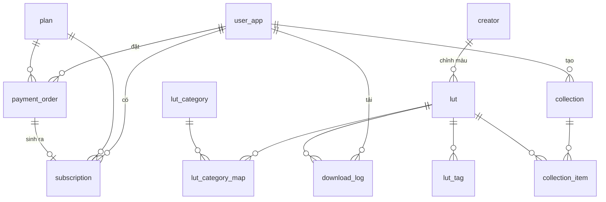

# Thiết kế tổng quát: cửa hàng LUT DownBeat

Tài liệu khung cho toàn bộ phần ecom: các bảng, quan hệ, nhóm API và thứ tự làm. Đây **không** phải plan để `/cook` trực tiếp. Mỗi lát ở §9 sẽ được lập plan riêng bằng `/plan-feature <slug>`, chép đúng phần bảng / API liên quan từ đây vào §4 / §5 của plan đó (hợp đồng chi tiết như body JSON, message lỗi, test case nằm ở plan lát).

Giao diện cửa hàng đã dựng xong với **dữ liệu giả** (`frontend/src/lib/mock/**`). Mỗi hàm giả có cùng chữ ký với hàm gọi API sau này; bảng ở §8 ghi hàm nào sẽ đổi sang endpoint nào.

## 1. Phạm vi

| Có trong thiết kế | Chưa làm (để sau) |
|---|---|
| Kho LUT: danh sách, lọc, tìm, danh mục, chi tiết, LUT liên quan, gợi ý tìm kiếm | Âm nhạc, hiệu ứng âm thanh, video stock (mục "Sắp ra mắt" ở sidebar) |
| Tài khoản khách: đăng ký bằng email, đăng nhập, quên mật khẩu (đã có OTP) | Đăng nhập Google / Facebook |
| Gói Miễn phí / Pro / Studio, mua gói qua **payOS** (VietQR), gia hạn, hết hạn | Tự trừ tiền định kỳ (payOS là chuyển khoản từng lần, §6.3) |
| Tải LUT có kiểm quyền: LUT ★ (Premium) cần gói trả phí còn hạn. **Không giới hạn số lượt tải** ở mọi gói | |
| Xem trước LUT bằng **ảnh trước / sau hoặc video**, quản trị chọn cho từng LUT | |
| Trang quản trị `/admin`: quản lý LUT, danh mục, tác giả, khách, đơn, dashboard | Thành viên nhóm của gói Studio (5 tài khoản) |
| Bộ sưu tập (lưu LUT yêu thích) | Giới thiệu bạn bè, blog |

## 2. Tác nhân

| Tác nhân | Là ai trong hệ thống | Làm được |
|---|---|---|
| Khách vãng lai | chưa đăng nhập | Xem kho, xem chi tiết, xem trước trước / sau, xem bảng giá |
| Thành viên Miễn phí | `user_app` có role **Khách hàng**, không có gói trả phí còn hạn | + tải LUT thường, lưu bộ sưu tập |
| Thành viên trả phí | như trên + `subscription` ACTIVE gói `pro` / `studio` | + tải LUT ★ |
| Quản trị | `user_app` có role quản trị (`is_operator` hoặc có permission) | Trang `/admin`: CRUD dữ liệu, xem đơn, dashboard |

Khách hàng và quản trị **dùng chung bảng `user_app`** và cùng luồng JWT (`/user/authenticate`, `/auth/refresh`). Phân biệt bằng role:

- Thêm role `Khách hàng` (`is_default = 1`, không có permission nào). Đăng ký mới tự gán role này.
- Role `Không quyền` của seed hiện tại đổi `is_default = 0`.
- Endpoint cho khách chỉ cần đăng nhập. Endpoint quản trị vẫn `checkPermission(...)` như cũ, nên khách gọi vào sẽ bị 403.

## 3. Kiến trúc

```
Frontend (React)                       Backend (Spring Boot, module business)        Lưu trữ
/luts, /luts/$slug,                    business.lut       (kho LUT, danh mục, tác giả) MySQL: bảng §4
/luts/danh-muc/$category, /pricing ──► business.account   (đăng ký, hồ sơ khách)      MinIO:
hộp thoại đăng nhập / đăng ký /        business.billing   (gói, đơn, subscription, payOS) - downbeat-public: ảnh bìa, ảnh trước/sau, video xem trước
nâng cấp / thanh toán                  business.download  (kiểm quyền + link tải)       - downbeat-lut (private): file .cube
/admin/** (quản trị)              ──►  business.collection, business.dashboard        Redis: cache danh mục, gói
```

- Thanh toán qua **payOS**: backend tạo link thanh toán, khách quét VietQR trên trang của payOS, payOS gọi webhook về backend để xác nhận. Khoá payOS (`PAYOS_CLIENT_ID`, `PAYOS_API_KEY`, `PAYOS_CHECKSUM_KEY`) chỉ nằm ở `backend/.env`, không bao giờ ở frontend.
- File `.cube` nằm trong bucket **private**. API tải trả **URL ký sẵn** (presigned, hết hạn sau 5 phút), nên không ai lấy được file nếu không qua kiểm quyền.
- Ảnh bìa, ảnh trước / sau và video xem trước nằm trong bucket public, URL lưu thẳng vào bảng.
- Theo `backend/AGENTS.md`: không DTO (body = entity POJO, cột JOIN thêm vào POJO), validate định dạng ở frontend, backend chỉ giữ quy tắc cần tra DB.

## 4. Cơ sở dữ liệu

Migration bắt đầu từ `V2__...` (đã có `V1__auth_schema.sql`). Tiền tệ là VND, lưu `bigint` (không có số lẻ). Thời gian dùng `datetime`. Trạng thái lưu bằng `varchar` + hằng số trong code (dễ đọc khi tra DB).



### 4.1 Kho LUT

**`creator`**: tác giả / nhà chỉnh màu.

| Cột | Kiểu | Ràng buộc / ghi chú |
|---|---|---|
| id | int PK AI | |
| name | varchar(100) | NOT NULL |
| slug | varchar(120) | UNIQUE |
| bio | varchar(500) | |
| avatar_url | varchar(500) | |
| status | tinyint | 1 = hiện, 0 = ẩn (xoá mềm) |
| created_time, updated_time | datetime | |

**`lut`**

| Cột | Kiểu | Ràng buộc / ghi chú |
|---|---|---|
| id | int PK AI | |
| slug | varchar(150) | UNIQUE. Sinh từ title (bỏ dấu), trùng thì thêm `-2`, `-3`… |
| title | varchar(150) | NOT NULL |
| description | varchar(1000) | |
| creator_id | int FK → creator | NOT NULL |
| style | varchar(30) | một trong `dien-anh, co-dien, phim-nhua, den-trang, teal-orange, am-ap, lanh, du-lich` (khớp `LUT_STYLES` ở FE) |
| is_premium | tinyint | 1 = LUT ★, cần gói trả phí |
| status | varchar(20) | `DRAFT` / `PUBLISHED` / `HIDDEN`. Kho chỉ hiện `PUBLISHED` |
| cover_url | varchar(500) | ảnh bìa (đã có chữ) |
| preview_type | varchar(20) | NOT NULL, DEFAULT `BEFORE_AFTER`. `BEFORE_AFTER` hoặc `VIDEO`, quản trị chọn khi thêm / sửa LUT (§5.4) |
| before_url, after_url | varchar(500) | ảnh trước / sau. **Bắt buộc khi** `preview_type = BEFORE_AFTER` |
| preview_video_url | varchar(500) | video đã áp LUT (mp4 / webm). **Bắt buộc khi** `preview_type = VIDEO` |
| file_key | varchar(300) | key file .cube trong bucket private. **Không trả về** ở API công khai |
| file_size_kb | int | |
| lut_size | smallint | 17 / 33 / 65 (kích thước lưới 3D) |
| download_count | int | DEFAULT 0, tăng khi tải (§6.2) |
| published_time | datetime | để sắp xếp "Mới nhất" |
| created_by | int FK → user_app | |
| created_time, updated_time | datetime | |

Index: `(status, published_time)`, `(status, download_count)`, `(creator_id)`, `(style)`. Tìm kiếm: `FULLTEXT(title, description) WITH PARSER ngram` cho tiếng Việt, kết hợp `LIKE` trên `creator.name` và `lut_tag.tag`.

**`lut_category`**: danh mục (trang `/luts/danh-muc/<slug>`).

| Cột | Kiểu | Ràng buộc / ghi chú |
|---|---|---|
| id | int PK AI | |
| slug | varchar(80) | UNIQUE |
| name | varchar(80) | NOT NULL |
| group_code | varchar(20) | `phong-cach` / `tong-mau` / `dip` / `phan-mem` |
| description | varchar(300) | mô tả đầu trang danh mục |
| is_popular | tinyint | hiện ở "Danh mục phổ biến" |
| sort_order | int | |
| status | tinyint | 1 / 0 |

**`lut_category_map`**: `lut_id` FK, `category_id` FK, PK `(lut_id, category_id)`. Xoá LUT thì xoá dòng map (CASCADE).

**`lut_tag`**: `lut_id` FK, `tag` varchar(50). PK `(lut_id, tag)`, index `(tag)`. Thẻ là từ khoá tự do (ví dụ "grain", "hoàng hôn") để tìm kiếm, không có trang riêng.

### 4.2 Gói và thanh toán

**`plan`**: seed bằng migration, quản trị chỉ sửa giá / mô tả.

| Cột | Kiểu | Ràng buộc / ghi chú |
|---|---|---|
| id | int PK AI | |
| code | varchar(20) | UNIQUE: `free`, `pro`, `studio` |
| name | varchar(50) | |
| audience | varchar(100) | "Nhà sáng tạo & freelancer"… |
| monthly_price | bigint | giá khi trả theo tháng |
| yearly_monthly_price | bigint | giá / tháng khi trả theo năm (thu 12 × giá này) |
| can_download_premium | tinyint | free = 0, pro / studio = 1 |
| max_members | int | 1 / 1 / 5 |
| license | json | mảng chuỗi "Giấy phép cho" |
| features | json | mảng chuỗi "Quyền lợi" |
| is_highlight | tinyint | nhãn "Phổ biến" |
| sort_order | int | |
| active | tinyint | |

**`payment_order`**: đơn mua gói.

| Cột | Kiểu | Ràng buộc / ghi chú |
|---|---|---|
| id | int PK AI | |
| code | varchar(20) | UNIQUE, server sinh: `DB` + yyMMdd + 4 số (ví dụ `DB2611050001`), hiện cho khách / quản trị |
| payos_order_code | bigint | UNIQUE. Mã đơn gửi sang payOS (payOS dùng mã số). Chốt cách sinh khi có tài liệu payOS |
| user_id | int FK → user_app | |
| plan_id | int FK → plan | |
| cycle | varchar(10) | `MONTH` / `YEAR` |
| amount | bigint | **server tính** từ `plan` (YEAR = 12 × yearly_monthly_price), không lấy từ client |
| status | varchar(20) | `PENDING` → `PAID` / `CANCELLED` / `EXPIRED` (link thanh toán hết hạn) |
| payos_payment_link_id | varchar(100) | id link thanh toán payOS trả về |
| checkout_url | varchar(500) | trang thanh toán payOS, FE chuyển khách sang đây |
| payos_reference | varchar(100) | mã giao dịch ngân hàng trong webhook (đối soát) |
| webhook_payload | json | bản webhook đã xác thực gần nhất (đối soát, gỡ lỗi) |
| paid_time | datetime | |
| created_time | datetime | |

Index: `(user_id, created_time)`, `(status, paid_time)` (dashboard doanh thu).

**`subscription`**: quyền dùng gói trả phí.

| Cột | Kiểu | Ràng buộc / ghi chú |
|---|---|---|
| id | int PK AI | |
| user_id | int FK → user_app | |
| plan_id | int FK → plan | |
| order_id | int FK → payment_order | đơn đã sinh ra kỳ này |
| cycle | varchar(10) | |
| status | varchar(20) | `ACTIVE` / `EXPIRED` / `CANCELLED` |
| start_date, end_date | date | end = start + 1 tháng / 12 tháng |
| auto_renew | tinyint | 1 mặc định; "Huỷ gói" đặt 0, vẫn dùng tới end_date |
| created_time, updated_time | datetime | |
| active_user_id | int | **cột sinh**: `IF(status = 'ACTIVE', user_id, NULL)`, UNIQUE. Mỗi khách có tối đa 1 gói ACTIVE |

Không có dòng `subscription` ACTIVE = gói Miễn phí (không lưu dòng cho gói free).

### 4.3 Tải và bộ sưu tập

**`download_log`**: `id`, `user_id` FK, `lut_id` FK, `plan_code` varchar(20) (gói lúc tải, để thống kê), `ip` varchar(45), `created_time`. Index `(user_id, created_time)`, `(lut_id, created_time)`.

**`collection`**: `id`, `user_id` FK, `name` varchar(100), `created_time`, `updated_time`. Unique `(user_id, name)`.

**`collection_item`**: `collection_id` FK (CASCADE), `lut_id` FK (CASCADE), `created_time`. PK `(collection_id, lut_id)`.

### 4.4 Phân quyền (bảng có sẵn)

Mỗi nhóm trang quản trị là một `resource` (uri khớp hằng `URI` trong controller), cấp cho role quản trị qua migration: `LUT` (`/lut/`), `LUT_CATEGORY` (`/lut-category/`), `CREATOR` (`/creator/`), `PLAN` (`/plan/`), `ORDER` (`/order/`), `CUSTOMER` (`/customer/`), `DASHBOARD` (`/dashboard/`).

## 5. API

Mọi endpoint dưới `/api`, response bọc `{ code, message, result }` như `ApiResponse` hiện có. Danh sách trả `{ total, page, items }` (khớp `PagedResult` ở FE). Endpoint công khai phải mở trong cấu hình security.

### 5.1 Công khai (không cần đăng nhập)

| Method · đường dẫn | Dùng ở | Ghi chú |
|---|---|---|
| `POST /lut/public/list` | lưới `/luts`, trang danh mục | body `{ q, keywords[], styles[], category, sort: relevance\|newest\|popular, page, limit }`. Chỉ LUT `PUBLISHED`. Item có `creatorName`, `categories[]` (slug), không có `fileKey` |
| `GET /lut/public/get?slug=` | trang chi tiết | 404 `DATA_NOT_FOUND` nếu không có / chưa xuất bản |
| `GET /lut/public/related?slug=&page=&limit=` | "Có thể bạn cũng thích" | cùng style trước, rồi cùng danh mục, rồi phổ biến |
| `GET /lut/public/suggest?q=&limit=4` | bảng gợi ý ở ô tìm kiếm header | q rỗng = LUT nổi bật (nhiều lượt tải) |
| `GET /lut-category/public/list` | khối danh mục, footer | cache Redis |
| `GET /lut-category/public/get?slug=` | đầu trang danh mục | 404 nếu không có |
| `GET /plan/public/list` | trang bảng giá, hộp thoại nâng cấp | cache Redis |

### 5.2 Tài khoản khách

| Method · đường dẫn | Ghi chú |
|---|---|
| `POST /account/register` | body `{ name, email, password }`. Tạo `user_app` role Khách hàng, trả **token như `/user/authenticate`** (đăng ký xong là đăng nhập luôn). Lỗi: email trùng |
| `POST /user/authenticate`, `/auth/refresh`, `/auth/logout`, `/auth/forgot-password`, `/auth/reset-password` | **có sẵn**, dùng chung với quản trị |
| `GET /account/me` | `{ id, name, email, plan: free\|pro\|studio, planExpiresAt }`. `plan` lấy từ subscription ACTIVE, không có thì `free` |

### 5.3 Tải LUT, mua gói, bộ sưu tập (cần đăng nhập)

| Method · đường dẫn | Ghi chú |
|---|---|
| `POST /lut/download` | body `{ lutId }` → `{ fileName, url }` (URL ký sẵn 5 phút). Kiểm quyền ở §6.2, ghi `download_log`, tăng `download_count` |
| `POST /order/create` | body `{ planCode, cycle }` → `{ code, amount, checkoutUrl }`. Backend tạo đơn `PENDING` rồi gọi payOS tạo link thanh toán (`returnUrl` = `/thanh-toan/ket-qua`, `cancelUrl` = `/thanh-toan/ket-qua?huy=1`) |
| `GET /order/get?code=` | trạng thái đơn của chính khách. Trang `/thanh-toan/ket-qua` gọi endpoint này, **không tin tham số payOS gắn trên URL** |
| `POST /order/cancel/{code}` | khách bấm huỷ trên trang payOS → đơn `CANCELLED` (chỉ khi còn `PENDING`) |
| `POST /payment/payos/webhook` | **công khai** (mở trong security), payOS gọi khi thanh toán xong. Xác thực chữ ký bằng `PAYOS_CHECKSUM_KEY`, sai thì 400 và không đổi gì. Đúng thì xử lý như §6.3 bước 3 |
| `POST /order/mock-pay/{code}` | **chỉ profile local**, dùng khi chưa có khoá payOS: đi thẳng tới bước 3 của §6.3 |
| `GET /order/my-list` | lịch sử mua gói của khách |
| `POST /subscription/cancel` | tắt tự gia hạn, gói vẫn dùng tới `end_date` |
| `GET /collection/my-list`, `POST /collection/update`, `POST /collection/delete/{id}`, `POST /collection/item/add`, `POST /collection/item/remove` | bộ sưu tập |

### 5.4 Quản trị (`checkPermission`)

Theo khuôn `/<x>/list | get | update | delete/{id}` của `backend/AGENTS.md`:

- `lut`: CRUD + `POST /lut/upload` (multipart: file .cube vào bucket private; ảnh và video vào bucket public; trả key / URL) + `POST /lut/publish/{id}`, `POST /lut/hide/{id}`. Upload phải thêm `mp4`, `webm` vào whitelist (tối đa 50 MB / video); vẫn không cho svg / html.
- Form thêm / sửa LUT có trường **"Kiểu xem trước"** (radio): "Ảnh trước / sau" hoặc "Video". Chọn "Ảnh trước / sau" thì hiện 2 ô tải ảnh "Ảnh trước" + "Ảnh sau"; chọn "Video" thì hiện ô tải "Video xem trước" (mp4 / webm). Đổi kiểu không xoá file đã tải của kiểu kia, nhưng chỉ kiểu đang chọn được dùng. FE kiểm kiểu đã chọn có đủ file. Backend kiểm lại khi **xuất bản** (`/lut/publish`): thiếu file của kiểu đang chọn thì báo `PREVIEW_MISSING`.
- `lut-category`, `creator`: CRUD.
- `plan`: `list`, `update` (không thêm / xoá gói).
- `order`: `list` (lọc trạng thái, khoảng ngày), `get`.
- `customer`: `list` (khách + gói hiện tại), `get` (đơn, lượt tải gần đây).
- `dashboard`: `GET /dashboard/summary?from=&to=` → doanh thu theo ngày / tháng, số đơn PAID, khách mới, gói đang ACTIVE theo loại, top 10 LUT tải nhiều, tỉ lệ LUT ★ / thường trong lượt tải.

### 5.5 Lỗi nghiệp vụ chung

| Tình huống | HTTP | `errorCode` | Message (FE hiện nguyên văn) |
|---|---|---|---|
| Email đăng ký đã có | 400 | `EMAIL_EXISTS` | Email đã được đăng ký |
| Sai email / mật khẩu | 401 | (có sẵn) | Email hoặc mật khẩu không đúng |
| Tải khi chưa đăng nhập | 401 | `UNAUTHORIZED` | Vui lòng đăng nhập để tải LUT |
| Tải LUT ★ khi không có gói trả phí | 403 | `PLAN_REQUIRED` | LUT Premium cần gói Pro hoặc Studio |
| LUT / danh mục không có hoặc chưa xuất bản | 404 | `DATA_NOT_FOUND` | Không tìm thấy LUT / Không tìm thấy danh mục |
| Mua đúng gói đang dùng còn hạn | 400 | `PLAN_ACTIVE` | Bạn đang dùng gói này |
| Huỷ / thanh toán đơn không còn PENDING | 400 | `ORDER_INVALID_STATUS` | Đơn hàng đã được xử lý |
| Không tạo được link payOS (lỗi mạng, sai khoá) | 502 | `PAYMENT_GATEWAY_ERROR` | Không kết nối được cổng thanh toán, vui lòng thử lại |
| Webhook sai chữ ký | 400 | `INVALID_SIGNATURE` | (không hiện cho khách; ghi log) |
| Xuất bản LUT thiếu file xem trước | 400 | `PREVIEW_MISSING` | LUT chưa có đủ ảnh / video xem trước |

FE đã rẽ nhánh theo `errorCode` (ví dụ `PLAN_REQUIRED` → mở hộp thoại nâng cấp), nên `errorCode` phải đúng như bảng.

## 6. Quy tắc nghiệp vụ

### 6.1 Danh sách và tìm kiếm
- Chỉ `status = PUBLISHED`. Sắp xếp: `relevance` (điểm FULLTEXT, rồi `download_count`), `newest` (`published_time` giảm dần), `popular` (`download_count` giảm dần).
- `q` và từng `keywords[]` là điều kiện AND, mỗi điều kiện khớp title / mô tả / tên tác giả / thẻ.

### 6.2 Tải LUT
1. Chưa đăng nhập → 401.
2. LUT không `PUBLISHED` → 404.
3. `is_premium = 1` và khách không có subscription `ACTIVE` với `end_date >= hôm nay` của gói `can_download_premium = 1` → 403 `PLAN_REQUIRED`.
4. Ghi `download_log`, `download_count = download_count + 1` (một câu UPDATE, không đọc rồi ghi), sinh presigned URL 5 phút.
5. **Không giới hạn số lượt tải** ở mọi gói (đã chốt). `download_log` chỉ để thống kê, không dùng để chặn.

### 6.3 Mua gói qua payOS
1. `order/create`: kiểm `PLAN_ACTIVE`, tính `amount` từ bảng `plan` (không lấy từ client), sinh `code` + `payos_order_code`, lưu `PENDING`, gọi payOS tạo link, lưu `payos_payment_link_id` + `checkout_url`, trả `checkoutUrl`. Gọi payOS lỗi thì đơn chuyển `CANCELLED`, trả `PAYMENT_GATEWAY_ERROR`.
2. FE chuyển khách sang `checkoutUrl`. Thanh toán xong hoặc huỷ, payOS đưa khách về `/thanh-toan/ket-qua`; trang này hỏi `GET /order/get?code=` mỗi 2 giây (tối đa khoảng 1 phút) tới khi đơn hết `PENDING`, rồi hiện "Thanh toán thành công" hoặc "Đơn đã huỷ".
3. **Webhook** (hoặc `mock-pay` ở local), trong một `@Transactional`:
   - Xác thực chữ ký. Tìm đơn theo `payos_order_code`; không thấy thì bỏ qua (trả 200 để payOS không gửi lại).
   - Đơn đã `PAID` thì **không làm gì** (payOS có thể gửi lại webhook). Chống trùng bằng `UPDATE ... SET status = 'PAID' WHERE id = ? AND status = 'PENDING'`: cập nhật 0 dòng nghĩa là đã xử lý rồi. Không dùng `Idempotency-Key` (theo quy tắc dự án).
   - Số tiền trong webhook khác `amount` của đơn thì không kích hoạt, ghi log để đối soát.
   - Kích hoạt gói: khách đang có subscription ACTIVE **cùng gói** thì cộng thêm kỳ vào `end_date`; **khác gói** (nâng cấp) thì đóng gói cũ (`CANCELLED`) và tạo gói mới bắt đầu hôm nay.
4. Job 00:10 mỗi ngày: subscription `ACTIVE` có `end_date < hôm nay` → `EXPIRED`; đơn `PENDING` quá 24 giờ → `EXPIRED`.
5. payOS là chuyển khoản từng lần nên **không tự trừ tiền định kỳ**. Khi gói còn 3 ngày, gửi email nhắc gia hạn (Mailpit ở local); khách gia hạn bằng cách mua lại gói đang dùng.

Chi tiết payOS (tên trường, cách ký, giới hạn độ dài mô tả, môi trường thử) chốt theo tài liệu người dùng cung cấp, ghi vào plan lát `goi-thanh-toan`.

### 6.4 Slug
Sinh từ title: bỏ dấu, `đ → d`, chữ thường, ký tự khác chữ / số → `-` (giống `slugify` ở `frontend/src/lib/mock/data/luts.ts`). Đổi title không đổi slug, để link cũ không hỏng.

## 7. Giao diện đã có (dữ liệu giả)

| Route | Nội dung |
|---|---|
| `/` | chuyển sang `/luts` |
| Xem trước | LUT `before-after`: thanh kéo so sánh. LUT `video`: trang chi tiết có video tự phát không tiếng; thẻ ở lưới có biểu tượng ▶ và phát video khi rê chuột (dữ liệu giả có 4 LUT video) |
| `/luts` | hero, thanh lọc (từ khoá, phong cách, sắp xếp; lưu trên URL), lưới LUT ("Xem thêm" rồi tự tải khi cuộn), danh mục phổ biến / tất cả danh mục, câu hỏi thường gặp, footer |
| `/luts/$slug` | chi tiết: thanh so sánh trước / sau kéo được, nút tải (LUT ★ hiện ghi chú cần gói), thông tin file, danh mục, LUT liên quan; khung chờ khi tải; 404 trong khung cửa hàng |
| `/luts/danh-muc/$category` | trang danh mục: tiêu đề, mô tả, thanh lọc + lưới chỉ LUT thuộc danh mục |
| `/pricing` | layout không sidebar: 3 gói, chọn chu kỳ tháng / năm, bảng so sánh, câu hỏi về thanh toán |
| Hộp thoại | đăng ký (kèm thẻ LUT khi bấm tải), đăng nhập, nâng cấp (LUT ★ + gói Miễn phí), xác nhận mua gói (ghi "Thanh toán qua payOS", hiện đang giả lập) |
| Header | ô tìm kiếm có bảng gợi ý (từ khoá phổ biến + 4 LUT khớp), menu tài khoản (gói, hạn, nâng cấp, đăng xuất) |
| `/admin` | trang quản trị (đổi tên từ `/crm`), chỗ đặt dashboard sau này |

Tài khoản thử (chỉ dữ liệu giả, mật khẩu `Admin@123`): `free@downbeat.local` (Miễn phí), `pro@downbeat.local` (Pro).

## 8. Đổi dữ liệu giả sang API

Khi lát backend xong, agy tạo `frontend/src/lib/axios/<x>.ts` cùng chữ ký rồi đổi import trong `lib/tanstack/options/*` và hook. Component không phải sửa.

| Hàm giả (`src/lib/mock/…`) | Endpoint |
|---|---|
| `luts.getLuts(req)` | `POST /lut/public/list` |
| `luts.getLut(slug)` | `GET /lut/public/get` |
| `luts.getRelatedLuts(slug, paging)` | `GET /lut/public/related` |
| `luts.getLutSuggestions(q)` | `GET /lut/public/suggest` |
| `luts.getLutCategories()` / `getLutCategory(slug)` | `GET /lut-category/public/list` / `get` |
| `account.getPlans()` | `GET /plan/public/list` |
| `account.register(req)` | `POST /account/register` |
| `account.login(req)` | `POST /user/authenticate` + `GET /account/me` |
| `account.checkout(userId, req)` | `POST /order/create` rồi chuyển sang `checkoutUrl` của payOS; thêm route `/thanh-toan/ket-qua` gọi `GET /order/get` |
| `account.requestLutDownload(lut, user)` | `POST /lut/download` |

Phiên khách hiện lưu ở `useShopSession` (`src/lib/stores/shop-session.ts`). Khi có API, phiên khách dùng token giống `useAuthStore` (chung luồng refresh) và lấy user từ `/account/me`. Dữ liệu `previewFilter` / `coverText` chỉ dùng cho ảnh giả; khi có ảnh thật thì dùng `before_url` / `after_url`. `previewType` (`before-after` / `video`) ở FE ứng với `preview_type` (`BEFORE_AFTER` / `VIDEO`) ở DB; hàm axios đổi qua lại.

## 9. Lộ trình: các lát cần lập plan

Mỗi dòng là một `/plan-feature <slug>`, làm theo thứ tự (lát sau dùng bảng của lát trước):

| # | Slug | Nội dung | Bảng | Phụ thuộc |
|---|---|---|---|---|
| 1 | `kho-lut` | API công khai §5.1 (trừ plan) + seed ~36 LUT / 16 danh mục từ dữ liệu giả + ảnh lên MinIO; FE đổi mock → API | creator, lut, lut_category, lut_category_map, lut_tag | — |
| 2 | `quan-ly-lut` | `/admin/luts`, `/admin/danh-muc`, `/admin/tac-gia`: CRUD, upload .cube + ảnh / video, chọn kiểu xem trước, xuất bản / ẩn | (dùng lại lát 1) + resource LUT, LUT_CATEGORY, CREATOR | 1 |
| 3 | `tai-khoan-khach` | đăng ký, `/account/me`, role Khách hàng, FE hộp thoại đăng nhập / đăng ký dùng API thật | (sửa role, user_app) | — |
| 4 | `goi-thanh-toan` | gói, đơn, **payOS** (tạo link, webhook, trang kết quả), subscription, job hết hạn + email nhắc gia hạn; `/admin/don-hang`. Cần tài liệu + khoá payOS trước khi lập plan | plan, payment_order, subscription | 3 |
| 5 | `tai-lut` | `POST /lut/download` + presigned URL + log; FE nút tải dùng API | download_log | 1, 4 |
| 6 | `dashboard-admin` | `/admin` thành dashboard: doanh thu, đơn, khách mới, gói, top LUT | (đọc các bảng trên) + resource DASHBOARD | 4, 5 |
| 7 | `bo-suu-tap` | bộ sưu tập của khách | collection, collection_item | 1, 3 |

Lát 1 và 3 làm song song được (không chung bảng).

## 10. Đã chốt và còn mở

Đã chốt (2026-11-05):

- **Thanh toán**: tích hợp **payOS**. Người dùng sẽ cung cấp tài liệu và khoá API; tới lúc đó giao diện dùng thanh toán giả lập.
- **Xem trước**: mỗi LUT chọn **ảnh trước / sau hoặc video** khi quản trị thêm / sửa (cột `preview_type`, §4.1, §5.4). Giao diện cửa hàng đã hiển thị được cả hai kiểu.
- **Lượt tải**: không giới hạn ở mọi gói.

Còn mở (chốt khi lập plan lát tương ứng):

1. **Nâng cấp giữa kỳ**: bản đầu không tính tiền chênh lệch (đóng gói cũ, mở gói mới). Có cần trừ phần còn lại không? (lát 4)
2. **Gói Studio 5 thành viên**: hiện chỉ ghi trên bảng giá. Làm thật cần bảng `team` / `team_member`, để sau lát 6.
3. **payOS khi demo đồ án**: dùng khoá thật với số tiền nhỏ, hay chỉ chạy `mock-pay` ở local? (lát 4)
