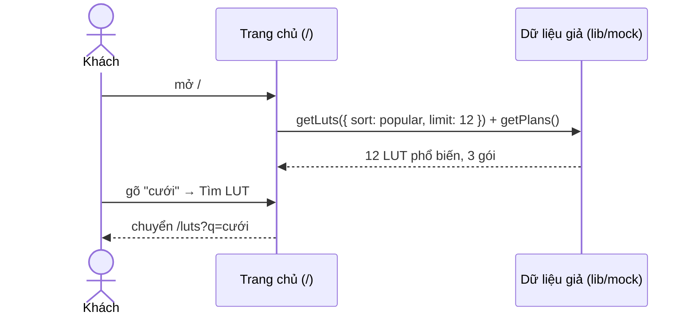

# Trang chủ (landing page cửa hàng)

## 1. Mục tiêu và phạm vi

Khách vào `/` thấy một trang giới thiệu DownBeat (thay vì bị chuyển thẳng sang `/luts`): giới thiệu kho LUT, các colorist, tính năng, giấy phép, bảng giá rút gọn, câu hỏi thường gặp, và dẫn sang kho LUT / bảng giá / đăng ký. Bố cục và nhịp các khối bám theo video tham khảo người dùng gửi (`Screen Recording 2026-11-05 125415.mp4`, trang chủ một kho tài nguyên sáng tạo, quay cả desktop 1870px và mobile 400px), nhưng **nội dung, thương hiệu, ảnh là của DownBeat** và xoay quanh LUT. Không chép logo, ảnh, câu chữ hay logo đối tác của trang trong video.

| Có làm | Không làm (để plan khác) |
|---|---|
| Route `/` hiển thị trang chủ, bỏ chuyển hướng sang `/luts` | API mới, backend (dữ liệu vẫn là giả ở `lib/mock/**`) |
| Header riêng của trang chủ (logo, menu loại tài nguyên giống video hiện khi cuộn qua hero, nút sáng / tối, nút tài khoản, menu mobile) | Trang "Về chúng tôi", trang tác giả, blog |
| 11 khối nội dung (§6) + footer có sẵn | Ảnh thật của DownBeat (dùng ảnh picsum **chọn sẵn theo id, đúng chủ đề**, §6) |
| Ô "Tìm màu bằng lời của bạn" chuyển sang `/luts?q=…` | Tìm kiếm ngữ nghĩa / AI thật (chỉ dùng tìm kiếm `q` đang có) |
| Bảng giá rút gọn dùng lại `PlanCard` + logic chọn gói của `/pricing` | Đổi giao diện `/pricing`, `/luts` (ngoài việc logo trỏ về `/`) |
| Responsive desktop / tablet / mobile 360–400px, giao diện sáng và tối, tôn trọng `prefers-reduced-motion` | Đổi footer (dùng nguyên `ShopFooter`) |

## 2. Tác nhân và phân quyền

| Tác nhân | Quyền | Ghi chú |
|---|---|---|
| Khách vãng lai | Xem toàn bộ trang chủ | Header hiện "Bảng giá", "Đăng ký", "Đăng nhập" |
| Thành viên (đã đăng nhập, dữ liệu giả) | Như trên | Header hiện menu tài khoản (`HeaderActions` có sẵn); nút chọn gói mở hộp thoại thanh toán thay vì đăng ký |

Không có resource / permission (trang công khai).

## 3. Luồng nghiệp vụ

**Luồng chính:** 1. Khách mở `/`. 2. Thấy hero, bấm một ô danh mục (vd "Phim nhựa") → `/luts/danh-muc/phim-nhua`, hoặc bấm "Khám phá kho LUT" → `/luts`.
**Luồng thay thế:**
- A1. Cuộn xuống: menu trên header hiện ra; bấm "LUTs" → `/luts`. Bấm mục chưa có (vd "Âm nhạc") thì đứng yên, hiện chú thích "Sắp ra mắt".
- A7. Bấm nút sáng / tối trên header → cả trang đổi giao diện (trừ 2 dải màu cố định).
- A2. Gõ mô tả vào ô "Tìm màu bằng lời của bạn" (hoặc bấm một gợi ý) rồi bấm "Tìm LUT" → `/luts?q=<nội dung>`.
- A3. Bấm thẻ colorist (vd "Analog Lab") → `/luts?q=Analog%20Lab`.
- A4. Bấm ảnh LUT trong khối ghép ảnh → trang chi tiết `/luts/<slug>`.
- A5. Ở khối bảng giá: khách chưa đăng nhập bấm "Chọn gói Pro" → hộp thoại đăng ký; đã đăng nhập → hộp thoại xác nhận mua gói (giống `/pricing`).
- A6. Bấm "Đăng ký" / "Đăng nhập" trên header → hộp thoại tương ứng (có sẵn).
**Ngoại lệ:**
- E1. Ô tìm bằng lời đang trống (hoặc chỉ có khoảng trắng) → nút "Tìm LUT" bị vô hiệu, không chuyển trang.
- E2. Dữ liệu LUT / gói đang tải → khung chờ (Skeleton) đúng kích thước, không nhảy bố cục.
- E3. Người dùng bật giảm chuyển động → băng chạy ngang, ảnh trôi, hiệu ứng gõ chữ đều tắt; nội dung vẫn xem / cuộn được đủ.

## 4. Cơ sở dữ liệu

Không có thay đổi. Không migration.

## 5. Hợp đồng API

**Không có endpoint mới.** Trang chủ chỉ đọc qua query options đã có (vẫn là dữ liệu giả, sau này tự đổi sang API theo `thiet-ke-tong-quat.md` §8):

| Dùng ở khối | Query options có sẵn | Tham số |
|---|---|---|
| Ghép ảnh LUT (§6 khối 5) | hàm giả `getLuts` qua một `queryOptions` mới trong `lib/tanstack/options/luts.ts`: `homeFeaturedLutsQueryOptions` (queryKey `["luts", "home-featured"]`) | `{ sort: "popular", paging: { page: 1, limit: 12 } }` |
| Bảng giá rút gọn (khối 9) | `plansQueryOptions` (`lib/tanstack/options/account.ts`) | — |

### 5.4 Lỗi nghiệp vụ

Không có. Query lỗi thì khối liên quan ẩn phần lưới (theo quy tắc "query không toast" của `frontend/AGENTS.md`), các khối khác vẫn hiện.

## 6. Giao diện (chuỗi cố định — test E2E chọn theo đúng các chuỗi này)

- Route: `/` (file `routes/index.tsx`), **không** có sidebar. `document.title` = "DownBeat | Kho LUT chỉnh màu cho nhà sáng tạo".
- Màu: dùng biến `--sh-*` để chạy được cả sáng và tối. Hai dải màu (khối 3 hồng, khối 8 xanh lá) giữ màu cố định ở cả hai giao diện, thêm 2 biến mới `--sh-band-pink: #f6b8d1`, `--sh-band-green: #22382a`; chữ trên dải hồng dùng `#151a20`, trên dải xanh dùng `#ffffff`.
- Font: tiêu đề dùng `font-display` (Space Grotesk, có sẵn), thân bài DM Sans. Chữ được tô ở khối 3 dùng font monospace hệ thống.
- Mỗi khối là `<section aria-labelledby>` trỏ tới tiêu đề của khối (test chọn bằng `getByRole("region", { name })`). Trang có đúng một `h1` (hero), các khối khác `h2`.
- Ảnh: dùng ảnh picsum **theo id cố định** (Claude đã xem và chọn từng ảnh cho đúng chủ đề), URL `https://picsum.photos/id/<id>/<w>/<h>` (picsum tự cắt giữa theo tỉ lệ). Thêm hàm `picsumId(id, w, h)` trong `home-data.ts`; **không dùng `picsum(seed)`** cho trang chủ vì ảnh theo seed là ngẫu nhiên, không hợp chủ đề. Kích thước yêu cầu = 2× kích thước hiển thị. Mọi `img` có `width`/`height` (không nhảy bố cục), `loading="lazy"` trừ ảnh hero; `alt=""` nếu ảnh chỉ trang trí, thẻ link có tên đọc riêng.

Nội dung tĩnh (danh sách ô, colorist, tính năng, FAQ…) gom vào `components/shop/home/home-data.ts`.

### Header trang chủ (`HomeHeader`)

- Dính trên cùng (`sticky top-0`), nền `--sh-bg`.
- Trái: `ShopLogo` (desktop đủ logo, mobile `compact`).
- Giữa-phải, chỉ ≥ `lg`: `<nav aria-label="Danh mục chính">` giống video, gồm 5 mục lấy từ `SHOP_NAV_GROUPS[0]` (`nav-config.ts`, theo `id`: `music`, `sfx`, `video`, `motion`, `luts`) để luôn khớp sidebar: "Âm nhạc", "Hiệu ứng âm thanh", "Video stock", "Đồ hoạ chuyển động", "LUTs". Chỉ hiện chữ (không icon), cỡ chữ nhỏ như video.
  - Mục có `to` ("LUTs") là `Link` tới `/luts`.
  - Mục chưa có `to`: làm giống sidebar (`<a href="#" aria-disabled="true">` + `preventDefault`), chữ màu `--sh-muted`, bọc `Tooltip` (có sẵn) nội dung "Sắp ra mắt" hiện khi rê chuột hoặc focus bàn phím.
  - **Ẩn khi nút "Khám phá kho LUT" của hero còn trong khung nhìn, hiện (mờ dần 200ms) khi đã cuộn qua** — dùng `IntersectionObserver`. Khi ẩn phải `invisible` (không chỉ `opacity-0`) để không bấm / tab được.
- Phải: `ThemeToggleButton` có sẵn (`sidebar-footer.tsx`, nhãn "Chuyển giao diện tối" / "Chuyển giao diện sáng") rồi tới `HeaderActions` ("Bảng giá", "Đăng ký", "Đăng nhập" hoặc menu tài khoản). Nút sáng / tối hiện ở mọi kích thước màn hình.
- < `lg`: thêm `MobileNav` có sẵn (nút "Mở menu") ở bên phải cùng. Trên mobile nút "Bảng giá" đã tự ẩn (`hidden sm:inline-flex`).

### Khối 1 — Hero

- `h1`: "Màu điện ảnh cho mọi khung hình"
- Đoạn dưới: "LUT chỉnh màu do colorist thật tạo ra, dùng được với mọi phần mềm dựng phim."
- 5 ô danh mục (link, ảnh dọc ~ 4:3.4 + nhãn ở dưới trên nền `--sh-surface`, rê chuột thì nhấc lên 4px). Desktop 5 cột, mobile 2 cột (ô thứ 5 nằm giữa hàng cuối). Tên đọc của link = nhãn:

| Nhãn | Link | Ảnh picsum id (nội dung) |
|---|---|---|
| Điện ảnh | `/luts/danh-muc/dien-anh` | `799` (cầu và nhà thờ về đêm, ánh tím neon) |
| Phim nhựa | `/luts/danh-muc/phim-nhua` | `250` (máy ảnh film cận cảnh) |
| Cổ điển | `/luts/danh-muc/co-dien` | `403` (máy đánh chữ cổ) |
| Đen trắng | `/luts/danh-muc/den-trang` | `318` (tháp Eiffel đen trắng; thêm `grayscale` cho chắc) |
| Du lịch | `/luts/danh-muc/du-lich` | `655` (xe van xanh du lịch) |

Kích thước tải: `picsumId(id, 400, 340)`.

- Hàng 4 cam kết, mỗi mục có dấu ✓ (lucide `Check`): "Bản quyền rõ ràng", "Hơn 5.000 nhà sáng tạo tin dùng", "Tải không giới hạn", "File .cube cho mọi phần mềm". Desktop 1 hàng, mobile xếp dọc.
- Nút chính (`ShopButton` primary): "Khám phá kho LUT" → `/luts`.
- Trang trí: 2 dải màu uốn lượn làm bằng CSS (gradient + `blur`/`mask`), `aria-hidden`: một dải hồng → xanh dương ở góc dưới trái, một dải hồng → cam ở góc trên phải; nằm dưới nội dung, không che chữ, không gây cuộn ngang.
  - *(sửa 2026-11-05 theo ảnh người dùng so với video)* Dải phải **thấy rõ như một dải lụa**, không phải đốm mờ: dải trái là một dải dọc uốn hình sóng (cao ~120% chiều cao hero, rộng ~260px desktop / ~140px mobile, tràn từ mép trái, kéo xuống chồng lên đầu khối 2), gradient hồng `--sh-pink` → xanh dương, độ đục ~0.8, blur ~24px ở mép (không blur cả dải tới mức thành đốm). Làm bằng SVG `path` + `linearGradient` + `feGaussianBlur` (hoặc CSS `clip-path`/`mask`). Dải phải nhỏ hơn, mờ hơn (~0.4). Không gây cuộn ngang (khối cha `overflow-x: clip`), không giảm tương phản chữ.

### Khối 2 — Nhà sáng tạo

- `h2` 2 dòng: "Màu sắc phía sau" / "những nhà sáng tạo nổi bật" (dòng 2 màu `--sh-accent`).
- Đoạn: "Từ vlog du lịch tới MV ca nhạc, rất nhiều video bạn yêu thích được chỉnh màu bằng DownBeat."
- Băng ảnh chân dung chạy ngang liên tục (ảnh 3:4, rộng ~240px desktop / ~150px mobile, tên ở góc dưới trái trên lớp phủ tối), ảnh `picsumId(id, 480, 640)`, 8 người theo thứ tự:

| Tên | Ảnh picsum id (nội dung) |
|---|---|
| Linh Vlog | `64` (cô gái đeo kính râm giữa cánh đồng) |
| Hùng Travel | `1005` (chàng trai quàng khăn, kính râm, nắng chiều) |
| Mai Films | `823` (cô gái mũ len đỏ đang chụp ảnh) |
| Tuấn Lens | `669` (chàng trai áo khoác vàng nhìn xa) |
| Ngọc Ánh | `996` (chân dung nghiêng trong nắng) |
| Khoa Studio | `453` (ca sĩ hát trên sân khấu, ánh đèn) |
| Bảo Trần | `832` (cô gái đọc sách) |
| Hà Phương | `836` (cô gái chơi guitar điện) |

  Lặp danh sách lần 2 để chạy vòng; **bản lặp `aria-hidden`**. Rê chuột thì dừng. Giảm chuyển động: không chạy, thành hàng cuộn ngang được.
- Hàng "Dùng được với" (nhãn nhỏ màu `--sh-muted`), dưới là 8 tên phần mềm dạng chữ lớn xám, desktop 1 hàng, mobile lưới 4 cột: "DaVinci Resolve", "Premiere Pro", "Final Cut Pro", "CapCut" (4 cái này là link tới `/luts/danh-muc/davinci-resolve`, `premiere-pro`, `final-cut-pro`, `capcut`), "After Effects", "Lightroom", "Photoshop", "OBS Studio" (chữ thường, không link). **Chỉ dùng chữ, không dùng logo** của các hãng.

### Khối 3 — Dải hồng giá trị

- Nền `--sh-band-pink`, chữ `#151a20`, căn giữa.
- `h2`: "Màu thật, từ người chỉnh màu thật"
- Đoạn (font monospace; 3 cụm trong ngoặc vuông được tô nền trắng bo góc 4px): "Chúng tôi đề cao [bàn tay con người] trong thời đại tự động hoá. Mỗi LUT trên DownBeat do [colorist thật] tạo ra, với [mức giá công bằng]."
- 2 nút nền trắng: "Khám phá kho LUT" → `/luts`; "Xem bảng giá" + icon `ArrowRight` → `/pricing`.

### Khối 4 — Colorist

- `h2` 2 dòng: "Nơi quy tụ những colorist" / "độc lập hàng đầu"; đoạn: "Màu chuẩn studio, giấy phép đơn giản."
- 7 thẻ dạng so le (desktop 4 cột masonry, chiều cao ảnh khác nhau; mobile 2 cột). Mỗi thẻ là link `/luts?q=<tên>`, ảnh phủ kín, tên đậm + mô tả 1–2 dòng ở đáy trên lớp phủ gradient tối:

| Tên | Mô tả | Ảnh picsum id (nội dung) |
|---|---|---|
| Minh Color | Colorist 10 năm cho MV và phim quảng cáo | `91` (người cầm máy ảnh hai ống kính, đen trắng) |
| Analog Lab | Tái hiện màu film Kodak, Fuji cổ điển | `454` (tay cầm máy ảnh film Yashica) |
| Mono Works | Chuyên đen trắng và tông tối tương phản | `1027` (chân dung nền tối; thêm `grayscale`) |
| Wander Grade | Màu du lịch, phong cảnh rực rỡ | `550` (người đứng ngắm thung lũng lúc hoàng hôn) |
| Wedding Tone | Tông mềm, ấm cho phim cưới | `325` (váy trắng trên cỏ) |
| Studio Kem | Pastel và tông lạnh nhẹ nhàng | `628` (cô gái cầm máy ảnh, tông sáng) |
| DownBeat Studio | Đội ngũ chỉnh màu của DownBeat | `531` (bàn làm việc với nhiều máy ảnh) |

Ảnh `picsumId(id, 480, h)` với `h` là 600 / 720 / 640 xen kẽ để các cột so le.

(Tên trùng tác giả trong dữ liệu giả, nên tìm `q` ra đúng LUT của người đó.)

### Khối 5 — Ghép ảnh LUT

- Desktop: chữ bên trái, cụm ảnh bên phải; mobile: chữ trên, cụm ảnh dưới.
- `h2` 2 dòng: "Sáng tạo," / "là bản năng của chúng tôi"; đoạn: "Những bộ LUT tuyển chọn theo trào lưu, làm ra để khơi cảm hứng."
- Cụm 12 ảnh bìa LUT phổ biến nhất (`homeFeaturedLutsQueryOptions`), đặt rải rác kích thước khác nhau (vị trí cố định theo thứ tự, ghi trong `home-data.ts` dạng `%`), xoay nhẹ ±4°, trôi lên xuống chậm (6–9s, lệch pha). Ảnh bìa dùng lại phần bìa của `lut-card.tsx` (ảnh + `coverText` + `previewFilter`), tách thành `LutCover` nếu cần. Mỗi ảnh là link `/luts/<slug>`, tên đọc = tiêu đề LUT (vd "Xanh Điện Ảnh"). Đang tải: 12 khung `Skeleton` ở đúng vị trí.
- *(sửa 2026-11-05 theo ảnh người dùng so với video — thay phần bố cục ở trên)*:
  - Cụm **không có nền / khung / bo góc** riêng: các ảnh nổi thẳng trên nền trang.
  - Bố cục **tự do, không thành hàng lối**: các ảnh đặt lệch nhau theo cả 2 trục, có khoảng trống giữa chúng (chỉ vài cặp chồng mép nhau ≤ 15%), tổng thể là một đám hình bầu dục thưa ở giữa vùng phải, không được trông như lưới 3×4.
  - 3 cỡ ảnh: lớn / vừa / nhỏ (rộng khoảng 26% / 21% / 17% bề rộng cụm), **vị trí và cỡ đều tính theo % bề rộng cụm** (không dùng `px`), để mobile co lại cùng tỉ lệ. Cụm có tỉ lệ cố định (vd `aspect-[5/4]`).
  - **Không ảnh nào bị cắt** bởi mép cụm: `left + width ≤ 100`, `top + chiều cao ≤ 100` cho cả 12 vị trí (cộng biên độ trôi 8px).
  - **Không xoay** (bỏ ±4°); vẫn trôi lên xuống chậm 6–9s lệch pha.
  - Ảnh bìa tỉ lệ 4:3 hoặc vuông, bo góc 8px, bóng đổ nhẹ. Chữ `coverText` phải **co theo cỡ ảnh** (vd `LutCover` thêm prop `size="sm"` dùng cỡ chữ ~40% bản thường) để không tràn khỏi ảnh nhỏ.

### Khối 6 — Tìm màu bằng lời

- Desktop: hộp bên trái, chữ bên phải; mobile: hộp trên.
- Chữ: `h2` 2 dòng "Tìm màu," / "bằng chính lời của bạn"; đoạn: "Mô tả cảnh quay hoặc cảm giác bạn muốn, DownBeat gợi ý ngay những LUT phù hợp."
- Hộp: nền gradient tím / hồng uốn sóng (CSS), ở giữa là thẻ trắng (cả hai giao diện) chứa:
  - `<form role="search" aria-label="Tìm màu bằng lời">`, ô nhập `aria-label="Mô tả video của bạn"`. Khi ô trống và chưa focus, placeholder tự gõ lần lượt: "Vlog du lịch Đà Lạt buổi sáng", "Phim cưới ngoài trời, tông ấm", "MV đêm thành phố ánh neon" (gõ ~50ms/ký tự, dừng 1,5s, xoá, câu tiếp). Giảm chuyển động: placeholder tĩnh "Vlog du lịch Đà Lạt buổi sáng".
  - 4 nút gợi ý (chip có viền): "Hoàng hôn", "Cưới", "Neon", "Vintage". Bấm → điền đúng chữ đó vào ô nhập và focus ô.
  - Nút tròn hồng icon `Send`, `aria-label="Tìm LUT"`, `disabled` khi ô trống / chỉ khoảng trắng. Submit (nút hoặc Enter) → `navigate({ to: "/luts", search: { q: <đã trim> } })`.

### Khối 7 — Băng tính năng

- `h2` 2 dòng: "Công cụ mạnh mẽ, cộng đồng" / "và sự an tâm".
- Băng thẻ cuộn ngang (`scroll-snap`, ẩn thanh cuộn), desktop thấy ~5,5 thẻ (rộng ~200px), mobile ~1,4 thẻ. 2 nút tròn chồng lên mép trái / phải: `aria-label="Trước"` / `aria-label="Sau"`, cuộn 1 trang; "Trước" `disabled` khi ở đầu, "Sau" `disabled` khi ở cuối.
- 8 thẻ, mỗi thẻ: vùng minh hoạ 4:3 (nền `--sh-surface` + icon lucide lớn + vài khối UI giả bằng div, không cần ảnh), tiêu đề `h3` 2 phần (phần 1 màu `--sh-fg`, phần 2 màu `--sh-accent`, nối bằng dấu cách nên tên đọc là cả câu), đoạn mô tả:

| Tiêu đề (phần 1 / phần 2) | Mô tả | Icon |
|---|---|---|
| Người thật, / hỗ trợ thật | Trò chuyện với đội ngũ DownBeat khi cần, không phải chatbot. | `Headset` |
| Không lo / bản quyền | Giấy phép rõ ràng cho từng gói, đăng video ở đâu cũng yên tâm. | `ShieldCheck` |
| Tìm kiếm / và bộ lọc thông minh | Lọc theo phong cách, từ khoá, độ phổ biến để chọn màu nhanh hơn. | `SlidersHorizontal` |
| So sánh / trước và sau | Kéo thanh trượt để thấy LUT đổi màu cảnh quay thế nào trước khi tải. | `Columns2` |
| Hàng chục / danh mục | Điện ảnh, phim nhựa, đám cưới, du lịch… đủ cho mọi thể loại video. | `LayoutGrid` |
| Lưu vào / bộ sưu tập | Đánh dấu LUT yêu thích và gom theo từng dự án. | `Bookmark` |
| Xem trước / bằng video | Một số LUT có video mẫu để bạn thấy màu khi chuyển động. | `PlayCircle` |
| Một file .cube, / mọi phần mềm | Dùng được với DaVinci Resolve, Premiere Pro, Final Cut Pro, CapCut. | `FileCode2` |

### Khối 8 — Dải xanh giấy phép

- Nền `--sh-band-green`, chữ trắng, căn giữa, phía trên tiêu đề là icon `HeartHandshake` cỡ 56px (`aria-hidden`).
- `h2`: "Cấp phép an tâm"
- Đoạn: "Mọi LUT trên DownBeat đều là sản phẩm gốc, do người thật tạo ra và được cấp phép đầy đủ, để bạn yên tâm đăng tải ở bất cứ đâu."
- Dòng đậm: "Không khiếu nại bản quyền. Không rủi ro pháp lý."

### Khối 9 — Bảng giá rút gọn

- `h2` 2 dòng: "Gói cho mọi kiểu" / "nhà sáng tạo".
- 3 `PlanCard` từ `plansQueryOptions`, chu kỳ **cố định "Theo tháng"** (không có nút chuyển), desktop 3 cột, mobile xếp dọc. Nhãn nút và hành vi giống hệt `/pricing`: "Bắt đầu miễn phí" / "Vào kho LUT" (gói Miễn phí), "Chọn gói Pro", "Chọn gói Studio". Logic chọn gói tách khỏi `pricing-page.tsx` thành hook dùng chung (§8).
- Dưới lưới: link "So sánh chi tiết các gói" + icon `ArrowRight` → `/pricing`.
- Đang tải: 3 `Skeleton` cao bằng thẻ.

### Khối 10 — Lời mời cuối

- Nền `--sh-surface`, bo góc 16px, desktop 2 cột (chữ trái, ảnh phải), mobile xếp dọc.
- `h2` 2 dòng: "Kể câu chuyện của bạn" / "bằng màu sắc"; nút primary "Bắt đầu miễn phí" → mở hộp thoại đăng ký (`useShopDialog().open({ type: "register" })`); **đã đăng nhập** thì nút đổi thành "Khám phá kho LUT" → `/luts`.
- Phải: 3 ảnh chồng nhau lệch nhau, `alt=""`: ảnh 1 dọc lớn `picsumId(65, 440, 560)` (cô gái tóc bay trong nắng chiều), ảnh 2 vuông `picsumId(839, 400, 400)` (cô gái đạp xe trên đường quê), ảnh 3 nhỏ có viền trắng 4px `picsumId(129, 320, 400)` (đôi bạn ngồi ghế băng nhìn hoàng hôn).
- Đáy: dải sóng gradient hồng → cam (SVG `path`, `aria-hidden`).
- *(sửa 2026-11-05 theo ảnh người dùng so với video — thay dòng "Nền `--sh-surface`, bo góc" và dòng "Đáy" ở trên)*:
  - Khối **tràn hết bề ngang**, nền `--sh-bg`, **không** thẻ / bo góc / nền `--sh-surface`. Nội dung vẫn giới hạn `max-w-6xl` ở giữa.
  - `h2` to hơn các khối khác: `md:text-5xl lg:text-6xl`, 2 dòng; nút cỡ lớn (`h-12 px-8`).
  - Cụm 3 ảnh lớn hơn: rộng ~560px desktop (~90% màn hình trên mobile), ảnh bo góc 4px, ảnh 3 viền 4px màu `--sh-bg` (không dùng `dark:`).
  - Đáy: **dải sóng lớn tràn hết bề ngang** cao ~220px desktop / ~120px mobile, nhiều đỉnh sóng mềm (≥ 4 đỉnh trên desktop), gradient dọc hồng `--sh-pink` (trên) → hồng cam `#e8968f` (dưới), mép trên viền mờ hạt (SVG `feTurbulence` + `feDisplacementMap`, hoặc `feGaussianBlur` + lớp nhiễu). Dải nằm **dưới** ảnh: ảnh 3 chồng lên dải sóng. Không gây cuộn ngang.

### Khối 11 — Câu hỏi thường gặp

- `h2`: "Câu hỏi thường gặp". 6 câu, mỗi câu là nút (dùng `Collapsible` có sẵn) có `aria-expanded`, icon `ChevronDown` xoay khi mở; mặc định đóng hết, mở câu này không đóng câu khác. Chiều rộng tối đa ~720px, căn giữa, đường kẻ giữa các câu.

| Câu hỏi | Trả lời |
|---|---|
| DownBeat là gì? | DownBeat là kho LUT chỉnh màu cho video và ảnh, do các colorist độc lập tạo ra. Bạn tải file .cube về, áp vào phần mềm dựng phim là xong. |
| DownBeat có miễn phí không? | Có. Tài khoản Miễn phí tải không giới hạn các LUT thường. LUT có dấu ★ cần gói Pro hoặc Studio. |
| LUT trên DownBeat có an toàn bản quyền không? | Có. Mọi LUT đều có giấy phép rõ ràng theo gói, dùng được cho video đăng trên mọi nền tảng. |
| Tôi dùng LUT với phần mềm nào được? | Mọi phần mềm đọc được file .cube: DaVinci Resolve, Premiere Pro, Final Cut Pro, CapCut, Lightroom… |
| Thanh toán gói như thế nào? | Quét mã VietQR qua payOS từ mọi ngân hàng, gói được kích hoạt ngay sau khi thanh toán. |
| Tôi dùng DownBeat cho khách hàng được không? | Được, với gói Pro hoặc Studio. Gói Miễn phí chỉ dành cho video cá nhân. |

### Footer

`ShopFooter` có sẵn, không sửa.

### Thay đổi ngoài trang chủ

- `ShopLogo` trỏ về `/` (đang trỏ `/luts`); `aria-label` giữ "DownBeat - về trang chủ".

### Chuyển động và trợ năng (bắt buộc)

- Keyframe mới đặt trong `shop-theme.css` (`shop-marquee`, `shop-float`), tất cả tắt trong `@media (prefers-reduced-motion: reduce)`; hiệu ứng gõ chữ kiểm tra `matchMedia("(prefers-reduced-motion: reduce)")`.
- Không cuộn ngang ở 360px (`document.documentElement.scrollWidth <= innerWidth`): các dải trang trí phải nằm trong vùng `overflow-hidden`.
- Thứ tự Tab theo thứ tự hiển thị; mọi nút / link có vòng focus thấy được (`focus-visible:ring-2` màu `--sh-pink`).
- Chữ trên ảnh (khối 2, 4) có lớp phủ đủ tối để đạt tương phản 4.5:1.

## 7. Việc backend (Codex)

**Không có.** Lát này không giao Codex.

## 8. Việc frontend (agy)

Thư mục mới `src/components/shop/home/`. File theo thứ tự:

1. `src/components/shop/shop-theme.css`: thêm `--sh-band-pink`, `--sh-band-green` (cùng giá trị ở sáng và tối), keyframe `shop-marquee`, `shop-float` + khối reduced-motion.
2. `src/lib/tanstack/options/luts.ts`: thêm `homeFeaturedLutsQueryOptions` (§5).
3. `src/components/shop/pricing/use-plan-select.ts`: tách `select(plan)` và `ctaLabel(plan)` từ `pricing-page.tsx` thành hook `usePlanSelect(cycle)`; sửa `pricing-page.tsx` dùng hook này (hành vi `/pricing` giữ nguyên). **Không đụng phần đang sửa dở của người dùng trong `plan-card.tsx`** (file đang có thay đổi chưa commit).
4. `src/components/shop/luts/lut-card.tsx`: nếu cần, tách phần bìa thành `LutCover` (export) để khối 5 dùng lại; `LutCard` dùng `LutCover`, giao diện `/luts` không đổi.
5. `src/components/shop/home/home-data.ts`: hàm `picsumId` + toàn bộ nội dung tĩnh ở §6 (ô hero, cam kết, nhà sáng tạo, phần mềm, colorist, vị trí ghép ảnh, gợi ý tìm, tính năng, FAQ), **đúng id ảnh đã ghi**, không tự đổi ảnh.
6. Các khối, mỗi khối một file: `hero-section.tsx`, `creators-section.tsx`, `values-band.tsx`, `authors-section.tsx`, `collage-section.tsx`, `prompt-search-section.tsx`, `features-carousel.tsx`, `license-band.tsx`, `plans-section.tsx`, `story-cta.tsx`, `home-faq.tsx`.
7. `src/components/shop/home/home-header.tsx` (nhận ref / id của nút CTA hero để quan sát; menu đọc từ `SHOP_NAV_GROUPS`; có `ThemeToggleButton`) và `home-page.tsx` (ghép header + các khối + `ShopFooter` trong `ShopShell`).
8. `src/routes/index.tsx`: bỏ `redirect`, render `HomePage`, đặt `document.title` như §6.
9. `src/components/shop/layout/shop-logo.tsx`: `to="/"`.

Component shadcn dùng (skill `shadcn` ở `.agents/skills/`): có sẵn trong `components/ui/`: `collapsible`, `skeleton`, `tooltip`; nút dùng `ShopButton`. Không cần `shadcn add`. Không thêm thư viện carousel / animation (dùng CSS + `scroll-snap`).

Nghiệm thu: `pnpm build`, `pnpm lint` xanh; tự mở `/` ở 1440px và 400px, sáng và tối, chụp so với video trước khi báo `worker_done`.

## 9. Test case

Tất cả loại `e2e`, viết trong `frontend/tests/e2e/trang-chu.spec.ts`. Không có `api` / `unit` vì lát không có backend. Viewport mặc định 1440×900 trừ khi ghi khác. Tài khoản giả: `free@downbeat.local` / `Admin@123`.

| ID | Loại | Mô tả | Tiền điều kiện | Bước | Kết quả mong đợi |
|---|---|---|---|---|---|
| TC-01 | e2e | Mở `/` ra trang chủ, không chuyển hướng | Chưa đăng nhập | `goto("/")` | URL vẫn `/`; title "DownBeat \| Kho LUT chỉnh màu cho nhà sáng tạo"; đúng 1 `h1` "Màu điện ảnh cho mọi khung hình"; có các region "Màu sắc phía sau những nhà sáng tạo nổi bật", "Màu thật, từ người chỉnh màu thật", "Câu hỏi thường gặp" |
| TC-02 | e2e | Ô danh mục ở hero | — | Đếm link trong region hero có tên "Điện ảnh", "Phim nhựa", "Cổ điển", "Đen trắng", "Du lịch"; bấm "Phim nhựa" | Đủ 5 link; sau khi bấm URL `/luts/danh-muc/phim-nhua` |
| TC-03 | e2e | Hero: cam kết + nút chính | — | Đọc hero; bấm "Khám phá kho LUT" trong hero | Thấy 4 chuỗi "Bản quyền rõ ràng", "Hơn 5.000 nhà sáng tạo tin dùng", "Tải không giới hạn", "File .cube cho mọi phần mềm"; URL `/luts` |
| TC-04 | e2e | Menu header ẩn ở đầu trang, hiện khi cuộn | Viewport 1440 | Ở đầu trang kiểm tra nav "Danh mục chính"; cuộn tới region khối 2; bấm "LUTs" | Ban đầu link "LUTs" không visible; sau khi cuộn nav có đúng 5 mục "Âm nhạc", "Hiệu ứng âm thanh", "Video stock", "Đồ hoạ chuyển động", "LUTs" theo thứ tự; URL `/luts` |
| TC-04b | e2e | Mục menu chưa có | Viewport 1440, đã cuộn qua hero | Rê chuột vào "Âm nhạc"; bấm "Âm nhạc" | Mục có `aria-disabled="true"`; hiện tooltip "Sắp ra mắt"; URL vẫn `/` |
| TC-05 | e2e | Nút tài khoản trên header (khách) | Chưa đăng nhập | Bấm "Đăng ký"; đóng; bấm "Đăng nhập"; đóng; bấm "Bảng giá" | Mở đúng hộp thoại đăng ký rồi đăng nhập (như `shop-flows.spec.ts`); URL `/pricing` |
| TC-06 | e2e | Header khi đã đăng nhập | Đăng nhập `free@downbeat.local` | Mở `/` | Không còn nút "Đăng ký"; có nút menu tài khoản chứa tên người dùng |
| TC-07 | e2e | Logo về trang chủ | — | `goto("/luts")`, bấm link "DownBeat - về trang chủ" | URL `/` |
| TC-08 | e2e | Băng nhà sáng tạo + phần mềm | — | Trong region khối 2: lấy tên người không nằm trong phần `aria-hidden`; bấm link "DaVinci Resolve" | Đọc được đúng 8 tên (mỗi tên 1 lần cho trình đọc màn hình); không có ảnh `img` nào là logo hãng; URL `/luts/danh-muc/davinci-resolve` |
| TC-09 | e2e | Dải hồng | — | Trong region "Màu thật, từ người chỉnh màu thật" bấm "Xem bảng giá" | Thấy cụm "bàn tay con người", "colorist thật", "mức giá công bằng"; URL `/pricing` |
| TC-10 | e2e | Thẻ colorist dẫn tới tìm kiếm | — | Đếm link trong region khối 4; bấm "Analog Lab" | Có 7 link; URL `/luts?q=Analog+Lab` (hoặc `%20`); lưới thấy "Kodak 400", không thấy "Noir" |
| TC-11 | e2e | Ghép ảnh LUT phổ biến | — | Chờ region "Sáng tạo, là bản năng của chúng tôi" hết Skeleton; đếm link; bấm "Xanh Điện Ảnh" | 12 link; có "Xanh Điện Ảnh" và "Vlog Tươi" (2 LUT nhiều lượt tải nhất); URL `/luts/xanh-dien-anh` |
| TC-12 | e2e | Tìm bằng lời: trống thì không cho tìm | — | Ô "Mô tả video của bạn" trống; điền "   " | Nút "Tìm LUT" disabled ở cả hai lần; URL vẫn `/` |
| TC-13 | e2e | Tìm bằng lời: gõ rồi tìm | — | Điền "cưới", bấm "Tìm LUT" | URL `/luts?q=cưới` (đã mã hoá); lưới có "Ngày Cưới" |
| TC-14 | e2e | Tìm bằng lời: bấm gợi ý + Enter | — | Bấm gợi ý "Neon"; nhấn Enter | Ô nhập có giá trị "Neon" và đang focus; URL `/luts?q=Neon`; lưới có "Neo Tokyo" |
| TC-15 | e2e | Băng tính năng | Viewport 1440 | Trong region "Công cụ mạnh mẽ, cộng đồng và sự an tâm": kiểm tra nút; bấm "Sau" tới khi disabled | Có 8 `h3`; ban đầu "Trước" disabled, "Sau" enabled; sau khi bấm "Sau" thì "Trước" enabled; cuối cùng "Sau" disabled và `h3` "Một file .cube, mọi phần mềm" visible |
| TC-16 | e2e | Dải xanh giấy phép | — | Đọc region "Cấp phép an tâm" | Thấy "Không khiếu nại bản quyền. Không rủi ro pháp lý." |
| TC-17 | e2e | Bảng giá rút gọn — khách | Chưa đăng nhập | Region "Gói cho mọi kiểu nhà sáng tạo": đọc 3 thẻ; bấm "Chọn gói Pro"; đóng hộp thoại; bấm "So sánh chi tiết các gói" | Có "Miễn phí", "Pro", "Studio"; thẻ Pro hiện giá tháng "99.000"; không có nút "Theo năm"; bấm chọn gói mở hộp thoại đăng ký; URL `/pricing` |
| TC-18 | e2e | Bảng giá rút gọn — đã đăng nhập | Đăng nhập `free@downbeat.local` | Bấm "Chọn gói Pro" ở khối 9 | Mở hộp thoại xác nhận mua gói (cùng hộp thoại như khi bấm ở `/pricing`), chu kỳ tháng |
| TC-19 | e2e | Lời mời cuối | Chưa đăng nhập, rồi đăng nhập | Region "Kể câu chuyện của bạn bằng màu sắc": bấm "Bắt đầu miễn phí"; sau đó đăng nhập `free@downbeat.local`, mở lại `/` | Khách: mở hộp thoại đăng ký. Đã đăng nhập: nút là "Khám phá kho LUT", bấm → `/luts` |
| TC-20 | e2e | FAQ mở / đóng | — | Bấm "DownBeat có miễn phí không?"; bấm "Thanh toán gói như thế nào?"; bấm lại câu đầu | Sau bước 1 `aria-expanded="true"` và thấy "LUT có dấu ★ cần gói Pro hoặc Studio"; bước 2 cả hai cùng mở; bước 3 câu đầu `aria-expanded="false"`, câu trả lời ẩn |
| TC-21 | e2e | Mobile 400px | Viewport 400×860 | Mở `/`; đo bố cục; bấm "Mở menu" | Có "Đăng ký", "Đăng nhập", nút "Mở menu"; không có nav "Danh mục chính" visible; 5 ô hero xếp 2 cột (ô 1 và 2 cùng `y`); `scrollWidth <= innerWidth` sau khi cuộn hết trang; menu mobile mở có link "LUTs" |
| TC-22 | e2e | Giảm chuyển động | `emulateMedia({ reducedMotion: "reduce" })` | Mở `/`, đọc `getComputedStyle` của dải chạy khối 2 và 1 ảnh khối 5 | `animationName` là `none` ở cả hai; placeholder ô tìm là "Vlog du lịch Đà Lạt buổi sáng" và không đổi sau 3 giây |
| TC-23 | e2e | Nút sáng / tối trên header | Giao diện sáng (như `shop-ui.spec.ts` đặt theme) | Mở `/`; bấm "Chuyển giao diện tối"; tải lại trang | Sau khi bấm: `html` có class `dark`, nền header khác trắng, nút đổi nhãn thành "Chuyển giao diện sáng"; dải hồng vẫn nền `rgb(246, 184, 209)`, dải xanh `rgb(34, 56, 42)`; tải lại vẫn tối |
| TC-24 | e2e | Ảnh đúng nguồn đã chọn | — | Đọc `src` ảnh trong hero và khối 2 | Ảnh ô "Phim nhựa" chứa `picsum.photos/id/250/`; ảnh "Mai Films" chứa `/id/823/`; không ảnh nào của trang chủ dùng dạng `picsum.photos/seed/` (trừ bìa LUT ở khối 5, lấy từ dữ liệu LUT) |

Ngoài ra Claude sửa test cũ trong `shop-flows.spec.ts` (dòng `goto("/")` đang chờ chuyển sang `/luts`) cho khớp hành vi mới.

## 10. Tiêu chí hoàn thành

- [x] Mọi TC ở §9 pass, các spec cửa hàng cũ (`shop-flows`, `shop-ui`) vẫn pass
- [x] `pnpm build`, `pnpm lint` xanh
- [x] Ảnh chụp desktop + mobile (sáng, tối) để so với video
- [x] Có `docs/chuc-nang/trang-chu.md`

## 11. Rủi ro / câu hỏi mở

Đã chốt với người dùng (2026-11-05):

1. **Menu header giống video**: "Âm nhạc", "Hiệu ứng âm thanh", "Video stock", "Đồ hoạ chuyển động", "LUTs"; mục chưa có hiện tooltip "Sắp ra mắt" như sidebar.
2. **Giao diện**: theo nút đổi sáng / tối (đặt trên header trang chủ), không ép tối.
3. **Ảnh**: ảnh picsum chọn sẵn theo id cho đúng bối cảnh từng khối (§6). Picsum ít ảnh chân dung nên vài ảnh chụp từ sau lưng / nghiêng; khi có ảnh thật chỉ cần đổi id / URL trong `home-data.ts`.
4. **Số liệu và tên minh hoạ** ("Hơn 5.000 nhà sáng tạo tin dùng", tên nhà sáng tạo khối 2): giữ.
5. **Tìm bằng lời**: chấp nhận tìm giả khớp nguyên cụm `q` (câu dài có thể ra 0 kết quả tới lát `kho-lut`); chip gợi ý dùng từ ngắn.

Còn lưu ý:

6. Lát chỉ có frontend nên `/cook` chỉ giao agy (không giao Codex), không cần backend :9200 để chạy E2E.
7. Ảnh tải từ picsum.photos lúc chạy: mất mạng thì ô ảnh trống (giữ nền `--sh-surface` để không vỡ bố cục).

## 12. Nhật ký thực hiện (do /cook và /doc-chuc-nang ghi — nối các phiên A/B/C)

| Thời điểm | Sự kiện |
|---|---|
| 2026-11-05 | Lập plan (draft) từ video tham khảo |
| 2026-11-05 | Chốt 5 câu hỏi §11: menu giống video, nút sáng / tối, ảnh picsum chọn theo id, giữ số liệu minh hoạ, chấp nhận tìm giả |
| 2026-11-05 | Người dùng duyệt → `approved` |
| 2026-11-05 | Phiên A: `status: in-progress`. Preflight: Orca ready; Docker / backend :9200 bỏ qua (lát chỉ frontend, §11.6). File bẩn có sẵn trước khi giao: `frontend/AGENTS.md`, `frontend/public/favicon.ico`, `plan/README.md` |
| 2026-11-05 | Claude viết `frontend/tests/e2e/trang-chu.spec.ts` (26 test: TC-01…TC-24 + TC-04b + TC-22b "có chuyển động khi không giảm chuyển động", thêm để chắc băng khối 2 thật sự chạy). Không có nhóm "API" (không endpoint). Sửa `shop-flows.spec.ts`: test "/ chuyển về /luts" → "/ là trang chủ" |
| 2026-11-05 | Task spec: `plan/tasks/trang-chu-fe.md`. Không giao Codex (§7 trống) |
| 2026-11-05 | Orca run `run_94559aaee3f0`, coordinator `term_e365d44f-aff4-44ba-816a-c3266f4b9ce6`. agy: dispatch `ctx_27458a7cd08a`, task `task_93dcd070fabe`, terminal `term_ccdf3566-3eea-4d27-baa5-0f2d3feb6bbd` (gemini-3.8-flash-high, turnStart observed) |
| 2026-11-05 | **phiên A xong** — phiên B chỉ chờ 1 dispatch (agy), bỏ bước 5 (review BE) |
| 2026-11-05 | Phiên B: agy `worker_done` (outcome succeeded, 21 file, tự báo build/lint xanh, E2E trang-chu 26/26, shop-flows 24/24). Bắt đầu review FE |
| 2026-11-05 | Review FE vòng 1 (Claude chạy lại): build xanh, lint 0 lỗi; E2E trang-chu + shop-flows 49/50: TC-15 đỏ khi chạy song song (nút "Sau" không disabled), chạy riêng ×3 thì xanh |
| 2026-11-05 | Người dùng gửi ảnh so với video: khối 5 (cụm ảnh thành lưới, bị cắt), khối 10 (thẻ bo góc, sóng mờ), hero (đốm mờ thay vì dải lụa). Claude sửa plan §6 khối 1, 5, 10 (đoạn "sửa 2026-11-05"); không chạm hợp đồng khác, không cần báo Codex (không giao) |
| 2026-11-05 | Giao `plan/tasks/trang-chu-fe-fix1.md` (9 mục: 3 giao diện + TC-15 không ổn định, nút carousel chồng mép, thẻ tìm kiếm luôn trắng, hồi quy reduced-motion `.shop-progress`, LutCard dùng chung bìa, lặp JSX khối 2): dispatch `ctx_c6d2aa3ce085`, task `task_9ef2ee3b2e08`, cùng terminal agy |
| 2026-11-05 | Người dùng cho phép: nếu fix1 của agy không đạt thì Claude tự sửa `frontend/src` (ngoại lệ quy tắc "Claude không code nghiệp vụ"), không giao fix2 |
| 2026-11-05 | agy fix1 `worker_done` (succeeded, 9 file). Claude kiểm lại: build xanh, lint 0 lỗi, E2E 50/50, TC-15 ×10 song song xanh, không cuộn ngang 1440/400. Khối 5, 10 đạt; khối 1 **chưa đạt** (dải lụa SVG bị `-z-10` đẩy xuống dưới nền `ShopShell`, không thấy) |
| 2026-11-05 | Claude tự sửa (người dùng đã cho phép): `hero-section.tsx` thêm `isolate` cho section + `mask-image` mờ đáy 2 dải lụa; `lut-card.tsx` `LutCover` thêm `@container`, chữ bìa `@max-[140px]:scale-50` (ảnh "md" của cụm khối 5 tràn chữ ở 400px) |
| 2026-11-05 | Bước 7: E2E có giao diện trang-chu **26/26 pass** (slowMo 400, ảnh tài liệu `docs/chuc-nang/img/trang-chu/`, 9 ảnh); shop-flows 24/24. Worker released (`ctx_27458a7cd08a`, `ctx_c6d2aa3ce085`). Vòng sửa FE: 1 (agy) + 1 bản sửa nhỏ của Claude. Lệch plan: §6 khối 1, 5, 10 sửa theo ảnh người dùng; khối 5 bỏ xoay ±4°. Còn tồn: sóng khối 10 chỉ 1–2 đỉnh, chưa có hạt nhiễu (plan ghi ≥ 4 đỉnh) — chấp nhận, ghi vào tài liệu |
| 2026-11-05 | **phiên B xong** |
| 2026-11-05 | Phiên C: viết `docs/chuc-nang/trang-chu.md`, plan → `done`. Tồn: `frontend/tests/` bị `.gitignore` nên spec E2E không nằm trong commit |
| 2026-11-05 | Sau PR: người dùng gửi 2 video so sánh, bảo **Claude tự sửa** giao diện cho giống bản tham chiếu nhất (không giao agy). Đo trên khung 1858×996, so từng khối. Đổi: token riêng `.shop-home` (nền xen kẽ #1d232c / #151a20 ở giao diện tối); header trong suốt ở đầu trang, menu dời sang phải, hiện khi tiêu đề hero khuất; dải lụa hero dùng ảnh người dùng đưa (`public/hero-wave-{upper,lower}.webp`); tiêu đề h1/h2 trang chủ dùng Chivo Mono 800; thẻ hero 272×232 + nhãn 62px, thẻ nhà sáng tạo 360×540, colorist 308px góc vuông, ghép ảnh ô vuông, ô tìm bằng lời 654×367, băng tính năng tràn bề ngang (thẻ 296px, tranh minh hoạ `feature-art.tsx`), `PlanCard` thêm kiểu `home`, sóng khối "Kể câu chuyện" mép hạt (`grain-filter.tsx`). Nút sáng/tối giữ nguyên. Sửa TC-15 (bấm "Sau" có timeout, tránh treo khi nút vừa tắt). trang-chu + shop-flows **50/50 pass**; build xanh, lint 0 lỗi. Ảnh tài liệu `docs/chuc-nang/img/trang-chu/` chưa chụp lại |
| 2026-11-05 | Phiên C (cập nhật PR #1): chụp lại 9 ảnh tài liệu theo giao diện mới (trang-chu 26/26 pass), cập nhật `docs/chuc-nang/trang-chu.md` §3, §5, §6, §8. Spec E2E (sửa TC-15) vẫn nằm ngoài commit do `frontend/tests/` bị `.gitignore` |
