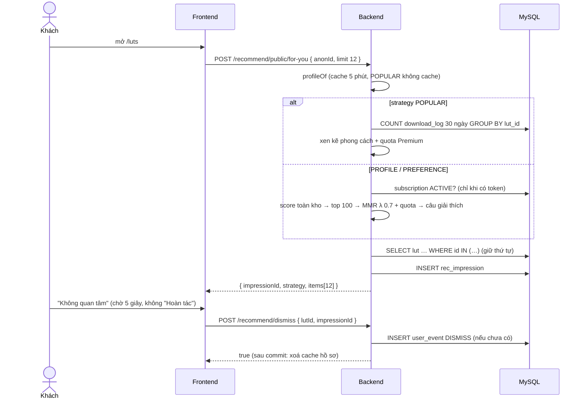

# Xếp hạng gợi ý

## 1. Mục tiêu và phạm vi

Sau plan này, đầu trang `/luts` có **khối gợi ý 12 LUT** cuộn ngang, đổi theo mức hiểu biết về khách:

- Khách chưa có tín hiệu gì → **"Phổ biến tuần này"**: LUT tải nhiều trong 30 ngày, xếp xen kẽ phong cách để thấy đủ các kiểu màu.
- Khách đã khai báo sở thích hoặc có hành vi → **"Dành cho bạn"**: backend tính `score(u, i)` (§7.6.1) với hồ sơ P_u của lát 2.2 trên toàn kho, lấy top 100, xếp lại bằng MMR (λ = 0.7) để 12 LUT không giống hệt nhau, giới hạn LUT Premium cho khách Miễn phí / vãng lai, và kèm **câu giải thích** dưới mỗi thẻ ("Cùng phong cách Ấm áp với Hoàng Hôn Sài Gòn bạn đã tải").
- Khách đã đăng nhập bấm **"Không quan tâm"** trên một thẻ: thẻ mờ đi với "Hoàn tác", 5 giây sau mới gửi API; LUT đó không quay lại khối gợi ý và kéo hồ sơ ra xa (DISMISS, w = −4).
- Bấm thẻ từ khối gợi ý thì sự kiện VIEW kế tiếp mang `impressionId` (mỗi lần trả danh sách ghi một dòng `rec_impression`), làm dữ liệu cho thống kê CTR ở lát 2.4.
- **"Có thể bạn cũng thích"** (và "LUT tương tự" sau khi tải) cá nhân hoá nhẹ: `0.8 · sim(c, j) + 0.2 · score(u, j)` khi khách có hồ sơ.

Mọi tham số lấy từ `recommend.*` (Phụ lục B). Phần thuật toán (`ScoreCalculator`, `Recommender`, `ReasonBuilder`) là lớp Java thuần, nhận vector và cấu hình làm tham số, để `EvalRunner` của lát 3.1 gọi lại đúng mã này.

| Có làm (lát này) | Không làm (để plan khác) |
|---|---|
| Migration `V12__xep_hang_goi_y.sql`: bảng `rec_impression` | Resource `RECOMMEND`, `GET /recommend/config`, `/recommend/stats`, `/recommend/rebuild`, "Thử hồ sơ", `/admin/goi-y` (lát 2.4) |
| 2 API mới: `recommend/public/for-you`, `recommend/dismiss`; `lut/public/related` thêm phần cá nhân hoá (cùng đường dẫn, cùng hợp đồng, thêm tham số `anonId` tuỳ chọn và field `score`) | Ghi `rec_impression` cho "Có thể bạn cũng thích" (`related` giữ hợp đồng cũ, không trả `impressionId`; §11 câu 6) |
| `ScoreCalculator` (score, đóng góp từng khối, sim giữa hai LUT), `Recommender` (ứng viên, top 100, MMR, quota Premium, xếp phổ biến xen kẽ phong cách, kho mới), `ReasonBuilder` (câu giải thích) | Biến thể A/B theo `variant` (lát 3.1 / 3.2); cột `variant` ghi hằng `cbf-full` |
| Chốt vấn đề mở #6: LUT Premium tối đa `floor(K × 0.34)` (4 trên 12) cho khách Miễn phí và vãng lai | Bộ lọc "Bỏ LUT đã xem" / "Bỏ LUT trong bộ sưu tập" khỏi "Dành cho bạn" (thiết kế chỉ loại LUT đã tải và đã bỏ qua; §11 câu 2) |
| Hai chỉnh nhỏ ở lát 2.2: hồ sơ `POPULAR` không cache; VIEW có `impressionId` không bị chống ghi lặp (§5.4) | Xoá dòng `rec_impression` cũ (§11 câu 6) |
| Frontend: khối gợi ý ở `/luts`, nút "Không quan tâm" + "Hoàn tác", gắn `impressionId` vào VIEW, gửi `anonId` khi gọi `related`, sửa mô tả hộp thoại "Xoá lịch sử gợi ý" | Khối gợi ý ở trang danh mục, trang chủ |

## 2. Tác nhân và phân quyền

| Tác nhân | Được làm | Ghi chú |
|---|---|---|
| Khách vãng lai | `for-you`, `related` bằng `anonId` | Không thấy nút "Không quan tâm", "Sửa sở thích màu". Bị giới hạn LUT Premium |
| Người đã đăng nhập (mọi role, kể cả admin vào cửa hàng) | Như trên (hồ sơ theo `user_id` trong token, bỏ qua `anonId`) + `dismiss` | Không có subscription ACTIVE (gói Miễn phí, admin) → bị giới hạn LUT Premium; gói Pro / Studio còn hạn → không giới hạn |

Không tạo resource, không có migration phân quyền, controller **không** gọi `checkPermission`. `/recommend/public/**` và `/lut/public/**` khớp mẫu công khai (token tuỳ chọn, lát 2.2 đã sửa filter); `/recommend/dismiss` không khớp → filter đòi token (401 khi thiếu).

## 3. Luồng nghiệp vụ

**Luồng chính 1 — khách vãng lai lần đầu, rồi xem vài LUT lạnh (UI-01, API-01, API-02):**
1. Khách mở `/luts` (không có bộ lọc). Giao diện gọi `POST /recommend/public/for-you { anonId, limit: 12 }`.
2. Backend tính hồ sơ của `anonId`: chưa có sự kiện → `strategy = POPULAR`. Hồ sơ rỗng **không** được cache (§5.4).
3. Xếp phổ biến (§7 mục 7.3): đếm lượt tải 30 ngày từ `download_log`, nhóm LUT theo phong cách, lấy lần lượt LUT phổ biến nhất của từng phong cách; khách vãng lai tối đa 4 LUT Premium. Ghi `rec_impression (anon_id, FOR_YOU, cbf-full, POPULAR, [11, 17, 1, …])` → trả `impressionId`.
4. Giao diện hiện khối **"Phổ biến tuần này"** (không có câu giải thích dưới thẻ).
5. Khách bấm thẻ "Xanh Đêm" trong khối → giao diện nhớ `impressionId` cho LUT 8 → trang chi tiết gửi `VIEW { lutId: 8, impressionId }`. Khách xem tiếp "Đà Lạt Sương", "Băng Giá" (từ lưới).
6. Khách quay lại `/luts` → `for-you` lần nữa: hồ sơ tính lại (lần trước rỗng nên không có trong cache) → `PROFILE`, α = 0 → `score(u, i)` cho mọi LUT, top 100, MMR → 6 LUT lạnh đứng đầu. Khối đổi thành **"Dành cho bạn"**, mỗi thẻ có câu giải thích.

**Luồng chính 2 — tính "Dành cho bạn" (`RecommendService.forYou`):**
1. Danh tính: có token → `userId`; không thì `anonId` hợp lệ; không có cả hai → hồ sơ rỗng.
2. `limit` chuẩn hoá về [1, 24], mặc định 12.
3. `profile = UserProfileService.profileOf(userId, anonId)` (cache 5 phút như lát 2.2).
4. Ứng viên = mọi LUT trong chỉ mục, trừ LUT có cặp `DOWNLOAD` hoặc `DISMISS` trong `profile.signals`.
5. Giới hạn Premium = không phải (có `userId` **và** có subscription ACTIVE hôm nay).
6. `POPULAR` → xếp phổ biến xen kẽ phong cách. `PROFILE` / `PREFERENCE` → `score` toàn kho, top 100 (thêm LUT miễn phí nếu cần, §7 mục 7.2), MMR có quota.
7. Lấy thông tin LUT theo đúng thứ tự (`listPublishedByIds`), thêm `score` và `reason`.
8. Ghi một dòng `rec_impression`, trả `{ impressionId, strategy, items }`.

**Luồng thay thế:**
- A1. **Khách đăng ký và chọn phong cách** (UI-02): sau "Xem gợi ý cho tôi", lưu sở thích làm mới khối → `PREFERENCE`, tiêu đề "Dành cho bạn", câu "Vì bạn thích phong cách Phim nhựa".
- A2. **"Sửa sở thích màu"** ở đầu khối (chỉ khi đăng nhập) mở hộp thoại "Sở thích màu" của lát 2.2; lưu xong khối tải lại.
- A3. **"Không quan tâm"** (UI-04, API-06): thẻ mờ, hiện "Đã ẩn khỏi gợi ý" + "Hoàn tác". Hết 5 giây → `POST /recommend/dismiss { lutId, impressionId }` → backend ghi `user_event DISMISS`, xoá cache hồ sơ → thẻ biến khỏi hàng. Bấm "Hoàn tác" trong 5 giây → không gửi gì. Rời trang trước 5 giây → vẫn gửi đúng hạn.
- A4. **Tải một LUT** (API-05): `download_log` có dòng mới → lần `for-you` sau LUT đó không còn trong danh sách.
- A5. **Ẩn LUT ở trang quản trị** (API-10): chỉ mục dựng lại → LUT không còn trong `for-you` và `related`.
- A6. **Trang chi tiết LUT c** — "Có thể bạn cũng thích" và "LUT tương tự" gửi kèm `anonId`. Có hồ sơ (`PROFILE` / `PREFERENCE`) → 50 LUT gần c nhất trong `lut_similarity` xếp lại theo `0.8 · sim(c, j) + 0.2 · score(u, j)`. Không có hồ sơ → kết quả y như lát 2.1.
- A7. **Thanh lọc / ô tìm có giá trị** (`q`, `kw`, `style` trên URL) → không hiện khối (người dùng đang tìm thứ cụ thể, kết quả lên sát đầu trang).
- A8. **Khách trả phí** (Pro / Studio còn hạn): không giới hạn LUT Premium.
- A9. **Xoá lịch sử gợi ý** (lát 2.2): xoá cả các dòng DISMISS, nên LUT đã bỏ qua có thể xuất hiện lại; khối tải lại ngay.

**Ngoại lệ:**
- E1. `dismiss` với `lutId` thiếu, không có, chưa xuất bản hoặc đã ẩn → 404 `DATA_NOT_FOUND` "Không tìm thấy LUT"; giao diện trả thẻ về trạng thái thường + toast message server.
- E2. `dismiss` không token → 401 (filter có sẵn).
- E3. `dismiss` lần hai cùng LUT → 200, `result = false`, không ghi thêm.
- E4. `for-you` lỗi mạng / 5xx → giao diện ẩn cả khối, trang vẫn dùng được, không toast.
- E5. Chỉ mục chưa dựng (khởi động lỗi) hoặc không còn ứng viên → `items = []`, không có `impressionId`, không ghi `rec_impression`; giao diện không hiện khối.



## 4. Cơ sở dữ liệu

Migration: `V12__xep_hang_goi_y.sql` (mới nhất hiện tại là `V11__ho_so_nguoi_dung.sql`). Không có seed. Không thêm cột cho bảng cũ; `user_event` đã nhận `DISMISS` và `impression_id` từ V11.

**`rec_impression`** — mỗi lần `for-you` trả một danh sách khác rỗng

| Cột | Kiểu | Ràng buộc / ghi chú |
|---|---|---|
| id | BIGINT AUTO_INCREMENT | PK; trả cho giao diện làm `impressionId` |
| user_id | INT NULL | FK → `user_app(id)` **ON DELETE SET NULL** (giữ số liệu thống kê khi xoá người dùng) |
| anon_id | CHAR(36) NULL | UUID chữ thường nếu body có `anonId` hợp lệ (kể cả khi có token) |
| placement | VARCHAR(20) NOT NULL | `FOR_YOU` (lát này chỉ ghi giá trị này; `RELATED` để dành) |
| variant | VARCHAR(20) NOT NULL | Lấy từ `recommend.variant`, mặc định `cbf-full` |
| strategy | VARCHAR(20) NOT NULL | `PROFILE` / `PREFERENCE` / `POPULAR` của lần trả đó. **Thêm** so với thiết kế §4.7 (§11 câu 6) |
| lut_ids | JSON NOT NULL | Mảng id LUT theo đúng thứ tự đã trả, ví dụ `[12, 29, 8, 36, 33, 18, 6, 5, 2, 35, 24, 23]` |
| created_time | DATETIME NOT NULL DEFAULT CURRENT_TIMESTAMP | Service ghi tường minh `LocalDateTime.now(clock)` |

Index: `idx_rec_impression_created (created_time)`, `idx_rec_impression_user (user_id, created_time)`. Xoá: không xoá ở lát này.

```sql
SET NAMES utf8mb4;

CREATE TABLE IF NOT EXISTS rec_impression (
  id BIGINT NOT NULL AUTO_INCREMENT PRIMARY KEY,
  user_id INT NULL,
  anon_id CHAR(36) NULL,
  placement VARCHAR(20) NOT NULL,
  variant VARCHAR(20) NOT NULL,
  strategy VARCHAR(20) NOT NULL,
  lut_ids JSON NOT NULL,
  created_time DATETIME NOT NULL DEFAULT CURRENT_TIMESTAMP,
  KEY idx_rec_impression_created (created_time),
  KEY idx_rec_impression_user (user_id, created_time),
  CONSTRAINT fk_rec_impression_user FOREIGN KEY (user_id) REFERENCES user_app(id) ON DELETE SET NULL
) ENGINE=InnoDB DEFAULT CHARSET=utf8mb4 COLLATE=utf8mb4_0900_ai_ci;
```

## 5. Hợp đồng API (cố định — nguồn sự thật cho cả BE và FE)

Thành công: `{ "code": 200, "message": "OK", "result": … }`. Lỗi nghiệp vụ: `{ "path", "code", "errorCode", "message" }`. POJO `NON_NULL`. `anonId` hợp lệ như lát 2.2 (UUID, so ở dạng chữ thường). Thời điểm theo `Clock` của app (Asia/Ho_Chi_Minh).

Một LUT trong `items` có đúng các khoá của `GET /lut/public/get` hiện nay (`id, slug, title, description, creatorId, creatorName, style, isPremium, coverUrl, previewType, beforeUrl, afterUrl, previewVideoUrl, fileSizeKb, lutSize, downloadCount, publishedTime, categories, tags`), thêm:

| Khoá | Có khi | Ý nghĩa |
|---|---|---|
| `reason` | `for-you`, mọi item | Câu giải thích §5.5 |
| `score` | `for-you` khi strategy khác `POPULAR`; `related` khi đã cá nhân hoá | `for-you`: score(u, i) (§7 mục 7.1, có thể âm), làm tròn 4 chữ số. `related`: điểm xếp hạng `0.8 · sim + 0.2 · score(u, j)`, làm tròn 4 chữ số |
| `similarity` | `related` (như lát 2.1) | sim(c, j) làm tròn 4 chữ số, **không** đổi nghĩa khi cá nhân hoá |

### 5.1 `POST /api/recommend/public/for-you` — danh sách gợi ý (công khai, token tuỳ chọn)

Request (body POJO `RecImpression`, chỉ đọc `anonId`, `limit`):
```json
{ "anonId": "3f2b8c1e-9d4a-4f6b-8a2e-1c7d5e9f0a3b", "limit": 12 }
```
Quy tắc:
1. Danh tính: có principal → `userId` từ token, hồ sơ của tài khoản (bỏ qua `anonId` khi tính hồ sơ; `anonId` hợp lệ vẫn được ghi vào `rec_impression.anon_id`). Không có principal → `anonId` hợp lệ thì hồ sơ ẩn danh; không hợp lệ / thiếu → hồ sơ rỗng (`POPULAR`). Body thiếu hẳn → như hồ sơ rỗng, `limit` mặc định.
2. `limit`: null hoặc ≤ 0 → `recommend.for-you-limit` (12); lớn hơn `recommend.for-you-max-limit` (24) → 24.
3. Ứng viên, xếp hạng, quota, câu giải thích theo §7 mục 7 / 8. Giới hạn Premium áp cho mọi danh tính **trừ** người đăng nhập có subscription ACTIVE (`SubscriptionService.findActiveByUserId(userId, hôm nay) != null`). Quota = `floor(limit × recommend.premium-max-ratio)` (0.34): limit 12 → 4, 24 → 8, 5 → 1, 2 → 0.
4. `items` khác rỗng → INSERT `rec_impression` (`placement = FOR_YOU`, `variant` = `recommend.variant`, `strategy`, `lut_ids` = id theo thứ tự `items`, `user_id`, `anon_id`) và trả `impressionId`. `items` rỗng → không INSERT, không có khoá `impressionId`.
5. Không xoá cache, không ghi `user_event`.

Response `result` (POJO `RecommendResult`, không phải bảng). Ví dụ: khách chỉ tải "Mùa Thu Hà Nội" (giá trị `score` minh hoạ):
```json
{
  "impressionId": 1532,
  "strategy": "PROFILE",
  "items": [
    {
      "id": 9, "slug": "hoang-hon-sai-gon", "title": "Hoàng Hôn Sài Gòn",
      "description": "Hoàng Hôn Sài Gòn là LUT phong cách hoàng hôn, ấm do Minh Color chỉnh màu. …",
      "creatorId": 1, "creatorName": "Minh Color", "style": "am-ap", "isPremium": 0,
      "coverUrl": "http://localhost:9020/downbeat-public/lut/hoang-hon-sai-gon/cover.jpg",
      "previewType": "BEFORE_AFTER",
      "beforeUrl": "http://localhost:9020/downbeat-public/lut/hoang-hon-sai-gon/before.jpg",
      "afterUrl": "http://localhost:9020/downbeat-public/lut/hoang-hon-sai-gon/after.jpg",
      "fileSizeKb": 948, "lutSize": 33, "downloadCount": 9760, "publishedTime": "2026-06-14T09:00:00",
      "categories": ["am-ap", "premiere-pro", "davinci-resolve", "final-cut-pro", "capcut"],
      "tags": ["ấm", "hoàng hôn"],
      "score": 0.7172,
      "reason": "Cùng phong cách Ấm áp với Mùa Thu Hà Nội bạn đã tải"
    }
  ]
}
```
`POPULAR`: item không có `score`, `reason` là "Đang được tải nhiều" (hoặc "Mới thêm vào kho", §5.5); giao diện không hiện câu này (§6.1).

### 5.2 `POST /api/recommend/dismiss` — "Không quan tâm" (cần token)

Request (body POJO `UserEvent`, chỉ đọc `lutId`, `impressionId`):
```json
{ "lutId": 17, "impressionId": 1532 }
```
Quy tắc (theo thứ tự):
1. `lutId` phải là LUT `PUBLISHED` (`LutService.isPublished`), không thì 404 `DATA_NOT_FOUND` "Không tìm thấy LUT", không ghi gì.
2. Đã có dòng `user_event` của khách với `event_type = 'DISMISS'` và cùng `lut_id` (không giới hạn thời gian) → `result = false`, không ghi, không phát sự kiện.
3. INSERT `user_event (user_id = token, anon_id = NULL, event_type = 'DISMISS', lut_id, value = NULL, impression_id = impressionId nếu > 0, created_time = now)` → `result = true`.
4. Sau commit: xoá cache hồ sơ (`UserSignalChangedEvent(userId, null, "không quan tâm")`, listener lát 2.2 đã sẵn).

Response:
```json
{ "code": 200, "message": "OK", "result": true }
```
Bỏ qua: không có thao tác "bỏ dismiss" riêng; "Xoá lịch sử gợi ý" (lát 2.2) xoá cả DISMISS.

### 5.3 `GET /api/lut/public/related?slug=&page=&limit=&anonId=` — "Có thể bạn cũng thích" (có sẵn, thêm cá nhân hoá)

Hợp đồng lát 2.1 giữ nguyên (`Page { total, page, items }`, 404 `DATA_NOT_FOUND` "Không tìm thấy LUT", `limit` mặc định 12 tối đa 48). Thêm tham số `anonId` (không bắt buộc) và quy tắc:

1. `profile = profileOf(userId từ token, anonId)`.
2. `profile.strategy = POPULAR`, hoặc LUT c không có dòng `lut_similarity` (đang dùng luật dự phòng của lát 1) → **trả đúng kết quả cũ** (không có khoá `score`).
3. Ngược lại: ứng viên = **mọi** dòng `lut_similarity` của c có LUT đích `PUBLISHED` (tối đa `similarity-top` = 50). Với mỗi j: `related = (1 − r) · sim(c, j) + r · score(u, j)`, r = `recommend.related-personal-ratio` (0.2), `sim` lấy nguyên từ bảng (chưa làm tròn), `score(u, j)` theo §7 mục 7.1 với chỉ mục hiện tại (j không có trong chỉ mục → 0). Sắp `related` giảm dần, rồi `download_count` giảm dần, rồi `id` tăng dần; cắt trang trong bộ nhớ theo `page`, `limit` như cũ; `total` = số ứng viên. Item có `similarity` = sim làm tròn 4 chữ số và `score` = `related` làm tròn 4 chữ số.
4. Không ghi `rec_impression`, không loại LUT đã tải / đã bỏ qua (chỉ loại chính c, như thiết kế §7.6.2).

Response mẫu (khách đã xem 3 LUT lạnh, `slug=kodak-400`, giá trị minh hoạ):
```json
{ "total": 35, "page": 1, "items": [
  { "id": 19, "slug": "fuji-classic", "title": "Fuji Classic", "style": "phim-nhua", "similarity": 0.7381, "score": 0.6312, "...": "…" }
] }
```

### 5.4 Tác động lên API / dịch vụ có sẵn

| Chỗ | Đổi |
|---|---|
| `POST /recommend/public/event` (lát 2.2 §5.3 mục 7) | `type = VIEW` **và** `impressionId > 0` → bỏ bước chống ghi lặp 30 phút (vẫn kiểm các bước khác). Lần bấm từ khối gợi ý luôn được ghi để thống kê CTR (§11 câu 4). Các loại khác giữ nguyên |
| `UserProfileService.profileOf` (dùng cho `profile`, `for-you`, `related`) | Hồ sơ có `strategy = POPULAR` **không** đưa vào cache (tính lại mỗi lần, chỉ tốn các truy vấn rỗng). Hồ sơ `PROFILE` / `PREFERENCE` cache 5 phút như cũ (§11 câu 3) |
| `GET /lut/public/related` | Chuyển handler từ `LutPublicController` sang `RecommendController` (cùng đường dẫn), để `lut` không phụ thuộc `recommend` (§7 mục 10) |
| `POST /recommend/clear-history` | Không đổi mã (đã xoá mọi `user_event` của khách, gồm DISMISS); giao diện đổi mô tả (§6.4) |

### 5.5 Câu giải thích (`reason`)

Dấu ngoặc là ngoặc kép cong `“ ”` (U+201C, U+201D). `{S}` = tên phong cách, `{C}` = tên danh mục (đều lấy `lut_category.name` theo slug, 8 phong cách có danh mục cùng slug), `{A}` = tiêu đề LUT neo, `{v}` = động từ, `{t}` = thẻ đã chuẩn hoá, `{N}` = `creatorName`.

Xét theo thứ tự, gặp dòng đầu tiên khớp thì dừng:

| # | Điều kiện | Câu |
|---|---|---|
| 1 | strategy `POPULAR`, LUT có lượt tải trong 30 ngày hoặc `download_count > 0` | Đang được tải nhiều |
| 2 | strategy `POPULAR`, còn lại | Mới thêm vào kho |
| 3 | Chính LUT này có trong lịch sử dương của khách, loại mạnh nhất là `PURCHASE` | Bạn đã chọn LUT này khi mua gói |
| 4 | … loại mạnh nhất là `FAVORITE` | Có trong bộ sưu tập của bạn |
| 5 | … loại mạnh nhất là `VIEW` / `PREVIEW` | Bạn đã xem LUT này |
| 6 | strategy `PREFERENCE` | Chuỗi khai báo (dòng 12 → 14) |
| 7 | Khối đóng góp lớn nhất b* (§7 mục 8) là **phong cách**, phần khai báo `α · E[s] ≥` phần hành vi `(1 − α) · H[s]` và > 0 | Vì bạn thích phong cách {S} |
| 8 | b* là phong cách, còn lại: có LUT neo cùng phong cách | Cùng phong cách {S} với {A} bạn {v} |
| 8b | b* là phong cách, không có LUT neo cùng phong cách (phong cách đến từ FILTER_STYLE) | Vì bạn hay lọc phong cách {S} |
| 9 | b* là **màu**, có LUT neo | Tông màu giống {A} bạn {v} |
| 10 | b* là **thẻ** | Có “{t}” như các LUT bạn hay xem |
| 10b | b* là **danh mục** | Thuộc danh mục {C} bạn quan tâm |
| 11 | b* là **tác giả** | Cùng tác giả {N} |
| 12 | (chuỗi khai báo) phong cách của LUT có trong khối phong cách khai báo E (> 0) | Vì bạn thích phong cách {S} |
| 13 | (chuỗi khai báo) LUT có danh mục k với E_danh_mục[k] > 0 (lấy k có E[k] · x[k] lớn nhất) | Thuộc danh mục {C} bạn quan tâm |
| 14 | (chuỗi khai báo) còn lại | Hợp với sở thích màu bạn đã chọn |
| 15 | Không dòng nào ở trên khớp (b* ≤ 0, hoặc b* là màu nhưng không có LUT neo): có khai báo → chuỗi 12 → 14; không có khai báo | Có thể hợp gu của bạn |

Động từ `{v}` theo loại mạnh nhất (trọng số sự kiện lớn nhất) của LUT neo: `PURCHASE` "đã chọn khi mua gói", `DOWNLOAD` "đã tải", `FAVORITE` "đã lưu", `PREVIEW` / `VIEW` "đã xem".

### 5.6 Lỗi nghiệp vụ

| Tình huống | HTTP | errorCode | message (nguyên văn) |
|---|---|---|---|
| `dismiss` không token / token sai | 401 | `LOGIN` / `UNAUTHORIZED` / `TOKEN_EXPIRED` (filter có sẵn) | (message có sẵn của filter) |
| `dismiss`: `lutId` thiếu, không có, chưa xuất bản (DRAFT) hoặc đã ẩn (HIDDEN) | 404 | `DATA_NOT_FOUND` | Không tìm thấy LUT |
| `related`: `slug` không có / chưa xuất bản (có sẵn từ lát 2.1) | 404 | `DATA_NOT_FOUND` | Không tìm thấy LUT |

`for-you` không có lỗi nghiệp vụ (không xác định được ai → `POPULAR`). Không thêm `ErrorCode` mới.

## 6. Giao diện (chuỗi cố định — test E2E chọn theo đúng các chuỗi này)

`{LUT}` là tiêu đề LUT, `{n}` là số.

### 6.1 Khối gợi ý ở `/luts`

- Vị trí: trang `/luts` (`routes/_shop/luts/index.tsx`), giữa `<hr>` dưới hero và `LutBrowser`, cách thanh lọc `mb-10`. **Chỉ hiện khi không có bộ lọc** (`!hasActiveFilters(search)`: không `q`, `kw`, `style`; `sort` không tính). Không hiện ở trang danh mục.
- Khung: `<section aria-labelledby>` có `h2` (nên `getByRole("region", { name: "Dành cho bạn" })` chọn được).

| Phần | `PROFILE` | `PREFERENCE` | `POPULAR` |
|---|---|---|---|
| Tiêu đề `h2` | "Dành cho bạn" | "Dành cho bạn" | "Phổ biến tuần này" |
| Dòng phụ (chữ nhỏ, màu nhạt) | "Dựa trên các LUT bạn đã tải và xem gần đây" | "Dựa trên sở thích màu bạn đã chọn" | "Được tải nhiều gần đây, đủ các phong cách màu" |
| Câu giải thích dưới thẻ | Có | Có | Không |

- Bên phải tiêu đề:
  - Chỉ khi đã đăng nhập: nút dạng liên kết "Sửa sở thích màu" (icon `ChevronRight` sau chữ) → `open({ type: "preference", mode: "edit" })`.
  - Từ `sm` trở lên: hai nút icon `ChevronLeft` / `ChevronRight`, `aria-label` "LUT trước" / "LUT tiếp theo", cuộn hàng đi một khung nhìn (`scrollBy` bằng `clientWidth`, `behavior: "smooth"`); `disabled` khi đã ở đầu / cuối hàng. Dưới `sm` ẩn hai nút (vuốt ngang).
- Hàng thẻ: `ul aria-label="Gợi ý LUT"`, cuộn ngang trong khung (`overflow-x-auto`, `scroll-snap-type: x mandatory`, ẩn thanh cuộn), trang không tràn ngang. Mỗi `li` (`snap-start`, `shrink-0`, rộng `78%` dưới `sm`, `300px` từ `sm`) gồm **đúng 3 con theo thứ tự**:
  1. `div` (relative) chứa `LutCard` của lưới (rê chuột so sánh / phát video, nút "Tải {LUT}", "Thêm {LUT} vào bộ sưu tập" như lưới) và lớp phủ khi đã ẩn (§6.2).
  2. `p` tiêu đề LUT (một dòng, cắt `…`, chữ `text-sm font-semibold`, bấm được: link tới `/luts/$slug`).
  3. `p` câu giải thích (`text-xs`, màu `--sh-muted`, một dòng, cắt `…`, `title` = cả câu). `POPULAR` không render `p` này (li chỉ có 2 con).
- Bấm vào thẻ (link "Xem LUT {LUT}") hoặc tiêu đề → nhớ `{ lutId, impressionId }` (§8 mục 4); VIEW kế tiếp của đúng LUT đó trong 60 giây gửi kèm `impressionId`.
- Đang tải: `section` có `aria-busy="true"`, `aria-label="Đang tải gợi ý"`, một thanh `Skeleton` thay tiêu đề + 4 khung `Skeleton` tỉ lệ 16:9 cùng kích thước thẻ. Phiên đang khôi phục (`useShopSession().loading`) thì chưa gọi API, vẫn hiện skeleton.
- Lỗi API hoặc `items` rỗng: không render gì (không chỗ trống, không toast).
- Dữ liệu: gọi lại mỗi lần khối được mount (quay lại `/luts` là có danh sách mới), không gọi lại khi focus cửa sổ. Đổi tài khoản (đăng nhập / đăng ký / đăng xuất) → khoá query đổi → tải lại. Lưu sở thích màu, xoá lịch sử gợi ý → tải lại ngay.

### 6.2 "Không quan tâm" và "Hoàn tác" (chỉ khi đã đăng nhập)

- Nút icon `EyeOff` góc trên phải của thẻ, `aria-label` "Không quan tâm {LUT}", tooltip "Không quan tâm". Thiết bị có chuột: hiện khi rê chuột / focus trong thẻ (như nút "Bỏ khỏi bộ sưu tập"); thiết bị cảm ứng (`(hover: none)`): luôn hiện. Huy hiệu Premium dịch sang trái như khi có nút "Bỏ khỏi bộ sưu tập".
- Bấm → thẻ chuyển trạng thái **đã ẩn**: ảnh mờ (`opacity-40`), mọi nút / link trong thẻ không bấm được (`inert`), câu giải thích ẩn; lớp phủ giữa thẻ có chữ "Đã ẩn khỏi gợi ý" và nút "Hoàn tác" (`ShopButton` secondary, sm).
- "Hoàn tác" trong 5 giây → thẻ về như cũ, không gọi API.
- Hết 5 giây → `POST /recommend/dismiss { lutId, impressionId }`. Thành công: thẻ biến khỏi hàng (không toast). Lỗi: thẻ về như cũ, toast message server (ví dụ "Không tìm thấy LUT"); mất mạng → "Không ẩn được LUT, vui lòng thử lại".
- Hẹn giờ không gắn với component: rời `/luts` trước 5 giây thì API vẫn được gửi đúng hạn. Đóng tab trước 5 giây thì không gửi (chấp nhận).
- Nhiều thẻ ẩn cùng lúc, mỗi thẻ hẹn giờ riêng.

### 6.3 Trang chi tiết LUT

Không đổi giao diện. "Có thể bạn cũng thích" và "LUT tương tự" (hộp thoại "Đã tải xong") gửi thêm `anonId` (§5.3); khoá query thêm khoá người xem như §6.1 để đổi tài khoản là tải lại.

### 6.4 Hộp thoại "Xoá lịch sử gợi ý" (lát 2.2 §6.4, chỉ đổi mô tả)

Mô tả mới: "DownBeat sẽ quên các LUT bạn đã xem, xem trước, đã ẩn khỏi gợi ý, từ khoá đã tìm và phong cách đã lọc. Lượt tải, bộ sưu tập và sở thích màu vẫn được giữ."

### 6.5 Điện thoại (≤ 640 px)

Trang không tràn ngang; hàng thẻ vuốt ngang được (`scrollWidth > clientWidth`), thẻ rộng 78% khung nhìn nên thấy mép thẻ kế tiếp; không có hai nút "LUT trước" / "LUT tiếp theo"; nút "Không quan tâm" luôn hiện với khách đã đăng nhập; tiêu đề + "Sửa sở thích màu" xuống dòng tự nhiên, không đè nhau.

## 7. Việc backend (agy BE)

Thứ tự theo `backend/AGENTS.md`. Package: `vn.aeoc.business.recommend` (`rank/` mới cho lớp thuần, `service/`, `repository/`, `controller/`). Hướng phụ thuộc giữ một chiều: `recommend` → `lut`, `download`, `billing`, `account`; `lut` không import `recommend`.

1. **Migration** `app/src/main/resources/db/migration/V12__xep_hang_goi_y.sql` đúng §4 → `sh scripts/ai/backend-restart.sh` → `mvn -q -DskipTests package` để sinh `REC_IMPRESSION`.
2. **Entity**
   - `entity/.../data/mysql/recommend/RecImpression.java` (bảng): `Long id, Integer userId, String anonId, String placement, String variant, String strategy, List<Integer> lutIds, LocalDateTime createdTime` + field không thuộc bảng `Integer limit` (chỉ request). Cột JSON `lut_ids`: đọc theo khuôn `Plan.setLicense(Object)` (setter nhận `Object`, parse mảng), ghi bằng chuỗi JSON `"[12,29,8]"` (xem cách `PaymentOrderRepository` ghi `webhook_payload`).
   - `entity/.../data/mysql/recommend/RecommendResult.java` (không thuộc bảng, response §5.1): `Long impressionId, String strategy, List<Lut> items`.
   - `entity/.../data/mysql/lut/Lut.java`: thêm `String reason`, `Double score` (không thuộc bảng, như `similarity`).
3. **Cấu hình** — `RecommendProperties` + `application.yml` thêm (tên khoá theo Phụ lục B, cộng 3 khoá mới cuối):
   ```yaml
   recommend:
     mmr-lambda: 0.7
     candidate-top: 100
     premium-max-ratio: 0.34
     related-personal-ratio: 0.2
     popular-days: 30
     for-you-limit: 12
     for-you-max-limit: 24
     variant: cbf-full
   ```
4. **Chỉ mục** (`recommend/index`)
   - `LutRepository.listPublishedForIndex()` thêm `IS_PREMIUM`, `PUBLISHED_TIME`.
   - `ItemVector` (record mới): `int id, String style, Integer creatorId, boolean premium, int downloadCount, LocalDateTime publishedTime, Map<String, Double> tag, Map<String, Double> category, Map<String, Double> text, double[] color` (color = `colorZ(id)`, LUT thiếu đặc trưng màu là mảng 0 như hiện nay).
   - `LutVectorIndex`: dựng sẵn `ItemVector` cho mọi LUT lúc `build`; thêm `item(Integer id)` (null nếu không có), `items()` (theo thứ tự `ids()`), `title(id)`, `isPremium(id)`, `publishedTime(id)`. Không đổi cách tính vector.
5. **`rank/ScoreCalculator`** (thuần, static), khoá khối cố định `tag, color, category, style, text, creator`:
   - `cosine(Map a, Map b)` = a·b / (‖a‖ · ‖b‖), tính cả hai chuẩn; một bên rỗng hoặc chuẩn 0 → 0. Có thể âm (hồ sơ có DISMISS).
   - `rbf(double[] a, double[] b)` = exp(−‖a − b‖² / (2 · D)), **D = a.length**; một bên null → 0 (với chỉ mục thật D = 10, trùng `SimilarityService.rbf`; ví dụ §7.7 dùng D = 2).
   - `contributions(ProfileVector p, ItemVector x, Weights w)` → `LinkedHashMap` 6 khoá, giá trị `w_b · sim_b`: tag / category / text = `cosine(p.b, x.b)`; style = `cosine(p.style, {x.style: 1})`; creator = `cosine(p.creator, {String.valueOf(x.creatorId): 1})`; color = `rbf(p.color, x.color)`. `w` = `normalizedWeights()`.
   - `score(p, x, w)` = tổng `contributions`. **Không** cắt về [0, 1].
   - `itemSim(ItemVector a, ItemVector b, Weights w)` = công thức của `SimilarityService.sim` (cosine trên vector đã chuẩn hoá, style / creator bằng nhau → 1, RBF màu), cắt về [0, 1]. Phải cho đúng cùng giá trị với `SimilarityService.sim(ix, i, j)` (TC-06).
6. **`rank/RankedItem`** (record): `int id, double score, Map<String, Double> contributions (null với POPULAR), boolean premium, int downloadCount`.
7. **`rank/Recommender`** (thuần, không Spring):
   1. `excludedIds(UserProfile p)` = `lutId` của mọi cặp trong `p.signals()` có `type` `DOWNLOAD` hoặc `DISMISS`.
   2. `premiumQuota(int k, double ratio)` = `(int) Math.floor(k * ratio + 1e-9)`; `premiumLimited = false` → không giới hạn.
   3. `rankByProfile(ProfileVector p, List<ItemVector> candidates, int k, boolean premiumLimited, RecommendProperties props)`:
      - Tính `score` + `contributions` cho mọi ứng viên; sắp `score` giảm dần, `downloadCount` giảm dần, `id` tăng dần.
      - **Pool** = `candidate-top` phần tử đầu. Nếu `premiumLimited`: thêm tiếp các LUT **miễn phí** đứng sau top (theo đúng thứ tự trên) cho tới khi pool có ít nhất `k` LUT miễn phí hoặc hết ứng viên (`selectPool`, static, để test).
      - **MMR** (`mmr(pool, simFn, k, λ, quota)`, static): S rỗng; lặp tới khi |S| = k hoặc không còn phần tử hợp lệ: phần tử hợp lệ = chưa trong S và (không Premium hoặc số Premium trong S < quota); chọn phần tử có `λ · score − (1 − λ) · max_{j ∈ S} sim(i, j)` lớn nhất (S rỗng → phần phạt 0), bằng nhau (chênh < 1e-12) → `downloadCount` lớn hơn → `id` nhỏ hơn. `simFn` = `ScoreCalculator.itemSim`, λ = `mmr-lambda`.
   4. `rankPopular(List<ItemVector> candidates, Map<Integer, Integer> recentDownloads, int k, boolean premiumLimited, props)` (§7.5.2, §7.5.4):
      - Khoá phổ biến của LUT: (`recentDownloads[id]` giảm dần, `downloadCount` giảm dần, `publishedTime` mới hơn trước (null coi là cũ nhất), `id` tăng dần). Kho chưa có lượt tải nào thì hai thành phần đầu bằng 0 và thứ tự tự rơi về "mới nhất" (§7.5.4), không cần nhánh riêng.
      - Nhóm theo `style`, mỗi nhóm sắp theo khoá trên; thứ tự nhóm theo khoá của LUT đứng đầu nhóm. Dãy xen kẽ = vòng 1 lấy LUT thứ 1 của từng nhóm theo thứ tự nhóm, vòng 2 lấy LUT thứ 2 (nhóm hết thì bỏ qua)…
      - Đi theo dãy xen kẽ, thêm từng LUT trừ LUT Premium khi đã đủ quota, dừng khi đủ `k`. `score` của `RankedItem` = 0, `contributions` = null.
   5. `recommend(UserProfile profile, List<ItemVector> all, Map<Integer, Integer> recentDownloads, int k, boolean premiumLimited, props)` = bỏ `excludedIds` khỏi `all` → `POPULAR` thì `rankPopular`, còn lại `rankByProfile(profile.mixed(), …)`. **Đây là hàm `EvalRunner` lát 3.1 sẽ gọi.**
8. **`rank/ReasonBuilder`** (thuần): constructor `(Function<Integer, ItemVector> itemOf, Function<Integer, String> titleOf, Map<String, String> categoryNames, RecommendProperties props)`; `reason(UserProfile profile, ItemVector item, Map<String, Double> contributions, String creatorName, int recentDownloads)` → câu theo đúng bảng §5.5:
   - **Lịch sử dương**: các cặp trong `profile.signals()` có `lutId`, `weight > 0`, `type` ∈ {VIEW, PREVIEW, FAVORITE, DOWNLOAD, PURCHASE}, gộp theo `lutId`; "loại mạnh nhất" = loại có trọng số sự kiện cấu hình lớn nhất (PURCHASE > DOWNLOAD > FAVORITE > PREVIEW > VIEW).
   - **b\***: khối có `contributions` lớn nhất trong {style, color, tag, category, creator} (**bỏ khối văn bản**, không có câu tương ứng); bằng nhau → ưu tiên theo đúng thứ tự vừa liệt kê; giá trị lớn nhất ≤ 0 → coi như không có b\*.
   - **Neo** (LUT trong lịch sử dương, khác chính LUT đang giải thích): khối phong cách → các LUT neo cùng `style`, chọn `itemSim` lớn nhất; khối màu → chọn `rbf(z_neo, z_item)` lớn nhất. Bằng nhau → `|weight|` tổng lớn hơn → `id` nhỏ hơn.
   - Thẻ `{t}` = khoá t có `P.tag[t] · x.tag[t]` lớn nhất (> 0); danh mục `{C}` = khoá k có `P.category[k] · x.category[k]` lớn nhất (> 0), lấy tên từ `categoryNames`, không có tên → slug. Chuỗi khai báo dùng `profile.declared()`.
   - Phần khai báo / hành vi của phong cách: `α · declared.style[s]` so với `(1 − α) · behavior.style[s]`, s = `item.style`.
9. **Đếm lượt tải gần đây**: `DownloadLogRepository.countByLutSince(LocalDateTime since)` → `Map<Integer, Integer>` (một câu `GROUP BY lut_id WHERE created_time >= since`); `LutDownloadService.recentDownloadCounts(since)`.
10. **Phía `lut`**: `LutService.similarAll(String slug)` → `List<Lut>` mọi LUT `PUBLISHED` có dòng `lut_similarity` với c (`similarity` chưa làm tròn), đã `enrich`, sắp `score` giảm dần, `download_count` giảm dần, `id` tăng dần; c không xuất bản → 404 như `related`. Xoá handler `related` khỏi `LutPublicController` (giữ `LutService.related` nguyên vẹn).
11. **Repository** `recommend/repository/RecImpressionRepository extends AbsMysqlRepository<RecImpressionRecord, RecImpression, Long>`: `insertReturning`. `UserEventRepository.existsDismiss(userId, lutId)`.
12. **`EventService`**: `dismiss(Integer userId, UserEvent body)` → `boolean` theo §5.2 (`@Transactional`, phát `UserSignalChangedEvent` sau khi ghi); `record(...)`: VIEW có `impressionId > 0` không gọi `existsRecent` (§5.4).
13. **`UserProfileService.profileOf`**: chỉ `cache.put` khi `strategy` khác `POPULAR` (§5.4).
14. **`recommend/service/RecommendService`** (`@Service`, có `Clock` như `EventService`):
    - `forYou(Integer userId, RecImpression body)` → `RecommendResult` theo §5.1 / §3 luồng chính 2. `ix == null` hoặc không có ứng viên → `items = []`. Gói trả phí: `SubscriptionService.findActiveByUserId(userId, LocalDate.now(clock)) != null`. `recentDownloads` (`now − popular-days`) chỉ truy vấn khi `POPULAR`, dùng cho cả xếp hạng và câu giải thích dòng 1 / 2. Items lấy bằng `LutService.listPublishedByIds(ids)` (giữ thứ tự; LUT vừa bị ẩn giữa chừng thì rơi khỏi danh sách và `lut_ids`). `categoryNames` từ `LutCategoryService.listPublic()` (đã cache). `reason`, `score` (làm tròn 4, chỉ khi khác `POPULAR`) gắn vào từng `Lut`.
    - `related(Integer userId, String anonId, String slug, Integer page, Integer limit)` → `Page<Lut>` theo §5.3 (strategy `POPULAR` hoặc `similarAll` rỗng → `lutService.related(slug, page, limit)` nguyên vẹn).
15. **Controller** `RecommendController`: `POST /recommend/public/for-you`, `POST /recommend/dismiss`, `GET /lut/public/related` (`slug` bắt buộc như cũ, `page`, `limit`, `anonId` tuỳ chọn; principal có thể null).
16. **Unit test**: mọi TC loại `unit` ở §9 (JUnit 5 + AssertJ + Mockito, không dựng Spring). Ví dụ §7.7 dựng `ItemVector` bằng tay (§9.1); bảng phổ biến §9.2.

Quyết định đã chốt, worker không tự đổi: quota `floor(k × 0.34)` đếm trên danh sách cuối, chỉ người có subscription ACTIVE được bỏ giới hạn; pool bổ sung LUT miễn phí khi bị giới hạn; ứng viên chỉ loại DOWNLOAD / DISMISS (LUT đã xem, đã lưu vẫn là ứng viên); score không cắt [0, 1]; RBF dùng D = số chiều vector; xếp phổ biến bằng một khoá 4 thành phần (không nhánh "kho mới" riêng); câu giải thích đúng bảng §5.5 (không dùng khối văn bản); `related` không cá nhân hoá khi `POPULAR`; hồ sơ `POPULAR` không cache; DISMISS lặp không ghi thêm; không thêm resource; không `@Async`.

Nghiệm thu riêng (thêm vào "Nghiệm thu chuẩn"): `SHOW CREATE TABLE rec_impression` đúng §4; dán vào `worker_done` (a) response `for-you` của một anonId mới, (b) của anonId đó sau 3 VIEW `xanh-dem`, `da-lat-suong`, `bang-gia`, (c) của một tài khoản mới chỉ tải `mua-thu-ha-noi`; (d) thời gian `for-you` (log `debug` "for-you {n} LUT, {ms} ms") trên kho 36 LUT.

## 8. Việc frontend (agy FE)

1. `lib/types/recommend.ts`: `RecommendStrategy = "PROFILE" | "PREFERENCE" | "POPULAR"`; `ForYouLutDTO = LutDTO & { reason?: string; score?: number }`; `ForYouDTO { impressionId?: number; strategy: RecommendStrategy; items: ForYouLutDTO[] }`. `lib/types/lut.ts`: `LutApiDTO` thêm `reason?: string; score?: number; similarity?: number`.
2. `lib/axios/recommend.ts`: `getForYou(limit = 12)` → `POST /recommend/public/for-you { anonId: getAnonId(), limit }`, map `items` bằng `toLutDTO` + `reason`, `score`; `dismissLut(lutId, impressionId?)` → `POST /recommend/dismiss`, trả `result`. `lib/axios/luts.ts` `getRelatedLuts`: thêm tham số `anonId: getAnonId()`.
3. `hooks/use-viewer-key.ts` (mới): `useViewerKey()` = `"u:" + user.id` khi có `useShopSession().user`, không thì `"anon"`; trả kèm `ready = !loading`.
4. `lib/recommend/track.ts`: thêm `rememberImpression(lutId, impressionId)` và `takeImpression(lutId)` (biến trong module, một mục duy nhất, hết hạn sau 60 giây, lấy xong thì xoá). `components/shop/luts/detail/lut-detail.tsx`: VIEW gửi `impressionId: takeImpression(lut.id)`.
5. `lib/tanstack/options/recommend.ts`: `createForYouQueryOptions(viewerKey)` (`["recommend", "for-you", viewerKey]`, `staleTime: 0`, `refetchOnWindowFocus: false`, `retry: 1`); `dismissLutMutationOptions` (`meta.errorMessage` "Không ẩn được LUT, vui lòng thử lại", không `successMessage`, không `invalidatesQuery`); `clearHistoryMutationOptions` thêm `invalidatesQuery: [["recommend", "for-you"]]`. `lib/tanstack/options/account.ts` `savePreferenceMutationOptions`: thêm `["recommend", "for-you"]` vào `invalidatesQuery`. `lib/tanstack/options/luts.ts`: `createInfiniteRelatedLutsQueryOptions(slug, viewerKey)`, `createRelatedLutsQueryOptions(slug, limit, viewerKey)` thêm `viewerKey` vào khoá; sửa hai chỗ gọi (`lut-detail.tsx`, `download-done-panel.tsx`).
6. `lib/stores/for-you-dismiss.ts` (mới, zustand): `hidden: Record<number, true>` (đang chờ 5 giây), `removed: Record<number, true>` (đã gửi thành công, lọc khỏi hàng tới hết phiên); `hide(lutId, impressionId)` đặt hẹn giờ 5 giây trong `Map` của module (không gắn component) rồi gọi `dismissLut`; `undo(lutId)` huỷ hẹn giờ. Lỗi API → bỏ khỏi `hidden` + toast qua `MutationCache` (gọi bằng `queryClient.getMutationCache().build(...)` hoặc `useMutation` ở `ForYouSection` nhận callback — worker chọn, miễn toast đi qua `meta` như `frontend/AGENTS.md`).
7. `components/shop/luts/lut-card.tsx`: thêm prop `onDismiss?: (lut) => void` (nút §6.2) và `onOpen?: (lut) => void` (gọi ở `onClick` của link "Xem LUT {LUT}").
8. `components/shop/luts/for-you/for-you-section.tsx` + `for-you-item.tsx` (mới): đúng §6.1 / §6.2; dùng `useLutDownload`, `useSaveToCollection` như `LutGrid`; `useQuery(createForYouQueryOptions(viewerKey))` với `enabled: ready`.
9. `routes/_shop/luts/index.tsx`: render `<ForYouSection />` theo §6.1 khi `!hasActiveFilters(search)`.
10. `components/shop/account/clear-history-dialog.tsx`: mô tả §6.4.
11. `pnpm api:types` sau khi backend lên để `api.gen.ts` có `/recommend/public/for-you`, `/recommend/dismiss`, tham số `anonId` của `related`; đối chiếu với type tay.

Component shadcn dùng: có sẵn trong `components/ui/`: `skeleton`, `tooltip`, `button`, `sonner`; của cửa hàng: `ShopButton`, `LutCard`. Không cần `shadcn add` (cuộn ngang dùng `div` + CSS scroll-snap, không dùng `scroll-area` để vuốt mượt trên điện thoại).

Việc của Claude ở `frontend/tests/e2e/` (không giao worker):
- Viết `xep-hang-goi-y.spec.ts` theo §9; thêm `FOR_YOU_LIST = 'ul[aria-label="Gợi ý LUT"]'` và helper `forYouItems(page)` ở `support/shop.ts`.
- Sửa `ho-so-nguoi-dung.spec.ts` TC-41 theo mô tả mới §6.4.
- Chạy hồi quy các spec cửa hàng mở `/luts` (khối mới nằm trên lưới): `kho-lut`, `shop-flows`, `shop-ui`, `bo-suu-tap`, `tai-lut`, `tai-khoan-khach`, `chi-muc-tuong-dong`, `ho-so-nguoi-dung`. Bộ chọn nào bị trùng với thẻ trong khối gợi ý thì khoanh lại trong `GRID`.

## 9. Test case

`unit` = agy BE viết JUnit · `api` / `e2e` = Claude viết ở `frontend/tests/e2e/xep-hang-goi-y.spec.ts`.

Dữ liệu E2E: mỗi test tự dùng `anonId` mới (`crypto.randomUUID()`) và tự đăng ký khách mới (`newEmail()`). Lượt tải 30 ngày ở DB local bị các spec khác làm bẩn (Noir, Mùa Thu Hà Nội, Xanh Điện Ảnh…), nên test `POPULAR` chỉ kiểm tính chất (số phong cách, quota), không kiểm thứ tự cụ thể. 36 LUT mẫu: 8 phong cách, 12 LUT Premium; phong cách `lanh` có 6 LUT: `xanh-dem` ★, `anh-trang` ★, `bang-gia` ★, `bac-cuc`, `da-lat-suong`, `mua-pho`. Không xuất bản: `thu-nghiem-nhap` (DRAFT), `hoang-hon-cu` (HIDDEN). Ước lượng bằng ma trận `sim` thật (API `related`) và MMR: khách vãng lai xem 3 LUT lạnh có cả 6 LUT lạnh ở 6 vị trí đầu.

### 9.1 Ví dụ tính tay §7.7 (TC-01, TC-02, TC-08)

Trọng số `tag 0.4, style 0.3, color 0.3`, ba khối còn lại 0. Thẻ idf = 1 (vector thẻ = one-hot chuẩn L2), màu 2 chiều (warmth, saturation), RBF với D = 2. `downloadCount` đều 0, id A = 1 … E = 5. Tiêu đề: A "Hoàng Hôn Sài Gòn", B "Mật Ong", C "Xanh Đêm", D "Mùa Thu Hà Nội", E "Cam Cháy"; `categoryNames` có `am-ap` "Ấm áp", `lanh` "Lạnh", `teal-orange` "Teal & Orange". Kết quả tính bằng script độc lập, sai số cho phép 0.0001.

| Đại lượng | Giá trị |
|---|---|
| LUT | A am-ap {hoàng hôn, ấm} (1.2, 0.8) · B am-ap {vàng, ấm, chân dung} (1.5, 1.0) · C lanh {lạnh, xanh, đêm} (−1.3, −0.2) · D am-ap {ấm, lá vàng} (1.0, 0.5) · E teal-orange {cam, tương phản} (0.9, 0.9) |
| **P** (tải A hôm nay c = 5, xem C 30 ngày trước c = 0.5, không khai báo) | tag: hoàng hôn = ấm 0.6428, lạnh = xanh = đêm 0.0525 · style: am-ap 0.9091, lanh 0.0909 · color (0.9727, 0.7091) · strategy PROFILE, α = 0 |
| Đóng góp `w_b · sim_b` và score (A bị loại vì DOWNLOAD) | D: tag 0.1990, style 0.2985, color 0.2967 → **0.7942** · B: 0.1625, 0.2985, 0.2740 → **0.7350** · E: 0, 0, 0.2969 → **0.2969** · C: 0.0398, 0.0299, 0.0671 → **0.1367** |
| sim giữa hai LUT (`itemSim`) | D-B 0.7280 · D-E 0.2875 · D-C 0.0707 · B-E 0.2735 · B-C 0.0295 · E-C 0.0661 |
| Thứ tự | λ = 1: D, B, E, C · λ = 0.7: D, B, E, C, giá trị MMR lúc chọn 0.5559, 0.2961, 0.1216, 0.0745 |
| **P2** = P + DISMISS D (0 ngày, c = −4) | tag: hoàng hôn 0.3722, ấm 0.0744, lạnh = xanh = đêm 0.0304, lá vàng −0.2977 · style: am-ap 0.1053, lanh 0.0526 · color **giống P** |
| Xếp với P2 (A, D bị loại) | score B 0.5778, E 0.2969, C 0.2446 · λ = 1: B, E, C · λ = 0.7: **B, C, E** (MMR 0.4044, 0.1624, 0.1258: E bị phạt vì giống B) |
| Câu giải thích với P | D, B: "Cùng phong cách Ấm áp với Hoàng Hôn Sài Gòn bạn đã tải" · E: "Tông màu giống Hoàng Hôn Sài Gòn bạn đã tải" (rbf A-E 0.9753 > C-E 0.2204) · C: "Bạn đã xem LUT này" |

### 9.2 Bảng phổ biến (TC-07)

| id | style | Premium | lượt tải 30 ngày | `downloadCount` | `publishedTime` |
|---|---|---|---|---|---|
| 1 | a | ★ | 5 | 100 | 2026-01-01 |
| 2 | a | | 0 | 900 | 2026-01-02 |
| 3 | b | | 3 | 50 | 2026-01-03 |
| 4 | b | ★ | 0 | 10 | 2026-01-04 |
| 5 | c | | 0 | 800 | 2026-01-05 |
| 6 | c | | 0 | 800 | 2026-01-06 |
| 7 | a | | 0 | 0 | 2026-01-07 |

Khoá phổ biến: 1, 3, 2, 6, 5, 4, 7. Nhóm a [1, 2, 7], b [3, 4], c [6, 5]; thứ tự nhóm a, b, c. Dãy xen kẽ: **1, 3, 6, 2, 4, 5, 7**.

### 9.3 Bảng test case

| ID | Loại | Mô tả | Tiền điều kiện | Bước | Kết quả mong đợi |
|---|---|---|---|---|---|
| TC-01 | unit | UT-12: ví dụ tính tay §7.7 | Dữ liệu §9.1 | `ScoreCalculator.contributions` / `score` với P cho B, C, D, E; `Recommender.recommend` (signals DOWNLOAD A, VIEW C) với λ = 1 và λ = 0.7, k = 12 | Đúng các giá trị §9.1 (khớp 3 chữ số: 0.794, 0.735, 0.297, 0.137); A không có trong kết quả; thứ tự D, B, E, C ở cả hai λ |
| TC-02 | unit | UT-10: DISMISS loại LUT và kéo hồ sơ ra xa | Dữ liệu §9.1 | `excludedIds` của signals {DOWNLOAD A, VIEW C, DISMISS D}; `rankByProfile(P2, [B, C, E], …)` với λ = 1 và 0.7 | `excludedIds` = {1, 4}; D không có; λ = 1: B, E, C; λ = 0.7: B, C, E với giá trị MMR §9.1 |
| TC-03 | unit | UT-11: quota Premium | 30 `RankedItem`: id 1–20 Premium score 0.90, 0.89 … 0.71; id 21–30 miễn phí 0.50 … 0.41; `simFn` ≡ 0; λ = 0.7 | `mmr` với k = 12 quota 4; k = 12 không giới hạn; k = 24 quota 8; `premiumQuota(k, 0.34)` với k = 1, 2, 3, 5, 6, 12, 24 | [1, 2, 3, 4, 21 … 28] (đúng **4** Premium trên 12); [1 … 12]; [1 … 8, 21 … 30] (18 phần tử, không đủ 24); 0, 0, 1, 1, 2, 4, 8 |
| TC-04 | unit | Pool bổ sung LUT miễn phí | `candidate-top` = 5; id 1–5 Premium score 0.9 … 0.5; id 6–8 miễn phí 0.3, 0.2, 0.1; sim ≡ 0 | `selectPool` + `mmr` với k = 4, quota 1; rồi không giới hạn | Pool có id 1–8; kết quả [1, 6, 7, 8]; không giới hạn: pool 1–5, kết quả [1, 2, 3, 4] |
| TC-05 | unit | Hoà điểm | 3 phần tử cùng score 0.5, sim ≡ 0: (id 7, dc 10), (id 3, dc 10), (id 5, dc 99) | `mmr` k = 3 | [5, 3, 7] (`downloadCount` lớn trước, rồi id nhỏ) |
| TC-06 | unit | `ScoreCalculator` khớp chỉ mục thật | `RecommendFixtures.create3Luts()` + kho 30 LUT của `RecommendFixtures`, cấu hình mặc định | `itemSim(ix.item(i), ix.item(j))` mọi cặp; `score(P, x_B)` với P dựng từ một DOWNLOAD A (`ProfileBuilder`); `cosine` có phần tử âm; `rbf(null, z)`; profile rỗng | Bằng `SimilarityService.sim(ix, i, j)` (sai số 1e-9); `score(P_A, x_B)` = `sim(A, B)`; cosine âm giữ nguyên dấu; 0; score 0 |
| TC-07 | unit | Xếp phổ biến xen kẽ phong cách, kho mới | Bảng §9.2 | `rankPopular` với: (a) k = 7 không giới hạn; (b) k = 6 ratio 0.34; (c) k = 6 ratio 0.2; (d) bỏ id 3; (e) mọi lượt tải 30 ngày và `downloadCount` = 0 | (a) [1, 3, 6, 2, 4, 5, 7]; (b) quota 2 → [1, 3, 6, 2, 4, 5]; (c) quota 1 → [1, 3, 6, 2, 5, 7] (bỏ 4); (d) nhóm b chỉ còn 4 → thứ tự nhóm a, c, b → [1, 6, 4, 2, 5, 7]; (e) theo mới nhất: nhóm a [7, 2, 1], c [6, 5], b [4, 3] → [7, 6, 4, 2, 5, 3, 1] |
| TC-08 | unit | Câu giải thích trên ví dụ §7.7 | §9.1, P và signals như TC-01 | `ReasonBuilder.reason` cho D, B, E, C | Đúng dòng "Câu giải thích với P" §9.1 |
| TC-09 | unit | Bảng câu giải thích §5.5 | Đầu vào dựng tay (vector, `contributions`, signals) | (a) PREFERENCE, E.style {phim-nhua: 1}, LUT phim-nhua; (b) PREFERENCE, E.style {lanh: 1}, E.category {dam-cuoi: 0.8, lanh: 0.6}, LUT am-ap danh mục [dam-cuoi, am-ap]; (c) như (b) nhưng LUT danh mục [am-ap]; (d) PROFILE α = 0.8333, declared.style = behavior.style = {am-ap: 1}, b* style; (e) PROFILE α = 0, behavior.style {lanh: 1} chỉ từ FILTER_STYLE, b* style; (f) b* tag, P.tag {grain: 0.6, ấm: 0.3}, x.tag {grain: 0.7071, ấm: 0.7071}; (g) b* category, P.category {ban-dem: 0.5, lanh: 0.2}, x {ban-dem: 0.8, lanh: 0.6}; (h) b* creator, `creatorName` "Minh Color"; (i) chỉ khối văn bản > 0, không khai báo; (j) style = color = 0.2 (hoà), có neo cùng phong cách; (k) neo màu có FAVORITE / PREVIEW / PURCHASE + DOWNLOAD; (l) chính LUT có FAVORITE; có PURCHASE; (m) POPULAR với `recentDownloads` 3; với 0 và `downloadCount` 0 | (a) "Vì bạn thích phong cách Phim nhựa"; (b) "Thuộc danh mục Đám cưới bạn quan tâm"; (c) "Hợp với sở thích màu bạn đã chọn"; (d) "Vì bạn thích phong cách Ấm áp"; (e) "Vì bạn hay lọc phong cách Lạnh"; (f) "Có “grain” như các LUT bạn hay xem"; (g) "Thuộc danh mục Ban đêm bạn quan tâm"; (h) "Cùng tác giả Minh Color"; (i) "Có thể hợp gu của bạn"; (j) câu phong cách (ưu tiên style); (k) "Tông màu giống {A} bạn đã lưu" / "… bạn đã xem" / "… bạn đã chọn khi mua gói"; (l) "Có trong bộ sưu tập của bạn" / "Bạn đã chọn LUT này khi mua gói"; (m) "Đang được tải nhiều" / "Mới thêm vào kho" |
| TC-10 | unit | `RecommendService.forYou` | Mock `UserProfileService`, `LutIndexService` (kho 30 LUT), `SubscriptionService`, `LutDownloadService`, `LutService`, `LutCategoryService`, `RecImpressionRepository`; `now` cố định | (a) `limit` null, 0, −5, 7, 30; (b) anon PROFILE; (c) userId 5 có subscription ACTIVE; (d) userId 5 không subscription; (e) signals có DOWNLOAD id 3, DISMISS id 4; (f) POPULAR; (g) `current()` = null; (h) anonId "ABC…" chữ hoa hợp lệ kèm token | (a) 12, 12, 12, 7, 24 phần tử; (b)(d) ≤ `floor(k × 0.34)` Premium; (c) `rankByProfile` nhận `premiumLimited = false`; (e) id 3, 4 không có; (f) `recentDownloadCounts(now − 30 ngày)` được gọi đúng 1 lần, item không có `score`; PROFILE thì không gọi; (g) `items` rỗng, không `insertReturning`, không có `impressionId`; mọi lần có items: `RecImpression` insert có `placement` FOR_YOU, `variant` cbf-full, `strategy` đúng, `lutIds` đúng thứ tự `items`, `createdTime` = now, (h) `userId` 5 + `anonId` chữ thường |
| TC-11 | unit | `EventService.dismiss` + VIEW có impression | Mock repository, `LutService`, publisher | (a) `isPublished` false; (b) `lutId` null; (c) `existsDismiss` true; (d) hợp lệ, `impressionId` 1532; (e) hợp lệ, `impressionId` 0; (f) `record` VIEW `impressionId` 1532 khi `existsRecent` sẽ trả true; (g) `record` PREVIEW `impressionId` 1532 khi `existsRecent` true | (a)(b) `AppException` `DATA_NOT_FOUND` "Không tìm thấy LUT", không insert; (c) `false`, không insert, không phát sự kiện; (d) `true`, insert `DISMISS` có `userId`, `lutId`, `impressionId` 1532, `anonId` null, `createdTime` now, phát 1 `UserSignalChangedEvent(userId, null, …)`; (e) `impressionId` null; (f) `existsRecent` không được gọi, insert, `true`; (g) `false` (chỉ VIEW được miễn) |
| TC-12 | unit | Hồ sơ `POPULAR` không cache | `UserProfileService` với mock nguồn | `profileOf(0, uuid)` 2 lần khi nguồn rỗng; thêm 1 VIEW vào mock rồi gọi lần 3, lần 4 | Nguồn ẩn danh được đọc ở lần 1, 2, 3 (không cache khi POPULAR); lần 3 trả PROFILE; lần 4 lấy từ cache (không đọc nguồn) |
| TC-13 | unit | `RecommendService.related` | Mock như TC-10; `similarAll` trả 6 LUT có `similarity` | (a) hồ sơ POPULAR; (b) PROFILE, page 1 limit 4; (c) page 2 limit 4; (d) `similarAll` rỗng; (e) hai LUT cùng `related` | (a) trả nguyên `lutService.related(...)`, item không có `score`; (b) 4 item sắp `score` giảm dần, `score` = round4(0.8 · sim + 0.2 · score(u, j)), `similarity` = round4(sim), `total` 6; (c) 2 item còn lại; (d) gọi `lutService.related`; (e) `download_count` lớn trước, rồi id nhỏ |
| TC-14 | unit | `LutVectorIndex.item` | `RecommendFixtures.create3Luts()` có `isPremium`, `publishedTime` | `ix.item(1)`, `ix.items()`, `ix.item(99)` | `premium`, `publishedTime`, `title`, `style`, `creatorId`, vector khớp các hàm cũ (`tagVector`, `colorZ`…); `items()` theo thứ tự `ids()`; null |
| TC-15 | api | API-01: khách vãng lai lần đầu | anonId mới | `for-you { anonId }`; gọi lại; `for-you` không body | 200, `strategy` POPULAR, đúng 12 item, 8 item đầu có 8 `style` khác nhau, ≤ 4 item `isPremium` 1, không trùng id, mọi `reason` ∈ {"Đang được tải nhiều", "Mới thêm vào kho"}, không item nào có `score`, `impressionId` > 0; lần 2 `impressionId` lớn hơn lần 1; không body: 200, POPULAR, 12 item |
| TC-16 | api | `limit` | anonId mới | `limit` 24, 100, 0, −3, 5 | 24 item (≤ 8 Premium); 24; 12; 12; 5 item (≤ 1 Premium); mọi lần không trùng id |
| TC-17 | api | API-02: 3 VIEW LUT lạnh, hồ sơ đổi ngay | anonId X mới | `for-you { X }`; VIEW `xanh-dem`, `da-lat-suong`, `bang-gia` (mỗi lần `true`); `for-you { X }` | Lần 1 POPULAR. Lần 2 **PROFILE** (không phải chờ 5 phút); `items[0].style` = `lanh`; ≥ 4 trong 6 item đầu có `style` `lanh`; ≤ 4 Premium; mọi item có `score` (số) và `reason` khác rỗng; item là một trong 3 LUT vừa xem có `reason` "Bạn đã xem LUT này" |
| TC-18 | api | API-03: chỉ khai báo | Khách mới, `POST preference ["phim-nhua"]` | `for-you` (token) | `strategy` PREFERENCE; `items[0].style` = `phim-nhua`; mọi item `style` `phim-nhua` có `reason` đúng "Vì bạn thích phong cách Phim nhựa" (ít nhất 1 item); ≤ 4 Premium |
| TC-19 | api | API-05: LUT đã tải biến mất; `score` khớp `sim` | Khách mới (không sở thích) | `lut/download { lutId: <mua-thu-ha-noi> }`; `for-you`; `related(mua-thu-ha-noi, limit 48)` không anonId | PROFILE; không có `mua-thu-ha-noi`; hồ sơ chỉ có một LUT dương nên P = vector của Mùa Thu Hà Nội: `score` của từng item bằng `similarity` của LUT đó trong `related` (sai số 0.0001); mọi `reason` khớp `/^(Cùng phong cách .+ với Mùa Thu Hà Nội bạn đã tải\|Tông màu giống Mùa Thu Hà Nội bạn đã tải\|Có “.+” như các LUT bạn hay xem\|Thuộc danh mục .+ bạn quan tâm\|Cùng tác giả .+\|Có thể hợp gu của bạn)$/`; có ít nhất 1 câu nhắc "Mùa Thu Hà Nội bạn đã tải" |
| TC-20 | api | API-06: `dismiss` và lỗi | Khách mới (không tín hiệu) | `for-you` → `dismiss { lutId: items[0].id, impressionId }`; `for-you`; `dismiss` cùng LUT lần nữa; `profile` (token); `dismiss` `lutId` 999999; id `hoang-hon-cu`; id `thu-nghiem-nhap`; `{}`; `dismiss` không token | `true`; for-you lần 2: vẫn POPULAR (chỉ có DISMISS), không còn LUT đó; lần 2 `false`; `signals` có đúng 1 cặp DISMISS LUT đó `weight` −4.0 (cache đã xoá ngay); 4 lần 404 `errorCode` `DATA_NOT_FOUND`, message "Không tìm thấy LUT"; 401 |
| TC-21 | api | API-10: ẩn LUT ở quản trị | anonId X: VIEW 3 LUT lạnh như TC-17; admin token | `for-you { X, limit: 24 }` có `bac-cuc` (tiền điều kiện); admin `lut/hide/<bac-cuc>`; `for-you { X, limit: 24 }`; `related(da-lat-suong, limit 48)` có và không có `anonId` X; `finally`: `lut/publish/<bac-cuc>` → `for-you` | Sau khi ẩn: không có `bac-cuc` ở cả 3 response; sau khi xuất bản lại: `bac-cuc` quay lại `for-you` |
| TC-22 | api | Khách trả phí không bị giới hạn Premium | Khách mới A (Miễn phí), khách mới B: `order/create { planCode: "pro", cycle: "MONTH" }` → `order/mock-pay/{code}` | Gọi liền nhau `for-you { limit: 24 }` cho A và B (cả hai POPULAR) | A ≤ 8 Premium; số Premium của B ≥ của A; nếu B > 8 thì A đúng 8. (`order/create` 502 `PAYMENT_GATEWAY_ERROR` → `test.skip` kèm lý do, như `goi-thanh-toan.spec.ts`) |
| TC-23 | api | `related` cá nhân hoá (handler đã chuyển controller) | anonId X (3 VIEW LUT lạnh), anonId Y mới | `related(kodak-400, limit 48)` không anonId (gốc); với Y; với X; `for-you { X }`; X với `page 2, limit 4`; `related(khong-co)`; `related` thiếu `slug` | Gốc và Y: giống hệt nhau (cùng thứ tự slug, cùng `similarity`), không có `score`. X: mọi item có `score`, `score` không tăng dọc danh sách, `similarity` của từng slug bằng bản gốc, `total` 35; với mỗi LUT có trong cả `related(X)` và `for-you(X)`: \|`score` − (0.8 · `similarity` + 0.2 · `score` for-you)\| ≤ 0.0002; tổng thứ hạng của 6 LUT lạnh trong X nhỏ hơn trong bản gốc; trang 2 = item thứ 5 → 8 của danh sách X; 404 `DATA_NOT_FOUND` "Không tìm thấy LUT"; 400 |
| TC-24 | api | VIEW có `impressionId` không bị chống lặp | anonId mới | VIEW `noir`; VIEW `noir`; `for-you` lấy `impressionId`; VIEW `noir` kèm `impressionId`; `profile` | `true`, `false`, `true`; `signals` có cặp VIEW `noir` `count` 2 |
| TC-25 | api | Có token thì bỏ qua `anonId` khi tính hồ sơ | anonId Z có 3 VIEW LUT lạnh (chưa gộp); khách mới | `for-you { anonId: Z }` kèm token | `strategy` POPULAR (hồ sơ tài khoản rỗng), không theo Z |
| TC-26 | e2e | UI-01: từ "Phổ biến tuần này" sang "Dành cho bạn" | Chưa đăng nhập, context mới | Mở `/luts`; mở lần lượt `/luts/xanh-dem`, `/luts/da-lat-suong`, `/luts/bang-gia` (chờ response VIEW `true`); về `/luts` | Lần 1: region "Phổ biến tuần này", dòng "Được tải nhiều gần đây, đủ các phong cách màu", `ul[aria-label="Gợi ý LUT"]` có 12 `li`, mỗi `li` chỉ 2 `p` (không câu giải thích), không có nút "Không quan tâm …", không có "Sửa sở thích màu". Lần 2: region "Dành cho bạn", dòng "Dựa trên các LUT bạn đã tải và xem gần đây", 12 `li` mỗi `li` có `p` thứ hai khác rỗng; tiêu đề `li` đầu ∈ 6 LUT lạnh ("Xanh Đêm", "Ánh Trăng", "Băng Giá", "Bắc Cực", "Đà Lạt Sương", "Mưa Phố") |
| TC-27 | e2e | UI-02: đăng ký, chọn phong cách | Chưa đăng nhập, `/luts` | Header "Đăng ký" → điền form → bước 2 tích "Phim nhựa", "Ấm áp", "Lạnh" → "Xem gợi ý cho tôi" | Region "Dành cho bạn", dòng "Dựa trên sở thích màu bạn đã chọn" (không cần tải lại trang); có ít nhất 1 câu giải thích ∈ {"Vì bạn thích phong cách Phim nhựa", "Vì bạn thích phong cách Ấm áp", "Vì bạn thích phong cách Lạnh"}; có nút "Sửa sở thích màu" |
| TC-28 | e2e | UI-03: "Sửa sở thích màu" từ khối | Khách mới đã lưu `["phim-nhua"]` (API), đăng nhập sẵn | `/luts` → "Sửa sở thích màu" → bỏ "Phim nhựa", tích "Đen trắng" → "Lưu sở thích" | Hộp thoại "Sở thích màu" mở, "Phim nhựa" đã tích sẵn; toast "Đã lưu sở thích màu"; khối tải lại: có câu "Vì bạn thích phong cách Đen trắng", không còn "Vì bạn thích phong cách Phim nhựa" |
| TC-29 | e2e | UI-04: "Không quan tâm" + "Hoàn tác" | Khách mới đăng nhập sẵn, sở thích `["am-ap"]` | Rê thẻ 1 → "Không quan tâm {LUT1}" → "Hoàn tác"; chờ 6 giây. Rê thẻ 2 → "Không quan tâm {LUT2}"; chờ request; tải lại trang | Thẻ 1: hiện "Đã ẩn khỏi gợi ý" + "Hoàn tác"; sau "Hoàn tác" thẻ về như cũ, **không** có request `dismiss` trong 6 giây. Thẻ 2: đúng 1 request `POST /recommend/dismiss` body `{ lutId: <id LUT2>, impressionId: <impressionId của for-you> }`, gửi sau ≥ 4,9 giây kể từ lúc bấm; sau đó hàng còn 11 `li`, không còn LUT2; tải lại: LUT2 không có trong khối |
| TC-30 | e2e | Gắn `impressionId` vào VIEW | Chưa đăng nhập | `/luts` (lấy `impressionId` từ response `for-you`) → bấm link "Xem LUT {LUT}" của `li` thứ 2 trong khối; quay lại, bấm một thẻ trong lưới "Danh sách LUT" | Request VIEW đầu có `lutId` = id `li` thứ 2 và `impressionId` = giá trị đã lấy; VIEW thứ hai (từ lưới) không có `impressionId` |
| TC-31 | e2e | Khi nào không hiện khối | Chưa đăng nhập | (a) `/luts?q=noir`; (b) chặn `**/recommend/public/for-you` trả 500 rồi mở `/luts`; (c) cho response `for-you` chậm 1,5 giây | (a) không có region "Phổ biến tuần này" / "Dành cho bạn"; (b) không có khối, lưới "Danh sách LUT" vẫn có thẻ, không toast; (c) thấy phần tử `aria-label="Đang tải gợi ý"` rồi được thay bằng khối |
| TC-32 | e2e | Nút trên thẻ trong khối | Chưa đăng nhập | Rê `li` đầu → "Tải {LUT}" | Mở hộp thoại đăng ký (như lưới) |
| TC-33 | e2e | `related` gửi `anonId` | Chưa đăng nhập | Mở `/luts/noir` | Request `GET /lut/public/related` có tham số `anonId` bằng `localStorage["downbeat.anonId"]` |
| TC-34 | e2e | Nút cuộn hàng | Viewport 1440×900, chưa đăng nhập | `/luts`: kiểm "LUT trước"; bấm "LUT tiếp theo" | "LUT trước" `disabled` lúc đầu; sau khi bấm, `scrollLeft` của danh sách > 0 và "LUT trước" bật |
| TC-35 | e2e | Điện thoại | Viewport 390×844, `isMobile: true`, `hasTouch: true` (Chromium coi là `(hover: none)`), khách đăng nhập sẵn | `/luts` | `findHorizontalOverflow` rỗng; danh sách `scrollWidth > clientWidth`; `li` đầu rộng < 390 px; không thấy "LUT trước" / "LUT tiếp theo"; nút "Không quan tâm {LUT}" của `li` đầu thấy được khi chưa chạm |
| TC-36 | e2e | Xoá lịch sử làm mới khối | Khách mới đăng nhập sẵn, VIEW 3 LUT lạnh (API, token) | `/luts` (khối "Dành cho bạn") → menu tài khoản → "Xoá lịch sử gợi ý" → "Xoá lịch sử" | Mô tả hộp thoại đúng §6.4; toast "Đã xoá lịch sử gợi ý"; khối đổi sang "Phổ biến tuần này" mà không tải lại trang |

### 9.4 Đối chiếu

- Endpoint §5 → TC `api`: `for-you` TC-15 → 22, 24, 25 · `dismiss` TC-20 · `related` TC-21, 23 · §5.4 `event` TC-24, `profileOf` TC-17, `clear-history` TC-36.
- Lỗi §5.6 → TC `api`: 401 TC-20 · `DATA_NOT_FOUND` của `dismiss` TC-20 · `DATA_NOT_FOUND` của `related` TC-23.
- Luồng §3: chính 1 TC-15, 17, 26, 30 · chính 2 TC-01, 03, 07, 10 · A1 TC-18, 27 · A2 TC-28 · A3 TC-02, 20, 29 · A4 TC-19 · A5 TC-21 · A6 TC-13, 23, 33 · A7 TC-31 · A8 TC-10, 22 · A9 TC-36 · E1, E2, E3 TC-11, 20 · E4 TC-31 · E5 TC-10.
- Thiết kế §11: UT-10 TC-02 · UT-11 TC-03 · UT-12 TC-01 · API-01 TC-15 · API-02 TC-17 · API-03 (phần câu giải thích) TC-18 · API-05 TC-19 · API-06 TC-20 · API-10 TC-21 · UI-01 TC-26 · UI-02 TC-27 · UI-03 (phần khối) TC-28 · UI-04 TC-29.
- Tổng: 14 `unit` (TC-01 → 14), 11 `api` (TC-15 → 25), 11 `e2e` (TC-26 → 36).

## 10. Tiêu chí hoàn thành

- [x] Mọi TC ở §9 pass; hồi quy `kho-lut`, `shop-flows`, `shop-ui`, `bo-suu-tap`, `tai-lut`, `tai-khoan-khach`, `chi-muc-tuong-dong`, `ho-so-nguoi-dung` vẫn pass (TC-41 của `ho-so-nguoi-dung` theo mô tả mới §6.4)
- [x] `mvn test`, `pnpm build`, `pnpm lint` xanh
- [x] `SHOW CREATE TABLE rec_impression` đúng §4; `for-you` trên kho 36 LUT dưới 200 ms (log của worker)
- [x] Có `docs/chuc-nang/xep-hang-goi-y.md`

## 11. Rủi ro / câu hỏi mở

Các mục dưới đây plan đã chọn sẵn một phương án (đã viết vào §5 → §9). Nói "duyệt" là giữ cả; muốn đổi mục nào thì ghi số mục.

1. **Vấn đề mở #6 — giới hạn LUT Premium**: tối đa `floor(K × 0.34)` LUT Premium (4 trên 12, 8 trên 24), áp cho khách vãng lai, gói Miễn phí và tài khoản không có subscription (kể cả admin vào cửa hàng); gói Pro / Studio còn hạn không giới hạn. Đếm trên danh sách cuối trong vòng MMR (LUT Premium thứ 5 bị bỏ qua, lấy LUT kế tiếp). Khi bị giới hạn, pool top 100 được bổ sung LUT miễn phí để luôn đủ 12 nếu kho đủ.
2. **LUT đã xem / đã lưu vẫn được gợi ý** (thiết kế §7.6.2 chỉ loại LUT đã tải và đã "Không quan tâm"). Hệ quả thấy được: khách vừa xem 3 LUT lạnh sẽ thấy chính 3 LUT đó trong 6 vị trí đầu, kèm câu "Bạn đã xem LUT này" (thay vì câu "Tông màu giống Băng Giá" trên chính thẻ Băng Giá). Giữ vì LUT đã xem mà chưa tải chính là LUT dễ được tải nhất; loại chúng đi sẽ làm chỉ số ở lát 3.1 thấp một cách giả tạo. Phương án khác: loại LUT đã xem trong 24 giờ.
3. **Hồ sơ `POPULAR` không cache** (sửa lát 2.2). Thiết kế §7.4.5 cho VIEW chậm 5 phút, nhưng UI-01 / API-02 mong "xem 3 LUT lạnh, quay lại thấy Dành cho bạn" ngay; hồ sơ rỗng tính lại chỉ tốn vài truy vấn trả 0 dòng. Hồ sơ đã có tín hiệu vẫn chậm tối đa 5 phút với VIEW mới.
4. **VIEW có `impressionId` không bị chống ghi lặp** (sửa lát 2.2): khách xem LUT X ở lưới rồi 10 phút sau bấm X trong khối gợi ý, lần bấm này vẫn được ghi, để CTR ở lát 2.4 không bị đếm thiếu. Đổi lại hồ sơ đếm thêm một lần xem (log nên gần như không đổi).
5. **Resource `RECOMMEND` dời sang lát 2.4** (kế hoạch tổng ghi ở 2.3): lát này không có API quản trị nào dùng nó; tạo cùng lát có `GET /recommend/config` để `uri` khớp controller viết cùng lúc. Cùng cách lát `goi-thanh-toan` dời resource `PLAN` / `ORDER` / `CUSTOMER` sang `quan-tri-don-hang`.
6. **`rec_impression`**: thêm cột `strategy` (thiết kế §4.7 không có) để thống kê 2.4 tách CTR của "Phổ biến tuần này" và "Dành cho bạn"; chỉ ghi `FOR_YOU` (`related` giữ hợp đồng cũ nên không có chỗ trả `impressionId`); mỗi lần mở `/luts` ghi một dòng và chưa có tác vụ dọn (lát 2.4 có thể thêm cùng tác vụ 00:30).
7. **"Có thể bạn cũng thích" cá nhân hoá cả khách vãng lai** có hồ sơ (thiết kế §7.6.3 "nếu có hồ sơ"; bản tóm tắt `thiet-ke-tong-quat.md` §11.6 chỉ nói khi đã đăng nhập), qua tham số `anonId` mới. Handler `related` chuyển sang `RecommendController` (cùng đường dẫn) để package `lut` không phụ thuộc `recommend`. Khi khách chưa có hồ sơ, kết quả y như lát 2.1 nên `chi-muc-tuong-dong.spec.ts` không đổi.
8. **Câu giải thích chi tiết hơn bảng §7.6.4**: (a) LUT neo phải khác chính LUT được gợi ý, chọn theo khối đang giải thích (phong cách: cùng phong cách, sim lớn nhất; màu: gần màu nhất) thay vì "sim lớn nhất" chung, để câu luôn đúng; (b) thêm câu cho LUT nằm trong chính lịch sử của khách, cho `PREFERENCE` (luôn nói theo khai báo, vì thẻ / màu khi đó là trọng tâm mượn từ danh mục, không có LUT neo), và câu dự phòng "Có thể hợp gu của bạn"; (c) không dùng khối văn bản để giải thích; (d) động từ: PREVIEW gộp vào "đã xem", PURCHASE là "đã chọn khi mua gói"; (e) `POPULAR` vẫn trả `reason` trong API nhưng giao diện không hiện (thiết kế §9.3).
9. **Tiêu đề "Phổ biến tuần này" trong khi cửa sổ phổ biến là 30 ngày** (`popular-days`): giữ đúng chuỗi thiết kế (UI-01 dùng chuỗi này), dòng phụ không ghi số ngày để khỏi mâu thuẫn. Phương án khác: đổi tiêu đề thành "Đang được tải nhiều".
10. **Thứ tự phổ biến** dùng một khoá (lượt tải 30 ngày, `download_count`, mới nhất, id), nên "kho mới chưa có lượt tải → xếp mới nhất" (§7.5.4) tự xảy ra. Lượt tải 30 ngày trong DB local đang bị các spec E2E làm lệch, nên test API chỉ kiểm tính chất của danh sách `POPULAR`.
11. **"LUT đã tải" chỉ tính trong 180 ngày / 200 cặp của hồ sơ**: LUT tải từ hơn 180 ngày trước có thể được gợi ý lại. Chọn để `Recommender` chỉ cần hồ sơ (EvalRunner 3.1 dùng đúng tập này), không thêm truy vấn.
12. **"Không quan tâm" không có nút bỏ riêng**: chỉ "Xoá lịch sử gợi ý" (xoá cả DISMISS) hoặc tác vụ 180 ngày làm LUT đó quay lại; mô tả hộp thoại xoá lịch sử được sửa để nói rõ (§6.4).
13. **Khối chỉ hiện ở `/luts` khi không có bộ lọc / từ khoá**: khách đang tìm thứ cụ thể thì kết quả lên sát đầu trang. Không hiện ở trang danh mục.
14. **`score` có thể âm** khi hồ sơ có DISMISS (cosine với phần tử âm), không cắt về [0, 1]; field `score` trong API chỉ để kiểm thử / trình bày.

## 12. Nhật ký thực hiện (do /cook và /doc-chuc-nang ghi — nối các phiên A/B/C)

| Thời điểm | Sự kiện |
|---|---|
| 2026-11-11 | Lập plan (draft) |
| 2026-11-11 | Người dùng duyệt (approved), giữ cả 14 phương án mặc định §11 (vấn đề mở #6 chốt: Premium tối đa floor(K × 0.34)) |
| 2026-11-11 | /cook phiên A: status → in-progress (plan/README.md, docs/plan/README.md "đang cook"). Preflight xanh (Orca ready, downBeat-mysql/minio healthy, BE :9500 200). File bẩn có sẵn trước khi giao việc: `.env.example`, `AGENTS.md`, `CLAUDE.md`, `README.md`, `backend/.env.example`, `backend/CLAUDE.md`, `backend/app/src/main/resources/application.yml`, `backend/authenticate/.../RestService.java`, `backend/business/.../billing/service/OrderService.java`, `docker-compose*.yml`, `docs/plan/README.md`, `docs/tai-lieu-thiet-ke.md`, `frontend/.env.example`, `frontend/AGENTS.md`, `frontend/playwright.config.ts`, `frontend/vite.config.ts`, `plan/README.md`, `plan/_template.md`, `plan/{go-redis-mail,goi-thanh-toan,kho-lut,tai-lut,thiet-ke-tong-quat,trang-chu}.md`, `plan/tasks/kho-lut-{be-fix1,fe}.md`, `scripts/ai/chup-anh-readme.mjs`; untracked `plan/xep-hang-goi-y.md`. Branch hiện tại `feature/bo-suu-tap` |
| 2026-11-11 | Spec `frontend/tests/e2e/xep-hang-goi-y.spec.ts` (22 test: API TC-15 → 25, giao diện TC-26 → 36; `--list` OK, eslint sạch). Thêm `FOR_YOU_LIST`, `forYouItems` ở `support/shop.ts`; sửa TC-41 `ho-so-nguoi-dung.spec.ts` theo mô tả §6.4. Lệch plan có chủ ý: TC-24 lấy `impressionId` bằng for-you của **anonId khác** (for-you của chính anonId sẽ cache hồ sơ PROFILE, VIEW không xoá cache → `profile` thấy count 1, không phải 2); TC-26 POPULAR kiểm mỗi `li` có 1 `p` con (theo §6.1: li 2 con = div + p tiêu đề). Hồi quy spec cũ (bộ chọn trùng thẻ trong khối) để phiên B |
| 2026-11-11 | Task spec: `plan/tasks/xep-hang-goi-y-be.md`, `plan/tasks/xep-hang-goi-y-fe.md`. Orca run `run_05555fea43d3`, coordinator `term_9684e52e-0cf0-4f36-be3c-feb0b35e5d90` (mọi lệnh kèm `--from`, `check` kèm `--terminal`; worktree `path:C:/Users/JulytusChu/Desktop/Code/DownBeat`) |
| 2026-11-11 | agy BE: dispatch `ctx_de6931db109d`, terminal `term_ae4244f8-958e-4bde-bc92-c2910376d32e` · agy FE: dispatch `ctx_8c2ef33d2fbd`, terminal `term_bee37695-62f2-48ed-a0f5-aa6605985f0b` (model gemini-3.8-flash-high, cả hai `turnStart observed`, đang đọc file). **phiên A xong** |
| 2026-11-11 | /cook phiên B bắt đầu. agy FE `worker_done` succeeded (ctx_8c2ef33d2fbd, 17 file, chưa chạy E2E vì BE chưa lên). Review FE: build xanh, lint 0 error (1 warning cũ `data-table-advanced.tsx`), chỉ sửa `frontend/src/**`. Lệch nhỏ, gom vào fix sau E2E: (1) `for-you-item.tsx` thẻ đã ẩn dùng `pointer-events-none` thay vì `inert` (§6.2, bàn phím vẫn tab vào được); (2) báo cáo thiếu dòng "Skill: …". agy BE vẫn `implementing` |
| 2026-11-11 | agy BE `worker_done` succeeded (ctx_de6931db109d; báo 106 unit test, API 11/11). Review BE: Claude chạy lại `mvn test` business 106/0/0, restart OK (V12 đã áp), API TC-15 → 25: 11/11 xanh. Lỗi: `LutAdminService.java:294` nới luật ≥ 3 thẻ khi xuất bản lại LUT HIDDEN (ngoài phạm vi). Gốc ở spec: TC-21 ẩn / xuất bản lại `bac-cuc` (seed 2 thẻ) → **Claude sửa spec**, TC-21 dùng `mua-pho` (lanh, 3 thẻ, miễn phí, có trong for-you của bộ VIEWED), chạy lại xanh |
| 2026-11-11 | Giao `plan/tasks/xep-hang-goi-y-be-fix1.md` (hoàn lại LutAdminService). Terminal cũ `term_ae4244f8…` bị từ chối ("not running a recognized agent", không tạo task) → worker agy BE mới: dispatch `ctx_980c6122ca1f`, terminal `term_2e4640e5-5e31-4fb0-860b-ad1b0cb39d69` |
| 2026-11-11 | BE fix1 `worker_done` (ctx_980c6122ca1f): diff `LutAdminService` rỗng, backend 200. UI TC-26 → 36 headless: 11/11 xanh. Hồi quy 8 spec cửa hàng: lượt song song đỏ lộn xộn (đăng ký 403 / đếm LUT lệch / axe giữa animation, do các spec song song bật tắt cấu hình và tạo LUT), chạy lại `--workers=1` còn 3 đỏ thật, **đều do spec**, Claude đã sửa: `shop-flows` "ảnh trước/sau trên thẻ" + `kho-lut` TC-27 thêm `scrollIntoViewIfNeeded()` trước `boundingBox` (khối gợi ý đẩy lưới xuống dưới khung nhìn); `ho-so-nguoi-dung` TC-39 chờ `merge-anon` của bước đăng ký xong mới đếm (request đi trễ, bị đếm nhầm vào bước đăng nhập). Chạy lại 3 lần mỗi test: xanh |
| 2026-11-11 | Giao `plan/tasks/xep-hang-goi-y-fe-fix1.md` (thẻ đã ẩn dùng `inert` theo §6.2 + dòng "Skill:") trên terminal FE cũ: dispatch `ctx_2275082a27e6`, terminal `term_bee37695-62f2-48ed-a0f5-aa6605985f0b` |
| 2026-11-11 | FE fix1 `worker_done` (ctx_2275082a27e6): `inert` trên div bọc `LutCard` + `p` tiêu đề khi đã ẩn; build xanh, lint 0 error, `api.gen.ts` đã sinh lại; báo cáo vẫn thiếu dòng "Skill:" (không chặn) |
| 2026-11-11 | E2E có giao diện (`--headed`, slowMo 400): lần 1 đỏ TC-29, lần 2 đỏ TC-31, **cả hai do spec**, Claude đã sửa: TC-29 lấy thời điểm bấm thật trong trang (`document` click capture), vì slowMo làm `Date.now()` sau `click()` bị trễ (đo được 4577 ms); TC-31 bước (c) kiểm hàng `ul[aria-label="Gợi ý LUT"]` thay vì tiêu đề "Phổ biến tuần này" (bước (a) `?q=noir` đã ghi SEARCH cho anonId nên strategy có thể là PROFILE). Lần chạy cuối: **22/22 passed** (API 11, giao diện 11). Ảnh tài liệu: `docs/chuc-nang/img/xep-hang-goi-y/` 01 → 05, 07, 08 (spec không có ảnh 06). Hồi quy 8 spec cửa hàng xanh khi chạy `--workers=1` (sau 3 chỗ sửa spec ở dòng trên) |
| 2026-11-11 | Đóng phiên B: release 4 dispatch (ctx_de6931db109d, ctx_8c2ef33d2fbd, ctx_980c6122ca1f, ctx_2275082a27e6), không còn reclaimable. Vòng sửa: BE 1 (hoàn lại nới luật ≥ 3 thẻ ở `LutAdminService`, ngoài phạm vi), FE 1 (`inert`). Spec Claude sửa: `xep-hang-goi-y` TC-21 / 29 / 31, `kho-lut` TC-27, `shop-flows` "ảnh trước/sau trên thẻ", `ho-so-nguoi-dung` TC-39. Lệch plan: không có ở hợp đồng §5 / giao diện §6; `RecommendService.forYou` tự lặp lại các bước của `Recommender.recommend` thay vì gọi thẳng (kết quả như nhau, lát 3.1 vẫn gọi `Recommender.recommend` được). Ghi chú: hồi quy chạy song song nhiều spec cùng lúc bị nhiễu (spec bật/tắt đăng ký, tạo LUT) nên nên chạy `--workers=1`. **phiên B xong** |
| 2026-11-11 | /doc-chuc-nang: viết `docs/chuc-nang/xep-hang-goi-y.md` (7 ảnh, JUnit business 106/0/0, Playwright 22/22), plan → **done**, commit + push + cập nhật PR |
